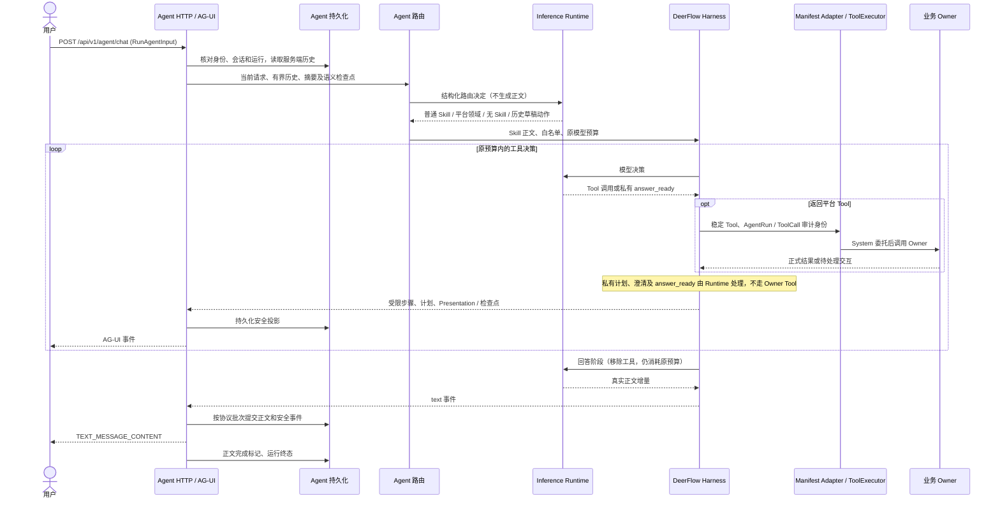
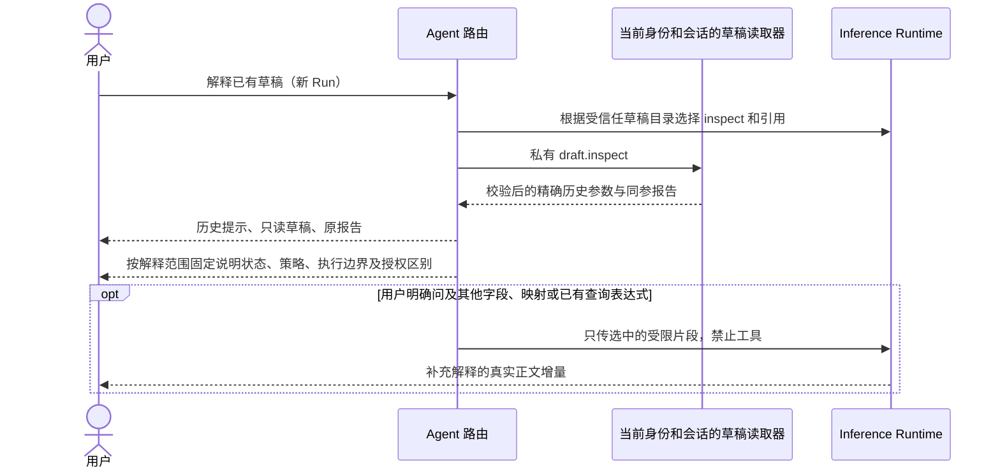

# Agent 请求时序与上下文边界

本文说明当前实现，不另设架构契约。设计以[模块设计共识](agent模块设计共识.md)、[交互协议规范](../../docs/spec/addp智能体交互协议规范.md)为准。

## 普通 Skill 请求

平台语义领域在进入 Harness 前增加 `platform.capabilities.list` 和目录选择；目录失败不得回退旧路由。没有 Skill 时直接进入禁止工具的回答阶段。澄清或 Owner 审批暂停后，从 ADDP 语义检查点恢复同一 AgentRun，不恢复框架消息快照；审批权始终属于业务 Owner。

## 历史草稿说明

该路径不重新预检、不读取当前资源，不把历史报告变成当前批准或可运行结论。候选生成、修改、创建与运行仍走各自的正式路径。

解释范围由同一次内部路由声明，纯关键主题不调用正文模型；不再把完整原请求和完整快照交给自由解释。引用解析仍按原模型选择／服务端核验路径，不自动选首项。固定文字与模型增量分别计量；同一回复取消后仍保留已显示内容，并按原协议标记未完成。

## 上下文、取消与耗时

- 历史由后端读取，先按最近 20 条、单条 6000 字符、合计 24000 字符构建上下文，历史摘要上限 2000 字符；Skill 背景再组合摘要与近期对话，不意味着模型拥有完整历史或长期记忆。
- Harness 不启用框架持久记忆或子代理，`checkpointer=None`；会话摘要和语义检查点由 ADDP 持有。
- 取消只停止 Agent Runtime 与待处理交互，不取消 Owner execution。失败或取消保留已提交的部分正文，标为未完成，并排除出后续模型上下文与摘要。
- 客户端断连由当前请求收敛生成和持久状态；安全事件可按 sequence 回放，回放不重新执行工具。归档不停止已经接纳的运行。
- 路由、平台目录选择、工具决策和回答阶段都可能消耗模型调用。不可再用固定的“工具数加常数”推断总调用数，也不承诺增量正文降低总耗时。

## 验证

确定性回归使用 `make test-agent-eval`，界面使用 `make test-agent-frontend`。真实模型回归、受控工具事实与真实页面验收的证据边界见[评测规范](../../docs/spec/addp智能体评测规范.md)，三者不能相互替代。
