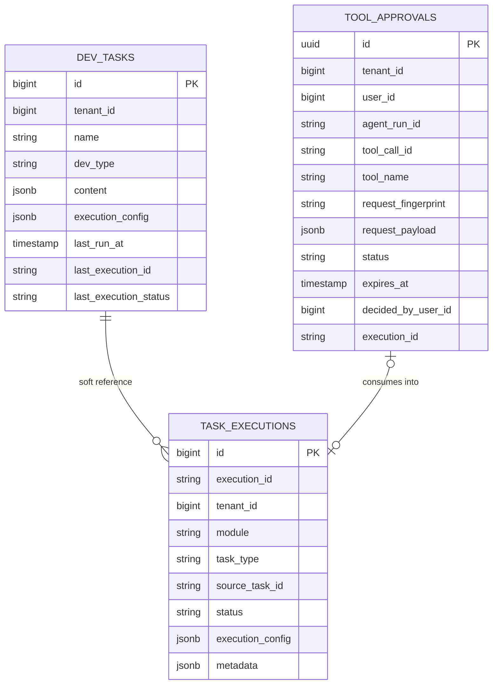

# Develop 模块数据库架构

[返回模块数据库入口](../../CLAUDE.md#数据库文档) · [任务表字段与 API](tables/dev_tasks表.md) · [验证与历史证据](../../CLAUDE.md#开发与验证)

阅读导航：[任务与执行主表](#表清单)、[支撑持久化](#支撑持久化)、[任务关系](#关系)、[初始化与验证](#初始化与验证边界)。

Develop 模块负责 SQL 查询、算子工作流和脚本开发任务。当前任务定义保存在 `develop.dev_tasks`，委托 Tool 审批保存在 `develop.tool_approvals`，执行记录统一写入 `common.task_executions`。Notebook 是 `script` 任务的当前实现形态，通过 `content.notebook_path` 标识。

## 表清单

下表列任务、审批与统一执行主表，运行策略等存储见[支撑持久化](#支撑持久化)。

| 表名 | Owner | 用途 |
| --- | --- | --- |
| `develop.dev_tasks` | Develop | 开发任务定义，支持 `query` / `workflow` / `script` |
| `develop.tool_approvals` | Develop | `workflow.run` 委托审批、原请求和一次性消费事实 |
| `common.task_executions` | Common | Develop 每次执行的统一 execution 记录，`module=develop` |

## 支撑持久化

这些表由 Develop 持有，复用 Common 存储实现的表仍保存在本 Owner schema；表名与初始化声明不等于实库结构已验收。

| 存储 | 职责与正文入口 |
| --- | --- |
| `develop.execution_policy` | 平台执行策略和租户默认超时覆盖，字段、权限、生效方式由[执行策略规范](../../../docs/spec/configuration/执行与模块策略.md#develop-执行策略)维护；[模型](../../backend/internal/models/execution_policy.go)声明独立 `version`。 |
| `develop.export_sessions` | 短期导出会话、Transfer execution 关联与 infra 暂存产物控制信息；复用 [Common Session](../../../common/exportartifact/exportartifact.go)，操作与保护规则见[全量导出](../../CLAUDE.md#查询全量导出)、[交付复核](../../CLAUDE.md#角色选择与独立导出)。 |
| `develop.catalog_resource_changes` | Owner 目录变化流；[模型](../../backend/internal/models/catalog_resource.go)中的 snapshot 仅是最小观察事实，动态详情与授权沿[企业 Catalog 边界](../../CLAUDE.md#企业-catalog-发布边界)。 |
| `develop.data_migrations` | Owner 数据迁移台账，供[目录回填](../../backend/internal/repository/database.go)及[查询历史迁移](../../backend/internal/repository/query_result_migration.go)去重；不保存任务定义修订。 |
| `develop.cleanup_results` | Owner 专业清理结果，复用 [Common Cleanup 存储](../../../common/cleanup/result.go)；读取沿[Cleanup 规范](../../../docs/spec/addp-cleanup体系规范.md#九监控与审计)及现有 Owner 权限，不由 System 跨读私表。 |
| Develop schema 内的 `protection_projection_entries`、`protection_projection_checkpoints`、`protection_projection_store_migrations` | 保护投影、同步游标与存储迁移账本；由 [Common Projection Store](../../../common/dataprotection/projectionstore/schema.go)管理，同步与实际查询判断沿[查询保护契约](../../CLAUDE.md#读取计划与保护范围)。 |

导出共享模型的 `SourceRef` 持久列名为 `source_item_locator`，Develop 实际保存的是来源查询 execution UUID；`transfer_execution_id` 则指向独立 Transfer execution。会话、完整执行结果和业务 DataItem 各自承担不同事实，字段名或会话存在不能替代[本人专业结果读取](../../CLAUDE.md#专业执行结果读取)与交付前复核。

策略 `version`、`data_migrations.version`、保护存储迁移版本和投影同步 cursor 各有归属；它们不能替代任务定义所缺少的[服务端并发版本](tables/dev_tasks表.md#正式并发要求与当前缺口)，也不授予资源访问权。

## 关系

关系说明：

- `common.task_executions.module = 'develop'`。
- `common.task_executions.task_type = dev_tasks.dev_type`。
- `common.task_executions.source_task_id` 以字符串软引用 `develop.dev_tasks.id`。
- 临时执行不创建 `dev_tasks`，`source_task_id` 为空，执行配置快照写入 `execution_config`；普通查询和 DuckDB 联邦查询都使用真实 `execution_config.engine_id`，请求体不得再使用顶层 `engine_id`。
- 委托 `workflow.run` 首次调用只创建 `tool_approvals`；批准后的恢复调用使用 `approval_id + request_fingerprint` 原子消费审批并创建 execution。
- 完整 workflow 审批请求只保存在 Develop，Agent 只保存 owner Interaction 投影。

字段边界：

内部 `dev_type` 与对外 `task_type` 一一映射，外部模块不直接依赖私有表字段；类型及内容归属统一见[任务表映射](tables/dev_tasks表.md#三devtype-与-taskprovider-task_type-边界)。

## 任务定义与执行快照

`develop.dev_tasks` 保存当前定义，`common.task_executions` 保存各次执行的冻结输入和运行事实；`source_task_id` 的软引用不能用来回查当前定义还原历史执行。字段归属、当前任务无 `version` 的规范缺口，以及重绑局部时间戳 CAS 的范围，统一见[任务表说明](tables/dev_tasks表.md#25-定义覆盖执行快照与并发缺口)。执行快照不代替历史修订管理或当前授权裁决。

## TaskProvider

任务级动态输入／输出契约、参数覆盖和服务身份见[模块 TaskProvider 边界](../../CLAUDE.md#taskprovider-边界)。本节列出服务间路由；用户 CRUD 与执行入口见[任务表 API](tables/dev_tasks表.md#四api-端点说明)。

标准入口：

| API | 说明 |
| --- | --- |
| `GET /api/v1/develop/task-provider/tasks?task_type=` | 服务间列出可编排任务 |
| `GET /api/v1/develop/task-provider/tasks/{task_type}/{id}` | 服务间获取任务详情 |
| `POST /api/v1/develop/task-provider/tasks/{task_type}/{id}/execute` | 通过 TaskProvider 执行任务 |
| `GET /api/v1/develop/task-provider/executions/{execution_id}` | 服务间查询 execution |

以上 TaskProvider 路由只接受 `addp-orchestrator` Tenant Service Access Token，并校验 TaskProvider 专用 Permission；Tenant 只来自 canonical AuthContext。用户查看执行详情仍使用 canonical User Bearer AuthContext 调用 `/api/v1/develop/executions/{execution_id}`。

## 算子工作流边界

算子工作流是 Develop 内部的细粒度 DAG。它进入 Orchestrator 前必须先保存为 `dev_tasks.dev_type=workflow` 的任务定义。Orchestrator 只引用 `provider=develop, task_type=workflow, task_id=...`，不直接编排算子节点。

## 调度边界

Develop 当前没有 owner scheduler / `next_run_at` due claim 闭环，因此不保存、不暴露 `schedule`、`enabled`、`next_run_at`，并且在 TaskProvider capabilities 中声明 `supports_schedule=false`。

## 初始化与验证边界

[InitDatabase](../../backend/internal/repository/database.go)先核对 Common schema 版本，再准备导出会话存储、迁移旧执行策略、AutoMigrate 领域模型，随后执行内容归一化、目录与查询历史数据迁移、Cleanup 结果存储初始化。[Backend 启动入口](../../backend/cmd/server/main.go)另调用 `projectionstore.Migrate` 准备本地保护存储；不能把所有表都归为一次 AutoMigrate。

上述阶段并非一个总事务。初始化失败会阻断后续启动，前面阶段已经提交的变更可能保留；旧 `query_policy` 与 `execution_policy` 同时存在时，策略迁移明确失败，不自动合并。Common 执行 schema、Owner 数据迁移台账和保护存储账本分别核对，不能凭某一账本记录或连接成功认定全部初始化完成。

标准入口、策略 PostgreSQL 专项及固定版本证据沿[Develop 验证索引](../../../docs/spec/configuration/执行与模块策略.md#develop-验证入口与证据边界)与[模块历史证据](../../CLAUDE.md#开发与验证)。源码声明、迁移门禁、当前用户权限、完整导出及清理、公开 HTTPS 分别验收；未执行的真实链路不计为通过。
