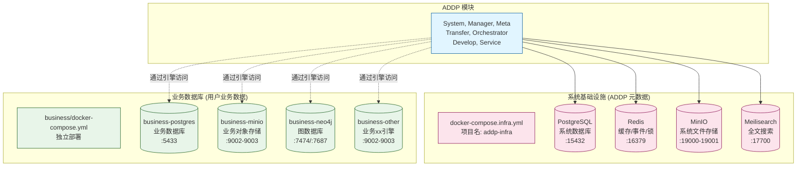
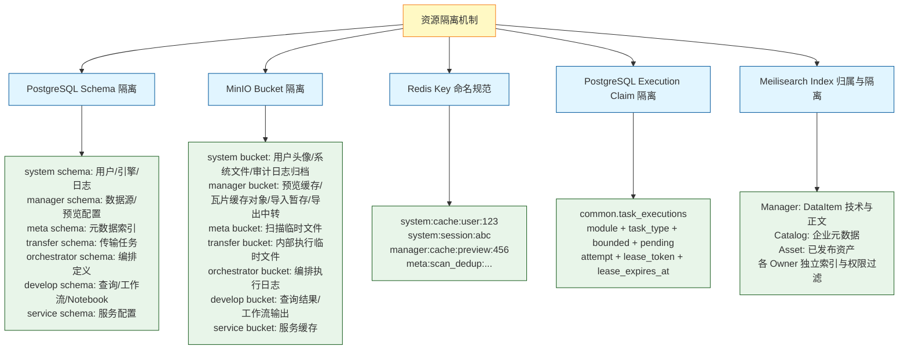

# ADDP 基础设施隔离图

本文档展示 ADDP 平台的基础设施架构,包括系统基础设施与业务数据库的隔离,以及各类资源的隔离机制。

---

## 目录

1. [基础设施架构概述](#基础设施架构概述)
2. [系统基础设施 vs 业务数据库](#系统基础设施-vs-业务数据库)
3. [资源隔离机制](#资源隔离机制)

---

## 基础设施架构概述

ADDP 采用**系统与业务数据分离**架构设计,确保平台元数据与用户业务数据隔离。

---

## 系统基础设施 vs 业务数据库

### 系统基础设施 (docker-compose.infra.yml)

**存储 ADDP 系统元数据**,包括:

**PostgreSQL** (端口 15432):
- 用户信息 (`system.users`)
- 引擎配置 (`system.engines`)
- 元数据存储 (`meta.meta_node`, `meta.meta_item`)
- 任务定义 (`orchestrator.orchestrations`)
- 服务配置 (`service.services`)
- Schema 隔离: `system`, `manager`, `meta`, `transfer`, `orchestrator`, `develop`, `service`

**Redis** (端口 16379):
- 用户会话缓存
- 引擎配置缓存
- 元数据缓存
- 事件发布、缓存和扫描范围锁；不承担 bounded execution 队列
- Key 命名规范: `{module}:{middleware}:{function}:{id}`

**MinIO** (端口 19000-19001):
- 用户头像、审计日志归档 (`system` bucket)
- 预览缓存、导入暂存、导出中转产物 (`manager` bucket)
- 瓦片缓存对象 (`manager` bucket,通过 Manager API 和 `storage_ref` 访问)
- 临时文件
- Bucket 隔离: `system`, `manager`, `meta`, `transfer`, `orchestrator`, `develop`, `service`

**Meilisearch** (端口 17700):
- Manager、Catalog、Asset 分别拥有 DataItem 内容、企业元数据和已发布资产的独立搜索索引；索引语义和权限过滤由各 Owner 负责。
- Meta 通过 Manager 的正式接口提交技术与正文快照，不直接读写该索引；Infra 只检查服务可用性，不预建共享业务索引。

### 业务数据库 (business/docker-compose.yml, 独立部署)

**存储用户通过 ADDP 管理的实际业务数据**:

**business-postgres** (端口 5433):
- 用户上传的 PostgreSQL 数据
- 由用户手动注册为引擎
- ADDP 通过引擎插件访问

**business-minio** (端口 9002-9003):
- 用户上传的业务文件 (Shapefile、GeoJSON、图片、视频)
- 由用户手动注册为引擎
- ADDP 通过引擎插件访问

**business-neo4j** (端口 7474/7687):
- 图结构业务数据（知识图谱、关系网络）
- Neo4j Community Edition，支持 Cypher 查询语言
- Browser UI：http://localhost:7474，Bolt 协议：bolt://localhost:7687
- 由用户手动注册为引擎
- ADDP 通过引擎插件访问

---

## 资源隔离机制

ADDP 采用**模块化资源隔离**策略,确保模块资源独立管理:

### 隔离机制详情

**1. PostgreSQL Schema 隔离**:
- 按模块隔离: `system`、`manager`、`meta`、`transfer`、`orchestrator`、`develop`、`service`
- 避免表名冲突,权限独立管理
- 租户隔离: 所有业务表包含 `tenant_id` 字段

**2. MinIO Bucket 隔离**:
- 按模块隔离: `system`、`manager`、`meta`、`transfer`、`orchestrator`、`develop`、`service`
- 避免文件冲突,配额独立管理
- `manager` bucket 保存预览缓存、瓦片缓存对象、Manager 导入暂存和导出中转产物，前端通过 Manager API 访问，不直接依赖公开 bucket 路径
- 其他 bucket 均为私有访问

### ADDP infra locator

`addp-infra://` 是 ADDP 后端内部使用的基础设施资源定位符，用于 Manager、Transfer 等模块在服务间契约中定位系统基础设施资源。它不是业务 ResourceLocator，不进入用户资源树，不进入 System engines，也不写入 Meta item。

通用形式：

平台对象引用采用 `addp-infra://object/{area}/{key...}?type=object|prefix`，区域在进程启动时绑定具体实现。`manager` 区域默认映射 `manager` 桶，供 Manager 导入及 Manager／Develop 导出使用。区域引用与实际桶名独立；部署例外本批仅支持 `standard`。

对象存储凭据由部署提供；内部对象不登记为业务 Engine。上传与导出访问分别由来源 Owner 核验租户、用户、任务／执行、摘要及当前资格。Transfer 负责执行读写，暂存生命周期由对应 Owner 与 Common 共享导出服务维护。正式路径与既有数据升级规则见[Infra 路径规范](../spec/addp存储引擎路径体系规范.md#addp-infra-locator-与业务-resourcelocator-的边界)。

**3. Redis Key 命名规范**:
- 格式: `{module}:{middleware}:{function}:{id}`
- 示例: `system:cache:user:123`、`meta:scan_dedup:...`
- 便于按模块管理和清理

**4. PostgreSQL bounded execution claim 隔离**:
- Worker 固定按 `module + task_type + execution_boundary=bounded + status=pending` 领取。
- 运行所有权由 `attempt + lease_token + lease_expires_at` 标识，不使用 Redis key 表达 execution owner。
- owner scheduler 只创建 durable pending execution；Worker 不可用时 execution 保留排队事实。

**5. Meilisearch 索引归属与隔离**:
- 搜索能力可以共用 Meilisearch 服务，Manager、Catalog、Asset 的索引、文档语义和权限过滤必须独立；不按开发/生产环境切换共享文档模型。
- 技术与正文内容由 Manager 维护，企业元数据由 Catalog 维护，已发布资产由 Asset 维护；Meta 的技术资源树搜索保留自身事实边界。
- 索引命名和设置以 Owner 定义为准，不再规定统一冒号前缀。职责见[企业资源目录的搜索能力](addp企业资源目录体系图.md#六目录视图与搜索)，当前默认索引与 Infra 入口见[存储与缓存初始化](../../scripts/infra/docs/存储与缓存初始化.md#meilisearch-index-命名规范)。

---

## 相关文档

- [返回核心概念关系图](addp核心概念关系图.md)
- [ADDP 配置介绍](../spec/addp配置介绍.md)
- [ADDP 端口分配](../spec/addp端口分配.md)

---

**文档版本**: v1.0
**创建日期**: 2026-02-16
**作者**: ADDP 开发团队
