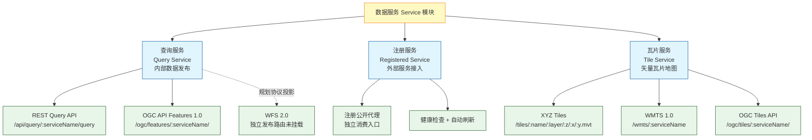
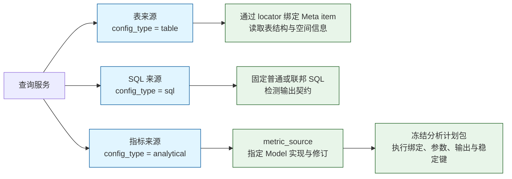
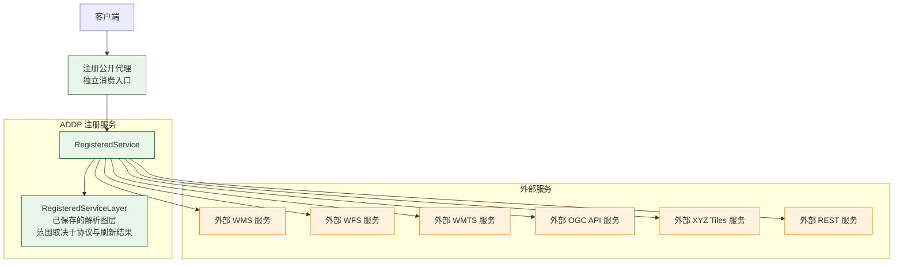
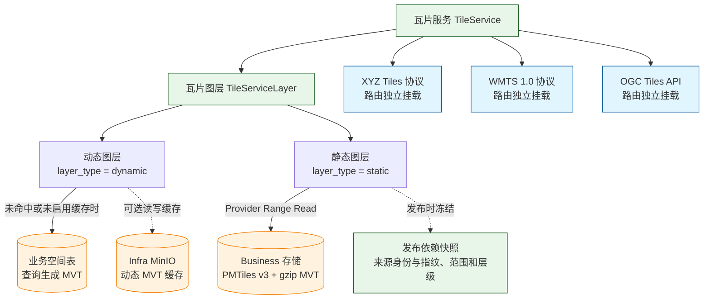

# ADDP 数据服务体系图

本文档展示 ADDP 平台的数据服务体系，包括内部查询服务发布、外部服务注册和矢量瓦片服务三大系统。

---

## 目录

1. [数据服务概述](#数据服务概述)
2. [查询服务](#查询服务)
3. [注册服务](#注册服务)
4. [瓦片服务](#瓦片服务)
5. [服务目录](#服务目录)
6. [权限控制](#权限控制)

---

## 数据服务概述

ADDP 的数据服务体系由三个相互独立的服务系统组成：



### 三大服务系统对比

| 服务系统 | 数据库表 | 定位 | 支持协议 |
|----------|----------|------|----------|
| **查询服务** | `service.query_services` | 将表、SQL 或已发布指标实现修订发布为标准服务 | REST Query、OGC API Features 1.0；WFS 2.0 为规划能力 |
| **注册服务** | `service.registered_services` | 注册管理外部第三方 OGC 服务，提供统一代理 | 代理 WMS/WFS/WMTS/OGC API/XYZ/REST |
| **瓦片服务** | `service.tile_services` | 发布高性能矢量瓦片地图服务 | XYZ Tiles、WMTS 1.0、OGC Tiles API |

---

## 查询服务

查询服务将表、固定普通或联邦 SQL、已发布指标实现修订发布为稳定、受治理的数据 API。来源类型和执行绑定共同确定发布契约；当前 REST Query 与 OGC API Features 是同一个不可变发布版本的协议投影，共用结构化查询内核，不各自构造 SQL。WFS 接入须沿用该内核，这是规范要求，不表示当前已挂载独立发布路由。

`published service` 是规范定义的已发布服务血缘主体，以 `service_id + published_revision` 标识；来源关系为 `data item --serve--> published service`，主体与关系约定见[血缘规范](../spec/addp数据血缘能力规范.md#21-血缘主体)。该约定不表示所有查询来源和页面均已接通血缘。

当前发布器仅同步具有 `source.item_id` 和依赖摘要的查询快照，正常覆盖表来源；SQL、联邦 SQL 与 analytical 的执行依赖不能直接视为已同步的 `serve` 边。身份取值、投递范围与页面限制统一见[Service 发布血缘同步边界](../../service/docs/architecture/查询发布与执行.md#发布血缘同步边界)。来源不完整时不得凭摘要补造血缘；须分别验收 Service 投递、Meta 关系投影及实际页面查询，配置保存、重放运行或空图均不证明血缘完整。

### 配置模式

查询服务以 `config_type` 显式选择三种互斥来源；来源类型与执行绑定分别表达，不能从 SQL 内容或空 Engine ID 猜测执行方式。



关系表和普通 SQL 使用 `engine_id`；联邦 SQL 只使用 `runtime_engine_id`；Parquet 对象表同时保存 Source `engine_id` 与 DuckDB `runtime_engine_id`。来源字段与快照统一见[查询来源契约](../../service/docs/tables/query_services表.md#来源与发布快照)及[执行绑定与依赖快照](../../service/docs/architecture/查询发布与执行.md#执行绑定与依赖快照)。

`analytical` 通过 `metric_source.implementation_id/revision_id` 绑定确定的 Model 已发布修订，不自动选择最新版。Service 复核并冻结受信任计划包，执行绑定、参数、输出与稳定键由包投影；发布请求不得同时提交表/SQL 来源、顶层 Engine 或 Runtime、参数定义或输出覆盖，也不接受客户端直接提交 Plan。指标来源复用现有 PreparedQuery 授权与执行边界；来源选择、显式重绑和版本规则统一见[指标来源与版本](../../service/docs/architecture/指标来源与版本.md)。

创建成功、服务 `active` 或生成查询预览均不证明指标已可执行。实际查询仍须复核确定修订及依赖、引擎能力、请求契约、授权与数据保护；[执行查询预览](../../service/docs/architecture/指标来源与版本.md#执行查询预览)不调用 PrepareQuery 或 Execute。按[标准入口与证据](../../service/docs/testing/验收方法与排查.md#标准入口与证据)区分发布持久化、真实数据执行与跨模块链路验收，未运行项不计为通过。

### 查询服务依赖快照

`data_config.source_snapshot` 冻结来源身份、执行依赖及输出契约，不复制完整 Meta attributes 或业务数据。各来源的冻结内容不同：

- **表来源**：以同 Tenant 的 locator / Meta item 及 fingerprint 确定身份，投影表结构、空间信息和对象表执行描述符。
- **SQL 来源**：冻结 SQL hash 与检测得到的输出契约；联邦 SQL 还冻结实际引用的 Source Engine ID 和对象表物理映射，执行时从 System 获取当前连接，不按名称重新绑定或请求 Meta 重新解析对象表。
- **指标来源**：冻结确定的 Model 实现修订、依赖摘要及唯一 `AnalyticalPlanPackage`。执行绑定、参数、输出和稳定键从包只读投影，不另存可编辑契约或 SQL 副本；来源互斥约束见上节。

字段、标准 `TableInfo / SpatialInfo` 复用及表/SQL 的 hash 取值边界统一见[来源与发布快照](../../service/docs/tables/query_services表.md#来源与发布快照)和[执行绑定与依赖快照](../../service/docs/architecture/查询发布与执行.md#执行绑定与依赖快照)。表/SQL 的结构依赖摘要排除行数、大小、时间、空间范围和索引状态；指标来源的摘要同时纳入冻结的指标引用与计划包，不能套用仅含表结构或 SQL hash 的解释。

表/SQL 查询使用已发布契约，源事实变化须显式检查、刷新或重新发布；不在每次查询时重新读取 Meta 来改写快照。`analytical` 每次查询仍向 Model 复核绑定的精确修订及依赖，并校验当前引擎能力与编译器身份；撤回、漂移或不匹配即拒绝，不自动选择最新版或替换冻结包。指标来源更新沿[显式重绑与消费绑定](../../service/docs/architecture/指标来源与版本.md#版本并发与消费绑定)，不能用普通表快照刷新代替。

依赖摘要不是具体血缘边或读取授权；血缘必须来自已解析来源与发布事实，来源不完整时不得凭 hash 补造。静态瓦片的来源与快照另见[瓦片架构](#瓦片服务架构)：原始数据 `derive` 到 PMTiles item，再由该 item `serve` 到服务，临时缓存路径不能充当源数据。

快照保存、摘要一致或编译预览成功不证明真实数据可读。按[标准入口与证据](../../service/docs/testing/验收方法与排查.md#标准入口与证据)分别验证来源冻结与持久化、修订撤回/依赖漂移拒绝、实际执行及授权保护；模拟依赖的测试不代替跨模块发布和消费链路，未运行项单列为未验证。

### 查询服务发布契约

发布契约冻结来源与执行绑定、输出字段及空间信息、命名参数、非空唯一稳定键（可复合）、字段策略和依赖事实，并明确协议格式与资源限制。表/SQL 的检测与快照、analytical 的计划包投影统一见[查询发布与执行](../../service/docs/architecture/查询发布与执行.md#三种来源)。

| 标识 | 来源与用途 | 使用边界 |
| --- | --- | --- |
| `version` | QueryService 持久化的正整数管理并发版本；创建为 1，成功更新时递增。 | 编辑、启停、删除、快照刷新及指标重绑须携带当前值；陈旧值返回 409，不能覆盖新修改。它不是消费契约版本或 Model 修订号。 |
| `service_version` | 当前由依赖摘要、稳定键与命名参数声明计算，供查询响应、游标和 Consumer Descriptor 使用。 | 缺少依赖快照、依赖摘要或稳定键时为空；不随每次管理编辑必然变化，也不代表所有可消费字段的完整指纹。 |
| `dependency_hash` | 冻结来源及执行依赖的摘要，各来源的内容见上节。 | 用于依赖比较，并参与 `service_version` 计算；不能作为管理并发版本、具体血缘边或授权凭据。 |

Consumer Descriptor 的 `contract_fingerprint` 另按公开操作、输入与输出契约计算，与 `service_version` 分开使用。管理并发、指标显式重绑及应用消费绑定统一见[版本、并发与消费绑定](../../service/docs/architecture/指标来源与版本.md#版本并发与消费绑定)。执行语义变化须通过对应管理动作显式更新；指标不自动切换最新版，消费契约变化后应用须重新绑定并发布新修订，不能以版本递增代替该步骤。

消费者只提交结构化请求，不提交 SQL、WHERE、ORDER BY 或引擎原生表达式。排序不足以形成全序时追加稳定键；缺少稳定键不得执行分页查询或启用 OGC API Features。查询使用 cursor/keyset、读取 `limit + 1` 行且默认不做精确计数；不透明游标校验 `service_version`、查询指纹、有效排序及末行排序值，不能拿管理 `version` 或列表 `page/page_size` 替代。具体请求与响应统一见[REST Query 验证](../../service/docs/testing/查询与要素协议.md#rest-query)。

按[标准入口与证据](../../service/docs/testing/验收方法与排查.md#标准入口与证据)分别核对陈旧管理版本无副作用拒绝、契约更新后的游标与应用绑定、依赖复核、实际数据执行及授权保护。契约保存、版本回读、摘要一致或预览成功均不代表真实消费已通过，未运行项单列为未验证。

### 支持的协议

| 协议 | 当前入口 | 能力范围 | 实现与验收边界 |
|------|------|----------|------|
| **REST Query API** | `POST /api/query/:serviceName/query` | 结构化过滤、稳定排序、游标分页、字段选择 | 已挂载；字段、参数、分页与授权按发布契约验证。 |
| **OGC API Features 1.0** | `GET /ogc/features/:serviceName` 及子资源 | Landing Page、Conformance、Collections、Items | 已挂载；空间输出资格、协议配置和客户端互通另验。 |
| **WFS 2.0** | 未挂载独立发布路由 | 规划的 GetCapabilities、GetFeature、DescribeFeatureType | 保留复用查询内核的规范要求，不能据协议配置宣称已发布。 |
| WMS 1.3 | 未挂载查询服务发布路由 | 规划的 GetCapabilities、GetMap、GetFeatureInfo | 待确认的规划范围，与第三方 WMS 注册代理分开。 |

当前协议能力与执行约束统一见[协议支持](../../service/docs/architecture/查询发布与执行.md#协议支持)及[统一执行契约](../../service/docs/architecture/查询发布与执行.md#统一执行契约)；WMS 等后续范围沿[能力清单](../../service/docs/service后续能力清单.md#待确认范围)维护，不在本图承诺实现或排期。

按[查询与要素测试](../../service/docs/testing/查询与要素协议.md)分别验证发布契约、请求/响应、身份与来源保护，以及实际客户端和公开入口。路由存在、配置保存或单次 HTTP 200 不代表完整协议与真实链路已验收；WFS 按专题中的边界保留为未实现的发布入口，不将第三方 WFS/WMS 注册代理成功计为平台发布能力，未运行项单列为未验证。

### REST Query API 请求

```json
{
  "select": ["id", "name", "updated_at"],
  "filter": {
    "field": "status",
    "op": "eq",
    "value": "active"
  },
  "order_by": [
    {"field": "updated_at", "direction": "desc"}
  ],
  "page": {"limit": 100, "cursor": ""},
  "format": "json"
}
```

过滤节点只允许发布策略声明的字段和类型化操作符；逻辑组合使用 `and/or/not` 结构，不接受字符串表达式。响应分页只返回 `limit/has_more/next_cursor`，默认不返回总数。

### OGC API Features 端点

当前 Service 与 Gateway 挂载 Landing Page、Conformance、Collections、要素列表和单要素路由，未挂载独立 collection 详情路由。完整路径、请求示例和参数限制统一见[OGC API Features 测试专题](../../service/docs/testing/查询与要素协议.md#ogc-api-features)。

一个 QueryService 对应一个 collection，ID 为 `service_name`；消费前读取集合列表返回的 ID、items 链接及已声明的范围/CRS，不猜测集合名、几何字段或坐标系。分页沿响应的 next 链接或不透明 cursor，单要素使用响应中的 Feature ID；地址来源、代理转发及返回链接的真实可达性统一见[元数据链接与公开入口核对](../../service/docs/testing/查询与要素协议.md#元数据链接与公开入口核对)。

集合发现或 conformance 声明成功不证明要素读取、空间筛选、分页、身份权限及 GIS 客户端互通均已通过。按上述专题和[客户端互通](../../service/docs/testing/验收方法与排查.md#客户端互通)分别留证；未接通的参数或请求级 CRS 转换不能以 HTTP 200 判为生效，未运行项单列为未验证。

### 查询服务管理 API

查询服务定义的管理前缀为 `/api/v1/service/query`；CRUD、源快照差异检查、显式刷新和 SQL 输出契约检测统一见[Service 核心 API](../../service/CLAUDE.md#核心-api)与[查询表契约](../../service/docs/tables/query_services表.md#当前入口)。本图保留查询来源、发布快照与执行边界，不另维护一份方法和路径清单。

---

## 注册服务

注册服务用于将**外部第三方 OGC 服务**纳入 ADDP 统一管理，提供代理访问、元数据解析、健康监控等能力。

### 注册服务架构



创建先保存注册记录；仅在 OGC 类型且显式开启 `auto_refresh_metadata` 时，创建后才异步刷新，创建响应不等待图层完成。异步失败只记日志，不自动回写 error 或回滚注册记录；手动、定时刷新另有状态处理，统一见[注册与元数据刷新](../../service/docs/数据库架构.md#注册与元数据刷新)。

WMS / WFS / WMTS 读取 GetCapabilities 并将有限解析结果写入图层表；OGC API 读取 collections 后仅保存父服务 metadata，不生成图层行；REST / XYZ 不由当前 OGC 刷新流程生成图层。各协议的覆盖、更新/新增、旧行保留及 XML 解析限制统一见[图层解析与刷新](../../service/docs/tables/registered_service_layers表.md#解析与刷新)。

解析、图层持久化与地图消费分别验收：刷新不是原子快照，可能留下空集、部分写入或旧图层；HTTP 200、active、刷新时间和解析数量均不证明图层完整或地图可用。受控上游与真实链路分别按[元数据刷新核对](../../service/docs/testing/注册服务与代理.md#元数据刷新核对)及[注册图层能力核对](../../service/docs/testing/注册服务与代理.md#注册图层能力核对)留证，未运行或失败项不计为通过。

### 支持注册的服务类型

| service_type | 说明 |
|---|---|
| `wms` | Web Map Service（地图图片服务） |
| `wfs` | Web Feature Service（矢量要素服务） |
| `wmts` | Web Map Tile Service（瓦片地图服务） |
| `ogc_api` | OGC API Features（现代 OGC 标准） |
| `xyz` | XYZ Tiles（Slippy Map 瓦片） |
| `rest` | RESTful API 服务 |

### 认证配置

| auth_type | 说明 |
|---|---|
| `none` | 不额外装配上游认证；不表示平台消费入口允许匿名访问。 |
| `basic` | HTTP Basic Auth |
| `bearer` | Bearer Token |
| `api_key` | API Key（Header 或 Query 参数） |

`auth_type/auth_config` 用于 Service 向上游装配凭据，不授予平台调用者消费权。参数、缺失配置与更新语义统一见[上游认证配置](../../service/docs/数据库架构.md#上游认证配置)；Basic 的 Base64 编码不属于加密，Bearer 与 API Key 的装配也不代表凭据有效或保护已完成。

### 注册服务管理 API

注册管理使用 `/api/v1/service/registered`，具体方法与 Permission 统一见[注册服务契约](../../service/docs/tables/registered_services表.md#健康管理与消费)。创建、刷新与图层解析边界见上文；上游健康检查和公开代理消费仍须独立验证。

公开代理独立挂载 `ANY /api/service/registered/proxy/:id/*path`，不属于管理 API。当前 Gateway 未转发该路径，Service 直连成功或 DTO 展示代理 URL 不代表统一入口可达；上游凭据装配也不证明平台已校验调用者身份、租户范围或服务停用效果。完整边界见[外部服务入口与请求链路](../../service/docs/外部服务架构设计.md#当前入口与请求链路)及[代理验证](../../service/docs/testing/注册服务与代理.md#代理读取与错误)。

### 自动化任务

健康检查与元数据刷新使用 Service 启动时应用的 `runtime_policy`，持久配置更新按重启生效；调度与默认值统一见[健康检查与定时刷新](../../service/docs/数据库架构.md#健康检查与定时刷新)，本图不另维护固定 cron。

- **定时范围**：仅在模块已注册时执行，按 Tenant 串行处理 `status=active` 的服务；元数据刷新还限定为 WMS、WFS、WMTS、OGC API 类型，不是对所有注册服务执行同一刷新。
- **状态与恢复**：健康检查的检查时间和状态分步回写，回写错误未向调用方返回；创建与元数据刷新也可能写入 active，因此持久状态不是最近健康结果的专用快照。定时循环不处理 error/inactive，不承诺自动重试或恢复；手动健康检查成功可能将 inactive 改为 active，旧错误信息仍可能保留。状态与非原子刷新分别沿上述专题及[注册与刷新流程](../../service/docs/数据库架构.md#注册与元数据刷新)核对。
- **实际验收**：按[健康结果与状态回写](../../service/docs/testing/注册服务与代理.md#健康结果与状态回写核对)和[元数据刷新核对](../../service/docs/testing/注册服务与代理.md#元数据刷新核对)分别验证调度执行、HTTP 结果、详情回读和图层内容；日志成功计数或 HTTP 200 不证明状态全部落库、图层完整或公开代理可用。未执行的真实调度和运行链路单列为未验证。

### 安全边界

- **存储与 DTO**：`auth_config` 当前按 JSONB 保存，未接入字段加解密；管理 DTO 不返回其正文，但仍返回上游 URL。字段隐藏不等于存储已加密或 URL 已脱敏，统一见[上游认证配置](../../service/docs/数据库架构.md#上游认证配置)。
- **网络目标**：当前注册代理路径未接入域名白名单及完整的内网地址、DNS 重绑定和重定向目标限制；已登记端点或请求构造成功不构成 SSRF 防护。实际范围见[管理面与公开代理](../../service/docs/数据库架构.md#管理面与公开代理)。
- **传输与泄露**：凭据在服务端装配不保证 Service 到上游使用 TLS，也不保证 URL、响应 Header/正文或日志已脱敏。传输和过滤边界沿[外部服务专题](../../service/docs/外部服务架构设计.md#认证租户与传输边界)及[代理日志边界](../../service/docs/外部服务架构设计.md#代理日志边界)核对。

按[上游认证矩阵](../../service/docs/testing/注册服务与代理.md#上游认证矩阵)使用合成凭据与受控上游，分别核对凭据装配、配置持久化/DTO、存储保护、实际 TLS、网络目标及泄露范围。上游认证成功仅证明所测类型和路径；未实现、未运行或失败项分别记录，不计为保护验收通过。

---

## 瓦片服务

瓦片服务将业务空间表发布为动态 MVT，或将 Meta 已识别的业务 PMTiles 发布为静态图层。业务归档与平台可选的动态缓存分别维护来源和生命周期。

### 瓦片服务架构



- **静态来源与发布**：通过 ResourceLocator 选择 Business 中由 Meta 识别的 PMTiles item，后端冻结 `source_snapshot` 中的身份、指纹、header hash、范围与层级。来源不接受裸路径、任意 URL 或 Manager infra `storage_ref`，具体契约统一见[静态图层](../../service/docs/tables/tile_service_layers表.md#static)。
- **实际读取与覆盖**：正常源读取通过 System 获取当前 Engine，再经 Provider Range Read、来源保护和 header hash 比对读取归档。快照摘要不是数据副本，也不证明全范围、全层级均有数据；实际 Range Read、MVT 解码和客户端结果按[元数据、快照与覆盖核对](../../service/docs/testing/瓦片协议.md#元数据快照与覆盖核对)分别验收，不以配置保存、字段回读或 HTTP 200 代替。
- **平台动态缓存**：启用时复用或异步写入 Infra MinIO 的动态 MVT 缓存；静态业务 PMTiles 不走该缓存路径，也不引用 Manager 快显缓存。TTL、HIT/MISS 与新鲜度边界统一见[缓存专题](../../service/docs/architecture/瓦片发布与缓存.md#动态缓存与过期边界)，按[缓存读取验证](../../service/docs/testing/瓦片协议.md#空瓦片缓存与访问)核对；未执行的真实读取、覆盖和缓存验证单列为未验证。

### 支持的协议与端点

图中的协议节点表示已挂载的入口，不表示按每个服务的 `protocols.*.enabled` 动态注册或撤销路由。`protocols` 配置保存、Router 挂载和消费时拒绝是不同事实；TMS 配置键也不证明存在对应路由。配置字段与当前能力统一见[服务与协议契约](../../service/docs/tables/tile_services表.md#服务图层与协议)。

现有 public/private Tenant 校验及来源保护不能代替服务状态、协议开关或图层启用检查。当前 XYZ 按 layer_name 查找图层，没有按 enabled 过滤，`enabled=false` 不能视为已阻断读取；三者的统一执行资格沿[管理与消费状态](../../service/docs/architecture/瓦片发布与缓存.md#管理与消费状态)保留为待核对。按[访问验证](../../service/docs/testing/瓦片协议.md#空瓦片缓存与访问)分别记录已保存的配置、请求入口、元数据与实际瓦片结果，不用保存提示、路由存在或单次 HTTP 结果推导禁用已生效；未实现或未运行项不计为通过。

以下是 Service 与 Gateway 已挂载的相对协议路径，不表示根 Nginx 统一入口已接通。根 Nginx 当前未转发这些路径；直连、公开 HTTPS、元数据生成链接与实际验收的区别统一见[Service 入口专题](../../service/docs/architecture/瓦片发布与缓存.md#元数据链接与公开入口)，具体核对沿[公开入口验证](../../service/docs/testing/瓦片协议.md#元数据链接与公开入口核对)。

| 协议 | 服务端入口概览 | 当前实现 |
|------|------|------|
| **XYZ Tiles** | `GET /tiles/:serviceName/:layerName/:z/:x/:y.mvt` | 动态 MVT 或静态业务 PMTiles 中的 MVT；不把 PNG/JPEG 映射当作栅格生成能力。 |
| **WMTS 1.0** | `GET /wmts/:serviceName` | Capabilities XML，实际瓦片由 ResourceURL 指向 XYZ；不表示独立 GetTile KVP 已实现。 |
| **OGC Tiles API** | `GET /ogc/tiles/:serviceName` | 元数据与 MVT 读取；矩阵、范围与客户端兼容须分别核对。 |

### OGC Tiles API 端点

完整端点、参数映射与可运行示例统一见[瓦片协议测试](../../service/docs/testing/瓦片协议.md#ogc-tiles)，矩阵声明、发布快照与实际数据覆盖见[协议边界](../../service/docs/architecture/瓦片发布与缓存.md#协议声明发布快照与数据覆盖)。请求返回成功不代替原始链接可达、瓦片解码与客户端显示验收。

### 瓦片服务管理 API

瓦片定义和图层管理位于 `/api/v1/service/tile`、`/api/v1/service/tile-layers`，方法、字段及 Permission 统一见[服务表契约](../../service/docs/tables/tile_services表.md#管理访问与删除)与[图层契约](../../service/docs/tables/tile_service_layers表.md#排序启用与管理)。管理操作使用服务/图层 ID；公开协议使用 service_name / layer_name，不能互换，也不通过给协议路径添加管理 API 前缀来接通入口。

---

## 服务目录

服务管理浏览、Service 消费目录与企业 Catalog 使用不同投影。管理页面沿[页面与模块协作](../../service/docs/architecture/管理界面与模块协作.md#统一入口与页面)导航；消费目录只返回当前调用者有权执行的只读摘要和 Consumer Descriptor，不返回 SQL、引擎连接或管理 DTO，也不因目录可见就跳过实际执行授权。

目录方法、Permission 与当前支持范围统一见[Service 核心 API](../../service/CLAUDE.md#核心-api)。企业 Catalog 当前仅接入 QueryService 的最小摘要与变化流，不能把查询、图查询、瓦片和第三方注册都写成已具备统一消费契约；不再沿用旧聚合目录路径。

---

## 权限控制

### 管理端（需 User Access Token）

管理 API 使用 `/api/v1/service` 前缀、canonical Bearer Tenant AuthContext 与对应操作的精确 Permission；服务定义、图层和注册管理按当前 Tenant 限定资源，图层还须属于路径指定的服务。具体约束以[Service 核心 API](../../service/CLAUDE.md#核心-api)为准，不能将管理授权套用于独立的公开消费入口。

### 公开端（可选认证）

“公开端”表示独立于管理 API 的消费入口，不代表所有请求都允许匿名访问；各协议的 public/private、主体类型、来源保护及实际拒绝行为分别成立。

| 消费入口 | 契约与验收边界 |
| --- | --- |
| 查询与要素协议 | 具体协议、当前挂载范围及 User / API Consumer 访问规则见[查询发布与执行](../../service/docs/architecture/查询发布与执行.md)，实际请求沿[查询与要素测试](../../service/docs/testing/查询与要素协议.md)验证。 |
| XYZ、WMTS 与 OGC Tiles | 沿[瓦片入口专题](../../service/docs/architecture/瓦片发布与缓存.md#元数据链接与公开入口)区分 Service / Gateway 直连与根 Nginx 统一入口；管理 API 可用不证明协议转发和元数据链接正确。 |
| 注册服务公开代理 | 当前没有复用管理面的 Tenant 与 Permission 保证，消费授权、Gateway 转发与直连条件统一见[外部服务边界](../../service/docs/外部服务架构设计.md#认证租户与传输边界)；不能由上游认证成功推导平台消费授权成立。 |

实际验证从[API 测试指南](../../service/docs/API测试指南.md#公共准备)确认部署、身份、入口和受控资源，再执行对应专题；报告分别记录直连、统一公开入口及客户端结果。路由存在、目录可见、配置保存、健康检查或 HTTP 200 不代替完整业务与 T4 验收；未实现、未运行、失败和跳过项分别说明。

---

## 相关文档

- [返回核心概念关系图](addp核心概念关系图.md)
- [Service 模块详情](../../service/CLAUDE.md)

---

**文档版本**: v2.0
**更新日期**: 2026-02-17
**作者**: ADDP 开发团队
