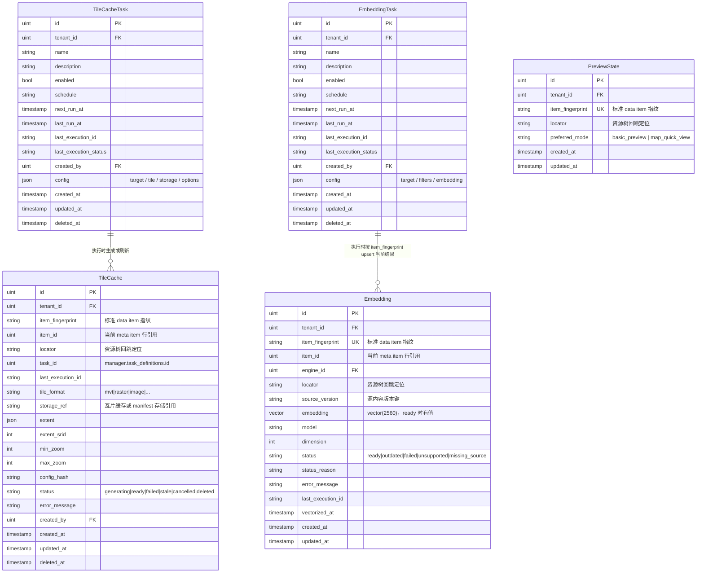

# ADDP Manager元模型

[返回核心对象 ER 图](../addp核心对象ER图（元模型）.md)

预览状态、瓦片缓存与向量化的任务和当前结果；任务定义与结果生命周期分别归属。

## Manager 模块核心对象（schema: manager）

| 中文         | 英文标识符    | 说明                                                              |
| ------------ | ------------- | ----------------------------------------------------------------- |
| 瓦片缓存生成任务 | TileCacheTask | Task 派生，生成瓦片缓存结果，执行时更新 TileCache |
| 向量化任务   | EmbeddingTask | Task 派生，对 data item 范围执行向量化，写入 Embedding artifact state |
| 预览状态 | PreviewState | 数据项预览状态，保存 item 身份、预览模式偏好和 map / scene_3d 交互视角 |
| 瓦片缓存结果 | TileCache | 空间 data item 的瓦片缓存结果状态，记录最小必要结果事实 |
| 向量记录     | Embedding     | 单个 data item 的当前向量化结果状态，以 item_fingerprint 去重     |

**关于 PreviewState**：
- 是预览状态，不是任务，也不是快显或瓦片缓存结果。
- PreviewState 保存用户预览状态；可快显能力、推荐结果和渲染源由能力 API 根据空间元数据、数据格式和各类快显结果动态合成。
- 瓦片缓存生成必须先创建 `TileCacheTask`，再执行；不设计无任务定义的 ad-hoc 瓦片缓存生成。

---

## Manager 模块对象图

**说明**：
- `PreviewState` 是预览状态，不是任务，也不是瓦片缓存结果；它只保存当前 item 的显示偏好和轻量交互视角，`can_use_quick_view`、`can_generate_tile_cache`、`default_tile_cache_id` 等能力字段由能力 API 动态合成。
- `TileCache` 是瓦片缓存结果状态，记录最小必要结果事实，例如存储引用、格式、范围、层级、配置指纹、最近 execution 和状态。
- `TileCacheTask` 执行流程：创建 execution → 按 `config` 生成或刷新 `TileCache` → 回写 `TileCacheTask.last_execution_id` / `last_execution_status`；执行链路不写回 `PreviewState` 能力字段。
- 瓦片缓存生成必须先创建 `TileCacheTask`，再执行；不设计无任务定义的 ad-hoc 瓦片缓存生成。
- `Embedding` 以 `tenant_id + item_fingerprint` 唯一定位当前结果；重复执行按跳过或覆盖策略处理当前 artifact state，源内容是否变化另由 `source_version` 判断。

---
