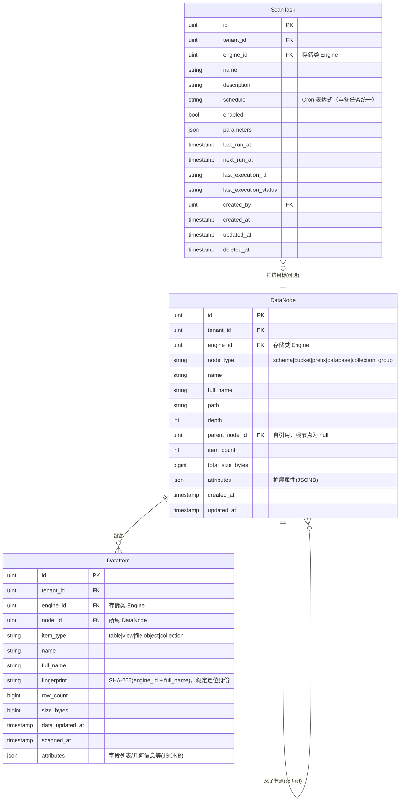

# ADDP Meta元模型

[返回核心对象 ER 图](../addp核心对象ER图（元模型）.md)

资源容器、数据项和扫描任务；稳定数据项指纹与内容版本分开表达。

## Meta 模块核心对象（schema: meta）

| 中文     | 英文标识符 | 说明                                                         |
| -------- | ---------- | ------------------------------------------------------------ |
| 数据节点 | DataNode   | 树形层级中的容器节点（数据库/Schema/Bucket/前缀目录等），属于存储类 Engine |
| 数据项   | DataItem   | 最小数据实体（表/视图/文件/对象/集合），是管理和操作的最小单元，属于存储类 Engine |

- `DataNode` 是容器，可包含多个子 `DataNode` 或多个 `DataItem`（树形结构，parent_node_id 自引用）
- `DataNode` 和 `DataItem` 都属于具有**存储能力**的 `Engine`（RelationalStorage / BranchLeafStorage / ObjectStorage / FileStorage）

---

## Meta 模块对象图

**说明**：
- `DataNode` 通过 `parent_node_id` 自引用形成树形层级：Engine 根 → Schema/Bucket → Table/Prefix → ...
- `DataItem` 是叶子节点，不再有子项，是管理和引用的最小单元
- `ScanTask` 针对一个 Engine 执行，可选指定从某个 `DataNode` 开始扫描（增量扫描）

## 字段与检索边界

- `DataItem.attributes` 以 JSONB 保存字段元数据，不展开为本图中的字段实体；字段元数据检索使用技术元数据搜索投影（Meilisearch），投影只含技术事实。

---
