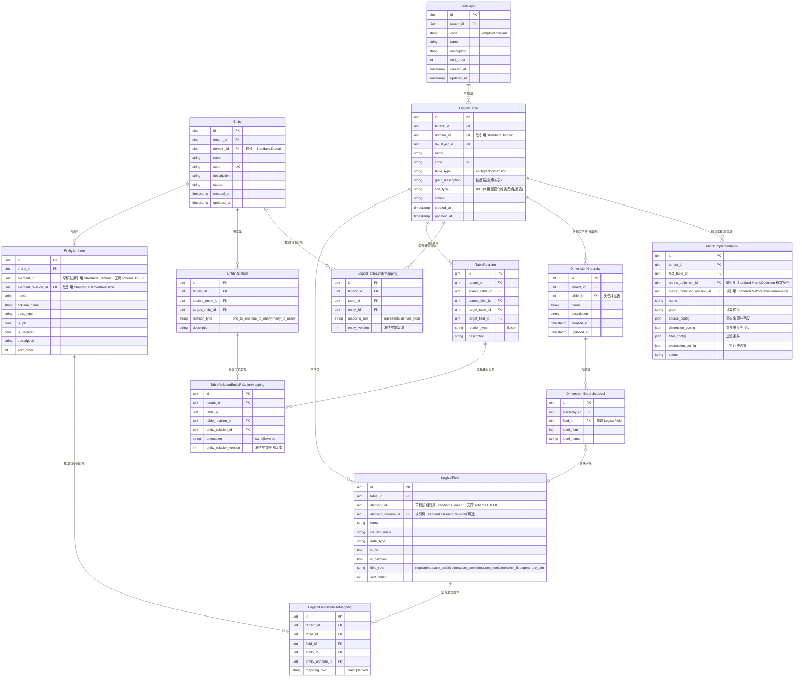

# ADDP Model元模型

[返回核心对象 ER 图](../addp核心对象ER图（元模型）.md)

实体、逻辑表、概念实现映射、维度层级和指标实现，以及 Standard 修订冻结边界。

## Model 模块核心对象（schema: model）

| 中文     | 英文标识符       | 说明                                              |
| -------- | ---------------- | ------------------------------------------------- |
| 逻辑表   | LogicalTable     | 数仓逻辑层的表定义（实体/事实/维度表，ODS/DWD/DWS/ADS 层） |
| 逻辑字段 | LogicalField     | 逻辑表的字段，草稿软引用 Standard.Element，审批冻结确定 ElementRevision           |

---

## Model 模块对象图

## 引用约束与待核对范围

- EntityAttribute 和 LogicalField 在草稿中保存 `element_id`；审批时冻结确定的 `element_revision_id`，正式消费不能动态跟随当前数据元版本，不建立跨 schema 外键。规则以 [Model 概念与数据约束规范](../../../model/docs/model概念与数据约束规范.md) 为准。待核对范围：审批、导入及展示路径是否均按此规则消费冻结修订；本页不提供这些路径的运行验收结论。
- MetricImplementation 同时保存指标稳定定义身份与确定的 `metric_definition_revision_id`，独占粒度、来源、连接、过滤和可执行表达式；不保留 FactMetricMapping。
- Entity 与 LogicalTable 通过表、字段、关系三类概念实现映射建立追溯；事实表和维度表复用唯一逻辑表，不保留 `LogicalTable.entity_id` 或第二套实体逻辑表。
- Model 独占 DimensionHierarchy 与成员；层级序号从 1 开始，成员只引用同一 LogicalTable 字段并共用父版本，LogicalField 不保存 `hierarchy_id + hierarchy_level`。

---
