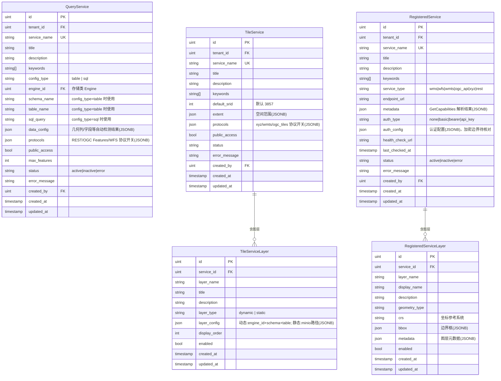

# ADDP Service元模型

[返回核心对象 ER 图](../addp核心对象ER图（元模型）.md)

查询、瓦片和外部注册服务的独立对象及图层关系；未确认的存储演进和认证配置边界保留在本页。

## Service 模块核心对象（schema: service）

Service 模块有三个相互独立的子系统：

| 中文           | 英文标识符         | 数据库表                          | 有子图层 | 说明                                                   |
| -------------- | ------------------ | --------------------------------- | -------- | ------------------------------------------------------ |
| 查询服务       | QueryService       | service.query_services            | 无       | 将内部单张表或 SQL 查询发布为 REST/OGC/WFS 接口        |
| 瓦片服务       | TileService        | service.tile_services             | 有       | 将内部空间数据发布为矢量瓦片（XYZ/WMTS/OGC Tiles）     |
| 瓦片服务图层   | TileServiceLayer   | service.tile_service_layers       | —        | TileService 的子图层，每层对应一个数据源（动态/静态）  |
| 注册服务       | RegisteredService  | service.registered_services       | 有       | 注册和代理第三方外部服务（WMS/WFS/WMTS/XYZ/REST）      |
| 注册服务图层   | RegisteredServiceLayer | service.registered_service_layers | —    | 从外部服务 GetCapabilities 自动解析的图层列表          |

**QueryService 配置模式**：`config_type = 'table'`（指定 schema+table）或 `config_type = 'sql'`（自定义 SQL）
**TileServiceLayer 模式**：`layer_type = 'dynamic'`（实时查询数据库）或 `layer_type = 'static'`（MinIO 预生成瓦片）

---

## Service 模块对象图

**说明**：
- `QueryService` 无子图层，直接对应单张表或一条 SQL，是最简洁的服务形式
- `TileService` 含多个 `TileServiceLayer`，每层可独立选择动态或静态模式
- `RegisteredService` 的图层由 GetCapabilities 自动解析生成，不是用户手工创建的

## 存储边界与待确认事项

- 动态 `TileServiceLayer` 的 `engine_id` 位于 `layer_config` JSONB，未建立数据库外键，由应用层校验；是否调整存储模型仍待确认。
- QueryService、TileService、RegisteredService 没有统一父表，服务目录由 owner 聚合读取；是否需要服务目录视图仍待讨论，本文不新增目录实体。
- `RegisteredService.auth_config` 与业务信息同表。当前服务写入路径直接保存请求配置，JSONB 序列化仅做 JSON 编码，尚未查到字段加密步骤；敏感配置的加密存储与读取边界需要单独核对，不能据本图认定已实现 AES-256-GCM。

---
