# ADDP Standard元模型

[返回核心对象 ER 图](../addp核心对象ER图（元模型）.md)

标准稳定身份、不可变修订、指标语义和文档提炼证据；可执行指标实现与维度层级见[Model 元模型](Model.md)。

## Standard 模块核心对象（schema: standard）

| 中文     | 英文标识符 | 说明                                         |
| -------- | ---------- | -------------------------------------------- |
| 数据元   | Element    | 数据标准的核心原子：语义、类型、约束、码值集 |
| 指标定义 | MetricDefinition | 指标业务含义、统计口径与语义依赖；发布时冻结确定修订，可执行表达式归 Model.MetricImplementation |
| 码值集   | CodeSet    | 枚举型数据的值域（如：性别、状态码）         |
| 码值项   | CodeItem   | CodeSet 中的具体枚举值                       |
| 计量单位 | Unit       | 指标和数据元的度量单位                       |
| 业务术语 | Glossary   | 业务概念的标准化定义词典                     |

---

## Standard 模块对象图

> 稳定身份负责长期引用，不可变修订负责审核、发布、生效和历史追溯。具体字段以 [Standard 模块说明](../../../standard/CLAUDE.md) 为准；码值层级与跨码值集映射仍是待讨论的模型扩展，见本页末尾。

```mermaid
erDiagram
    Domain {
        uint id PK
        uint tenant_id FK
        uint parent_id FK "自引用，根域为 null"
        string name
        string code
        string description
        int sort_order
        timestamp created_at
        timestamp updated_at
    }






    StandardCategory {
        uint id PK
        uint tenant_id FK
        uint parent_id FK "自引用"
        string object_type "element|code_set|metric|document|glossary"
        string code
        string name
        int sort_order
    }

    Element {
        uint id PK
        uint tenant_id FK
        uint owner_domain_id FK "scope_type=domain 时必填"
        uint category_id FK "仅导航"
        string code UK
        string scope_type "platform|tenant_common|domain"
        timestamp created_at
        timestamp updated_at
    }

    ElementRevision {
        uint id PK
        uint element_id FK
        int revision_no
        string status "draft|in_review|published|withdrawn"
        string name
        string definition
        string data_type
        string value_domain_type "unrestricted|range|enumeration"
        json range_config "连续值域结构"
        uint code_set_revision_id FK "枚举值域时必填"
        uint unit_id FK "可选"
        timestamp effective_from
        timestamp effective_to
        timestamp created_at
        timestamp updated_at
    }

    CodeSet {
        uint id PK
        uint tenant_id FK
        uint owner_domain_id FK "scope_type=domain 时必填"
        uint category_id FK "仅导航"
        string code UK
        string scope_type "platform|tenant_common|domain"
        timestamp created_at
        timestamp updated_at
    }

    CodeSetRevision {
        uint id PK
        uint code_set_id FK
        int revision_no
        string status "draft|in_review|published|withdrawn"
        string name
        string definition
        timestamp effective_from
        timestamp effective_to
        timestamp created_at
        timestamp updated_at
    }

    CodeItem {
        uint id PK
        uint code_set_revision_id FK
        string code
        string name
        string description
        int sort_order
    }

    MeasurementCategory {
        uint id PK
        uint tenant_id FK
        string name
        string description
    }

    Unit {
        uint id PK
        uint tenant_id FK
        uint category_id FK
        string name
        string symbol
        bool is_system
        timestamp created_at
        timestamp updated_at
    }

    MetricDefinition {
        uint id PK
        uint tenant_id FK
        uint category_id FK
        uint owner_domain_id FK "scope_type=domain 时必填"
        string code UK
        string scope_type "platform|tenant_common|domain"
        timestamp created_at
        timestamp updated_at
    }

    MetricDefinitionRevision {
        uint id PK
        uint metric_definition_id FK
        int revision_no
        string status "draft|in_review|published|withdrawn"
        string name
        string definition
        string statistical_caliber "业务统计口径"
        string semantic_formula "非引擎可执行的业务表达"
        uint unit_id FK "可选"
        timestamp effective_from
        timestamp effective_to
        timestamp created_at
        timestamp updated_at
    }

    MetricDefinitionRevisionDependency {
        uint id PK
        uint metric_definition_revision_id FK
        uint dependency_definition_id FK "草稿维护稳定身份"
        uint dependency_revision_id FK "发布时冻结"
        string relation_kind "base|component"
        decimal coefficient "可选"
        string note
    }

    Glossary {
        uint id PK
        uint tenant_id FK
        uint owner_domain_id FK "scope_type=domain 时必填"
        string code UK
        string scope_type "platform|tenant_common|domain"
        uint steward_id
        jsonb tags
        uint draft_revision_id FK
        string lifecycle_state "active"
        bigint version "乐观锁"
        timestamp created_at
        timestamp updated_at
    }

    GlossaryRevision {
        uint id PK
        uint glossary_id FK
        int revision_no
        string status "draft|in_review|published|withdrawn"
        string name
        string[] alias
        string definition
        string example
        string note
        int64[] related_ids "关联术语ID数组"
        string change_summary
        timestamp effective_from
        timestamp effective_to
        uint submitted_by
        timestamp submitted_at
        uint published_by
        timestamp published_at
        timestamp created_at
        timestamp updated_at
    }

    Document {
        uint id PK
        uint tenant_id FK
        uint owner_domain_id FK "scope_type=domain 时必填"
        uint category_id FK "仅导航"
        string code UK
        string scope_type "platform|tenant_common|domain"
        string doc_type
        string source_org
        uint draft_revision_id FK
        bigint version "并发版本"
        timestamp created_at
        timestamp updated_at
    }

    DocumentRevision {
        uint id PK
        uint document_id FK
        int revision_no
        string status "draft|in_review|published|withdrawn"
        string name
        string version_label
        date publish_date
        string description
        string file_key "MinIO 文件路径"
        string file_name
        bigint file_size
        string media_type
        string content_sha256
        string change_summary
        timestamp effective_from
        timestamp effective_to
        timestamp created_at
        timestamp updated_at
    }

    DocumentExtraction {
        uint id PK
        uint document_revision_id FK
        string status "completed"
        uint requested_by
        timestamp created_at
    }

    DocumentExtractionCandidate {
        uint id PK
        uint extraction_id FK
        string candidate_type "glossary|element|code_set|metric"
        string code
        string name
        string definition
        jsonb payload "按类型约束；枚举数据元以code_set_code引用同批码值集候选"
        string status "pending|retained|rejected"
        bigint version "并发版本"
        uint reviewed_by
        timestamp reviewed_at
    }

    %% Candidate comparison is a read-time projection, not a persisted entity:
    %% same candidate_type + exact code -> compare scope and asserted standard fields.
    %% An enumeration element candidate must reference one code_set candidate in the same extraction by code_set_code.

    ExtractionEvidence {
        uint id PK
        uint candidate_id FK
        uint document_revision_id FK
        string section_path "Markdown 章节或页码"
        int start_line
        int end_line
        string excerpt "来源原文"
        string excerpt_hash "SHA-256"
    }

    Domain ||--o{ Domain : "父子域(self-ref)"
    Domain ||--o{ Element : "治理归属(scope=domain)"
    Domain ||--o{ CodeSet : "治理归属(scope=domain)"
    Domain ||--o{ MetricDefinition : "治理归属(scope=domain)"
    Domain ||--o{ Glossary : "治理归属(scope=domain)"
    Domain ||--o{ Document : "治理归属(scope=domain)"
    StandardCategory ||--o{ StandardCategory : "父子分类(self-ref)"
    StandardCategory ||--o{ Element : "导航分类"
    StandardCategory ||--o{ CodeSet : "导航分类"
    StandardCategory ||--o{ MetricDefinition : "导航分类"
    StandardCategory ||--o{ Glossary : "导航分类"
    StandardCategory ||--o{ Document : "导航分类"
    Element ||--o{ ElementRevision : "含修订"
    CodeSet ||--o{ CodeSetRevision : "含修订"
    CodeSetRevision ||--o{ CodeItem : "含码值"
    CodeSetRevision ||--o{ ElementRevision : "枚举值域约束"
    MeasurementCategory ||--o{ Unit : "含单位"
    Unit ||--o{ ElementRevision : "计量单位(可选)"
    Unit ||--o{ MetricDefinitionRevision : "计量单位(可选)"
    MetricDefinition ||--o{ MetricDefinitionRevision : "含修订"
    MetricDefinitionRevision ||--o{ MetricDefinitionRevisionDependency : "含语义依赖"
    MetricDefinitionRevisionDependency }o--|| MetricDefinition : "引用稳定身份"
    MetricDefinitionRevisionDependency }o--o| MetricDefinitionRevision : "发布时冻结"
    Glossary ||--o{ GlossaryRevision : "含修订"
    Document ||--o{ DocumentRevision : "含修订"
    DocumentRevision ||--o{ DocumentExtraction : "作为确定输入"
    DocumentExtraction ||--o{ DocumentExtractionCandidate : "产生候选"
    DocumentExtractionCandidate ||--|{ ExtractionEvidence : "由证据支撑"
    DocumentRevision ||--o{ ExtractionEvidence : "固定来源修订"
```

## 修订、所有权与待确认边界

- 数据元、码值集、指标定义、业务术语和标准文档采用稳定身份与不可变修订，标准内容及来源文档可冻结到确定修订，并按生效区间解析。
- 维度层级属于 Model 的 LogicalTable 聚合；Standard 不维护维度层级表、API、权限或前端入口。
- Standard 只保存指标的修订级语义口径和冻结的语义依赖；粒度、来源、连接、过滤及可执行表达式由 Model.MetricImplementation 保存。
- `GlossaryRevision.related_ids` 用 `int64[]` 保存关联术语 ID，不建立逐项数据库外键。
- 标准文档提炼固定输入修订，保存候选、章节、行号、原文证据及人工处置。Copilot 与 Standard 双端约束候选数据类型和值域类型；枚举数据元候选通过 `code_set_code` 引用同批码值集候选，正式发布时冻结码值集修订。读取时确定性比对当前同编码标准，区分新增、完全一致、内容冲突、范围冲突并展示字段差异；候选不能绕过 Standard 审核形成正式标准。
- **待讨论**：码值层级与跨码值集映射尚未形成规范。先区分标准间语义映射与 Transfer 的资产级转换执行，再决定是否建立父子码项或 crosswalk 资源。

---
