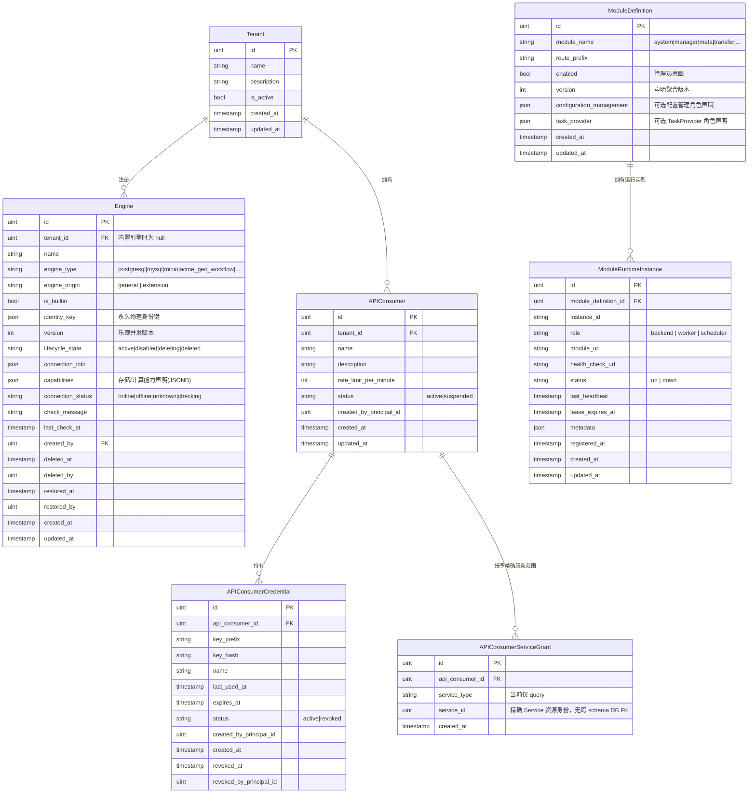

# ADDP System与引擎元模型

[返回核心对象 ER 图](../addp核心对象ER图（元模型）.md)

System 非 IAM 对象、模块角色与引擎能力；IAM 细节由[账号与权限体系](../addp账号与权限体系图.md)及 [System IAM 规范](../../../system/docs/IAM数据模型与迁移规范.md)维护。

## System 模块核心对象（schema: system）

| 中文     | 英文标识符  | 说明                                                             |
| -------- | ----------- | ---------------------------------------------------------------- |
| 租户     | Tenant      | 平台顶级隔离单元，隔离租户级业务对象；平台模块定义、内置引擎等有明确的全局边界                   |
| 用户     | User        | ADDP 内部自然人身份；通过 Tenant Membership 加入一个或多个 Tenant，不再以 user_type 表达权限 |
| 租户成员关系 | TenantMembership | User 或 Service Principal 进入某个 Tenant 的有效关系；一次业务会话只选择一个当前 Tenant |
| 外部身份 | ExternalIdentity | 外部 IdP 的 `issuer + subject` 到 ADDP User 的稳定映射 |
| 部门 | Department | Tenant 内表达稳定组织归属的层级组织单元 |
| 项目组 | ProjectGroup | Tenant 内表达跨部门协作的成员集合 |
| 角色分配 | RoleAssignment | 将 Role 赋予 Principal，并声明 Platform 或 Tenant Scope；组织归属与资源访问授权分别维护 |
| 引擎     | Engine      | 数据源和计算资源的统一抽象，通过 capabilities 声明具体能力       |
| 模块     | Module      | ADDP 微服务单元；可选择性地声明任务能力，成为任务提供者          |
| API 消费方 | APIConsumer | Tenant 为外部系统登记的已发布数据面 API 调用方，不属于 Principal；可授权的服务范围由 Service owner 校验 |
| API 消费凭据 | APIConsumerCredential | APIConsumer 持有的凭据，支持失效与撤销；速率限制由消费方配置，不生成 AuthContext |

**关于 Module 与 TaskProvider**：
- `TaskProvider` 不是独立对象，而是 `Module` 的一种可选角色，通过注册时声明任务 API 来体现；Provider ID 复用 Module ID，无独立生命周期。
- `module_definitions` 保存稳定模块身份、管理员意图和可选 `task_provider` 声明；`module_runtime_instances` 单独保存进程租约和运行端点
- TaskProvider 的 `available`、`unavailable_reason` 和有效 Backend 端点池是 System 根据当前租约生成的读取投影，不是持久事实；调用方不得把单个端点缓存为模块身份
- 不是所有模块都是任务提供者：Console / Gateway / Monitor 不暴露任务接口

**关于 Engine**：
- `engine_origin = 'general'`：用户手动注册的数据引擎（PostgreSQL/MySQL/MinIO 等）
- `engine_origin = 'extension'`：按 ADDP 扩展规范注册的运行时（GeoPython Workflow、Spark Workflow、Jupyter、用户自研 Workflow 等）
- `is_builtin = true`：内置引擎，tenant_id = null，全局可见
- `capabilities` JSONB 字段声明引擎的存储/计算能力，各模块按需使用

---

## 引擎能力分类（从 capabilities JSONB 提炼，无独立表）

| 中文         | 英文标识符        | 对应插件接口            | 使用该能力的模块               |
| ------------ | ----------------- | ----------------------- | ------------------------------ |
| 目录发现       | EngineCatalogCapability  | EngineCatalogProvider          | Meta / Manager / Console        |
| Catalog leaf facts | EngineCatalogFactsCapability | EngineCatalogFactsProvider     | Meta / Manager / Service        |
| 内容读取       | ContentRead        | ContentReadableProvider  | Manager / Meta / Transfer       |
| 查询计算       | QueryCompute       | QueryRuntimeProvider     | Develop / Service / Manager     |
| 工作流计算     | WorkflowCompute    | WorkflowRuntimeProvider  | Develop / Orchestrator          |
| Notebook计算   | ScriptCompute      | ScriptRuntimeProvider    | Develop                         |

---

## 系统非 IAM 核心对象图（System 模块）

> 本图只展示跨模块元模型需要的 System 对象。IAM 实体字段和数据库关系由 [System IAM 数据模型与迁移规范](../../../system/docs/IAM数据模型与迁移规范.md) 及实际 migration 维护，避免在两份关系图中重复定义。

## 关系与约束

- 模块定义是全局对象，不按 Tenant 重复注册；`ModuleDefinition` 与 `ModuleRuntimeInstance` 分别维护稳定声明与进程租约。
- 图中的 `created_by` 表达创建人引用，具体身份字段以 owner 模型为准；`Engine.created_by` 不通过数据库外键绑定 IAM 身份。
- APIConsumer 的服务授权按 `(service_type, service_id)` 精确绑定，由 Service owner 最终校验；当前服务引用类型仅 `query`。APIConsumerCredential 不生成 Principal 或 AuthContext，不能访问 `/api/v1/*` 控制面。认证边界见[API 认证与授权](../../spec/api/认证授权.md)。

---
