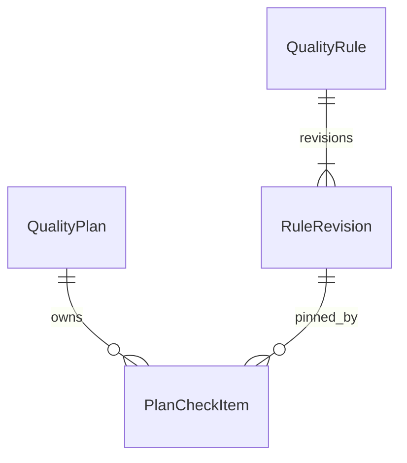

# ADDP 任务与执行元模型

[返回核心对象 ER 图](../addp核心对象ER图（元模型）.md)

Task 抽象、Transfer / Orchestrator / Develop / Quality / Graph 对象及统一执行关系。完整任务类型和执行协议以[任务体系规范](../../spec/addp任务体系规范.md)为准；Model 的建表任务复用 LogicalTable，见[Model 元模型](Model.md)。

## Task（任务）抽象体系

**核心思想**：ADDP 中多种业务对象在本质上都是"任务"——定义了"做什么"，可以被执行、产生执行记录，并可按声明被 Orchestrator 编排；定时能力由 task type 声明。

| 中文         | 英文标识符    | 所在 Schema   | 说明                                                  |
| ------------ | ------------- | ------------- | ----------------------------------------------------- |
| 任务（抽象） | Task          | —             | 抽象概念，以下均为派生                                |
| 扫描任务     | ScanTask      | meta      | 对某个 Engine 的元数据扫描任务定义                    |
| 传输任务     | TransferTask  | transfer      | 数据同步任务定义，统一任务体系只暴露 `task_type=sync` |
| 开发任务     | DevTask       | develop       | 可执行的开发工件（query/workflow/script），本质也是任务 |
| 编排工作流   | Orchestration | orchestrator  | 跨模块任务的 DAG 编排定义，**本身也是一种任务**       |
| 瓦片缓存生成任务 | TileCacheTask | manager | 生成瓦片缓存的任务定义，执行后更新 TileCache 结果事实 |
| 向量化任务   | EmbeddingTask | manager       | 对 data item 范围执行向量化的任务定义                 |
| 质量检查方案 | QualityPlan     | quality       | 数据质量检查任务定义                                  |
| 图谱构建任务 | GraphBuildTask | graph        | 知识图谱构建任务定义                                  |
| 逻辑表建表任务 | LogicalTable（任务角色） | model | 复用已持久化逻辑表，执行建表或结构校验，不复制任务定义 |

**任务的共同能力**：
- **Schedule**：只有声明 `supports_schedule=true` 且具备完整 owner 调度闭环的任务支持自身定时；Manager 受管当前结果任务当前声明 `supports_schedule=false`，仍可被 Orchestrator 定时调用。Embedding 的独立逐 item 调度边界见[模块任务契约](../../spec/tasks/模块任务契约.md)。
- **Execution**：所有 Task 执行后写入 `common.task_executions` 统一记录
- **可被 Orchestration 编排**：ScanTask / TransferTask / DevTask / TileCacheTask / VectorMaterializedViewTask / EmbeddingTask / QualityPlan / GraphBuildTask / Orchestration 均可作为 Orchestration 的步骤（Step）
- **Orchestration 的递归性**：Orchestration 执行完也产生 Execution，并以 `task_type=orchestration` 暴露给任务库；保存和执行时必须防止递归引用

**本图涉及的任务类型（task_type in common.task_executions）**：
- Meta: `scan`
- Transfer: `sync`
- Develop: `query` / `workflow` / `script`
- Orchestrator: `orchestration`
- Manager: `vector_tile_cache_generation` / `vector_materialized_view_generation` / `embedding`
- Quality: `quality_plan`
- Graph: `kg_build`
- Model: `logical_table_materialization`（复用已持久化 LogicalTable，不另建任务定义副本）

---

## Transfer 模块核心对象（schema: transfer）

| 中文     | 英文标识符   | 说明                                                     |
| -------- | ------------ | -------------------------------------------------------- |
| 传输任务 | TransferTask | Task 派生，对统一任务体系暴露为数据同步任务定义    |
| 字段映射 | FieldMapping | TransferTask 的子对象，定义源→目标字段的映射规则         |

---

## Orchestrator 模块核心对象（schema: orchestrator）

| 中文       | 英文标识符    | 说明                                                              |
| ---------- | ------------- | ----------------------------------------------------------------- |
| 编排工作流 | Orchestration | Task 派生，跨模块任务的 DAG 定义，本身执行后也产生 Execution      |
| 步骤       | Step          | Orchestration 的子对象，通过 `provider/task_type/task_id` 引用已有任务定义，内嵌 JSONB |

---

## Develop 模块核心对象（schema: develop）

| 中文     | 英文标识符 | 说明                                                                  |
| -------- | ---------- | --------------------------------------------------------------------- |
| 开发任务 | DevTask    | Task 派生，可执行的开发工件（query/workflow/script），选择计算类 Engine 执行 |

---

## Quality 模块核心对象（schema: quality）

| 中文         | 英文标识符 | 说明                         |
| ------------ | ---------- | ---------------------------- |
| 质量检查方案 | QualityPlan  | Task 派生，执行数据质量规则检查 |
| 质量规则 | QualityRule | 独立可复用的约束定义，不是 Task |
| 规则修订 | RuleRevision | 不可变约束及来源快照 |
| 方案检查项 | PlanCheckItem | 方案聚合内的固定规则修订引用、目标绑定与策略 |

方案与规则通过检查项形成多对多关系。一次执行冻结检查项和规则修订，不回读最新定义。

---

## Graph 模块核心对象（schema: graph）

| 中文         | 英文标识符    | 说明                         |
| ------------ | ------------- | ---------------------------- |
| 图谱构建任务 | GraphBuildTask | Task 派生，执行知识图谱构建任务 |

---

## Task 抽象体系图

> Task 是抽象概念（无统一实体表）。图中展示持久任务的主要字段与统一执行记录；调度和编排能力以 TaskProvider 声明为准，公共字段语义见[任务定义与授权](../../spec/tasks/任务定义与授权.md)。

```mermaid
erDiagram
    ScanTask {
        uint id PK
        uint tenant_id FK
        uint engine_id FK "存储类 Engine"
        string name
        string description "任务描述（可选）"
        string schedule "Cron 表达式（空=不调度）"
        bool enabled "是否启用定时调度，默认 false"
        json parameters "扫描目标配置：节点/深度/类型等"
        timestamp last_run_at
        timestamp next_run_at
        string last_execution_id "最近执行 UUID（软引用）"
        string last_execution_status "最近执行状态（冗余）"
        uint created_by FK
        timestamp created_at
        timestamp updated_at
        timestamp deleted_at
    }

    TransferTask {
        uint id PK
        uint tenant_id FK
        string name
        string description
        string task_type "固定为 sync；Manager 导入/导出是调用方业务语义"
        json config "Reader-Transform-Writer 管道配置(JSONB)"
        string schedule "Cron 表达式"
        int batch_size
        bool enabled
        bool auto_scan_metadata "完成后自动触发扫描"
        timestamp last_run_at
        timestamp next_run_at
        string last_execution_id
        string last_execution_status
        uint created_by FK
        timestamp created_at
        timestamp updated_at
        timestamp deleted_at
    }

    FieldMapping {
        uint id PK
        uint task_id FK
        string source_field
        string target_field
        string default_value
        string field_type
        string format
        bool nullable
        timestamp created_at
    }

    DevTask {
        uint id PK
        uint tenant_id FK
        uint engine_id FK "具备对应能力的 Engine"
        string name
        string display_name
        string dev_type "query | workflow | script"
        json content "SQL语句/工作流节点定义/脚本内容"
        json execution_config "引擎ID和执行参数"
        string schedule "Cron 表达式"
        bool enabled "是否启用定时调度"
        int timeout "超时时间（秒）"
        string tags "text[]，标签"
        string status "active | inactive | archived（发布状态）"
        timestamp last_run_at
        timestamp next_run_at
        string last_execution_id
        string last_execution_status
        uint created_by FK
        timestamp created_at
        timestamp updated_at
        timestamp deleted_at
    }

    Orchestration {
        uint id PK
        uint tenant_id FK
        string name
        string description
        json steps "Step 内嵌数组(JSONB)"
        bool enabled
        string schedule "Cron 表达式"
        timestamp last_run_at
        timestamp next_run_at
        string last_execution_id
        string last_execution_status
        uint created_by FK
        timestamp created_at
        timestamp updated_at
        timestamp deleted_at
    }

    TileCacheTask {
        uint id PK
        uint tenant_id FK
        string name
        string description
        bool enabled
        string schedule "Cron 表达式"
        timestamp next_run_at
        timestamp last_run_at
        string last_execution_id
        string last_execution_status
        uint created_by FK
        json config "target / tile / storage / options"
        timestamp created_at
        timestamp updated_at
        timestamp deleted_at
    }

    EmbeddingTask {
        uint id PK
        uint tenant_id FK
        string name
        string description
        bool enabled
        string schedule "Cron 表达式"
        timestamp next_run_at
        timestamp last_run_at
        string last_execution_id
        string last_execution_status
        uint created_by FK
        json config "target / filters / embedding"
        timestamp created_at
        timestamp updated_at
        timestamp deleted_at
    }

    QualityPlan {
        uint id PK
        uint tenant_id FK
        string code UK
        bigint version
        string name
        string description
        json table_bindings
        timestamp last_run_at
        string last_execution_id
        string last_execution_status
        uint created_by FK
        timestamp created_at
        timestamp updated_at
    }

    GraphBuildTask {
        uint id PK
        uint tenant_id FK
        uint graph_id FK "图谱 ID"
        string name
        string description
        string schedule "Cron 表达式"
        bool enabled
        timestamp last_run_at
        timestamp next_run_at
        string last_execution_id
        string last_execution_status
        uint created_by FK
        timestamp created_at
        timestamp updated_at
        timestamp deleted_at
    }

    TaskExecution {
        bigint id PK "bigint，应对高频写入"
        string execution_id UK "UUID，全局唯一，跨模块追踪"
        uint tenant_id FK
        string module "meta|transfer|develop|orchestrator|manager|quality|graph|model"
        string task_type "scan|sync|query|workflow|script|orchestration|vector_tile_cache_generation|vector_materialized_view_generation|embedding|quality_plan|kg_build|logical_table_materialization"
        string source "触发来源模块"
        string source_task_id "对应模块任务 ID（字符串，无 DB FK）"
        string source_task_name "任务名称（冗余，便于展示）"
        string status "pending|running|success|failed|timeout|cancelled"
        int progress "0-100"
        string current_step "当前步骤描述（可选）"
        string trigger_type "manual | scheduled"
        uint triggered_by FK "触发用户 ID（可选）"
        string parent_execution_id "父 Orchestration 的 execution_id（无 DB FK）"
        timestamp started_at
        timestamp completed_at
        bigint execution_time_ms "执行时长（毫秒）"
        json error_details "错误详情（JSONB，仅失败时有值）"
        json metadata "模块特有扩展数据（JSONB，成功失败均有价值）"
        timestamp created_at
        timestamp updated_at
    }

    TransferTask ||--o{ FieldMapping : "含字段映射"
    ScanTask ||--o{ TaskExecution : "产生"
    TransferTask ||--o{ TaskExecution : "产生"
    DevTask ||--o{ TaskExecution : "产生"
    Orchestration ||--o{ TaskExecution : "产生"
    TileCacheTask ||--o{ TaskExecution : "产生"
    EmbeddingTask ||--o{ TaskExecution : "产生"
    QualityPlan ||--o{ TaskExecution : "产生"
    GraphBuildTask ||--o{ TaskExecution : "产生"
    Orchestration }o--o{ ScanTask : "编排步骤"
    Orchestration }o--o{ TransferTask : "编排步骤"
    Orchestration }o--o{ DevTask : "编排步骤"
    LogicalTable ||--o{ TaskExecution : "建表或结构校验，复用逻辑表定义"
    Orchestration }o--o{ LogicalTable : "logical_table_materialization 步骤"
    Orchestration }o--o{ TileCacheTask : "编排步骤"
    Orchestration }o--o{ EmbeddingTask : "编排步骤"
    Orchestration }o--o{ QualityPlan : "编排步骤"
    Orchestration }o--o{ GraphBuildTask : "编排步骤"
    Orchestration }o--o{ Orchestration : "编排步骤（需防递归）"
    TaskExecution ||--o{ TaskExecution : "parent_execution_id 子步骤追踪父编排"
```

**说明**：
- `Orchestration.steps` 是内嵌 JSONB 数组，每个 Step 通过 TaskProvider API 调用已有任务定义（`provider/task_type/task_id`）。
- 工作流运行时由 Develop 消费；算子工作流必须先在 Develop 中形成 `workflow` 任务，再作为 `provider=develop, task_type=workflow` 的 Step 进入 Orchestrator。
- `Orchestration` 执行后本身也产生 `TaskExecution`（task_type='orchestration'），并可作为 `provider=orchestrator, task_type=orchestration` 的任务被更高层 Orchestration 引用；保存和执行时必须防止自引用或循环引用。
- `DevTask.execution_config` 表达执行目标：所有 `query` 任务统一使用 `engine_id` 指向具备 query 能力的真实 System Engine，DuckDB 联邦查询绑定平台内置 DuckDB Runtime Engine，不存在 `query_mode` 或虚拟 `engine_id=0`；`workflow` 任务的 `engine_id` 指向具体工作流运行时实例，不冗余保存 `engine_type`；`script` 类选择具备脚本执行能力的引擎，当前可由 Jupyter Notebook runtime 承载
- `TaskExecution.error_details`：仅在失败时填充，存储错误类型、错误栈等诊断信息；`metadata`：每次执行均可写入，存储各模块特有的过程数据和结果统计

## 执行与引用约束

- `ScanTask` 使用单字段 `schedule`（Cron 表达式）；字段存在不代表该 task type 已支持自身定时。
- `Orchestration.steps` 内嵌 JSONB；跨模块任务引用由应用层通过 TaskProvider 校验，不建立跨 schema 外键。
- `TaskExecution.source_task_id` 是字符串软引用，不建立跨 schema 外键；读取任务定义必须按 `module + task_type + source_task_id` 路由到 owner。一次性 execution 可为空，并冻结完整执行配置。详见[执行记录与租约](../../spec/tasks/执行记录与租约.md)。

---
