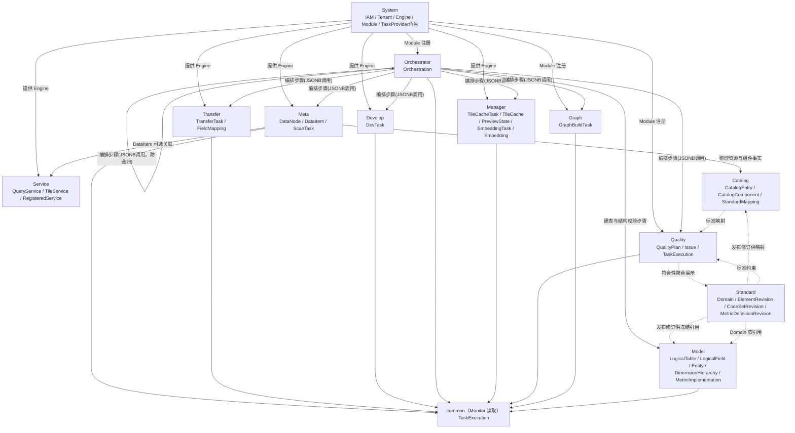

# ADDP 全局能力与模块概览元模型

[返回核心对象 ER 图](../addp核心对象ER图（元模型）.md)

横切能力与模块级依赖总览；具体字段和对象关系按下列专题阅读。

## 全局横切能力（提炼自多个业务对象，无独立实体表）

| 中文     | 英文标识符  | 说明                                                           | 体现在哪些业务对象上                              |
| -------- | ----------- | -------------------------------------------------------------- | ------------------------------------------------- |
| 调度配置 | Schedule    | 定时触发能力（Cron 表达式），定义"何时执行"                    | 仅声明 `supports_schedule=true` 且具备完整 owner 调度闭环的任务                       |
| 执行记录 | Execution   | 单次运行的状态/进度/耗时/错误，记录"执行了什么、结果如何"      | 所有 Task 派生对象执行后均写入 common.task_executions |
| 数据血缘 | Lineage     | data item 之间的来源、派生和服务依赖关系视图；关系证据可回溯到 execution 或发布事实 | Meta 的 lineage_observations、lineage_item_relations、lineage_service_dependencies |
| 数据项指纹 | Fingerprint | 由 `engine_id + full_name` 计算的稳定定位身份，用于去重和引用；内容变化不改变指纹 | DataItem / PreviewState / Embedding；源内容版本另用 source_version 等事实表达 |
| 向量嵌入 | Embedding   | data item 的当前向量化结果状态与 pgvector 向量内容，支持语义检索 | DataItem（文件/对象/表）                          |
| 审计日志 | AuditLog    | 所有操作的不可变轨迹（操作人/时间/HTTP方法/路径/状态码）       | 全局，由 System 集中记录                          |

---

## 全局元模型总图（概览）

> 模块级视图，只展示模块之间的依赖方向，不列对象细节。

---
