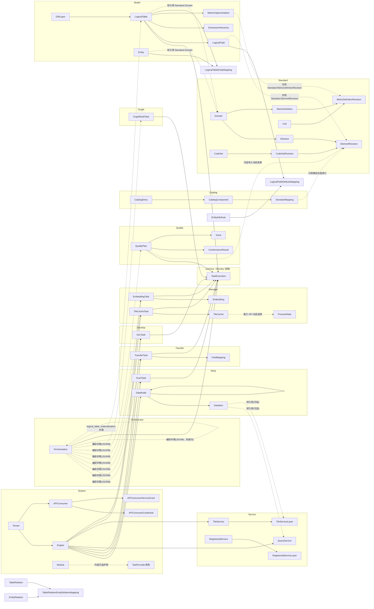

# ADDP 跨模块关系元模型

[返回核心对象 ER 图](../addp核心对象ER图（元模型）.md)

对象间的业务引用、编排与产出关系；本图不是数据库外键清单。

## 跨模块关系图

> 忽略字段细节，聚焦关键业务关联。实线表示业务归属、资源依赖或执行产出关系，不据此推定数据库外键；虚线标识软引用、可选关联或声明投影，具体约束以 owner 规范为准。

**说明**：
- 实线（`-->`）：主要业务归属、资源依赖或执行产出；跨 schema 关联仍由应用层维护。
- 虚线（`-.->`）：软引用、可选关联或声明投影；不代表独立持久实体或数据库外键。
- `DataItem → QueryService/TileServiceLayer`：Service 发布服务时可关联元数据项，但不强制——服务可直接指定 engine_id + schema + table 而不经过 Meta

---
