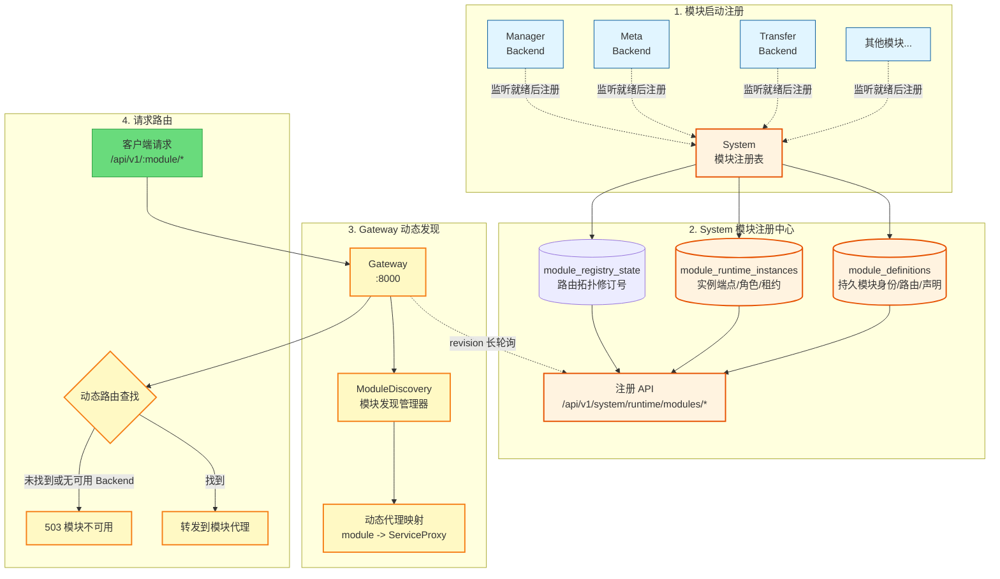
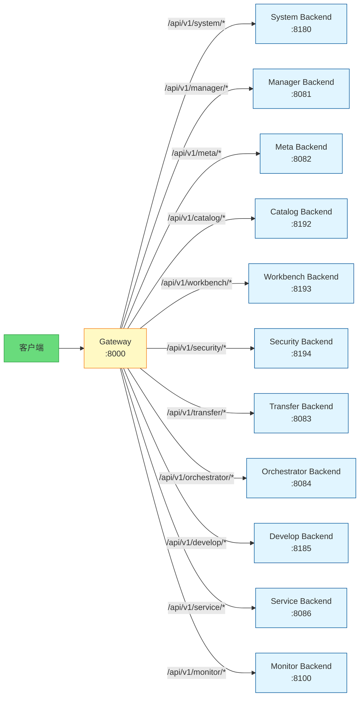

# ADDP Gateway注册与路由

[返回模块架构图](../addp模块架构图.md)

持久模块定义、临时实例租约、注册生命周期、Gateway 动态发现与路由资格。实现说明见[Gateway 架构说明](../../../gateway/docs/gateway架构说明.md)。

阅读导航：[Gateway 路由机制](#gateway-路由机制)、[模块注册与路由发现流程](#模块注册与路由发现流程)、[核心机制说明](#核心机制说明)、[存活、就绪、注册与可路由契约](#存活就绪注册与可路由契约)、[路由请求流程](#路由请求流程)、[路由规则](#路由规则)、[配置环境变量](#配置环境变量)、[关键文件位置](#关键文件位置)。

## Gateway 路由机制

Gateway 作为 ADDP 的统一入口，负责请求路由和转发。ADDP 采用 **持久模块定义 + 临时运行实例租约 + 动态路由发现** 的单一机制。该模型借鉴服务注册中心对 Service、Instance、enabled 和 healthy 的分离，但注册事实仍由 System/PostgreSQL 管理，不引入 Nacos 产品依赖。

### 模块注册与路由发现流程



### 核心机制说明

**1. 持久模块定义**:
- `module_definitions` 保存稳定 `module_name`、路由前缀、管理员启用状态和配置管理入口声明；模块进程离线不会删除该定义。Gateway Ingress 无业务路由前缀，定义的 `route_prefix` 为空。
- 业务模块的 `enabled` 是管理员意图，与实例心跳健康独立。禁用业务模块时所有实例即使仍有心跳也不得进入 Gateway 路由或 Console 动态入口。System 和 Gateway 是引导控制面与平台入口，其 `enabled` 固定为 true，不接受管理员禁用；自注册实例只供运行观测。Gateway 通过部署提供的 `SYSTEM_URL` 直接访问 System。
- 模块首次注册创建定义；后续注册按 `module_name` 幂等更新允许由 owner 发布的声明，不改变定义 ID。
- 模块定义是可变持久化主资源，使用正整数 `version` 进行乐观并发控制。平台系统管理员通过 `/api/v1/system/platform/modules` 读取定义和实例投影，只能通过带 `version` 的更新请求修改业务模块的 `enabled`；System 与 Gateway 的 `enabled` 不可修改。路由前缀和配置入口声明仍由 owner 注册发布，不提供管理员手工编辑路径。
- 相同 owner 声明的重复注册保持幂等且不递增 `version`；路由前缀或配置入口声明实际变化时，System 原子更新声明并递增 `version`，同时保持管理员 `enabled` 不变。

**2. 临时运行实例租约**:
- 每个 Backend、Worker、Scheduler 或 Gateway Ingress 进程启动时生成本次进程唯一的 `instance_id`，并以 `module_name + instance_id` 注册到 `module_runtime_instances`，同时提交本次进程启动时间。
- 运行实例声明 `role`；只有 `backend` 实例具有 Gateway 业务路由端点。Gateway 使用不可路由的 `ingress` 角色和自身监听地址；`worker`、`scheduler` 与 `ingress` 只用于运行观测。Gateway 在 HTTP 监听建立后通过直连 System 的同一注册客户端维护自身租约，不通过 Gateway 自己代理注册请求；Gateway Ready 仍以已应用 System 路由快照为条件。
- 同一模块允许多个运行实例并存，注册不会互相覆盖 URL、版本或元数据。
- 运行实例另存 `runtime_hostname`（进程自动采集的运行环境主机名）和 `host_node_name`（部署通过 `ADDP_HOST_NODE_NAME` 明确注入的宿主节点名）。本地进程的运行环境主机名定位本机，容器进程的运行环境主机名定位容器；宿主节点名未提供时保持为空。不得从服务 URL、DNS、网卡地址或实例 ID 推断节点身份。历史实例不回填无法证明的节点信息，重登记只更新当前实例观测；节点信息不改变模块定义版本、路由修订号、Ready 或租约状态。
- 注册提交完整实例声明；后续心跳只续租并更新 `last_heartbeat`，不得借心跳覆盖模块定义、管理员启用状态或实例元数据。
- Backend 必须先完成自身必需 Infra 初始化并成功绑定 HTTP 监听端口，再发起后台注册；不得把尚未监听的 `module_url` 提前发布为可路由实例。

**3. 周期心跳机制**:
- 模块每 **10 秒**发送一次心跳到 System
- System 将超过租约超时时间未心跳的运行实例标记为 `down` 并记录 `lease_expired` 与到期时间，但不删除运行实例历史，也不删除持久模块定义。正常注销记录 `graceful` 与注销时间。`lease_expired` 表示失联或疑似异常退出，不证明进程崩溃；同一进程重新注册时恢复为 `up` 并清除离线原因。
- 同一 `instance_id` 重新注册可恢复为 `up`；新进程必须使用新的 `instance_id`。
- 任一次心跳失败后，Go 与 Python 公共客户端的下一次请求都必须使用同一 `instance_id` 幂等重注册；注册失败使用有界退避，不能继续发送必然失败的心跳直到租约过期。
- 公共客户端必须发布 `starting|registered|recovering|failed|stopped` 五态进程内快照。首次注册成功进入 `registered`；任一心跳失败立即进入 `recovering`，重注册成功后恢复。该快照只供本进程就绪判断，不落库、不发布第二套注册事实。
- 连接失败、超时、`429`、`5xx`，以及 Token Endpoint 返回 `200` 但响应 JSON 无法完整解析的瞬时协议故障是可重试故障；严格刷新凭据后仍然出现的 `400`、`401`、`403`，或 Token JSON 可解析但字段、类型、Scope、有效期不符合 Service Access Token 契约等确定性拒绝，必须进入 `failed` 并终止进程，不得无限重试永不可成功的配置。心跳返回实例不存在时仍使用同 ID 重注册。
- 模块正常退出时应注销本次 `instance_id`；异常退出仍由租约到期收敛。
- Go 进程入口必须把同一个可取消的信号 Context 传给公共注册客户端；客户端返回生命周期完成信号，入口在关闭资源和退出进程前必须等待该信号，确保限时注销请求已经结束。不得用 `context.Background()` 承载进程级注册生命周期，也不得用 `os.Exit` 绕过等待与清理。
- Runtime 模块注册、心跳和注销失败必须返回 `{error, error_code}`；稳定错误码使用 `module_registration_invalid`、`module_runtime_instance_not_found`、`module_registry_unauthorized`、`module_registry_forbidden`、`module_registration_failed`、`module_heartbeat_failed` 和 `module_deregistration_failed`。Go 与 Python 公共客户端都必须保留 `method`、`path`、`status_code`、`error_code`、`error_message` 和受限长度的 `response_body`；后台生命周期日志还必须包含 `operation`、`module`、`instance_id` 和 `role`，不得只输出无结构的异常文本。Token Endpoint 的成功响应含凭据，诊断只能记录稳定错误码、可重试性、响应体字节数、Content-Type 和不含值的字段校验原因，禁止记录原始响应体或任何 Token 值。

**管理面边界**:
- `platform.module.read` 允许平台系统管理员查看模块定义及其 Backend、Worker、Scheduler、Ingress 实例投影；`platform.module.update` 只允许修改业务模块定义的 `enabled` 管理意图。System 与 Gateway 行只展示固定启用状态，不提供开关；更新接口拒绝对这两个模块的写入。
- 平台模块页以现有产品中文模块名称说明核心职责，并保留稳定 `module_name` 供定位；展示词条由前端国际化维护，不写入注册表。模块列表概览当前实例的 UP/DOWN、已登记服务端点的主机或 IP 与端口，以及本次进程运行时长；展开详情展示完整端点、租约状态、最近心跳和进程启动时间。无监听端点的 Worker、Scheduler 不伪造 IP 或端口；主机名也不冒充物理 IP。UP/DOWN 来自 System 实例状态与租约，不代表 `/health/ready` 实测结果。历史区分正常注销与租约超时，租约超时的停止时间只是失联观测时间，不能作为准确的进程退出时间。路由资格仅由 Backend 租约计算。
- 管理界面不得创建模块定义、删除运行实例、手工修改 `status` 或延长租约。定义由 owner 首次注册产生，实例健康只能由注册、心跳和租约到期推进。
- 管理界面按固定周期重新读取 System 当前投影；进程稍后启动并重新注册后，无需重启 System 或前端即可显示为可用。
- `GET /api/v1/system/platform/modules` 和模块详情只返回有界的当前运行投影：保留全部租约有效的实例；某个角色当前没有有效租约时，仅保留该角色最近一次离线观测，用于区分“从未注册该角色”和“该角色当前离线”。不得在模块主列表中携带全部历史实例。页面的“需关注”仅基于当前投影的租约超时或当前服务入口不可用；全部下线记录仍从实例历史读取，不以旧实例的正常退出制造持续告警。
- `GET /api/v1/system/platform/module-instances` 是全部实例历史的唯一只读分页入口，可跨模块组合筛选。默认值、状态恢复、登记／离线时间依据、半开范围、稳定排序及筛选交互统一见[实例查询状态契约](../../spec/addp前端路由与可恢复状态规范.md#五canonical-url)；时间查询不重建历史在线状态或可用率。
- `registered_host` 是登记 URL 的主机名或 IP，不代表物理节点 IP；无端点实例不能按此字段命中，但仍能按其他条件查询。`node_name` 对宿主节点名或运行环境主机名做不区分大小写的精确匹配，与其他条件按 AND 组合，因此无端点 Worker 也能按节点查询。列表分别展示两种节点名，未知字段显示“未提供”。
- 模块概览中的“查询该模块实例”进入同一实例查询视图并预填模块条件，沿用该视图默认值；不保留独立的单模块历史查询路径。
- `module_runtime_instances` 记录会被心跳、注销和租约收敛更新，是实例生命周期历史，不是追加式审计事件；管理员启停等操作审计仍以 `audit_logs` 为唯一事实源。

**4. Gateway 动态发现**:
- Gateway 使用自身 Platform Service Access Token，通过 `GET /api/v1/system/runtime/modules/watch` 获取路由快照；启动时以 `revision=0` 获取已启用模块及其 `up` 的 Backend 完整快照。`GET /api/v1/system/runtime/modules` 是注册表列表入口，不替代发现长轮询。
- 后续只通过 revision 长轮询等待拓扑变化；新增、恢复、下线、端点变化和管理员启停会立即唤醒请求，无需重启 Gateway。
- 长轮询达到 `MODULE_WATCH_TIMEOUT`（默认 **10 秒**）时，即使 revision 未变化也返回一份新鲜完整快照，使 Gateway 持有的租约截止时间持续更新，不会因缓存租约老化形成路由空窗。
- 只根据 `enabled + role=backend + status=up + lease valid` 的实例创建、更新和移除 HTTP 代理
- Gateway 原子替换完整快照；System 短暂不可达时保留最近一次快照，但每次选路仍校验其中的租约截止时间。
- 多个 Backend 实例的选择必须来自同一发现结果，不能回退到环境变量中的第二套路由事实源

**5. 单一路由机制**:
- 模块动态注册表是 Gateway 业务模块路由的唯一事实源。
- System 注册中心暂时不可达时，Gateway 可以继续使用最近一次成功且尚未超过本地失效窗口的发现快照；不得读取 `*_SERVICE_URL` 建立平行 fallback 路由。
- 没有可用 Backend 实例或快照已失效时返回 503，不能把请求静默发往未受租约管理的地址。

### 存活、就绪、注册与可路由契约

ADDP 必须分开以下四个状态，不再使用含义不明的“启动成功”同时表示进程与平台可用性：

| 状态 | 唯一判断 | 消费方 |
| --- | --- | --- |
| Alive | HTTP 进程已监听并能处理本地存活请求 | 进程管理器、容器存活探针、T4 构建身份预检 |
| Ready | 自身必需 Infra 已就绪，且业务模块当前注册生命周期为 `registered` | 部署就绪探针、开发启动脚本、业务路由门禁 |
| Registered | System 已为当前 `module_name + instance_id` 建立或续期租约 | 当前进程注册生命周期、System 模块管理 |
| Routable | System 快照中实例满足 `enabled + backend + up + lease valid`，并已被 Gateway 应用 | Gateway |

Backend 的公开健康端点只保留两个唯一语义：

- `GET /health/live`：只做本地进程存活判断，成功固定返回 `200`；响应包含 `status=live`、`module` 和统一构建身份。不访问 System、其他业务模块、必需 Infra 或可选 Engine Instance。
- `GET /health/ready`：Ready 时返回 `200` 和 `status=ready`；否则返回 `503` 和 `status=not_ready`。响应包含 `module`、`role`、`instance_id`、`registration_state`、统一构建身份及受限的 `checks[]`；检查项只暴露稳定 `name/status/error_code`，不返回凭据、连接串或原始下游错误。
- 旧 `/health` 不再保留；各模块、Monitor、注册的 `health_check_url`、开发脚本、Compose/部署探针和 T4 预检必须在同一次实施中切换，不得保留别名或 fallback。

Backend 必须在健康路由之后、所有业务路由之前安装统一 Ready 门禁；未 Ready 时直连业务请求也返回 `503 module_not_ready`，不得借直连地址绕过 System 注册资格。Gateway 仍只依据 System 租约路由，不在每个请求前额外探测 Ready；System 不可达后的短暂观测延迟由 10 秒心跳和 30 秒租约边界收敛。

Worker 和 Scheduler 不为健康检查额外分配 HTTP 端口。它们必须先完成自身必需 Infra 初始化，再注册实例；未进入 `registered` 或心跳失败进入 `recovering` 时，不得领取新 execution、创建新调度执行或接受新工作。已在执行的工作按 owner execution lease 和授权契约收敛，不因模块心跳一次失败就无条件中止。自身必需 Infra 出现无法恢复的故障时，必须停止心跳、注销并退出，不得以有效租约伪装可工作。

System 是唯一例外：其 Ready 只依赖自身必需 Infra、迁移和 IAM/bootstrap 事实，不依赖它向自己注册。Gateway 的 Ready 要求已从 System 成功应用至少一次完整模块路由快照；业务模块不得把任何其他业务模块的可达性纳入 Ready。

### 路由请求流程



### 路由规则

| 路径前缀 | 目标服务 | 端口 | 说明 |
|---------|---------|------|------|
| `/api/v1/system/*` | System Backend | 8180 | 用户认证、引擎管理、日志 |
| `/api/v1/manager/*` | Manager Backend | 8081 | 数据管理、预览、空间快显和瓦片缓存 |
| `/api/v1/meta/*` | Meta Backend | 8082 | 元数据扫描、索引、搜索 |
| `/api/v1/catalog/*` | Catalog Backend | 8192 | 企业目录身份、业务编目、责任、语义关联和搜索 |
| `/api/v1/workbench/*` | Workbench Backend | 8193 | 已发布服务消费、个人视图和后续数据应用创作 |
| `/api/v1/security/*` | Security Backend | 8194 | 安全分类分级、纳管、敏感发现、资源评估、保护策略和运行时投影变化 |
| `/api/v1/transfer/*` | Transfer Backend | 8083 | 数据同步、搬运、格式转换 |
| `/api/v1/orchestrator/*` | Orchestrator Backend | 8084 | 任务编排、调度 |
| `/api/v1/develop/*` | Develop Backend | 8185 | 查询、工作流、Notebook |
| `/api/v1/service/*` | Service Backend | 8086 | 数据服务发布、OGC 标准 |
| `/api/v1/monitor/*` | Monitor Backend | 8100 | 执行监控、统计分析 |

### 配置环境变量

#### Gateway 模块配置

```bash
# 启用模块发现（推荐）
MODULE_REGISTRY_ENABLED=true                 # 启用动态路由发现
MODULE_WATCH_TIMEOUT=10s                     # revision 长轮询超时

# System 模块配置（用于获取注册信息）
SYSTEM_URL=http://system-backend:8180
GATEWAY_SERVICE_CLIENT_SECRET=your_gateway_service_client_secret

# System 自身地址是 Gateway 获取注册事实所需的部署 Bootstrap，不是业务模块路由 fallback
```

#### 各模块配置

```bash
# 启用与 System 集成
ENABLE_INTEGRATION=true
SYSTEM_URL=http://system-backend:8180
MODULE_SERVICE_CLIENT_SECRET=your_module_service_client_secret
```

### 关键文件位置

| 组件 | 文件路径 | 说明 |
|------|---------|------|
| **System 注册表** | [system/backend/internal/models/module_registry.go](../../../system/backend/internal/models/module_registry.go) | 持久模块定义与运行实例租约模型 |
| **System API** | [system/backend/internal/api/module_registry_handler.go](../../../system/backend/internal/api/module_registry_handler.go) | 注册/心跳/查询 API |
| **Gateway 发现** | [gateway/internal/module_discovery.go](../../../gateway/internal/module_discovery.go) | 模块发现管理器（revision 长轮询） |
| **Gateway 路由** | [gateway/internal/router/router.go](../../../gateway/internal/router/router.go) | 动态路由配置 |
| **Common 客户端** | [common/client/system_service.go](../../../common/client/system_service.go) | 模块注册、心跳、重注册与退出注销客户端 |
