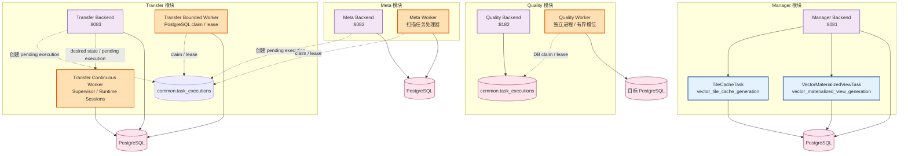

# ADDP Worker与启动恢复

[返回模块架构图](../addp模块架构图.md)

执行 Worker、Backend 内嵌监督器、引擎解耦与模块启动恢复边界。任务类型和 execution 协议以[任务体系规范](../../spec/addp任务体系规范.md)为准。

阅读导航：[Worker 运行时](#worker-运行时)、[模块启动与恢复](#模块启动与恢复)。

## Worker 运行时

ADDP 的 execution worker 是执行 owner 的运行时角色。Quality、Meta、Security 和 Transfer bounded 使用各模块附属的独立 Worker 进程，Transfer continuous 使用专用长期运行时 Worker；Develop query/workflow/script、Manager bounded、Orchestrator orchestration 与 Model logical table materialization 使用各自 Backend 内嵌的有界执行监督器。Manager 当前的受管快显任务由 Manager Backend 持有领域 execution 并把重型计算委托给独立专业 Workflow Runtime；`pptx_pdf_generation` 唯一调用 Document Workflow `document_to_pdf`，LibreOffice 不进入 Manager 进程。PostgreSQL/PostGIS 原生 MVT、MySQL/Oracle 临时 FlatGeobuf 到 GeoPython PMTiles、文件或对象到 GeoPython PMTiles，以及矢量物化视图仍按各自既有唯一执行路线运行。Manager 受管当前结果任务不启动 owner scheduler；Embedding 的逐 item 调度器独立保留。后续若统一引入 Manager Worker，必须整体迁移对应任务类型的 execution owner，不保留 Backend 与 Worker 双轨。

### 模块启动与引擎可用性边界

- 零个 Engine Instance 是平台合法状态。任何模块 Backend、附属 Worker 的进程启动和 readiness 都不得要求某个 Engine Instance 已登记、处于 active 或在线，也不得因为内置 Engine Runtime 缺失而失败。
- 模块可以依赖自身必需的 Infra，例如 owner PostgreSQL schema、执行队列使用的 PostgreSQL、Redis、MinIO、Meilisearch 或 Infra Kafka。Infra 是部署基础设施，不属于 Engine Instance 启动解耦范围；必需 Infra 不可用时，模块可以启动失败或保持 not ready。
- Engine Plugin 的静态注册表完整性属于进程代码完整性，不等同于 Engine Instance 存在。独立 Engine Runtime 的内部依赖只约束该 Runtime 自身，不得反向成为 System 或业务模块的启动条件。
- Backend 在具体 API 调用需要引擎时才解析 Engine Instance；缺失或离线只失败当前请求。Worker 必须能够在零引擎状态下空闲运行，并在领取到引用缺失或离线引擎的 execution 时只失败该 execution，进程继续处理后续任务。
- 引擎连接巡检、实例能力刷新和 Runtime 自注册只能在 HTTP 服务就绪后异步执行，并按 Engine Instance 隔离失败；不得进入模块启动关键路径。



**后台运行时说明**:

| 运行时 | 所属模块 | 职责 | 技术栈 |
|--------|---------|------|-------|
| **Transfer Bounded Worker** | Transfer | PostgreSQL claim snapshot、watermark 和 bounded replay execution，持有 execution lease 后执行 | Go, PostgreSQL claim/lease |
| **Transfer Continuous Worker** | Transfer | 一个进程承载多个 continuous runtime session，按 task claim lease，并在 session 内受限处理 partition | Go, DB lease, Kafka client |
| **Meta Worker** | Meta | PostgreSQL claim 扫描 execution，处理元数据扫描和索引；定时调度留在 Backend | Go, PostgreSQL claim/lease |
| **Quality Worker** | Quality | 独立进程领取已授权 `pending` `quality_plan` execution，按冻结方案执行强类型规则 | Go, PostgreSQL claim/lease |
| **TileCacheTask** | Manager | 在 Manager Backend 内按手动请求或 Orchestrator 编排触发 `vector_tile_cache_generation`，执行记录写入 `common.task_executions` | Go, TaskProvider API |
| **VectorMaterializedViewTask** | Manager | 在 Manager Backend 内按用户手动或 Orchestrator 编排触发执行 `vector_materialized_view_generation`，创建或刷新 Manager 管理的 3857 矢量物化视图目标 | Go, TaskProvider API |

**运行时说明**:
- **Bounded execution queue**: Quality、Meta、Transfer bounded 统一以 `common.task_executions` PostgreSQL claim 为唯一领取路线，不使用 Redis/Asynq 或进程内 channel。
- **Continuous supervisor**: Transfer continuous worker 直接 claim pending execution 和 `transfer.runtime_leases`；同一 task 同一时刻只有一个合法 owner，不把长期 session 投递为 Asynq job。
- **Quality DB claim**: 独立 `quality-worker` 从 `common.task_executions` 领取已授权 `pending` `quality_plan` execution；每个实例使用有界槽位，多实例通过 `SKIP LOCKED`、attempt 与 `lease_token` 协调。
- **CDC capture supervisor**: Transfer 已实现唯一 capture control plane，通过 Kafka Connect REST 管理 PostgreSQL/MySQL Debezium connector，并负责 generation、provider 专属捕获资源、内部 topic/group/ACL 的任务级生命周期；它不嵌入 continuous worker，也不把 Infra Kafka 注册为 System Engine。
- **Manager 受管结果调度边界**: 瓦片缓存、矢量物化视图等受管当前结果任务均为 `supports_schedule=false`，不由 Manager 自身定时调度；周期性刷新由 Orchestrator 显式携带本次覆盖确认触发。Embedding 的逐 item owner scheduler 独立保留。
- **执行记录**: 各模块执行状态统一写入 `common.task_executions`。
- **角色边界**: owner scheduler 负责创建和投递 execution，execution worker 负责真实运行体与终态，Monitor dispatcher 只消费通知 outbox；固定 cleanup、collector 和 heartbeat 属于 maintenance loop，不应统称 worker。
- **单一路线**: 同一 task type 只能有一条正式执行路线。Quality `quality_plan`、Meta scan、Security `sensitive_data_discovery` 和 Transfer bounded 的正式路线是独立 Worker + PostgreSQL claim；Develop query/workflow/script、Manager bounded、Orchestrator orchestration 与 Model logical table materialization 的正式路线是 Backend 内嵌 Supervisor + PostgreSQL claim，不保留请求外 goroutine 或独立 Worker 双轨。
- **结果状态**: Manager 瓦片缓存结果状态写入 `manager.vector_tile_cache`，矢量物化视图结果状态写入 `manager.vector_materialized_view`，不由 execution 替代。
- **未来切换条件**: 当 Manager API 响应因后台生成受影响、临时材料与 GeoPython 调用需要独立资源隔离，或需要多个执行器并行消费同一类任务时，对应任务类型应切换到唯一的 Manager Worker 或 GIS 执行引擎运行时。

---

## 模块启动与恢复

ADDP 部署按以下顺序使实例进入 Ready。业务进程可以在 System 之前被操作系统或容器调度器创建，但只能保持 Alive/Not Ready 并后台注册；对平台业务可用性而言，System 是所有业务模块、Gateway 和 Python 应用的必要先行控制面：

```
1. 基础设施层（必须最先就绪）
   ├─ PostgreSQL
   ├─ Redis
   ├─ MinIO
   └─ Meilisearch

2. 控制面（必须先 Ready）
   └─ System Backend（认证中心、模块注册中心、引擎注册表）

3. 业务模块层（进程可并行创建，System Ready 后才能 Ready）
   ├─ Manager Backend
   ├─ Meta Backend + Worker
   ├─ Catalog Backend
   ├─ Security Backend + Worker
   ├─ Transfer Backend + Worker
   ├─ Orchestrator Backend
   ├─ Develop Backend
   ├─ Service Backend
   ├─ Monitor Backend
   ├─ Standard Backend
   ├─ Asset Backend
   └─ Portal Backend

4. 扩展运行时层（可并行，也可早于 System 或业务模块启动）
   ├─ GeoPython Workflow 运行时
   ├─ Math Workflow 参考运行时（按选择范围启动，手动注册）
   ├─ Spark Workflow 运行时
   └─ Jupyter 脚本运行时

5. Python 应用层（独立进程，同样依赖 System 才能 Ready）
   ├─ Agent Backend
   └─ Copilot Backend

6. 网关层（至少应用一次 System 完整快照后 Ready，不等待业务模块）
   └─ Gateway（从 System 获取并持续监听模块路由快照）

7. 前端层（可并行启动）
   ├─ Console Frontend
   ├─ System Frontend
   ├─ Manager Frontend
   ├─ Meta Frontend
   ├─ Catalog Frontend
   ├─ Security Frontend
   ├─ Transfer Frontend
   ├─ Orchestrator Frontend
   ├─ Develop Frontend
   ├─ Service Frontend
   ├─ Monitor Frontend
   ├─ Standard Frontend
   ├─ Asset Frontend
   └─ Portal Frontend
```

**启动与恢复边界说明**：

| 约束 | 说明 |
|------|------|
| **Infra → 使用该 Infra 的进程** | PostgreSQL、Redis、MinIO、Meilisearch 等部署基础设施可以是进程自身的硬依赖；Infra 不属于 Engine Instance 启动解耦范围。 |
| **业务模块 ↔ System** | 业务进程的 Alive 不依赖 System 当时可达；Ready 强依赖当前进程已成功注册。注册客户端在后台对瞬时故障有界退避重试，System 恢复后使用同一进程级 `instance_id` 自动注册并恢复 Ready。 |
| **Gateway ↔ 业务模块** | Gateway 在 System 可达后以 `revision=0` 取得完整路由快照，随后长轮询更新；它不要求业务模块预先启动。模块稍后注册、租约失效或重新注册时，路由池自动收敛。 |
| **System 暂时不可达** | 模块在注册或心跳失败被观测后转为 Not Ready，但进程保持 Alive 并重试注册。Gateway 只保留最近一次仍在本地租约有效期内的快照；租约失效后请求返回 503，不回退到硬编码模块地址。 |
| **扩展运行时与 Engine Instance** | Runtime 自身就绪后异步注册；零个 Engine Instance 是合法状态，业务模块启动不得依赖任何内置或外部引擎存在。 |
| **Agent / Copilot 独立进程** | Python 应用与 Go 模块共用同一模块注册和 Ready 契约；进程可以在任意时刻创建，但 System 注册成功前不得接受业务流量。运行时调用其他业务模块时仍只失败当前请求，不改变本模块 Ready。 |
| **Catalog ↔ 专业模块** | Catalog 拉取 Meta DataItem 变化并按需读取 Standard、System 等 owner 事实；这些调用失败只造成同步滞后或当前业务请求失败，不改变 Catalog Ready。Manager、Asset 调用 Catalog 也遵循同一软依赖边界，禁止回退旧发现路径。 |
| **Ontology ↔ 专业模块** | 除 System 外所有业务模块均为按需协作来源，不影响 Ontology Ready。自有定义可独立建模、发布和试算；显式引用或读取 owner 不可用时只阻断本次依赖操作，保留来源身份及错误，不切换到同名来源。数据绑定不要求先建立 CatalogEntry；运行事实须来自授权读取，不能由 LLM 或目录摘要代替。 |
| **Security ↔ 专业模块** | Security 只精确读取显式纳管目标的 Meta / Owner 必要事实，不全量扫描；参与 Owner 后台拉取投影变化并本地执行。这些调用是运行软依赖，不改变任一模块 Ready；已纳管资源投影失效时 Owner 必须拒绝，不回退明文。Catalog Frontend 可按当前 User AuthContext 直读 Security 摘要，Catalog Backend 不代理、不复制且不依赖 Security Ready。 |
| **前端无严格顺序约束** | Console 通过 iframe 动态加载各模块前端（用户访问时才加载），各前端可完全并行启动 |

---
