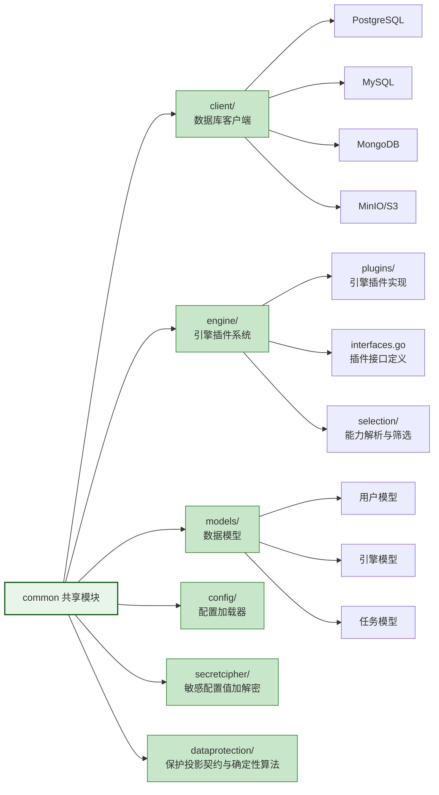
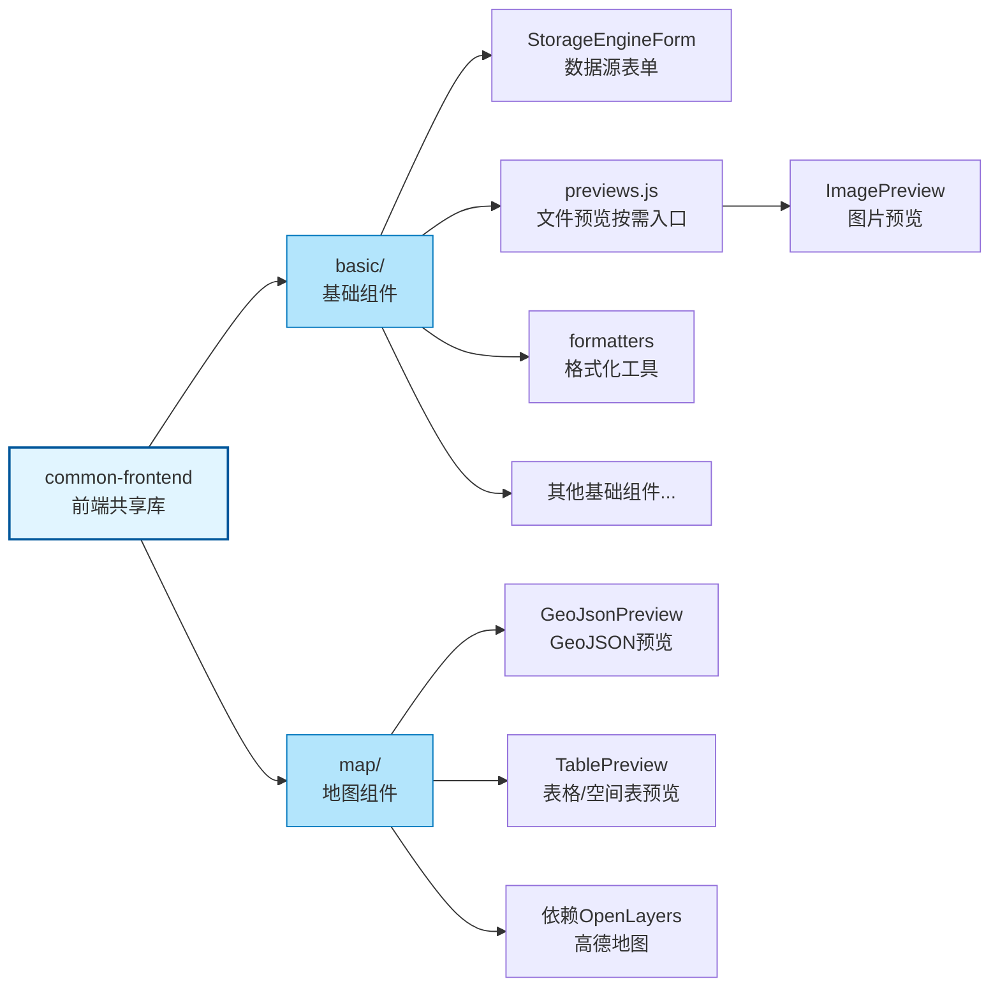

# ADDP 共享模块

[返回模块架构图](../addp模块架构图.md)

common 与 common-frontend 的共享职责、结构和使用原则；更完整的共享能力关系见[共享模块介绍](../addp共享模块介绍.md)。

阅读导航：[共享模块](#共享模块)、[common (后端共享库)](#common-后端共享库)、[common-frontend (前端共享库)](#common-frontend-前端共享库)。

## 共享模块

### common (后端共享库)

位于 `common/` 目录,所有后端服务依赖的共享代码:

**主要内容**:
- **client/**: 数据库客户端(PostgreSQL、MySQL、MongoDB、MinIO 等)
- **engine/**: 引擎插件系统(接口定义、插件实现、自动注册)
- **models/**: 通用数据模型(用户、引擎、任务等)
- **config/**: 根环境部署配置、服务地址、端口检查和时区
- **secretcipher/**: 密码、Token、Webhook Secret 等敏感配置值的 AES-256-GCM 加解密；不承载 Security 业务事实
- **dataprotection/**: 跨 Owner 共享的保护投影 v1 契约、路径定位、校验和确定性遮盖 / 抑制算法；不读写 Security 数据库，不做业务决策

### common-frontend (前端共享库)

位于 `common-frontend/` 目录,前端模块复用的组件和工具:

**模块划分**:
- **basic/**: 基础 UI 组件,无地图依赖；文件预览组件通过 `previews.js` 独立入口按需导入
  - `StorageEngineForm`: 数据源表单组件
  - `ImagePreview`: 图片预览组件，从 `@common-ui/previews` 导入
  - `formatters`: 数据格式化工具
  - 其他通用 UI 组件
- **map/**: 地图相关组件,依赖 OpenLayers 和高德地图
  - `GeoJsonPreview`: GeoJSON 数据预览组件
  - `TablePreview`: 表格数据预览组件，支持 Shapefile 等空间表的空间字段可视化

**使用原则**:
- 各模块通过 `npm install` 引入 common-frontend
- common-frontend 自身不能有 `node_modules`(避免依赖冲突)
- 各模块需在 `package.json` 中添加 `overrides` 强制统一 Vue 版本

---
