# ADDP 平台总览与模块职责

[返回模块架构图](../addp模块架构图.md)

平台分层、主要模块和职责。图表中的端口为默认值示意，实际监听以标准启动脚本和[端口分配规范](../../spec/addp端口分配.md)为准；生产入口见[平台接入方式](平台接入方式.md)。

阅读导航：[模块总览](#模块总览)、[模块详细说明](#模块详细说明)。

## 模块总览

ADDP 平台采用微服务架构,由以下模块组成:

```mermaid
graph TB
    subgraph "前端层"
        Console[Console<br/>控制台<br/>:5170]
        SystemFE[System Frontend<br/>:5173]
        ManagerFE[Manager Frontend<br/>:5174]
        MetaFE[Meta Frontend<br/>:5175]
        CatalogFE[Catalog Frontend<br/>:5189]
        WorkbenchFE[Workbench Frontend<br/>:5190]
        SecurityFE[Security Frontend<br/>:5191]
        TransferFE[Transfer Frontend<br/>:5176]
        OrchestratorFE[Orchestrator Frontend<br/>:5177]
        DevelopFE[Develop Frontend<br/>:5178]
        ServiceFE[Service Frontend<br/>:5180]
        MonitorFE[Monitor Frontend<br/>:5179]
        InferenceFE[Inference Frontend<br/>:5188]
        StandardFE[Standard Frontend<br/>:5181]
        ModelFE[Model Frontend<br/>:5182]
        AssetFE[Asset Frontend<br/>:5184]
        PortalFE[Portal Frontend<br/>:5185]
    end

    subgraph "网关层"
        Gateway[Gateway<br/>API网关<br/>:8000]
    end

    subgraph "服务层"
        System[System Backend<br/>核心系统<br/>:8180]
        Manager[Manager Backend<br/>数据管理<br/>:8081]
        Meta[Meta Backend<br/>元数据服务<br/>:8082]
        Catalog[Catalog Backend<br/>企业资源目录<br/>:8192]
        Workbench[Workbench Backend<br/>服务消费工作台<br/>:8193]
        Security[Security Backend<br/>数据安全<br/>:8194]
        Ontology[Ontology Backend<br/>租户领域语义<br/>:8195]
        Transfer[Transfer Backend<br/>数据传输<br/>:8083]
        Orchestrator[Orchestrator Backend<br/>任务编排<br/>:8084]
        Develop[Develop Backend<br/>数据开发<br/>:8185]
        Service[Service Backend<br/>数据服务<br/>:8086]
        Monitor[Monitor Backend<br/>运行监控<br/>:8100]
        Quality[Quality Backend<br/>数据质量<br/>:8182]
        Inference[Inference Backend<br/>统一 AI 推理<br/>:8191]
        Standard[Standard Backend<br/>数据标准<br/>:8110]
        Model[Model Backend<br/>数据建模<br/>:8181]
        Asset[Asset Backend<br/>数据资产<br/>:8183]
        Portal[Portal Backend<br/>资产门户 BFF<br/>:8184]
    end

    subgraph "Worker运行时"
        TransferBoundedWorker[Transfer Bounded Worker<br/>PostgreSQL Claim]
        TransferContinuousWorker[Transfer Continuous Worker<br/>Supervisor / Runtime Sessions]
        MetaWorker[Meta Worker<br/>扫描任务处理]
        QualityWorker[Quality Worker<br/>独立进程 / PostgreSQL Claim]
        SecurityWorker[Security Worker<br/>敏感发现 / PostgreSQL Claim]
    end

    subgraph "共享模块"
        Common[common<br/>后端共享库]
        CommonFE[common-frontend<br/>前端共享库]
    end

    subgraph "扩展运行时"
        PyWorkflow[geopython_workflow<br/>内置 Workflow 示例]
        SparkWorkflow[spark_workflow<br/>内置 Workflow 示例]
        CustomWorkflow[用户自研 Workflow<br/>addp.workflow/v1]
        Jupyter[jupyter<br/>Notebook 脚本运行时]
    end

    subgraph "基础设施层"
        PostgreSQL[(PostgreSQL<br/>系统数据库<br/>:15432)]
        Redis[(Redis<br/>缓存/事件<br/>:16379)]
        FalkorDB[(FalkorDB<br/>Ontology 私有投影<br/>:16479)]
        MinIO[(MinIO<br/>对象存储<br/>:19000)]
        Meilisearch[(Meilisearch<br/>全文搜索<br/>:17700)]
        InfraKafka[(Infra Kafka<br/>KRaft<br/>:19092)]
        KafkaConnect[Kafka Connect<br/>Debezium<br/>:18083]
    end

    Console --> Gateway
    SystemFE -.-> Console
    ManagerFE -.-> Console
    MetaFE -.-> Console
    CatalogFE -.-> Console
    WorkbenchFE -.-> Console
    SecurityFE -.-> Console
    TransferFE -.-> Console
    OrchestratorFE -.-> Console
    DevelopFE -.-> Console
    ServiceFE -.-> Console
    MonitorFE -.-> Console
    InferenceFE -.-> Console
    StandardFE -.-> Console
    ModelFE -.-> Console
    AssetFE -.-> Console
    PortalFE -.-> Console

    Gateway --> System
    Gateway --> Manager
    Gateway --> Meta
    Gateway --> Catalog
    Gateway --> Workbench
    Gateway --> Security
    Gateway --> Ontology
    Ontology --> PostgreSQL
    Ontology --> FalkorDB
    Ontology --> Common
    Ontology --> System
    Gateway --> Transfer
    Gateway --> Orchestrator
    Gateway --> Develop
    Gateway --> Service
    Gateway --> Monitor
    Gateway --> Quality
    Gateway --> Inference
    Gateway --> Standard
    Gateway --> Model
    Gateway --> Asset
    Gateway --> Portal

    System --> Common
    Manager --> Common
    Meta --> Common
    Catalog --> Common
    Workbench --> Common
    Security --> Common
    Transfer --> Common
    Orchestrator --> Common
    Develop --> Common
    Service --> Common
    Monitor --> Common
    Quality --> Common
    Inference --> Common
    Standard --> Common
    Model --> Common
    Asset --> Common
    Portal --> Common

    Meta -. DataItem 可恢复变化 .-> Catalog
    Meta -. 已显式纳管目标的精确技术事实 .-> Security
    Standard -. 语义对象公开读取 .-> Catalog
    Standard -. 已发布语义修订 .-> Model
    Standard -. 已发布语义修订 .-> Quality
    Model -. Entity 与 LogicalTable 专业资源 .-> Catalog
    Catalog -. 字段或组件标准映射 .-> Quality
    Quality -. 符合性聚合 .-> Standard
    Security -. 当前用户权限下的安全专业事实 .-> CatalogFE
    Security -. 保护投影变化 .-> Manager
    Security -. 保护投影变化 .-> Transfer
    Security -. 保护投影变化 .-> Develop
    Security -. 保护投影变化 .-> Service
    Catalog -. 目录摘要与导航 .-> Manager
    Catalog -. 目录对象选择 .-> Asset
    Asset -. 已发布资产 .-> Portal
    Service -. Consumer Descriptor 与在线查询 .-> Workbench

    SystemFE --> CommonFE
    ManagerFE --> CommonFE
    MetaFE --> CommonFE
    CatalogFE --> CommonFE
    WorkbenchFE --> CommonFE
    SecurityFE --> CommonFE
    TransferFE --> CommonFE
    OrchestratorFE --> CommonFE
    DevelopFE --> CommonFE
    ServiceFE --> CommonFE
    InferenceFE --> CommonFE
    StandardFE --> CommonFE
    ModelFE --> CommonFE
    AssetFE --> CommonFE
    PortalFE --> CommonFE

    Common --> PostgreSQL
    Common --> Redis
    Common --> MinIO
    Common --> Meilisearch
    KafkaConnect --> InfraKafka

    Transfer --> TransferBoundedWorker
    Transfer -.-> TransferContinuousWorker
    Meta --> MetaWorker
    Quality --> QualityWorker
    Security --> SecurityWorker
    TransferBoundedWorker --> PostgreSQL
    TransferContinuousWorker --> PostgreSQL
    MetaWorker --> PostgreSQL
    QualityWorker --> PostgreSQL
    SecurityWorker --> PostgreSQL

    Develop --> Common
    Common --> PyWorkflow
    Common --> SparkWorkflow
    Common --> CustomWorkflow
    Common --> Jupyter

    classDef frontend fill:#e1f5ff,stroke:#01579b
    classDef gateway fill:#fff3e0,stroke:#e65100
    classDef backend fill:#f3e5f5,stroke:#4a148c
    classDef worker fill:#ffe0b2,stroke:#e65100
    classDef shared fill:#e8f5e9,stroke:#1b5e20
    classDef engine fill:#fff9c4,stroke:#f57f17
    classDef infra fill:#fce4ec,stroke:#880e4f

    class Console,SystemFE,ManagerFE,MetaFE,CatalogFE,WorkbenchFE,SecurityFE,TransferFE,OrchestratorFE,DevelopFE,ServiceFE,MonitorFE,InferenceFE,StandardFE,ModelFE,AssetFE,PortalFE frontend
    class Gateway gateway
    class System,Manager,Meta,Catalog,Workbench,Security,Transfer,Orchestrator,Develop,Service,Monitor,Quality,Inference,Standard,Model,Asset,Portal backend
    class TransferBoundedWorker,TransferContinuousWorker,MetaWorker,QualityWorker,SecurityWorker worker
    class Common,CommonFE shared
    class PyWorkflow,SparkWorkflow,CustomWorkflow,Jupyter engine
    class PostgreSQL,Redis,MinIO,Meilisearch,InfraKafka,KafkaConnect infra
```

**说明**:
- **前端层**: 各模块的独立前端应用,Console 通过 iframe 集成所有模块前端
- **网关层**: Gateway 统一处理外部请求并路由到对应的后端服务
- **服务层**: 各业务模块的后端服务,提供 RESTful API
- **业务模块边界**: Transfer、Develop、Model、Quality 等是对等 owner，默认只向下依赖 System、Meta、Common 和 Engine Provider。跨 owner 协作优先由 Orchestrator 连接 TaskProvider 稳定输出与必填运行时输入，数据资源使用 ResourceLocator 交接；引入 Common Client 只解决传输实现重复，不会消除 owner-specific ID、API 或生命周期造成的语义依赖。任务定义非必要不得保存其他业务 owner 的专有 ID。
- **企业目录主线**: Meta 维护 DataItem 技术事实并提供可恢复变化；Catalog 建立企业目录身份、业务语义关联、责任和搜索；Asset 从 Catalog 选择并组合目录对象；Portal 只消费已发布资产。图中的虚线业务调用都是运行软依赖，不构成启动或 Ready 条件。
- **源数据授权主线（表级贯通待实现）**: Catalog 维护企业责任与业务关联，System 引擎访问控制领域唯一维护物理源数据规则，Manager、Develop、Quality、Transfer 等执行相同权威规则；专业模型、服务、应用等对象的授权仍归各自 owner。责任不自动赋予访问或办理权限，业务确认不等于授权生效，Catalog 不是实际访问的运行前提。分工、接入限时只读与责任移交遵循 `docs/spec/addp授权上下文规范.md` 5.5，不新增 System IAM 中央业务 ACL。
- **数据标准主线**: Standard 拥有业务域、术语、数据元、码值集、单位、指标定义和标准来源文档等语义契约；Model 拥有逻辑模型、公共/一致性维度、维度层级和指标实现，并冻结采用的 Standard 修订；Catalog 拥有实际字段/组件到标准修订的映射；Quality 拥有规则应用、执行、符合性结果和问题。Standard 可以聚合展示落标与符合性，但不复制后三者的事实。
- **领域本体主线**: 平台能力语义、租户领域语义和运行时业务事实分层组合。Ontology 管理自有本体定义、修订、规则及未来的本体专用数据绑定；已有专业定义和映射仍引用各 owner。除 System 和自身 PG/FalkorDB Infra 外，不假定其他业务模块存在；按需通过正式 Client SDK/API 协作，失败只影响依赖该能力的请求。Catalog 提供可选企业身份、责任和治理关联，不是本体建模或真实事实判断的必经入口。当前已实现原生 Tenant 定义、发布、Agent 定义读取与手工试算，以及平台 Transfer 创建能力的发布和同版图依赖消费；数据绑定及真实业务事实求值尚未实现；详见 [本体定义与发布规范](../../spec/addp本体定义与发布规范.md)。
- **数据安全主线**: Security 与 Catalog 并行消费 Meta 事实，但只精确读取已显式纳管目标；Security 编译 Owner-specific 保护投影，Manager、Transfer、Develop 和 Service 后台拉取后在本模块服务端出口执行。Catalog 只联邦展示 Security 专业事实，不是安全发现或保护生效的前置。
- **Worker运行时**: Quality、Meta、Security 与 Transfer bounded execution 使用 owner 模块附属的独立 Worker；Develop query/workflow/script、Manager bounded、Orchestrator orchestration 与 Model logical table materialization 使用 owner Backend 内嵌 Supervisor。每种 task type 只能选择其中一条路线。
  - **Transfer Bounded Worker**: 从 `common.task_executions` PostgreSQL claim snapshot、watermark 和 bounded replay execution。
  - **Transfer Continuous Worker**: 已实现的独立长驻进程角色，通过 supervisor、DB lease、heartbeat 和 fencing 承载多个 continuous runtime session；不使用 Asynq 承载无限消费循环。当前数据面开放业务 Kafka keyed JSON -> PostgreSQL/MySQL，以及 PostgreSQL/MySQL/Oracle 单表 Debezium CDC -> PostgreSQL/MySQL/Oracle；Oracle Spatial 由 Oracle capture Provider 在源 schema 内维护 WKB 镜像表后进入同一 Debezium/consumer/apply 主路径，Oracle target 只开放 XY geometry。两类 source 共用同一 continuous runtime、position、lease 和 fencing；ArcGIS SDE 仍保留为后续独立逻辑变化源 Provider，不能并入普通 Oracle redo CDC。
  - **Meta Worker**: 从 `common.task_executions` PostgreSQL claim 扫描 execution，执行元数据扫描和索引。
  - **Quality Worker**: 独立进程，从 `common.task_executions` PostgreSQL claim `quality_plan` execution，按冻结方案和完整目标执行规则；不回读当前规则、Standard、Model 或 Catalog。
  - **Security Worker**: 独立进程，只领取 Security 对显式纳管目标创建的 `sensitive_data_discovery` execution，读取必要专业事实和受控样本并生成 Finding；不全量遍历 Meta，不提供通用数据代理。
  - **Develop Execution Supervisor**: 内嵌于 Develop Backend，通过 PostgreSQL claim/lease 领取全部 `module=develop + task_type=query|workflow|script` bounded execution，不启动独立 Query Worker。
- **Manager 快显与瓦片任务**: `vector_tile_cache_generation` 与 `vector_tile_set_generation` 由 Manager Backend 按源能力选择唯一执行路径：PostgreSQL/PostGIS 表使用原生 `ST_AsMVT`，MySQL、Oracle 等标准 EWKB 可读的空间表流式物化临时 FlatGeobuf 后调用 GeoPython `vector_to_pmtiles`，文件或对象通过受控访问计划调用同一 operator；三类路径统一输出 PMTiles v3。`pptx_pdf_generation` 由 Manager 拥有任务和当前结果，通过 Common `WorkflowRuntimeProvider` direct 调用 Document Workflow `document_to_pdf`，LibreOffice 只存在于该 Runtime 镜像。任务定义、执行记录和缓存结果分别进入 Manager owner 表、`common.task_executions` 与对应 Manager 结果表。`vector_materialized_view_generation` 仍由 Manager Backend 在手动或编排触发时执行，结果进入 `manager.vector_materialized_view`。这些任务当前不启动模块自身定时调度；若需要把 Manager bounded execution 迁入附属 Worker，必须按任务类型整体切换唯一执行者，不允许 Backend 与 Worker 双轨并存。
- **共享模块**: common 和 common-frontend 提供可复用的代码和组件
- **扩展运行时**: `engines/` 目录集中放置不拥有业务配置事实的独立计算 / Notebook Runtime 实现，由业务模块通过统一 Provider 调用。Inference 同时拥有 Provider、Deployment、Profile、凭据和配置管理入口，因此保留为根目录业务模块；其数据面端点另以 `inference_runtime` Engine Instance 纳入统一引擎体系，不在 `engines/` 下复制 owner 实现。
- **基础设施层**: 共享的数据库、缓存、对象存储、搜索引擎，以及 PostgreSQL/MySQL/Oracle CDC 使用的 Infra Kafka/Kafka Connect。Infra Kafka、Connect 和 Transfer capture supervisor 已开放；Infra Kafka 不注册为 System Engine，也不进入用户任务配置。

---

## 模块详细说明

| 模块 | 职责 | 端口 (开发/生产) | 主要技术栈 |
|------|------|-----------------|-----------|
| **Console** | 控制台入口,集成所有模块功能 | 5170 / 80 | Vue 3, Vue Router |
| **System** | 核心系统服务:用户认证、引擎管理、日志 | 8180 / 8180 | Go, Gin, GORM, opaque Token |
| **Gateway** | API 网关,请求路由和转发 | 8000 / 8000 | Go, Gin |
| **Manager** | 数据管理:数据存储目录展示、数据预览、空间快显和瓦片缓存 | 8081 / 8081 | Go, Gin, OpenLayers |
| **Meta** | 元数据服务:扫描、索引、搜索 | 8082 / 8082 | Go, Gin, Meilisearch, Cron |
| **Catalog** | 企业资源目录：稳定目录身份、来源绑定、业务语义关联、责任、治理和企业元数据搜索 | 8192 / 8192 | Go, Gin, GORM, Meilisearch |
| **Workbench** | 数据应用工作台：直接把已发布数据服务配置为 Data Application Component，支持动态参数、结构化查询、参数绑定、选择联动、桌面与大屏展示、大屏前台刷新、不可变发布修订和最终运行 | 8193 / 8193 | Go, Gin, GORM, Vue 3 |
| **Security** | 数据安全：敏感类型、安全分类分级、显式纳管、敏感发现、资源评估、保护策略与 Owner-specific 保护投影 | 8194 / 8194 | Go, Gin, GORM, Vue 3 |
| **Ontology** | 租户领域本体：原生类、属性、关系、规则、修订发布及假设性试算；本体专用数据绑定与真实事实求值待实现 | 8195 / 8195 | Go, Gin, GORM, CEL, Vue 3；Infra PG / FalkorDB |
| **Security Worker** | 已纳管资源的有界敏感数据发现执行器 | - | Go, PostgreSQL claim/lease |
| **Meta Worker** | Meta 扫描任务处理器 | - | Go, PostgreSQL claim/lease |
| **Transfer** | 数据传输:同步、搬运、格式转换任务 | 8083 / 8083 | Go, Gin, GORM |
| **Transfer Bounded Worker** | Transfer 有界任务处理器 | - | Go, PostgreSQL claim/lease |
| **Transfer Continuous Worker** | Transfer 持续任务处理器 | - | Go, DB lease, Kafka client |
| **Orchestrator** | 任务编排:跨模块任务编排调度 | 8084 / 8084 | Go, Gin, Cron |
| **Develop** | 数据开发:查询执行、工作流、Notebook 开发 | 8185 / 8185 | Go, Gin, Monaco Editor |
| **Service** | 数据服务:服务发布(空间OGC标准与非空间)、外部服务注册 | 8086 / 8086 | Go, Gin, OGC 标准 |
| **Monitor** | 运行监控:任务执行记录、统计分析与平台主机资源观测 | 8100 / 8100 | Go, Gin, PostgreSQL |
| **Model** | 数据建模：业务实体、逻辑模型、模型关系、公共/一致性维度、维度层级和指标实现；冻结采用的 Standard 修订 | 8181 / 8181 | Go, Gin, GORM, Vue 3 |
| **Quality** | 数据质量：规则及不可变修订、检查方案、物理目标绑定、规则执行结果和问题治理 | 8182 / 8182 | Go, Gin, GORM |
| **Quality Worker** | Quality 有界检查方案执行器，独立进程 | - | Go, PostgreSQL claim/lease |
| **Standard** | 数据标准：业务域、术语、数据元、码值集、单位、指标定义和来源文档等可复用业务语义契约；不拥有维度层级、字段映射或质量执行事实 | 8110 / 8110 | Go, Gin, GORM |
| **Asset** | 数据资产：目录对象组合、发布、申请、授权、评价和运营 | 8183 / 8183 | Go, Gin, GORM, Meilisearch |
| **Portal** | 面向消费者的已发布资产门户 BFF | 8184 / 8184 | Go, Gin, GORM |
| **Inference** | 统一 AI 推理：Provider Connection、Model Deployment、Model Profile、加密凭据和推理数据面 | 8191 / 8191 | Go, Gin, GORM |
| **Copilot** | AI 辅助助手：输入资源解析与确认、查询/工作流/Notebook/Transfer 领域生成、导航和图谱抽取 | 8087 / 8087 | Python, FastAPI, LangChain |

---
