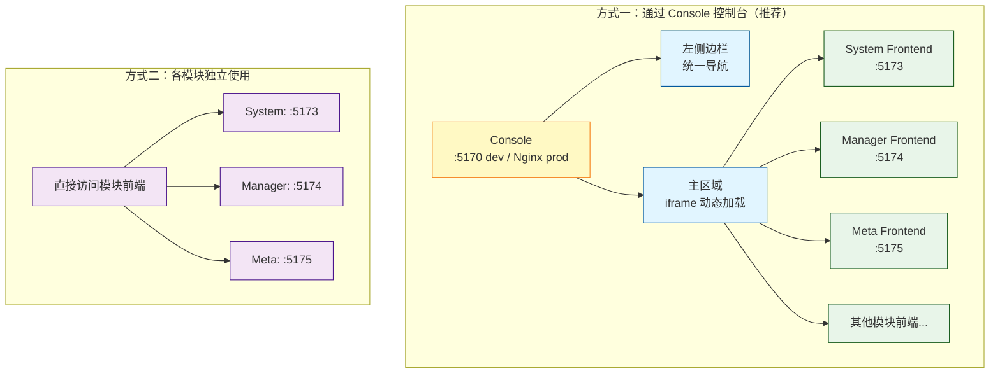

# ADDP 平台接入方式

[返回模块架构图](../addp模块架构图.md)

Console 集成访问和模块独立部署两种入口，以及统一浏览器认证的职责。

阅读导航：[ADDP 两种使用方式](#addp-两种使用方式)、[两种使用方式说明](#两种使用方式说明)。

## ADDP 两种使用方式

ADDP 支持两种使用方式：通过 Console 控制台访问，或各模块独立部署使用。

### 两种使用方式说明

**方式一：通过 Console 控制台**（推荐）：
- **单一入口**：本地开发首选 `http://localhost:5170`；生产使用 Nginx 统一入口，以部署配置的 `ADDP_PUBLIC_ORIGIN` 为准，默认 `http://localhost`。
- **集成导航**：左侧边栏只显示当前账号有权进入的模块与页面；入口判断遵循[权限与角色发布规范](../../spec/addp权限与角色发布规范.md)中的部分授权账号规则
- **模块加载**：主区域通过 iframe 动态加载各模块前端
- **一次登录**：统一浏览器认证会话，短期 Access Token 由 Console 向受信任的模块 iframe 投递；可访问范围仍由当前授权上下文与资源 owner 判断
- **适用场景**：生产环境，提供完整的用户体验

**方式二：各模块独立使用**：
- **直接访问**：各模块前端独立访问（如 `http://localhost:5173`）
- **独立登录**：每个模块有自己的登录页面
- **独立部署**：适合单个模块独立部署的场景
- **适用场景**：开发调试，模块独立交付

> 认证细节（Browser AuthSession、iframe `postMessage`、静默刷新和多标签页互斥）见：[ADDP 登录认证原理说明](../addp登录认证的原理说明.md)

---
