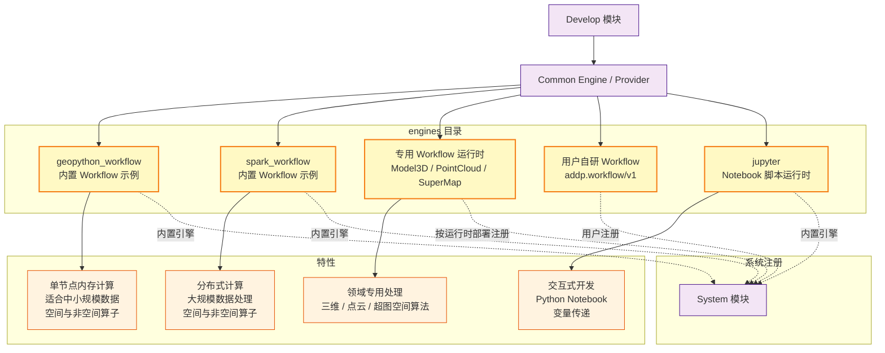
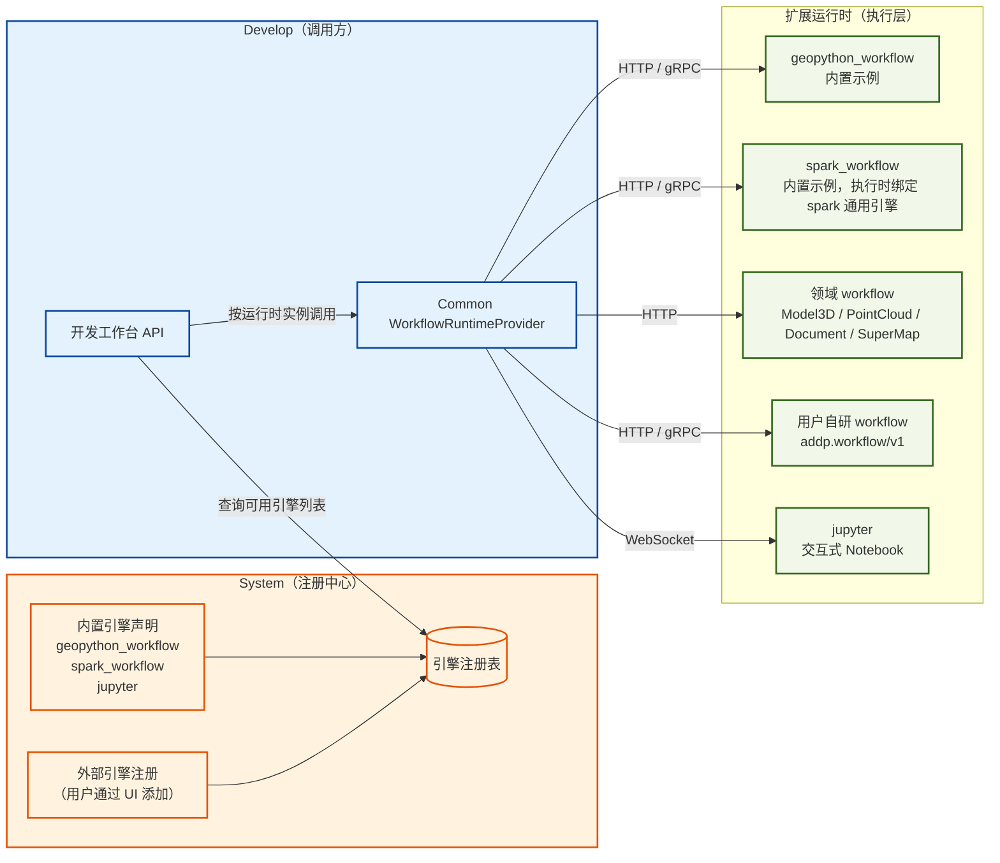
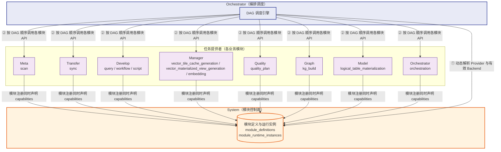
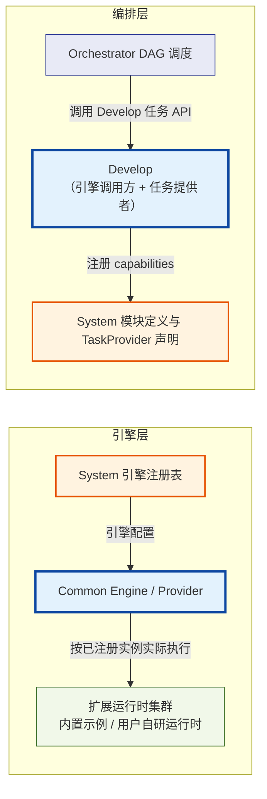

# ADDP 扩展运行时与任务编排

[返回模块架构图](../addp模块架构图.md)

System 的运行时注册、Common Provider 调用与 Orchestrator 的 TaskProvider 编排之间的关系。

阅读导航：[扩展运行时与任务编排](#扩展运行时与任务编排)、[扩展运行时概述](#扩展运行时概述)、[扩展运行时与任务编排的架构关系](#扩展运行时与任务编排的架构关系)。

## 扩展运行时与任务编排

### 扩展运行时概述

位于 `engines/` 目录，ADDP 平台提供若干内置扩展运行时作为示例和默认部署选择；用户也可以按扩展引擎规范注册自研运行时：

**运行时示例**：

| 引擎 | 类型 | 适用场景 | 主要能力 |
|------|------|---------|---------|
| **geopython_workflow** | 工作流运行时 | 数据量 < 100 万行 | 快速执行，空间与非空间算子 |
| **spark_workflow** | 工作流运行时 | 数据量 > 100 万行 | 大规模数据处理，空间与非空间算子；执行时绑定 `engine_type=spark` 的通用引擎资源 |
| **model3d_workflow** | 工作流运行时 | 三维模型、BIM 和 3DGS 快显 | GLB、3D Tiles、KSplat 等领域转换算子 |
| **pointcloud_workflow** | 工作流运行时 | 点云快显 | LAS / LAZ / E57 / PCD / XYZ 到 COPC 转换算子 |
| **supermap_workflow** | 工作流运行时 | 超图数据格式与空间分析 | SuperMap iObjects C++ 算子和 DAG 类型化内存句柄传递 |
| **math_workflow** | 工作流运行时参考实现 | 学习与扩展规范示例 | 基础数学算子；开发环境自动启动服务，手动注册后可用 |
| **jupyter** | 脚本运行时 | Notebook 开发 | Python Notebook，变量传递 |

**注册机制**：
- 生产内置运行时在自身服务就绪后异步自注册为**内置引擎** (`is_builtin = true`)；System 不代替 Runtime 预注册。System 尚未可用时，Runtime 退避重试注册，注册失败不得阻塞 Runtime 自身 readiness。
- 用户自研扩展运行时按同一张 System 引擎注册表管理，不要求某个内置工作流运行时必然存在。
- 调用方只发现已注册、启用且声明对应能力的运行时实例；工作流算子通过 `addp.workflow/v1` 动态发现。
- Runtime 与业务模块可以按任意顺序启动。模块选择启动不隐式要求或拉起可选 Runtime；需要本地运行某个 Runtime 时必须显式选择该 Runtime，或使用包含 Runtime 的全量部署组合。

---

### 扩展运行时与任务编排的架构关系

#### 一、扩展运行时层：System 注册 → Common Provider 调用

System 是扩展运行时的**注册中心**。Develop 负责编排和执行工作流；其他业务模块如需 direct 算子能力，也必须通过 Common Engine / Provider 按已注册运行时实例调用，不得直接假设某个内置工作流引擎存在。

**要点**：
- System 仅维护引擎元数据（连接信息、类型、状态），不参与执行
- Develop 运行时从 System 查询引擎配置，按用户选择路由到对应运行时
- 扩展运行时是纯执行层，无任务定义概念，只接受并执行代码/作业

---

#### 二、任务编排层：各模块向 System 注册 → Orchestrator 编排

各业务模块在模块注册时向 System 声明自己提供的 **TaskProvider capabilities**，Orchestrator 在具体调用前从模块控制面动态解析当前有效 Backend。

**要点**：
- 各模块 Backend 启动时通过模块注册一次性发布实例与 TaskProvider capabilities（任务类型、定义 schema、owner 前端入口和标准 API endpoint）；不再存在独立 Provider 注册请求
- Provider 声明是模块定义的一部分，管理员 `enabled` 与运行实例租约是可用性的唯一事实；Provider 不保存独立地址或启用状态
- Orchestrator 和 Monitor 每次实际使用前从 System 解析当前有效 Backend 池；模块离线期间保留声明但不可调用，Backend 恢复租约后立即可用
- TaskProvider 投影不得固定选择排序第一条 Backend，也不得把单个 `base_url` 当作模块事实；调用方从 System 返回的有效端点池中按稳定轮询选择，执行 POST 失败后不得自动换实例重放
- Orchestrator 不硬编码对任何模块的依赖，完全由注册信息驱动
- DAG 步骤只能引用 owner 模块已保存的任务定义，通过 `provider + task_type + task_id` 调用标准 TaskProvider API

---

#### 三、两层之间的关联：System 注册表与 Common 调用路径

**Develop 在两层中扮演不同角色**：
- 对**引擎层**：是工作流编排和执行的主要消费者，从 System 获取引擎配置，经 Common Engine / Provider 向扩展运行时派发执行任务；其他业务模块如需 direct 算子，也走同一 Provider 主路径
- 对**编排层**：是提供者，将自身能力封装为 `query` / `workflow` / `script` 三类可编排任务类型注册到 System，供 Orchestrator 调度；Notebook 是 `script` 的当前 UI 和运行时形态，不作为独立 `task_type`

这意味着一个复杂的数据处理流水线可以是：
> Transfer 导入数据 → Develop 执行 SQL/Python 加工 → Meta 更新元数据 → Manager 刷新目录
>
> 全部由 Orchestrator 统一编排，其中 Develop 步骤内部再调用扩展运行时执行。

---
