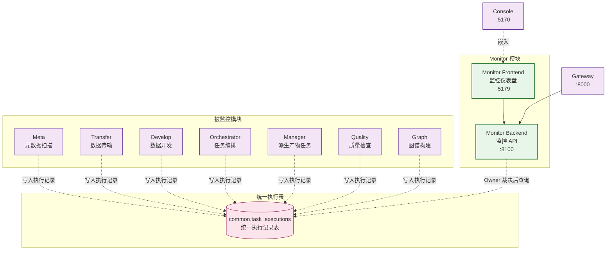

# ADDP 运行监控与观测

[返回模块架构图](../addp模块架构图.md)

Monitor 执行监控、平台运行观测与 System 服务运行日志的职责分工。

阅读导航：[Monitor 模块](#monitor-模块)、[平台运行观测](#平台运行观测)、[模块服务运行日志边界](#模块服务运行日志边界)。

## Monitor 模块

Monitor 聚合 Owner 写入的公共执行事实，提供授权执行诊断，并拥有独立的 Platform 运行观测与告警域。执行与平台事实分别沿[执行监控规范](../../spec/tasks/执行监控.md)和[平台运行观测规范](../../spec/addp平台运行观测规范.md)，不在模块架构概览重复维护实施阶段。

图中端口为本地开发首选值，实际映射以标准启动输出及 `.dev-state/ports.env` 为准；容器与公开入口边界见[端口规范](../../spec/addp端口分配.md)，不从图示端口推断生产访问地址。

**Monitor 模块功能**:

| 功能 | 说明 |
|------|------|
| **执行记录查询** | 按当前 Tenant 与 Owner 逐请求读取范围分页、过滤，见[执行读取契约](../../spec/tasks/执行监控.md#租户执行诊断)；不能按“跨模块”扩大授权。 |
| **统计分析** | 计算成功率、平均执行时间、失败原因分布等统计指标 |
| **趋势分析** | 按天聚合执行数据,生成趋势图表 |
| **模块健康检查** | [Provider 探测与公共后台心跳](../../spec/tasks/执行监控.md#provider-与后台运行实例健康)分别表达；任务执行失败不等于模块或进程不可用，心跳也不授予执行所有权。 |

**统一执行表 (common.task_executions)**:
- 模型、索引、执行身份及 Worker 职责统一见[执行架构与存储](../monitoring/执行架构与存储.md)及[执行记录与租约](../../spec/tasks/执行记录与租约.md)，不复制字段或索引清单。
- `source`、`trigger_type` 的含义与唯一枚举沿[触发类型和来源](../../spec/tasks/执行记录与租约.md#触发类型和来源)，`source_task_id` 是任务定义软引用。真实读写 Owner 通过 `lineage_facts` 交由 Meta 保存血缘证据，Monitor 只读取安全投影，不反向拥有领域结果。

### 平台运行观测

- System 拥有纳管节点稳定身份和部署关联，以及已有模块/实例/引擎登记；Monitor 拥有监测目标、策略、查询、拓扑投影、告警与通知，不复制实例租约或引擎生命周期。
- Prometheus、Loki、Tempo 和节点采集设施按 Infra 组织；指标、日志、追踪分别选择。SDK 和公共埋点随应用构建，业务主路径不等待遥测确认。
- 可选观测设施和 Monitor 不进入其他业务模块的启动、Ready 或 Gateway 路由条件；Monitor 整体 Ready 不包含可选观测后端，执行查询与资源/日志/追踪请求分别处理错误。
- 未启用、配置缺失、设施故障、目标未接入、无样本、过期与不支持分别表达；未知观测不改变任务、租约或引擎事实，也不能恢复告警。
- 首期平台资源视图不授予 Tenant 数据、SQL、任务结果或主机管理权。集中日志正文保持下述 System 授权主路径。
- 当前实现和剩余覆盖统一见[后续事项能力表](../../next/ADDP平台运行监控与可观测性设计.md#一当前实现与剩余工作)，来源及容器支持沿[运行环境边界](../../spec/addp平台运行观测规范.md#52-部署与运行环境)；固定版本、失败与未覆盖项见[历史证据专题](../../spec/testing/evidence/Monitor历史证据.md#按主题查阅)，不由架构图推导已实现或已验收。

### 模块服务运行日志边界

System 提供 Platform 实例运行日志的授权查询和页面入口；Infra 的 Alloy 采集受控实例文件，Loki 保存日志，使用独立 MinIO bucket。Monitor 拥有任务执行监控及独立的平台日志链路告警域；Infra 定时采集节点安全计数并通过受认证观测协议上报，Monitor 判定、持久保存并复用通知传输能力，System 提供平台链路摘要与上下文跳转，事件处理及通知管理唯一位于 Monitor `/platform-alerts`。Monitor 不读取业务节点文件，平台事件不绑定虚构 Tenant 或任务。日志设施故障不作为业务 Ready 前置条件，也不改写模块租约状态。详细契约见 [模块服务运行日志规范](../../spec/addp模块服务运行日志规范.md)，未完成验收见 [日志专题](../../next/ADDP模块服务运行日志设计.md)。

---
