# ADDP 运行监控与观测

[返回模块架构图](../addp模块架构图.md)

Monitor 执行监控、平台运行观测与 System 服务运行日志的职责分工。

阅读导航：[Monitor 模块](#monitor-模块)、[平台运行观测](#平台运行观测)、[模块服务运行日志边界](#模块服务运行日志边界)。

## Monitor 模块

Monitor 模块当前提供**统一运行监控**及独立的 Platform 日志链路健康与告警。平台运行观测覆盖 ADDP 节点、运行实例和明确纳管引擎的资源、服务质量与关联诊断；主机资源观测与独立可选指标设施已分批实施；实例自身 CPU/RSS/时长及趋势已接入；引擎专业指标、容器观测、拓扑及追踪仍待实施，依赖矩阵与分期见 [平台运行观测规范](../../spec/addp平台运行观测规范.md)。

```mermaid
graph TB
    subgraph "Monitor 模块"
        MFE[Monitor Frontend<br/>监控仪表盘<br/>:5179]
        MBE[Monitor Backend<br/>监控 API<br/>:8100]
        MFE --> MBE
    end

    subgraph "被监控模块"
        Meta[Meta<br/>元数据扫描]
        Transfer[Transfer<br/>数据传输]
        Develop[Develop<br/>数据开发]
        Orchestrator[Orchestrator<br/>任务编排]
        Manager[Manager<br/>派生产物任务]
        Quality[Quality<br/>质量检查]
        Graph[Graph<br/>图谱构建]
    end

    subgraph "统一执行表"
        TaskExec[(common.task_executions<br/>统一执行记录表)]
    end

    Meta -.写入执行记录.-> TaskExec
    Transfer -.写入执行记录.-> TaskExec
    Develop -.写入执行记录.-> TaskExec
    Orchestrator -.写入执行记录.-> TaskExec
    Manager -.写入执行记录.-> TaskExec
    Quality -.写入执行记录.-> TaskExec
    Graph -.写入执行记录.-> TaskExec
    MBE -.查询执行记录.-> TaskExec

    Gateway[Gateway<br/>:8000] --> MBE
    Console[Console<br/>:5170] -.嵌入.-> MFE

    classDef monitor fill:#e8f5e9,stroke:#2e7d32,stroke-width:2px
    classDef module fill:#f3e5f5,stroke:#4a148c
    classDef infra fill:#fce4ec,stroke:#880e4f

    class MFE,MBE monitor
    class Meta,Transfer,Develop,Orchestrator,Manager,Quality,Graph,Gateway,Console module
    class TaskExec infra
```

**Monitor 模块功能**:

| 功能 | 说明 |
|------|------|
| **执行记录查询** | 分页查询所有模块的任务执行记录,支持模块/状态/类型过滤 |
| **统计分析** | 计算成功率、平均执行时间、失败原因分布等统计指标 |
| **趋势分析** | 按天聚合执行数据,生成趋势图表 |
| **模块健康检查** | 检查各模块的任务执行状态,识别异常模块 |

**统一执行表 (common.task_executions)**:
- **跨模块统一**: Meta、Transfer、Develop、Orchestrator、Manager、Quality、Graph 等模块的执行记录统一存储
- **灵活字段**: 使用 JSONB 字段存储模块特有数据 (execution_config, result, error_details)
- **性能优化**: 多层索引 (租户+状态、模块+类型、时间降序、JSONB GIN)
- **来源审计**: 通过 source 记录触发来源模块，trigger_type 只表达 manual / scheduled
- **数据血缘**: 真实读写 owner 在 execution 结果中写入 `lineage_facts`，Meta 解析后保存关系证据和当前投影；`source_task_id` 只作为任务定义软引用

### 平台运行观测

- System 拥有纳管节点稳定身份和部署关联，以及已有模块/实例/引擎登记；Monitor 拥有监测目标、策略、查询、拓扑投影、告警与通知，不复制实例租约或引擎生命周期。
- Prometheus、Loki、Tempo 和节点采集设施按 Infra 组织；指标、日志、追踪分别选择。SDK 和公共埋点随应用构建，业务主路径不等待遥测确认。
- 可选观测设施和 Monitor 不进入其他业务模块的启动、Ready 或 Gateway 路由条件；Monitor 整体 Ready 不包含可选观测后端，执行查询与资源/日志/追踪请求分别处理错误。
- 未启用、配置缺失、设施故障、目标未接入、无样本、过期与不支持分别表达；未知观测不改变任务、租约或引擎事实，也不能恢复告警。
- 首期平台资源视图不授予 Tenant 数据、SQL、任务结果或主机管理权。集中日志正文保持下述 System 授权主路径。
- 日志、指标设施已按显式部署开关组织；实际覆盖仍须来源部署与授权验收。详细契约见 [平台运行观测规范](../../spec/addp平台运行观测规范.md)。

### 模块服务运行日志边界

System 提供 Platform 实例运行日志的授权查询和页面入口；Infra 的 Alloy 采集受控实例文件，Loki 保存日志，使用独立 MinIO bucket。Monitor 拥有任务执行监控及独立的平台日志链路告警域；Infra 定时采集节点安全计数并通过受认证观测协议上报，Monitor 判定、持久保存并复用通知传输能力，System 提供平台链路摘要和处理入口。Monitor 不读取业务节点文件，平台事件不绑定虚构 Tenant 或任务。日志设施故障不作为业务 Ready 前置条件，也不改写模块租约状态。详细契约见 [模块服务运行日志规范](../../spec/addp模块服务运行日志规范.md)，未完成验收见 [日志专题](../../next/ADDP模块服务运行日志设计.md)。

---
