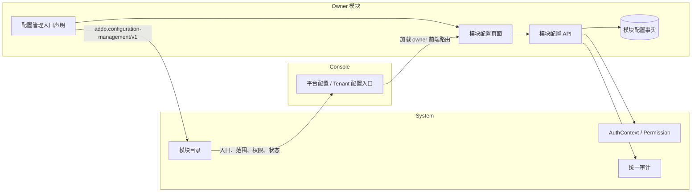
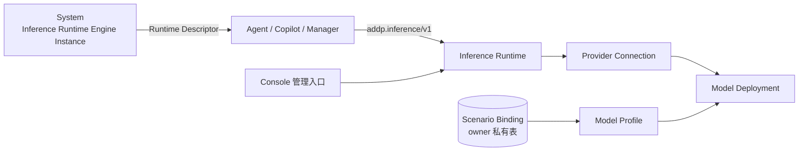

# ADDP 配置管理与AI推理

[返回模块架构图](../addp模块架构图.md)

Console、System、owner 模块和部署系统的配置职责，以及 Inference 资源、Runtime 与业务场景绑定的边界。

阅读导航：[配置管理职责](#配置管理职责)、[AI 推理职责](#ai-推理职责)。

## 配置管理职责

ADDP 的配置管理采用“Console 集中呈现、System 集中治理、owner 模块自治”的结构。配置项的平台级或 Tenant 级范围与配置语义的 owner 是两个独立维度；System 不因为提供模块目录和 IAM 就成为所有配置的事实源。

| 组件 | 职责 | 明确不负责 |
| --- | --- | --- |
| Console | 按当前 AuthContext、Permission 和模块状态聚合模块级配置入口，加载 owner 模块页面 | 保存配置值、解释业务字段、代替后端授权 |
| System | 登记版本化配置管理入口能力，提供 IAM、Permission、统一审计及 System-owned 配置 | 保存其他模块配置值、理解业务字段、在模块下线时代管配置 |
| owner 模块 | 定义、校验、保存、应用并审计本模块的普通运行配置 | 把部署配置或 Secret 混入普通配置表 |
| 部署系统 | 提供端口、数据库、基础设施地址和 Secret 等 Bootstrap 输入 | 作为 owner 普通运行配置的 fallback |

模块启动后可以随模块注册发布自己的配置管理入口。每个模块对外发布一个稳定的模块级入口；模块内的多个配置域在该入口页面内部通过 Tab 或分组组织。System 只接受 owner 与当前 Service Principal 一致的声明，并按稳定 entry id 幂等更新；声明不携带具体配置定义和值。Console 只负责统一入口和上下文分区，配置页面及 API 保持模块独立运行能力。

Platform Realm 只展示平台配置入口，Tenant Context 只展示当前 Tenant 配置入口。owner API 必须执行最终上下文和 Permission 校验；System 的通用平台配置 Permission 不能绕过业务模块自己的配置 Permission。

部署配置、普通运行配置、Secret、资源实体和任务快照的详细边界见 [ADDP 配置规范](../../spec/addp配置介绍.md)。

### AI 推理职责

AI 推理采用“System 登记 Runtime、Inference 拥有推理资源、业务模块拥有场景绑定、Console 聚合入口”的单一路径。在线厂商账号和内网模型端点不会各自成为 System Engine Instance。

| 组件 | 拥有的事实 | 明确不拥有 |
| --- | --- | --- |
| System | Runtime Engine Instance、IAM、Permission、模块生命周期 | Provider 列表、模型列表、API Key、场景默认值 |
| Inference | Provider Connection、Model Deployment、Model Profile、加密凭据、统一推理协议与调用审计 | Agent/Copilot/Manager 的业务 Service、Chain 和场景绑定 |
| Agent / Copilot / Manager | 本模块 Scenario Binding、业务上下文和 Service/Chain | 厂商协议适配、上游 API Key |
| Console | Inference 管理页面的统一入口 | 推理资源和密钥事实 |

Runtime Instance 默认是平台级共享计算能力，但不因此获得任意 Tenant 业务权限。Provider Connection 可以是平台级或 Tenant 级；平台 Provider 必须显式授权全部或指定 Tenant，Tenant Provider 只能被所属 Tenant 使用。调用方按“Tenant 显式场景绑定 > 平台默认场景绑定 > 明确未配置错误”解析，不做任意模型自动优先或隐藏 fallback。详细契约见 [ADDP AI 推理接口规范](../../spec/addp%20AI推理接口规范.md)。

---
