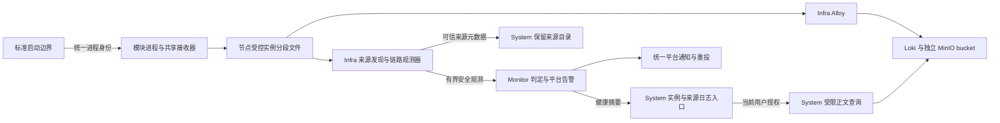
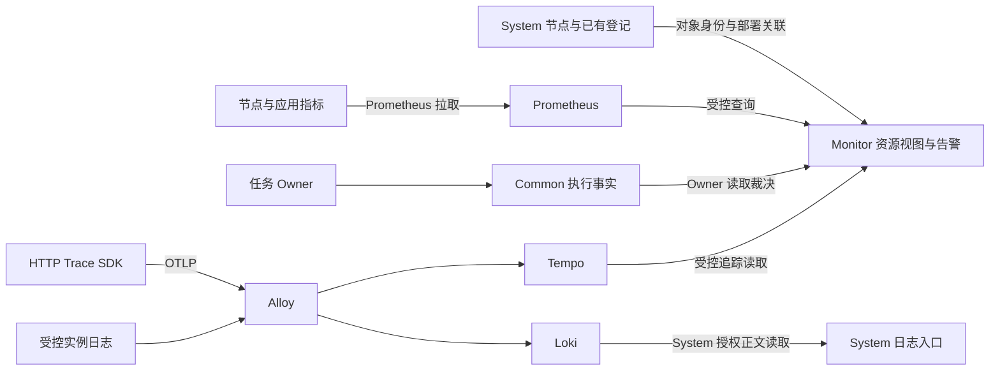

# ADDP 监控：平台日志与运行观测

[返回监控与执行体系](../addp监控与执行体系图.md)

## 模块服务运行日志与链路告警

运行日志描述进程启动输出、运行消息和异常堆栈；操作审计描述操作者行为，任务执行记录与过程事件描述执行生命周期。三者各有事实源，不能因为都叫“日志”而合并存储、身份或权限。模块运行日志属于平台运维域，正文由 System 在 Platform Context 下授权读取。

进程实例身份在启动边界产生，登记、健康和日志共同消费；重启产生新身份，同进程重新登记保留原身份。接收器是日志设施，不是业务实例；任务租约 Worker 身份也不替代进程身份。日志设施失效不改变业务 Ready、租约或 UP/DOWN。

未登记来源具有受控启动与采集身份，却尚未关联当前登记事实。System 保存有保留期的来源目录，使源文件清理后仍可在集中保留窗口内定位日志；未登记不等于 DOWN 或启动失败，首次采集时间不是进程启动时间。正文与已登记实例复用同一查询路径，不另建正文存储。

历史阅读固定查询窗口，按接收时间和精确接收序号续读；游标不代表存储快照，目录存在不证明正文送达，近期探针成功不证明历史完整。配额清理、断连和未刷新输出可能造成缺口，状态须保留未知与已知丢弃事实。

Infra 独立观测器只上报有界身份、时间和安全计数，不发送正文或租户数据；Monitor 根据新鲜度、计数基线及连续样本判定日志信号。平台告警与 Tenant 执行告警事实及权限分开；统一平台事件只有 opened/resolved，各信号固定级别、独立恢复，未知或暂停不能证明恢复。

System 保留日志正文、来源、健康诊断与上下文跳转，事件处理和通知管理唯一位于 Monitor `/platform-alerts`。通知复用统一平台 outbox、受控 Webhook/SMTP/企业微信传输与有界重试，最终失败可按原身份重新入队；历史补发不改变当前告警，入队不等于送达，通知到达也不代表当前仍异常。

实现、安全、容量、API 和标准门禁见[模块服务运行日志规范](../../spec/addp模块服务运行日志规范.md)；未完成证据与范围准入见[运行日志验收与后续事项](../../next/ADDP模块服务运行日志设计.md)。

## 平台运行观测

运行观测采用“System 维护对象身份 → 部署/应用产生事实 → Infra 保存遥测 → Monitor 授权聚合与告警”的职责链。任务执行继续使用 common.task_executions；资源采样使用 Prometheus，日志保持 Alloy/Loki/System 唯一路径，HTTP Trace 使用基于 OpenTelemetry 的共享 SDK，经 Alloy 进入 Tempo；各语言和执行阶段的范围沿[Trace 契约](../../spec/addp平台运行观测规范.md#65-分布式追踪与日志关联二期第一批)。

观测后端不作为业务 Ready 的强依赖。未部署 Prometheus 不阻断执行统计，未部署 Tempo 不阻断指标或日志；某节点采集缺失只影响该节点观测。共享 Alloy 故障可能同时影响日志与追踪，且共享磁盘耗尽仍可能影响业务，不能将软依赖解释为物理隔离，见[故障与状态边界](../../spec/addp平台运行观测规范.md#53-故障与状态)。Monitor 不用资源指标裁决 System 实例 UP/DOWN，也不改写任务终态或引擎生命周期。

平台资源与租户执行按各自上下文授权。资源压力、服务质量、部署关系和观测调用关系分别解释；不把 slot capacity 当 CPU，不把无数据当正常，不凭染色拓扑确认根因。故障矩阵、领域准入和 T0–T5 门禁沿[正式规范](../../spec/addp平台运行观测规范.md)，当前实现与缺口沿[后续事项能力表](../../next/ADDP平台运行监控与可观测性设计.md#一当前实现与剩余工作)；固定源码、失败、清理及未覆盖范围见[历史证据专题](../../spec/testing/evidence/Monitor历史证据.md#按主题查阅)。独立容器证明、正式身份、Hosted 与生产 T5 分别认定，不由来源接入或局部页面结果外推。

## 平台运行告警

Monitor 统一拥有平台告警规则、事件、处理及通知；System 保留主机/实例身份管理、日志诊断和上下文跳转。平台日志与主机资源复用一条平台事件/通知主链，租户执行告警继续独立裁决当前 Tenant 与任务访问权限。首期平台告警由平台系统管理员管理，查看、处理、规则配置及通知管理分别授权，不自动向安全/审计管理员或租户账号授予运维操作，也不因平台管理员身份取得租户业务数据。服务身份只承担已声明的采集/评估职责。

日志来源的观测协议与诊断策略保留，旧通知目标仅订日志；主机 CPU/内存压力默认停用，资源通知需显式选择。原位迁移保留历史事件和投递身份，不重写历史载荷或为迁移重发通知。告警契约见[正式规范](../../spec/addp平台运行观测规范.md#七平台告警与通知)，实现与剩余覆盖沿上述能力表；固定版本、失败及分层结果见[告警与规则证据](../../spec/testing/evidence/Monitor告警与规则历史证据.md)，不将页面单项通过计为真实故障、通知与恢复闭环。
