# ADDP 监控：执行架构与存储

[返回监控与执行体系](../addp监控与执行体系图.md)

## 监控体系概述

租户任务执行诊断采用“Owner 产生事实并裁决读取 → Common 统一执行身份与安全契约 → Monitor 聚合展示”的职责链。Monitor 的详情只展示安全概览、已有步骤、错误与有界诊断摘要；专业结果返回所属模块。平台服务进程日志由 System 管理，操作审计使用独立事实源。过程事件与分期沿[租户执行诊断规范](../../spec/tasks/执行监控.md#租户执行诊断)，保留与释放沿[概览保留契约](../../spec/tasks/执行监控.md#概览保留与清理契约)；30 天事件清理、180 天概览只读评估及周期验收的区别统一见[模块留存导航](../../../monitor/docs/Monitor模块架构说明.md#执行留存与验收)，本页不重复维护状态。

`common.task_executions` 统一保存 execution，不保存任务定义或调度定义；模块及类型按 Owner 当前声明解释。跨模块读取仍须当前 Tenant、入口 Permission 和 Owner 逐请求裁决，见[读取时序](执行诊断与租户告警.md#跨模块监控集成)。

---

## 统一执行监控架构

图中模块与类型用于说明职责关系，实际类型沿[Owner 声明](执行状态与任务类型.md#各模块任务类型)，不把图中出现视为当前部署或验收通过。

```mermaid
graph TB
    subgraph "任务执行模块"
        Meta[Meta 模块<br/>scan]
        Transfer[Transfer 模块<br/>sync]
        Develop[Develop 模块<br/>query / workflow / script]
        Manager[Manager 模块<br/>vector_tile_cache_generation / vector_materialized_view_generation / embedding]
        Quality[Quality 模块<br/>quality_plan]
        Graph[Graph 模块<br/>kg_build]
        Orchestrator[Orchestrator 模块<br/>orchestration]
    end

    subgraph "统一记录层 (common.task_executions)"
        TaskExec[(common.task_executions 表)]

        Meta --> |写入执行记录| TaskExec
        Transfer --> |写入执行记录| TaskExec
        Develop --> |写入执行记录| TaskExec
        Manager --> |写入执行记录| TaskExec
        Quality --> |写入执行记录| TaskExec
        Graph --> |写入执行记录| TaskExec
        Orchestrator --> |写入执行记录| TaskExec
    end

    subgraph "后台运行实例观测 (common.background_runtime_heartbeats)"
        RuntimeHeartbeat[(后台运行实例心跳)]
        Meta --> |execution worker 心跳| RuntimeHeartbeat
        Transfer --> |bounded / continuous worker 心跳| RuntimeHeartbeat
        Quality --> |execution worker 心跳| RuntimeHeartbeat
    end

    subgraph "监控层 (Monitor 模块)"
        Monitor[Monitor 模块]

        Monitor --> |Owner 裁决后查询| TaskExec
        Monitor --> |只读查询| RuntimeHeartbeat
        Monitor --> Dashboard[监控看板<br/>实时状态/统计]
        Monitor --> Analysis[执行分析<br/>成功率/耗时分析]
        Monitor --> Alert[告警通知<br/>失败告警]
        Monitor --> Log[执行诊断<br/>安全错误与过程事件]
    end

    classDef module fill:#e1f5ff,stroke:#01579b
    classDef storage fill:#fff9c4,stroke:#f57f17
    classDef monitor fill:#e8f5e9,stroke:#1b5e20

    class Meta,Transfer,Develop,Manager,Quality,Graph,Orchestrator module
    class TaskExec,RuntimeHeartbeat storage
    class Monitor,Dashboard,Analysis,Alert,Log monitor
```

图中的执行诊断只读取公共事实的安全投影；平台服务日志正文仍由 System 授权，沿[运行日志职责](平台日志与运行观测.md#模块服务运行日志与链路告警)，不能从执行记录入口直接读取原始日志。

### task_executions 表结构

完整字段语义、状态推进和租约约束以[执行记录规范](../../spec/tasks/执行记录与租约.md#执行记录规范)及[共享模型](../../../common/execution/task_execution.go)为准，索引以模型与标准存储入口为准。本页按职责定位，不重复维护字段类型或模块／状态枚举。

| 范围 | 概念与读取边界 |
| --- | --- |
| 执行身份与归属 | `id` 是存储行身份，`execution_id` 是跨模块执行 UUID；Tenant、Owner 模块与稳定类型沿正式记录契约，不因统一存储扩大授权。 |
| 任务、来源与执行关联 | `source_task_id` 是可空的任务定义软引用；触发类型、父子关系和重试来源分别沿[来源与状态契约](../../spec/tasks/执行记录与租约.md#记录关联与状态推进)及[Owner 类型声明](执行状态与任务类型.md#各模块任务类型)，不能混作同一身份。 |
| attempt、租约与时间 | 领取次数、最大尝试及当前 attempt 的开始时间沿[租约契约](../../spec/tasks/执行记录与租约.md#bounded-execution-领取租约和恢复契约)；`lease_owner` 仅用于观测，不能替代写入凭据。 |
| 持久事实与公开诊断 | `execution_config`、`metadata`、`error_details` 是持久字段，不等于公开 DTO。成功 execution 的 `error_details` 仍须为空；通用详情只消费[安全诊断投影](../../spec/tasks/执行监控.md#租户执行诊断)，不公开原始配置、metadata、错误正文或租约 Token。 |

Manager／Develop 代发的一次性导出仍由 Transfer 独占 execution。导出 owner 从认证用户上下文保存发起用户，并在派发前将导出会话绑定到唯一 Transfer execution UUID 和不可变请求摘要。Transfer 根据认证服务 Client 推导 owner，用自己的租户服务令牌向 owner 的 `POST /runtime/export-sessions/{id}/execution-source` 核验会话、租户、UUID、摘要与待执行状态，然后只将核验得到的用户写入 `triggered_by`。Monitor 继续通过统一 OwnAdHoc 读取范围允许发起用户查看临时执行；来源事实不授予执行或数据权限，不复制用户 Token、Membership 或 Execution Authorization。没有导出会话来源的机器执行不声明人类发起用户，旧执行也不推测或回填归属。

### 执行运行时角色矩阵

`common.task_executions` 统一记录执行事实。Quality、Meta、Security 和 Transfer bounded 的独立 execution worker，以及 Develop Query、Manager bounded、Orchestrator orchestration 和 Model materialization 的 Backend 内嵌 execution supervisor，使用相同的 PostgreSQL claim + execution lease 所有权协议；continuous runtime、dispatcher 和 maintenance loop 保持各自专用机制。下面的矩阵区分这些角色，避免把名称相同的后台组件误认为同一机制。

| 运行时角色 | 所属模块 | 进程边界 | 领取/投递事实 | 并发与恢复 | 与 `common.task_executions` 的关系 |
|---|---|---|---|---|---|
| Quality execution worker | Quality | 独立 `quality-worker` | PostgreSQL claim 已授权 `quality/quality_plan/pending` execution | 有界槽位；lease token、heartbeat、attempt 和按执行契约恢复 | 执行质量检查、评分和 Issue reconcile，并带所有权条件写终态 |
| Meta scan worker | Meta | 独立 `meta-worker` | PostgreSQL claim `meta/scan/pending` execution | 有界槽位；lease token、heartbeat、attempt 和按扫描提交协议恢复 | 执行扫描、Meta 当前投影更新和终态写入 |
| Security discovery worker | Security | 独立 `security-worker` | PostgreSQL claim `security/sensitive_data_discovery/pending` execution | 有界槽位；lease token、heartbeat；仅扫描显式纳管目标 | 生成 Security Finding 并带所有权条件写终态，不承担全量 Meta 遍历 |
| Transfer bounded worker | Transfer | 独立 `transfer-bounded-worker` | PostgreSQL claim `transfer/sync/pending` bounded execution | 有界槽位；lease token、heartbeat；仅对明确可安全重放的模式自动恢复 | 承担 snapshot、watermark 和 bounded replay，不承载 continuous session |
| Develop query execution supervisor | Develop | 内嵌 `develop-backend` | PostgreSQL claim 全部 `develop/query/pending` bounded execution | 固定有界槽位；lease token、heartbeat；租约失效后收敛失败 | 同一路径执行 Workbench、手动任务与 Orchestrator query；不启动独立 Query Worker |
| Orchestrator execution supervisor | Orchestrator | 内嵌 `orchestrator-backend` | PostgreSQL claim 冻结计划的 `orchestrator/orchestration/pending` execution | 有界步骤推进；等待释放槽位；lease、独立续租；失联及不确定提交不重放 | 保存步骤阶段、进度和子执行引用，复用 Common 安全过程事件；不代替下游 Owner 执行或取消任务 |
| Transfer continuous worker | Transfer | 独立 `transfer-continuous-worker` 进程 | `transfer.runtime_leases`、Kafka/CDC position | capacity、heartbeat、fencing；恢复创建新的 recovery execution | 承担 continuous runtime session；`sync_states` 是业务 committed position，不替代 execution 历史 |
| Webhook/Email dispatcher | Monitor | 内嵌 `monitor-backend` | Monitor delivery outbox + `SKIP LOCKED` | 投递 lease、至少一次语义、指数退避和 dead 终态 | 消费告警生命周期 delivery，不创建或改写业务 execution |

**角色边界**:

- execution worker 与 execution supervisor 负责“执行什么以及如何完成”，差别仅在独立进程或 Backend 内嵌的部署边界；owner scheduler 只负责“何时创建 execution”；dispatcher 只负责“如何投递通知”。
- Orchestrator scheduler、Manager embedding scheduler、Meta lineage collector 和各模块 cleanup 属于 scheduler/maintenance loop，不自动等同 execution worker。
- Quality、Meta、Security、Transfer bounded 只使用 PostgreSQL claim 单一路线；Backend 只创建 execution，不执行 bounded 业务逻辑，也不保留 Asynq 或本地 channel fallback。
- 每次 claim 生成不可复用 `lease_token`。heartbeat、进度和终态写入同时校验 attempt 与 token；仅凭 Worker 名称或消息 active 状态不能证明所有权。
- `common.background_runtime_heartbeats` 只回答后台运行组件是否仍在上报，以及其容量与当前占用；Monitor 必须把它与 execution lease、continuous runtime lease 和 delivery lease 分开展示。实例心跳过期不能直接改写任何业务 execution。
- Monitor 对外只投影 `lease_owner`、`lease_expires_at`、attempt、排队/执行时长和恢复原因等安全观测字段，绝不返回 `lease_token` 或 continuous fencing token。

---
