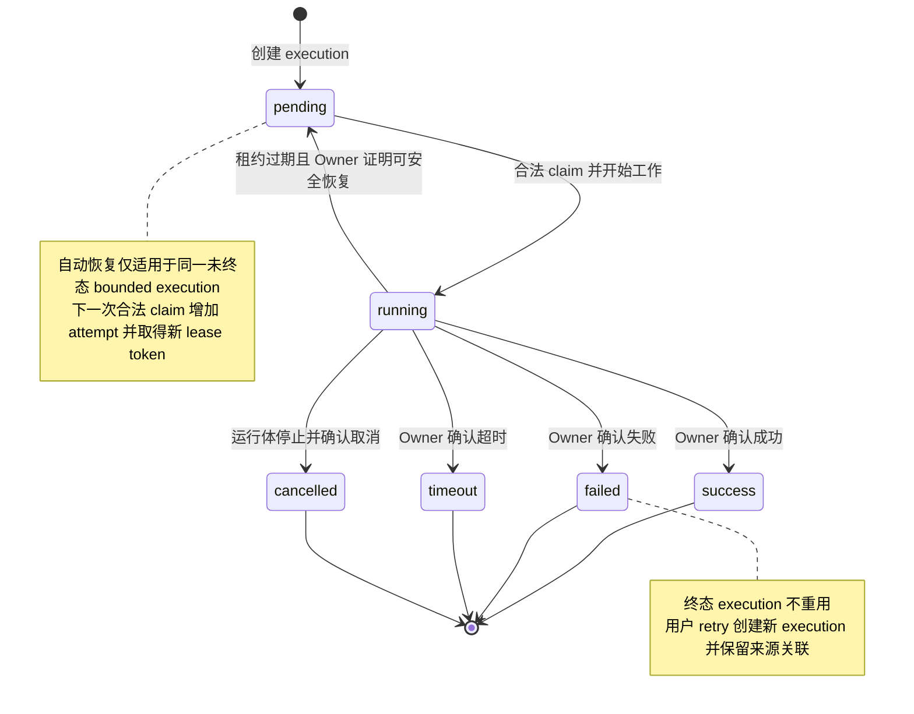

# ADDP 监控：执行状态与任务类型

[返回监控与执行体系](../addp监控与执行体系图.md)

## 任务执行状态流转

本页说明 execution，不把任务定义、Worker 进程与执行状态混为一谈。状态和时间字段沿[记录关联与状态推进](../../spec/tasks/执行记录与租约.md#记录关联与状态推进)，bounded claim、attempt 与恢复沿[租约契约](../../spec/tasks/执行记录与租约.md#bounded-execution-领取租约和恢复契约)。下图只表示通常执行及允许的 bounded 恢复路径，执行前拒绝／取消等终态仍由 Owner 按正式契约产生。

### 状态说明

六种状态的唯一枚举见[正式状态定义](../../spec/tasks/执行记录与租约.md#执行状态枚举)；这里只解释观测边界。

| 状态 | 含义与边界 |
| --- | --- |
| `pending` | execution 已创建并等待领取；不能用创建时间冒充开始时间。 |
| `running` | 已由执行方领取并开始工作；不等于 Worker 或模块整体健康。 |
| `success` | Owner 已确认成功终态；结果仍按其领域授权读取。 |
| `failed` | Owner 已确认失败终态；执行前失败可能没有开始时间。 |
| `timeout` | Owner 已确认超时终态；不能由 Monitor 按创建时间猜测。 |
| `cancelled` | Owner 已确认取消；不能只改状态而让真实运行体继续工作。 |

`metadata` 不因处于 `pending/running` 就必定为空；其中可能包含 Owner 已保存事实或私有关联。通用页面只消费[安全诊断投影](../../spec/tasks/执行监控.md#租户执行诊断)，不返回原始 metadata、配置或内部租约凭据。时间字段及 `error_details` 的写入条件由正式记录契约维护，不从本页简表推导字段一定存在或允许公开。

自动恢复只针对尚未终态且 Owner 能证明安全重放的 bounded execution，不把租约过期直接视为重放许可；continuous session 的恢复沿[同步执行契约](../../spec/tasks/Transfer同步执行.md#transfer-continuous-sync-v1-契约)，不借用此图新增恢复路径。已有[执行诊断与 Worker 恢复历史证据](../../spec/testing/evidence/Monitor执行监控与留存历史证据.md#continuous-诊断与-owner-不可用)分别绑定固定源码、失败和实际拓扑，不代表所有 Owner、全部恢复模式或 T5 已验收。

---

## 各模块任务类型

稳定 execution `task_type` 与可供编排调用的 TaskProvider 类型分别沿[执行记录与租约](../../spec/tasks/执行记录与租约.md)和[TaskProvider 能力声明](../../spec/tasks/TaskProvider接口.md#capabilitiestask_capabilities)。共享[模型常量](../../../common/execution/task_execution.go)不是已注册或已验收能力清单；ad-hoc 类型不得为了监控而伪造任务定义或标准任务列表。

下表只定位既有领域入口，不充当完整类型注册表。实际任务类型、输入和执行约束以 Owner 当前定义及声明为准。

| Owner | 领域示例 | 定义与实现入口 |
| --- | --- | --- |
| Meta | 元数据扫描 | [Meta 模块契约](../../../meta/CLAUDE.md) |
| Transfer | 导入、导出与同步 | [Transfer 模块契约](../../../transfer/CLAUDE.md) |
| Orchestrator | 流水线编排 | [Orchestrator 模块契约](../../../orchestrator/CLAUDE.md) |
| Develop | 查询、工作流与脚本 | [Develop 模块契约](../../../develop/CLAUDE.md) |
| Manager | 瓦片、物化视图、向量化等派生处理 | [Manager 模块契约](../../../manager/CLAUDE.md) |
| Quality | 质量检查 | [Quality 模块契约](../../../quality/CLAUDE.md) |
| Graph | 知识图谱构建 | [Graph 模块契约](../../../graph/CLAUDE.md) |

---
