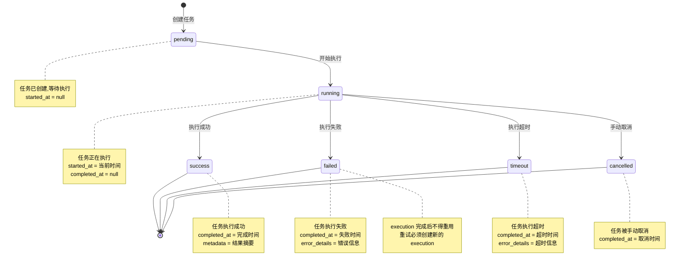

# ADDP 监控：执行状态与任务类型

[返回监控与执行体系](../addp监控与执行体系图.md)

## 任务执行状态流转

### 状态说明

| 状态 | 说明 | started_at | completed_at | metadata/error_details |
|------|------|-----------|------------|-------------|
| `pending` | 任务已创建,等待执行 | null | null | null |
| `running` | 任务正在执行 | 开始时间 | null | null |
| `success` | 任务执行成功 | 开始时间 | 完成时间 | metadata |
| `failed` | 任务执行失败 | 开始时间 | 失败时间 | error_details |
| `timeout` | 任务执行超时 | 开始时间 | 超时时间 | error_details |
| `cancelled` | 任务被手动取消 | 开始时间(可选) | 取消时间 | null |

---

## 各模块任务类型

| 模块 | task_type | 说明 | 示例 |
|------|-----------|------|------|
| **Meta** | `scan` | 元数据扫描任务 | 扫描 PostgreSQL 数据库 |
| **Transfer** | `sync` | 数据同步任务 | 表导入、表导出或跨格式同步 |
| **Orchestrator** | `orchestration` | 编排任务执行 | 执行数据处理流水线 |
| **Develop** | `query` | 查询执行任务 | SQL 查询执行 |
| | `workflow` | 工作流执行任务 | 执行空间分析工作流 |
| | `script` | 脚本执行任务 | 执行命令式脚本；当前可由 Jupyter Notebook runtime 承载 |
| **Manager** | `vector_tile_cache_generation` | 瓦片缓存生成任务 | 为空间数据生成瓦片缓存 |
| | `vector_materialized_view_generation` | 矢量物化视图任务 | 为 PostGIS 空间数据创建或刷新 3857 矢量物化视图目标 |
| | `embedding` | 向量化任务 | 对对象存储文件进行向量化 |
| **Quality** | `check` | 数据质量检查任务 | 执行质量规则检查 |
| **Graph** | `kg_build` | 知识图谱构建任务 | 构建知识图谱 |

---
