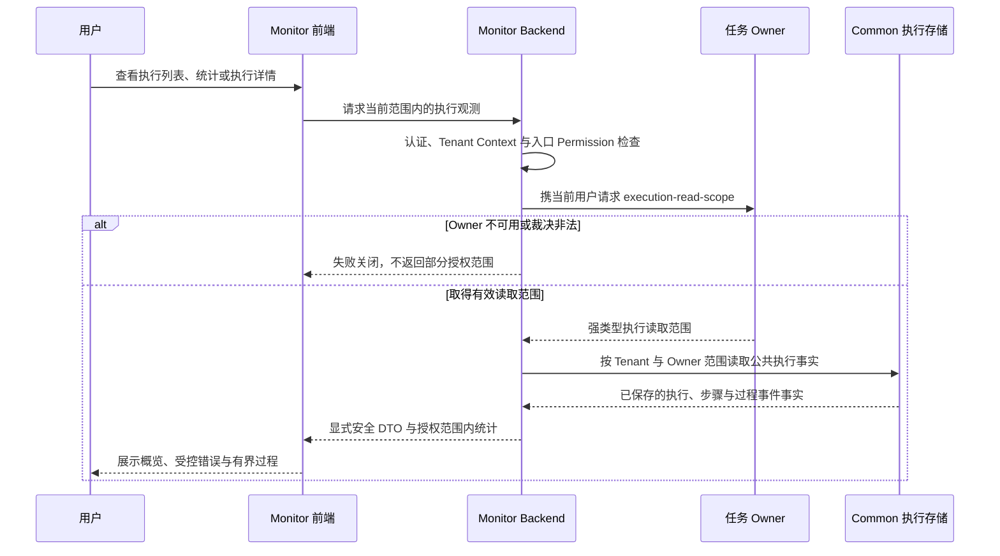

# ADDP 监控：执行诊断与租户告警

[返回监控与执行体系](../addp监控与执行体系图.md)

## 跨模块监控集成

Monitor 按当前 Tenant 和 Owner 读取裁决聚合跨模块执行事实。路由以[Monitor Router](../../../monitor/backend/internal/api/router.go)和[前端 API](../../../monitor/frontend/src/api/monitor.js)为准，授权及安全 DTO 沿[执行监控规范](../../spec/tasks/执行监控.md#租户执行诊断)。

专业结果仍从 Owner 授权入口读取，不向通用详情返回原始 metadata、执行配置或错误日志全文。[固定版本执行诊断及 Owner 故障证据](../../spec/testing/evidence/Monitor执行监控与留存历史证据.md#continuous-诊断与-owner-不可用)保留失败、撤权与恢复的实际范围，不替代后续功能或外部通知验收。

### 监控功能

**1. 实时监控看板**:
- 当前运行任务数量
- 最近 24 小时任务执行统计
- 按模块分组的成功率/失败率
- 按任务类型分组的平均耗时
- Provider 即时探测沿[正式规范](../../spec/tasks/执行监控.md#provider-即时探测)，检查当前 Backend 可用性与无副作用任务发现，不以任务成功率代替健康。
- 后台运行实例沿[公共心跳口径](../../spec/tasks/执行监控.md#后台运行实例心跳)，按角色／用途显示容量、占用和存活；不以心跳代替 execution lease、业务结果或部署预期。
- 执行运行指标：按模块、任务类型和执行边界展示积压、吞吐、耗时、失败、重试与恢复，口径见[正式统计契约](../../spec/tasks/执行监控.md#运行指标口径)。

这些指标只用于容量与调度决策，不反向修改 owner task、execution 或运行时容量。只有在实际 P95 排队、积压和槽位利用事实持续证明存在隔离需求后，才讨论优先级、租户配额或任务级限流。

Dashboard 默认展示最近 24 小时，并以低于执行状态列表的频率刷新聚合查询；统计口径、API 分工、权限和验收要求由[正式统计契约](../../spec/tasks/执行监控.md#执行统计与运行指标)维护，页面展示不扩大 Owner 读取范围。

**2. 历史执行记录**:
- 按模块、任务类型、状态筛选
- 按时间范围筛选
- 分页查询

**3. 执行详情**:
- 显式安全执行概览；执行配置和原始参数不进入通用诊断
- 排队时长、执行时长、attempt / max attempts
- bounded attempt 的 lease owner、lease expiry 和当前 lease 状态；不展示 lease token
- owner 写入的恢复原因或稳定恢复错误码
- owner 写入的 `lineage_facts` 输入资源与输出产物摘要
- Owner 已写入事实的白名单摘要和已记录步骤
- 稳定错误码与失败类别；专业结果通过 Owner 授权入口查看
- PostgreSQL 过程事件、保留窗口与截断提示
- 仅当对应 TaskProvider task type 明确声明 `supports_cancel=true` 时，才在监控侧展示取消入口；`supports_cancel=false` 的执行只展示状态和诊断，不提供标准取消动作。

### 执行血缘资源摘要

执行血缘由真实读写 Owner 写入，结构沿[统一血缘事实](../../spec/addp数据血缘能力规范.md#41-lineage_facts)，Manager 的覆盖及委托边界见[Owner 事实说明](../../../manager/docs/数据库架构.md#83-执行血缘事实)。Monitor 只消费 Common Observation 的安全摘要，不解析 SQL、不直连业务引擎或 Meta 补齐事实，不返回原始 JSON、operations 或 schema snapshot；Manager 瓦片缓存生成和矢量物化视图只展示受控目标及统计摘要，完整领域证据仍从 Owner 授权入口读取，沿[安全 DTO 契约](../../spec/tasks/执行监控.md#租户执行诊断)。

资源摘要、业务输入跳转与内部产物的展示统一见[共享前端契约](../../../common-frontend/docs/components/页面状态与导航.md#执行血缘资源摘要)。已保存摘要不代表 Meta 关系图完整或当前资源仍可读取；目标入口独立授权。平台进程日志仍由 System 管理，操作审计独立保存。

### 执行信号与租户告警

Transfer continuous 的采样、分区与 checkpoint 判定由 Transfer 负责，公共诊断投影沿[同步执行规范第 15—20、47 条](../../spec/tasks/Transfer同步执行.md#transfer-continuous-sync-v1-契约)。Monitor 只消费公共 execution 事实，不直连业务 Kafka，也不读取 `transfer.sync_states`、`transfer.runtime_leases` 或 `transfer.schema_change_requests` 补判；执行状态、无状态观测信号、持久 incident 与通知分别表达。

实时信号仍区分严重与警告：retention critical、recovery circuit open 和符合正式条件的 schema blocked 为严重；retention degraded、checkpoint degraded、恢复等待和 half-open 为警告。最新根 execution、去重、确认／抑制及恢复条件统一沿[第 20—21、48 条](../../spec/tasks/Transfer同步执行.md#transfer-continuous-sync-v1-契约)：更新的根执行取代旧信号，不回扫历史 pending 记录维持告警；schema blocked 必须满足第 48 条的完整条件，不能仅凭 `schema_change.status=pending` 判定。确认只记录处理人和时间，抑制只影响通知，均不改写 execution 或 Owner 私有事实。

通用规则沿[第 37—46 条](../../spec/tasks/Transfer同步执行.md#transfer-continuous-sync-v1-契约)：Monitor 拥有按精确任务身份配置的最近失败、最近超时与连续失败策略，Owner 写入真实终态；ad-hoc、子 execution 和 continuous session 不进入通用规则，最新根执行切为 continuous 后不沿用历史 bounded 终态。全部 evaluator 先收集 active signal，再由同一 reconciler 处理 incident；查询失败不解释为信号消失，不由一个 evaluator 恢复其他 evaluator 的告警。

规则、incident/event、通知路由和 delivery 归 Monitor；无路由仍保存 incident 与不可变 event，不生成外部 delivery，配置和投递边界见[租户外部通知契约](#租户外部通知契约)。System 只提供统一操作审计，任务 Owner 不保存通知目标或告警阈值；既有[执行诊断证据](../../spec/testing/evidence/Monitor执行监控与留存历史证据.md#continuous-诊断与-owner-不可用)不代表租户告警或通知已完成真实链路验收。

### 租户外部通知契约

Webhook 与邮件的生命周期、事务 outbox、至少一次投递、测试发送、人工重投和目标删除，统一沿[同步执行规范第 22—36 条](../../spec/tasks/Transfer同步执行.md#transfer-continuous-sync-v1-契约)。两渠道消费同一不可变 `monitor.alert_events`，各自保存目标与 delivery；确认不发通知，抑制保留 event 但不补发对应 delivery。通知不能反向成为告警、execution 或 Transfer runtime 的事实源，操作审计仍归 System。

Webhook 使用 `monitor.alert.webhook/v1`，以 HMAC-SHA256 签名 `timestamp + "." + raw_body`，Header 为 `X-ADDP-Webhook-ID`、`X-ADDP-Webhook-Timestamp`、`X-ADDP-Webhook-Signature: v1=<hex>`。payload 不携带业务数据、凭据或完整 metadata；secret 使用 `ENCRYPTION_KEY`／AES-256-GCM 保存，API 与审计均不返回明文或密文。发送和独立 `monitor.webhook.test/v1` 测试沿相同目标重核、SSRF 和签名边界，拒绝重定向；公网 HTTPS 默认与受管内网显式放行沿[部署安全配置](../../spec/configuration/Monitor与运行观测.md#告警评估与通知策略)，普通 API 不提供绕过开关。

邮件租户目标与平台 SMTP Relay 分别管理，TLS、凭据、生效方式及未配置时 dispatcher 不启动／outbox 保持 `pending` 统一见[配置规范](../../spec/configuration/Monitor与运行观测.md#告警评估与通知策略)。邮件冻结收件人、主题和正文；重投复用原 delivery 身份及内容、使用目标当前收件人的边界由上述正式契约维护，不将配置保存或入队解释为实际送达。

### 统计分析与通知入口

**4. 统计分析**:
- 汇总卡片展示执行总数、成功率、运行数量和失败数量；日趋势展示总数、成功数及失败数，均沿[统计 API 分工](../../spec/tasks/执行监控.md#统计-api-分工与授权)。
- 分组运行指标沿[正式口径](../../spec/tasks/执行监控.md#运行指标口径)；原有专题展示需求统一归入[统计展示扩展](../../../monitor/docs/Monitor模块架构说明.md#后续范围与待核对口径)，不把 API 或图表入口存在视为需求已实现。

**5. 告警通知**:
- 租户通知管理唯一页面 `/notifications` 只管理 Webhook／邮件目标与投递，见[现有页面](../../../monitor/frontend/src/views/NotificationList.vue)；通用规则及 continuous 告警沿[租户外部通知契约](#租户外部通知契约)。站内消息收件箱仍属后续范围，不将通知管理页视为站内消息已实现。
- Platform 通知由独立权限和事实裁决，沿[平台通知规范](../../spec/addp平台运行观测规范.md#73-历史订阅与通知)；平台渠道不自动扩展租户渠道。
- 实际送达须核对对应固定源码、真实接收端、事件和 delivery 证据；测试发送、页面或入队成功不代替真实告警投递，已有[执行诊断历史证据](../../spec/testing/evidence/Monitor执行监控与留存历史证据.md#2026-10-23-固定版本租户日志终审)不外推为通知通过。

---
