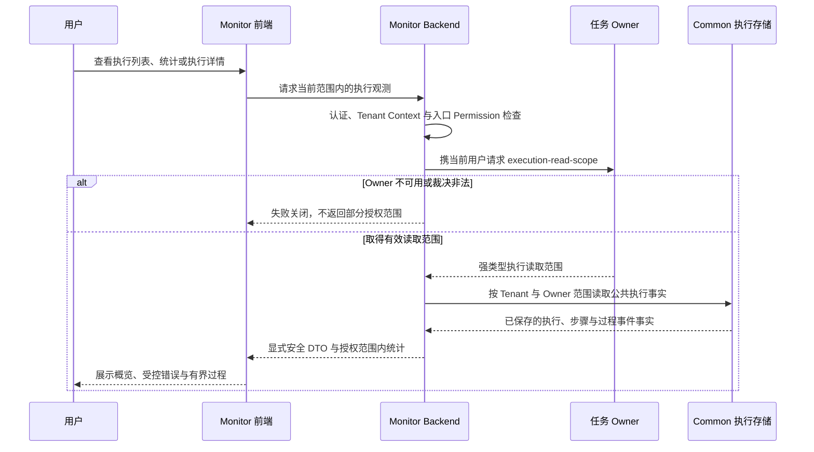

# ADDP 监控：执行诊断与租户告警

[返回监控与执行体系](../addp监控与执行体系图.md)

## 跨模块监控集成

Monitor 按当前 Tenant 和 Owner 读取裁决聚合跨模块执行事实。路由以[Monitor Router](../../../monitor/backend/internal/api/router.go)和[前端 API](../../../monitor/frontend/src/api/monitor.js)为准，授权及安全 DTO 沿[执行监控规范](../../spec/tasks/执行监控.md#租户执行诊断)。

专业结果仍从 Owner 授权入口读取，不向通用详情返回原始 metadata、执行配置或错误日志全文。[固定版本执行诊断及 Owner 故障证据](../../spec/testing/evidence/Monitor执行监控与留存历史证据.md#continuous-诊断与-owner-不可用)保留失败、撤权与恢复的实际范围，不替代后续功能或外部通知验收。

### 监控功能

**1. 实时监控看板**:
- 当前运行任务数量
- 最近 24 小时任务执行统计
- 按模块分组的成功率/失败率
- 按任务类型分组的平均耗时
- TaskProvider provider health：注册状态、模块 `/health/ready`、capabilities 基础结构，以及标准 `GET /tasks?task_type=` 任务发现响应体是否符合 `{items,total,page,page_size}`
- 后台运行实例健康：分别展示 bounded execution worker、Backend 内嵌 execution supervisor、continuous worker 和 dispatcher 的存活实例、容量、当前占用、最近心跳与过期时间
- 执行运行指标：按模块、任务类型和执行边界展示当前积压、吞吐、平均/P95 排队时长、平均/P95 运行时长、失败率、自动 attempt 重试、用户 retry 和恢复次数

执行运行指标使用以下统一口径：

| 指标 | 口径 |
| --- | --- |
| 统计窗口 | 固定允许 `24h`、`7d`、`30d`，以 `created_at` 进入窗口 |
| 当前积压 | 当前全部 `pending` / `running` execution，跨统计窗口计算 |
| 排队时长 | `started_at - created_at`；尚未开始使用查询时刻，未开始即终态使用 `completed_at`。`started_at` 按当前 attempt 记录，恢复后的差值不等于纯等待时间 |
| 运行时长 | `started_at` 有效时，owner 已写入 `execution_time_ms` 优先；否则使用 `completed_at/query_now - started_at`。沿当前 attempt 时间，不据此推算全部 attempt 累计运行时长；无开始时间时不生成运行时长 |
| P95 | 窗口内同组 execution 的 PostgreSQL `percentile_cont(0.95)`，不按客户端样本估算 |
| 自动 attempt 重试 | 同一 execution 的 `attempt > 1`，与用户 retry 分离 |
| 用户 retry | 新 execution 的 `retry_of_execution_id` 非空，原 execution 历史不改写 |
| 恢复 | owner 公共 metadata 的 `recovery_reason`，或稳定 `lease_expired` 错误/步骤事实 |
| 吞吐 | 窗口内终态 execution 数除以窗口小时数；不使用当前 Worker 容量伪造理论吞吐 |
| 失败率 | 窗口内 `(failed + timeout) / (success + failed + timeout + cancelled)`；尚未终态的 execution 不进入分母 |

时间字段的恢复／claim 语义统一见[执行记录契约](../../spec/tasks/执行记录与租约.md#记录关联与状态推进)，当前实现尚待修正的边界见[模块待核对项](../../../monitor/docs/Monitor模块架构说明.md#后续范围与待核对口径)；既有统计公式不因本次口径确认而变更，不能由旧恢复或页面证据推断该边界已验收。

这些指标只用于容量与调度决策，不反向修改 owner task、execution 或运行时容量。只有在实际 P95 排队、积压和槽位利用事实持续证明存在隔离需求后，才讨论优先级、租户配额或任务级限流。

Monitor 通过 `GET /api/v1/monitor/executions/runtime-metrics?duration=24h|7d|30d` 暴露上述分组指标，使用 `monitor.statistics.read` 权限；Dashboard 默认展示最近 24 小时，并以低于执行状态列表的频率刷新聚合查询。

**2. 历史执行记录**:
- 按模块、任务类型、状态筛选
- 按时间范围筛选
- 分页查询

**3. 执行详情**:
- 显式安全执行概览；执行配置和原始参数不进入通用诊断
- 排队时长、执行时长、attempt / max attempts
- bounded attempt 的 lease owner、lease expiry 和当前 lease 状态；不展示 lease token
- owner 写入的恢复原因或稳定恢复错误码
- owner 写入的 `lineage_facts` 输入资源与输出产物摘要
- Owner 已写入事实的白名单摘要和已记录步骤
- 稳定错误码与失败类别；专业结果通过 Owner 授权入口查看
- PostgreSQL 过程事件、保留窗口与截断提示
- 仅当对应 TaskProvider task type 明确声明 `supports_cancel=true` 时，才在监控侧展示取消入口；`supports_cancel=false` 的执行只展示状态和诊断，不提供标准取消动作。

执行元数据由任务 owner 模块写入 `common.task_executions.metadata`，Monitor 只消费 Common Observation 的显式安全投影，不反向拥有或改写模块产物。Develop、Transfer 和 Manager 均使用 `addp.lineage-facts/v1`；Manager 覆盖数据剖析、向量化、受管快显派生产物及业务派生结果，清理 execution 不生成血缘，Transfer-backed 导入导出只由 Transfer execution 写入一次。对于版本受支持的 `lineage_facts`，执行详情按 `inputs` 和 `outputs` 展示安全资源摘要：业务 ResourceLocator 使用共享定位符能力转为可读路径；可解析的业务输入通过共享 Console 路由进入 Manager 数据探查；`addp-infra://` 输出只标识为“平台内部产物”并展示文件名，不提供 Meta 或 Manager 跳转，也不根据 infra 存储位置推断其临时或长期生命周期。Monitor 不解析 SQL、不直连业务引擎或 Meta 补齐事实，不返回原始 JSON、血缘 operations 或 schema snapshot。Manager 瓦片缓存生成和矢量物化视图只展示受控目标及统计摘要；完整领域证据通过 Manager 自身授权入口读取。平台进程日志仍由 System 管理，操作审计独立保存。

Transfer continuous 运行观测同样遵守 owner 边界：Transfer worker 从业务 Kafka 采集分区 earliest/latest，以目标已提交 `next_offset` 计算 lag、retention 恢复余量和 checkpoint age/health，并写入 `metadata.continuous.diagnostics`。Monitor 只从 `common.task_executions` 展示 health、恢复 circuit 和分区诊断，不直连业务 Kafka，不读取 `transfer.sync_states` 或 `transfer.runtime_leases`。这保证 Monitor 始终是统一观测者，而不是 continuous runtime 的第二个 owner。

Monitor 可以把 owner metadata 无状态归一化为实时观测信号：retention critical、recovery circuit open 与数据库 CDC `schema_change.status=pending` 为严重，retention degraded、checkpoint degraded、恢复等待和 half-open 为警告。观测信号不是新的 execution 状态。continuous 告警按 `tenant + module + task_type + source_task_id` 只读取最新根 execution。最新 execution 为 `pending|running` 时派生运行信号；只有最新 execution 本身为 `failed` 且 `schema_change.status=pending` 时保留 schema blocked 信号。更新的根 execution 取代旧执行的信号；最新执行不再携带该信号，或审批将该投影改为 `applied`、Stop 改为 `stopped` 后，旧告警自动恢复，不回扫历史 pending 记录。Monitor evaluator 只扫描 `common.task_executions` 公共事实，把仍存在的信号物化为 `monitor.alert_incidents`，不得读取 `transfer.schema_change_requests`。告警身份包含规则身份和实际任务身份，同一规则、同一任务同时最多一个 `open|acknowledged` 事件。确认只记录操作人和时间，抑制只暂停通知，二者都不得改写 execution metadata 或 owner 私有状态。

通用执行告警由 Monitor 拥有规则策略，但不拥有运行事实。租户规则精确绑定 `module + task_type + source_task_id`，第一版只允许最近失败、最近超时和连续失败；owner 模块负责写真实 `success|failed|timeout`，Monitor 不读取 owner 私有表补判。ad-hoc、子 execution 和 Transfer continuous session 不进入通用规则；同一任务的最新根 execution 已切换为 continuous 时，Monitor 不再沿用其历史 bounded 终态。多个 evaluator 必须先收集全部 active signal，再由一个 reconciler 统一打开、升级和恢复 incident，避免一个 evaluator 错误恢复另一个 evaluator 的告警。

通用规则的外部通知采用显式 `monitor.notification_routes`。规则没有路由时仍保存 incident 和不可变 lifecycle event，但不产生 Webhook/邮件 delivery；有路由时只向当前租户绑定的目标生成 outbox。规则、incident/event、路由和 delivery 均归 Monitor，System 只提供统一操作审计，各任务 owner 不保存通知目标或告警阈值。

### 租户外部通知契约

Webhook 与邮件的生命周期、事务 outbox、至少一次投递、测试发送、人工重投和目标删除，统一沿[同步执行规范第 22—36 条](../../spec/tasks/Transfer同步执行.md#transfer-continuous-sync-v1-契约)。两渠道消费同一不可变 `monitor.alert_events`，各自保存目标与 delivery；确认不发通知，抑制保留 event 但不补发对应 delivery。通知不能反向成为告警、execution 或 Transfer runtime 的事实源，操作审计仍归 System。

Webhook 使用 `monitor.alert.webhook/v1`，以 HMAC-SHA256 签名 `timestamp + "." + raw_body`，Header 为 `X-ADDP-Webhook-ID`、`X-ADDP-Webhook-Timestamp`、`X-ADDP-Webhook-Signature: v1=<hex>`。payload 不携带业务数据、凭据或完整 metadata；secret 使用 `ENCRYPTION_KEY`／AES-256-GCM 保存，API 与审计均不返回明文或密文。发送和独立 `monitor.webhook.test/v1` 测试沿相同目标重核、SSRF 和签名边界，拒绝重定向；公网 HTTPS 默认与受管内网显式放行沿[部署安全配置](../../spec/configuration/Monitor与运行观测.md#告警评估与通知策略)，普通 API 不提供绕过开关。

邮件租户目标与平台 SMTP Relay 分别管理，TLS、凭据、生效方式及未配置时 dispatcher 不启动／outbox 保持 `pending` 统一见[配置规范](../../spec/configuration/Monitor与运行观测.md#告警评估与通知策略)。邮件冻结收件人、主题和正文；重投复用原 delivery 身份及内容、使用目标当前收件人的边界由上述正式契约维护，不将配置保存或入队解释为实际送达。

### 统计分析与通知入口

**4. 统计分析**:
- 成功率趋势图
- 执行耗时分布图
- 失败原因分析
- 热点任务 Top 10

**5. 告警通知**:
- 租户通知管理唯一页面 `/notifications` 只管理 Webhook／邮件目标与投递，见[现有页面](../../../monitor/frontend/src/views/NotificationList.vue)；通用规则及 continuous 告警沿[租户外部通知契约](#租户外部通知契约)。站内消息收件箱仍属后续范围，不将通知管理页视为站内消息已实现。
- Platform 通知由独立权限和事实裁决，沿[平台通知规范](../../spec/addp平台运行观测规范.md#73-历史订阅与通知)；平台渠道不自动扩展租户渠道。
- 实际送达须核对对应固定源码、真实接收端、事件和 delivery 证据；测试发送、页面或入队成功不代替真实告警投递，已有[执行诊断历史证据](../../spec/testing/evidence/Monitor执行监控与留存历史证据.md#2026-10-23-固定版本租户日志终审)不外推为通知通过。

---
