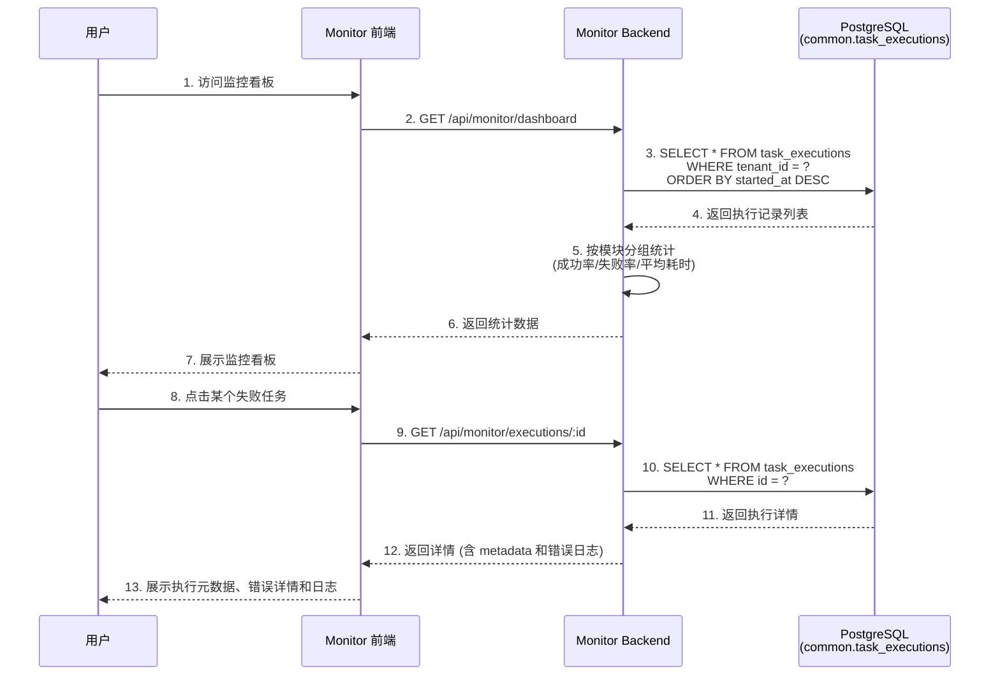

# ADDP 监控：执行诊断与租户告警

[返回监控与执行体系](../addp监控与执行体系图.md)

## 跨模块监控集成

Monitor 模块统一监控所有模块的任务执行:

### 监控功能

**1. 实时监控看板**:
- 当前运行任务数量
- 最近 24 小时任务执行统计
- 按模块分组的成功率/失败率
- 按任务类型分组的平均耗时
- TaskProvider provider health：注册状态、模块 `/health/ready`、capabilities 基础结构，以及标准 `GET /tasks?task_type=` 任务发现响应体是否符合 `{items,total,page,page_size}`
- 后台运行实例健康：分别展示 bounded execution worker、Backend 内嵌 execution supervisor、continuous worker 和 dispatcher 的存活实例、容量、当前占用、最近心跳与过期时间
- 执行运行指标：按模块、任务类型和执行边界展示当前积压、吞吐、平均/P95 排队时长、平均/P95 运行时长、失败率、自动 attempt 重试、用户 retry 和恢复次数

执行运行指标使用以下统一口径：

| 指标 | 口径 |
| --- | --- |
| 统计窗口 | 固定允许 `24h`、`7d`、`30d`，以 `created_at` 进入窗口 |
| 当前积压 | 当前全部 `pending` / `running` execution，跨统计窗口计算 |
| 排队时长 | `started_at - created_at`；尚未开始使用查询时刻，未开始即终态使用 `completed_at` |
| 运行时长 | owner 已写入 `execution_time_ms` 优先；否则使用 `completed_at/query_now - started_at` |
| P95 | 窗口内同组 execution 的 PostgreSQL `percentile_cont(0.95)`，不按客户端样本估算 |
| 自动 attempt 重试 | 同一 execution 的 `attempt > 1`，与用户 retry 分离 |
| 用户 retry | 新 execution 的 `retry_of_execution_id` 非空，原 execution 历史不改写 |
| 恢复 | owner 公共 metadata 的 `recovery_reason`，或稳定 `lease_expired` 错误/步骤事实 |
| 吞吐 | 窗口内终态 execution 数除以窗口小时数；不使用当前 Worker 容量伪造理论吞吐 |
| 失败率 | 窗口内 `(failed + timeout) / (success + failed + timeout + cancelled)`；尚未终态的 execution 不进入分母 |

这些指标只用于容量与调度决策，不反向修改 owner task、execution 或运行时容量。只有在实际 P95 排队、积压和槽位利用事实持续证明存在隔离需求后，才讨论优先级、租户配额或任务级限流。

Monitor 通过 `GET /executions/runtime-metrics?duration=24h|7d|30d` 暴露上述分组指标，使用 `monitor.statistics.read` 权限；Dashboard 默认展示最近 24 小时，并以低于执行状态列表的频率刷新聚合查询。

**2. 历史执行记录**:
- 按模块、任务类型、状态筛选
- 按时间范围筛选
- 分页查询

**3. 执行详情**:
- 显式安全执行概览；执行配置和原始参数不进入通用诊断
- 排队时长、执行时长、attempt / max attempts
- bounded attempt 的 lease owner、lease expiry 和当前 lease 状态；不展示 lease token
- owner 写入的恢复原因或稳定恢复错误码
- owner 写入的 `lineage_facts` 输入资源与输出产物摘要
- Owner 已写入事实的白名单摘要和已记录步骤
- 稳定错误码与失败类别；专业结果通过 Owner 授权入口查看
- PostgreSQL 过程事件、保留窗口与截断提示
- 仅当对应 TaskProvider task type 明确声明 `supports_cancel=true` 时，才在监控侧展示取消入口；`supports_cancel=false` 的执行只展示状态和诊断，不提供标准取消动作。

执行元数据由任务 owner 模块写入 `common.task_executions.metadata`，Monitor 只消费 Common Observation 的显式安全投影，不反向拥有或改写模块产物。Develop、Transfer 和 Manager 均使用 `addp.lineage-facts/v1`；Manager 覆盖数据剖析、向量化、受管快显派生产物及业务派生结果，清理 execution 不生成血缘，Transfer-backed 导入导出只由 Transfer execution 写入一次。对于版本受支持的 `lineage_facts`，执行详情按 `inputs` 和 `outputs` 展示安全资源摘要：业务 ResourceLocator 使用共享定位符能力转为可读路径；可解析的业务输入通过共享 Console 路由进入 Manager 数据探查；`addp-infra://` 输出只标识为“平台内部产物”并展示文件名，不提供 Meta 或 Manager 跳转，也不根据 infra 存储位置推断其临时或长期生命周期。Monitor 不解析 SQL、不直连业务引擎或 Meta 补齐事实，不返回原始 JSON、血缘 operations 或 schema snapshot。Manager 瓦片缓存生成和矢量物化视图只展示受控目标及统计摘要；完整领域证据通过 Manager 自身授权入口读取。平台进程日志仍由 System 管理，操作审计独立保存。

Transfer continuous 运行观测同样遵守 owner 边界：Transfer worker 从业务 Kafka 采集分区 earliest/latest，以目标已提交 `next_offset` 计算 lag、retention 恢复余量和 checkpoint age/health，并写入 `metadata.continuous.diagnostics`。Monitor 只从 `common.task_executions` 展示 health、恢复 circuit 和分区诊断，不直连业务 Kafka，不读取 `transfer.sync_states` 或 `transfer.runtime_leases`。这保证 Monitor 始终是统一观测者，而不是 continuous runtime 的第二个 owner。

Monitor 可以把 owner metadata 无状态归一化为实时观测信号：retention critical、recovery circuit open 与数据库 CDC `schema_change.status=pending` 为严重，retention degraded、checkpoint degraded、恢复等待和 half-open 为警告。观测信号不是新的 execution 状态。continuous 告警按 `tenant + module + task_type + source_task_id` 只读取最新根 execution。最新 execution 为 `pending|running` 时派生运行信号；只有最新 execution 本身为 `failed` 且 `schema_change.status=pending` 时保留 schema blocked 信号。更新的根 execution 取代旧执行的信号；最新执行不再携带该信号，或审批将该投影改为 `applied`、Stop 改为 `stopped` 后，旧告警自动恢复，不回扫历史 pending 记录。Monitor evaluator 只扫描 `common.task_executions` 公共事实，把仍存在的信号物化为 `monitor.alert_incidents`，不得读取 `transfer.schema_change_requests`。告警身份包含规则身份和实际任务身份，同一规则、同一任务同时最多一个 `open|acknowledged` 事件。确认只记录操作人和时间，抑制只暂停通知，二者都不得改写 execution metadata 或 owner 私有状态。

通用执行告警由 Monitor 拥有规则策略，但不拥有运行事实。租户规则精确绑定 `module + task_type + source_task_id`，第一版只允许最近失败、最近超时和连续失败；owner 模块负责写真实 `success|failed|timeout`，Monitor 不读取 owner 私有表补判。ad-hoc、子 execution 和 Transfer continuous session 不进入通用规则；同一任务的最新根 execution 已切换为 continuous 时，Monitor 不再沿用其历史 bounded 终态。多个 evaluator 必须先收集全部 active signal，再由一个 reconciler 统一打开、升级和恢复 incident，避免一个 evaluator 错误恢复另一个 evaluator 的告警。

通用规则的外部通知采用显式 `monitor.notification_routes`。规则没有路由时仍保存 incident 和不可变 lifecycle event，但不产生 Webhook/邮件 delivery；有路由时只向当前租户绑定的目标生成 outbox。规则、incident/event、路由和 delivery 均归 Monitor，System 只提供统一操作审计，各任务 owner 不保存通知目标或告警阈值。

Webhook v1 由 Monitor 拥有。告警打开、严重级别由 warning 升为 critical、告警恢复时，Monitor 必须在更新 incident 的同一个 Infra PostgreSQL 事务中写入不可变 `monitor.alert_events`，并为当时已启用且订阅该事件的 `monitor.webhook_destinations` 生成 `monitor.webhook_deliveries` outbox。HTTP 发送只能在事务外执行；dispatcher 使用短事务和 `FOR UPDATE SKIP LOCKED` 领取到期 delivery，按至少一次语义重试。接收方以全局唯一 `delivery_id` 幂等。确认不产生通知；抑制期间仍保留生命周期 event，但对应 delivery 记为 suppressed 且不补发。通知渠道不能反向成为告警、execution 或 Transfer runtime 的事实源。

Webhook 请求固定使用 `monitor.alert.webhook/v1` JSON schema，事件类型只允许 `opened|escalated|resolved`。签名使用目标独立 secret 对 `timestamp + "." + raw_body` 做 HMAC-SHA256，并通过 `X-ADDP-Webhook-ID`、`X-ADDP-Webhook-Timestamp`、`X-ADDP-Webhook-Signature: v1=<hex>` 传递。secret 使用平台 `ENCRYPTION_KEY` 做 AES-256-GCM 加密，API 和投递审计不得返回明文或密文。payload 只包含稳定告警摘要、任务/执行身份和 Console 链接，不携带业务数据、凭据或完整 execution metadata。 Webhook 默认只允许 HTTPS，拒绝私网、环回和 metadata 地址；发送时重新校验目标并拒绝重定向，测试投递沿相同传输边界。

Webhook 目标运维不改变告警事实边界。测试投递使用独立 `monitor.webhook.test/v1` schema，同步验证目标当前 URL、secret、SSRF 策略和签名，不生成告警 event 或正式 outbox。人工重投只允许 `dead` delivery，复用原 `delivery_id` 和 payload，并使用目标当前 URL/secret 开启新的最大尝试周期；累计尝试次数和人工重投次数必须保留。删除目标取消未领取投递但保留历史 delivery，已领取请求可以完成。所有写操作进入 System 统一审计日志，Monitor 不建立第二套操作审计。

邮件通知与 Webhook 消费同一条不可变 `monitor.alert_events` 事实流，但使用独立 `monitor.email_destinations` 和 `monitor.email_deliveries`。租户目标只保存名称、收件地址、订阅事件和启用状态；SMTP Relay、TLS 模式、认证凭据与发件身份由 Monitor 平台配置管理，具体归属见[配置规范](../../spec/addp配置介绍.md)。第一版只允许强制 STARTTLS 或隐式 TLS，不支持明文或机会式降级；SMTP 密码不进入租户 API、Swagger 或投递审计。邮件 delivery 冻结收件人、主题和纯文本/HTML 正文，dispatcher 在事务外按至少一次语义发送；测试发送不生成 event/outbox，`dead` 人工重投复用原 `delivery_id`、主题和正文，使用目标当前收件人。目标支持禁用与删除，写操作复用 System 统一审计。SMTP 未配置或 Relay 未启用时 dispatcher 不启动，未投递 outbox 保持 `pending`，不能伪造通知结果。

**4. 统计分析**:
- 成功率趋势图
- 执行耗时分布图
- 失败原因分析
- 热点任务 Top 10

**5. 告警通知**:
- Webhook v1 支持 continuous 告警的打开、升级和恢复投递
- 每租户维护独立 Webhook 目标、订阅事件和签名 secret
- 支持指数退避、失败终态和投递审计
- 支持独立测试投递、`dead` 手动重投、目标删除和 System 操作审计
- 通用任务最近失败、最近超时和连续失败按同一告警生命周期评估
- 邮件通知 v1 使用平台统一 SMTP Relay 和独立邮件 outbox；站内通知后续实现

---
