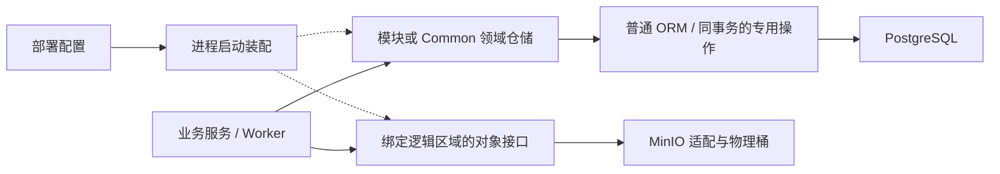
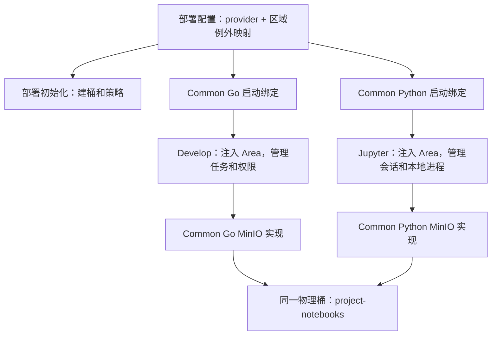
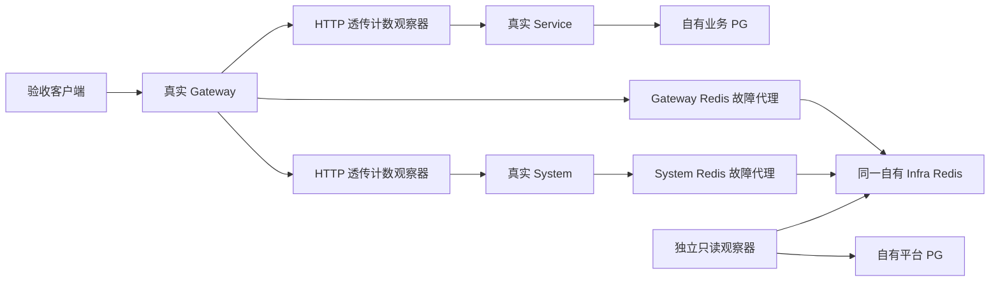

# 平台数据库与对象存储解耦设计

**状态：数据库第一批已完成跨进程验收，System 授权签发批次已通过本地 PG 验收。更新于 2026-11-18。** 两批范围分别见第 4.1、4.2 节。第 4.3 节 Standard 文档对象存储样板已通过本地 PG／MinIO T2 及固定产品的 HTTP T4。第 4.4 节跨模块改造已通过固定产品 `a5a2c7d90` 的完整隔离 HTTP T4，含保护失效与已批准的到期清理。第 4.5 节 Develop／Jupyter Notebook 已通过固定产品 `49603ec79b777fce4b3a844e022397118d55ba5b` 的完整隔离 HTTP T4，含非默认桶、普通 User 精确六项权限、真实 Kernel、关闭回存、自然 300 秒 TTL、身份拒绝与清理；前五轮失败及证据缺口分别保留，未回标为通过。第 4.6 节 Redis R1 已实现并通过相关门禁，固定 `690754af4890` 的隔离 HTTP T4 已实跑四轮。第四轮通过身份准备、源 Grant 回执和接收方 Meta 可见性核验，在 Security 保护登记处收到 HTTP 400，真实 Query 和 A～E 尚未验证。首期交付 PostgreSQL（PG）与 MinIO 两个现有实现的解耦，MySQL 平台主库列入第二阶段。验收矩阵列出目标，实际运行证据按批次记录。

## 1. 目标与部署边界

同一套 ADDP 部署独立选择**平台关系数据库**和**平台对象存储**。前者保存用户、授权、元数据、执行记录等平台事实，后者保存模块文档、暂存产物、缓存和启用归档后的审计对象。每种职责在一套部署中只绑定一个实现。模块通过已有领域仓储和对象 I/O 契约消费，由部署在进程启动时选定实现。首期的判断标准是：以后增加 MySQL 时，修改集中在数据库适配、模块专用迁移和查询、部署运维及其测试；同一套授权、任务及文件业务流程可以继续使用。

业务数据库和业务对象存储沿现有 System Engine Instance、Provider 和授权路径访问。用户接入 MySQL、MinIO、S3、国产库或分布式库的能力独立于平台主库认证。Infra 与业务侧可复用协议客户端、内容流或查询工具，平台启动连接由部署提供，包括零个业务 Engine Instance 的场景。Redis、Meilisearch、Kafka、FalkorDB 和观测服务在首期按原职责接入；它们对 PG 或对象存储的依赖列入对应边界复核。[引擎体系](../concepts/addp引擎体系图.md) · [基础设施隔离](../concepts/addp基础设施隔离图.md) · [配置归属](../spec/configuration/配置归属与生效.md)

### 1.1 Infra 的必需性与可替换性（分类已确认，Redis 按核心依赖收敛）

2026-11-16 用户提出按两类重新确认 Infra：**核心必需依赖**缺失时不能完成平台核心启动；**功能依赖**缺失时不阻止平台核心启动，依赖功能不可用。组件分类与产品选型分开：平台需要的是合格的关系数据库能力，不是固定必须存在 PG；对象存储可以由所选 Provider 提供，不要求同时部署 MinIO、S3 和 RustFS。本节分类同步至正式配置规范；部署及模块启动差距仍需分批实施和验收。Redis 经进一步核对 OAuth／MFA 安全限流后按第一类处理。

**Redis 的补充核对。** System 的 OAuth `/oauth/token`、授权请求、设备授权和部分 MFA 路由使用 Redis 安全限流，依赖不可用时返回 503；服务端取得或续取 OAuth Service Token 因而可能受阻，影响会传递到跨模块调用。Meta 的范围锁、引擎变更／扫描完成通知和 Manager 缓存同步也使用 Redis。已有 Token 不因 Redis 失联就被自动全部撤销，IAM 与 Token 等权威事实仍在关系库；bounded 队列也不依赖 Redis。综合安全入口与协调的广度，Redis 应归第一类，而非仅按缓存分类。当前 Gateway 限流失败放行及模块 readiness 对 Redis 的检查差异仍需专项治理，不能由分类变更推定已完成运行中失联验收。依据：[System OAuth 安全中间件](../../system/backend/internal/middleware/oauth_security.go)、[实际 IAM 路由](../../system/backend/internal/api/iam_routes.go)。

#### 两个维度与作用范围

- 必需性回答“某项能力缺失是否阻止核心启动”；Provider 回答“这项能力由哪款产品实现”。不能从“可切换”推导“可以没有”，也不能从“功能依赖”推导“该功能可以跳过权限或一致性条件”。
- 平台核心启动、模块服务监听、模块／Runtime 就绪、具体功能可用分别表达。可选组件故障不使整个平台不可用；专用 Runtime 的必要依赖缺失时可保持监听但未就绪，例如 Jupyter 的 Notebook 存储不可用。不得让全局健康汇总把所有可选组件都变成阻塞条件。
- 关系库 Provider 必须满足连接、事务、迁移、约束及所启用功能的已认证能力；不是任意数据库端口能连接就算合格。选型在启动前确定，运行期间不自动跨产品故障转移。更改 Provider 与搬迁已有数据是独立部署操作。

#### 组件盘点与建议分类

| Infra 能力／当前产品 | 建议平台级分类 | 缺失时受影响的具体能力与必要限制 | 当前实现及主要差距 |
| --- | --- | --- | --- |
| 平台关系数据库／PostgreSQL | **第一类：核心必需** | IAM、任务、元数据、租约、审计等权威事实不能工作；拒绝核心启动。运行中失联时相关就绪和事务失败，不能以内存或缓存代替 | 大多数 Backend 已连接并迁移自有 schema；System 的 IAM／公共初始化及 Worker 版本门禁均依赖它。Gateway 的访问日志库曾采用非阻塞处理，是角色不同，不能据此把平台主库判为可选 |
| 平台对象存储／MinIO | **第二类：功能依赖** | Standard 文档、Notebook、导入暂存、导出、对象缓存、启用的归档等不可用；不影响未依赖对象的功能。不能返回空文件假成功、换桶读取或删除旧对象来掩盖错误 | Common Go 的远端桶探测失败只告警；Jupyter 会存储失败却仍报告 healthy。部署脚本目前也把 MinIO 作为整体等待条件，尚未统一到目标分类 |
| 缓存、事件通知、锁／Redis | **第一类：共享安全／协调依赖** | 缓存加速、事件通知及依赖 Redis 的扫描范围锁、限流等受影响。权威事实仍取原 owner；需要跨进程锁或安全限流的操作，必须停止或按已确认的等价保障执行，不能仅因 Redis 可选就取消约束 | System 使用引擎事件发布；Meta 明确标注可选并使用 SETNX 范围锁；Gateway 连接失败继续启动，限流错误当前还会放行。不能将 Redis 缺失笼统描述为“只影响性能”，也不能在未改造验收前宣称全部场景已可选 |
| 全文索引／Meilisearch | **第二类：功能依赖** | Manager 内容搜索、Catalog 搜索、Asset 已发布资产搜索受影响；有权威关系库事实的定义与管理功能不应因此全部退出。不能悄悄用 SQL LIKE 替代原搜索语义 | Asset 已有搜索初始化失败继续启动；Catalog 将 Meilisearch 纳入整体 readiness，搜索投影初始化失败会退出。现状不一致，需拆分功能可用性 |
| 本体图投影／Infra FalkorDB | **第二类：功能依赖** | Ontology 图投影及依赖该投影的关系查询不可用；PG 中的定义、修订、发布权威事实仍保留。不以空图代替真实结果 | Ontology 当前将 PG 与 FalkorDB 一起纳入模块 readiness；生产等待脚本也强制等待 FalkorDB。调整时须复核 owner 的读写与投影边界，不承诺当前已能无图启动全部功能 |
| 消息流／Infra Kafka（Redpanda） | **第二类：功能依赖** | Infra CDC 中转、相关持续同步、死信等不可用；普通查询、文档管理及不依赖 Kafka 的有界任务应可用。不得跳过 offset、账本、checkpoint、租约或授权保障 | Infra 启动脚本目前等待 broker、topic／ACL 初始化，失败退出；Transfer 的持续能力配置与具体接线也需复核，不能只改一处 Ping |
| 捕获接入／Kafka Connect | **第二类：功能依赖** | 依赖 Connect 的数据库 CDC 捕获不可用；Kafka 业务源消费与数据库 CDC 是不同依赖，不能一起误关闭 | 当前启动脚本仍等待 Connect，超时退出；capture supervisor、连接器治理与恢复语义须单独保留 |
| 指标／Prometheus及采集接入 | **第二类：功能依赖** | 实时指标、历史查询、依赖指标的告警等不可用；业务请求和核心事实继续处理。告警应表达观测不可用，不能把缺数据解释为健康或指标为零 | 已有观测部署开关与来源准备机制，规范明确业务 Ready 不依赖指标来源；仍须核对整套部署等待和 Monitor 消费路径 |
| 日志／Loki、Alloy、runtime-log-* | **第二类：功能依赖** | 集中运行日志与相关查询／检测不可用；不等于关闭业务事务审计或伪造“无异常” | 已有独立启停选择与保留策略，不能将日志栈重新并入核心强依赖。若日志使用对象存储，依赖失败只沿日志能力传播 |
| Trace／Tempo、trace-query等 | **第二类：功能依赖** | HTTP Trace 采集和查询不可用，不影响核心认证与业务事务 | 已有独立观测边界；对象存储等下游故障不能向核心启动传播 |
| pgvector等数据库可选扩展 | **第二类：可选能力，非独立数据库组件** | 向量写入、语义搜索等不可用；平台关系数据库、关键词／普通查询等各按自己的真实依赖工作 | 本草案已允许无 vector 能力，不以缺扩展判定整个平台主库不合格；具体用户入口仍须逐项验收 |

`redpanda-init`、MinIO 建桶、日志／Trace 的初始化容器、清理器与查询代理按所属功能栈处理，不各自定义一个平台必需项。SMTP／Webhook 等外部通知目标也属于对应功能依赖；不是本地 Infra 必须同时部署的核心组件。System、Gateway、认证服务和业务 Engine 属于各自的服务／业务依赖体系，不能因本节的 Infra 分类而跳过认证、授权或目标可用性检查。

盘点入口：[Infra Compose](../../docker-compose.infra.yml)、[统一 Infra 启动](../../scripts/infra/up.sh)、[生产等待](../../scripts/prod/wait-infra.sh)、[开发启动](../../scripts/dev/start.sh)、[Common MinIO 绑定](../../common/infra/objectstore/minio/area.go)、[Gateway 限流](../../gateway/internal/middleware/rate_limiter.go)、[Meta 范围锁](../../meta/backend/internal/service/scan_dedup_service.go)、[Catalog 启动](../../catalog/backend/cmd/server/main.go)、[Ontology 启动](../../ontology/backend/cmd/server/main.go)、[Asset 启动](../../asset/backend/cmd/server/main.go)。本轮依据代码和规范只读核对，未做组件断网、停容器或故障注入；表中现状不是故障验收结论。

#### 支持切换的具体含义

1. **关系数据库**：通过公共数据库接入及各 owner 仓储／迁移消费选定产品。当前只认证 PG；未来 MySQL 或具体国产／分布式数据库通过相应事务、迁移、约束和门禁后接入。主库始终必需，但 PG 容器不再是不可替换的前置条件。
2. **对象存储**：通过公共 Area／Ref 消费选定 Provider；逻辑区域、键、身份边界不含产品名，部署在启动前选择 MinIO、S3 或经认证的 RustFS 实现。首期仍仅实现 MinIO；S3 协议相近可以复用适配代码，但不能将已有业务 Engine Provider 或兼容协议直接当作 Infra 认证完成。
3. **其余组件**：先明确能力的可用性与消费边界，不为每个组件预建多 Provider 框架。已有实际替换需求时再扩展对应契约；Kafka／Redis／搜索产品的替换各自需要语义和故障验证。
4. **已有数据**：配置改了不等于数据库或对象已经搬迁。维护窗口、停写／排空、复制与迁移、原始摘要核对及回退资产保留由各 owner／部署按批准范围完成；禁止新位置失败后偷偷读旧位置形成双轨。

#### 已确认的执行规则与后续治理

- 平台级第一类为合格的平台关系数据库和 Redis 共享安全／协调能力，其余按上表列为第二类；专用 Runtime 的就绪是对应功能的前置条件。
- 第二类区分“未启用”和“已启用但不可用”，前者不创建对应后台工作，后者明确暴露依赖故障并拒绝受影响操作；核心仍可启动。功能依赖失败不等于安全检查成功、允许无锁写入或可以自动切换 Provider。
- 配置拒绝装配与进程退出分开：核心选型错误阻止核心启动；第二类配置错误至少关闭对应能力并给出明确诊断，是否阻止承载其他功能的整模块进程，需要按本分类统一，不继续沿用偶然的 `log.Fatal` 位置作为产品政策。
- 分类确认后，先修订部署等待／模块就绪的正式规范，再把生命周期脚本、owner 功能边界及相关门禁同批改造。不能只让 `up.sh` 忽略错误，也不能只在 SDK 构造函数吞掉异常。验收需同时覆盖缺失、启动后失联、恢复后同一绑定，以及依赖操作拒绝但无关功能可用。

分类讨论时曾暂停第 4.5 节的启动／就绪接线，避免把未完成的现场改动计作交付。分类与边界随后已确认并同步正式规范，Notebook 本批的实现、门禁和运行证据见第 4.5 节。Redis 全平台的启动阻断、运行中失联及恢复治理仍单列后续批次评审。


## 2. 模块直接依赖清单

清单依据当前工作区的启动装配、仓储、Worker、模块间对象定位符和部署脚本整理。表中“—”表示本次在该模块的产品路径未识别出直接平台对象 I/O；预建同名桶、业务引擎连接和经其他模块 API 读写均不能单独作为直连依据。每行链接是复核入口，实施时还要沿其调用方检查迁移、后台任务和清理路径。

| 消费方 | 平台关系库的直接用途或入口 | 平台对象存储的直接用途或其他边界 |
| --- | --- | --- |
| [Common](../../common/CLAUDE.md) | 公共 PG 连接、schema 版本、执行领取与租约、运行心跳、清理结果和保护投影；公共模型包含数据库类型映射 | [共享导出](../../common/exportartifact/exportartifact.go)直接持有 MinIO 客户端，生成暂存引用、下载和清理前缀；公共配置读取 MinIO 凭据 |
| [System](../../system/backend/cmd/server/main.go) | IAM、租户、引擎、授权与事务审计；负责公共 schema 首次初始化。IAM 有独立迁移器、校验和、bootstrap 与恢复命令 | 有模块级 Infra MinIO 配置；独立[审计归档](../../system/backend/internal/auditarchive)从 PG 逻辑复制读取，使用专用对象存储身份和保留策略 |
| [Gateway](../../gateway/internal/router/router.go) | 访问日志直连 PG 并迁移表，连接失败可继续提供路由 | —；限流走 Redis，需保留既有故障语义 |
| [Manager](../../manager/backend/internal/repository/database.go) | 任务、产物、搜索状态、embedding、向量查询；Backend 和 bounded Worker 都在范围内 | 导入暂存、导出、快显与缓存产物、清理；与 Meta、Transfer 交换平台对象引用 |
| [Meta](../../meta/backend/internal/repository/database.go) | 元数据、血缘、扫描计划与执行。Worker 复用公共领取及租约 | [即时识别](../../meta/backend/internal/service/inspect_service.go)解析 Infra 引用，按 MinIO 类型构造读取与目录适配；业务扫描另走业务 Engine |
| [Transfer](../../transfer/backend/internal/service/execution_engine_service.go) | 任务、执行、持续同步状态；Backend、bounded Worker、continuous Worker 独立建连 | 解析并核验导入源、导出目标或父前缀，再装配 Infra 读写。业务源、目标和目标端位置账本仍归业务 Provider |
| [Develop](../../develop/backend/internal/repository/database.go) | SQL、Notebook、任务及执行配置 | Notebook 文件、运行输入输出、共享导出和清理，须与 Jupyter 一起核对 |
| [Service](../../service/backend/cmd/server/main.go) | 查询、发布与服务运行配置 | 服务瓦片缓存使用 MinIO 客户端；已发布服务访问业务数据的引擎连接另行管理 |
| [Orchestrator](../../orchestrator/backend/cmd/server/main.go) | 编排定义、调度及执行状态 | —；Redis 和被编排模块的产物不等于 Orchestrator 直连对象存储 |
| [Graph](../../graph/backend/cmd/server/main.go) | 图谱定义、构建和审核记录 | 构建材料由部署凭据装配 MinIO 插件。图数据写入用户选择的业务图引擎 |
| [Ontology](../../ontology/backend/cmd/server/main.go) | 定义、修订、发布事实，PG 是恢复权威 | —；专用 Infra FalkorDB 提供图投影，两个依赖各有就绪检查 |
| [Standard](../../standard/backend/cmd/server/main.go) | 标准、文档引用、待清理对象记录 | [文档服务](../../standard/backend/internal/service/document_service.go)与租户清理使用启动时绑定的对象区域；文件替换与删除补偿归 Standard |
| [Model](../../model/backend/cmd/server/main.go) | 模型、逻辑表与指标等自有状态，直接打开 PG | —；面向用户数据源的编译、查询属于业务侧 |
| [Quality](../../quality/backend/cmd/server/main.go) | 质量规则、计划、检测结果；独立 Worker 使用 PG 和公共执行契约 | — |
| [Security](../../security/backend/cmd/server/main.go) | 安全策略、治理状态及执行，包含[独立 Worker](../../security/backend/cmd/worker/main.go)和消费方保护投影协作 | — |
| [Catalog](../../catalog/backend/cmd/server/main.go) | 目录、责任、共享决定及投影进度 | —；Meilisearch 索引参与该模块就绪判断 |
| [Asset](../../asset/backend/cmd/server/main.go) | 资产、发布、申请等平台事实 | —；关键词投影使用独立 Meilisearch 索引 |
| [Workbench](../../workbench/backend/cmd/server/main.go) | 数据应用、目录资源和访问规则，有独立迁移与就绪检查 | — |
| [Inference](../../inference/backend/cmd/server/main.go) | 模型配置、推理资源等平台事实及约束 | —；模型服务端点与平台存储分开配置 |
| [Monitor](../../monitor/backend/cmd/server/main.go) | 观测策略、告警规则、调度与通知，部分写入使用 PG 锁 | 资源采集器有 MinIO 专项指标；Loki、Tempo 等服务的对象存储配置、专用桶与身份归部署侧 |
| [Agent](../../agent/backend/database.py) | Python SQLAlchemy + asyncpg；会话、历史与摘要，独立事务迁移及并发约束 | — |
| [Copilot](../../copilot/backend/database.py) | Python SQLAlchemy、PG 模型及 SQL 迁移；推理场景绑定有持久事实 | — |
| [Portal](../../portal/backend/cmd/server/main.go)、[Console](../../console/CLAUDE.md) | Portal 后端通过 System、Asset 客户端并可用 Redis；Console 为前端。当前入口未见平台库直连 | 页面消费 owner API，按返回能力展示功能 |
| [Jupyter](../../engines/jupyter/api_server.py) 及[其他运行时](../../engines/CLAUDE.md) | 运行时对业务数据库的挂载、查询按被授权的业务连接执行 | Jupyter 直接访问 develop 桶，含[交互会话](../../engines/jupyter/interactive_sessions.py)。其他运行时按输入来源复核，特别是由 Manager 注入的私有产物读写配置 |
| [部署与运维](../../scripts/infra/README.md) | Infra 初始化包含扩展；开发与产品启动注入连接，备份、恢复、监控和测试夹具使用 PG 原生命令 | Compose、建桶、权限、生命周期、归档、日志与 Trace 准备及恢复依赖 MinIO 工具或 S3 协议；按所选实现生成部署输入与操作 |

## 3. 公共层、模块与部署各负责什么

| 归属 | 提供或持有的契约 | 怎样落实 |
| --- | --- | --- |
| 部署与各进程启动入口 | 两个独立的产品选择，以及端点、逻辑库或桶绑定、TLS、凭据和必需能力 | 沿根环境模板和既有启动注入路径，Go 与 Python 解释相同字段。应用选型与“自建容器或使用客户已有服务”分开。厂商镜像专用变量由部署侧映射。未知选型在装配时明确报错。变更选型属于受控部署或数据迁移。 |
| 公共数据库基础能力 | 连接与连接池、使用同一事务句柄、模块命名空间、迁移协调与版本检查 | 在现有公共连接和 schema 职责处收敛。Go 仓储可继续使用 GORM，Python 仓储可继续使用 SQLAlchemy。业务服务通过仓储操作，普通 ORM 查询共享，原生驱动、方言 SQL、原生类型和厂商错误翻译留在适配边界。 |
| Common 共享领域 | 任务领取、租约与数据库时钟、执行事件、保护投影、清理及运行心跳等已有共享行为 | 各归原领域包，集中实现其原子操作。调用方传入已有事务时，适配沿用该事务，保证业务事实、共享执行和审计需要原子提交的写入作用于同一连接。 |
| 模块 owner | 私有表、约束、索引、仓储、迁移历史、授权、查询语义和用户可见行为 | System 拥有 IAM 及事务审计，Manager 拥有相似度查询，Standard 拥有文档生命周期。确需原生能力的仓储操作和迁移放在该 owner 的对应产品实现内。System Backend 初始化 common，各 Backend 管理自有迁移，独立 Worker 按职责只读核验版本后领取任务。保留 IAM 等已有专用迁移及修复入口的校验语义。 |
| 公共对象 I/O 与厂商实现 | 对象流、属性、范围读、按前缀列举、写入和删除，按调用方职责提供最小操作集 | 优先复用 [contentio](../../common/contentio/io.go) 已有流和范围读语义。MinIO 私有参数、客户端、返回对象和错误在适配内转换。桶准备与策略由部署流程负责；迁移当前自动建桶的调用方时，应先接通部署准备与可用性诊断。 |
| 对象的模块 owner 与运维 | owner 决定逻辑区域、对象键、租户授权、引用提交及过期清理；部署管理物理桶映射、凭据与备份 | 文件上传和数据库事务有各自的提交边界。Standard 继续执行上传新对象、事务切换引用、持久记录旧对象待清理的流程。审计归档继续使用独立身份与受保护版本的专用接口，普通删除能力不得传入。第三方服务由部署适配其原生协议。 |

PG 和 MinIO 的实现可以共享底层驱动代码。平台 Infra 的实例选择、凭据来源和可用能力属于部署上下文；业务 Engine 的实例选择、能力与授权属于 System 和业务请求。Go 与 Python 共享语义与验收用例，两种语言分别接入自己的原生库。

### 3.1 已确认：对象引用与具体引擎类型无关

当前跨模块契约已将产品名写入 `addp-infra://minio/…`。Manager 生成引用，Common 导出会话暂存并校验，Transfer 解析并绑定到执行计划，Meta 按 kind 分发。仅替换 MinIO SDK 会留下这条依赖。[现有路径规范](../spec/addp存储引擎路径体系规范.md) · [导出引用](../../common/exportartifact/exportartifact.go) · [Transfer 解析](../../transfer/backend/internal/planner/infra_locator.go)

**已确认的设计**：服务进程启动时按部署配置绑定对象存储实现及可用逻辑区域，运行期间按该绑定解析引用。保留内部 `addp-infra` 协议，以职责表示存储类型。例如 `addp-infra://object/manager/tenant_7/import/upload-id/roads.shp?type=object`，其中 `manager` 表示逻辑存储区域，部署负责映射物理桶。对象与前缀保持不同类型。共用一处构造和解析契约，保留路径段转义、上传者、租户、任务、精确来源或目标的原有核验；拥有定位符本身不授予读取权限。

该决定涉及已记录的引用。实施前需将决定写入正式路径规范，并评审已有记录的升级方案。实施前由 owner 盘点待执行任务、导出会话、清理记录、血缘及历史审计中引用的用途。可变记录在受控升级中一次转换，核对对象身份及计数后启用新路径；在途任务先排空或按 owner 已有终止规则处理。不可变审计原文及摘要保留原字节，历史展示与活动输入分开。迁移验收覆盖剩余有效引用、权限拒绝和过期清理，运行入口只接收一种正式表示。

### 3.2 必需能力与可选能力

- **数据库基础语义是必需项。** 两个 Worker 并发领取同一执行时只有一个有效持有者；续租与终态写入校验 attempt、token、有效期和数据库时钟。授权与事务审计保持原子性。迁移失败不得发布成功版本，Worker 不得领取未准备好的任务。必需条件失败沿现有启动、就绪或请求契约报告。Gateway 的访问日志等既有可降级依赖保留原故障边界。[执行租约](../../common/execution/lease.go) · [版本核验](../../common/schema/schema.go)
- **embedding 向量存储与相似检索是已确认的可选项。** 数据库实现报告当前部署实际可用的能力；Manager 据此装配对应迁移、仓储、任务入口和调度，并将可用模式提供给界面。缺少向量时，独立关键词搜索、普通预览和目录仍可用；显式向量或要求融合排序的请求应说明模式不可用，不能以关键词结果冒充。GIS 矢量瓦片另按自身依赖判断。已经声明支持却查询超时或无权限时，沿实际故障处理；已投产库丢失扩展时保留已有任务、索引与数据，避免破坏性初始化。[初始化 SQL](../../scripts/infra/init-postgresql.sql) · [Manager 初始化](../../manager/backend/internal/repository/database.go) · [向量查询](../../manager/backend/internal/repository/search_vector.go)
- **长期审计归档按部署要求验收。** 启用后要求来源库可连续采集、按检查点恢复，存储端可验证版本与保留保护。PG 首期保留复制槽、快照和 LSN 语义；更换数据库后由新实现证明连续性。缺少归档所需能力时明确报告该项无法启用，事务审计仍是独立的必需保证。[归档存储契约](../../system/backend/internal/auditarchive/archive.go) · [PG 采集](../../system/backend/internal/auditarchive/postgres.go)

### 3.3 代码放置与依赖方向

建议把跨模块共用的技术边界放在现有共享库中，在模块原有仓储旁保留领域实现。下表列出首期目标。第一批已落地的数据库入口见第 4.1 节。对象存储、能力探测与 Python 适配按后续真实调用确定接口。现有 `common/execution`、`common/schema`、`common/contentio` 及模块仓储就地演进。

| 包归属 | 定义什么 | 谁依赖它 |
| --- | --- | --- |
| `common/infra/database` | 部署数据库选型的类型、连接配置、已绑定数据库句柄及基础能力。Go 仓储沿用 GORM 会话和事务。此包不认识业务表。 | 公共领域仓储、模块仓储和启动装配 |
| `common/infra/database/postgres` | 把部署连接参数转换为 PG 驱动连接，处理 PG 命名空间、基础能力探测等产品细节。 | 启动装配直接引用此实现；基础契约包不反向引用 |
| `common/infra/objectstore` 与其 `minio` 子包 | 前者拥有 Infra 逻辑区域、内部引用的构造与解析、区域绑定契约，复用 `contentio` 的流与属性类型。后者持有 MinIO 客户端，把已绑定区域内的操作转换为桶和对象键。 | 普通消费者只依赖所需读写契约；装配引用 MinIO 实现。归档继续拥有受保护版本的专用接口 |
| `common/infra/bootstrap` 与 `common/infra/objectstore/bootstrap` | 分别装配平台数据库和对象存储。Go 包按依赖种类拆分，数据库装配包只导入数据库实现，对象存储装配包才导入 MinIO 实现。 | 进程只导入自身需要的装配包；Security 等仅使用数据库的消费者，其 Go 包依赖图不含 MinIO SDK |
| `common/execution`、`common/schema`、`<模块>/backend/internal/repository` 及原有迁移目录 | 定义执行、迁移和业务仓储操作，普通 ORM 实现就近保留。某操作确需原生 SQL 时，将产品专用实现放在所属包的产品命名文件中，例如 `lease_postgres.go`。原生 DDL、校验和及历史版本继续归迁移 owner。 | 启动时用已绑定数据库构造仓储；业务服务和 Worker 持有仓储，只调用领域操作。公共数据库实现无需导入任何模块 |
| `common-python/addp_common/infra/` 与 Python 模块现有仓储 | 共享部署字段、逻辑引用和错误语义，按实际消费落地数据库或对象适配。Agent 保持异步会话，Copilot 保持同步会话，Jupyter 使用区域绑定的对象客户端。 | 各 Python 进程在启动处注入；跨语言一致性通过相同的定位符样例、能力与错误用例验证 |

下图的实线表示运行调用，虚线表示启动时选择并注入实现。每个服务进程在本地完成这一步。



### 3.4 实现如何关联、请求如何执行

**数据库。** 启动入口读一次部署选型，例如 `postgres`。公共装配打开连接，返回携带已选类型和可用能力的句柄。模块用该句柄构造已有仓储：普通读写直接使用其会话；需要专用实现的仓储在构造时按同一个类型绑定对应操作。各模块不再读取第二个数据库类型变量。调用方已开启事务时，把事务会话传给这些操作；适配内部不得另取连接提交。声明需要专用实现的仓储若缺少匹配绑定，应在相应能力装配时给出诊断。未来添加 MySQL 时，公共装配增加打开连接的实现，各 owner 仅补有差异的操作与迁移，两者以同一个部署类型关联。

**对象存储。** 启动入口读一次对象存储选型，例如 `minio`，并把 Standard 的逻辑区域 `standard` 绑定到部署指定的桶与凭据。向文档服务构造函数传入这个区域可用的读写操作。下载时，Standard 先核对租户、文档及修订，再用该修订的对象键打开内容流；MinIO 适配负责把键映射到物理桶。Common 或 Transfer 接收跨模块 URI 时，先解析为“逻辑区域、键、对象或前缀”，按原契约核验调用身份和用途，再使用启动时绑定的区域。普通服务参数、持久化引用和跨模块消息均不携带厂商类型或凭据。[Standard 现有装配](../../standard/backend/cmd/server/main.go) · [文档下载](../../standard/backend/internal/service/document_service.go)

**如何验证解耦成立。** 以依赖检查约束业务服务、Worker 和共享契约的 import 方向，以样板测试验证实际装配。数据库侧让一次领域操作在调用方事务回滚后检查领域数据与共享写入均已回滚。对象侧在两个隔离测试部署中把同一逻辑区域映射到不同名字的物理桶，使用相同的逻辑引用和各自放入的不同内容，断言各进程只读到本部署的内容。首期即可在真实 PG 和 MinIO 上验证这些边界。

### 3.5 两条事务链路中的公共层与模块分工

首期先在现有 PG 路径划清下面的职责。第二阶段选择 MySQL 时沿用相同的业务入口和事务边界。

**Meta 领取扫描任务。** 一条产物深度扫描关联了先前的基础扫描。只要同租户的这条基础扫描还在排队或执行，Meta 就要排除对应的深度扫描。第一批由 Meta 仓储的 `NextScanCandidate` 通过 PG 的 JSON 文本提取表达式读取 `production_basic_execution_id`，按创建时间和 ID 选择并锁定候选。Meta 服务把仓储返回的精确身份和当前事务传给 `common/execution.ClaimPending`。[候选选择](../../meta/backend/internal/repository/scan_candidate.go) · [领取事务](../../meta/backend/internal/service/scan_execution_lease.go)

| 归属 | 第二阶段接 MySQL 时的工作 |
| --- | --- |
| Common 实现一次 | `common/execution` 负责核对候选仍为待领取状态、按数据库时间签发并续租、用当前租约提交终态，以及执行事件的持久化。共享执行表及其索引由该包维护，沿公共 schema 入口迁移。Meta、Quality、Transfer 等消费者共用这份实现。[租约实现](../../common/execution/lease.go) · [公共迁移](../../common/schema/schema.go) |
| Meta 负责的 SQL 和迁移 | Meta 仓储负责扫描候选查询，包括依赖的 JSON 字段、状态过滤、排序和候选锁定。接 MySQL 时优先复用可移植表达式，只为查询中的产品差异补实现。Meta 负责扫描任务定义、摘要等自有表的 DDL 和索引，公共执行表仍归 Common。[Meta 数据库入口](../../meta/backend/internal/repository/database.go) · [Meta 迁移](../../meta/backend/migrations) |
| 可直接复用的业务代码 | Worker 的领取循环、心跳和扫描执行流程，以及 Meta 对基础扫描依赖的判断规则。Meta 发起事务，在同一事务内完成候选选择、公共领取、记录 `started` 事件和必要的扫描任务摘要更新。[Worker](../../meta/backend/internal/worker/bounded_runner.go) · [扫描执行服务](../../meta/backend/internal/service/scan_execution_lease.go) |

**实库验收。** 基础扫描运行期间，其关联深度扫描不能被领取。两个 Worker 争抢同一可领取执行时只有一个取得有效租约。对仍存在的任务定义制造摘要更新冲突后，核对执行仍待领取、租约未生效、没有新增 `started` 事件。这三项分别验证 Meta 的选择规则、Common 的领取语义和跨包事务。

**System 签发数据源读取授权。** 两个有资格的请求可能同时用同一 `request_id` 首次签发授权，此时授权行尚不存在。当前 System 使用 PG 事务级 advisory lock 串行处理该请求身份，取得锁后复核资格和历史结果。新签发还要复核接收方、目标引擎版本及期限，并在同一事务写入 Grant 和 `system.engine_access_grant.issued` 审计事件。[签发与重放](../../system/backend/internal/engineaccess/independent_grant.go)

| 归属 | 第二阶段接 MySQL 时的工作 |
| --- | --- |
| 公共数据库层实现一次 | 提供 MySQL 连接、数据库时间和可传递的同一事务会话。授权仓储与 IAM 审计写入器共用该会话，统一提交或回滚。 |
| System 负责的 SQL 和迁移 | `system/backend/internal/engineaccess` 封装同一请求的串行处理、目标锁定及授权记录读写。MySQL 实现要覆盖首次签发时尚无授权行的情形。`internal/iam` 持有事务审计写入，`internal/migration` 持有相应授权与审计表、唯一性约束及依赖 PG 函数或触发器的迁移。逐项验证等价语义，能跨库执行的查询保留一份。[授权仓储](../../system/backend/internal/engineaccess/source_grant.go) · [目标锁定](../../system/backend/internal/engineaccess/fulfillment.go) · [System 迁移](../../system/backend/internal/migration) |
| 可直接复用的业务代码 | API、操作者资格、接收方和有效期检查、目标版本复核、相同命令重放返回已有结果、同 ID 不同命令返回冲突，以及审计事件内容。首期把内嵌的 PG 锁调用移入仓储后，两种数据库执行同一个签发流程。[授权 API](../../system/backend/internal/api/engine_access_grant_handler.go) · [签发服务](../../system/backend/internal/engineaccess/independent_grant.go) |

**实库验收。** 并发提交两次相同命令，只产生一条 Grant 和一条签发成功事件。复用同一 ID 提交不同内容须返回冲突。审计写入失败时，核对本次 Grant 也未提交。首期用 PG 建立行为基线，第二阶段对项目指定版本的 MySQL 执行同一组断言。

## 4. 首期顺序与退出条件

| 步骤 | 范围 | 达到什么条件才进入下一步 |
| --- | --- | --- |
| ① 确认规范与基线 | 评审本稿；以已确认的内部引用形式为基线，评审已有数据升级方式、能力缺失的用户体验。获批后先同步术语、配置、路径和测试规范。建立逐模块的厂商依赖清单，区分 Infra、业务 Engine、测试夹具和厂商专用运维工具。 | 每条直接依赖有 owner 和迁移去向；每个改动能映射至根 Makefile 门禁与 CI。对既有 PG 数据、对象、权限和就绪行为有升级对照。 |
| ② 建立两个真实样板 | 数据库走 System 初始化 common → Meta 提交扫描 → Worker 领取、续租、完成；对象走 Standard 上传 → 下载 → 替换 → 清理。接入 PG、MinIO 和唯一部署配置。 | 共享仓储和 Standard 业务层不依赖厂商类型；同一条链路证明并发、文件替换失败及清理语义。旧调用入口在其所属切片移除。 |
| ③ 先迁高耦合链路 | System 授权、审计与运维命令，Manager 向量初始化与有界 Worker，Manager → Meta／Transfer 的导入导出、Common 保护投影与共享导出。实施已核准的对象引用变更。 | 成功、拒绝、版本不匹配、取消或过期均能从原业务入口观察。标准 PG 部署保留向量能力；独占无 pgvector 部署能完成关键词搜索及非向量业务。 |
| ④ 逐 owner 完成其余模块 | 按第 2 节清单逐行迁移。含 Go Backend/Worker、Agent/Copilot、Develop/Jupyter、Graph 材料、Gateway 日志，以及页面中的能力反馈。 | 所有运行进程消费部署选型；领域代码无厂商直连、私有 DSN、厂商 SDK 类型或方言分支。产品适配、业务 Engine 与专用运维代码可分别定位。 |
| ⑤ 部署、恢复与回归 | 接通标准开发和产品部署、初始化、探活、监控、备份、隔离恢复及相关 CI。对升级前后 PG 数据和对象引用做真实读取、鉴权与清理对照。 | 第 5 节断言和对应门禁有实际结果。两个选择分别只有 PG、MinIO 生产实现；不发布可选但无法工作的 MySQL 配置。 |

### 4.1 已批准的第一批实现范围

System Backend 初始化公共表，Meta Backend 核验公共版本并迁移 Meta，Meta Worker 只读核验两个版本。平台主库由部署字段 `ADDP_INFRA_DATABASE_PROVIDER` 选择，首批默认且只支持 `postgres`。公共连接配置进入 `common/infra/database`，通过 GORM 已有的 `Dialector` 契约接入 PG。bootstrap 集中选择驱动并打开连接，调用方保留原有 GORM 日志、池设置和事务句柄。PG 连接实现负责端点、凭据、TLS、时区和连接级 search_path。schema 的迁移锁与版本发布归 common/schema，执行租约及时间条件归 common/execution。

Meta 仓储选择可领取的候选，Meta 扫描服务持有外层事务并向 Common 传入精确候选。保留 ClaimNext、ClaimPending 的签名、调用方附加筛选和同事务语义。领取、started 事件与对应任务摘要一并提交。真实 PG 核验竞争领取、过期租约拒绝、依赖阻塞、其他候选可领、摘要冲突整体回滚及迁移版本可见性。实库入口使用 Common execution-lifecycle、Meta production、System IAM 和持有公共 schema 测试的 Security 门禁。跨进程验收单列，真实运行情况与代码实现分开记录。

#### 第一批可调用的契约

| 契约及归属 | 调用方得到什么 |
| --- | --- |
| [`database.Config`](../../common/infra/database/config.go) | 启动代码传入端点、数据库名、凭据、模块命名空间和连接安全模式。这是参数类型。 |
| [`bootstrap.OpenDatabase`](../../common/infra/bootstrap/database.go) | 输入配置与 GORM 选项，返回 `*gorm.DB` 或错误。它在建连时读取部署选型并选择具体构造器，未知值报错。模块可在同一会话上创建事务并传给仓储。 |
| [`postgres.Dialector`](../../common/infra/database/postgres/postgres.go) | 首批唯一的 PG 构造函数。校验部署时区、转义连接参数、将时区和可选的 `search_path` 写入连接串，返回实现 GORM 原生 `gorm.Dialector` 接口的驱动。连接池打开、模块迁移和业务查询各有独立入口。 |
| [`schema.Migrate / Require`](../../common/schema/schema.go) | Backend 在事务中加迁移锁、执行 owner 迁移并发布版本。Worker 只读核验所需版本。PG 的建命名空间、迁移锁和版本写入由 [schema 的 PG 实现](../../common/schema/postgres.go) 承担。 |
| [`execution.ClaimNext / ClaimPending`](../../common/execution/lease.go) | 前者按调用方范围领取下一条可用执行；后者领取调用方已选的精确身份，支持可选的截止时间。两者使用同一套数据库时间、竞争控制和租约签发逻辑。 |

本批复用的 Go 接口是 `gorm.Dialector`。Common 通过上述结构体和函数提供平台契约。对象存储、可选能力探测、System 业务授权锁和 MySQL 属于后续批次。Manager 和 Transfer 中直接构造旧公共连接参数的调用点同步迁到 `database.Config`，业务仓储仍按各自批次改造。

#### 第一批验收清单

| 验收条件 | 验证方法 |
| --- | --- |
| 默认和显式 PG 均可装配，未知实现拒绝启动建连。连接串可承载特殊字符，真实连接的数据库名、时区和 search_path 与配置相同。 | Common 启动装配与 PG 驱动单测，以及 Common execution-lifecycle 实库门禁中的 `TestBoundConnectionAgainstPostgres`。 |
| 领取 API 保留筛选与精确身份。同一执行同时竞争只有一个有效持有者，过期 attempt 无法写回。 | `make test-common-postgres COMMON_POSTGRES_TEST_ARGS="--test execution-lifecycle"`。 |
| 同租户基础扫描未结束时，关联深度扫描被排除，独立候选仍可领。摘要与待领取执行冲突时，领取更新和 started 事件均回滚。 | `make test-meta-postgres`。 |
| System 独占初始化 Common，Meta Backend 管理 Meta 版本，Worker 对版本缺失或不匹配拒绝开始工作。 | `make test-security-postgres` 中的共享 schema 测试，配合 System、Meta 的实库门禁。随后单列真实 System、Meta Backend、Meta Worker 按顺序启动并完成一次扫描的跨进程证据。 |

### 4.2 System 授权签发批次

**范围与分工。** System 授权仓储提供按 `request_id` 串行处理的内部方法。独立签发、Catalog 履约仲裁和已受理请求的签发写入共用它。即使 Grant 行尚未创建，同一请求的三个入口也必须使用同一把锁。PG 实现在调用方传入的事务上取得事务级 advisory lock，沿用现有锁键和加锁顺序，由外层事务提交或回滚时释放。接 MySQL 时由 System 仓储实现相同语义。

服务继续持有原有外层事务，并负责资格复核、命令内容比对、重放和冲突判定。新签发沿用原有 Grant 写入与 IAM 审计写入，二者共用事务。本批仅收拢请求锁，目标锁、其他授权操作、迁移和 Common 数据库契约均维持现有范围。

| 真实 PG 验收场景 | 必须观察到的结果 |
| --- | --- |
| 两个调用同时首次签发同一命令 | 两者均成功，返回同一份已签发结果。按该 `request_id` 查询，Grant 为 1 条，`system.engine_access_grant.issued` 审计为 1 条。 |
| 已成功的 ID 携带不同签发内容 | 返回现有签发冲突；原 Grant 的内容保留，Grant 和签发审计仍各 1 条。 |
| 新请求的签发审计被 PG 拒绝 | 调用返回审计写入错误；外层事务结束后，从事务外按该 ID 查到 Grant 和签发审计均为 0 条。 |

上述用例归属 System IAM 的 `engineaccess` 包，走已有 T2 入口 `make test-system-iam-postgres SYSTEM_IAM_POSTGRES_TEST_ARGS="--package engineaccess"` 与对应 CI 门禁。

**2026-11-14 本地验收结果。** System 后端 Go T1 及上述 `engineaccess` 实库门禁通过。两个独立签发调用均先查到空历史，最终返回相同的请求 ID 和签发时间，实库 Grant 和签发审计各 1 条。随后修改签发理由重放得到冲突，原理由及记录数保持不变。另一新请求触发审计表的 `audit_logs_request_id_check` 约束，事务外查询到 Grant 和签发审计各 0 条。[PG 请求锁](../../system/backend/internal/engineaccess/request_lock_postgres.go) · [签发实库断言](../../system/backend/internal/engineaccess/independent_grant_postgres_test.go)

### 4.3 Standard 文档对象存储样板

本批覆盖标准文档草稿上传与替换、确定修订下载、失效文件清理，以及租户删除时对同一批文档对象的清理。Standard 现有修订表的 `file_key` 和清理表的 `object_key` 已经是区域内相对键。区域由这两类记录的归属唯一确定为 `standard`，沿用现存键值、表结构和文件下载入口。第 3.1 节的跨模块 URI 升级另批处理。[文档生命周期](../../standard/CLAUDE.md#文档文件生命周期) · [租户文档清理](../../standard/backend/internal/service/cleanup_service.go)

#### 启动时如何绑定

1. **部署准备。** 平台通过 `ADDP_INFRA_OBJECTSTORE_PROVIDER` 选择对象存储实现，首期默认且仅支持 `minio`。逻辑区域默认映射到同名物理桶，部署只在可选的 `ADDP_INFRA_OBJECTSTORE_BINDINGS` 中登记例外（格式为 `standard=<物理桶名>`）。例如，省略映射时 `standard` 使用桶 `standard`；项目指定桶名时，只登记 `standard → project-a-standard-docs`。首批仅接受逻辑区域 `standard` 的改绑；若映射含其他区域，配置校验报出该区域。部署初始化与 T2 夹具按同一规则准备桶和访问权限，沿用 Infra MinIO 的端点、凭据与 TLS 配置。部署初始化负责建桶。[现有桶清单](../../scripts/infra/init-minio.sh) · [现有连接配置](../../common/config/minio.go)
2. **进程装配。** Standard Backend 启动时向 `common/infra/objectstore/bootstrap` 请求逻辑区域 `standard`。bootstrap 按部署映射解析物理桶并装配 MinIO 适配，把同一绑定注入文档服务和租户清理服务。上传、下载、后台文件清理和租户删除均用区域内相对键访问该桶。绑定在本次进程生命周期内固定。已有部署改绑新桶前须按原键准备仍被修订引用及待清理的对象。[当前启动装配](../../standard/backend/cmd/server/main.go)
3. **启动故障边界（建议）。** 未知选型或无效绑定配置应在装配时报错。配置有效但存储暂时不可达、桶缺失或访问被拒时，启动诊断明确标出逻辑区域和物理桶，保留现有 Standard 非文件功能的可用性。文件操作返回其实际错误，租户清理保留删除失败的文档记录。有效的区域绑定仍可在原桶恢复后工作，业务服务不在请求中建桶、换桶或切换实现。

#### Common、Standard 与部署的职责

| 归属 | 本批契约 |
| --- | --- |
| Common 区域契约与 MinIO 实现 | 在 `common/infra/objectstore` 定义已绑定区域内的流式写入、查询属性、打开读取流和按键删除。四个操作只接收上下文、相对键及所需数据；写入接受输入流、长度和媒体类型，成功表示对象写入完成，下载返回调用者负责关闭的流。复用 Go 流和 `contentio` 已有属性、缺失语义。MinIO 子包持有客户端和物理桶，翻译 SDK 参数、返回值和错误。部署准备桶，业务接口不暴露建桶、列全桶或厂商类型。[公共 I/O](../../common/contentio/io.go) · [MinIO 适配](../../common/infra/objectstore/minio/area.go) |
| Standard 文档与修订 | 校验租户、文档、确定修订、权限、文件大小及草稿版本。生成 `tenant_{tenant_id}/documents/{id}/revisions/{revision_id}/{uuid}{extension}`，流式计算 SHA-256，持有 PG 引用事务。下载按修订取键并返回文件名、媒体类型和长度。文件抽取继续复用下载入口。[文档服务](../../standard/backend/internal/service/document_service.go) |
| Standard 清理 | `ReplaceDraftFile` 在同一个 PG 事务中切换修订的文件引用及元数据、更新文档版本并登记旧键。提交后尝试删除旧对象，失败保留清理记录供现有 Worker 重试。若 PG 切换失败，旧键登记随事务回滚，Standard 只补偿删除本次新键；补偿删除失败则按现有机制登记该新键。租户清理复用同一区域的按键删除能力，仍由 Standard 决定可清理的租户和修订。[替换事务](../../standard/backend/internal/repository/document_repository.go) · [待清理记录](../../standard/backend/internal/models/document.go) |

#### 真实 PG 与 MinIO 的验收标准

沿用 `make test-standard-postgres` 及 CI 中同一入口。它运行真实 PG 和本轮独占的临时 MinIO。历史修订用例在测试事务中覆盖草稿删除和已撤回修订下载。本批通过生产装配入口取得区域对象；对“引用已提交”“失败已回滚”的断言使用独立的已提交夹具，从业务事务外读取 PG，并按本轮文档及对象前缀清理。所有业务断言先于夹具清理执行。[现有实库用例](../../standard/backend/internal/service/document_service_integration_test.go) · [标准门禁](../../scripts/test/standard-postgres-gate.sh)

| 场景 | 操作与通过条件 |
| --- | --- |
| 同一区域在两个部署中绑定到不同物理桶 | 用生产装配入口分别启动两组绑定。第一组省略例外映射，使用桶 `standard`；第二组仅配置 `standard → project-a-standard-docs`。在这两个真实 MinIO 桶内以**完全相同的相对键**分别放入不同的已知字节。用各自的 `standard` 绑定读取该键，逐字节核对第一组返回第一份内容、第二组返回第二份内容。 |
| 上传下载字节一致 | 在改绑部署中以 `UploadFile` 上传已知字节 A，在 PG 核对修订的相对键、大小、媒体类型和 SHA-256。按同租户、文档 ID、修订 ID 调用 `DownloadFile`，读到 EOF 并关闭，逐字节比较 A，同时核对文件名与长度。用独立 MinIO 客户端核实该对象位于改绑后的物理桶。 |
| 替换成功，旧对象可清理 | 以当前文档版本把 A 替换为内容不同的 B，记录两把键。事务外核对 PG 已指向 B、版本增加。通过原修订下载得到 B；直接对配置桶内 A 键执行 Stat，必须得到对象不存在，B 仍在，A 的清理记录已处理。断言在用例的清场动作之前完成。 |
| 新对象已写入，PG 切换引用失败 | 在已有 A 的草稿上上传不同内容 C，传入已过期的文档版本。由测试观测真实写入成功后的 C 键与字节，随后让真实 `ReplaceDraftFile` 返回版本冲突。事务外核对修订的键、摘要和文档版本仍为替换尝试前的值，旧键未被排入清理；走原修订下载并逐字节读回 A。正常补偿后检查 C 键已从真实 MinIO 删除。观测点只在测试内记录实际 I/O，生产事务与对象操作照常执行。 |

区域绑定与三项文档生命周期场景均在上述 T2 门禁验收。已有 SQLite／受控存储用例继续覆盖删除失败后的重试。HTTP 权限、浏览器资源票据与代理传输的证据沿原有分层单独记录。

**2026-11-14 装配包依赖边界修正。** 数据库装配保持在 `common/infra/bootstrap`，对象存储装配迁到 `common/infra/objectstore/bootstrap`。原同包对象装配路径删除；仅使用数据库的模块可独立构建。Standard 使用新对象装配路径并共用原区域契约。

**2026-11-14 本地 T2 通过。** 先用独占 MinIO 验证默认与改绑区域能从同一相对键分别读回不同字节。随后运行完整 `make test-standard-postgres`，在改绑桶中核对上传下载字节、PG 已提交版本与摘要、替换后旧键删除、真实版本冲突后原修订可下载及新键补偿。租户物理清理从同一区域删除了当前文件。门禁确认临时容器、网络、卷和镜像零残留。

### 4.4 Manager 导入暂存与导出中转（已批准实施）

本批改造 Manager 导入暂存、Manager／Develop 共用的导出中转，以及 Transfer 执行、Meta 即时识别和相应清理所需的对象访问与内部引用。产品实现仍为 PG 和 MinIO。先同步正式路径、Infra 隔离及相关模块规范，再实施代码。

#### 调研结论与范围

| 当前直接依赖 | 消费链路与本批处理 |
| --- | --- |
| Manager 导入服务直接上传 MinIO，并自行拼接 `addp-infra://minio/manager/...` | Shapefile 组成写入 `tenant_<id>/import/<日期>/<upload UUID>/`，Manager 保存上传者、组成摘要及 source locator，绑定 Transfer 任务后触发。上传改用绑定的 `manager` 区域，引用由 Common 构造。[导入服务](../../manager/backend/internal/service/import_service.go) · [上传来源核验](../../manager/backend/internal/repository/import_source_repository.go) |
| Common 导出会话直接持有 SDK，分别拼接、解析内部引用 | Manager 与 Develop 都调用 `common/exportartifact`，均使用 `manager` 区域；对象前缀中的 owner 分别为 `manager`、`develop`。该包的创建、下载、打包及过期清理同批迁移，两个调用方同步接入。[公共导出](../../common/exportartifact/exportartifact.go) · [Develop 装配](../../develop/backend/cmd/server/main.go) |
| Transfer 在 Infra locator 与引擎绑定中写死 MinIO | 转换为 Common 逻辑区域绑定后继续使用通用内容与格式读写链。上传来源核验、执行授权、会话摘要和写后扫描仍沿现有入口执行。[端点解析](../../transfer/backend/internal/planner/infra_locator.go) · [Infra 绑定](../../transfer/backend/internal/planner/infra_engine_resolver.go) |
| Meta 即时识别自行解析 locator 并装配 MinIO Provider | 接收同一逻辑对象引用，通过公共绑定执行现有识别；返回组成引用使用区域内键。Infra 对象的即时识别与业务目标写入后的 Meta 扫描各按原职责执行。[即时识别](../../meta/backend/internal/service/inspect_service.go) |
| Manager 其他产物、部分血缘生成和部署策略仍带桶／产品信息 | 共用的血缘生成处同步输出新逻辑引用。预览、瓦片、COG、COPC、三维及 Python 运行时的实际对象 I/O 留给各自产物批次。它们仍直接使用 `manager` 桶，因此本批建议继续采用 `manager → manager`，整桶改绑在其余消费者完成迁移后开放。[血缘生成](../../manager/backend/internal/service/execution_lineage.go) · [Manager 装配](../../manager/backend/cmd/server/main.go) |

本批增加启动时可请求的逻辑区域 `manager`，部署例外映射继续仅接受 `standard`。Manager、Develop、Transfer Backend／Worker 和 Meta 即时识别在启动时取得所需的 `manager` 绑定。区域按用途指定，Develop 导出继续请求 `manager`。只使用数据库的模块继续依赖数据库装配包。

现行 `manager/temp/` 七天生命周期策略只覆盖 `temp/`。导入的 `tenant_<id>/import/…` 与导出的 `tenant_<id>/export/…` 使用不同前缀，改造时必须核对原有清理入口及真实残留，按实际覆盖记录结果。[部署策略](../../scripts/infra/init-minio.sh)

#### 公共层与模块分工

| 归属 | 本批交付 |
| --- | --- |
| `common/infra/objectstore` 与对象装配包 | 在该包的引用契约中统一内部对象／前缀引用的构造、解析和相对键表示，该契约仅依赖通用类型；保留 Standard 已使用的区域接口。格式／目录适配放在 `common/infra/objectstore/contentadapter` 子包，HTTP Client 仅引用区域与引用契约，不能传递引入格式实现或厂商 SDK。为已有格式读写、即时识别及前缀清理补齐所需的属性、范围读、目录列举和写入适配，复用 `contentio` 与通用格式实现。列举与删除均限制在已核验的精确前缀；多文件组成保留主文件、必需项和 ZIP entry 的语义。厂商 SDK、物理桶和连接参数封装于具体适配中。流式 Writer 的 Close 必须等待实际上传完成并传回错误，写失败不得报告执行成功。 |
| `common/exportartifact` | 同一套会话服务继续负责用户归属、预绑定 execution ID、请求摘要、来源保护复核、状态刷新、下载流／多文件打包及过期清理；对象操作改用区域接口。会话记录仍由 Manager 或 Develop 的仓储保存。FileGDB 的输出引用和 artifact manifest 同步使用公共逻辑引用／区域内键，核对完整组成及会话前缀。 |
| Manager | 负责导入组成校验、对象键、内容摘要、上传记录、任务绑定、提交／启动与来源核验；导出业务入口选择格式并进行来源权限检查。API、既有文件格式、任务类型和业务目标 locator 沿现有契约。 |
| Develop | 迁移 Common 导出服务的装配、下载及清理调用；工作流结果交接文件使用同一区域绑定。继续核对原用户、原 execution、交接内容摘要、原截止时间与保护资格。Notebook 的 `develop` 区域留给对应批次。 |
| Transfer | 在现有 Infra 端点与内容适配处消费公共解析及绑定。执行计划继续复用已有格式 Reader／Writer；回执中的内部 target locator、组成 refs 和冻结输入使用同一逻辑表示。实际写入目标仍由该 execution 产生并报告。 |
| Meta | 通过公共区域内容／目录适配执行即时识别，识别结果保留正确组成键。平台暂存对象沿 Infra 范围访问，业务写后扫描继续用业务目标 locator。 |
| 各 owner 与部署 | 各自迁移可变记录、负责用户与执行身份的核验。部署负责对象存储选型、区域准备、迁移期间的协调和恢复；公共对象绑定自身不授予文档、上传或导出访问资格。 |

#### 新引用与授权核验

运行入口统一使用 `addp-infra://object/manager/tenant_7/import/<日期>/<upload UUID>/roads.shp?type=object` 或对应的 `?type=prefix`。URI 表示逻辑区域、类型化路径及对象／前缀身份，物理桶在启动绑定内解析。公共构造与解析只进行一次路径编码／解码，覆盖中文、空格、加号、百分号及带分隔符的非法路径段，避免各模块再自行拼接或拆分 URI。[现行路径规范](../spec/addp存储引擎路径体系规范.md#addp-infra-locator-与业务-resourcelocator-的边界)

导入执行必须继续核对当前有效租约、tenant、原上传者、绑定任务、精确 source locator 和组成摘要，Owner 不可用或来源不匹配时拒绝。导出继续按认证的 Manager／Develop Service Client 推导 owner，核对会话的 tenant、原用户、execution ID、完整请求摘要和当前保护资格。下载、打包与清理再次检查当次可能变化的状态及授权，组成路径只能位于本会话前缀。新生成的引用、持久化任务配置与执行回执必须相互一致。

#### 既有记录的一次升级清单

1. **盘点并排空。** 升级前按 owner 列出 Manager 上传记录、Transfer 任务定义与活动执行、Manager／Develop 导出会话及交接文件、清理记录、执行血缘和不可变审计中的旧引用。暂停新的相关提交并等待在途执行结束；尚可下载的短期导出会话等待到期、按原路径完成清理，再切换版本。核对待清理对象和控制记录，保留升级前的计数与摘要。
2. **按事实归属迁移。** Manager 上传记录与 Transfer 持久任务定义中的可变 source locator 同步转换，保留上传 UUID、用户、tenant、绑定任务、组成摘要与原键。owner 迁移分别实现并由部署协调执行，所有相关 owner 完成且一致性核对通过后整体启动。迁移中断时先完成或恢复该批迁移，再开放入口。未知桶、无法确定归属的记录或仍在运行的旧 execution 应报告具体身份供处置。
3. **保留历史事实。** 已冻结的执行输入、授权绑定摘要、历史审计及存证保留原字节。历史读取按其事实展示；再次执行持久任务时使用迁移后的任务定义并重新取得本次授权。带调度授权的持久任务需通过原入口重新授权后恢复调度；迁移不重算或伪造已签发的定义摘要。采用导出会话到期排空方案，避免改写仍受原请求摘要约束的会话。
4. **只启用新表示。** 升级后的活动入口、producer 和 consumer 一次切换到新 URI。旧格式的识别与转换只存在于升级工具中。正式规范、模块文档及测试在同次改造中更新；部署以同名桶启动时原对象键继续定位原字节。

#### 实施顺序与验收

先完成正式路径规范和升级清单，再提供公共引用／内容适配并验证实际 MinIO；随后将 Manager 导入、Common 导出及 Develop 调用点、Transfer Backend／Worker、Meta 即时识别和血缘生成一起切换。部署升级与原数据夹具完成后，进入隔离 T4。

| 层级与场景 | 通过条件及入口 |
| --- | --- |
| T0／T1 契约与编译依赖 | URI 往返、特殊字符、对象／前缀区分、非法路径拒绝、会话路径越界、摘要及身份错配均覆盖；新旧生产入口仅保留新表示，领域服务与仓储的新增依赖不包含 MinIO SDK。以 `make test-module MODULE=<owner> GO_ONLY=1` 覆盖 Common、Manager、Develop、Transfer、Meta，数据库消费者依赖隔离回归继续覆盖 Security。 |
| 真实 MinIO 内容与目录适配 | 复用同一区域接口核对普通与范围读取、属性、组成列举、写入完成错误和精确前缀删除。以两个独占测试桶验证相同逻辑键的字节隔离，仅作为适配契约证据；本批部署配置仍拒绝 `manager` 改绑。本批已在 `make test-manager-postgres` 的独占 Compose 中加入临时 MinIO，复用仓库 Dockerfile，并在该入口运行公共适配及跨包对象 I/O 断言。同次更新拥有服务、构建输入、影响选择和对应 CI 登记，成功／失败／中断均检查本轮资源零残留。 |
| 真实 PG 状态与升级 | 验证上传来源的唯一任务绑定、会话预绑定 execution 和请求摘要、拒绝身份错配、原始保护检查及过期状态；预置旧格式任务和上传记录，迁移后可通过原 UUID 核验，历史摘要及审计字节保持。各 owner 原有 PG 门禁分别补断言，使用 `make test-manager-postgres`、`make test-transfer-postgres`、`make test-develop-postgres`、`make test-meta-postgres` 及 Common 对应实库入口。 |
| 隔离 T4 导入 | 真实用户经 Gateway 上传含必需组成的 Shapefile，按同一 upload UUID、Transfer task ID、execution ID 核对 Owner 许可、Meta 即时识别、Transfer 实际读写和业务目标的精确扫描。跨租户、非上传者、错任务、组成摘要变化须拒绝并核对目标未写入。 |
| 隔离 T4 导出与清理 | Manager 与 Develop 各完成一次同一公共链路的 CSV 导出，核对目标逻辑引用、下载字节与物理落桶；多文件格式和 FileGDB 沿已有正式入口回归组成及打包。错用户、跨租户、过期／保护资格失效、越出会话前缀的下载或清理均拒绝。到期清理只删除本会话对象，其他 owner／tenant 的哨兵对象仍在。 |

本节跨模块范围、Develop 共享调用点同批切换、导出会话到期排空及延后 manager 改绑已批准。

**固定版本隔离验收编排。** `infra-object-storage` 使用独立的测试检出和干净产品检出；本轮产品固定为 `a5a2c7d90ba1813f5f7b707dfcc69870796c0b93`，相关 CI 成功后才派发真实 T4。通过 Gateway 提交一次 Shapefile 导入、Manager 和 Develop 各一次 CSV 导出；报告关联上传 UUID、持久任务、各次 execution、运行中 Worker 租约、started 事件、业务目标以及物理对象和下载摘要。普通用户、同租户另一用户及另一租户用户通过 AuthContext 核对实际权限。Security 的正式纳管入口用于使已生成导出的来源保护事实失效，再验证状态及下载拒绝。

**过期夹具的证据边界（已批准）。** 固定产品的成功导出保留期为 24 小时、清理周期为 30 分钟。仅在两次导出均成功下载并完成保护失效验证后，按本轮会话 ID、tenant、原用户、execution、目标引用和成功状态精确匹配两条记录，将其时间戳回拨到过期；事务必须恰好影响这两条记录，保留变更前后时间和原始记录摘要。随后等待原产品定时清理器处理，不改产品、系统时钟、清理间隔或执行摘要，不直接删除会话和待验对象。核对两条会话及各自精确前缀对象消失，其他 owner／tenant 的哨兵与导入组成保留。此项只证明构造过期状态后的真实选择与清理，不能计作自然等待 24 小时。Hosted 环境最终销毁另记为生命周期清理，不能代替该断言。

**2026-11-15 HTTP 首轮编排失败，业务尚未开始。** [运行 43653499618](https://github.com/pampa0629/addp/actions/runs/43653499618) 使用编排 `3c15f50ca63eaf31fa2e36d093132049f5f1b5e7`，产品输入为固定的 `a5a2c7d90ba1813f5f7b707dfcc69870796c0b93`。隔离服务和身份夹具已启动，但业务 PG descriptor 遗漏必填 `description`，标准引擎登记器在调用登记 API 前拒绝。未提交导入或导出，未执行过期时间戳夹具。首轮 `result=failed`，生命周期 `cleanup=passed`、`infra_cleanup=zero_residuals`；环境清理不计作业务通过。修正仅涉及验收 descriptor 及其标准校验回归，产品和业务断言保持。[首轮归档](https://github.com/pampa0629/addp/actions/runs/43653499618/artifacts/14137881929)

**2026-11-15 HTTP 第二轮分项通过，保护请求编排失败。** [运行 43655423657](https://github.com/pampa0629/addp/actions/runs/43655423657) 的编排为 `699bb7aab31eda7d3fb73011facc59dd29a5460c`，预检核实七个 Backend／Gateway 均来自干净产品 `a5a2c7d90ba1813f5f7b707dfcc69870796c0b93`。上传 `f65f9f6e-e9f2-454b-8970-a7b3015293c5` 绑定任务 1，实际执行 `4a03b285-6295-435d-a028-8b14bae9d498`；五个组成逐字节／摘要一致，PG 中两条记录、坐标和 SRID 4326 一致，写后 Meta 扫描 `5523627f-2147-4fa9-bcfd-ffdddd0805da` 成功。Manager／Develop 导出实际执行分别为 `2cedd0ad-7af4-455f-824b-133e2f81a8aa`、`c63e772c-f84c-494f-bacf-6605fffc7e2c`，三个 Transfer 执行均观测到真实 Worker 的有效租约、同 attempt 的 started 事件及成功终态。两次 CSV 下载与 `manager` 桶对象一致，分别为 135、24 字节；两种身份的导出状态与文件读取均为 404，非上传者重跑在读写前失败且目标保持。随后纳管请求只提供原生路径，缺少 Security 既有契约要求的 Meta `item_id`，返回 400。保护失效和过期夹具未执行，整轮仍为 failed；环境清理为 passed／zero_residuals。编排修正为经当前用户的 Meta 列表取得实际 DataItem，复用规范引用构造器，保留既有权限与业务断言。该轮业务分项保留在[原始 Job 日志](https://github.com/pampa0629/addp/actions/runs/43655423657/job/132632762781)；[归档](https://github.com/pampa0629/addp/actions/runs/43655423657/artifacts/14138625285)的 JSON 仅含预检与总体失败，后续编排另行落盘闭合的分项 JSON，保留失败现场。

**2026-11-15 HTTP 第三轮导入分项通过，Meta 读取失败。** [运行 43658265789](https://github.com/pampa0629/addp/actions/runs/43658265789) 使用编排 `629976bcd00812ee325120357b74b75ca7eb1bd8`，预检核实产品仍为干净的固定版本 `a5a2c7d90ba1813f5f7b707dfcc69870796c0b93`。上传 `76c0c0c1-2126-42eb-9301-a4c0d8a89f25`、任务 1 和执行 `3db9e15c-322b-47d5-bac0-1d37a586ee95` 已关联；真实 Worker 的有效租约与同 attempt 的 started 事件、五个组成的字节摘要、两行坐标及 SRID 4326、任务成功摘要、写后 Meta 子扫描均已验证。随后普通用户调用 `/api/v1/meta/engines/1/items?branch=public` 返回 404。本轮未进入 CSV 导出、保护失效或过期时间戳夹具；`result=failed`，生命周期清理 passed、Infra 零残留。分项 JSON 已随[本轮归档](https://github.com/pampa0629/addp/actions/runs/43658265789/artifacts/14138184738)保存，失败记录保留。

**夹具语义问题与下一轮修订（已批准）。** 原编排为观察领取而预建空目标表并持有表锁。固定版本的 PG Provider 将已有目标的替换标记为 `TableTargetRecreated`，Transfer 仅对 `TableTargetCreated` 初始化首次产出授权，因此预建表使验收走入“重建已有目标”的流程。第三轮没有归档当时的 `initial_authorization` 状态，不能仅由 404 认定它就是该次读取失败的完整根因。已批准修订如下：

1. 独占业务 PG 仅准备数据库、扩展与连接角色，目标表保持不存在；上传经原 Gateway 入口，由实际 Worker 新建目标。验收场景明确为“新建产出后使用产品正常签发的初始授权”。
2. 导入领取观察改用独占业务 PG 上短暂的建表阻塞屏障，拟在独立事务中持有 `pg_catalog.pg_class` 的 SHARE 锁，观测真实租约及 started 后释放；平台 PG 不加锁。发布前先用真实独占 PG 验证该屏障允许入口所需的目录读取、确实阻塞新建且释放后继续，失败则停止，不直接派发 HTTP T4。导出继续锁本轮已创建的目标表。
3. 同一 execution 的公共 `metadata.initial_authorization` 必须明确到达 `issued`，记录其公开状态与时间；只等待产品既有 `pending` 流程，`denied`、成功执行缺少该状态或超时均失败。随后仍由原普通用户读取 Meta DataItem，构造带 `item_id` 的规范引用。物理写入成功、Meta 扫描成功分别记证据，不代替授权成功。
4. 产品继续固定 `a5a2c7d90`；用户角色及权限、导出身份拒绝、摘要核对、保护失效和两条会话的已批准过期清理保持既定断言。该修订仅涉及验收夹具与观察器，不增加手工 Grant，不改产品授权逻辑。最小门禁为 `make test-infra-object-online-runner`、`make test-infra-object-barrier-postgres` 的真实独占 PG 屏障验证，以及独立发布后按固定产品重新执行本项 T4。此项改变被测产出的授权前提已获批准。实库屏障通过后单独发布编排，再启动第四轮；门禁失败则保留失败，不派发 HTTP T4。

**2026-11-15 新建目标屏障实库验证通过。** `make test-infra-object-barrier-postgres` 在独占 PG 容器的 `addp_test` 中，使用与 HTTP 观察器相同的屏障：目标起初不存在，业务角色可读取目录，实际建表的 `RowExclusiveLock` 在 `pg_class` 上等待，屏障释放后真实建表完成。断言均通过，容器无宿主端口、无持久卷，最终 `barrier_infra_cleanup=zero_residuals`。该入口也接入 Hosted 编排，在启动产品服务前执行；此结果仅证明屏障，不代表 HTTP T4 通过。干净检出仅带入本批文件后，`make test-infra-object-online-runner test-online-dispatcher-unit test-online-registration-unit` 通过（观察器 12 项、dispatcher 28 项、登记 158 项）；共享工作区同次登记检查因范围外 ENVI 检查报错，该失败保留，不修改相关实现。

**2026-11-15 HTTP 第四轮完整 T4 通过。** [运行 43661920572](https://github.com/pampa0629/addp/actions/runs/43661920572) 使用独立发布的编排 `2d0ace6f7bd13c07c668a1b7a2f172c989461a1d`，七个 Backend／Gateway 的预检均确认为干净产品 `a5a2c7d90ba1813f5f7b707dfcc69870796c0b93`。Hosted 在启动产品前再次通过真实独占 PG 的建表屏障检查，零残留。产品前置 [Platform CI](https://github.com/pampa0629/addp/actions/runs/43607453347) 与 [Release/T2 CI](https://github.com/pampa0629/addp/actions/runs/43607453379) 终态均为 success，仅按各次实际选择的门禁认定范围；编排提交的 [Execution online CI runner](https://github.com/pampa0629/addp/actions/runs/43661898949/job/132652837277) 和 [Platform consistency](https://github.com/pampa0629/addp/actions/runs/43661898949/job/132652837498) 均实际选中并通过。后者含登记 87 项、Manager 生命周期 10 项及实际登记检查；本地额外完整登记入口的一项未改动生命周期测试曾超时，该失败保留，与 Linux CI 的通过结果分别记录。

| 本轮实际链路 | 身份关联及结果 |
| --- | --- |
| Shapefile 导入 | tenant 2、用户 55，经 Gateway 上传 `59e835b5-58f2-4bb4-979b-9a691f324bf7`，绑定任务 1；执行 `bf02d0dd-acc4-44c0-a9f3-633edaf405b8`。真实 Worker 的有效租约、attempt 1 的唯一 started／completed 事件及任务成功摘要一致；五个组成在 `manager` 桶的字节与摘要一致，PG 两行值、坐标及 SRID 4326 一致。写后 Meta 子扫描 `8e35708c-8419-4d43-8406-43ddd80d1aa7` 成功，09:25:15（北京时间）观测到同一导入执行的公开初始授权状态为 `issued`，原用户随后读取到 DataItem 1 及其规范引用。 |
| Manager CSV | 会话 1，真实 Transfer Worker 执行 `7c68df75-e943-45f8-b4c1-61709c366f90`；有效租约、started 和成功终态一致。Gateway 下载与物理 `manager` 桶对象逐字节一致：135 字节、2 行，SHA-256 `f395e23a77f6a7e712e47b8992e127261e8bb63e2d15f53e114b36765ec689b1`。 |
| Develop CSV | 查询执行 `462c8baa-4c14-4bb3-ac69-6f748af3eb98`，导出会话 1，真实 Transfer Worker 执行 `c8658d48-af43-4d5d-9206-a01c42b8c066`；有效租约、started 和成功终态一致。Gateway 下载与物理 `manager` 桶对象逐字节一致：24 字节、2 行，SHA-256 `68e6b7d7275c4e49f6ac7b87c0c97d049dfc0ae75c63ad629db6416b2760e480`。两个 owner 保持各自的会话前缀、原用户、execution、逻辑引用与请求摘要绑定。 |
| 身份拒绝 | 同租户另一用户 56、另一租户 3 的用户 57，读取两份导出的状态及文件均为 404。跨租户读导入任务为 404；非上传者重跑的执行 `50d20eff-a5b8-45ca-9fd7-126f216d3f49` 失败且读／写均为 0，原目标数据保持。 |
| 保护失效 | 原用户经 Gateway 正式纳管同一 DataItem，纳管 ID `b43cfef0-7dfb-468d-9c11-f49a94b329fc`。两份既有导出的状态与下载均返回 409、`export_protection_changed`。 |
| 已批准到期清理 | 两次成功下载及保护失效验证后，于北京时间 09:25:42 仅将本轮 Manager／Develop 各会话 1 的创建与更新时间回拨 25 小时，保留其他字段的稳定摘要。等待原产品定时清理器后，两条会话及各自精确前缀对象均消失、HTTP 状态及文件读取均为 404；另一 owner、另一 tenant 的两条哨兵保持，五个导入组成摘要保持。 |

本轮 `result=passed`、生命周期 `cleanup=passed`、`infra_cleanup=zero_residuals`。到期部分证明构造过期状态后的真实产品清理，`natural_24h_wait=false`，不计为自然等待 24 小时。前三轮失败记录保留，不由本轮覆盖。[完整分项与生命周期归档](https://github.com/pampa0629/addp/actions/runs/43661920572/artifacts/14142285980)包含 `infra-object-storage-evidence.json`、`online-report.json`、`readiness.txt`、`summary.txt`；本批 T4 范围至此闭合。

#### 2026-11-14 实施与本地验证记录

实现使用以下单一路径：`common/infra/objectstore` 保存轻量区域及引用契约，`contentadapter` 子包把已绑定区域适配到既有格式／目录流水线，`minio` 子包负责实际 SDK 操作，`bootstrap` 在进程启动时装配。Manager 导入、Common 导出及其 Manager／Develop 调用方、Transfer Backend／Worker、Meta 即时识别均已接入。Transfer 与 Meta 不再保存已无消费者的 MinIO 配置副本。公共 Client 的依赖门禁禁止传递引入内容适配、格式实现和 MinIO SDK。

Manager 启动迁移上传记录；Transfer 的 Backend 在版本 14 事务中迁移持久任务定义，Worker 通过原版本门禁后才领取。仍在运行的旧任务会被拒绝迁移。Common 导出会话初始化在发现旧引用时报告剩余数量，要求按升级清单由旧版本完成到期清理。历史执行输入和授权定义摘要不改写。

| 本地门禁 | 已验证范围 |
| --- | --- |
| `make test-module MODULE=<owner> GO_ONLY=1`，owner 为 `common`、`manager`、`develop`、`transfer`、`meta`、`security`、`ontology` | 对应模块全量 Go T1；引用往返及非法路径、上传失败的 Close 返回、旧引用一次转换、原有身份与摘要检查、格式链及新构造函数装配。独立检出仅覆盖本批文件，并在发布前吸收已提交的共享依赖更新。 |
| `make test-manager-postgres` | 原有 Manager PG 门禁及新增真实 PG 上传记录升级；独占 MinIO 验证双桶同键字节隔离、属性／范围读取／列举、拒绝 manager 改绑、Manager／Develop CSV 下载、多文件 ZIP 的逐项字节一致及精确会话清理，邻接前缀哨兵保持；旧导出会话拒绝升级且请求摘要保持。独占 MinIO 生命周期零残留。 |
| `make test-transfer-postgres` | 新增持久任务引用迁移、活动执行拒绝、重复迁移，以及任务身份、原授权摘要与历史执行输入保持；原受保护导出及执行隔离继续通过。 |
| `make test-meta-postgres`、`make test-develop-postgres` | 两个 owner 原有实库门禁通过，保留执行读取与隔离、会话作用域、结果持久化及清理事务。 |
| `make test-standard-postgres` | 共享区域适配回归：真实 MinIO 双桶绑定、文档字节、替换清理及数据库切换失败后原文件可下载；独占资源零残留。 |
| `make test-system-iam-postgres SYSTEM_IAM_POSTGRES_TEST_ARGS="--package engineaccess --test filegdb-export-source"` | 精确 FileGDB 来源授权的真实 PG 回归，仅声明该定向门禁结果。 |
| `make test-t2-ci-registration` | 87 项登记单测、10 项 Manager 生命周期单测及实际登记检查通过；覆盖新增 MinIO 的成功、构建／启动／执行失败、跳过、空运行、中断和清理。保留既有超时及通过标准。 |
| `make test-platform-review` | 按已有来源审核契约复核已提交的 Transfer 规划器，创建切片修订 76 仅更新 planner 的来源身份、摘要、用途及定义 revision；59 项来源、72 项绑定、6 项覆盖保留，原生创建的条件、权限和效果未扩张，运行／执行读取切片保持。未激活运行态。 |
| Online 登记及受影响编排检查 | 实际 Online 登记检查、Manager 登记约束单测、76 项内部产物血缘编排检查和 21 项 MinIO 物理观察夹具检查通过；观察夹具仍核验真实物理桶，输入引用统一为逻辑表示。 |

对象 T2 中使用真实 PG／MinIO，Transfer 调度端以桩返回受控执行结果；这些结果证明区域适配、会话与清理契约，不计作 Gateway／真实 Worker 的跨进程验收。开发运行环境未在本批执行升级或重启。上述记录是 2026-11-14 的本地 T1／T2 证据；后续 2026-11-15 的固定产品 HTTP T4 结果见本节第四轮记录，两类证据分别认定。

### 4.5 Develop／Jupyter Notebook 对象存储解耦（已通过固定产品 HTTP T4）

本节的单一引用、改绑与现有文件保留／回存失败边界已批准，正在实施；以下门禁是验收目标，未运行项不能计为通过。首期仍只实现 MinIO；本批新增 `develop` 区域的启动绑定和改绑，不新增 Notebook 实体、独立文件服务或数据库 Provider。第 4.4 节已验收的 CSV 导出继续使用 `manager` 区域，不能因为调用方是 Develop 就改放到 `develop`。

#### 当前事实与改造范围

| 位置 | 已核实的直接依赖／行为 | 本批处理 |
| --- | --- | --- |
| [Develop NotebookExecutionService](../../develop/backend/internal/service/notebook_execution_service.go) | 服务自行读取 Infra MinIO 配置并构建 SDK，硬编码 `develop` 桶；创建、上传、下载、失败补偿、提交时内容摘要均复用该服务 | 保留已有服务职责，构造函数改为注入 `objectstore.Area`，读写与删除方法使用中性名称；移除服务内 SDK、配置读取和桶常量 |
| [Notebook Handler](../../develop/backend/internal/api/notebook_handler.go)、[任务模型](../../develop/backend/internal/models/dev_task.go)与 Session 服务 | 活动任务同时持有相对 `notebook_path` 与完整键 `minio_path`；下载读后者，Session／内容冻结按前者重拼路径 | 一次收敛为 `content.notebook_locator`，所有活动消费者使用同一引用；当前权限、Task ID、Engine／Kernel 绑定保留 |
| [Jupyter 启动与无头接口](../../engines/jupyter/api_server.py)、[配置](../../engines/jupyter/config.py) | 直接创建 Python MinIO SDK、检查并自动建桶；连接失败后保留 `None` 客户端降级；已有无头接口读 Notebook、核验 SHA-256 并写结果 | 启动处消费 Common Python 的绑定；移除自动建桶及业务内 SDK 调用，替换已有内部接口的对象引用。必需存储失败不得报告 healthy；平台排队 `script` 的拒绝派发保持 |
| [Jupyter InteractiveSessionManager](../../engines/jupyter/interactive_sessions.py) | 直接 Get／Put 同一 `tenant_<id>/notebooks/...`；每 Session 独立目录与进程，正常关闭／TTL／进程退出时回存并清理 | 注入已绑定区域和已核验对象引用，回存精确原对象；Runtime 继续拥有本地工作区与进程生命周期 |
| Notebook 删除与 [Develop cleanup](../../develop/backend/internal/service/cleanup_service.go) | Notebook DELETE 软删除任务、保留对象；租户／引擎清理当前处理任务事实，未实现 Notebook 对象 GC | 本批保持这一保留策略，不因拿到 Area.Delete 就新增按租户、桶或前缀回收。Area.Delete 仅用于现有新建失败补偿等确定归属的操作 |
| [Common Python](../../common-python/CLAUDE.md) | 已有 Notebook 数据访问 Facade；尚无平台 Infra 对象区域适配 | 增加独立的轻量 Infra 对象包；Facade 仍只消费受控业务数据接口，不取得平台对象存储凭据 |

#### 启动绑定、部署与就绪

沿用 `ADDP_INFRA_OBJECTSTORE_PROVIDER=minio` 与 `ADDP_INFRA_OBJECTSTORE_BINDINGS`。绑定值扩展为逗号分隔的 `区域=物理桶` 列表；一项也是同一语法，不保留第二套解析路线。例如：

```dotenv
# 未填写的区域默认映射到同名桶。
ADDP_INFRA_OBJECTSTORE_PROVIDER=minio
ADDP_INFRA_OBJECTSTORE_BINDINGS=standard=standard-documents,develop=project-notebooks
```

此时 `standard → standard-documents`、`develop → project-notebooks`、`manager → manager`。仅允许 `standard`、`develop` 配置例外；继续拒绝 `manager` 改绑。未知区域、重复区域、空值和非法桶名在配置边界拒绝；各进程校验完整映射，不能因自己不用某一项就接受错误配置。不增加 `DEVELOP_BUCKET`、`JUPYTER_BUCKET` 或任务级桶选项。连接、TLS 和凭据仍沿共享部署注入，具体网络端点可按宿主机／容器网络表达，业务代码不读取这些字段。

部署初始化脚本按同一映射建好私有桶及策略；Develop 和 Jupyter 均不建桶。Go 启动调用 `common/infra/objectstore/bootstrap`，Python 启动调用拟设 `addp_common.infra.objectstore.bootstrap`，一次生成各自的 `develop` 区域实例，再注入消费者。配置不合法拒绝装配；Go 对远端桶不可达／缺失保持现有告警与实际文件操作报错语义，不使整个 Develop Backend 因此退出；Jupyter 的外部存储绑定失败表达为 `/health` 的 503／unhealthy，并拒绝 Notebook 操作，修复后按标准生命周期重新启动。移除“无存储但健康”的降级，不自动回退默认桶或重新选择 Provider。存储就绪与 Runtime 的监听／实例登记分别遵循既有生命周期规范，不以注册成功代替可读写。



本批认证同一部署管理、共享区域绑定的 Jupyter Runtime；不将任意外部 Script Engine 自动解释为可访问本平台 Infra。选用哪个已注册 Script Engine／Kernel 仍由原任务配置决定，不自动换引擎。部署同源注入与跨进程验收共同核对绑定一致性，不新增配置中心或请求期查询物理桶的服务。

#### 抽象放置与职责

| 所属层 | 拟提供或消费的能力 | 明确不负责的事实 |
| --- | --- | --- |
| `common/infra/objectstore`（Go） | 在既有 Ref、Area 和 bootstrap 中增加 `develop`；Area 继续提供 Put／Stat／Open／Delete。MinIO 实现封装 SDK 和错误，bootstrap 只在启动选型 | 不解释 Notebook、Task、Session 或用户权限。解析器认识 `develop` 不等于 Transfer／Manager 获得该区域的消费权限 |
| `common-python/addp_common/infra/objectstore/` | `area`／`ref` 提供 SDK 无关的类型、URI 与最小 I/O 协议；`bootstrap` 读取相同部署语义；`minio` 实现连接、桶核验、对象读写与资源释放 | 不拥有 Notebook 路径规则、Session 表、自动建桶、清理计划、业务数据授权或通用重试 |
| Develop | 从认证租户及已有任务取得文件身份，生成逻辑引用；创建／上传／下载、内容摘要、失败补偿、版本化数据迁移；继续负责 Session 用户绑定及同源代理、System 授权与显式关闭 | 不持有 SDK、不选择物理桶、不让浏览器提交任意平台对象引用以读写其他文件 |
| Jupyter | 内部服务认证后校验请求的租户与区域边界，将同一 Notebook 加载到本 Session 工作区；提供真实 Lab／Kernel，关闭与 TTL 时回存；终止本 Session 进程并清理本地目录 | 不查 Develop 数据库、不自行推导用户权限、不把内部 `addp-develop` 服务身份当作用户的业务数据访问权，不按桶或租户列举并清理对象 |
| 部署 | 管理 Provider、例外映射、网络端点、凭据、桶准备、受控搬迁及备份 | 不把改绑解释为自动复制数据，也不向浏览器或 Kernel 注入 Infra 管理权限 |

Python 最小 I/O 与 Go Area 语义对应：`put` 只有完整写入完成才返回成功，`open` 返回可关闭的二进制流，`stat` 返回中性属性，`delete` 只删除给定键；SDK 的 close／release_conn、上传完成错误和对象不存在等转换留在适配器。Notebook 当前不需要通用范围读或目录列举，不提前增加。Ref／Area 的基础导入不加载 MinIO；MinIO SDK 拟作为 Common Python 可选 `infra-minio` 依赖，由 Jupyter 的环境、镜像和相应门禁显式安装，不使 Agent／Copilot／CLI 基础安装强依赖该 SDK。

Go 与 Python 各有原生实现，共享 URI、区域映射和错误语义的契约样例，不复制一份 Go 代码到 Python，也不经 Go HTTP 服务转发所有对象字节。Kernel 的 `addp_common.notebook` 业务数据 Facade 与本包保持职责分开。

#### 单一对象引用、调用链与升级

现行[模块任务契约](../spec/tasks/模块任务契约.md#develop-执行监督与授权)明确使用 `content.notebook_path`；本节已批准将该规范及内部请求统一改为 `notebook_locator`，正式规范先同步，代码与存量迁移同批切换。新活动任务只保存以下一种文件定位事实，物理桶不入库：

```text
content.notebook_locator = addp-infra://object/develop/tenant_7/notebooks/<文件UUID>.ipynb?type=object
```

对象键继续沿用 `tenant_<tenant_id>/notebooks/<文件名>.ipynb`；绑定改变不改变逻辑 URI。文件名供 Lab 展示时从同一 Ref 派生，不能成为第二个持久存储地址。新建／上传入口仍由 Develop 产生文件身份；通用任务更新也不得将该字段重指向另一个 Notebook 文件。引用的语法由 Common 边界解析，所属区域、`type=object`、任务租户和 `notebooks/` 范围由接收 owner 在外部信任边界核对一次，再以内部类型流转。

Develop 下载、FreezeContent、创建失败补偿及 Session 装载均消费同一引用。Go 的 Jupyter Provider、`InteractiveScriptSessionRequest` 与 Runtime 创建请求同步由 `notebook_path` 切换为 `notebook_locator`；原有内部无头 API 的输入／输出也使用 `notebook_locator`／`output_locator`，输出引用位于同租户 `executions/` 范围。其实际存储 I/O 同批替换，但不开放平台派发。已有 SHA-256 冻结与 Runtime 下载字节核验保留，内容变化仍拒绝，不能由引用格式正确推导文件未改变。

一次升级按以下顺序进行：

1. 盘点活动 Notebook 定义、已有会话、持久输出与历史引用；暂停新建会话及编辑，正常关闭并确认回存完成，再停止相关 Develop／Jupyter 进程。会话在内存中，不迁移 Cookie、能力令牌或进程；回存失败先处理，不把临时工作区已清理当作保存成功。
2. Develop 通过既有版本化迁移器，将当前可变任务的 `notebook_path`、`minio_path` 核对为同一租户同一键后生成 `notebook_locator`，删除旧两个字段。缺失、冲突或越界记录报告具体 Task ID，停止该批升级，不猜测修复。覆盖仍可能被 owner 读取的软删除定义；不可变执行快照、旧输出回执、摘要及审计保留原字节，历史展示不作为新任务的活动输入。
3. 默认同名桶不搬文件。需要改绑时，按经核对的对象清单将原 `develop` 桶中的本区域对象复制到目标桶、保持键、逐对象核对长度与 SHA-256，确认完成后再切换所有进程的共同映射。已有执行结果和保留对象也须盘点，不只复制当前可见任务。原桶及其他区域数据的删除另按运维批准处理，不由应用启动执行。
4. Develop、Common、Common Python、Jupyter 及其接口说明一次切换；同步正式路径／配置规范、Swagger、模块和表说明，删除活动路径的旧字段、FromMinIO 方法和直接 SDK 依赖。新进程只接收新契约，不做“新桶未找到再读旧桶”或新旧字段双读。已有执行队列先按原规则排空或收敛，不改写冻结输入使其重新执行。

#### Session 读写与清理的权限边界

- **普通文件 API。** 创建、上传、下载与删除沿既有 `develop.notebook.*` 和任务租户裁决；同租户具备读取权限的用户可以按现有规则下载 Notebook，不改成“仅创建人可读”。跨租户目标通过 owner 查询拒绝。对象 URI、同名文件、拥有 SDK 或 Service Token 都不是用户文件授权。
- **交互会话。** 创建沿 `develop.notebook.update`、`develop.task.read` 和当前 User Bearer；Session 绑定 Tenant、User、Task、Engine、文件引用和 TTL。同一任务另一个用户在原 Session 有效时不能接管；关闭接口校验本人及同一任务。代理入口沿当前路径受限的 HttpOnly 能力 Cookie，Kernel 回调沿独立的会话 Capability。错 Session 的 Cookie／Capability 不可串用，关闭、到期、Develop 重启后失效。Cookie 本身是会话能力凭据，不能把“另附一个不同用户的 Bearer”当作已复制的有效 Cookie 仍会被二次用户认证的证据。
- **System 与业务数据读取。** Session Authorization 继续绑定当前用户；目录和每次只读查询／扫描沿原 System 检查及独立 Execution Authorization，不借用 Infra MinIO 身份。当前文件代理依据本地 Session／Cookie／TTL，不在每个 Contents 请求或 WebSocket 帧重新向 System 查询用户资格；本批不声称新增整个编辑通道的即时撤权闭环。数据读取的撤权与关闭控制分别按原契约验证。
- **Runtime 内部请求。** 仅认证的 `addp-develop` Tenant Service Token 可访问控制面，认证租户须与请求一致。用户、Task、文件引用由 Develop 已核验的 owner 请求给出；Runtime 再核对其认证租户与文件范围，不直接接受浏览器文件地址。结构非法引用拒绝为 400，合法但区域／租户越权拒绝为 403；跨租户关闭既有 Session 按 404。服务身份仅用于这一内部契约。
- **回存与清理。** Runtime 只回存 Session 创建时绑定的精确 Notebook 对象，关闭／TTL 不删除持久 Notebook；仅终止该 Session 的进程并移除其工作区。清理不能扩展为 `tenant_*/`、`notebooks/`、整个 `develop` 区域或物理桶删除。新建任务失败的对象删除由 Develop 对本次生成的精确键补偿，不能删其他任务或其他用户会话的文件。
- **失败与现有保留策略。** 当前 Runtime 在回存失败时也终止进程并清理临时目录；显式关闭须暴露保存错误，TTL 路径须留存失败诊断，不将目录清理计作回存成功。本批用提交前明确拒绝的写失败验证原对象完整；不承诺恢复未保存编辑，不增加恢复队列、自动重放或新的文件回收策略。软删除／租户清理对持久文件的既有保留语义保持。
- **凭据边界。** Infra 连接只在 Develop／Jupyter 服务端适配层；Lab／Kernel 环境继续剔除 MinIO 凭据，并剔除本批新增的 Infra 对象配置注入。浏览器响应、Notebook 内容、执行快照和日志不得含物理连接凭据、Service Token 或 Runtime Token。临时目录与 Jupyter root_dir 是现有进程／应用隔离，本批不将其表述为新的操作系统沙箱。

#### 真实 MinIO、PG 与 HTTP 验收标准

以下是计划门禁，实施时补齐断言和 CI，同一批提交完成；不是现有测试已覆盖的声明。

| 层级／场景 | 必须可观察的结果 | 拟用标准入口与边界 |
| --- | --- | --- |
| T0／T1 依赖、配置与引用 | Go／Python 对同一组合法及非法 URI、转义路径、区域映射和重复项得到一致结果；只存在 `notebook_locator` 活动路径；轻量导入不加载 SDK；Kernel 无 Infra 凭据；旧字段与错误区域均拒绝 | `make test-module MODULE=common GO_ONLY=1`、`make test-module MODULE=develop`、`make test-common-python`、`make test-jupyter`；共享影响沿 `make test-changed` 和已有 CI 选择扩散 |
| T2 双语言真实 MinIO | 独占两个桶，在完全相同的键写不同有效 ipynb 字节；Go／Python 在默认绑定和 `develop=例外桶` 下各读到正确字节。Go 上传→Python 读取、Python 回存→Go 下载逐字节与 SHA-256 一致；另一桶的同键对象保持；测试字节不以重新序列化 JSON 代替原字节 | 扩展 `make test-develop-postgres` 的门禁编排，提供独占 MinIO 与 Go／Python 两端真实适配调用；并非拿一个 Python／Go 替身代替另一端。缺依赖、跳过或零用例均失败 |
| T2 实际状态与失败 | 真实 PG 验证版本化迁移、字段冲突时不前移版本及冻结历史保持；新建任务落库失败只补偿本次对象。真实 MinIO 以明确的写入权限拒绝构造回存失败，显式报错、原对象仍可下载，哨兵不变；本地工作区清理结果与保存结果分开 | 同一 Develop PG／MinIO 门禁；存储适配使用真实服务，若 Session 进程使用替身只能计该 T2，不计真实 Kernel。默认／例外映射回归同批运行 `make test-standard-postgres`、`make test-manager-postgres`，保留 manager 改绑拒绝 |
| T4 正常入口与回存 | 固定产品 SHA，编排与产品分开检出；`develop` 绑定非默认私有桶，默认桶同键放不同字节哨兵。真实租户 User 经 Gateway 新建／上传 Notebook、下载、创建隔离 Session。真实 JupyterLab／Kernel 经同源 HTTP／WebSocket 使用本会话，编辑并保存；关闭后 Go 下载、实际目标桶和已确认保存的 ipynb 字节／SHA-256 一致，默认桶哨兵不变 | 拟登记 `ADDP_ONLINE_TEST=1 make test-online ONLINE_SUITE=develop-notebook-storage`。只执行不访问外部业务数据的简单单元，不能用直接 Runtime 调用代替 Gateway 产品链路，也不能据此宣称排队 script 可用 |
| T4 身份与范围拒绝 | 同租户另一用户具备相应功能权限：可按原规则下载共享任务文件，但不能用本人身份关闭他人的 Session、不能在活动 Session 上抢占；以自己的另一 Session Cookie／Capability 访问目标 Session 拒绝。另一租户具备相同功能权限仍不能读取／创建／关闭本租户目标。Runtime 控制面拒绝错误 Service Client；结构错误或跨区域／租户引用不得读写任何对象 | 普通管理接口身份拒绝按原契约核对 403／404，同任务抢占 409；代理缺失或错 Cookie 为 401。Kernel Capability 缺失、错 Session、关闭或过期后调用 `engine-descriptors`／`catalog/children` 为 401；敏感凭据不进入归档 |
| T4 正常关闭与真实 TTL 清理 | 显式关闭成功后旧会话 HTTP／WebSocket／Kernel Capability 失效，精确工作区与进程清理；另建 Session 后自然等待 TTL，原 reaper 完成回存及清理。TTL 对照会话在待测会话之后建立，记录其真实 expires_at，在确认对照尚未到期的窗口核对其目录、进程仍在；另一任务／租户对象及两个物理桶哨兵保持。Notebook 软删除后普通读取拒绝，但持久对象按原保留策略仍存在 | 隔离部署使用已有 `JUPYTER_SESSION_TTL_SECONDS=300`，记录 Runtime 返回的真实 expires_at，等待原 15 秒扫描线程；不新增 TTL 配置、不改系统时钟、不回拨内存 Session 或数据库时间。上一批导出会话的时间戳回拨批准不适用于本批 |

T4 必须关联同一 Tenant／User、Task ID、Session ID、Script Engine ID、逻辑引用、实际物理桶／键、内容长度与 SHA-256、实际 Runtime／Kernel 进程、到期与观测时间、拒绝状态和清理结果；只记录必要进程身份及脱敏诊断，不归档 Cookie、Capability、Token 或连接秘密。排队 `script` 仍应以 `develop.script.authorization_unavailable` 失败且不调用 Runtime；SHA-256 内容变化拒绝由 Runtime 契约及真实对象读取测试继续覆盖，不以真实交互成功扩张无头执行证据。

#### 实施顺序与同批 CI 适配

1. 本节审核后，先同步正式路径、配置、Notebook Runtime、会话与任务字段说明，确认单一 `notebook_locator`、改绑升级和保留策略；不先写适配代码再补规范。
2. 接通部署建桶、Go／Python 启动绑定及轻量依赖边界，完成双桶同键与跨语言真实 MinIO 门禁。
3. 同批切换 Develop 全部 Notebook I/O、前端夹具与模块声明公开摘要、可变任务迁移、Go Jupyter Provider 与 Runtime 两类接口、Session 回存、凭据过滤及就绪响应；保持现有授权和排队拒绝边界。
4. 扩展根 Makefile／`scripts/test/develop-postgres-gate.sh` 的独占 MinIO 与清理编排，同步 T2 服务与路径登记；Common Python 的可选依赖安装、Jupyter 原生环境、镜像与对应 CI 缓存输入一起更新。现有 Common Python 和 Jupyter T1 job 继续消费标准入口，并确认共享输入能实际选中。新增 T4 场景、独占服务／身份夹具、超时和成功／失败／中断后的零残留检查同批登记到 Online dispatcher、workflow 及一致性门禁；不把 CI 接入留到推送后。
5. 最小充分 T1／T2 和相关 CI 实际选中通过后，再提请固定新产品 SHA 的隔离 HTTP T4；按上述完整链路验收并保留失败及缺口，再安排后续对象区域或数据库批次。不得用本节目标替代尚未运行的结果。


#### 2026-11-16 本批实现与本地证据

本批接通 Go 区域注入、Common Python 的轻量 Ref／Area／绑定及 MinIO 可选依赖，部署允许同时配置 `standard`、`develop` 例外并明确设置私有策略。Go 保持远端存储告警及文件 I/O 报错，不改变现有非文件功能；Jupyter 使用绑定的就绪探测，存储故障未就绪，运行中探测恢复继续使用原绑定，不切换 Provider。初始绑定失败后仍须按标准生命周期修复／重启。Notebook 活动任务及内部接口采用唯一 `notebook_locator`，Develop 版本化迁移 `2026111601` 含软删除定义；冻结历史不改写。通用任务创建拒绝外部指定 Notebook 文件，更新拒绝重绑定，新增拒绝消息按中／英文输出。回存失败与软删除的原保留边界保持。

| 已运行入口 | 实际结果与证据范围 |
| --- | --- |
| `make test-module MODULE=common GO_ONLY=1`、`make test-module MODULE=develop GO_ONLY=1` | 两个 owner 全量 Go T1 通过；新增公共对象契约另以相同包定向检查，含 Manager 适配在 I/O 前拒绝 `develop` 区域的反例。只认定本批实际输入覆盖。 |
| `make test-common-python` | 639 passed、1 skipped、64 subtests passed；跳过为既有 GeoPandas 可选读取用例，未计通过。本批共享 Go／Python 契约样例、轻量导入与部署初始化映射检查通过。 |
| `make test-jupyter` | 18 项通过，使用受控认证／执行器／进程；含内容摘要拒绝、租户边界、绑定故障的 503 与同一绑定探测恢复。本项不是实际 Lab／Kernel 的 T4。 |
| `make test-develop-postgres` | 真实 PG 迁移、重复执行、冲突时整批回滚且版本不前移通过；自有 MinIO Compose 调用实际部署初始化入口，验证例外桶、私有策略与匿名读取 403，Go／Python 双桶同键隔离、原始 ipynb 字节双向一致，以及真实只读凭据回存失败后原对象仍可读。工作区清理用受控进程，本项仍为 T2。容器、网络、卷及本轮镜像零残留。 |
| `make test-standard-postgres`、`make test-manager-postgres` | 两个现有真实 PG／MinIO 门禁通过，区域／引用及共享导出回归保留；自有测试资源清理通过。 |
| `npm --prefix develop/frontend run test:e2e -- e2e/notebook-engine-binding.spec.mjs`、`make test-platform-review` | Notebook 引擎绑定与重绑浏览器夹具 6 项通过；模块声明公开摘要同步为 `notebook_locator`，平台声明审核门禁通过。完整前端门禁的确定性部分已通过，但 320 项浏览器回归主动中止，未计完整前端门禁通过。 |
| `make test-t2-ci-registration`、`make test-python-ci-registration`、`make test-gate-selection-unit` | T2 登记 87 项、生命周期 10 项及实际登记检查通过；Python CI 登记检查通过；共享样例及初始化输入能选中 Common Python，Develop T2 同批声明自有 MinIO、共享生命周期和 Python／Runtime 输入。Jupyter 的原生／镜像／CI 显式安装 `infra-minio`，根标准入口保留。 |

HTTP 编排已同批登记为 `develop-notebook-storage`：`make test-notebook-storage-online-runner` 验证路径 Cookie、二进制下载、错误身份／同长错误字节的拒绝与清理判断；已有 Online dispatcher、部署 profile 和手工 Hosted workflow 同步接入，Platform 的 `test-online-runner` 聚合自动消费该入口。独立 identity 检出仅应用专用 IAM 夹具补丁，已编译通过；正式产品保持固定 SHA 的干净检出。编排经 Gateway 新建／上传与共享下载，使用真实 JupyterLab Contents HTTP 和 Kernel WebSocket 读写；核对显式关闭、自然 300 秒 TTL、对照会话、跨租户对象与双桶哨兵，并将 Runtime 控制面错误身份／引用拒绝单独记录。该登记与观察器验证不计作 HTTP T4 已通过，实际派发仍在相关 CI 通过、固定产品版本并确认后进行。

迁移与编排的初次失败分别保留：测试中的 JSON 问号运算符被 GORM 误识别、复用 Manager 门禁时带入未配置的导出 PG 测试、只读账号缺少桶探测权限，以及初始化器替身未模拟桶不存在。修正的是对应 SQL 或测试编排／策略，没有放宽产品授权或把失败计为通过。开发服务未在本批重启；本地共享 PG 仅使用标准入口的 `addp_test`，对象服务均独占。自然 CI 终态与固定产品的 HTTP T4 尚待后续记录；第 4.5 节整体运行验收未闭合，不能以本地结果代替。


#### 2026-11-16 固定产品 CI 与首轮 Notebook HTTP T4

产品固定为 `f5b3b0bdbaa351922e72b35736e63e7960360254`。相关 job 的终态及日志中的实际选中已核对：

| CI 与范围 | 实际结果 |
| --- | --- |
| [Platform CI 43811279338](https://github.com/pampa0629/addp/actions/runs/43811279338)：Go workspace、Common Python、Jupyter、Develop frontend、Product binary build | 均实际选中并成功；Common Python 为 639 passed、1 skipped、64 subtests passed，跳过仍不计通过；Jupyter 18 项通过；Develop 前端完整 320 项通过；产品构建于 UTC 06:39:19 成功结束。 |
| [Release／T2 43811279287](https://github.com/pampa0629/addp/actions/runs/43811279287)：Develop、Standard、Manager 集成 | 三项实际选中并成功；Develop 的引用迁移、真实 MinIO 跨语言检查通过，临时资源零残留。 |
| Platform consistency 整体 | **未通过**。停在本批未修改的 `test-dev-lifecycle` 生产启动 `prod` 断言，尚未执行到后续聚合项；不将整体 Platform 计为通过，不扩展修复其他会话范围。上述相关 job 的独立成功分别认定。 |

[首轮 HTTP T4 43836186397](https://github.com/pampa0629/addp/actions/runs/43836186397) 使用独立验收代码 `f3c26ef001712187ea57da9b9256f04aee4475e1` 和固定产品的干净检出。独占 Hosted 准入通过，但在 Jupyter 原生环境准备时失败，**未进入 Notebook 业务验收**。日志确认选中 Python 3.12.3，requirements、Common `infra-minio` 安装及 `pip check` 已成功，随后原启动脚本报告依赖同步失败；其 import 探测屏蔽了 traceback，尚不能仅据此确定具体失败模块。原运行不重写、不把准备成功计为 Kernel、回存、身份或 TTL 验收成功。

本轮 `result=failed`、生命周期 `cleanup=passed`、`infra_cleanup=zero_residuals`；[归档 14211966251](https://github.com/pampa0629/addp/actions/runs/43836186397/artifacts/14211966251)保留 readiness 和 summary，业务报告尚未产生。同时复核发现原验收编排未显式创建默认 `develop` 对照桶；部署按改绑创建目标桶是预期产品行为，对照桶应由验收夹具独立建为私有。该准备缺口尚未在首轮运行中触发，不能当作本次依赖同步失败的根因。补充对照桶准备已通过 `make test-notebook-storage-online-runner` 的 6 项检查；不修改产品、授权、时间或成功谓词。第 4.5 节运行验收仍未闭合。


**后续隔离诊断（不计作 HTTP T4）。** 使用首轮日志的依赖版本建立临时 Python 3.12 环境，`pip check` 通过，但原生探测在 `import pyarrow` 处失败：`pyarrow requires NumPy 2.0 or newer, found 1.26.4`。随后以独占、运行后删除的 Linux amd64／Python 3.12.3 诊断容器安装同一 `pyarrow==26.0.1`、`numpy==1.26.4`，复现完全相同的 ImportError，容器零残留。固定的 `matplotlib==3.8.2` 约束 NumPy `<2`，而当前 `pyarrow>=18.0.0` 可以解析到该不兼容运行组合；仅安装成功和 `pip check` 不足以证明原生 import 可用。这是一个已确认足以阻断固定产品冷启动的依赖冲突，不代表已排除所有后续启动问题。

候选修复只在临时检出验证，**尚未修改或切换正式产品**：将 Jupyter PyArrow 声明收紧为 `>=18.0.0,<26.0.0`；`make test-jupyter` 在原 18 项用例前复用原生启动的 `jupyter_runtime_imports_available`；该已有探测保留失败 traceback。使用 PyArrow 26.0.1 时增强后的标准门禁按预期失败，顺序恢复到 25.0.0 后，原生全量导入和 18 项测试通过；Linux 的 NumPy 1.26.4／Matplotlib 3.8.2／PyArrow 25.0.0 组合另通过导入及含空值 Arrow IPC 往返，诊断容器零残留。这些验证仅支持修复提案，不能替代修复版产品的 CI 与 HTTP T4。由于用户指定本轮产品为 `f5b3b0bdb`，需确认修复版本及后续重验范围；不在原验收环境中覆盖依赖使固定产品继续运行。


#### 2026-11-16 冷启动修复与新固定版本重验（已批准）

用户已批准落实上述三处冷启动修复，并在相关 CI 通过后以修复产生的新完整产品 SHA 重跑相同 HTTP T4。Jupyter 的 PyArrow 声明收紧为 `>=18.0.0,<26.0.0`；`make test-jupyter` 先复用原生启动的全量 import 探测，再执行原 18 项测试；探测保留失败 traceback。已有原生准备指纹、镜像依赖层和 Jupyter CI 缓存均包含 requirements，CI 仍消费标准 Make 入口，无须另建安装路径或重复 workflow。共享影响选择补充 `scripts/dev/jupyter-env.sh → engines` 并增加反例检查，确保以后仅修改原生探测也会实际选中 Jupyter CI。该修复不改变对象区域、权限、会话保留与回存失败边界、自然 300 秒 TTL 或其他成功谓词。

首轮固定产品 `f5b3b0bdb` 的失败及零残留记录继续保留；新版本的 CI、本地门禁和第二轮 HTTP 结果分别补记，不能反向将首轮认定为通过。

本地最小门禁已覆盖增强后的原生导入与原 18 项 Jupyter 测试、影响选择 35 项、Python／Online CI 实际登记，以及 Notebook HTTP 编排 6 项。另在干净检出从头运行原生准备，requirements 自动解析为 PyArrow 25.0.1，依赖安装、`pip check` 和原生全量导入通过；在该干净环境运行增强后的 `make test-jupyter`，原 18 项测试通过。TypeScript 编译通过；随后 JupyterLab builder 读取 4.2 系列 core metadata 时遇到 GitHub API `403 rate limit exceeded`，该次 bridge 构建**未通过**。保留此失败日志，不改变 builder 或注入凭据绕过；bridge 的实际冷构建仍由既有 Hosted HTTP T4 的标准原生启动步骤验证。


#### 2026-11-16 修复版本 CI 与第二轮 Notebook HTTP T4

修复产品为 `dab57e86b57a84259f9dac68060511bc7395a4a8`。[Platform CI 43845326306](https://github.com/pampa0629/addp/actions/runs/43845326306) 的 Go workspace、Common Python、Jupyter、Develop frontend、Product binary build 和 Platform consistency，以及 [Release／T2 43845326105](https://github.com/pampa0629/addp/actions/runs/43845326105) 的 Develop／Standard／Manager 集成共九项相关 job 均实际选中并成功。Jupyter Linux 环境解析到 PyArrow 25.0.1，增强后的原生导入及 18 项测试通过；Platform consistency 于 UTC 10:45:57 成功，包含本批影响选择和 Notebook 编排检查。该记录只认定相关 job，不由此声称所有无关 workflow 均通过。

[第二轮 HTTP T4 43854578748](https://github.com/pampa0629/addp/actions/runs/43854578748) 的验收代码为 `1800556f46e5be47ab91b4163a280d7ae4ccbf42`，产品仍是上述独立干净检出。派发客户端曾收到 EOF，随后查询确认服务端已受理，因此未重复派发。实际运行完成依赖准备、TypeScript／JupyterLab bridge 构建和 Jupyter Notebook Runtime 就绪，UTC 11:17:21 记录同步完成与 API Server 就绪；原冷启动缺陷已被该轮真实启动覆盖，本地 bridge 的 GitHub 限流失败未在该轮重现。此时尚未创建交互 Session，不能据 Runtime API 就绪宣称真实 Kernel 已验收。

本轮在 IAM 验收用户准备时失败：`create consumer role: permission is not tenant customizable`，仍**未进入 Notebook 业务断言**。固定产品的 Permission Manifest 确认 `system.engine.read` 为 active、Tenant Scope、`tenant_customizable=false`；其余五项 `develop.notebook.create/read/update/delete`、`develop.task.read` 均可自定义。原夹具把六项全部放进自定义角色，违反正式角色发布规则；当前 Notebook Session 签发又确实要求 `system.engine.read`，不能直接把夹具中的它替换成 `system.engine_catalog.read`。

固定产品中含该管理读取权限且可分配给 User 的既有模板共有四个：授权委托管理员 11 项、引擎生命周期操作员 4 项、基础设施管理员 11 项、数据授权办理员 10 项，均多于原计划授权。最小的生命周期模板也额外包含 `system.engine.create/delete`、`system.cleanup.read`，不能未经确认加入夹具。Runtime Service 角色只允许 Service Principal，不能赋给 User。

[归档 14221234405](https://github.com/pampa0629/addp/actions/runs/43854578748/artifacts/14221234405)确认 `result=failed`、`cleanup=passed`、`infra_cleanup=zero_residuals`，保留 readiness／summary，业务报告未生成。第二轮与首轮分别保留；非默认桶的 Gateway 字节、真实 Kernel、关闭回存、自然 TTL 与身份拒绝仍未闭合。本轮没有扩大用户权限或修改 IAM 目录绕过失败。

#### 权限夹具修订（已实现并通过 HTTP 验收）

用户已批准在保留当前 Notebook 授权检查的前提下，发布 Tenant 内置“引擎管理只读”模板，key 为 `tenant.engine_management_reader`：

| 项目 | 已批准边界 |
| --- | --- |
| 角色来源 | System 的 `system/authorization/builtin_roles.yaml`；递增 Manifest 版本，追加前向 IAM migration，提供中／英文名称和说明，沿既有角色发布主路径。 |
| 唯一 Permission | 精确为 `system.engine.read`。继续保持其 `tenant_customizable=false`；该权限可读取引擎管理的脱敏详情，不能将其表述成只允许业务目录浏览。 |
| 适用与分配 | 仅 Tenant Scope、仅 User；不自动给任何既有账号分配，不生成资源 Grant、委托或数据访问权。正式管理入口按现有规则显式分配。 |
| Notebook 验收 User | 自定义角色只含原五项可定制权限，与此内置模板通过正式 Role Assignment 组合；Owner、Peer、Foreign 三个 User 的 AuthContext 实际权限并集须精确等于原计划六项，不含管理员角色或额外写入／授权管理权限。角色分配完成后才签发会话。 |
| 保持的业务边界 | System／Develop 现有 Notebook Session 签发、Tenant／User／Task／Engine、Cookie／Kernel Capability、关闭／到期及业务数据授权检查全部保留；不改变对象区域、内容摘要或保留规则。 |
| 必需门禁 | 授权目录及生成物门禁；System IAM 真实 PG 验证精确单权限、User／Tenant 限制、不可定制仍被拒和零默认分配；编排门禁验证正式组合、AuthContext 六项精确集合及身份拒绝。随后相关 CI 通过，固定含该模板的新产品 SHA，重跑原 HTTP T4。 |

用户已明确批准新增此最小只读模板并按新 SHA 重验。正式规范先同步，再实现目录、前向迁移、中英文词条、正式角色组合及精确权限门禁；相关 CI 通过后直接重跑原 HTTP T4。前两轮失败记录保留，不回标为通过。

本地实施验证：目录版本 154 及前向迁移 `000299_engine_management_reader` 已实现；`make test-authorization`（含全模块 Swagger 覆盖）、`make test-module MODULE=system GO_ONLY=1`、`make test-notebook-storage-online-runner`（九项）、`make test-system-iam-runner` 和 `make test-t2-ci-registration` 均通过。共享 PG 使用标准入口的 `addp_iam_test`，`--package migration --test engine-management-reader` 与 `--package online-fixture --test engine-management-reader` 实际通过，无跳过；覆盖已有身份与授权事实不变、重复启动无副作用、零默认分配、Service Principal 拒绝、原六项直接创建自定义角色仍拒绝，以及正式分配后会话权限精确六项。最初复用的旧迁移测试 helper 引用了当前已移除的表，改用当前表结构的专项发布测试后通过；该测试失败不认定为产品迁移失败。System T1 的迁移版本断言同步到 299 后通过。

新增专项 filter 只缩小本地验证范围；CI 的 System IAM 全套仍由既有 `AgainstPostgres` 自动发现，Notebook 编排继续由 Platform consistency 的既有入口承接，T2 注册检查确认自动覆盖，无需新增 workflow 分支。该段记录发布前的本地证据，后续 CI 与 HTTP 结果分轮记录如下。

#### 2026-11-17 最小只读模板 CI 与第三轮 Notebook HTTP T4

产品 `49603ec79b777fce4b3a844e022397118d55ba5b` 已发布角色目录版本 154 及前向迁移 000299，未自动分配账号。该固定版本的 [Platform CI 43889579320](https://github.com/pampa0629/addp/actions/runs/43889579320) 与 [Release／T2 43889579532](https://github.com/pampa0629/addp/actions/runs/43889579532) 共十项相关 job 实际执行并成功：System Go、Go workspace、Product binary build、Jupyter、Platform consistency，以及 System IAM、System Cleanup、Manager、Standard、Develop 集成。Common Python 本轮未被路径选择，不计为重新运行通过。此处仅确认所列十项成功 job；System 前端角色翻译遗漏的相关失败及补齐见后文，不能将这十项概括为全部受影响门禁通过。

System IAM 全套日志明确记录 `TestEngineManagementReaderForwardMigrationAgainstPostgres` 和 `TestNotebookEngineReaderIdentityAgainstPostgres` 成功，覆盖模板前向发布、既有授权事实不变、零默认分配、Service Principal 拒绝及正式组合后的 User 会话精确六项。Platform consistency 于 UTC 2026-11-16 15:31:55 完成，九项 Notebook 编排测试及目录检查通过。Develop 门禁实际执行 Notebook 引用迁移及 Go／Python 真实 MinIO 跨语言读写；Standard、Manager 的真实 PG／MinIO 门禁亦通过，自有对象服务清理无残留。

[第三轮 HTTP T4 43897742596](https://github.com/pampa0629/addp/actions/runs/43897742596) 固定上述产品，验收代码为 `859904b1f6e88106b2547b2d5ded81c6a1faabe5`。派发前已核对专用 workflow、脚本及其共享 HTTP／对象读取／生命周期依赖与经门禁验证的内容一致。该轮在身份夹具创建 Jupyter 引擎时失败：`ERROR: relation "engines" does not exist (SQLSTATE 42P01)`，仍**未进入 Notebook 业务断言**。没有 AuthContext 业务报告、真实 Kernel 或 TTL 验收证据，不能将本地六项权限验证替代该轮 HTTP 身份核验。[归档 14241930943](https://github.com/pampa0629/addp/actions/runs/43897742596/artifacts/14241930943) 仅含 readiness／summary，记录 `result=failed`、`cleanup=passed`、`infra_cleanup=zero_residuals`。

根因已由实现和实库复核：通用 IAM 夹具直接以普通 PG 会话打开连接，IAM 模型使用完整表名；新增的 Notebook 引擎夹具却把同一会话传给依赖启动命名空间的 System 引擎仓储。System 正式 `repository.InitDB` 经 Common 数据库 Provider 设置 `system` 命名空间，夹具漏用了该入口；本轮错误不作为产品缺表的证据。

修正仅作用于独立 identity 检出的验收补丁，复用 System `repository.InitDB` 与现有引擎 Service 创建／幂等注册，关闭自有连接；产品继续固定 `49603ec79…`，权限、业务断言和自然 TTL 均不变。`make test-system-iam-postgres SYSTEM_IAM_POSTGRES_TEST_ARGS="--test notebook-storage-fixture"` 在既有标准入口及其全程独占锁下，生成实际补丁的临时身份检出，并以真实 PG 验证引擎入 `system.engines`、再次注册仍为同一真实 ID；拒绝跳过或未实际执行。该阶段同时纳入 System IAM 全套和 `--package online-fixture` 默认门禁，补丁及生成测试文件登记为 T2 输入。相关编排 CI 通过后，再以同一固定产品派发下一轮 HTTP T4；三轮失败证据分别保留。

本次夹具修正的本地门禁已通过：九项 Notebook 编排测试、46 项 System IAM 入口测试、87 项 T2 登记测试及 10 项生命周期测试和实际登记检查。在独立干净产品 `49603ec79…` 上，通过标准入口的 `--source-root` 运行新 PG 阶段，日志明确打印完整产品 SHA、权限目录测试与真实引擎创建／幂等注册测试通过，无跳过；子检出和连接自动清理。此证据仅为实库夹具验证，下一轮 HTTP T4 尚待执行。

#### 2026-11-17 夹具修正 CI 与第四轮固定版本预检

验收修正 `93eac83b051e0a85c104f6b3dd0fe18e6e322041` 的 [System IAM 实库 CI](https://github.com/pampa0629/addp/actions/runs/43904581917/job/133430306547) 成功，明确执行了 `TestNotebookStoragePermissionBoundary` 和 `TestNotebookStorageEngineFixtureAgainstPostgres`，没有跳过。对应 [Platform 汇总 job](https://github.com/pampa0629/addp/actions/runs/43904581728/job/133429871819) 失败于未由本会话修改的生产 `stop.sh` 命令形式断言，提前中断后续 Notebook 单测与目录检查，不能计为整个 Platform 通过。固定产品仍为 `49603ec79…`，其十项相关 CI 已通过且输入不变；未改变的观察器部分复用该证据，新增夹具由本地标准入口及本轮实际 PG CI 覆盖。按只跟进本批实际影响的既定规则，保留该无关汇总失败，不修改或重跑其所属实现。

[第四轮 HTTP T4 43908051135](https://github.com/pampa0629/addp/actions/runs/43908051135) 使用产品 `49603ec79b777fce4b3a844e022397118d55ba5b`、验收代码 `e53233ab1aadd7e6b30f178657891dcf4324f387`，身份及 Jupyter 引擎夹具已完成。随后在业务预检阶段失败：System `/health` 实际报告正确产品 SHA，Online dispatcher 却仍用验收检出的 SHA 作为期望值，UTC 16:43:24 报 `expected e53233ab…`。**Notebook 业务断言仍未开始**，没有 HTTP AuthContext 六项权限、Kernel、文件字节或 TTL 证据。[归档 14248890050](https://github.com/pampa0629/addp/actions/runs/43908051135/artifacts/14248890050) 的 `online-report.json` 明确为 `failure_stage=preflight`、`online_preflight_failed`，业务 stages 为空；Hosted summary 为 `result=failed`、`cleanup=passed`、`infra_cleanup=zero_residuals`。

修正限于现有 Online dispatcher：Notebook 与已实现的 Meta／Standard／跨模块对象存储验收一样，以独立产品检出作为干净状态及服务构建身份的预检依据；观察器用验收检出的绝对路径和产品 Python 环境运行，分别保留产品／验收 SHA。未增加版本宽容分支，真实 HTTP 预检仍拒绝错误产品版本；新增回归实际验证“产品健康值匹配产品 commit 时通过、与不同的干净验收 commit 比较时拒绝”，并验证分发器预检 cwd 与观察器来源分别正确。本地分发器 20 项、真实 HTTP 预检 15 项和 Notebook 编排 9 项通过，Online 登记沿现有入口验证；CI 由既有独立 `Execution online CI runner` 同批覆盖这两类回归，无需新增 workflow。相关编排门禁通过后，以同一固定产品重跑；前四轮失败分别保留。

#### 2026-11-17 预检 CI 与第五轮业务验收

预检修正 `234ea4bff6039f5e0ddc6f60158c111e1b2c05fc` 的独立 [Execution online CI runner](https://github.com/pampa0629/addp/actions/runs/43912505152/job/133457894367) 已实际选中并成功，覆盖 20 项分发器测试、包含真实 HTTP 健康预检的 36 项组合测试及 Online 登记检查。保持原版本拒绝规则，没有将产品健康值改成验收代码 SHA，也没有跳过产品干净状态检查。

[第五轮 HTTP T4 43913646882](https://github.com/pampa0629/addp/actions/runs/43913646882) 产品仍固定 `49603ec79b777fce4b3a844e022397118d55ba5b`，验收代码即上述 `234ea4bff…`。预检实际通过：`repository_clean=true`，System／Gateway／Develop 健康身份均为同一固定产品 SHA。[归档 14251495281](https://github.com/pampa0629/addp/actions/runs/43913646882/artifacts/14251495281) 首次产生 `notebook-storage-evidence.json`：Owner／Peer 为 Tenant 2、Foreign 为 Tenant 3，均为普通 User，其实际 AuthContext 权限集合由同一响应精确核验为原计划六项，分别组合自定义五项与 `tenant.engine_management_reader`。Runtime 控制面反例记录为错误 Service／区域／Tenant 403、旧字段／非法引用 400。这些是本轮已记录的局部证据，不能替代整轮成功。

随后在错误 Kernel Capability 反例处失败：调用 `POST .../catalog/children` 时传 `{}`，期望 401，实际 400。固定产品 Handler 先验证 `engine_id` 和有界 `options.limit`，再向会话服务核验 Capability；该非法请求在输入边界被拒，没有到达要验证的 Capability 查验。整轮 `failure_stage=scenario`、`online_scenario_failed`，业务与 Hosted cleanup 均记录 passed，Infra 为 zero_residuals；**整轮仍失败**。执行位置已在 Kernel 交互之后，但观察器原来到显式关闭成功后才追加观察项，本轮 `observations=[]`，因此不将未归档的 Kernel PID／字节与关闭回存认定为成功证据，自然 TTL 亦未执行。

修正保留原 Catalog 端点和未知 Capability 必须返回 401 的标准，只补齐 Engine、规范路径和有界分页请求体；不接受泛化的 4xx，不改产品权限或处理顺序。新增真实 Gin Handler 回归同时核验非法 `{}` 返回 `engine_catalog_request_invalid` 400、合法有界输入携未知 Capability 返回 `notebook_session_unavailable` 401。该测试通过根 Notebook 门禁执行；Notebook 门禁同步加入既有独立 Execution online CI runner，避免依赖后面可能被无关检查提前中断的聚合入口。观察器在获得真实初始落桶字节／Kernel 证明时先写入当次观察记录，再完成关闭证明；后续反例失败仍保留局部证据，最终成功条件不变，前五轮缺失字段不回填。

#### 2026-11-17 第六轮固定产品 HTTP T4 通过

[第六轮 HTTP T4 43921581123](https://github.com/pampa0629/addp/actions/runs/43921581123/job/133489995659) 已通过。产品固定为 `49603ec79b777fce4b3a844e022397118d55ba5b`，验收代码为 `1e810725d2569d8c7e680ca8358bd9591562b5f5`。该编排提交的独立 [Execution online CI runner](https://github.com/pampa0629/addp/actions/runs/43919849513/job/133483877899) 实际选中并成功：九项 Notebook 编排测试、新增真实 Gin Handler 的有界请求／错误 Capability 测试、20 项分发器测试、包含健康预检的 36 项组合测试和 Online 登记检查均执行通过。派发前确认相关脚本与预检输入一致，未修改固定产品、权限集合、存储保留规则或 TTL，未采用时间回拨。

[归档 14255701199](https://github.com/pampa0629/addp/actions/runs/43921581123/artifacts/14255701199) 包含 `notebook-storage-evidence.json`、`online-report.json`、`summary.txt` 和启动前 readiness 快照。核对业务证据与 `online-report.suite_report` 完全一致：两者 `result=passed`，Hosted summary 为 `result=passed`、`cleanup=passed`、`infra_cleanup=zero_residuals`，业务总耗时 338.476 秒。预检确认产品检出干净，System／Gateway／Develop 的实际健康身份均为固定产品 SHA；readiness 仅为启动前门禁，不替代实际运行证据。

本轮部署绑定为 `develop=notebook-http-documents`。Owner／Peer 为 Tenant 2 的普通 User，Foreign 为 Tenant 3 的普通 User；三者经 Gateway 获取的同一次 AuthContext 均由观察器核对实际完整权限并集精确为原计划六项，且角色仅为自定义五项加 `tenant.engine_management_reader`，无管理员角色。对象引用仍为 `addp-infra://object/develop/tenant_<id>/notebooks/<uuid>.ipynb?type=object`，物理桶不进入任务引用。

| 场景 | Task ID | 显式关闭 Session ID | 真实 Kernel PID | 初始字节 → 关闭后字节 | 关闭回存 SHA-256 |
| --- | --- | --- | --- | --- | --- |
| 经 Gateway 新建 Notebook | 2 | `2147e75f-f0f4-474e-a8f5-a19f39668b23` | 87949 | 267 → 493 | `3f577ec32a02152fb8b56a27e5108db982004f9fb305dfc36e51021a161a1856` |
| 经 Gateway 上传 Notebook | 3 | `dde2fcac-d139-45ca-b6e3-3dbb96651a7a` | 89507 | 136 → 312 | `7454a424bcd1d4afaaac1080cb59d1950768b517e26dcc4a495af6438e96e232` |

两条任务的实际键分别为 `tenant_2/notebooks/ad24d6b7-4005-4fa2-b59e-6e6919ac61c3.ipynb` 和 `tenant_2/notebooks/01d095a9-78ab-4bf3-800b-ce2489eb1da0.ipynb`，均落到非默认桶。上传原始 136 字节的 SHA-256 为 `4252c0d13bb6670f98714a45dc00022a414a94804a6451d260523546c30f87de`，与 HTTP 下载及实际落桶字节一致。两次真实 Kernel WebSocket 执行均返回 `1+1=2`；PID 与 `/proc` 启动标识及私有会话工作区交叉核对，子进程无 Infra 对象存储凭据环境变量。通过 Jupyter Contents HTTP 保存实际编辑后，显式关闭的 HTTP 下载、MinIO 对象与工作区原始保存字节一致，进程及工作区消失，旧 Cookie／Capability 与旧 WebSocket 均拒绝。

自然 TTL 使用 Task 3 的新 Session `8f575000-7b94-4fb6-9a17-f8e728403e83`。实际到期为 UTC `2026-11-16T18:04:09.010136Z`，于 `18:04:18.327752Z` 确认回存及清理，晚于到期 9.317616 秒。对照 Session `fb85e732-26fc-4232-b8ce-31fcdbd892f0` 到期为 `18:04:56.253284Z`，观察时仍有活进程且其 Capability 请求成功；已到期会话的 Cookie、WebSocket 和 Capability 均拒绝。TTL 新编辑的文件为 450 字节，SHA-256 `79185778a48f9cd345d31a56f444d6ec3faaf8d53ad2745303449593ef81b0c3`，回存后的 HTTP 与物理对象字节一致。该 450 字节是后续 TTL 编辑版本，区别于前表 Task 3 显式关闭时的 312 字节。

跨 Tenant 下载与创建／关闭 Session 返回 404；同 Tenant 错 User 的会话代理为 401、关闭他人 Session 为 404，活动 Task 的并发会话为 409。合法有界 Catalog 请求携未知 Capability、错误 Session Cookie／Capability 均为 401；Runtime 控制面错误 Service／区域／Tenant 为 403，旧字段与非法引用为 400。默认 `develop` 桶的同键不同字节哨兵、Tenant 3 的外租户哨兵均保持，后者 SHA-256 为 `bbd8540fb1b36dc600016bfb29459e38f7f13b637129d71e8e0042cd22456dce`。最终软删除任务后下载为 404，既定文件保留断言通过，Session／工作区及独占 Infra 清理无残留。

第 4.5 节的既定 Notebook 范围据此闭合。前三轮未进入业务、第四轮预检失败、第五轮非法反例请求及未归档证明继续作为原始失败记录；本次成功只归属于第六轮及其固定产品／验收代码组合。此前无关的 `prod stop` 汇总断言失败不计为通过。下一批建议先评审 Redis 核心依赖的启动／就绪、运行中失联与恢复治理，再实施跨模块生命周期改造。

#### 2026-11-17 角色共享翻译补齐与前端证据更正（已通过）

原角色实施只同步了 System 后端 TOML，漏掉共享前端两种语言的 `roles.tenant.engine_management_reader.name` 和 `description`，属于本角色改动的遗漏。[System 前端实际失败 job 133483878645](https://github.com/pampa0629/addp/actions/runs/43919849513/job/133483878645) 对应产品／编排提交 `1e810725d2569d8c7e680ca8358bd9591562b5f5`、push attempt 1；原日志首次报告 zh-CN 缺两项，183 项单测中 182 通过、1 失败，浏览器和构建均未进入。源文件同时确认英文缺同两项；496／7e／93／234 的同类失败保留原状态。此前所列后端、实库和编排成功不能替代角色前端门禁，本次补齐这一交付缺口。

修正只在 `common-frontend/basic/src/i18n/{zh-cn,en}.json` 增加四个翻译叶节点，沿用已批准的后端名称和说明。Role Catalog 仍为唯一角色及权限事实源，权限集合、Scope／Principal 限制、迁移、零默认 Assignment 均不改变；保持现有按 Catalog 枚举所有 Tenant 内置角色的双语 name／description 完整性断言，不添加例外过滤或模块私有译名。正式发布规范同步明确后端与共享前端词条的发布验证责任。

实际角色呈现消费为 System 的角色、分配、账号面板及 Security 的角色选项，均复用共享 `resolveRoleName`／`resolveRoleDescription`；公共消息初始化仍沿原入口。最小本地门禁为 `make test-common-frontend` 和 System 完整 `make test-system-frontend`，另核对 `make test-frontend-ci-registration`。已有共享变更矩阵能命中 System，独立 Common frontend contracts／Frontend CI registration 及 System 前端矩阵继续消费标准入口，无需为同步而新增 workflow 或修改断言。工作区保留其他会话改动，System 本地验证使用干净隔离检出叠加这两份语言包。

Notebook 第六轮固定产品 HTTP T4 的已有证据独立有效，本补齐不派发新 Hosted，不改变原 T4 产品或授权范围。授权草稿导航的原始浏览器首失败及其诊断记录保留，本轮完整浏览器结果只用于核对，不据此猜测或修改该导航实现。本地标准门禁已全部通过：共享契约 381 项，System 单测 183 项（含原完整性失败用例）、完整浏览器 307 项及构建，前端 CI 登记 34 项及实际登记检查。System 使用干净基线 `2d2aadeb6af6a46431839ea1521f602e6b30c8b5` 的隔离检出，仅叠加两份共享语言包；浏览器回归耗时 13.6 分钟，构建 3.44 秒。没有重试或修改授权导航实现来制造结果。

翻译修复完整 SHA 为 `7bdabaef05da856cf0ff7f51a8efaf924bcfb303`。[Platform CI Run 43930987911](https://github.com/pampa0629/addp/actions/runs/43930987911) 中，本次唯一的 [System frontend Job 133523002920](https://github.com/pampa0629/addp/actions/runs/43930987911/job/133523002920) 实际输出 `system gate selected: shared matrix selected system from 4 changed files`，不是跳过后得到的 job success。选中、依赖准备、Chromium 安装及 `Run System frontend gate` 均实际成功；183 单测通过，完整 307 浏览器用例通过（14.7 分钟，无 flaky 报告），构建通过（7.28 秒），北京时间 2026-11-17 02:55:10 终态 success。原角色完整性断言未改，两个语言的 name／description 均由原枚举用例覆盖。

同一 SHA 的 [Common frontend contracts Job 133523001949](https://github.com/pampa0629/addp/actions/runs/43930987911/job/133523001949) 实际执行 381 项，0 失败、0 跳过；[Frontend CI registration Job 133523002390](https://github.com/pampa0629/addp/actions/runs/43930987911/job/133523002390) 实际执行 34 项及登记检查，确认 21 个前端和独立共享门禁已登记。三项必要 CI 均为已完成 success；本记录不推断其他模块的 CI 状态。翻译缺口据此闭合，旧角色翻译失败仍为失败；既有授权导航首失败保留，本轮完整浏览器成功只供原负责人对照核验，不据此宣布其根因已修复。本次没有派发新 Hosted 或操作个人服务、keepalive、数据卷，Notebook 第六轮固定产品证据不被改写。

### 4.6 Redis 核心依赖治理（R1 已实现，第四轮 HTTP T4 停在保护登记，A～E 待验收）

本节承接已确认的“平台关系库与 Redis 为核心必需依赖”，R1 已获批准并完成实现，相关 CI 按后文逐项记录；R2／R3 尚未实施，分层验证结果按后文记录。本轮调查基线为 `bf4756daa1f44766d658757752a76063f19542df`，未停容器、断网、清缓存、修改时间或重启开发服务。Notebook 第六轮和角色翻译补齐的证据保持原范围。

#### 调查结论与实际消费

Redis 承载共享安全控制、协调和可重建投影，不保存 IAM／Token／任务执行／租约／审计的权威事实。必需性按职责判定，不能以“构造了 redis.Client”或 router 接收了参数，就认定每个进程都必须直接依赖 Redis。现有 `redis.NewClient` 只是构造客户端，不能证明认证成功或服务可达。以下均为代码事实，不是故障注入结论。

| owner／入口 | 已核对的直接消费与当前行为 | 本次治理责任 |
| --- | --- | --- |
| System | [OAuth／部分 MFA 路由](../../system/backend/internal/api/iam_routes.go) 经 [共享固定窗口中间件](../../common/middleware/ratelimit/ratelimit.go) 访问 Redis；实际命令失败已返回 503。`/login` 本身没有挂这段 OAuth 限流，不能笼统宣称所有登录路径已被同一控制覆盖。Router 与 main 另各建一个 Redis 客户端；Ready 当前只有静态 `local_dependencies`／`iam_bootstrap`。引擎变更通知沿 Redis Pub/Sub。 | 安全入口故障不可放行；统一启动装配的安全 Redis 客户端及其释放，Ready 接线不能继续静态假成功。事件通知不变成签发／撤销的权威来源。 |
| Gateway | [initRedis](../../gateway/internal/router/router.go) Ping 失败返回 nil 并继续；[消费方限流](../../gateway/internal/middleware/rate_limiter.go) nil 或 Eval 失败均放行。实际算法为每 Consumer 固定 60 秒窗口，并非注释所称令牌桶。Ready 只检查曾应用完整 System 路由快照。 | 启动拒绝无 Redis 的核心装配；运行中失败返回 503，命中限额仍为 429；不改 Consumer 维度、配额或窗口，不影响最终 Service 授权责任。 |
| Meta Backend／Scheduler／Worker | Backend 和 Worker 允许未配置 Redis；[手工创建](../../meta/backend/internal/service/scan_execution_create.go)及[定时创建](../../meta/backend/internal/service/scan_task_scheduler_due.go)的范围锁 SetNX 报错后仍继续创建。执行、领取和租约在平台关系库。范围锁 owner 释放已用比较后删除，创建锁 TTL 目前为两小时；Pub/Sub 用于引擎同步及扫描通知。 | 后续批次必须改正范围锁缺失／命令失败仍创建的路径，分别覆盖手工、定时和真实 Worker；不能只在 HTTP Ready 挂 Ping。Redis 锁失效与关系库租约不同，不把“同 execution 不重复领取”当作“同范围不会并发”。 |
| Manager | [启动装配](../../manager/backend/cmd/server/main.go)连接引擎缓存、空间预览、缓存清理和扫描事件订阅；没有配置时部分对象不创建。 | 后续按各缓存真实可重建性决定拒绝、丢弃失效缓存或重新读取；授权事实仍按 System／owner 当前裁决。不能把漏掉的删除／扫描通知视为已补齐。 |
| Develop、Transfer、Orchestrator、Service、Quality、Model、Asset、Monitor | 已核对 Go 启动入口多数构造 Redis 客户端并向 Router 传参，多个参数在 Router 中没有实际使用。部分模块还有事件或缓存职责，不能由参数存在推断有界任务依赖 Redis 队列；需要以具体调用追踪确定后续改动。 | 首批不强制给所有模块增加直接 Redis Ping 或退出逻辑；后续按实际调用点收敛，不制造仅为“统一”而存在的依赖。 |
| Common Python／Jupyter、Agent／Copilot | 本轮检索未发现 Common Python 或 Notebook 实际 Redis 调用；Agent 有配置声明不等于已消费。Jupyter 对象存储故障边界保持第 4.5 节。 | 首批不添加 Python Redis SDK、代理客户端或全 Runtime Redis 探针。经 System 取 Token 的间接依赖按真实请求失败传播。 |
| 部署脚本 | [infra/up.sh](../../scripts/infra/up.sh)和[prod/wait-infra.sh](../../scripts/prod/wait-infra.sh)已等待本机 Compose Redis，但 core 分组还混入对象、搜索、图、Kafka／Connect；直接启动服务仍有各自放行路径。 | 首批保留现有整体编排范围，只接齐应用对所配置 Redis 的启动检查和最小回归；功能栈分组拆分另批评审，不顺带修改可选组件启停。 |

调查还确认 Infra Redis 的 [ACL 启动脚本](../../scripts/infra/redis-authentication.sh)与 Business Redis 独立，现行 Infra 启动没有像 Business Redis 那样显式启用 AOF。仅有数据卷不能当作锁／计数不丢失的证明；本节不把重连、容器重启或清空数据三种情况合并验收。

#### 已批准的故障与就绪语义

1. **启动前缺失、地址错误或认证失败。** 部署核心启动不成功；System／Gateway 在对外接受业务前失败退出并给出脱敏诊断。配置沿现有部署来源，不增加 `REDIS_OPTIONAL`／故障放行开关、不自动选另一个 Redis。现有其他模块的初始化不代表平台核心就绪；独立启动它们也不能把 Redis 故障藏成整平台成功。
2. **运行中失联。** System／Gateway 进程保留，`/health/live=200`；新增稳定检查项 `redis`，依赖检查失败则 `/health/ready=503`。复用两者现有 `RequireReady`，业务入口整体暂时返回未就绪；健康检查仍可访问，不触发进程内自动重启。这个选择会使 System 的登录、现有 Token 校验等入口也暂时不可用，并经 Gateway 影响业务访问，是核心控制面失效的明确边界，不是宣称 Token 已被撤销。两者恢复前不能声称“其他模块 Ready 就等于用户请求可用”。
3. **实际安全命令失败。** Ready 检查与实际操作之间存在状态变化，Ping 成功也不证明 Lua／写权限或内存可写。OAuth／MFA 的现有 Redis 限流继续按真实结果拒绝；Gateway nil、超时、认证／ACL／写入错误均拒绝该受限请求，返回稳定 503，不能放行、改内存计数或把依赖失败误报为 429。已有配额、键命名、固定窗口语义不变；首批不借复用中间件改键算法或哈希输入。
4. **连通性恢复且原状态保留。** 复用启动时确定的同一客户端和部署端点，后续带超时探针成功恢复 Ready；实际请求仍重新执行安全命令，不根据历史健康值放行。不增加全平台状态广播、后台恢复平台或新监控数据库。仅验证一次网络故障后原连接池重连不等于认证所有 Redis 高可用拓扑。
5. **Redis 重启或状态丢失。** 不能由 Ping 成功认定范围锁、窗口计数、通知全部恢复。首批只认证“保持原状态的失联／重连”；计数持久性、异常重启窗口和丢锁后的 Meta 准入／旧执行收敛必须在后续专项给出可证明方案。不得清空生产 Redis 作为恢复步骤，不得为恢复验收删除数据卷。
6. **通知与缓存。** 引擎变更或扫描完成的 Pub/Sub 断线不能承诺补发。后续以 owner 持久事实和实际版本检查收敛，必要时使过期缓存不可用或重新加载；不允许补发通知重跑业务、重新签发 Grant 或恢复已撤销权限。本批不新增 Outbox／消息总线迁移。

这里需要正式修改健康专题中“System 使用两个静态项、Gateway 只以首份快照为 Ready”的限定；既有规范已允许模块核验数据库等真实依赖，本提案只增加两个核心服务的 Redis 检查，不重新定义所有业务 Backend 的 Ready。用户已审核通过，正式配置、健康与 Gateway 规范先行同步。健康检查沿固定结构增加机器检查项，不新增 API 路由；Gateway 限流故障响应同步到其协议文档。

#### 公共层与模块的分工

| 位置 | 首批职责 | 明确边界 |
| --- | --- | --- |
| `common/config` 既有 RedisConfig；`common/infra/bootstrap` | 继续从现有配置来源消费端点、认证和 DB；提供带超时的必需 Redis 装配，失败清理自有连接并返回错误。由 System／Gateway 的 composition root 持有并注入。 | 不另建 Redis Provider 注册表、通用 KV／锁框架或 MySQL 式替换接口；无实际消费的旧 helper 去留先查引用，不能同语义保留新旧两条装配路径。 |
| `common/modulelifecycle` | 沿既有 `CheckFunc` 增加可复用的 Redis 连通性检查，把失败转成稳定机器码和 `not_ready`；不输出凭据。探针使用请求 context 及短的有界超时。 | 不根据某个模块名写特殊规则，不授业务权限，不把连通性变成安全命令成功保证；不用探针生成业务锁。 |
| System | 合并 Router／main 对同一用途的重复 Redis 装配，复用同一安全客户端注入现有 OAuth／MFA 中间件和 Ready；明确关闭所有权。 | IAM／Token／Grant／审计事务留在原仓储；不移到 Redis、不改功能权限、不新增自动角色。事件客户端是否需要独立连接池按真实订阅职责处理，不能为数量统一破坏职责。 |
| Gateway | 必需装配、Ready、消费方限流错误拒绝；保留现有 System registry snapshot 检查和租约路由。 | 复用 Common 生命周期，固定窗口计数仍由 Gateway 定义 Consumer 键及配额；不变更 Service 最终授权、Credential 正缓存 TTL 或其它路由身份协议。 |
| Meta／Manager 及其余模块 | 后续 owner 各自实现范围准入、租约／锁关系、缓存有效性、通知缺口及恢复。 | Common 不用统一“缓存失败直接查库”策略吞掉 owner 的一致性责任；首批不改这些模块产品代码。 |

Common 的首批新接口仅为真实两个消费者服务，不扩展到任意 Redis 产品。后续若有 Valkey 等替换要求，再按实际命令、Lua、ACL、故障恢复和拓扑逐项认证；协议兼容不作为本批平台 Provider 认证。

#### 分批顺序与升级边界

- **R1：Common＋System＋Gateway。** 审核本节后同步正式规范，接通应用必需装配、两个核心服务的动态 Ready 和 Gateway 限流故障拒绝；标准入口、真实 Redis 门禁、路径选择与 CI 同批实现。现有业务数据库与文件迁移不变，不触碰平台 Redis 数据或个人服务。
- **R2：Meta 范围准入。** 先评审“Redis 范围锁与平台关系库执行／租约事实谁负责最终排他”，再改手工、定时、Worker 和恢复。必须覆盖丢锁、超过既有 TTL 的在途执行及 owner 安全释放；不能只在创建前新增 Ping。是否将权威范围排他收进模块仓储是下一批决定，本轮不预设 PG 专用 SQL 或新锁实体。
- **R3：Manager／其他实际事件与缓存消费者。** 给出缓存来源、版本、失效条件和通知重连后的当前事实重核方案，再分 owner 改造；全平台消费者覆盖收敛后，才可宣称 Redis 核心依赖治理完成。
- **可选组件部署分组另批。** 当前 `CORE_SERVICES` 混入功能依赖的差距仍保留在升级清单；R1 不顺手重构全部 Compose、观测栈或 Kubernetes 健康策略。未来运行环境按同一配置及应用 Ready 消费核心依赖，不按容器名称当作唯一真相。

R1 保持现行正常业务结果，故障时从放行变拒绝是明确的行为变化；部署前需安排涉及服务的重启与在途请求边界。仍遵守用户操作个人开发服务的规则，本节审核不等于 AI 获得 keepalive 或个人环境故障注入许可。正式实现不保留“Redis 不可用仍启动／放行”的旧分支。

#### R1 最小充分门禁与验收标准（实施前须落成标准入口）

| 层级／用例 | 必须证明的结果 | 证据界限 |
| --- | --- | --- |
| T1：Common 装配与生命周期 | 空／非法配置拒绝、连接失败释放、context／超时生效；同一被注入客户端参与探针；live 不请求 Redis、ready 使用现有结构及机器码。 | 替身仅证明控制流，不计真实网络恢复。 |
| T1：System／Gateway | System OAuth／MFA 的真实命令失败仍拒绝，Gateway 未连接／Eval 失败不触发后端 handler，达到配额仍 429；超时／依赖错误为 503。Ready 两项原条件保留，Redis 故障不自动退出或清除已有 registry snapshot。 | 同步用户可见错误及必要 Swagger；不放宽现有权限／原计数断言。 |
| T2：独占真实 Redis | 正确认证；错误密码；Redis 停止／网络隔断后 Ready 503、live 200；恢复原数据后 Ready 200、限流继续计数；可 Ping 但无 Eval 权限／写入被拒时，实际受限请求必须 503。前后核对真实限额窗口，不接受请求失败被当作配额耗尽。 | 仅操作标准门禁自有实例、网络、卷和测试前缀，禁止停止共享 `addp-redis`；不执行生产 FLUSHDB／FLUSHALL。网络恢复用例不可由重建空实例代替。 |
| T2：拒绝后的副作用 | OAuth 失败不产生成功 Token 响应，Gateway 拒绝不调用下游；复用 System IAM 现有实库观察，无默认角色／Grant 变化。 | PG 走标准入口和 `addp_iam_test`，不能临时建第三个共享测试 database。 |
| 生命周期门禁 | 正常／缺失／错误认证的装配，开发和容器部署等待相同选定端点，失败退出，不把端口监听当成功。 | 用脚本替身／自有容器验证，不接管用户运行环境。 |
| CI | `make test-module MODULE=common GO_ONLY=1`、System／Gateway owner Go 门禁，既有 `make test-system-iam-postgres`、根生命周期入口及新增真实 Redis标准门禁按影响接入；平台登记和路径矩阵必须命中。 | 首选扩展现有 Redis 独占生命周期，Infra 与 Business 用途／凭据分开；若现入口无法承载随机宿主端口和 API 故障探针，先扩展标准入口及自动清理再运行。不能用现有 Business Redis／Monitor 观测门禁冒充安全链路认证。 |
| 后续隔离 HTTP T4 | 新 SHA 的相关 CI 通过后，固定产品经 Gateway 取得正常基线、注入自有 Redis 故障、观察实际 OAuth／消费方限流拒绝、恢复后再核对身份与调用计数；保存 product／harness SHA 及零残留证据。 | 另行展示具体隔离编排再申请实跑；本轮没有新增或派发 Hosted。 |

此表定义 R1 的门禁要求，实际新增标准入口、CI 登记及验证结果见下文。`make test-common-redis` 等既有业务引擎门禁仅用于共享夹具回归，不替代新核心安全门禁。

#### 已确认的决定

1. 已批准 R1 的就绪边界：启动时 Redis 不可用使 System／Gateway 启动失败；运行中失联保留 live，但两个核心服务 Ready 503，复用现有全业务入口就绪拦截，原 Token 不因此被撤销；其余模块不统一退出。
2. 已批准 R1 先闭合安全控制面，Meta 丢锁／范围排他与 Manager 通知／缓存恢复按 R2／R3 单独评审；R1 只认证原状态保留的失联重连，不宣称 Redis 重启丢状态后的全平台自动恢复。

用户已批准两项边界，先同步正式配置／健康／Gateway 规范，再实施 R1、真实 Redis 门禁与 CI。Meta 作为平台元数据核心模块的必需性得到再次强调；R2 是其 Redis 范围准入治理顺序，不表示 Meta 可选。Meta 缺失会阻断目录、数据定位、授权事实和扫描等真实消费者链路；是否让不直接消费 Meta 的模块统一拒绝启动、已有长任务如何收敛仍需按服务依赖另行评审，R1 不隐式改写所有模块启动图。Meta 的继续创建路径作为已知缺口保留并列为紧随其后的 R2，不被 R1 的门禁掩盖。

#### R1 实现与本地验证记录

正式配置、健康和 Gateway 规范先行同步。产品由 `common/infra/bootstrap.OpenRequiredRedis` 完成必需装配：非法／缺失端点、空凭据、非法 DB 或认证连通失败返回错误，不返回客户端；使用现有部署配置，调用方持有并关闭连接。连接命令禁用隐式重试，Dial／Read／Write 各 1 秒，调用方 context 与启动最多 5 秒共同约束；错误不输出 Secret 或原始 Redis 响应。`common/modulelifecycle.RedisCheck` 复用同一客户端，探针最长 1 秒，保留稳定 `redis_unavailable` 和既有健康结构。System 的 main／Router 共用注入客户端，删除重复装配；Gateway 删除继续无 Redis 运行的初始化分支。两者原就绪条件保留，健康路径在业务拦截前注册。

文档收尾复核还替换了 Gateway 运维手册前文遗留的“只以路由快照就绪”和“Redis 故障继续放行”描述，并在 503 排查表补齐实际限流命令失败的机器码，保证同一手册前后语义一致。

Gateway 保留原 Consumer 键、60 秒窗口及 429 字段，nil／Eval 错误返回 503、稳定 `rate_limit_unavailable` 和共享双语错误；System OAuth／MFA 协议响应与 Token／权限规则不改。共同的限流依赖文案由共享语言包维护，Gateway 只沿现有语言中间件处理请求；没有添加用户权限、重试、配额配置或内存回退。

新标准入口为 `make test-common-redis-core`，依赖 `ADDP_SYSTEM_POSTGRES_TEST_DSN` 指向 disposable IAM PG。它扩展既有 Redis 独占生命周期，只启动 Infra Redis 服务并分配随机回环端口，与 Business Redis 夹具隔离；通过测试 TCP 代理切断既有连接、恢复同一真实服务，未停止共享 Redis 或重建空 Redis。Common 装配／Ready、Gateway 实际固定窗口以及 System OAuth 中间件均用真实 Redis；可 Ping 无 Eval 的独占 ACL 用户验证命令层拒绝。System 部分还调用标准 `make test-system-iam-postgres ... --package api --test oauth-client-credentials`，在原实库夹具中经完整生产 Router 验证 Ready／live、Token 签发拒绝、Grant／Assignment／Token 行数不变及原 Token 的有效性。最初扩展夹具在父用例唯一签发审计断言前创建额外测试 Token，导致审计数量断言失败；将新增子场景放到原断言之后、凭据轮换之前后通过，未放宽原审计断言。

根 `test-integration` 串行登记新实库门禁；Release／T2 新增固定 Redis 7.2.13＋PostgreSQL 15 的独占 CI job，增加 Gateway 路径选择，相关输入登记到共享影响矩阵。`make test-redis-core-runner` 验证必需用例缺失／跳过／缺少 PG 证明均拒绝，加入既有 `test-t2-ci-registration`；该登记入口不启动真实基础设施。现有业务 Redis 及专业观测门禁不作为本批安全成功的替代证据。

本地最终验证：`make test-module MODULE=common GO_ONLY=1`、`MODULE=system`、`MODULE=gateway` 均通过；`make test-common-redis-core` 全部必需用例实际通过（Common 装配／Ready、Gateway 固定窗口、System 中间件与完整生产 Router＋PG 子场景），无跳过，独占容器／网络／卷清理为 zero residue。入口反例 2 项通过，`make test-t2-ci-registration` 的 87 项登记、10 项生命周期及实际登记检查通过，登记确认 19 个 gate-owned Compose 门禁；`make test-gate-selection-unit test-workflow-security` 已通过。后续自然 CI 终态另记，不以本地结果替代。`make test-dev-lifecycle` 聚合在未由本会话修改的 `dev-worker-units_test` 两项用例失败：Worker 测试进程已启动，但测试的启动回执等待超时；后续聚合步骤未进入，不能计为整体通过，未修改或重试该无关实现。R1 未重启任何个人开发服务；如后续需要个人环境运行验收，Common 变更需用户执行全模块标准重启，不能由本会话接管。本地验证完成时新的跨进程 HTTP T4 尚未编排／实跑，后续待审核设计见下节；不以本地模块 HTTP T2 或任何旧 Notebook 验收替代。

#### R1 首次发布 CI 与校验和补齐

首次 R1 产品为 `9e2a3938d40fbc34d693fa77cc72ee8163ff17dc`。[Redis 核心 CI 133773400887](https://github.com/pampa0629/addp/actions/runs/44003463545/job/133773400887) 实际执行四项真实 Redis 用例及 System 生产 Router＋PG 的 Token／Grant 不变子场景，全部通过、无跳过，独占 Redis 清理 zero residue。该提交的 System Go、System IAM 全套及 Platform 汇总已实际选中并终态成功，具体证据见下一节；不从这些局部成功推断其他无关 CI 或 HTTP T4 通过。

[Go workspace 首次失败 133772961877](https://github.com/pampa0629/addp/actions/runs/44003463561/job/133772961877) 在 `asset/backend` 的 tidy 检查处停止，尚未进入 Go 测试。原因是新增共享 bootstrap／生命周期测试引入已有 Miniredis 测试依赖，12 个实际消费模块的 `go.sum` 各缺少 Miniredis v2.35.0／gopher-lua v1.1.1 的包及 go.mod 校验项；本地首轮 owner Go 门禁没有覆盖到全模块 tidy，这是本批验证遗漏。只读检查了全部 22 个已登记 Go 模块，再对这 12 个文件同步四条校验项；没有 go.mod、版本或其它源代码变更，不放宽 tidy 检查。原失败保留；补齐后的本地完整 `make test-go` 已通过，实际核对全部 22 个已登记 Go 模块的 tidy 与测试，新 SHA CI 分开记录。

共享 Redis 生命周期的三个既有标准门禁已在本地补充回归：`make test-business-redis`、`make test-common-redis` 和 `make test-monitor-redis-source` 均终态成功，覆盖默认 Business、Infra／Business 观测及双服务分支，清理均确认自有容器／网络／卷零残留。这些既有门禁用于保护共享夹具，不替代新核心安全门禁。

#### R1 校验和补齐后的 CI 证据与验收边界

R1 固定代码版本为 `690754af4890f493e5ec3fe560e7a5d12ba60c9d`。后续 R1 修复提交仅同步上述 12 个 `go.sum` 的四条校验项并补充本节证据；与首次 R1 发布比较，R1 产品源码、System IAM 场景和 Redis 窗口算法均未改变。校验和补齐前的失败保留，不能改记为成功。

| 固定版本／门禁 | 实际结果与证明范围 |
| --- | --- |
| `690754af4890`：[Go workspace 133778093199](https://github.com/pampa0629/addp/actions/runs/44005005357/job/133778093199) | 已选中并 success；实际完成全部 22 个已登记 Go 模块的 tidy 与测试。补齐后的本地完整 `make test-go` 同样通过。 |
| `690754af4890`：[Platform 汇总 133778093079](https://github.com/pampa0629/addp/actions/runs/44005005357/job/133778093079) | 已选中并 success，终态时间为 2026-11-17 03:25:23 UTC；实际完成 Linux 生命周期、Redis 核心入口反例及 T2 登记检查，确认 24 个 hosted-service、19 个 gate-owned Compose、10 个 hosted-only、2 个 owner-managed 门禁已登记。 |
| `690754af4890`：[产品二进制构建 133778093346](https://github.com/pampa0629/addp/actions/runs/44005005357/job/133778093346) | 已选中并 success；证明该固定代码版本可构建，不替代启动或跨进程 HTTP 验收。 |
| `690754af4890`：[Redis 核心 133779191240](https://github.com/pampa0629/addp/actions/runs/44005005388/job/133779191240) | 已选中并 success；Common 必需装配、动态 Ready、Gateway 固定窗口、System OAuth 实际命令四项真实 Redis 用例及生产 Router＋PG 子场景均实际 PASS、无跳过；独占容器、网络和卷清理为 zero residue。 |
| `690754af4890`：[共享 Redis 消费者 133779191324](https://github.com/pampa0629/addp/actions/runs/44005005388/job/133779191324)、[Monitor Redis 观测 133779191213](https://github.com/pampa0629/addp/actions/runs/44005005388/job/133779191213) | 两项均已选中并 success，独占资源清理为 zero residue；用于确认共享生命周期改造没有破坏既有 Infra／Business 消费与观测。 |
| `9e2a3938d40f`：[System Go 133772961895](https://github.com/pampa0629/addp/actions/runs/44003463561/job/133772961895)、[System IAM 全套 133773400423](https://github.com/pampa0629/addp/actions/runs/44003463545/job/133773400423)、[Business Redis 133773401157](https://github.com/pampa0629/addp/actions/runs/44003463545/job/133773401157) | 三项均实际选中并 success；IAM 全套真实 PG 未跳过。这些输入未被后续校验和补齐修改，复用首次发布证据。新 SHA 的独立 System Go 未选中，System IAM／Business Redis 被跳过，不能宣称它们在新 SHA 重跑通过。 |
| `9e2a3938d40f`：[Platform 汇总 133772962187](https://github.com/pampa0629/addp/actions/runs/44003463561/job/133772962187) | 实际选中并 success，包括 Linux 生命周期、新入口反例和平台登记；本地 `make test-dev-lifecycle` 的两项回执超时仍保留为本地失败，不因 CI 成功而改写。 |

本轮只证明 R1 的 Common＋System＋Gateway 和必要共享夹具影响范围。未实施 R2／R3，未验证 Redis 重启丢状态后的恢复，CI 收尾时也尚未编排或运行新的隔离跨进程 HTTP T4，后续新增设计见下节，仍未实施／实跑。没有重启个人服务、执行 keepalive、停止共享 Redis、清空数据或改变系统时间。下一步先展示固定代码版本的 R1 隔离 HTTP T4 编排，审核后经 Gateway 核对正常请求、故障拒绝与无副作用、保留原 Redis 状态恢复后的 Token 和同窗口计数；随后评审 Meta 核心服务依赖与 R2 范围排他的具体设计。

#### R1 固定版本隔离 HTTP T4 编排（已审核，编排实施中，未实跑）

本节拟验证固定产品 `690754af4890f493e5ec3fe560e7a5d12ba60c9d` 的真实跨进程行为。产品使用独立干净检出和原标准构建／生命周期，不把验收补丁放进产品服务；验收编排另行提交并记录完整 harness SHA。身份准备若需扩展现有 `online-test-fixture`，仅在独立 identity 检出加入测试入口，调用该固定产品的正式 IAM／owner Service，不直接 SQL 写身份、角色、Grant 或 Token。新入口实现、协议预验及编排 CI 都不等于已获准派发；真实运行须审核后另行确认。

**环境、进程与观察器。** 采用人工 GitHub Hosted Linux x86_64 一次性隔离部署，遵循 [T4 Online 规范](../spec/testing/T4-Online验收规范.md)，不接管个人环境或执行 keepalive。自有平台 PG 使用 `addp_online`，另建独占业务 PG 实例提供合成只读表；Infra Redis 使用同一自有实例、同一 DB。按正式依赖启动 System、Meta Backend／扫描 Worker、Security、Service、Gateway；引擎接入、一次准备扫描、源授权与保护就绪均在计时阶段前完成。Meta 是真实核心服务，不用伪造 DataItem 或 HTTP 替身代替；若固定产品的正式依赖链要求其他 Backend，先明确登记依赖闭包，不能靠跳过授权／保护完成基线。



- 两个 Redis TCP 代理只控制各自客户端的连通性。断网动作关闭该代理的已有连接并拒绝新连接，收到生效回执后才发业务探针；恢复仅开放到原 Redis 的连接，不重启 Redis／产品、不换 DB、不清键、不改 ACL、TTL 或时钟。其他模块继续连接本轮 Redis 的原端点，本轮不认证其 Redis 故障行为。
- HTTP 观察器部署在隔离网络的独立地址，沿现有 System URL、Service 发布地址配置接线，原样转发到真实 Backend。它只对本轮预先登记的方法和规范路径保留有界的 request_id 计数，不制造业务响应、不改凭据／身份、不重试或重放。Service 的发现、租约、健康及最终授权保持正式链路，不能向注册表直接 SQL 填入假 Backend。其网络接线和 request_id 保留必须先用真实跨进程协议预验；未证明就不派发 T4。
- 先登记业务探针序号、方法与路径，响应后读取 Gateway 实际返回的 `X-Request-ID` 并关联透传记录；Gateway 会重建外部请求的 request_id，不能假定调用方自填 ID 会被保留。观察器分别记录“收到／已转发／上游完成及状态”，响应后按真实 ID 归并，结束后冻结计数。固定 Gateway 会把 Backend 返回的相同请求 ID 追加到响应头，观察器仅将重复且完全相同的值核成一个 ID；不同 ID、必需探针 ID 缺失或链路不匹配均失败。后台无 request_id 的 Runtime Token 准备不进入探针计数，必需探针的正向转发仍须独立证明；不能用“没看到日志”充当未转发证据。报告只保留脱敏编号、计数与结果，认证 Header、请求体及完整凭据不进入观察记录。

**身份和准备基线。** 普通 Tenant User 仅承担既有引擎接入、Meta 准备扫描、源授权和 Query 定义所需职责；实施核对发现，固定版本的四项 Consumer 管理 Permission 均不可租户自定义，不能给普通准备用户组合原设权限。用户已批准改由独立 identity 检出的 System 专用夹具调用既有 `APIConsumerService`，只创建和清理本轮 Consumer、凭据及精确 Query Grant；不发行管理员 Token、不新增生产 Role、不修改 Permission，也不直接 SQL 写这些事实。普通准备用户不使用平台三员或 `tenant.administrator`。源 Grant、Service 最终授权与 Security 保护沿固定产品原规则，不因 Redis 验收扩大源数据权限。准备身份的实际 Permission、引擎管理范围及精确源 Grant 必须在编排合同中列出并核对；若既有夹具无法以已批准职责闭合，先报告缺口，不补权绕过。

1. 建立 Run ID 专属合成表和一个真实 Query Service，固定字段、排序和返回值。发布用户具备原 Query 定义及数据读取权限，真实 Meta DataItem、源规则与保护已就绪；准备请求使用准备身份，不使用计数验收 Consumer。Query 结果核对实际字段和值，HTTP 200 本身不算业务基线成功。
2. 通过 System 正式 Tenant Service Account Service 创建本轮独立服务账号 `O` 及 OAuth Client；只保留有效 Tenant Membership，**不给 O 分配任何 Role／Permission 或源 Grant**，也不与运行中的模块共用 Client。经 Gateway 唯一 Token 入口，以 Client Credentials、`scope=addp.api`、`audience=addp.api` 和该 Tenant 取得 `T0`；不直签 Token。再经 Gateway `GET /api/v1/system/auth/context` 核对 Service Principal、Client、Tenant／Membership、Token 类型／签发与到期时间和空权限集合；Service Token 的现有 AuthContext 为 `scope_mode=unrestricted`、空 scopes，不将签发请求的 `scope=addp.api` 误作其权限投影；Token 存储记录的同一性由 System owner 只读观察器另行核对，AuthContext 不提供 Token ID。该接口用于证明认证身份，不用 O 读取业务资源。
3. 创建全新的 API Consumer `C`，配额为 2，仅授予同 Tenant 的精确 `(query, service_id)` Grant；取得一次性消费凭据 `K`。K 不生成 Principal／AuthContext，不与 Bearer 同发，不用于控制面或准备数据。断网探针不会撤销／轮换 K。
4. 准备身份回收前完成正常控制面及 Query 链路预热，等待所有依赖 Ready、正式租约和保护就绪；对专用 C 尚不发 Query。独立观察器确认 `ratelimit:api-consumer:<C.id>` 不存在，并采集 O、C 和本轮资源的只读事实基线。T0 剩余有效期至少 120 秒，不改其产品默认寿命。此后不增加／变更权限、源规则、Query 定义、凭据或模块拓扑。

**关键窗口内的顺序。** 所有准备、构建和收敛均在窗口外完成。首次 Consumer Query 建窗后设单调时钟 **35 秒绝对截止**，覆盖下表 A～E；原产品窗口仍为 60 秒。单次业务 HTTP 最多 5 秒且不超过剩余预算，不重试业务探针；健康恢复仅允许窗口内有界轮询。每一步必须得到前一步的证据才继续。

| 阶段 | 请求与故障动作 | 必须同时成立的观察 |
| --- | --- | --- |
| A：正常请求／建窗 | K 经 Gateway 对真实 Query 发 Q1。 | HTTP 200、固定结果匹配；Service 透传观察器确认 Q1 恰好转发／完成一次。Redis 计数为 1，`0 < PTTL <= 60000`，保存绝对到期 `E=PEXPIRETIME(key)`。System、Gateway 均 Ready 200。 |
| B：仅 Gateway 断 Redis | 关闭 Gateway Redis 代理，System 代理保持通；核两进程 live，再经 Gateway 各发一次 Q-fault 和对 O 的有效 Token 签发请求。 | Gateway live 200、Ready 503，`redis=not_ready/redis_unavailable`；System live／Ready 仍 200。两个业务请求均 503／`module_not_ready`，HTTP 观察器对它们转发 System／Service 的次数均为 0。C 计数仍 1、E 不变，无本轮成功 Token 签发。 |
| C：仅 System 断 Redis | 先关闭 System Redis 代理，再恢复 Gateway Redis 代理；确认 Gateway Ready 200、System Ready 503。经 Gateway 对 O 发一次有效 Token 签发请求。 | Gateway 正常转发该请求恰好一次，真实 System 返回 503／`module_not_ready`；没有 Token 成功响应或持久化成功签发。System live 200、`redis` 检查失败；Gateway 保留路由快照。此阶段不发 C 的 Query，避免正常 Gateway 限流先消费额度后因 System 故障失败。C 计数仍 1、E 不变。 |
| D：恢复原状态／原 Token | 开放 System Redis 代理，待两者 Ready 200，并核对原 Service Backend Ready、原租约有效；用内存中原样保留的 T0，经 Gateway 再读同一 AuthContext。 | HTTP 200；Principal、Client、Context、Tenant／Membership、Token 类型／原签发与到期及空权限集合均匹配，owner 观察器确认原 Token 存储记录未被替换。不调用 refresh、不重新登录、不再签新 Token 替代 T0；原 Token 未撤销，O 无新增 Token／授权。 |
| E：原窗口剩余额度 | K 发 Q2，再发 Q3，均针对原 Query。 | Q2 为 200 且结果与 Q1 相同，计数变 2；Q3 为 Gateway 429，保留原 `error/limit=2/window="1 minute"`，计数变 3。Q2 恰好转发一次、Q3 转发 0 次；整个阶段 E 不变、PTTL 始终为正。 |

断网时 `RequireReady` 位于 OAuth／Consumer 限流前，故 B／C 应为 `module_not_ready`，不能要求或伪称已观测 `rate_limit_unavailable`／OAuth `temporarily_unavailable`。Ping 成功但实际 Eval 被 ACL 拒绝的路径已由真实 Redis T2 证明，本轮不通过替换健康实现、制造 Ping 假成功或改 ACL 来强行进入该分支。

**怎样证明没有业务副作用。** 在 B／C 前后，由 System owner 的独立只读观察器按 O 的 Principal／Client 和 C、本轮源／服务 ID 范围比较：O 的已签 Token 集合及撤销／到期字段、Role Assignment、源 Grant、C 的精确 Service Grant 与凭据状态不变；拒绝请求没有成功签发审计，不要求系统无任何失败日志／访问记录。Query 定义及合成业务表行值／摘要不变，B 的 Q-fault 和 E 的 Q3 未进入真实 Service，既不创建其成功执行事实，也不触发业务 PG 查询。模块心跳、就绪请求、失败日志及其他模块自己的 Token 续取不属于这组业务不变量，不用全库行数相等代替按本轮身份和请求关联的核对。

**怎样排除“重建了一个新窗口”。** 独立 Redis 观察器不经故障代理，使用只读原子采样取得同一键的 `GET`、`PTTL`、`PEXPIRETIME`；全过程不 DEL／SET／EXPIRE、重置计数或主动续期。A 后及 B、C、E 的样本必须为 `1→1→1→2→3`，绝对到期 E 完全相同；核 Redis run_id／容器身份和 System／Gateway 进程启动身份全程未变，且代理后端端点未换。超过 35 秒、键自然过期、恢复落入新窗口、计数／到期不符、观察缺失或业务请求结果不明，均将该轮判失败／证据不足；禁止清键、另建 Consumer 或重发请求把原轮改成通过。D 的恢复健康、原 Token 及 E 的计数全部齐全，才能称“保留原状态恢复”通过。

**门禁、报告和退出。** 本节已获批准，按范围实现 `ONLINE_SUITE=infra-redis-core`、`make test-redis-core-online-runner` 和 Hosted 编排，并接入现有 Online dispatcher、登记检查、共享影响选择与手工 T4 workflow；登记和门禁实施结果单列在下文；登记不等于允许派发。复用原 `make test-common-redis-core`，先验证固定产品身份夹具和双 Redis 代理／HTTP 观察器的真实跨进程接线，再通过编排确定性门禁及相关 CI；不修改固定产品来适配验收。反例至少覆盖错误产品 SHA／不干净检出、身份不符、非 503、伪造零转发、计数正确但 E 改变、原 Token 被新 Token 替换、晚于截止、缺阶段或清理失败。

报告记录完整 product／harness SHA、Run ID、各进程身份、O／C／Query 的脱敏关联、每个探针的 request_id／状态／转发计数、Redis 原窗口样本、原 Token 同一性布尔、授权事实比较和各阶段耗时；不归档 Token、Client Secret、K、完整 AuthContext／身份材料或代理的原始认证流量。业务首次失败保留，后续恢复／清理不能覆盖它。成败、超时和信号均先恢复两个代理的通路、有限尝试正式停用／撤销本轮凭据及删除 Consumer／Query／引擎等可删资源，再按标准生命周期停止自有产品和代理、销毁本轮 Infra／业务 PG／网络／卷／私有材料；业务清理、历史随卷销毁和外层零残留分别报告。恢复或业务清理失败仍做外层精确销毁，但整轮不得计为通过；不删共享资源、不改个人服务、不用全局 prune。R2／R3、Redis 重启丢状态、HA 切换、全限流矩阵和浏览器交互均不在本次认证范围。


#### R1 HTTP 编排实现与前置门禁终态

本批只修改验收脚本、测试数据、根 Make、CI 编排和文档，没有修改产品服务、生产权限目录、迁移或依赖。产品常量在 `scripts/test/redis-core-http-contract.json` 固定为上述完整 SHA；独立 product 检出保持干净，identity 检出仅应用专用补丁和 owner 夹具 Go 文件。`infra-redis-core` 已接入 Online 分发器、固定产品预检和手工 Hosted job，保持 `nightly=false`，本批没有派发该 workflow。

`make test-redis-core-online-runner` 实际通过 13 项：包括五阶段及归档证明、原 Token 替换／到期重设／错误拒绝／不完整计数／超时反例、真实 TCP 旧连接切断与原端点恢复、实际 HTTP 字节及身份头透传、手工固定检出登记、固定产品身份编译，以及恢复失败仍精确销毁／外来 Run 拒绝销毁。语法检查覆盖观察器、准备器和入口，不把仅能 import 的文件当作执行通过。根 `test-online-runner` 与独立 `test-execution-online-ci-runner` 均消费该入口，后者保留原语法前置顺序。

真实接线由既有独占 Redis 生命周期与标准 System IAM PG 锁承载。`make test-redis-core-wiring` 是局部 T2，`make test-common-redis-core` 在原真实用例后强制运行同一接线预验，缺少固定版本通过记录即失败；CI 的既有 Redis 核心 job 同批增加完整 Git 历史，确保历史产品对象可检出。T2 在两个独立 Go 测试子进程运行该固定源码的生产 System／Gateway Router、真实 PG、真实 Redis及透明转发，验证零权限服务账号、正常签发、Gateway 断网零转发、System 断网真实转发后拒绝、原 Token 恢复、唯一成功签发及审计、Consumer 精确绑定清理与服务账号停用。它不证明产品 main 启动、真实 Service Query、Meta Worker 准备扫描或完整 35 秒 T4；后几项仍须实跑取证。

完整 `make test-common-redis-core` 本地已终态成功：原 Common 装配／Ready、Gateway 固定窗口、System 限流及真实 IAM PG 用例、新固定版本跨进程预验均执行，无跳过，自有 Redis 容器／网络／卷清理为 zero residue。共享 PG 仅使用标准 `addp_iam_test`，未创建第三个 database。登记回归 87 项、生命周期 10 项、Online 登记 158 项及分发器 20 项通过；T2 实际登记仍为 24 个 hosted-service、19 个 gate-owned Compose、10 个 hosted-only、2 个 owner-managed。选择回归 36 项和 workflow 安全检查已通过，后续 CI 自然终态分开记录。

实施过程的失败保留：首次把监听建立误作 Ready；补健康前置后发现夹具缺少产品 System 连接的 `search_path=system`，使注册快照查询报缺表；随后修正观察器对 Service Token 空 scopes／unrestricted 投影、后台无 request_id 的准备请求及重复相同响应 ID 的理解。均修在夹具／观察器，不修改固定产品或放宽关键谓词。首轮 Make 组合把新增门禁置于既有语法前置之前，确定性登记反例拒绝，恢复原顺序后通过。临时检出复用共享 PG 被归属检查拒绝、共享标准脚本并发编辑导致的一次执行中断也保留；未改归属规则或提交其他会话变更，在标准工作区重新验证后完整门禁通过。

2026-11-17 发布验收编排 `16df8858f0b83ab943338d8ca5a571f7280d23e4`，产品仍固定 `690754af4890f493e5ec3fe560e7a5d12ba60c9d`。首次发布被提交空白检查拒绝：专用补丁的上下文行触发新文件空白规则，另有测试尾空白；改为零上下文补丁并统一用 `git apply --unidiff-zero`、删除尾空白，重跑 13 项及 workflow 安全检查通过后再发布。此次 CI 终态如下，未派发 Online T4，也未重跑或修复无关失败：

| CI 门禁 | 实际结果与证据边界 |
| --- | --- |
| [Execution online CI runner](https://github.com/pampa0629/addp/actions/runs/44052199465/job/133932525361) | 成功，`selected: true`；新增 13 项实际执行通过，既有 Online 登记和分发器组合回归通过。仅为编排验证。 |
| [System Go CI runner](https://github.com/pampa0629/addp/actions/runs/44052199465/job/133932525608) | 成功，实际选中并执行 System Go T1。 |
| [System IAM verification](https://github.com/pampa0629/addp/actions/runs/44052199499/job/133935811800)／[汇总门禁](https://github.com/pampa0629/addp/actions/runs/44052199499/job/133949870361) | 均成功；PG 验证日志含 722 条通过记录、无 `--- SKIP:`，不是仅汇总成功。 |
| [System and Gateway Redis core lifecycle](https://github.com/pampa0629/addp/actions/runs/44052199499/job/133935813353) | 成功；四组既有真实 Redis 用例、真实 PG Token／Grant 不变量及固定完整产品 SHA 的跨进程预验实际执行，无跳过；自有容器／网络／卷为 `zero residue`。仍为 T2，不是完整 T4。 |
| [Platform consistency](https://github.com/pampa0629/addp/actions/runs/44052199465/job/133932525239) | 失败于 `TestTransferReviewSourceDrift`：两份 Transfer 文档与评审来源记录漂移，本批未修改这些文件。后续子门禁未执行，不计 CI 通过；本批登记／选择的本地证据及独立编排 CI 证据按上文分别保留，不以该无关失败扩展修复范围。 |

前置门禁完成时，真实产品 main、Meta Worker 准备、Service Query、原窗口计数与完整清理仍待隔离 HTTP T4 取证，未计为通过。用户随后确认仅实跑一次，首轮结果记录如下。

#### R1 HTTP T4 首轮（2026-11-17，失败）

用户确认后，仅派发一次 [Hosted 运行 44066065788](https://github.com/pampa0629/addp/actions/runs/44066065788/job/133979976803)，`run_attempt=1`，Run ID 为 `redis-r1-44066065788-1`，北京时间 18:34:23 创建、18:46:43 终态失败。产品为 `690754af4890f493e5ec3fe560e7a5d12ba60c9d`，实际编排为 `a3e57dd8a99961ffb9105e08557a4562974bc246`；本场景 workflow、夹具、观察器、准备器及分发代码与前置通过 CI 的 `16df8858f` 一致。曾尝试以完整提交 SHA 直接 dispatch，但 GitHub 返回 422／No ref found，未创建运行；核对编排后从 `main` 派发，没有因此重复业务验收。

| 本轮证据 | 实际结论 |
| --- | --- |
| 隔离准入与产品启动 | 预检通过，`addp_online`、非默认 Tenant 2、干净固定产品检出及回环地址匹配。System、Gateway、Meta、Security、Service 五个 HTTP 服务实际健康记录的完整 SHA 均为固定产品版本。此证据不等于 Worker started 或 Query 业务通过。 |
| 首次失败 | 在源 Grant 准备阶段，`initialize_exact_record_read_grants` 的签发后观察调用 `POST /api/v1/system/engine-access/read-observations/current-source` 返回 HTTP 403／`permission_denied`，场景退出；公共报告为 `failure_stage=scenario`、专项报告为 `redis_http_preparation_failed`。 |
| 原因核对 | 固定产品的该观察路由和领域检查明确要求 `manager.data_item.read`。本轮准备用户按已批准合同只有八项 Service／Meta／Security Permission，未包含它。R1 准备器错误复用了带 Manager 权限前提的 helper；签发前预期的 403 也不能据此证明缺少源 Grant。此次 403 不能证明已签发 Grant 无效，更不能推导为 Redis 故障。未补权、未改产品或重跑。 |
| 未取得的证据 | 尚未创建本轮 Query／Consumer，未签发探针 T0，未进入 A～E；正常 Query、Redis 断网拒绝与无副作用、原 Token 恢复、同一窗口 `1→1→1→2→3` 均未验证。没有本轮 Worker task／started 关联报告，不计 Worker 验收通过。 |
| 清理与归档 | 专项 `owner_cleanup=true`／`cleanup=passed`，外层 `cleanup=passed`／`infra_cleanup=zero_residuals`；本轮服务停止，专属业务源及 Infra／网络／卷按既有生命周期销毁。尚未创建的 Consumer／Query 清理不能算其生命周期验收。[归档 14320638269](https://github.com/pampa0629/addp/actions/runs/44066065788/artifacts/14320638269) 含 `online-report.json`、`redis-core-http-evidence.json`、`readiness.txt`、`summary.txt`，无身份凭据材料。清理成功不覆盖业务失败。 |

2026-11-18 用户确认继续修正 R1 测试夹具，范围仅为夹具及回归／CI，不包括重跑 T4。由原源授权用户经正式 API 签发精确 Grant、核对绑定回执；由接收方按现有 Meta 权限核对同一 DataItem，再以 Service 自身真实 Query 和固定返回值验证实际消费，不借 Manager 观察路由，也不把授权回执或输出契约推断成数据读取通过。保持八项准备权限、零权限 O、精确 C Grant、固定产品和 A～E 谓词，通过后再单独确认下一次实跑。

修正职责限定在 R1 准备器：复用公共身份／源授权事实读取函数，按本轮唯一表发出一次正式签发命令；签发前登记精确撤销锚点，回执必须匹配 request_id、引擎、接收人、表身份／边界、read 动作与 until_revoked 期限，拒绝递归或其他范围。接收方自己读取 Meta 表清单，核对唯一正 ID、类型、完整表名与 fingerprint，显式使用数组响应契约；现有 Service Query 预热返回精确行值后才创建 Consumer。报告分别保留回执、Meta 和真实 Query 三项准备证据，缺项不能计完整通过。公共 Manager helper 不增绕过参数，不给准备用户新增 Permission，也不替换为源授权员读取或直接 SQL 造 Grant。

回归覆盖本轮原始 Manager 403、错误回执、错误／重复 Meta 身份、真实 Query 返回值不符、额外 Manager 权限和失败清理，明确回执／输出契约成功不能让 Query 失败被接受。标准入口沿 `make test-redis-core-online-runner`；现有 Execution online CI runner、Online 登记及真实 `make test-common-redis-core` 已登记准备器／测试输入，无需新增入口或修改共享 Make／workflow。真实 Redis／PG 接线证据仍为原固定版本 T2，不代修正后的真实 Service T4。

修正后本地 `make test-redis-core-online-runner` 已通过 19 项：新增 6 项准备器回归实际执行 `accept()`，模拟 owner API 至 Consumer 创建前停止，保留失败归档和精确撤销；旧实现不能到达 Consumer 边界，修正后无 Manager 观察调用，错误 Query 字节或 403 均中止。归档校验同时拒绝缺少三项准备证据、非布尔成功和错误引擎绑定。此为 T1 模拟响应测试，不称真实源 Grant／Service HTTP 验收。完整 `make test-common-redis-core` 本地成功，含固定产品身份／跨进程 T2，无跳过，自有 Redis 容器／网络／卷零残留。`make test-redis-core-runner test-online-dispatcher-unit test-online-registration-unit test-t2-ci-registration` 同样成功，包含 158 项 Online 登记、87 项 T2 登记及 10 项生命周期回归。

实现提交为 `aa1c6c993ba12afecf9b762506b4a4cc89ad3b51`，仅修改 R1 准备器、专项报告校验、测试和本草案四个文件，产品、八项 Permission 合同及公共 Manager helper 未变。2026-11-18 对应 CI 终态如下：

| CI 门禁 | 实际结果与边界 |
| --- | --- |
| [Execution online CI runner](https://github.com/pampa0629/addp/actions/runs/44232306645/job/134560050129) | 成功，`selected: true`，新增 19 项实际执行通过，Online 登记与分发器组合回归通过；不计真实 Service T4。 |
| [System and Gateway Redis core lifecycle](https://github.com/pampa0629/addp/actions/runs/44232306638/job/134564040457) | 成功；原四组真实 Redis 用例、真实 PG Token／Grant 不变量、完整固定产品 SHA 的跨进程预验实际执行，无跳过；自有容器／网络／卷 `zero residue`。本次 System IAM 全量验证未被影响选择选中，不计该全量 CI 通过。 |
| [Platform consistency](https://github.com/pampa0629/addp/actions/runs/44232306645/job/134560050260) | 失败于 `TestTransferReviewSourceDrift`，涉及本批未修改的 Transfer 文档、Handler、Service、Planner 与配置预检来源记录；未扩展调查、修复或重跑。后续未执行子门禁不计 CI 通过，本批相应本地登记／生命周期证据与独立编排 CI 分开记录。 |

夹具修正批次结束时尚未派发第二次 T4，首轮 `44066065788` 的业务失败仍保留。用户随后确认按原固定产品和 A～E 条件重验一次。

#### R1 HTTP T4 第二轮（2026-11-18，失败）

本轮为 [`44236392328` 的首次尝试](https://github.com/pampa0629/addp/actions/runs/44236392328/job/134573457406)，Run ID 为 `redis-r1-44236392328-1`。北京时间 12:18:19 派发、12:41:53 终态失败。产品检出固定 `690754af4890f493e5ec3fe560e7a5d12ba60c9d`，实际编排提交为 `329f3b6d953df095a34d977af7dacd4dc8cf1694`。本场景使用的 workflow、Makefile 入口、夹具、观察器和 Python 公共依赖与 CI 已验证的 `aa1c6c993` 一致。

| 证据 | 实际结果 |
| --- | --- |
| 固定检出和隔离准入 | 均通过。启动器通过五个 HTTP 服务的固定 SHA 与 Ready 检查后，进入独占业务源准备。退出日志记录了五个 HTTP 服务及两个 Worker 进程的停止，未取得 Worker 领取任务的证据。 |
| 首次失败 | `start()` 在专属业务 PostgreSQL `redis_core_fixture` 上执行 `psql` 建表及写入样本时收到非零退出。命令包装器只报告 `owned fixture command failed`，未保留该命令的 stderr 或实际退出码，无法确认 PostgreSQL 的具体报错。 |
| 证据缺口 | 失败发生在身份准备和 `accept()` 之前。精确源 Grant、接收方 Meta 可见性、Service Query、Consumer 和原 Token 以及 A～E 全部未验证。首轮 Manager 观察 403 仍是另一条独立失败记录。 |
| 清理与归档 | 外层报告记录 `result=failed`、`cleanup=passed`、`infra_cleanup=zero_residuals`。归档仅含 `readiness.txt` 和 `summary.txt`，没有业务报告。[归档 14398154262](https://github.com/pampa0629/addp/actions/runs/44236392328/artifacts/14398154262) |

下一步建议先验证独占 PG 夹具的冷启动。现有 `pg_isready` 使用容器内默认 Unix Socket，可能在镜像临时初始化实例接受连接时提前放行，而该实例尚可能没有目标库，或在随后切换时断开。此机制可在生产镜像入口中核对，本轮 stderr 缺失，仍待独立验证。可复用对象存储夹具已有的 TCP 探测语义，以认证连接对目标库执行 `SELECT current_database()` 并校验库名，随后只执行一次建表和写入。为该步保留脱敏错误和退出码，并先用独占 PG 验证启动及清理，再提交修正和相关门禁，之后另行确认 T4。参见 [PostgreSQL 镜像入口](https://github.com/docker-library/postgres/blob/master/docker-entrypoint.sh#L1431-L1472) 和 [对象存储夹具](../../scripts/test/infra-object-source-fixture.sh)。

#### R1 独占业务源 PG 冷启动回归（2026-11-18）

独占 PG 15 测试在镜像初始化脚本中设一道可释放的屏障，使临时实例保持运行。此时原 Unix Socket 探针返回 0，同一目标库的 TCP 查询退出 2，stderr 为 `Connection refused`。释放屏障后，认证 TCP 查询准确返回 `redis_core_fixture`。这次观察确认旧探针可以提前放行。第二轮 Hosted 缺少原始 stderr，其确切失败原因仍未知。

Hosted 准备器通过 `127.0.0.1:5432` 以本轮随机密码连接独占库。容器初始化时明确要求 TCP 使用 SCRAM 认证。仅只读探针可以等待重试；查询成功且库名匹配后，通过同一端点和凭据，在一个事务中建表并写入一条基线数据。初始化失败即退出。就绪或初始化失败时，`redis-core-source-error.json` 保留阶段、原因、实际退出码和去除密码并限长的 stderr，原有 workflow 会收集该文件。若命令超时未返回退出码，记录 `null`。

`make test-redis-core-online-runner` 检查库名不符、等待超时、失败脱敏及初始化调用次数。`make test-common-redis-core` 使用专属 Compose 项目和数据卷复验临时 Socket、最终 TCP 登录、错密拒绝和完整基线行；沿用既有退出清理与容器、网络、卷残留检查。CI 沿用已登记的编排和 Redis 核心生命周期门禁。产品固定 `690754af4890`；源 Grant、Meta、Service Query 和 A～E 保持原验收条件，下一次 T4 另行确认。

修正提交 `4bab7f6ea` 的[编排 CI](https://github.com/pampa0629/addp/actions/runs/44253020826/job/134628016291) 实际通过 21 项 R1 测试。[核心生命周期 CI](https://github.com/pampa0629/addp/actions/runs/44253020777/job/134645968193) 在 Linux 上复验提前就绪、认证与一行基线，并通过固定产品跨进程接线及零残留检查。本地完整核心门禁首轮在 System IAM 迁移校验时超时，按原参数复跑通过。共享夹具的 Business 和 Common Redis 门禁在本地及 CI 通过；本地 Monitor 门禁因已有监控镜像的归属校验失败，同提交的[独占 Monitor CI](https://github.com/pampa0629/addp/actions/runs/44253020777/job/134645968068) 完成恢复和零残留检查。[平台一致性作业](https://github.com/pampa0629/addp/actions/runs/44253020826/job/134628016886) 单独失败于权限目录计数（实际 554，断言 552）。本批未改权限目录，未派发 T4。

#### R1 HTTP T4 第三轮（2026-11-18，身份准备超时）

[作业 134673567181](https://github.com/pampa0629/addp/actions/runs/44266890517/job/134673567181) 仅执行一次，场景编号 `redis-r1-44266890517-1`，北京时间 16:25:47 派发，17:22:50 结束。产品为 `690754af4890f493e5ec3fe560e7a5d12ba60c9d`，实际编排为 `5679d9f9d4153d2990bbda1ea017f9161ef638af`。R1 作业、专用夹具和观察器与已验证的 `4bab7f6ea` 相同；公共入口的差异涉及其他场景与文件授权辅助类。

| 验收项 | 第三轮证据 |
| --- | --- |
| 隔离准入及业务 PG | 固定产品检出与隔离预检通过。按已核对的启动顺序和失败调用栈，五个 HTTP 服务已通过固定 SHA 就绪检查；独占 PG 已经认证 TCP 查询确认目标库、成功提交一次建表与基线写入，并生成连接描述。本轮尚未从 Service 读回基线行。 |
| 首次失败 | 首次准备 System 身份时，`go run ./cmd/online-test-fixture` 超过 180 秒，Python 报 `subprocess.TimeoutExpired`。该预算包含 Go 编译和夹具执行，日志缺少分段耗时，无法判定超时在哪一段，也无法判定超时前是否已产生部分身份记录。 |
| 源授权及 A～E | 未进入 `accept()`。源 Grant 回执、接收方 Meta 可见性、真实 Service Query 均未验证。A～E 的正常请求、断网 503 与无副作用、原 Token 恢复和同窗口计数均未执行。 |
| 最终清理 | 外层报告为 `result=failed`、`cleanup=passed`、`infra_cleanup=zero_residuals`。[归档 14414342243](https://github.com/pampa0629/addp/actions/runs/44266890517/artifacts/14414342243) 仅含隔离预检与外层总结，没有业务报告或身份夹具分段诊断。 |

下一步建议在固定产品的独占环境单独验证首次身份准备，为编译和执行分别计时，留下脱敏的阶段、退出或超时证据，再据此判断修正范围。R1 继续保留当前验收条件，后续批次等待 A～E 验证完成。

#### R1 System 首次身份准备独占诊断（2026-11-18，通过）

[Hosted Linux 作业 44302699098](https://github.com/pampa0629/addp/actions/runs/44302699098/job/134796244216) 使用产品 `690754af4890` 和 `4bab7f6ea` 的原身份补丁，独立编译夹具，通过其正式 CLI 入口执行首次准备。Go 为 1.24.7，架构为 linux/amd64，构建缓存与模块下载缓存均从空目录开始。正常和中断对照使用同一二进制，各有独立的 PostgreSQL 15 容器、数据库卷及网络。一次性[诊断代码](https://github.com/pampa0629/addp/tree/d73f78e318bc87990c7dfeb823b637d6493a958f/scripts/test/r1-identity-diagnostic)可按提交回溯。[脱敏阶段报告](https://github.com/pampa0629/addp/actions/runs/44302699098/artifacts/14425858260)

| 实测阶段 | 墙钟耗时 | 退出结果 |
| --- | ---: | --- |
| 冷编译身份夹具（含依赖准备） | 215.940 秒 | 0 |
| 编译独立观察器 | 0.952 秒 | 0 |
| 正常组执行固定版本 IAM 迁移 | 2.047 秒 | 0 |
| 正常组首次执行身份准备 | 0.671 秒 | 0 |
| 核验 OAuth 凭据、成员关系和零角色 | 0.076 秒 | 0 |
| 中断组执行固定版本 IAM 迁移 | 2.049 秒 | 0 |
| 中断组持有租户表锁，执行身份准备 | 12.012 秒 | 12 秒实验期限触发，进程组收到 SIGKILL，退出记录为 −9 |

正常组生成权限为 0600 的身份文件。实库核对 2 个租户、5 个用户、6 项用户角色绑定及 3 个分别归属于消费方、源授权方和引擎准备方的会话 Token；消费方精确持有 8 项权限。OAuth 服务账号的文件凭据与数据库校验值匹配，账号及其非默认租户成员关系均为 active，角色数为 0。报告仅保存计数和核验结果。

中断组在首次建立租户时观察到写连接等待本轮持有的表锁。终止夹具后，独立连接确认已有一个 reserve 用户，对应一条主体、一条本地账号和一条审计记录；租户、成员、角色绑定、Token、OAuth Client 增量均为 0，身份文件尚未生成。此时存在部分提交，不能凭身份文件缺失判断库中没有写入。两组销毁后分别核对容器、卷、网络和身份文件残留数全部为 0，私有临时目录也已删除。

本次冷编译单独超过旧合并时限 35.940 秒。这说明冷缓存足以触发原超时；第三轮 T4 没有分段日志，无法追溯当时缓存命中或身份写入状态。建议仅改验收编排：在身份副本上一次性编译并复用私有二进制，编译使用独立时限，执行保留原 180 秒上限及夹具内部 90 秒业务上下文。分阶段记录耗时、退出或超时及脱敏错误。执行失败时先终止并回收本轮子进程，再观察本轮库的身份计数并销毁独占环境；原库不自动重试。上述修正待评审，本次未派发 HTTP T4。

#### R1 身份夹具分段执行

固定产品 `690754af4890`。Hosted 编排通过隔离准入后、启动 Infra 前，从该版本的身份副本构建一次 `online-test-fixture` 到本轮私有目录。编译单设 900 秒上限，与冷启动诊断使用的预算一致；首次准备、Consumer 准备、清理、账号停用复用这一个二进制，每次执行仍限 180 秒。首次准备内部的 90 秒业务上下文和 Consumer 操作原有的 30 秒上下文由固定夹具控制。

每阶段的 `redis-core-identity-<阶段>.json` 单独记录本轮编号、产品版本、时限、墙钟耗时、进程退出码及结果。错误仅归档预定义类别或系统错误号。各写操作前只读采集本轮租户和身份的计数，执行失败后再采集同口径计数及身份文件是否存在。超时先对本阶段独立进程组发送 SIGKILL，等待子进程回收，再读库；取证失败会明确标记。执行超时随即移交外层精确销毁，不在原库重试或继续业务清理。已完成的业务阶段、原始失败及最终销毁结果分别保留。

编排门禁验证编译一次、阶段预算、失败脱敏、进程及其子进程被终止，以及跳过超时后的业务写操作。核心 T2 在锁定的 IAM 测试库中通过固定产品的用户创建服务产生首笔提交，验证超时后能观察到新增用户和审计。GitHub 核心 T2 另配独占 `addp_online` PG Service，通过固定夹具 CLI 实际执行四项身份操作，核对 Token、Consumer 授权与凭据计数、删除和账号停用；其中 Query ID 仅作身份夹具绑定，HTTP A～E 仍须另行确认实跑。

编排提交 `a08fb0472` 已通过[编排 CI](https://github.com/pampa0629/addp/actions/runs/44322676313/job/134865497637) 的 25 项 R1 测试和[核心生命周期 CI](https://github.com/pampa0629/addp/actions/runs/44322676924/job/134866275316)。后者在实际 GitHub Hosted Linux 上记录了编译 17.098 秒、首次准备 0.545 秒、Consumer 准备 0.027 秒、清理 0.024 秒、账号停用 0.033 秒，五阶段退出码均为 0。本次 CI 复用同作业构建缓存；独立冷编译的实测值仍为 215.940 秒。受控中断用例独立确认回收写入进程后新增 1 个用户、1 条审计、0 个租户；Redis 门禁确认零残留，GitHub 随后移除了两个 PG Service 容器和作业网络。

本地编排、真实 Redis／PG 核心门禁、Online 登记和工作流安全检查通过。T2 登记首轮的执行生命周期测试超过 15 秒，同参数复跑通过。[平台一致性作业](https://github.com/pampa0629/addp/actions/runs/44322676313/job/134865498798) 单独失败在 `test-dev-lifecycle` 的 `infra-port-resolution.sh`，该脚本未在本批变更。R1 完整 HTTP T4 本轮未派发，仍待确认。

#### R1 第四轮隔离 HTTP T4（2026-11-18）

固定产品 `690754af4890`，编排实现 `a08fb0472`，实际检出 `4415e2704`。本轮编号 `redis-r1-44326682299-1`。独占环境预检通过，验收在创建保护登记时失败。[Hosted 作业](https://github.com/pampa0629/addp/actions/runs/44326682299/job/134879757546) · [脱敏报告及分阶段记录](https://github.com/pampa0629/addp/actions/runs/44326682299/artifacts/14438616743)

| 核对项 | 本轮证据 |
| --- | --- |
| 首次身份准备 | 夹具只编译一次，耗时 154.557 秒。首次执行耗时 0.563 秒，两者退出码均为 0。准备用户的实际权限与约定的八项完全匹配。 |
| 源授权与 Meta | 引擎 1 的 `public.redis_core_probe` 源 Grant 回执已核实，request_id 为 `faa8e791-4145-4f75-ad46-90e64853ba90`。接收方主体 55 从 Meta 读到 DataItem 1，类型、全名和指纹匹配。 |
| Security 与 Query | 通过 Gateway 创建保护登记返回 HTTP 400，日志中的错误码为 `unknown`。编排生成 locator 时遗漏刚核实的 `item_id=1`，固定版本 Security 在进入创建事务前要求正数 ItemID。流程停在登记请求，尚未发布或执行真实 Service Query。 |
| Redis A～E | 尚未创建 Consumer 或取得基线 OAuth Token，未发起故障注入。断网 503、无副作用、原 Token 恢复与同窗口计数均无本轮运行证据。 |
| 清理 | 已撤销本轮源 Grant，账号停用夹具耗时 0.035 秒，退出码 0。业务报告记录 `owner_cleanup=true`，外层记录 `cleanup=passed` 与 `infra_cleanup=zero_residuals`。 |

后续预验还需覆盖登记成功后的状态推进。固定产品要求 Develop、Manager、Service、Transfer、Graph 五个模块分别确认保护投影，当前 R1 环境仅启动其中的 Service，而编排等待整条登记达到 `active`。本轮在创建登记时即结束，未实际进入该等待。建议先评审独占预验的进程范围，用原八项权限和已核实的 Meta ItemID，经 Gateway 取得登记回执，观察真实保护确认并读回 Query 基线行，再确认是否重跑完整 R1。[固定产品登记校验和状态推进](https://github.com/pampa0629/addp/blob/690754af4890f493e5ec3fe560e7a5d12ba60c9d/security/backend/internal/service/enrollment_service.go) · [必需模块清单](https://github.com/pampa0629/addp/blob/690754af4890f493e5ec3fe560e7a5d12ba60c9d/security/backend/internal/service/protection_owner_contract.go)

#### R1 独占预验方案：保护登记到真实 Query（待审核）

**范围。** 在一次性 Hosted Linux 环境中独立检出产品 `690754af4890f493e5ec3fe560e7a5d12ba60c9d`，另记编排 SHA。复用 R1 的独占平台 PG、业务 PG、健康 Redis、身份夹具及模块部署。预验终点是同一普通用户经 Gateway 读回指定 Query 行并完成清理。Consumer 准备、OAuth 基线和 Redis A～E 留给完整 T4。本节仅为设计。

**启动与职责。** 先由 System Backend 提供 IAM、租户发现和引擎描述符，按固定版本的部署入口准备、配发并发布参与模块的声明和服务凭据。启动 Meta Backend 和 Meta Worker 负责一次真实扫描，Security Backend 和 Security Worker 负责登记、发现及投影发布，再接通下表五个 Backend 和 Gateway。各 Backend 走正式迁移、模块注册及健康检查，核对就绪版本和 Worker 身份。五方各用自己的模块身份，从 Security 拉取本租户投影，持久化投影和游标，经本地检查后回报已应用游标。同步器均在各自 `backend/cmd/server` 内，每 30 秒周期同步。[固定版本公共同步器](https://github.com/pampa0629/addp/blob/690754af4890f493e5ec3fe560e7a5d12ba60c9d/common/dataprotection/projectionstore/runner.go)

| 模块 | 所需进程 | 确认前的职责 |
| --- | --- | --- |
| Develop | `develop-backend` | 检查仍在旧投影下运行的查询、执行和 Notebook 读取。本例不创建 Notebook。 |
| Manager | `manager-backend` | 检查旧读取、执行租约及内容索引的安全状态。无需发起预览或索引任务。 |
| Service | `service-backend` | 应用投影，检查在途读取及派生数据清理，随后由同一 Backend 发布和执行 Query。 |
| Transfer | `transfer-backend` | 检查受影响的运行中执行。投影同步位于 Backend，本例无需批量或连续 Worker。 |
| Graph | `graph-backend` | 安装图读取保护，确认旧投影下的图读取已经退出。无需启动图构建任务。 |

**待批准的夹具调整。** 原表只有整数 `id` 和文本 `label`，固定产品的结构化探测器无法从这两个字段发现保护对象。Security 编译器对规则为空的 Owner 保留 `projection_state=enrolling`。五个进程即使都已确认初始游标，也不能据此验收 `active`。建议在本轮独占业务表增加一个合成字段 `email text`，值取 `probe@example.invalid`，Query 仍只选择 `id,label`。[探测器字段规则](https://github.com/pampa0629/addp/blob/690754af4890f493e5ec3fe560e7a5d12ba60c9d/security/backend/internal/service/detector_registry.go) · [空规则的编译行为](https://github.com/pampa0629/addp/blob/690754af4890f493e5ec3fe560e7a5d12ba60c9d/security/backend/internal/service/projection_compiler.go)

建议使用**独立的临时租户治理准备用户**，在本轮空租户复用 `initialize_fresh_governance`，经 Gateway 只建立一个分类、一个等级、一种邮箱敏感类型（默认基线为 `suppress`）和一个启用的 `addp.detector.email_metadata/v1`。该用户只需 `security.classification`、`security.grade`、`security.sensitive_data_type`、`security.detector` 四组各自的 `.read` 和 `.create`；类型创建与默认基线写入由产品在同一事务完成。用 AuthContext 核对独立主体、同一租户及精确权限，准备完成即退出业务链路。这项治理准备单独提请审核，不复用其身份登记或读取数据。[已有治理准备入口](https://github.com/pampa0629/addp/blob/690754af4890f493e5ec3fe560e7a5d12ba60c9d/scripts/test/security-transfer-protection-online.py#L728)

**经 Gateway 的验收步骤。**

1. 复用现有引擎准备身份登记独占业务 PG，原授权方完成 Meta 扫描，并对本轮表向接收方签发精确 `read` Grant。核对 Grant 请求 ID、接收主体、路径、指纹和边界摘要。全程用于登记和发布 Query 的人是该接收方。先从 `GET /api/v1/system/auth/context` 确认其租户和实际权限集合恰为 `service.definition.create`、`service.definition.read`、`service.definition.update`、`service.definition.delete`、`service.data_read.execute`、`meta.catalog.read`、`security.enrollment.create`、`security.enrollment.read`。
2. 接收方调用 `GET /api/v1/meta/engines/{engine_id}/items?branch=public`，要求 `public.redis_core_probe` 唯一匹配、类型为 `table`、指纹与 Grant 一致。取本次返回的正整数 `id`，用现有 locator 构造函数生成 `addp://engine/{engine_id}/path/public/redis_core_probe?type=table&item_id={id}`。只发一次 `POST /api/v1/security/protection-enrollments`，请求体为 `{"locator":"<上述 locator>"}`。要求 HTTP 201，记录登记 ID，回执的 `target.resource_identity`、`target_snapshot.engine_id/item_type/full_name` 与 Meta 一致。
3. 对同一登记只读轮询 `GET /api/v1/security/protection-enrollments/{id}`，沿用原编排 120 秒上限。从 `activating` 开始，五方确认首批游标后，Security 进入 `enrolling` 并创建发现任务。真实 Security Worker 读取 Meta 字段事实、完成发现，Security 据此发布新修订。通过条件取自**同一份最终回执**：同一登记和目标，`state=active`，发现摘要为 `completed`，记录发现 execution ID；`owner_progress` 恰有五条，各 Owner 唯一，均为 `projection_state=active` 且 `acknowledged=true`。留存每方的投影 ID、修订、发布游标和确认时间。按邮箱基线核对 Develop/query、Manager/preview、Service/service_execute、Transfer/export 的规则包含 `suppress`，Graph/graph_read 包含 `deny`。各方游标按自己的发布记录核对。中间状态按实记录，轮询采样可能跨过瞬态。[状态推进及回执定义](https://github.com/pampa0629/addp/blob/690754af4890f493e5ec3fe560e7a5d12ba60c9d/security/backend/internal/service/enrollment_service.go)
4. 同一接收方经 `POST /api/v1/service/sql/output-contract` 为 `SELECT id,label FROM public.redis_core_probe` 取得输出契约，再经 `POST /api/v1/service/query` 创建本轮私有 SQL Query，记录返回的 Query ID 及服务名。随后调用 `POST /api/query/{service_name}/query`，指定 `id,label`、按 `id` 升序、上限一行。要求 HTTP 200 且结果数组精确等于 `[{"id":1,"label":"redis-r1-byte-baseline"}]`。合同探测成功或 Query 创建成功均只记作中间步骤。

**证据与清理。** 报告按 run ID 关联产品及编排 SHA、租户和业务主体、引擎、Grant、Meta item_id／指纹、登记、发现、五方进度、Query 和实际返回行。失败保留首个阶段、HTTP 状态及脱敏错误；若未收敛，保存最后回执及缺少确认或有效规则的 Owner，在本轮库结束业务验证。已创建的 Query 由发布用户删除，源 Grant 由原授权方撤销；登记、治理定义和身份历史随独占库销毁。分别核对业务清理和本轮容器、卷、网络、进程及私有凭据残留。只有业务链路与清理均通过，才提交是否重跑完整 R1 的确认。

**后续归属。** 第四轮遗漏 Meta `item_id` 的请求由 R1 验收编排负责修正。空租户的脱敏治理准备、保护登记的五方确认以及进入 `active` 的条件，交由 CI 巡检协调数据脱敏负责人核查并给出可复用的准备方式。当前 HTTP 400 发生在登记创建前，尚无证据判定脱敏执行有缺陷。Infra 负责在取得真实 Query 基线后验收 Redis 断网、恢复及清理。平台数据库接入可以独立推进。

### 4.7 Standard 平台数据库启动接入（已批准实施）

本批实施前，Standard 的文档对象存储已完成独立绑定，而同一服务的主库启动直接调用 `gorm.Open(postgres.Open(cfg.GetDatabaseDSN()), …)`。在该旧入口下，即使部署指定了其他平台数据库 Provider，Standard 仍会尝试连接 PG，可能在意外选中的库执行模块迁移。这个批次只收敛该启动入口。[Standard 启动入口](../../standard/backend/cmd/server/main.go)

| 归属 | 本批设计 |
| --- | --- |
| Common | 复用 `common/infra/bootstrap.OpenDatabase`。它在启动时读取部署级 `ADDP_INFRA_DATABASE_PROVIDER`，首期默认和显式 `postgres` 均选 PG，其他值在连接数据库前报错。PG 适配器负责 DSN、`search_path` 和会话时区。沿用现有接口与部署变量。[公共入口](../../common/infra/bootstrap/database.go) |
| Standard | 将现有主机、端口、库名、凭据和 `standard` schema 传给公共入口，保留 `TranslateError: true`。连接成功后按原顺序检查 `common` schema 版本，执行 Standard 自有迁移，再将同一 `*gorm.DB` 交给现有仓储。移除生产入口的 PG 驱动导入和模块自拼 DSN。原 DSN 未显式指定时区；接入后会话使用平台 `TZ`（默认 `Asia/Shanghai`），这是可观察的行为变化。 |
| 下一阶段 MySQL | 连接和会话初始化在 Common 增加一次。Standard 负责适配自己的 schema 迁移、JSONB 字段和使用 `ILIKE` 等方言的查询。当前批次不宣告这些 SQL 已跨库；领域服务和 HTTP 层继续调用现有仓储。 |

**通过条件**

1. 通过 Standard 实际使用的启动接线分别验证未配置和显式 `postgres`，在真实 PG 读回目标库、`standard` 搜索路径和平台时区。执行现有 schema 检查与模块迁移，核对已有仓储操作及数据库错误翻译。只测试 Common 选型不足以证明 Standard 已接入。
2. 设置首期未支持的 `mysql`，同时给出不可达数据库地址。Standard 启动须在连接或迁移前以不支持的 Provider 错误退出；另测显式 `postgres` 指向不可达地址时按核心必需依赖启动失败。
3. 实现与验证同批进入 `make test-module MODULE=standard` 和 `make test-standard-postgres`。后者沿用既有 PG 与门禁独占的 MinIO，保留文档读写、替换和失败回滚回归；核对 CI 影响选择能由 Standard 启动文件、公共装配及 PG 适配器改动命中该门禁，缺失的输入登记在实施时补齐。

**启动门禁的证据边界。** `make test-standard-postgres` 调用 Standard 的真实 `main`。正向用例先准备 System 负责的公共 schema，再让服务执行版本检查和模块迁移，随后在服务身份初始化处使用空测试密钥结束子进程。会话属性通过同一生产建连函数另开真实 PG 连接读回，重复业务域编码由原仓储返回冲突。两个负向用例调用同一 `main`，分别核对未支持的 Provider 与 PG 连接失败的原因和退出码。HTTP 服务注册与就绪属于后续启动阶段。[门禁用例](../../standard/backend/cmd/server/database_test.go) · [Standard T2 入口](../../scripts/test/standard-postgres-gate.sh)

### 4.8 Model 平台数据库启动接入（纳入全模块实施）

**实际启动链路。** 本地开发脚本构建 `model/backend/cmd/server`，产品构建也将该入口编译为 `model-backend`，由生产 Compose 启动。当前 `main` 读取部署配置，自拼 PG DSN 并启用 `TranslateError: true`；连接成功后，先用 `schema.Require` 只读检查 System 发布的 `common` schema 版本，再调用 `modelmigration.Run`。数据库阶段完成后才初始化 Redis 客户端和服务身份，随后构造仓储、启动物化执行与清理、监听 HTTP 并注册。当前 DSN 使用 `model` 搜索路径，未显式设置会话时区，生产 Compose 的 Model 容器也尚未接收 `ADDP_INFRA_DATABASE_PROVIDER` 和 `TZ`。[Model 启动入口](../../model/backend/cmd/server/main.go) · [模块配置](../../model/backend/internal/config/config.go) · [生产 Compose](../../docker-compose.yml)

| 归属 | 本批改造范围 |
| --- | --- |
| Common | 复用 `common/infra/bootstrap.OpenDatabase` 和现有 PG 适配器。部署变量未设置或显式为 `postgres` 时连接 PG，未支持的值在建连前报错。适配器负责 DSN、搜索路径和会话时区，默认采用 `Asia/Shanghai`，显式设置时采用平台 `TZ`。 |
| Model 启动与部署 | 传入既有端点、凭据、库名及 `model` schema，保留 `TranslateError: true`，删除生产入口的直接 PG 驱动调用和模块自拼 DSN。为 `model-backend` 接通现有平台 Provider 和 `TZ` 两项部署变量。保持先检查 `common`、再迁移 `model` 的启动顺序，后续仓储与执行组件继续消费同一平台数据库连接。实施时同步正式部署规范及 Model 启动说明。 |
| Model 迁移与事务 | Model 继续拥有嵌入的 PG SQL 和 `model.schema_migrations`。Runner 在同一事务中先获取 PG 事务级 advisory lock，再按文件名顺序执行待应用 SQL、迁移 027 中的 Cleanup 表初始化及版本登记。任一步失败，整批待应用迁移回滚。实体及逻辑表聚合、物化执行状态和租户清理各自沿现有事务入口运行。 |
| 物化的业务 Engine | 实际建表、删表和写入继续使用经 System 执行授权取得的目标 Engine 连接，物理 DDL 使用目标库自己的事务。平台库的连接选型与目标库连接分别由各自入口决定，当前事务边界保持原有行为。Model 业务 Engine 的 MySQL 指标金样继续使用既有门禁。 |

Model 的部分唯一索引、JSONB 表达式、触发器和事务级迁移锁仍归 Model 自有 PG 实现。未来的平台 MySQL 批次负责对应的模块迁移和仓储方言适配。[迁移 Runner](../../model/backend/internal/migration/runner.go) · [物化目标连接与事务](../../model/backend/internal/service/materialization_service.go)

**真实 PG T2 通过条件**

| 场景 | 通过条件 |
| --- | --- |
| 默认与显式 PG | 两组均执行真实 `Model main`。公共 schema 前置条件满足后，观察进程执行到迁移后的服务身份初始化，由空测试密钥受控退出。使用同一生产建连函数另开真实 PG 会话读回 `current_database()`、`search_path` 和 `TimeZone`。库名与门禁 DSN 一致，搜索路径为 `model`，默认时区为 `Asia/Shanghai`，显式时区用 `Asia/Tokyo` 核对覆盖。证据覆盖数据库启动阶段。 |
| 启动失败 | 以不可达地址运行两次真实入口。指定 `mysql` 时在选型阶段以未支持 Provider 退出；指定 `postgres` 时在连接阶段以 PG 连接错误退出。另在独占 PG 上用缺少 `common` 版本记录的库运行，核对先在公共版本检查退出且没有创建 `model` 迁移记录或业务表。每项记录退出码与对应阶段。 |
| 迁移回滚与重启 | 在 CI 独占 PG 的首次启动场景，先准备公共 schema，再用一次性同名表阻断迁移 005，使前序 SQL 已执行后才失败。核对进程在 Model 迁移阶段退出，前序新表和 `model.schema_migrations` 均已回滚，夹具表仍在。清理夹具后再次启动，核对待应用迁移记录齐全及 Cleanup 表已创建。保留一条带所有权标记的 Model 测试记录，再启动一次，核对迁移版本集合、登记时间和记录内容一致。 |
| 业务错误和事务 | 使用生产建连函数返回的会话，分别触发同租户重复实体编码、属性引用不存在的实体两类真实约束错误，经现有仓储均得到 `commonapi.ErrConflict`。两个写入失败各用独立事务验证。已有逻辑表聚合、物化执行／目标、租户清理事务用例继续随 Model PG 门禁运行。 |

**门禁及 CI。** 用例纳入 `make test-model-postgres`，并由 `make test-module MODULE=model` 自然发现。保留已有 Common 执行授权回归和 Model 仓储、服务实库用例。现有 `model-postgres` 作业提供随 Job 回收的 PG 15 独占库 `addp_model_disposable`，按标准入口执行冷启动、故障回滚和重启场景。本地只使用经过端口与归属核验的 `addp_test`，验证连接、会话和仓储语义，夹具按归属回滚或清理。缺少公共 schema 前置条件及故障迁移场景使用独占库，共享测试库上的结果不计入这两项。实施时在现有脚本登记公共装配、PG 适配器、平台时区及部署接线的影响路径，验证它们分别能选择 Model 作业；用渲染后的 Compose 配置核对 Model 容器实际收到部署变量。继续复用现有 Make 和 workflow 入口。[Model PG 门禁](../../scripts/test/model-postgres-gate.sh) · [CI 作业](../../.github/workflows/release-and-t2-gates.yml#L1909)

### 4.9 平台数据库启动接入推广到所有模块

本批统一所有平台数据库生产建连的装配入口。普通 Go Backend 和独立 Worker 复用 Common GORM 装配。System 服务、发布工具与 IAM CLI 使用相同平台连接参数，保留 IAM 原生 PG 迁移和定向修复。Python Agent 与 Copilot 共用 Python 平台选型和 PG 会话参数，分别沿用现行异步与同步驱动。Copilot 会话应用平台 TZ。Agent 会话沿用 PG 默认时区，保证历史消息与会话的无时区时间戳排序。生产 Compose 为平台库消费者注入 Provider 与 TZ。本地开发沿用根部署配置。Gateway 的访问日志使用原降级边界。业务 Engine 与平台原生管理凭据分别沿各自连接路径。

各模块继续负责命名空间、迁移先后、锁、事务、错误翻译和日志级别。Develop 的 `develop,public` 搜索路径绑定在连接启动参数，覆盖连接池内每条会话。Ontology 保留连接时限，Monitor 保留 SSL 及原搜索路径。System IAM 保留迁移目录、校验和、脏状态及锁行为。首期平台主库实现仍为 PG。

沿现有标准入口验证全 Go 编译和测试、Go 与 Python 真 PG 会话、Model 启动样板及各模块受影响的原有实库用例。变更影响选择应覆盖 Common Go 与 Python 数据库入口、Compose 注入和各模块代码，模型启动门禁继续复用 Model PG 15 作业。持续检查生产入口的驱动收敛与部署注入。

### 4.10 Common、System、Meta 与 Gateway 的独占实例部署

一套 ADDP 独占一个平台数据库实例。部署方选择 PG 或 MySQL，提供平台部署账号和平台运行账号。根发布入口 `bash scripts/prod/deploy.sh` 使用发布镜像准备 System、Common、Meta 和 Gateway；普通启动只核验已发布的版本。System 掌管鉴权、授权记录及审计，Meta 掌管扫描事实、任务摘要和授权依据，Common 掌管执行和事件，Gateway 掌管访问日志。正式部署配置见[环境与密钥规范](../spec/configuration/部署环境与密钥.md)。

MySQL 的运行账号可读取 Grant、任务首次签发结果和上传首次签发结果三张基表。System 在外层事务内调用部署账号拥有的 `persist_source_grant`，再写审计，统一提交。部署检查过程体、参数、实际所有者与运行账号写入边界，全部完成后发布版本。PG 使用原有约束保证同一业务结果。其余模块接入时沿用平台身份。

验收对两种数据库分别从空库安装，从有扫描条目、Catalog 变更和授权依据的上一发布版本升级，普通启停期间观察实际 DDL。扫描验收使用独立的只读 PG 业务源，两边均通过正常 System 接口注册引擎、向普通租户成员授予引擎管理委托，再由该成员通过 Meta HTTP 创建并触发任务。以响应中的 `execution_id` 核对真实 Worker 的 attempt、`started`、`completed`、任务摘要及扫描条目。接入 Gateway 后的 Compose 范围为 `system-meta-gateway`，统一通过 Console 对应的 Gateway 入口登录、提交任务并读回终态；全平台发布按模块逐批开放。

独占环境通过 Gateway 验证了相同的普通租户操作。PG 执行 `f7b37d63-4e14-4131-a360-3c240999cfef`、MySQL 执行 `9a3b3a2b-b690-4519-baf7-d529bd70cd1d` 均在第一次领取完成，执行事件及任务摘要与各自的执行 ID 一致。该批 MySQL 的 `GET /api/v1/meta/engines` 曾返回 503。后续由 System 仓储适配了数据项授权和目录导航两条查询。两者复用当前主体、直接组织成员、授权有效期和撤销条件；节点授权覆盖范围按结构化路径和完整文件组合判断。Meta 继续返回可选引擎，并仅用可见条目计算目录统计。

可分别用 `make test-system-iam-postgres SYSTEM_IAM_POSTGRES_TEST_ARGS="--package engineaccess --test source-visibility"` 和 `make test-common-mysql-data-protection COMMON_MYSQL_TEST_ARGS="--local-disposable --test platform-source-grant-boundary"` 核对当前授权、自然过期和撤销。两套独占部署的浏览器验收均由普通租户在 Meta 页面选择引擎并执行已有任务；引擎列表与触发接口均返回 200，页面读回同一执行的 `success`。PG 执行 ID 为 `cc9d15ad-3a9f-4df3-ae0d-1233689e6230`，MySQL 为 `014757dd-82ac-49aa-857f-7e20f7216af8`。

### 4.11 全模块平台 MySQL 推广

**Security 接入范围。** 平台库保存 Security 的分类分级、纳管、发现、正式评估、策略、临时原值授权以及按租户与消费模块交付的保护投影。部署阶段准备 Security 自有表和约束。Backend 和 Worker 在启动时读取版本，沿用现有服务身份、原值审批和 Owner 投影确认流程。MySQL 须与 PG 保持相同的有效纳管唯一性、待审批申请唯一性和事务更新语义。正式页面验收前，由真实 Security 为 Manager 初始化该租户的保护投影。

各模块按正式安装、受限启动、业务读写三个阶段验收。Common、System、Meta 和 Gateway 已有双库部署入口。后续模块只有在真实 MySQL 上完成领域验证后才计入已支持范围。业务引擎插件的 MySQL 测试单独记录。

Inference 部署使用平台部署账号执行 `inference-backend prepare-database`，准备五张领域表和 schema 版本。运行进程通过 Common 选择数据库并只读检查版本。PG 保留现有 Profile 部分唯一索引；MySQL 用条件生成列和唯一索引表达平台内唯一、同一租户内唯一。业务层继续负责租户范围、JSON 请求、凭据轮换与审计事务。已有 PG 需要在更新进程前准备 Inference 版本，并为现有表和后续对象向平台运行账号授权。该步骤须在该部署的升级窗口执行。102 的测试使用独占数据库。

Workbench 的库表和 Catalog 变更触发器归 Workbench。安装程序准备草稿、发布修订、变更和资源访问规则，发布与变更记录同事务提交。PG 和 MySQL 复用同一组领域用例，覆盖跨用户读取、发布、草稿编辑、下线、并发履约及撤销。

**Manager 切换清单（2026-11-24）**

| 项目 | 处理方式 | 已有证据或待验项 |
| --- | --- | --- |
| 个人预览偏好与文件来源 | MySQL 用原生 JSON，按租户、用户、数据项区分偏好；保持清理屏障及上传来源的一次绑定。 | 102 独占 MySQL 仓储门禁通过。 |
| 上传后的授权恢复 | Manager 只续办已落盘文件的识别和首次授权，按租户和执行 ID 条件更新上传状态。原始写入回执和已结束的授权结果须保留。 | 双库共用同一组服务断言，覆盖临时不可达、识别待定、签发成功及明确拒绝。 |
| 后台任务领取 | Manager 选择可运行的任务，Common 管理执行租约和事件。 | 102 独占 MySQL 验证同一执行的 started 和 completed，缺少文件绑定的任务到期前不会被领取。 |
| 关键词检索状态 | 删除回执、清理记录、不可复用的文档序号属于 Manager。同名索引沿用原序号；投递与可见版本在同一事务更新。 | 102 独占 MySQL 已核对回执重放、恢复后序号稳定和未知回执阻止开放。 |
| 全量清空或同名重建 | 部署维护入口分两阶段。平台库先隔离并使旧游标失效，再核验 Manager 自有外部索引的任务与结果，保留原回执、序号及清理依据。 | MySQL 已在 102 通过正式维护命令与真实 Meilisearch 验证重建、清空、原序号和邻接索引保留。[PG 门禁](https://github.com/pampa0629/addp/actions/runs/45357875158/job/138329878791)和 [MySQL 门禁](https://github.com/pampa0629/addp/actions/runs/45357875158/job/138329879529)均已连接真实 Meilisearch 通过。 |
| 个人检索历史 | 按租户和用户去重，每人最多保留 50 条。 | 102 独占 MySQL 已核对并发首次写入、保留上限和跨用户隔离。 |
| 数据画像 | Manager 只持久化保护后的画像；同租户同目标的并发提交复用一次执行，保留发起人及采样预算。保护投影变化时只清除命中目标的条件值。 | PG、MySQL 共用画像读回和并发提交的业务断言；运行入口分别是 Manager PG 门禁和 MySQL 的平台执行、Manager 存储门禁。 |
| 派生任务与底图策略 | 活跃任务在租户和类型内按语义键去重，资源绑定随任务维护；租户底图覆盖平台底图，更新预览策略须匹配版本。 | 102 独占 MySQL 核对重复任务被拒、两条资源绑定、资源失效和退役，以及底图租户隔离与过期版本拒绝。 |
| 派生结果 | 八类预览结果沿用原租户、数据项与格式组合标识。MySQL 用条件生成列约束当前结果，关键字查找忽略大小写，任务和栅格消息标识保持精确匹配。 | 102 独占 MySQL 已验证八类当前结果重复写入被拒、软删除后可重新发布、两个 GRIB 消息独立读回。GLB 仓储验证发布新引用、只清理旧引用及替换失败保留原结果。文件转换器和页面另行验收。 |
| 部署准备与普通启动 | 根入口调用 `manager-backend prepare-database`。服务读版本和能力；有 pgvector 才启用向量结果、任务领取与调度，关键词和图像分割绑定可独立使用。 | 102 的 PG、PG 加 pgvector、MySQL 已核对版本缺失拒绝及两次受限连接；有向量的 PG 核对原 047 摘要、序号和检索代际。MySQL 核对四条触发器及相同表定义。 |
| 检索维护实库验收 | PG、MySQL 调用相同的维护命令，连接真实 Meilisearch，保留删除回执和文档序号。 | [PG 和 Meilisearch](https://github.com/pampa0629/addp/actions/runs/45357875158/job/138329878791)、[MySQL 和 Meilisearch](https://github.com/pampa0629/addp/actions/runs/45357875158/job/138329879529) 在同一提交通过。 |
| 102 租户入口与扫描 | 产品 `2e7f232a4` 经根发布入口部署。租户管理员实际登录 Console 并打开数据探查，经 Gateway 提交扫描。 | 任务 1、执行 `4049e790-a92b-4ffd-8542-18172d710ea7`。Worker 第一次领取后各产生一条 started、completed，任务摘要为 success，Meta 返回 `public.orders`。 |
| Manager 行预览 | `30e8ce02b` 纳入 Security 后，真实保护投影使引擎列表恢复。System 探测业务库成功，但在 MySQL 将 JSON 地址与字符串比较，状态一直为 unknown，行预览返回 503。`52d7b546a` 将地址按 JSON 比较，旧地址仍不能更新状态。 | 在 102 使用正式发布命令升级后，原租户管理员从 Console 选择在线引擎并展开 `public.orders`，预览 HTTP 200，表格显示 `release-order`。同一任务 1 再次经 Gateway 提交，执行 `a8a43b2c-3900-4bf0-a7af-16594d1bd579` 的真实领取、一次 started、一次 completed 和 success 摘要已对齐。 |

**模块推广清单（2026-11-24）**

根部署入口以 `scripts/infra/platform-database.sh` 登记的安装命令为准。当前接入 System、Meta、Manager、Security、Inference、Workbench、Agent、Copilot、Orchestrator 九个业务后台，另有 Gateway。Common 随 System 的安装命令独立准备。Portal 后台不持有平台表。各模块在独占环境经正常入口使用 MySQL 的结果仍需分别验收。

| 推广模块 | 已接入或核对的范围 | 下一项验收 |
| --- | --- | --- |
| Orchestrator | 模块自有编排定义表与 Common 执行表共用调度事务。PG、MySQL 已验证并发调度只入队一次、租约领取、同一执行的 started 和 completed。[双库门禁](https://github.com/pampa0629/addp/actions/runs/45410942772/job/138504701913) | 已接入根安装。双库在部署阶段准备结构，运行账号核验两个版本。102 可用后经 Gateway 提交编排。 |
| Monitor | 运行时指标与按天趋势复用 Common 的可读范围。双库门禁核对窗口外积压、授权过滤及排队与运行时长的 P95。 | 准备 Monitor 自有的告警与通知表，从正式入口读回指标。 |
| Standard | 已验证关键词查询与数据元修订发布。[双库门禁](https://github.com/pampa0629/addp/actions/runs/45393713892/job/138447824147) | 整库安装后以运行身份发布并读回修订。 |
| Model | 已验证实体与逻辑表检索、领域与标准引用读取。[双库门禁](https://github.com/pampa0629/addp/actions/runs/45394075605/job/138447906403) | 整库安装后以运行身份创建并读回模型。 |
| Service | 已验证消费者目录的仓储读取。[双库门禁](https://github.com/pampa0629/addp/actions/runs/45394706796/job/138450962196) | 整库安装后经 Gateway 核对目录和已授权的服务调用。 |
| Asset、Catalog、Develop、Graph、Ontology、Quality、Transfer | 这七个模块均持有平台表。首次安装和正常重启仍需逐个接入根入口。 | 分别核对模块自有约束、核心读写路径和受限启动。 |

## 5. 首期验收矩阵

下列命令是已有入口，断言为改造后的验收目标。现有测试若未覆盖某条断言，实施该步骤时在原 owner 门禁补充；新场景在同批改动中接入根 Makefile、影响选择及对应 workflow。T2 实库、T4 跨服务、T5 发布证据分开记录。[测试与验收规范](../spec/addp测试与验收规范.md) · [根 Makefile](../../Makefile)

| 验收项 | 可观察的通过条件 | 标准入口或执行环境 |
| --- | --- | --- |
| 依赖边界、配置与升级 | 按生产调用路径检查驱动 import、SDK 类型、DSN、`Dialector.Name()`、产品专属 DDL/模型和旧 locator。PG/MinIO 的专用代码仅出现在相应适配、部署工具及明确的业务 Engine 中。未知产品拒绝装配。PG 既有迁移校验和可复核，升级保留数据，重新启动可重复。 | T0/T1，纳入 `make test-platform` 及各 owner 的 `make test-module MODULE=<模块>`，工作区影响选择用 `make test-changed` |
| PG 共享事务与授权 | 空库初始化及既有版本升级；失败时版本不前移、Worker 在 schema 未就绪时停止领取。双连接实测同一任务唯一领取、过期租约写回被拒、最新持有者完成；授权和审计写入共同提交或回滚。 | T2，`make test-common-postgres`、`make test-meta-postgres`、`make test-system-iam-postgres`；含 Python 迁移的 owner 单独运行 |
| MinIO 文件生命周期 | 用实际字节校验上传、下载、范围读、对象属性与删除；Standard 替换成功后旧对象可清理，数据库切换失败时原文件仍可读取。跨租户或错任务的暂存引用拒绝读取；共享导出只清理授权前缀。 | Standard T2 使用 `make test-standard-postgres` 自带的临时 MinIO；Manager／Transfer 的导入导出由相应 T2 与隔离 T4 覆盖 |
| 可选向量功能 | 带扩展配置完成实际相似度查询；没有扩展的独占实例完成启动、登录、关键词搜索和普通预览，向量任务无法新建或被调度，显式语义查询得到一致的不可用结果。验证用户入口与直接 API。 | `make test-manager-postgres` 及 Manager 模块测试；新增缺扩展夹具接入现有 CI；Console T3 和隔离 T4 覆盖实际入口 |
| 跨模块与运行时 | 真实身份通过 Gateway 完成样板扫描、文件替换、导入与导出下载；检查拒绝路径和清理。Develop 与 Jupyter 用同一授权范围读写 Notebook；Agent、Copilot 的迁移和持久状态经各自入口验证。 | 按 owner 使用 `make test-module MODULE=<模块>`，Agent 另有 `make test-agent-postgres`；T4 经 `ADDP_ONLINE_TEST=1 make test-online ONLINE_SUITE=<已登记场景>` |
| 审计、部署与灾备 | 启用归档时验证连续采集、断点续传和保留保护。隔离恢复后核对 IAM、执行、文档引用与对象内容，实际登录并下载；区分备份脚本检查、真实恢复与产品部署证据。 | 审计使用 Hosted 专项 `make test-system-audit-archive`；`make test-infra-backup` 仅覆盖工具检查，用 `make infra-restore-drill BACKUP_DIR=<备份绝对路径>` 验证表行数与对象哈希，恢复后的登录、下载另在隔离产品环境验证 |

涉及本地 Infra 先用 `bash scripts/infra/status.sh` 核对归属与端口。PG 本地集成只用标准入口和 `addp_test`、`addp_iam_test`。无向量扩展场景放在独占测试实例，避免修改共享开发实例的扩展。按 [Infra 数据库说明](../../scripts/infra/docs/PostgreSQL与测试库.md) 和 [CI 与交付规范](../spec/testing/CI与交付规范.md) 记录实际运行的实现、配置、层级、结果及跳过原因。

## 6. 第二阶段与评审决定

MySQL 阶段先确认项目指定的产品与版本、账号可创建的 database、必交功能，以及新装还是搬迁既有数据，再实现命名空间映射、模块 DDL 与方言查询、迁移中断恢复、并发领取、IAM 约束和备份恢复。复用首期的业务断言，增加真实 MySQL 门禁。平台是否支持一款国产或分布式数据库按具体产品、版本和部署拓扑认证，包括它实际提供的事务与故障恢复保证。已有业务 Provider 或兼容线协议可帮助实现连接，不能充当平台主库验收证据。

#### MySQL 新装权限种子的对照与待决项（2026-11-20）

102 独占 PostgreSQL 15 全新执行 System 正常 IAM 迁移后，在任何测试身份创建前读取启用的 Permission、内置 Role、产品级角色绑定。目录基线为 `42be33a1f`，至 `85877db9a` 的权限清单、聚合器和 PG 迁移文件相同。对照使用 Common 发布聚合器的输出和同版本实库。497 个启用权限和 77 个启用内置角色的键集合完全一致。下面的差异会改变新装系统的授权行为，需要逐项确认后再写入 MySQL 的权限种子。

| 内置角色 | 仅 PG 实库实际授予的权限 |
| --- | --- |
| `platform.system_administrator` | `develop.configuration.read`、`develop.configuration.update` |
| `tenant.administrator` | `catalog.reference.read`、`catalog.standard_mapping.review`、`develop.configuration.read`、`develop.configuration.update`、`manager.content_index.update` |
| `tenant.catalog_runtime` | `system.engine_descriptor.read` |
| `tenant.spark_runtime` | `system.execution_authorization.execute` |

清单有 759 个绑定，PG 有 768 个。按清单直接安装会使这些管理员或服务身份少 9 个绑定。另有 5 个权限属性存在差异。

| 权限 | 属性 | PG 安装值 | 发布清单值 |
| --- | --- | --- | --- |
| `iam.platform_administrator_change.create` | 风险等级 | high | medium |
| `iam.platform_administrator_change.reject` | 风险等级 | high | medium |
| `security.enrollment.read` | 风险等级 | low | medium |
| `security.protection_projection.update` | 风险等级 | medium | high |
| `copilot.sql.execute` | 可委托 | false | true |

统一目录后，新装验收对两个数据库逐键比较授权相关属性和角色绑定集合，并用普通租户身份验证实际允许与拒绝。对照本身不改动清单、历史迁移、已有分配或服务账号。

下表记录首次对照时的逐项来源和建议。2026-11-20 评审批准按 PG 实际权限统一其中 13 项。内置角色清单 v156 补齐 9 个产品绑定，System 权限清单 v50 和 Security 权限清单 v10 修正 4 个风险等级。102 新装 PG 逐键复核了 497 个启用权限、77 个内置角色和 768 个绑定。绑定和风险等级全部一致。既有 System 新装 PG 门禁持续检查这三类事实。

唯一待决项是 `copilot.sql.execute` 的委托范围。PG 仍为 false，发布清单仍为 true。在隔离副本将清单改为 false 后，正式 Tool Catalog 校验以 `non_delegable_tool_permission` 拒绝了现有的 `query.draft.generate`。完整 MySQL 权限种子待该项评审后发布。 102 独占 PG 已验证，System 能给持权租户用户签发单一 audience 和 scope 的草案令牌，同租户无该权限的用户被拒，用已签发的委托令牌再申请资源事实也被拒。当前 Copilot 在带资源的草案调用中会再次申请 `resource.facts.get`，所以尚缺该委托路径成功生成草案的证据。保留现有授权边界，单独跟踪工具问题。MySQL v12 已接通有效角色与权限查询，用独占夹具验证数据和失效语义，安装程序尚未分配生产角色和权限。 在独占 PG 的回滚事务中，仅更新 Copilot 委托标记就使现有持权用户授权版本递增、原委托令牌失效；回滚后原令牌再次有效。本轮保留既有 PG 数据。MySQL v13 用实际签发的浏览器访问令牌解析出同一用户、租户、角色权限、部门祖先和项目组。验证经过 System 领域服务，Gateway 登录和扫描仍待跨进程验收。

| 对照项 | 在现有产品中的作用 | 评审建议 |
| --- | --- | --- |
| 两类管理员各自读、改 Develop 配置（4 个绑定） | 迁移 `000050` 明确授予这四项。Develop 执行策略读取和更新均按当前平台或租户上下文办理。 | 按原角色、原 Scope 补齐发布清单，分别核对平台配置和本租户配置。 |
| 租户管理员审核 Catalog 标准映射（1 个绑定） | 迁移 `000161` 明确授予。Catalog 的通过、驳回及撤回入口均检查该权限。 | 保留现有审核能力和逐操作审计。 |
| Catalog、Spark 两个内置机器角色（2 个绑定） | 迁移 `000101`、`000256` 分别授予引擎描述符读取、执行授权办理。 | 精确保留给对应机器角色，验收时检查调用方和 audience。 |
| 租户管理员的 `catalog.reference.read` 和 `manager.content_index.update`（2 个绑定） | 迁移 `000083`、`000087` 把权限写入角色。Catalog 解析接口还限 `addp-asset`，Manager 索引入口还限 `addp-meta`。普通管理员持有 Permission 仍不满足服务身份条件。 | 根据本轮保留原则记录现状；如要移除这两项绑定，另审授权上下文输出和其他消费者。保留入口的机器身份检查。 |
| 三员变更申请和拒绝（2 个属性） | 迁移 `000222` 将两个动作标记为 high。互斥岗位、申请和复核资格由治理流程另行检查。 | 统一为现行 high，保留原复核流程。 |
| Security 登记读取和保护投影更新（2 个属性） | 迁移 `000114` 分别写入 low 和 medium，清单为 medium 和 high。 | 先保留实库值。提高风险等级需另审其显示、策略和审计影响。 |
| Copilot 查询草案的 `copilot.sql.execute`（1 个属性） | 迁移 `000006` 将可委托设为 false，发布清单设为 true。`query.draft.generate` Tool Manifest 明确引用此 Permission 和委托 Scope。 | 在统一目录评审前保持 false。若决定打开委托，专门验证原用户、精确 audience 和 Scope，以及不得借此取得源数据读取或执行授权。 |

依据见 [System 迁移](../../system/backend/internal/migration/sql)、[Develop 执行策略入口](../../develop/backend/internal/api/execution_policy_handler.go)、[Catalog 与 Manager 服务身份要求](../spec/addp企业资源目录实现规范.md) 和 [Tool Manifest](../../common-python/addp_common/tools/manifest.json)。

第二阶段按以下范围安排改动，包名沿用第 3.3 节的拟设位置。

- **数据库接入与公共机制。** 增加 `common/infra/database/mysql` 并接入 `common/infra/bootstrap`，在 `common/schema` 完成 MySQL 的迁移协调与版本核验，在 `common/execution` 补齐执行存储的产品差异。Python 的同步和异步数据库会话沿共享部署配置接入。
- **各模块的 SQL 和迁移。** 每个持有平台表的模块负责验证自己的建表、约束与升级。普通 ORM 查询经实库验证后继续共用。确需方言的查询和 DDL 留在相应模块的仓储和迁移目录，第 3.5 节给出了 Meta 和 System 各自负责的具体操作。既有 PG 迁移保留原校验和。
- **部署与验收。** 为 MySQL 接通初始化、备份恢复及实库门禁。首期仍只提供 PG 和 MinIO 实现。

已确认的决定和后续评审事项如下。

1. 已确认第一批通用连接、共享租约和 Meta 候选 SQL 的归属。Meta 持有外层事务，保留两种公共领取契约。
2. 对象引用与引擎类型无关、启动时绑定实现已确认。第 4.4 节的活动记录转换、在途排空和不可变历史保留安排已批准。
3. 已确认允许缺少向量能力的部署关闭对应功能。具体入口行为、无扩展场景及其余首期验收矩阵留给对应批次评审。

### 单扫描跨进程验收入口

手工选择 Online T4 的 `meta-scan-claim`，在 `pg_source_commit` 填产品完整 SHA。Hosted 使用派发时的测试脚本，在另一份干净检出上依次启动 System、Meta Backend、Meta Worker。通过 Gateway 创建禁用调度的 basic 任务并手动触发一次。仅在本轮独占的业务源上短暂持有表锁，给观察器留下读取运行中租约的窗口。以响应中的 execution_id 核对实际 Worker 心跳身份、有效租约、同 attempt 的 started 事件、任务摘要和成功终态。报告分别保留测试和产品 SHA、时间、任务与事件 ID、唯一执行断言和清理结果。测试不归档租约 token、身份凭据和原始日志。

**2026-11-14 第一批 Hosted T4 已通过。** [运行 43569725338](https://github.com/pampa0629/addp/actions/runs/43569725338) 的预检确认产品为干净检出 `6a12711859b52f9c23364e00cba48f9a42789463`，测试编排为 `1dc0f235b2abc1267b1cef5468062e21cac9e750`。System、Meta Backend、领取该执行的 Meta Worker 依次于北京时间 15:23:46.292、15:24:25.771、15:24:26.842 启动。租户 2 的任务 1 经 Gateway 手工触发一次，唯一执行为 `10466ff2-2c4e-4176-97c4-4d266b67f8a0`。15:25:48.861533 观测到 attempt 1 的运行记录及有效租约，持有者匹配 Worker 槽位 4。同一 attempt 的唯一 started 事件 ID 为 1，发生于 15:25:48.876351。任务摘要指向该执行，状态为 success；执行于 15:25:49.244850 成功，实际扫描 4 个条目、1 个目录节点。任务清理通过，独占 Infra 零残留。[归档证据](https://github.com/pampa0629/addp/actions/runs/43569725338/artifacts/14103764508)


### Standard 文档 HTTP 验收入口

Online T4 手工选择 `standard-document-storage`，`pg_source_commit` 填入产品完整 SHA。验收编排与产品分别检出，产品采用标准生命周期依次启动 System、Gateway、Standard。部署将 `standard` 绑定到非默认桶 `standard-http-documents`。IAM 夹具创建具备文档创建、读取、更新与删除权限的租户用户，以及另一非默认租户中只有文档读取权限的用户。通过 Gateway 在同一文档、同一修订上传、替换并下载，逐字节核对 HTTP 与物理桶内容、摘要及旧对象删除。另一租户先成功读取文档列表，再访问该文件与修订，必须得到 404。用例删除所建文档并核对对象缺失，Hosted 生命周期销毁独占 Infra。结果归档产品和编排 SHA、两租户权限核对、文档／修订身份、键、长度、摘要和拒绝状态，凭据存于临时秘密目录。

**2026-11-14 HTTP 首轮编排失败，业务待验。** [运行 43576660856](https://github.com/pampa0629/addp/actions/runs/43576660856) 检出产品 `4f1bb4ff562fceda1ff790e9f28e81d9c1a677fe`，System 与 Gateway 启动成功。测试编排调用了该版本尚不支持的 `--exact-process -standard`，在 Standard 启动前退出。归档 `summary.txt` 为 `result=failed`、`cleanup=passed`、`infra_cleanup=zero_residuals`。修正测试编排为该产品支持的 `scripts/dev/start.sh -standard` 后重新验收，产品 SHA 及业务断言保持原定范围。[首轮归档](https://github.com/pampa0629/addp/actions/runs/43576660856/artifacts/14107778246)

**2026-11-14 HTTP 第二轮夹具版本不匹配，业务待验。** [运行 43580889263](https://github.com/pampa0629/addp/actions/runs/43580889263) 已启动固定产品的 Standard，但编排侧 IAM 夹具要求迁移版本 296，产品版本为 295，在建立测试身份前退出。清理通过且 Infra 零残留。后续身份夹具从同一产品 SHA 独立检出，仅对 `cmd/online-test-fixture/main.go` 应用场景权限与两租户身份定义补丁。夹具复用产品的 IAM 实现及迁移版本，产品运行检出保持干净。


**2026-11-14 Standard HTTP T4 已通过。** [运行 43583449856](https://github.com/pampa0629/addp/actions/runs/43583449856) 的编排为 `69a570e6f4d06870d44cb8ffb75336b0b3dde14e`，产品为干净检出的 `4f1bb4ff562fceda1ff790e9f28e81d9c1a677fe`。预检核实 System、Gateway、Standard 三个实际进程均来自该产品提交。逻辑区域 `standard` 绑定物理桶 `standard-http-documents`。租户 2 的普通用户经 Gateway 创建文档 1，对指定修订 1 连续上传、替换并下载，文档版本依次为 2、3。两次下载及独立 MinIO 读取分别核对 15、21 字节，SHA-256 分别为 `add9b6f437554b699e665c88a6a8f2e5b8d3f803bee2c7631d3b07161d6f7bac`、`175d44cffd9208b6e29dbed8483c85e702c54ca6e9fe94165d7cb8f5feea723d`。两个键均位于 `tenant_2/documents/1/revisions/1/` 下，目标物理桶读取一致，默认桶中对应键不存在，替换后旧键不存在。租户 3 的普通用户经 AuthContext 核实具有 `standard.document.read` 并成功读取本租户列表，随后读取租户 2 的同一文件和修订均得到 HTTP 404。用例删除文档后核对文件缺失，最终 `result=passed`、`cleanup=passed`、`infra_cleanup=zero_residuals`。[完整归档](https://github.com/pampa0629/addp/actions/runs/43583449856/artifacts/14110498556)
