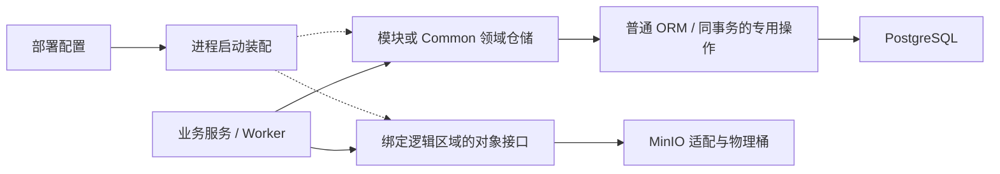

# 平台数据库与对象存储解耦设计

**状态：数据库第一批已完成跨进程验收，System 授权签发批次已通过本地 PG 验收。2026-11-14。** 两批范围分别见第 4.1、4.2 节。第 4.3 节 Standard 文档对象存储样板已通过本地 PG／MinIO T2 及固定产品的 HTTP T4。第 4.4 节跨模块改造已完成实现及本地 T1／T2，固定产品的隔离 T4 尚待执行。首期交付 PostgreSQL（PG）与 MinIO 两个现有实现的解耦，MySQL 平台主库列入第二阶段。验收矩阵列出目标，实际运行证据按批次记录。

## 1. 目标与部署边界

同一套 ADDP 部署独立选择**平台关系数据库**和**平台对象存储**。前者保存用户、授权、元数据、执行记录等平台事实，后者保存模块文档、暂存产物、缓存和启用归档后的审计对象。每种职责在一套部署中只绑定一个实现。模块通过已有领域仓储和对象 I/O 契约消费，由部署在进程启动时选定实现。首期的判断标准是：以后增加 MySQL 时，修改集中在数据库适配、模块专用迁移和查询、部署运维及其测试；同一套授权、任务及文件业务流程可以继续使用。

业务数据库和业务对象存储沿现有 System Engine Instance、Provider 和授权路径访问。用户接入 MySQL、MinIO、S3、国产库或分布式库的能力独立于平台主库认证。Infra 与业务侧可复用协议客户端、内容流或查询工具，平台启动连接由部署提供，包括零个业务 Engine Instance 的场景。Redis、Meilisearch、Kafka、FalkorDB 和观测服务在首期按原职责接入；它们对 PG 或对象存储的依赖列入对应边界复核。[引擎体系](../concepts/addp引擎体系图.md) · [基础设施隔离](../concepts/addp基础设施隔离图.md) · [配置归属](../spec/configuration/配置归属与生效.md)

## 2. 模块直接依赖清单

清单依据当前工作区的启动装配、仓储、Worker、模块间对象定位符和部署脚本整理。表中“—”表示本次在该模块的产品路径未识别出直接平台对象 I/O；预建同名桶、业务引擎连接和经其他模块 API 读写均不能单独作为直连依据。每行链接是复核入口，实施时还要沿其调用方检查迁移、后台任务和清理路径。

| 消费方 | 平台关系库的直接用途或入口 | 平台对象存储的直接用途或其他边界 |
| --- | --- | --- |
| [Common](../../common/CLAUDE.md) | 公共 PG 连接、schema 版本、执行领取与租约、运行心跳、清理结果和保护投影；公共模型包含数据库类型映射 | [共享导出](../../common/exportartifact/exportartifact.go)直接持有 MinIO 客户端，生成暂存引用、下载和清理前缀；公共配置读取 MinIO 凭据 |
| [System](../../system/backend/cmd/server/main.go) | IAM、租户、引擎、授权与事务审计；负责公共 schema 首次初始化。IAM 有独立迁移器、校验和、bootstrap 与恢复命令 | 有模块级 Infra MinIO 配置；独立[审计归档](../../system/backend/internal/auditarchive)从 PG 逻辑复制读取，使用专用对象存储身份和保留策略 |
| [Gateway](../../gateway/internal/router/router.go) | 访问日志直连 PG 并迁移表，连接失败可继续提供路由 | —；限流走 Redis，需保留既有故障语义 |
| [Manager](../../manager/backend/internal/repository/database.go) | 任务、产物、搜索状态、embedding、向量查询；Backend 和 bounded Worker 都在范围内 | 导入暂存、导出、快显与缓存产物、清理；与 Meta、Transfer 交换平台对象引用 |
| [Meta](../../meta/backend/internal/repository/database.go) | 元数据、血缘、扫描计划与执行。Worker 复用公共领取及租约 | [即时识别](../../meta/backend/internal/service/inspect_service.go)解析 Infra 引用，按 MinIO 类型构造读取与目录适配；业务扫描另走业务 Engine |
| [Transfer](../../transfer/backend/internal/service/execution_engine_service.go) | 任务、执行、持续同步状态；Backend、bounded Worker、continuous Worker 独立建连 | 解析并核验导入源、导出目标或父前缀，再装配 Infra 读写。业务源、目标和目标端位置账本仍归业务 Provider |
| [Develop](../../develop/backend/internal/repository/database.go) | SQL、Notebook、任务及执行配置 | Notebook 文件、运行输入输出、共享导出和清理，须与 Jupyter 一起核对 |
| [Service](../../service/backend/cmd/server/main.go) | 查询、发布与服务运行配置 | 服务瓦片缓存使用 MinIO 客户端；已发布服务访问业务数据的引擎连接另行管理 |
| [Orchestrator](../../orchestrator/backend/cmd/server/main.go) | 编排定义、调度及执行状态 | —；Redis 和被编排模块的产物不等于 Orchestrator 直连对象存储 |
| [Graph](../../graph/backend/cmd/server/main.go) | 图谱定义、构建和审核记录 | 构建材料由部署凭据装配 MinIO 插件。图数据写入用户选择的业务图引擎 |
| [Ontology](../../ontology/backend/cmd/server/main.go) | 定义、修订、发布事实，PG 是恢复权威 | —；专用 Infra FalkorDB 提供图投影，两个依赖各有就绪检查 |
| [Standard](../../standard/backend/cmd/server/main.go) | 标准、文档引用、待清理对象记录 | [文档服务](../../standard/backend/internal/service/document_service.go)与租户清理使用启动时绑定的对象区域；文件替换与删除补偿归 Standard |
| [Model](../../model/backend/cmd/server/main.go) | 模型、逻辑表与指标等自有状态，直接打开 PG | —；面向用户数据源的编译、查询属于业务侧 |
| [Quality](../../quality/backend/cmd/server/main.go) | 质量规则、计划、检测结果；独立 Worker 使用 PG 和公共执行契约 | — |
| [Security](../../security/backend/cmd/server/main.go) | 安全策略、治理状态及执行，包含[独立 Worker](../../security/backend/cmd/worker/main.go)和消费方保护投影协作 | — |
| [Catalog](../../catalog/backend/cmd/server/main.go) | 目录、责任、共享决定及投影进度 | —；Meilisearch 索引参与该模块就绪判断 |
| [Asset](../../asset/backend/cmd/server/main.go) | 资产、发布、申请等平台事实 | —；关键词投影使用独立 Meilisearch 索引 |
| [Workbench](../../workbench/backend/cmd/server/main.go) | 数据应用、目录资源和访问规则，有独立迁移与就绪检查 | — |
| [Inference](../../inference/backend/cmd/server/main.go) | 模型配置、推理资源等平台事实及约束 | —；模型服务端点与平台存储分开配置 |
| [Monitor](../../monitor/backend/cmd/server/main.go) | 观测策略、告警规则、调度与通知，部分写入使用 PG 锁 | 资源采集器有 MinIO 专项指标；Loki、Tempo 等服务的对象存储配置、专用桶与身份归部署侧 |
| [Agent](../../agent/backend/database.py) | Python SQLAlchemy + asyncpg；会话、历史与摘要，独立事务迁移及并发约束 | — |
| [Copilot](../../copilot/backend/database.py) | Python SQLAlchemy、PG 模型及 SQL 迁移；推理场景绑定有持久事实 | — |
| [Portal](../../portal/backend/cmd/server/main.go)、[Console](../../console/CLAUDE.md) | Portal 后端通过 System、Asset 客户端并可用 Redis；Console 为前端。当前入口未见平台库直连 | 页面消费 owner API，按返回能力展示功能 |
| [Jupyter](../../engines/jupyter/api_server.py) 及[其他运行时](../../engines/CLAUDE.md) | 运行时对业务数据库的挂载、查询按被授权的业务连接执行 | Jupyter 直接访问 develop 桶，含[交互会话](../../engines/jupyter/interactive_sessions.py)。其他运行时按输入来源复核，特别是由 Manager 注入的私有产物读写配置 |
| [部署与运维](../../scripts/infra/README.md) | Infra 初始化包含扩展；开发与产品启动注入连接，备份、恢复、监控和测试夹具使用 PG 原生命令 | Compose、建桶、权限、生命周期、归档、日志与 Trace 准备及恢复依赖 MinIO 工具或 S3 协议；按所选实现生成部署输入与操作 |

## 3. 公共层、模块与部署各负责什么

| 归属 | 提供或持有的契约 | 怎样落实 |
| --- | --- | --- |
| 部署与各进程启动入口 | 两个独立的产品选择，以及端点、逻辑库或桶绑定、TLS、凭据和必需能力 | 沿根环境模板和既有启动注入路径，Go 与 Python 解释相同字段。应用选型与“自建容器或使用客户已有服务”分开。厂商镜像专用变量由部署侧映射。未知选型在装配时明确报错。变更选型属于受控部署或数据迁移。 |
| 公共数据库基础能力 | 连接与连接池、使用同一事务句柄、模块命名空间、迁移协调与版本检查 | 在现有公共连接和 schema 职责处收敛。Go 仓储可继续使用 GORM，Python 仓储可继续使用 SQLAlchemy。业务服务通过仓储操作，普通 ORM 查询共享，原生驱动、方言 SQL、原生类型和厂商错误翻译留在适配边界。 |
| Common 共享领域 | 任务领取、租约与数据库时钟、执行事件、保护投影、清理及运行心跳等已有共享行为 | 各归原领域包，集中实现其原子操作。调用方传入已有事务时，适配沿用该事务，保证业务事实、共享执行和审计需要原子提交的写入作用于同一连接。 |
| 模块 owner | 私有表、约束、索引、仓储、迁移历史、授权、查询语义和用户可见行为 | System 拥有 IAM 及事务审计，Manager 拥有相似度查询，Standard 拥有文档生命周期。确需原生能力的仓储操作和迁移放在该 owner 的对应产品实现内。System Backend 初始化 common，各 Backend 管理自有迁移，独立 Worker 按职责只读核验版本后领取任务。保留 IAM 等已有专用迁移及修复入口的校验语义。 |
| 公共对象 I/O 与厂商实现 | 对象流、属性、范围读、按前缀列举、写入和删除，按调用方职责提供最小操作集 | 优先复用 [contentio](../../common/contentio/io.go) 已有流和范围读语义。MinIO 私有参数、客户端、返回对象和错误在适配内转换。桶准备与策略由部署流程负责；迁移当前自动建桶的调用方时，应先接通部署准备与可用性诊断。 |
| 对象的模块 owner 与运维 | owner 决定逻辑区域、对象键、租户授权、引用提交及过期清理；部署管理物理桶映射、凭据与备份 | 文件上传和数据库事务有各自的提交边界。Standard 继续执行上传新对象、事务切换引用、持久记录旧对象待清理的流程。审计归档继续使用独立身份与受保护版本的专用接口，普通删除能力不得传入。第三方服务由部署适配其原生协议。 |

PG 和 MinIO 的实现可以共享底层驱动代码。平台 Infra 的实例选择、凭据来源和可用能力属于部署上下文；业务 Engine 的实例选择、能力与授权属于 System 和业务请求。Go 与 Python 共享语义与验收用例，两种语言分别接入自己的原生库。

### 3.1 已确认：对象引用与具体引擎类型无关

当前跨模块契约已将产品名写入 `addp-infra://minio/…`。Manager 生成引用，Common 导出会话暂存并校验，Transfer 解析并绑定到执行计划，Meta 按 kind 分发。仅替换 MinIO SDK 会留下这条依赖。[现有路径规范](../spec/addp存储引擎路径体系规范.md) · [导出引用](../../common/exportartifact/exportartifact.go) · [Transfer 解析](../../transfer/backend/internal/planner/infra_locator.go)

**已确认的设计**：服务进程启动时按部署配置绑定对象存储实现及可用逻辑区域，运行期间按该绑定解析引用。保留内部 `addp-infra` 协议，以职责表示存储类型。例如 `addp-infra://object/manager/tenant_7/import/upload-id/roads.shp?type=object`，其中 `manager` 表示逻辑存储区域，部署负责映射物理桶。对象与前缀保持不同类型。共用一处构造和解析契约，保留路径段转义、上传者、租户、任务、精确来源或目标的原有核验；拥有定位符本身不授予读取权限。

该决定涉及已记录的引用。实施前需将决定写入正式路径规范，并评审已有记录的升级方案。实施前由 owner 盘点待执行任务、导出会话、清理记录、血缘及历史审计中引用的用途。可变记录在受控升级中一次转换，核对对象身份及计数后启用新路径；在途任务先排空或按 owner 已有终止规则处理。不可变审计原文及摘要保留原字节，历史展示与活动输入分开。迁移验收覆盖剩余有效引用、权限拒绝和过期清理，运行入口只接收一种正式表示。

### 3.2 必需能力与可选能力

- **数据库基础语义是必需项。** 两个 Worker 并发领取同一执行时只有一个有效持有者；续租与终态写入校验 attempt、token、有效期和数据库时钟。授权与事务审计保持原子性。迁移失败不得发布成功版本，Worker 不得领取未准备好的任务。必需条件失败沿现有启动、就绪或请求契约报告。Gateway 的访问日志等既有可降级依赖保留原故障边界。[执行租约](../../common/execution/lease.go) · [版本核验](../../common/schema/schema.go)
- **embedding 向量存储与相似检索是已确认的可选项。** 数据库实现报告当前部署实际可用的能力；Manager 据此装配对应迁移、仓储、任务入口和调度，并将可用模式提供给界面。缺少向量时，独立关键词搜索、普通预览和目录仍可用；显式向量或要求融合排序的请求应说明模式不可用，不能以关键词结果冒充。GIS 矢量瓦片另按自身依赖判断。已经声明支持却查询超时或无权限时，沿实际故障处理；已投产库丢失扩展时保留已有任务、索引与数据，避免破坏性初始化。[初始化 SQL](../../scripts/infra/init-postgresql.sql) · [Manager 初始化](../../manager/backend/internal/repository/database.go) · [向量查询](../../manager/backend/internal/repository/search_vector.go)
- **长期审计归档按部署要求验收。** 启用后要求来源库可连续采集、按检查点恢复，存储端可验证版本与保留保护。PG 首期保留复制槽、快照和 LSN 语义；更换数据库后由新实现证明连续性。缺少归档所需能力时明确报告该项无法启用，事务审计仍是独立的必需保证。[归档存储契约](../../system/backend/internal/auditarchive/archive.go) · [PG 采集](../../system/backend/internal/auditarchive/postgres.go)

### 3.3 代码放置与依赖方向

建议把跨模块共用的技术边界放在现有共享库中，在模块原有仓储旁保留领域实现。下表列出首期目标。第一批已落地的数据库入口见第 4.1 节。对象存储、能力探测与 Python 适配按后续真实调用确定接口。现有 `common/execution`、`common/schema`、`common/contentio` 及模块仓储就地演进。

| 包归属 | 定义什么 | 谁依赖它 |
| --- | --- | --- |
| `common/infra/database` | 部署数据库选型的类型、连接配置、已绑定数据库句柄及基础能力。Go 仓储沿用 GORM 会话和事务。此包不认识业务表。 | 公共领域仓储、模块仓储和启动装配 |
| `common/infra/database/postgres` | 把部署连接参数转换为 PG 驱动连接，处理 PG 命名空间、基础能力探测等产品细节。 | 启动装配直接引用此实现；基础契约包不反向引用 |
| `common/infra/objectstore` 与其 `minio` 子包 | 前者拥有 Infra 逻辑区域、内部引用的构造与解析、区域绑定契约，复用 `contentio` 的流与属性类型。后者持有 MinIO 客户端，把已绑定区域内的操作转换为桶和对象键。 | 普通消费者只依赖所需读写契约；装配引用 MinIO 实现。归档继续拥有受保护版本的专用接口 |
| `common/infra/bootstrap` 与 `common/infra/objectstore/bootstrap` | 分别装配平台数据库和对象存储。Go 包按依赖种类拆分，数据库装配包只导入数据库实现，对象存储装配包才导入 MinIO 实现。 | 进程只导入自身需要的装配包；Security 等仅使用数据库的消费者，其 Go 包依赖图不含 MinIO SDK |
| `common/execution`、`common/schema`、`<模块>/backend/internal/repository` 及原有迁移目录 | 定义执行、迁移和业务仓储操作，普通 ORM 实现就近保留。某操作确需原生 SQL 时，将产品专用实现放在所属包的产品命名文件中，例如 `lease_postgres.go`。原生 DDL、校验和及历史版本继续归迁移 owner。 | 启动时用已绑定数据库构造仓储；业务服务和 Worker 持有仓储，只调用领域操作。公共数据库实现无需导入任何模块 |
| `common-python/addp_common/infra/` 与 Python 模块现有仓储 | 共享部署字段、逻辑引用和错误语义，按实际消费落地数据库或对象适配。Agent 保持异步会话，Copilot 保持同步会话，Jupyter 使用区域绑定的对象客户端。 | 各 Python 进程在启动处注入；跨语言一致性通过相同的定位符样例、能力与错误用例验证 |

下图的实线表示运行调用，虚线表示启动时选择并注入实现。每个服务进程在本地完成这一步。

### 3.4 实现如何关联、请求如何执行

**数据库。** 启动入口读一次部署选型，例如 `postgres`。公共装配打开连接，返回携带已选类型和可用能力的句柄。模块用该句柄构造已有仓储：普通读写直接使用其会话；需要专用实现的仓储在构造时按同一个类型绑定对应操作。各模块不再读取第二个数据库类型变量。调用方已开启事务时，把事务会话传给这些操作；适配内部不得另取连接提交。声明需要专用实现的仓储若缺少匹配绑定，应在相应能力装配时给出诊断。未来添加 MySQL 时，公共装配增加打开连接的实现，各 owner 仅补有差异的操作与迁移，两者以同一个部署类型关联。

**对象存储。** 启动入口读一次对象存储选型，例如 `minio`，并把 Standard 的逻辑区域 `standard` 绑定到部署指定的桶与凭据。向文档服务构造函数传入这个区域可用的读写操作。下载时，Standard 先核对租户、文档及修订，再用该修订的对象键打开内容流；MinIO 适配负责把键映射到物理桶。Common 或 Transfer 接收跨模块 URI 时，先解析为“逻辑区域、键、对象或前缀”，按原契约核验调用身份和用途，再使用启动时绑定的区域。普通服务参数、持久化引用和跨模块消息均不携带厂商类型或凭据。[Standard 现有装配](../../standard/backend/cmd/server/main.go) · [文档下载](../../standard/backend/internal/service/document_service.go)

**如何验证解耦成立。** 以依赖检查约束业务服务、Worker 和共享契约的 import 方向，以样板测试验证实际装配。数据库侧让一次领域操作在调用方事务回滚后检查领域数据与共享写入均已回滚。对象侧在两个隔离测试部署中把同一逻辑区域映射到不同名字的物理桶，使用相同的逻辑引用和各自放入的不同内容，断言各进程只读到本部署的内容。首期即可在真实 PG 和 MinIO 上验证这些边界。

### 3.5 两条事务链路中的公共层与模块分工

首期先在现有 PG 路径划清下面的职责。第二阶段选择 MySQL 时沿用相同的业务入口和事务边界。

**Meta 领取扫描任务。** 一条产物深度扫描关联了先前的基础扫描。只要同租户的这条基础扫描还在排队或执行，Meta 就要排除对应的深度扫描。第一批由 Meta 仓储的 `NextScanCandidate` 通过 PG 的 JSON 文本提取表达式读取 `production_basic_execution_id`，按创建时间和 ID 选择并锁定候选。Meta 服务把仓储返回的精确身份和当前事务传给 `common/execution.ClaimPending`。[候选选择](../../meta/backend/internal/repository/scan_candidate.go) · [领取事务](../../meta/backend/internal/service/scan_execution_lease.go)

| 归属 | 第二阶段接 MySQL 时的工作 |
| --- | --- |
| Common 实现一次 | `common/execution` 负责核对候选仍为待领取状态、按数据库时间签发并续租、用当前租约提交终态，以及执行事件的持久化。共享执行表及其索引由该包维护，沿公共 schema 入口迁移。Meta、Quality、Transfer 等消费者共用这份实现。[租约实现](../../common/execution/lease.go) · [公共迁移](../../common/schema/schema.go) |
| Meta 负责的 SQL 和迁移 | Meta 仓储负责扫描候选查询，包括依赖的 JSON 字段、状态过滤、排序和候选锁定。接 MySQL 时优先复用可移植表达式，只为查询中的产品差异补实现。Meta 负责扫描任务定义、摘要等自有表的 DDL 和索引，公共执行表仍归 Common。[Meta 数据库入口](../../meta/backend/internal/repository/database.go) · [Meta 迁移](../../meta/backend/migrations) |
| 可直接复用的业务代码 | Worker 的领取循环、心跳和扫描执行流程，以及 Meta 对基础扫描依赖的判断规则。Meta 发起事务，在同一事务内完成候选选择、公共领取、记录 `started` 事件和必要的扫描任务摘要更新。[Worker](../../meta/backend/internal/worker/bounded_runner.go) · [扫描执行服务](../../meta/backend/internal/service/scan_execution_lease.go) |

**实库验收。** 基础扫描运行期间，其关联深度扫描不能被领取。两个 Worker 争抢同一可领取执行时只有一个取得有效租约。对仍存在的任务定义制造摘要更新冲突后，核对执行仍待领取、租约未生效、没有新增 `started` 事件。这三项分别验证 Meta 的选择规则、Common 的领取语义和跨包事务。

**System 签发数据源读取授权。** 两个有资格的请求可能同时用同一 `request_id` 首次签发授权，此时授权行尚不存在。当前 System 使用 PG 事务级 advisory lock 串行处理该请求身份，取得锁后复核资格和历史结果。新签发还要复核接收方、目标引擎版本及期限，并在同一事务写入 Grant 和 `system.engine_access_grant.issued` 审计事件。[签发与重放](../../system/backend/internal/engineaccess/independent_grant.go)

| 归属 | 第二阶段接 MySQL 时的工作 |
| --- | --- |
| 公共数据库层实现一次 | 提供 MySQL 连接、数据库时间和可传递的同一事务会话。授权仓储与 IAM 审计写入器共用该会话，统一提交或回滚。 |
| System 负责的 SQL 和迁移 | `system/backend/internal/engineaccess` 封装同一请求的串行处理、目标锁定及授权记录读写。MySQL 实现要覆盖首次签发时尚无授权行的情形。`internal/iam` 持有事务审计写入，`internal/migration` 持有相应授权与审计表、唯一性约束及依赖 PG 函数或触发器的迁移。逐项验证等价语义，能跨库执行的查询保留一份。[授权仓储](../../system/backend/internal/engineaccess/source_grant.go) · [目标锁定](../../system/backend/internal/engineaccess/fulfillment.go) · [System 迁移](../../system/backend/internal/migration) |
| 可直接复用的业务代码 | API、操作者资格、接收方和有效期检查、目标版本复核、相同命令重放返回已有结果、同 ID 不同命令返回冲突，以及审计事件内容。首期把内嵌的 PG 锁调用移入仓储后，两种数据库执行同一个签发流程。[授权 API](../../system/backend/internal/api/engine_access_grant_handler.go) · [签发服务](../../system/backend/internal/engineaccess/independent_grant.go) |

**实库验收。** 并发提交两次相同命令，只产生一条 Grant 和一条签发成功事件。复用同一 ID 提交不同内容须返回冲突。审计写入失败时，核对本次 Grant 也未提交。首期用 PG 建立行为基线，第二阶段对项目指定版本的 MySQL 执行同一组断言。

## 4. 首期顺序与退出条件

| 步骤 | 范围 | 达到什么条件才进入下一步 |
| --- | --- | --- |
| ① 确认规范与基线 | 评审本稿；以已确认的内部引用形式为基线，评审已有数据升级方式、能力缺失的用户体验。获批后先同步术语、配置、路径和测试规范。建立逐模块的厂商依赖清单，区分 Infra、业务 Engine、测试夹具和厂商专用运维工具。 | 每条直接依赖有 owner 和迁移去向；每个改动能映射至根 Makefile 门禁与 CI。对既有 PG 数据、对象、权限和就绪行为有升级对照。 |
| ② 建立两个真实样板 | 数据库走 System 初始化 common → Meta 提交扫描 → Worker 领取、续租、完成；对象走 Standard 上传 → 下载 → 替换 → 清理。接入 PG、MinIO 和唯一部署配置。 | 共享仓储和 Standard 业务层不依赖厂商类型；同一条链路证明并发、文件替换失败及清理语义。旧调用入口在其所属切片移除。 |
| ③ 先迁高耦合链路 | System 授权、审计与运维命令，Manager 向量初始化与有界 Worker，Manager → Meta／Transfer 的导入导出、Common 保护投影与共享导出。实施已核准的对象引用变更。 | 成功、拒绝、版本不匹配、取消或过期均能从原业务入口观察。标准 PG 部署保留向量能力；独占无 pgvector 部署能完成关键词搜索及非向量业务。 |
| ④ 逐 owner 完成其余模块 | 按第 2 节清单逐行迁移。含 Go Backend/Worker、Agent/Copilot、Develop/Jupyter、Graph 材料、Gateway 日志，以及页面中的能力反馈。 | 所有运行进程消费部署选型；领域代码无厂商直连、私有 DSN、厂商 SDK 类型或方言分支。产品适配、业务 Engine 与专用运维代码可分别定位。 |
| ⑤ 部署、恢复与回归 | 接通标准开发和产品部署、初始化、探活、监控、备份、隔离恢复及相关 CI。对升级前后 PG 数据和对象引用做真实读取、鉴权与清理对照。 | 第 5 节断言和对应门禁有实际结果。两个选择分别只有 PG、MinIO 生产实现；不发布可选但无法工作的 MySQL 配置。 |

### 4.1 已批准的第一批实现范围

System Backend 初始化公共表，Meta Backend 核验公共版本并迁移 Meta，Meta Worker 只读核验两个版本。平台主库由部署字段 `ADDP_INFRA_DATABASE_PROVIDER` 选择，首批默认且只支持 `postgres`。公共连接配置进入 `common/infra/database`，通过 GORM 已有的 `Dialector` 契约接入 PG。bootstrap 集中选择驱动并打开连接，调用方保留原有 GORM 日志、池设置和事务句柄。PG 连接实现负责端点、凭据、TLS、时区和连接级 search_path。schema 的迁移锁与版本发布归 common/schema，执行租约及时间条件归 common/execution。

Meta 仓储选择可领取的候选，Meta 扫描服务持有外层事务并向 Common 传入精确候选。保留 ClaimNext、ClaimPending 的签名、调用方附加筛选和同事务语义。领取、started 事件与对应任务摘要一并提交。真实 PG 核验竞争领取、过期租约拒绝、依赖阻塞、其他候选可领、摘要冲突整体回滚及迁移版本可见性。实库入口使用 Common execution-lifecycle、Meta production、System IAM 和持有公共 schema 测试的 Security 门禁。跨进程验收单列，真实运行情况与代码实现分开记录。

#### 第一批可调用的契约

| 契约及归属 | 调用方得到什么 |
| --- | --- |
| [`database.Config`](../../common/infra/database/config.go) | 启动代码传入端点、数据库名、凭据、模块命名空间和连接安全模式。这是参数类型。 |
| [`bootstrap.OpenDatabase`](../../common/infra/bootstrap/database.go) | 输入配置与 GORM 选项，返回 `*gorm.DB` 或错误。它在建连时读取部署选型并选择具体构造器，未知值报错。模块可在同一会话上创建事务并传给仓储。 |
| [`postgres.Dialector`](../../common/infra/database/postgres/postgres.go) | 首批唯一的 PG 构造函数。校验部署时区、转义连接参数、将时区和可选的 `search_path` 写入连接串，返回实现 GORM 原生 `gorm.Dialector` 接口的驱动。连接池打开、模块迁移和业务查询各有独立入口。 |
| [`schema.Migrate / Require`](../../common/schema/schema.go) | Backend 在事务中加迁移锁、执行 owner 迁移并发布版本。Worker 只读核验所需版本。PG 的建命名空间、迁移锁和版本写入由 [schema 的 PG 实现](../../common/schema/postgres.go) 承担。 |
| [`execution.ClaimNext / ClaimPending`](../../common/execution/lease.go) | 前者按调用方范围领取下一条可用执行；后者领取调用方已选的精确身份，支持可选的截止时间。两者使用同一套数据库时间、竞争控制和租约签发逻辑。 |

本批复用的 Go 接口是 `gorm.Dialector`。Common 通过上述结构体和函数提供平台契约。对象存储、可选能力探测、System 业务授权锁和 MySQL 属于后续批次。Manager 和 Transfer 中直接构造旧公共连接参数的调用点同步迁到 `database.Config`，业务仓储仍按各自批次改造。

#### 第一批验收清单

| 验收条件 | 验证方法 |
| --- | --- |
| 默认和显式 PG 均可装配，未知实现拒绝启动建连。连接串可承载特殊字符，真实连接的数据库名、时区和 search_path 与配置相同。 | Common 启动装配与 PG 驱动单测，以及 Common execution-lifecycle 实库门禁中的 `TestBoundConnectionAgainstPostgres`。 |
| 领取 API 保留筛选与精确身份。同一执行同时竞争只有一个有效持有者，过期 attempt 无法写回。 | `make test-common-postgres COMMON_POSTGRES_TEST_ARGS="--test execution-lifecycle"`。 |
| 同租户基础扫描未结束时，关联深度扫描被排除，独立候选仍可领。摘要与待领取执行冲突时，领取更新和 started 事件均回滚。 | `make test-meta-postgres`。 |
| System 独占初始化 Common，Meta Backend 管理 Meta 版本，Worker 对版本缺失或不匹配拒绝开始工作。 | `make test-security-postgres` 中的共享 schema 测试，配合 System、Meta 的实库门禁。随后单列真实 System、Meta Backend、Meta Worker 按顺序启动并完成一次扫描的跨进程证据。 |

### 4.2 System 授权签发批次

**范围与分工。** System 授权仓储提供按 `request_id` 串行处理的内部方法。独立签发、Catalog 履约仲裁和已受理请求的签发写入共用它。即使 Grant 行尚未创建，同一请求的三个入口也必须使用同一把锁。PG 实现在调用方传入的事务上取得事务级 advisory lock，沿用现有锁键和加锁顺序，由外层事务提交或回滚时释放。接 MySQL 时由 System 仓储实现相同语义。

服务继续持有原有外层事务，并负责资格复核、命令内容比对、重放和冲突判定。新签发沿用原有 Grant 写入与 IAM 审计写入，二者共用事务。本批仅收拢请求锁，目标锁、其他授权操作、迁移和 Common 数据库契约均维持现有范围。

| 真实 PG 验收场景 | 必须观察到的结果 |
| --- | --- |
| 两个调用同时首次签发同一命令 | 两者均成功，返回同一份已签发结果。按该 `request_id` 查询，Grant 为 1 条，`system.engine_access_grant.issued` 审计为 1 条。 |
| 已成功的 ID 携带不同签发内容 | 返回现有签发冲突；原 Grant 的内容保留，Grant 和签发审计仍各 1 条。 |
| 新请求的签发审计被 PG 拒绝 | 调用返回审计写入错误；外层事务结束后，从事务外按该 ID 查到 Grant 和签发审计均为 0 条。 |

上述用例归属 System IAM 的 `engineaccess` 包，走已有 T2 入口 `make test-system-iam-postgres SYSTEM_IAM_POSTGRES_TEST_ARGS="--package engineaccess"` 与对应 CI 门禁。

**2026-11-14 本地验收结果。** System 后端 Go T1 及上述 `engineaccess` 实库门禁通过。两个独立签发调用均先查到空历史，最终返回相同的请求 ID 和签发时间，实库 Grant 和签发审计各 1 条。随后修改签发理由重放得到冲突，原理由及记录数保持不变。另一新请求触发审计表的 `audit_logs_request_id_check` 约束，事务外查询到 Grant 和签发审计各 0 条。[PG 请求锁](../../system/backend/internal/engineaccess/request_lock_postgres.go) · [签发实库断言](../../system/backend/internal/engineaccess/independent_grant_postgres_test.go)

### 4.3 Standard 文档对象存储样板

本批覆盖标准文档草稿上传与替换、确定修订下载、失效文件清理，以及租户删除时对同一批文档对象的清理。Standard 现有修订表的 `file_key` 和清理表的 `object_key` 已经是区域内相对键。区域由这两类记录的归属唯一确定为 `standard`，沿用现存键值、表结构和文件下载入口。第 3.1 节的跨模块 URI 升级另批处理。[文档生命周期](../../standard/CLAUDE.md#文档文件生命周期) · [租户文档清理](../../standard/backend/internal/service/cleanup_service.go)

#### 启动时如何绑定

1. **部署准备。** 平台通过 `ADDP_INFRA_OBJECTSTORE_PROVIDER` 选择对象存储实现，首期默认且仅支持 `minio`。逻辑区域默认映射到同名物理桶，部署只在可选的 `ADDP_INFRA_OBJECTSTORE_BINDINGS` 中登记例外（格式为 `standard=<物理桶名>`）。例如，省略映射时 `standard` 使用桶 `standard`；项目指定桶名时，只登记 `standard → project-a-standard-docs`。首批仅接受逻辑区域 `standard` 的改绑；若映射含其他区域，配置校验报出该区域。部署初始化与 T2 夹具按同一规则准备桶和访问权限，沿用 Infra MinIO 的端点、凭据与 TLS 配置。部署初始化负责建桶。[现有桶清单](../../scripts/infra/init-minio.sh) · [现有连接配置](../../common/config/minio.go)
2. **进程装配。** Standard Backend 启动时向 `common/infra/objectstore/bootstrap` 请求逻辑区域 `standard`。bootstrap 按部署映射解析物理桶并装配 MinIO 适配，把同一绑定注入文档服务和租户清理服务。上传、下载、后台文件清理和租户删除均用区域内相对键访问该桶。绑定在本次进程生命周期内固定。已有部署改绑新桶前须按原键准备仍被修订引用及待清理的对象。[当前启动装配](../../standard/backend/cmd/server/main.go)
3. **启动故障边界（建议）。** 未知选型或无效绑定配置应在装配时报错。配置有效但存储暂时不可达、桶缺失或访问被拒时，启动诊断明确标出逻辑区域和物理桶，保留现有 Standard 非文件功能的可用性。文件操作返回其实际错误，租户清理保留删除失败的文档记录。有效的区域绑定仍可在原桶恢复后工作，业务服务不在请求中建桶、换桶或切换实现。

#### Common、Standard 与部署的职责

| 归属 | 本批契约 |
| --- | --- |
| Common 区域契约与 MinIO 实现 | 在 `common/infra/objectstore` 定义已绑定区域内的流式写入、查询属性、打开读取流和按键删除。四个操作只接收上下文、相对键及所需数据；写入接受输入流、长度和媒体类型，成功表示对象写入完成，下载返回调用者负责关闭的流。复用 Go 流和 `contentio` 已有属性、缺失语义。MinIO 子包持有客户端和物理桶，翻译 SDK 参数、返回值和错误。部署准备桶，业务接口不暴露建桶、列全桶或厂商类型。[公共 I/O](../../common/contentio/io.go) · [MinIO 适配](../../common/infra/objectstore/minio/area.go) |
| Standard 文档与修订 | 校验租户、文档、确定修订、权限、文件大小及草稿版本。生成 `tenant_{tenant_id}/documents/{id}/revisions/{revision_id}/{uuid}{extension}`，流式计算 SHA-256，持有 PG 引用事务。下载按修订取键并返回文件名、媒体类型和长度。文件抽取继续复用下载入口。[文档服务](../../standard/backend/internal/service/document_service.go) |
| Standard 清理 | `ReplaceDraftFile` 在同一个 PG 事务中切换修订的文件引用及元数据、更新文档版本并登记旧键。提交后尝试删除旧对象，失败保留清理记录供现有 Worker 重试。若 PG 切换失败，旧键登记随事务回滚，Standard 只补偿删除本次新键；补偿删除失败则按现有机制登记该新键。租户清理复用同一区域的按键删除能力，仍由 Standard 决定可清理的租户和修订。[替换事务](../../standard/backend/internal/repository/document_repository.go) · [待清理记录](../../standard/backend/internal/models/document.go) |

#### 真实 PG 与 MinIO 的验收标准

沿用 `make test-standard-postgres` 及 CI 中同一入口。它运行真实 PG 和本轮独占的临时 MinIO。历史修订用例在测试事务中覆盖草稿删除和已撤回修订下载。本批通过生产装配入口取得区域对象；对“引用已提交”“失败已回滚”的断言使用独立的已提交夹具，从业务事务外读取 PG，并按本轮文档及对象前缀清理。所有业务断言先于夹具清理执行。[现有实库用例](../../standard/backend/internal/service/document_service_integration_test.go) · [标准门禁](../../scripts/test/standard-postgres-gate.sh)

| 场景 | 操作与通过条件 |
| --- | --- |
| 同一区域在两个部署中绑定到不同物理桶 | 用生产装配入口分别启动两组绑定。第一组省略例外映射，使用桶 `standard`；第二组仅配置 `standard → project-a-standard-docs`。在这两个真实 MinIO 桶内以**完全相同的相对键**分别放入不同的已知字节。用各自的 `standard` 绑定读取该键，逐字节核对第一组返回第一份内容、第二组返回第二份内容。 |
| 上传下载字节一致 | 在改绑部署中以 `UploadFile` 上传已知字节 A，在 PG 核对修订的相对键、大小、媒体类型和 SHA-256。按同租户、文档 ID、修订 ID 调用 `DownloadFile`，读到 EOF 并关闭，逐字节比较 A，同时核对文件名与长度。用独立 MinIO 客户端核实该对象位于改绑后的物理桶。 |
| 替换成功，旧对象可清理 | 以当前文档版本把 A 替换为内容不同的 B，记录两把键。事务外核对 PG 已指向 B、版本增加。通过原修订下载得到 B；直接对配置桶内 A 键执行 Stat，必须得到对象不存在，B 仍在，A 的清理记录已处理。断言在用例的清场动作之前完成。 |
| 新对象已写入，PG 切换引用失败 | 在已有 A 的草稿上上传不同内容 C，传入已过期的文档版本。由测试观测真实写入成功后的 C 键与字节，随后让真实 `ReplaceDraftFile` 返回版本冲突。事务外核对修订的键、摘要和文档版本仍为替换尝试前的值，旧键未被排入清理；走原修订下载并逐字节读回 A。正常补偿后检查 C 键已从真实 MinIO 删除。观测点只在测试内记录实际 I/O，生产事务与对象操作照常执行。 |

区域绑定与三项文档生命周期场景均在上述 T2 门禁验收。已有 SQLite／受控存储用例继续覆盖删除失败后的重试。HTTP 权限、浏览器资源票据与代理传输的证据沿原有分层单独记录。

**2026-11-14 装配包依赖边界修正。** 数据库装配保持在 `common/infra/bootstrap`，对象存储装配迁到 `common/infra/objectstore/bootstrap`。原同包对象装配路径删除；仅使用数据库的模块可独立构建。Standard 使用新对象装配路径并共用原区域契约。

**2026-11-14 本地 T2 通过。** 先用独占 MinIO 验证默认与改绑区域能从同一相对键分别读回不同字节。随后运行完整 `make test-standard-postgres`，在改绑桶中核对上传下载字节、PG 已提交版本与摘要、替换后旧键删除、真实版本冲突后原修订可下载及新键补偿。租户物理清理从同一区域删除了当前文件。门禁确认临时容器、网络、卷和镜像零残留。

### 4.4 Manager 导入暂存与导出中转（已批准实施）

本批改造 Manager 导入暂存、Manager／Develop 共用的导出中转，以及 Transfer 执行、Meta 即时识别和相应清理所需的对象访问与内部引用。产品实现仍为 PG 和 MinIO。先同步正式路径、Infra 隔离及相关模块规范，再实施代码。

#### 调研结论与范围

| 当前直接依赖 | 消费链路与本批处理 |
| --- | --- |
| Manager 导入服务直接上传 MinIO，并自行拼接 `addp-infra://minio/manager/...` | Shapefile 组成写入 `tenant_<id>/import/<日期>/<upload UUID>/`，Manager 保存上传者、组成摘要及 source locator，绑定 Transfer 任务后触发。上传改用绑定的 `manager` 区域，引用由 Common 构造。[导入服务](../../manager/backend/internal/service/import_service.go) · [上传来源核验](../../manager/backend/internal/repository/import_source_repository.go) |
| Common 导出会话直接持有 SDK，分别拼接、解析内部引用 | Manager 与 Develop 都调用 `common/exportartifact`，均使用 `manager` 区域；对象前缀中的 owner 分别为 `manager`、`develop`。该包的创建、下载、打包及过期清理同批迁移，两个调用方同步接入。[公共导出](../../common/exportartifact/exportartifact.go) · [Develop 装配](../../develop/backend/cmd/server/main.go) |
| Transfer 在 Infra locator 与引擎绑定中写死 MinIO | 转换为 Common 逻辑区域绑定后继续使用通用内容与格式读写链。上传来源核验、执行授权、会话摘要和写后扫描仍沿现有入口执行。[端点解析](../../transfer/backend/internal/planner/infra_locator.go) · [Infra 绑定](../../transfer/backend/internal/planner/infra_engine_resolver.go) |
| Meta 即时识别自行解析 locator 并装配 MinIO Provider | 接收同一逻辑对象引用，通过公共绑定执行现有识别；返回组成引用使用区域内键。Infra 对象的即时识别与业务目标写入后的 Meta 扫描各按原职责执行。[即时识别](../../meta/backend/internal/service/inspect_service.go) |
| Manager 其他产物、部分血缘生成和部署策略仍带桶／产品信息 | 共用的血缘生成处同步输出新逻辑引用。预览、瓦片、COG、COPC、三维及 Python 运行时的实际对象 I/O 留给各自产物批次。它们仍直接使用 `manager` 桶，因此本批建议继续采用 `manager → manager`，整桶改绑在其余消费者完成迁移后开放。[血缘生成](../../manager/backend/internal/service/execution_lineage.go) · [Manager 装配](../../manager/backend/cmd/server/main.go) |

本批增加启动时可请求的逻辑区域 `manager`，部署例外映射继续仅接受 `standard`。Manager、Develop、Transfer Backend／Worker 和 Meta 即时识别在启动时取得所需的 `manager` 绑定。区域按用途指定，Develop 导出继续请求 `manager`。只使用数据库的模块继续依赖数据库装配包。

现行 `manager/temp/` 七天生命周期策略只覆盖 `temp/`。导入的 `tenant_<id>/import/…` 与导出的 `tenant_<id>/export/…` 使用不同前缀，改造时必须核对原有清理入口及真实残留，按实际覆盖记录结果。[部署策略](../../scripts/infra/init-minio.sh)

#### 公共层与模块分工

| 归属 | 本批交付 |
| --- | --- |
| `common/infra/objectstore` 与对象装配包 | 在该包的引用契约中统一内部对象／前缀引用的构造、解析和相对键表示，该契约仅依赖通用类型；保留 Standard 已使用的区域接口。格式／目录适配放在 `common/infra/objectstore/contentadapter` 子包，HTTP Client 仅引用区域与引用契约，不能传递引入格式实现或厂商 SDK。为已有格式读写、即时识别及前缀清理补齐所需的属性、范围读、目录列举和写入适配，复用 `contentio` 与通用格式实现。列举与删除均限制在已核验的精确前缀；多文件组成保留主文件、必需项和 ZIP entry 的语义。厂商 SDK、物理桶和连接参数封装于具体适配中。流式 Writer 的 Close 必须等待实际上传完成并传回错误，写失败不得报告执行成功。 |
| `common/exportartifact` | 同一套会话服务继续负责用户归属、预绑定 execution ID、请求摘要、来源保护复核、状态刷新、下载流／多文件打包及过期清理；对象操作改用区域接口。会话记录仍由 Manager 或 Develop 的仓储保存。FileGDB 的输出引用和 artifact manifest 同步使用公共逻辑引用／区域内键，核对完整组成及会话前缀。 |
| Manager | 负责导入组成校验、对象键、内容摘要、上传记录、任务绑定、提交／启动与来源核验；导出业务入口选择格式并进行来源权限检查。API、既有文件格式、任务类型和业务目标 locator 沿现有契约。 |
| Develop | 迁移 Common 导出服务的装配、下载及清理调用；工作流结果交接文件使用同一区域绑定。继续核对原用户、原 execution、交接内容摘要、原截止时间与保护资格。Notebook 的 `develop` 区域留给对应批次。 |
| Transfer | 在现有 Infra 端点与内容适配处消费公共解析及绑定。执行计划继续复用已有格式 Reader／Writer；回执中的内部 target locator、组成 refs 和冻结输入使用同一逻辑表示。实际写入目标仍由该 execution 产生并报告。 |
| Meta | 通过公共区域内容／目录适配执行即时识别，识别结果保留正确组成键。平台暂存对象沿 Infra 范围访问，业务写后扫描继续用业务目标 locator。 |
| 各 owner 与部署 | 各自迁移可变记录、负责用户与执行身份的核验。部署负责对象存储选型、区域准备、迁移期间的协调和恢复；公共对象绑定自身不授予文档、上传或导出访问资格。 |

#### 新引用与授权核验

运行入口统一使用 `addp-infra://object/manager/tenant_7/import/<日期>/<upload UUID>/roads.shp?type=object` 或对应的 `?type=prefix`。URI 表示逻辑区域、类型化路径及对象／前缀身份，物理桶在启动绑定内解析。公共构造与解析只进行一次路径编码／解码，覆盖中文、空格、加号、百分号及带分隔符的非法路径段，避免各模块再自行拼接或拆分 URI。[现行路径规范](../spec/addp存储引擎路径体系规范.md#addp-infra-locator-与业务-resourcelocator-的边界)

导入执行必须继续核对当前有效租约、tenant、原上传者、绑定任务、精确 source locator 和组成摘要，Owner 不可用或来源不匹配时拒绝。导出继续按认证的 Manager／Develop Service Client 推导 owner，核对会话的 tenant、原用户、execution ID、完整请求摘要和当前保护资格。下载、打包与清理再次检查当次可能变化的状态及授权，组成路径只能位于本会话前缀。新生成的引用、持久化任务配置与执行回执必须相互一致。

#### 既有记录的一次升级清单

1. **盘点并排空。** 升级前按 owner 列出 Manager 上传记录、Transfer 任务定义与活动执行、Manager／Develop 导出会话及交接文件、清理记录、执行血缘和不可变审计中的旧引用。暂停新的相关提交并等待在途执行结束；尚可下载的短期导出会话等待到期、按原路径完成清理，再切换版本。核对待清理对象和控制记录，保留升级前的计数与摘要。
2. **按事实归属迁移。** Manager 上传记录与 Transfer 持久任务定义中的可变 source locator 同步转换，保留上传 UUID、用户、tenant、绑定任务、组成摘要与原键。owner 迁移分别实现并由部署协调执行，所有相关 owner 完成且一致性核对通过后整体启动。迁移中断时先完成或恢复该批迁移，再开放入口。未知桶、无法确定归属的记录或仍在运行的旧 execution 应报告具体身份供处置。
3. **保留历史事实。** 已冻结的执行输入、授权绑定摘要、历史审计及存证保留原字节。历史读取按其事实展示；再次执行持久任务时使用迁移后的任务定义并重新取得本次授权。带调度授权的持久任务需通过原入口重新授权后恢复调度；迁移不重算或伪造已签发的定义摘要。采用导出会话到期排空方案，避免改写仍受原请求摘要约束的会话。
4. **只启用新表示。** 升级后的活动入口、producer 和 consumer 一次切换到新 URI。旧格式的识别与转换只存在于升级工具中。正式规范、模块文档及测试在同次改造中更新；部署以同名桶启动时原对象键继续定位原字节。

#### 实施顺序与验收

先完成正式路径规范和升级清单，再提供公共引用／内容适配并验证实际 MinIO；随后将 Manager 导入、Common 导出及 Develop 调用点、Transfer Backend／Worker、Meta 即时识别和血缘生成一起切换。部署升级与原数据夹具完成后，进入隔离 T4。

| 层级与场景 | 通过条件及入口 |
| --- | --- |
| T0／T1 契约与编译依赖 | URI 往返、特殊字符、对象／前缀区分、非法路径拒绝、会话路径越界、摘要及身份错配均覆盖；新旧生产入口仅保留新表示，领域服务与仓储的新增依赖不包含 MinIO SDK。以 `make test-module MODULE=<owner> GO_ONLY=1` 覆盖 Common、Manager、Develop、Transfer、Meta，数据库消费者依赖隔离回归继续覆盖 Security。 |
| 真实 MinIO 内容与目录适配 | 复用同一区域接口核对普通与范围读取、属性、组成列举、写入完成错误和精确前缀删除。以两个独占测试桶验证相同逻辑键的字节隔离，仅作为适配契约证据；本批部署配置仍拒绝 `manager` 改绑。本批已在 `make test-manager-postgres` 的独占 Compose 中加入临时 MinIO，复用仓库 Dockerfile，并在该入口运行公共适配及跨包对象 I/O 断言。同次更新拥有服务、构建输入、影响选择和对应 CI 登记，成功／失败／中断均检查本轮资源零残留。 |
| 真实 PG 状态与升级 | 验证上传来源的唯一任务绑定、会话预绑定 execution 和请求摘要、拒绝身份错配、原始保护检查及过期状态；预置旧格式任务和上传记录，迁移后可通过原 UUID 核验，历史摘要及审计字节保持。各 owner 原有 PG 门禁分别补断言，使用 `make test-manager-postgres`、`make test-transfer-postgres`、`make test-develop-postgres`、`make test-meta-postgres` 及 Common 对应实库入口。 |
| 隔离 T4 导入 | 真实用户经 Gateway 上传含必需组成的 Shapefile，按同一 upload UUID、Transfer task ID、execution ID 核对 Owner 许可、Meta 即时识别、Transfer 实际读写和业务目标的精确扫描。跨租户、非上传者、错任务、组成摘要变化须拒绝并核对目标未写入。 |
| 隔离 T4 导出与清理 | Manager 与 Develop 各完成一次同一公共链路的 CSV 导出，核对目标逻辑引用、下载字节与物理落桶；多文件格式和 FileGDB 沿已有正式入口回归组成及打包。错用户、跨租户、过期／保护资格失效、越出会话前缀的下载或清理均拒绝。到期清理只删除本会话对象，其他 owner／tenant 的哨兵对象仍在。 |

本节跨模块范围、Develop 共享调用点同批切换、导出会话到期排空及延后 manager 改绑已批准。

#### 2026-11-14 实施与本地验证记录

实现使用以下单一路径：`common/infra/objectstore` 保存轻量区域及引用契约，`contentadapter` 子包把已绑定区域适配到既有格式／目录流水线，`minio` 子包负责实际 SDK 操作，`bootstrap` 在进程启动时装配。Manager 导入、Common 导出及其 Manager／Develop 调用方、Transfer Backend／Worker、Meta 即时识别均已接入。Transfer 与 Meta 不再保存已无消费者的 MinIO 配置副本。公共 Client 的依赖门禁禁止传递引入内容适配、格式实现和 MinIO SDK。

Manager 启动迁移上传记录；Transfer 的 Backend 在版本 14 事务中迁移持久任务定义，Worker 通过原版本门禁后才领取。仍在运行的旧任务会被拒绝迁移。Common 导出会话初始化在发现旧引用时报告剩余数量，要求按升级清单由旧版本完成到期清理。历史执行输入和授权定义摘要不改写。

| 本地门禁 | 已验证范围 |
| --- | --- |
| `make test-module MODULE=<owner> GO_ONLY=1`，owner 为 `common`、`manager`、`develop`、`transfer`、`meta`、`security` | 对应模块全量 Go T1；引用往返及非法路径、上传失败的 Close 返回、旧引用一次转换、原有身份与摘要检查、格式链及新构造函数装配。独立检出仅覆盖本批文件，并在发布前吸收已提交的共享依赖更新。 |
| `make test-manager-postgres` | 原有 Manager PG 门禁及新增真实 PG 上传记录升级；独占 MinIO 验证双桶同键字节隔离、属性／范围读取／列举、拒绝 manager 改绑、Manager／Develop CSV 下载、多文件 ZIP 的逐项字节一致及精确会话清理，邻接前缀哨兵保持；旧导出会话拒绝升级且请求摘要保持。独占 MinIO 生命周期零残留。 |
| `make test-transfer-postgres` | 新增持久任务引用迁移、活动执行拒绝、重复迁移，以及任务身份、原授权摘要与历史执行输入保持；原受保护导出及执行隔离继续通过。 |
| `make test-meta-postgres`、`make test-develop-postgres` | 两个 owner 原有实库门禁通过，保留执行读取与隔离、会话作用域、结果持久化及清理事务。 |
| `make test-standard-postgres` | 共享区域适配回归：真实 MinIO 双桶绑定、文档字节、替换清理及数据库切换失败后原文件可下载；独占资源零残留。 |
| `make test-system-iam-postgres SYSTEM_IAM_POSTGRES_TEST_ARGS="--package engineaccess --test filegdb-export-source"` | 精确 FileGDB 来源授权的真实 PG 回归，仅声明该定向门禁结果。 |
| `make test-t2-ci-registration` | 87 项登记单测、10 项 Manager 生命周期单测及实际登记检查通过；覆盖新增 MinIO 的成功、构建／启动／执行失败、跳过、空运行、中断和清理。保留既有超时及通过标准。 |
| Online 登记及受影响编排检查 | 实际 Online 登记检查、Manager 登记约束单测、76 项内部产物血缘编排检查和 21 项 MinIO 物理观察夹具检查通过；观察夹具仍核验真实物理桶，输入引用统一为逻辑表示。 |

对象 T2 中使用真实 PG／MinIO，Transfer 调度端以桩返回受控执行结果；这些结果证明区域适配、会话与清理契约，不计作 Gateway／真实 Worker 的跨进程验收。开发运行环境未在本批执行升级或重启。下一步按本节的 T4 目标固定产品 SHA，分别核对导入 UUID／task／execution 和两个导出 owner 的实际读写、下载及授权拒绝，再决定其余 Manager 产物的改造批次。

## 5. 首期验收矩阵

下列命令是已有入口，断言为改造后的验收目标。现有测试若未覆盖某条断言，实施该步骤时在原 owner 门禁补充；新场景在同批改动中接入根 Makefile、影响选择及对应 workflow。T2 实库、T4 跨服务、T5 发布证据分开记录。[测试与验收规范](../spec/addp测试与验收规范.md) · [根 Makefile](../../Makefile)

| 验收项 | 可观察的通过条件 | 标准入口或执行环境 |
| --- | --- | --- |
| 依赖边界、配置与升级 | 按生产调用路径检查驱动 import、SDK 类型、DSN、`Dialector.Name()`、产品专属 DDL/模型和旧 locator。PG/MinIO 的专用代码仅出现在相应适配、部署工具及明确的业务 Engine 中。未知产品拒绝装配。PG 既有迁移校验和可复核，升级保留数据，重新启动可重复。 | T0/T1，纳入 `make test-platform` 及各 owner 的 `make test-module MODULE=<模块>`，工作区影响选择用 `make test-changed` |
| PG 共享事务与授权 | 空库初始化及既有版本升级；失败时版本不前移、Worker 在 schema 未就绪时停止领取。双连接实测同一任务唯一领取、过期租约写回被拒、最新持有者完成；授权和审计写入共同提交或回滚。 | T2，`make test-common-postgres`、`make test-meta-postgres`、`make test-system-iam-postgres`；含 Python 迁移的 owner 单独运行 |
| MinIO 文件生命周期 | 用实际字节校验上传、下载、范围读、对象属性与删除；Standard 替换成功后旧对象可清理，数据库切换失败时原文件仍可读取。跨租户或错任务的暂存引用拒绝读取；共享导出只清理授权前缀。 | Standard T2 使用 `make test-standard-postgres` 自带的临时 MinIO；Manager／Transfer 的导入导出由相应 T2 与隔离 T4 覆盖 |
| 可选向量功能 | 带扩展配置完成实际相似度查询；没有扩展的独占实例完成启动、登录、关键词搜索和普通预览，向量任务无法新建或被调度，显式语义查询得到一致的不可用结果。验证用户入口与直接 API。 | `make test-manager-postgres` 及 Manager 模块测试；新增缺扩展夹具接入现有 CI；Console T3 和隔离 T4 覆盖实际入口 |
| 跨模块与运行时 | 真实身份通过 Gateway 完成样板扫描、文件替换、导入与导出下载；检查拒绝路径和清理。Develop 与 Jupyter 用同一授权范围读写 Notebook；Agent、Copilot 的迁移和持久状态经各自入口验证。 | 按 owner 使用 `make test-module MODULE=<模块>`，Agent 另有 `make test-agent-postgres`；T4 经 `ADDP_ONLINE_TEST=1 make test-online ONLINE_SUITE=<已登记场景>` |
| 审计、部署与灾备 | 启用归档时验证连续采集、断点续传和保留保护。隔离恢复后核对 IAM、执行、文档引用与对象内容，实际登录并下载；区分备份脚本检查、真实恢复与产品部署证据。 | 审计使用 Hosted 专项 `make test-system-audit-archive`；`make test-infra-backup` 仅覆盖工具检查，用 `make infra-restore-drill BACKUP_DIR=<备份绝对路径>` 验证表行数与对象哈希，恢复后的登录、下载另在隔离产品环境验证 |

涉及本地 Infra 先用 `bash scripts/infra/status.sh` 核对归属与端口。PG 本地集成只用标准入口和 `addp_test`、`addp_iam_test`。无向量扩展场景放在独占测试实例，避免修改共享开发实例的扩展。按 [Infra 数据库说明](../../scripts/infra/docs/PostgreSQL与测试库.md) 和 [CI 与交付规范](../spec/testing/CI与交付规范.md) 记录实际运行的实现、配置、层级、结果及跳过原因。

## 6. 第二阶段与评审决定

MySQL 阶段先确认项目指定的产品与版本、账号可创建的 database、必交功能，以及新装还是搬迁既有数据，再实现命名空间映射、模块 DDL 与方言查询、迁移中断恢复、并发领取、IAM 约束和备份恢复。复用首期的业务断言，增加真实 MySQL 门禁。平台是否支持一款国产或分布式数据库按具体产品、版本和部署拓扑认证，包括它实际提供的事务与故障恢复保证。已有业务 Provider 或兼容线协议可帮助实现连接，不能充当平台主库验收证据。

第二阶段按以下范围安排改动，包名沿用第 3.3 节的拟设位置。

- **数据库接入与公共机制。** 增加 `common/infra/database/mysql` 并接入 `common/infra/bootstrap`，在 `common/schema` 完成 MySQL 的迁移协调与版本核验，在 `common/execution` 补齐执行存储的产品差异。Python 的同步和异步数据库会话沿共享部署配置接入。
- **各模块的 SQL 和迁移。** 每个持有平台表的模块负责验证自己的建表、约束与升级。普通 ORM 查询经实库验证后继续共用。确需方言的查询和 DDL 留在相应模块的仓储和迁移目录，第 3.5 节给出了 Meta 和 System 各自负责的具体操作。既有 PG 迁移保留原校验和。
- **部署与验收。** 为 MySQL 接通初始化、备份恢复及实库门禁。首期仍只提供 PG 和 MinIO 实现。

已确认的决定和后续评审事项如下。

1. 已确认第一批通用连接、共享租约和 Meta 候选 SQL 的归属。Meta 持有外层事务，保留两种公共领取契约。
2. 对象引用与引擎类型无关、启动时绑定实现已确认。第 4.4 节的活动记录转换、在途排空和不可变历史保留安排已批准。
3. 已确认允许缺少向量能力的部署关闭对应功能。具体入口行为、无扩展场景及其余首期验收矩阵留给对应批次评审。

### 单扫描跨进程验收入口

手工选择 Online T4 的 `meta-scan-claim`，在 `pg_source_commit` 填产品完整 SHA。Hosted 使用派发时的测试脚本，在另一份干净检出上依次启动 System、Meta Backend、Meta Worker。通过 Gateway 创建禁用调度的 basic 任务并手动触发一次。仅在本轮独占的业务源上短暂持有表锁，给观察器留下读取运行中租约的窗口。以响应中的 execution_id 核对实际 Worker 心跳身份、有效租约、同 attempt 的 started 事件、任务摘要和成功终态。报告分别保留测试和产品 SHA、时间、任务与事件 ID、唯一执行断言和清理结果。测试不归档租约 token、身份凭据和原始日志。

**2026-11-14 第一批 Hosted T4 已通过。** [运行 43569725338](https://github.com/pampa0629/addp/actions/runs/43569725338) 的预检确认产品为干净检出 `6a12711859b52f9c23364e00cba48f9a42789463`，测试编排为 `1dc0f235b2abc1267b1cef5468062e21cac9e750`。System、Meta Backend、领取该执行的 Meta Worker 依次于北京时间 15:23:46.292、15:24:25.771、15:24:26.842 启动。租户 2 的任务 1 经 Gateway 手工触发一次，唯一执行为 `10466ff2-2c4e-4176-97c4-4d266b67f8a0`。15:25:48.861533 观测到 attempt 1 的运行记录及有效租约，持有者匹配 Worker 槽位 4。同一 attempt 的唯一 started 事件 ID 为 1，发生于 15:25:48.876351。任务摘要指向该执行，状态为 success；执行于 15:25:49.244850 成功，实际扫描 4 个条目、1 个目录节点。任务清理通过，独占 Infra 零残留。[归档证据](https://github.com/pampa0629/addp/actions/runs/43569725338/artifacts/14103764508)

### Standard 文档 HTTP 验收入口

Online T4 手工选择 `standard-document-storage`，`pg_source_commit` 填入产品完整 SHA。验收编排与产品分别检出，产品采用标准生命周期依次启动 System、Gateway、Standard。部署将 `standard` 绑定到非默认桶 `standard-http-documents`。IAM 夹具创建具备文档创建、读取、更新与删除权限的租户用户，以及另一非默认租户中只有文档读取权限的用户。通过 Gateway 在同一文档、同一修订上传、替换并下载，逐字节核对 HTTP 与物理桶内容、摘要及旧对象删除。另一租户先成功读取文档列表，再访问该文件与修订，必须得到 404。用例删除所建文档并核对对象缺失，Hosted 生命周期销毁独占 Infra。结果归档产品和编排 SHA、两租户权限核对、文档／修订身份、键、长度、摘要和拒绝状态，凭据存于临时秘密目录。

**2026-11-14 HTTP 首轮编排失败，业务待验。** [运行 43576660856](https://github.com/pampa0629/addp/actions/runs/43576660856) 检出产品 `4f1bb4ff562fceda1ff790e9f28e81d9c1a677fe`，System 与 Gateway 启动成功。测试编排调用了该版本尚不支持的 `--exact-process -standard`，在 Standard 启动前退出。归档 `summary.txt` 为 `result=failed`、`cleanup=passed`、`infra_cleanup=zero_residuals`。修正测试编排为该产品支持的 `scripts/dev/start.sh -standard` 后重新验收，产品 SHA 及业务断言保持原定范围。[首轮归档](https://github.com/pampa0629/addp/actions/runs/43576660856/artifacts/14107778246)

**2026-11-14 HTTP 第二轮夹具版本不匹配，业务待验。** [运行 43580889263](https://github.com/pampa0629/addp/actions/runs/43580889263) 已启动固定产品的 Standard，但编排侧 IAM 夹具要求迁移版本 296，产品版本为 295，在建立测试身份前退出。清理通过且 Infra 零残留。后续身份夹具从同一产品 SHA 独立检出，仅对 `cmd/online-test-fixture/main.go` 应用场景权限与两租户身份定义补丁。夹具复用产品的 IAM 实现及迁移版本，产品运行检出保持干净。

**2026-11-14 Standard HTTP T4 已通过。** [运行 43583449856](https://github.com/pampa0629/addp/actions/runs/43583449856) 的编排为 `69a570e6f4d06870d44cb8ffb75336b0b3dde14e`，产品为干净检出的 `4f1bb4ff562fceda1ff790e9f28e81d9c1a677fe`。预检核实 System、Gateway、Standard 三个实际进程均来自该产品提交。逻辑区域 `standard` 绑定物理桶 `standard-http-documents`。租户 2 的普通用户经 Gateway 创建文档 1，对指定修订 1 连续上传、替换并下载，文档版本依次为 2、3。两次下载及独立 MinIO 读取分别核对 15、21 字节，SHA-256 分别为 `add9b6f437554b699e665c88a6a8f2e5b8d3f803bee2c7631d3b07161d6f7bac`、`175d44cffd9208b6e29dbed8483c85e702c54ca6e9fe94165d7cb8f5feea723d`。两个键均位于 `tenant_2/documents/1/revisions/1/` 下，目标物理桶读取一致，默认桶中对应键不存在，替换后旧键不存在。租户 3 的普通用户经 AuthContext 核实具有 `standard.document.read` 并成功读取本租户列表，随后读取租户 2 的同一文件和修订均得到 HTTP 404。用例删除文档后核对文件缺失，最终 `result=passed`、`cleanup=passed`、`infra_cleanup=zero_residuals`。[完整归档](https://github.com/pampa0629/addp/actions/runs/43583449856/artifacts/14110498556)
