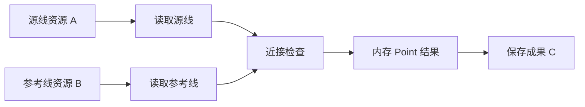

# 算子中间成果与血缘待办

**状态**：现状核对与问题记录；后续设计待讨论，暂不实施血缘扩展。
**核对日期**：2026-10-30。
**范围**：Develop 算子工作流、Runtime 中间结果与 Meta 资源血缘的衔接。

用户要求先记录当前机制和缺口，继续推进剩余算子开发。本专题不改变现有资源身份、执行协议、权限和血缘采集规则，也不授权登记所有中间对象。

## 一、当前机制

现有资源血缘回答“这个文件或表由哪些资源加工产生”。算子之间传递的内存结果参与来源追溯，但不作为独立 DataItem 登记。

| 对象或依赖 | 当前处理 |
| --- | --- |
| 读取节点绑定的文件、表等资源 | 以 ResourceLocator 声明执行输入；Meta 解析对应 DataItem。 |
| 算子间通过标准 `$ref` 传递的 DataFrame、GeoDataFrame 等对象 | 留在本次 DAG 内；Develop 沿引用追溯参与当前产出的读取节点，不为对象创建资源身份。 |
| 已确认成功保存的文件、表等成果 | 记录稳定输出及真实写入模式；目标扫描形成 DataItem 后，可进入 Meta 资源血缘。并非任意返回值都是持久化成果。 |
| `depends_on` | 只表达执行先后，不证明数据来源。 |
| `lineage_facts.operations` | 声明持久化产出与来源端口的派生关系，不是所有中间算子的逐步执行记录。公开执行观测会裁剪此字段，公开响应为空不能证明内部事实缺失。 |

例如实际工作流为：

当前资源血缘保留 `A → C`、`B → C`，不会把上述每个算子和内存对象都展开成 Meta 资源节点。`$ref` 中的端口用于选择节点数据，但当前贡献来源按节点追溯，不等于字段级、行级或完整多输出端口语义分析。

如果中间结果已保存、形成可定位资源，并由后续任务实际读取，该资源可以成为后续派生关系的输入。反之，只把中间结果额外保存一份，而下游仍引用原内存对象，不能据此宣称下游读取了这份副本。

## 二、尚未补齐的内容

1. **完整加工过程的可见性**：资源图能说明来源与成果，尚不能据此逐步查看“哪个算子、哪个输入／输出端口、哪个中间结果”构成的完整实际加工链。编辑器中的 DAG 定义也不能单独证明每个节点已成功执行。
2. **中间结果的观测证据**：当前资源血缘没有为每个内存结果提供独立身份及统一的结构、行数、几何类型等观测契约。执行结果中已有的局部摘要不能直接扩称为统一中间成果血缘。
3. **多输出贡献关系的精度**：节点级来源追溯不能自动证明同一算子各输出端口或各字段分别依赖哪些输入，需在有明确业务需求时定义，而不是从端口名称猜测。
4. **持久化副本与实际消费的区别**：未来展示必须保留真实数据依赖，避免把“保存过”误画成“下游读过”。
5. **证据与公开投影的区别**：不能通过放开内部 `operations` 或完整 Runtime 对象来替代正式设计；公开诊断、执行事实和 Meta 当前关系需要分别核验。

## 三、建议方向与待确认边界

建议保留现有 DataItem 资源血缘，另行讨论本次 execution 内的算子与端口加工过程展示；优先复用冻结 DAG、实际节点状态和受控结果摘要，不默认把内存对象持久化成资源。此方向仍是建议，尚未确定新的实体、协议或模块职责。

实施前需确认：

- 首版仅展示已确认执行的算子与数据连线，还是同时记录中间结果 Schema、行数和几何摘要；失败、取消、未执行如何区分。
- 是否要求各输出端口的真实输入贡献；字段映射及行级来源是否另行分期。
- Develop、Runtime、统一执行观测和 Meta 各自提供哪些事实，如何在资源图与加工过程之间跳转。
- 事实的存储量、保留期、脱敏与访问权限；不保存凭据、完整数据行或大对象。
- 验收如何覆盖多源、多分支、多输出、未使用输入、部分保存、失败节点和额外持久化副本；不能只凭图上出现连线认定来源正确。

这些决定会涉及概念、事实协议或模块边界，需先讨论，确认后再更新术语及正式规范、实现与标准门禁。本专题不替代正式规范，也不阻塞已确认范围内的算子开发和独立验收。

## 四、事实依据与后续维护

- [数据血缘能力规范](../spec/addp数据血缘能力规范.md)：血缘主体、执行事实、`$ref` 追溯、持久化确认及 Meta 采集边界。
- [Develop 资源与执行契约](../spec/workflow/Develop资源与执行.md)：当前 DAG 内部对象与跨任务稳定输出的区别。
- [Develop 资源来源追溯实现](../../develop/backend/internal/service/workflow_lineage.go)及[回归测试](../../develop/backend/internal/service/workflow_lineage_test.go)：按产出节点沿参数引用收集读取来源，顺序依赖不构成来源边。
- [统一血缘事实结构](../../common/execution/lineage.go)、[公开执行观测投影](../../common/execution/observation.go)：内部事实与公开响应的区别。
- [Meta 血缘采集实现](../../meta/backend/internal/service/lineage_service.go)：资源解析、关系证据与当前投影。

本次仅核对规范与实现并记录问题，不新增产品能力、不触发业务 T4 或容量验收。后续方案确定后，将生效契约写回正式文档，在本专题保留尚未解决的问题，不追加逐轮 CI 流水。
