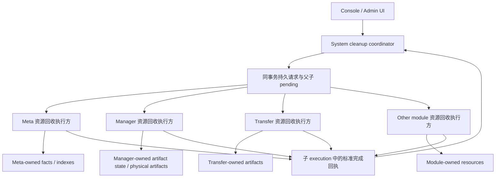

# ADDP Cleanup（资源回收）体系规范

> 状态：平台级规范。本文定义 ADDP 系统级资源回收体系的概念、职责边界、协议约束和演进顺序。

> 2026-10-29设计确认：持久队列、创建职责及完成回执采用[持久队列与完成回执](#持久队列与完成回执)的唯一目标协议，Graph取消／核清沿[Graph构建契约](tasks/模块任务契约.md#graph-构建任务)。实现与验证进度见本文的实施状态表；持久公共队列是唯一执行路线。工作区代码、本地门禁、环境切换和 Hosted 验收分别记录，不互相替代。

阅读导航：

| 阅读目的 | 正文入口 |
| --- | --- |
| 核对 Owner 归属 | [职责边界](#三职责边界) |
| 确定参与范围与执行条件 | [请求语义](#五请求语义)、[executor 参与范围](#executor-参与范围)、[scan 与 execute](#六scan-与-execute)、[清理模式](#七清理模式) |
| 区分结果、状态与界面 | [结果模型](#八结果模型)、[状态判定](#状态与通过判定)、[System 页面与 API](#system-页面与任务-api)、[Monitor](#1-monitor) |
| 核对删除及历史保留 | [Engine 删除工作流](#engine-删除工作流)、[审计](#2-审计)、[协调状态与历史保留](#3-协调状态与历史保留) |
| 确认验收与进展 | [运行态验收](#十三运行态验收)、[迁移状态](#十四迁移状态)、[已确认决策](#十五已确认决策) |

## 一、定位

ADDP cleanup（用户侧称“资源回收”）是系统级资源回收与生命周期治理体系，不是单一模块的失效数据删除功能。

cleanup 的价值在于补齐 ADDP 从“发现、加工、消费”到“失效、回收、审计”的生命周期闭环：

- 保持事实和产物一致：engine、tenant、item 或源 facts 变化后，Meta facts、Manager 派生产物、Transfer 残留和运行时缓存不能长期漂移。
- 防止跨模块耦合：cleanup 责任跟随 owner module，避免 System 或 Meta 变成理解所有模块私有表、bucket 和 key 的硬编码中心。
- 控制资源成本：及时识别和回收对象存储、PG 派生对象、向量行、搜索索引、Redis key、临时文件等持续占用的资源。
- 提升用户体验正确性：避免用户继续看到已失效的快显、旧瓦片、旧 embedding、已删除 engine 下的 metadata 或不可执行任务。
- 支撑运维可观测：cleanup 本身可能失败、超时或部分完成，必须能被 Monitor 观察，而不是只留在模块日志里。
- 支撑安全审计和合规追溯：cleanup 必须能回答谁发起、为什么发起、基于哪次 scan、影响哪些模块、清了什么、跳过什么、失败什么。

cleanup 覆盖以下对象：

| 类型 | 示例 | 说明 |
| --- | --- | --- |
| 源事实 | `meta.meta_node`、`meta.meta_item` | 由事实 owner 模块清理。 |
| 派生产物状态 | `manager.vector_tile_cache`、`manager.embeddings`、`manager.vector_materialized_view` | 描述当前产物是否可用、由什么配置生成、在哪里。 |
| 物理产物 | MinIO objects、PG materialized view / index、pgvector 行、Redis key | 只能由产物 owner 模块按登记状态清理。 |
| 任务定义残留 | 强绑定已删除 engine / item / tenant 的任务定义 | 是否删除、禁用或标记缺源由 owner 模块定义并在 cleanup result（资源回收结果）中报告。 |
| 运行时缓存 | 内存缓存、Redis 缓存、临时文件 | 由创建缓存的模块清理。 |

Model LogicalTable 的正式物化目标不属于通用 cleanup 自动发现范围。单表退出使用时必须走 Model 的物化目标退役命令：精确确认当前设计目标、验证 Model ownership marker、锁定当前逻辑表版本后执行非级联删除。该命令不接受任意 SQL、不注册 TaskProvider，也不由租户或 Engine cleanup 事件替代。

cleanup 从监控视角具有 execution 特征，必须纳入 Monitor；从编排视角属于系统运维流程，不是用户数据处理任务，不纳入 TaskProvider，也不进入 Orchestrator 编排。

## 二、核心术语

| 术语 | 定义 |
| --- | --- |
| cleanup coordinator | 资源回收协调方。负责受理持久请求、原子创建父子pending、汇总标准回执和展示审计；唯一coordinator是System，不代替Owner执行清理。 |
| cleanup executor | 资源回收执行方。负责评估和回收本模块拥有的资源，并写入模块结果。Meta、Manager、Transfer 等模块均可成为 executor。 |
| owner module | 资源、状态或产物的拥有模块。cleanup 责任跟随 owner module，不跟随触发事件来源。 |
| cleanup request | System持久受理的中性资源回收请求。只携带身份、租户、范围、动作、确认依据和中性上下文，不携带模块私有表结构或存储路径，不依赖Redis投递作为唯一事实。 |
| cleanup result | 资源回收执行方写回的模块级资源回收结果。包含统一状态字段和模块私有统计明细。 |
| logical cleanup | 逻辑清理。把事实、产物状态或任务定义从活跃路径移除，或标记为 `deleted`、`missing_source`、`outdated`、`disabled` 等。 |
| physical cleanup | 物理清理。删除实际存储资源，例如对象存储 key、PG 派生对象、向量行、缓存 key、临时文件。 |
| artifact state | 派生产物当前状态对象，例如瓦片缓存结果、embedding result、矢量物化视图结果。不是执行记录。 |
| physical artifact | 可删除的物理资源，例如对象存储 key、PG 派生对象、向量行、缓存 key。 |
| lifecycle event | 中性的生命周期事件，例如 engine deleted、tenant deleted、item deleted。各模块独立消费并处理 owner 范围内资源。 |

## 三、职责边界

### 1. System

System 是 cleanup coordinator，负责：

- 提供 Console / Admin UI 入口。
- 校验操作者权限和租户上下文。
- 校验并冻结资源回收 scan / execute 请求、确认依据和expected modules，同事务预建父子pending。
- 沿公共execution队列持久投递，不再发布Redis `cleanup.request` 作为执行路线；真实生命周期来源事件保留。
- 保存任务元信息、消费安全标准回执、计算并持久化总体状态；正常GET不得推进状态。
- 展示各模块资源回收结果和审计摘要。
- 为资源回收 scan / execute 写入系统运维 execution，并进入 Monitor。
- 为资源回收创建、确认、完成和失败写入审计日志。

System 不负责：

- 判断 Meta、Manager、Transfer 等模块的待回收规则。
- 读取或写入业务模块私有表。
- 删除 MinIO 对象、Meilisearch 文档、PG 派生对象、Redis key 或模块缓存。
- 知道 MVT、embedding、preview cache 等产物的内部路径、表结构或失效策略。

### 2. common

`common` 承载中性协议及公共执行原语，负责：

- 定义 cleanup request / result（资源回收请求 / 结果）的通用字段。
- 定义模块名、动作类型、结果状态等公共枚举。
- 提供可复用的协议解析或序列化 helper。
- 定义闭合、有界的标准完成回执；复用execution存储和当前lease围栏组合Owner事务，不新建回执表、专用结果队列或领域结果仓储。

`common` 不得承载：

- 具体模块的表结构。
- bucket、prefix、Redis key、PG object name 等物理路径规则。
- MVT、embedding、preview cache 等模块私有 artifact 类型清单。
- 模块私有的清理决策逻辑。

### 3. Meta

Meta 资源回收执行方只治理 Meta-owned 资源：

- `meta.meta_node`。
- `meta.meta_item`。
- Meta 自有 PG 事实投影；Manager 的搜索索引由 Manager 独占治理。
- Meta 自己的扫描任务定义、扫描锁或执行残留。
- System 中不存在、已禁用，或 active 但不再声明 `storage` 能力的 Engine Instance，均不再是合法的 Meta 数据源；其历史 Meta 快照属于无效源事实，由 Meta cleanup 回收。
- 无效 Engine 候选集必须取 Meta 事实中的 Engine 引用与 Meta 扫描任务定义中的 Engine 绑定之并集；不得因为该 Engine 的事实已经被软删除或物理删除，而漏掉“只剩任务定义”的孤儿引用。
- 普通手工 scan 必须评估所有强绑定无效 Engine 的 Meta 扫描任务定义，不以 `owner_module` 或自动任务 `owner_ref` 作为漏掉用户创建任务的过滤条件。

Meta 不得：

- 读取 Manager 私有表，例如 `manager.preview_state`、`manager.vector_tile_cache`、`manager.embeddings`。
- 推导 Manager 的 MinIO bucket、prefix 或对象路径。
- 删除 Manager preview state、MVT tiles、tile cache、embedding、preview cache。
- 清理 System audit logs 或其他 System-owned 产物。

### 4. Manager

Manager 资源回收执行方只治理 Manager-owned 派生产物和缓存：

- `manager.preview_state`。
- `manager.vector_materialized_view` 以及 Manager 创建并登记的 3857 优化目标。
- `manager.vector_tile_cache`、`manager.task_definitions` 中的对应定义、`manager.task_resource_bindings`，以及 `storage_ref` 指向的瓦片对象和 manifest。
- Manager runtime tile cache。
- `manager.embeddings`、`manager.embedding_tasks` 以及向量化结果。
- Manager TaskProvider 声明的全部任务定义；TaskProvider 任务类型与 cleanup 任务注册表必须保持一一对应，新增任务类型时必须由一致性门禁阻止漏注册。
- Manager 受管快显产物，包括 COG、3D Tiles、GLB、KSplat、COPC 和 PPTX/PDF 等已登记 artifact state 及其物理产物。
- Manager preview cache、缩略图、抽取缓存等后续 Manager-owned 产物。

Manager 同时独占本域搜索索引中失效 Engine 投影的回收，包括 Meta 记录已消失的残留。不得依据 Meta 节点／任务集合推断索引完整范围；Meta Cleanup 不再调用 Manager 删除索引。Manager scan 必须完整核验本 Tenant 的索引身份与出口代次，分页截断、未决写入、服务不可用和生命周期不明均不得作为零候选成功；execute 只按确认范围执行，未知效果不自动重发，效果前仍复核 Manager 子执行的原用户授权。

手动 execute 的原 scan 范围包含 Meta 时，必须同时显式包含 Manager；不满足时返回 HTTP 409，并提示使用 Meta＋Manager 重新评估。不创建隐藏子项、不自动扩大范围。Meta-only scan 仍可执行；Engine 删除流程继续沿原完整必选集合。配对本身不证明索引已评估或已清理，必须具有 Manager 的实际候选及效果证据。

Manager 任务定义残留治理规则：

- 任务配置中 `source` 与 `target` 的强绑定 Engine、ResourceLocator、item ID 或 fingerprint 任一已失效，该任务都是 cleanup 候选；不得只解析单一 `target` 字段。
- 普通手工 scan 必须同时发现已启用与曾被逻辑回收禁用的孤儿任务定义。`logical_cleanup` 对全部候选写入 `binding_status=missing` 和确定的 `binding_issue`，并禁用仍启用的候选；无 lifecycle context 的手工 `physical_cleanup` 允许硬删除孤儿任务定义，包括先前已被逻辑回收禁用的定义。
- Engine 生命周期 cleanup 不得物理删除用户任务定义；即使请求的 cleanup mode 为 `physical_cleanup`，任务定义仍映射为禁用并记录 `binding_status=missing`、`binding_issue=missing_engine`，供用户后续显式重绑或删除。
- 任务绑定状态与执行摘要正交。cleanup 不得把 `missing_engine`、`missing_source` 写入 `last_execution_status`，也不得覆盖原有最近 execution 摘要。

Manager 不得：

- 删除源业务表、源表原有索引或源数据。
- 删除 Meta facts。
- 删除 System engine 配置。
- 删除自动识别的外部 3857 物化视图、外部表或外部索引。
- 通过 Meta attributes 或硬编码 MinIO prefix 反推自身产物位置。

Manager 删除瓦片对象时必须从 `manager.vector_tile_cache.storage_ref` 解析单个 PMTiles 对象位置，不得硬编码存储路径。

### 5. Transfer 和其他模块

Transfer、Develop、Service、Asset、Portal 等模块按同一原则处理：

- 只清理本模块创建、登记并拥有生命周期的资源。
- 可以消费 System 或 owner 模块发布的生命周期事件。
- 不得让其他模块代替自己解释私有表、任务定义或物理路径。

#### Transfer

Transfer 已实现的资源回收执行方当前治理 Transfer-owned 任务定义和受管运行资源：

- 已确认的 Engine 删除流程按固定 Engine 范围扫描 source / target endpoint locator 引用该 Engine 的 `transfer.transfer_tasks`；缺少可信原用户的独立 `engine.deleted` 事件不启动清理。
- engine 生命周期 cleanup 无论使用何种 cleanup mode，都只禁用命中的用户任务定义、清空下一次调度并恢复 idle 状态；任务定义必须保留供用户后续重绑定或显式删除。
- 历史／closed Tenant 生命周期清理首期阻断。用户直接删除任务的既有入口沿独立当前用户授权，不借用 Cleanup 子执行权限。
- 没有明确 lifecycle context 的普通 scan 不应把全部 Transfer 任务定义视作待回收对象。
- Transfer 不拥有目标引擎中的表、文件或对象生命周期；这些资源只有在被其他 owner 模块登记为 artifact state 时，才由对应 owner executor 清理。

PostgreSQL CDC v1 capture control plane 已实现，Transfer cleanup executor 必须治理由 capture supervisor 明确登记的任务级捕获资源：

- ADDP-created Kafka Connect connector、replication slot、publication、Infra Kafka CDC topic 和 consumer group 归 Transfer owner；按 `task_id + capture_generation` 精确定位，不按 topic prefix 或数据库名称猜测。
- CDC stop 与 System Cleanup 使用同一套准确目标操作登记。外部结果未知不重发；明确成功的原操作回执可用于后续收口，不能据此重新删除或自动重新开放任务。
- 新 producer 因已有外部清理操作而被持久围栏拒绝时，启动／恢复接口返回 HTTP 409、稳定 `error_code=transfer_cleanup_unresolved` 和按请求语言翻译的安全 `error`，不返回底层包装错误。用户显式删除任务时外部清理失败仍返回 HTTP 503；该分类调整不开放任务、不重发未知效果，也不改变 Engine 删除保留任务与 DLQ 的语义。
- Kafka Connect config/offset/status 等共享内部 topic、Kafka broker 数据目录和 ACL 基础配置归 Infra 部署 owner，不得由单个 Transfer task cleanup 删除。
- cleanup 不删除目标业务表、目标业务行、目标 `addp_transfer.apply_positions`、`common.task_executions` 或 System 审计日志。
- slot/publication 只允许删除资源登记中标记为 ADDP-created 且 identity 完全匹配的对象，不得按同名规则删除用户已有资源。

#### Service

Service 第一阶段资源回收执行方只治理 Service-owned 服务发布定义和动态图层状态：

- `engine.deleted` 时，扫描直接绑定该 engine 的 `service.query_services`、`service.graph_query_services`，以及 `service.tile_service_layers.layer_config.source.engine_id` 指向该 engine 的动态图层。
- `tenant.deleted` 时，扫描该租户下 Service-owned query service、graph query service、tile service 和 tile layer。
- `logical_cleanup` 将命中的服务发布定义置为 `inactive` 并记录 `missing_source` 原因，动态图层置为 disabled。
- engine 生命周期 cleanup 无论使用何种 cleanup mode，都只将命中的服务发布定义置为 `inactive` 并记录 `missing_source`，动态图层置为 disabled；定义必须保留供用户后续重绑定或显式删除。
- tenant 生命周期 `physical_cleanup` 才允许删除 Service-owned 服务发布定义和动态图层状态记录。
- 没有明确 lifecycle context 的普通 scan 不应把全部 Service 发布定义视作待回收对象。
- Service cleanup 不删除外部 registered services，不删除外部服务端点，不推断或删除 MinIO 静态瓦片、缓存对象或业务引擎中的源数据。

#### Quality

Quality 第一阶段资源回收执行方只治理 Quality-owned 质量配置和问题状态：

- `engine.deleted` 时，扫描绑定该 engine 的 `quality.rule_applications`、`quality.check_tasks` 和 `quality.issues`。
- `tenant.deleted` 时，扫描该租户下 Quality-owned 规则应用、检查任务和问题工单。
- `logical_cleanup` 禁用规则应用；检查任务定义保留，但不再具有调度开关，目标 Engine 生命周期校验会使其退出可执行路径；命中的 open 问题工单置为 ignored。
- engine 生命周期 cleanup 无论使用何种 cleanup mode，都只禁用规则应用，保留检查任务定义供用户后续重绑定或显式删除，并将命中的 open 问题工单置为 ignored。Quality 不通过写入伪调度状态来阻止检查任务执行。
- Quality scan 和 execute 都必须以 `common.task_executions` 的 `pending|running` 记录判断活动执行，不得使用 CheckTask 最近执行摘要代替运行事实。同一次 Quality logical cleanup 必须在一个数据库事务中锁定命中的 CheckTask、确认不存在活动执行，再原子禁用规则应用并忽略 open 问题工单；任一对象更新失败或并发状态变化时全部回滚，不得留下部分清理状态。
- tenant 生命周期 `physical_cleanup` 才允许删除 Quality-owned 规则应用、检查任务和问题工单状态记录。
- Quality physical cleanup 删除问题、检查任务和规则应用必须使用单一数据库事务；任一删除失败或运行状态发生变化时全部回滚，不得留下部分删除状态。
- 没有明确 lifecycle context 的普通 scan 不应把全部 Quality 配置和问题工单视作待回收对象。
- Quality cleanup 不删除源业务表、源数据、Standard 数据元或规则定义，也不删除 `common.task_executions` 历史执行记录。

#### Develop

Develop 资源回收执行方评估 engine 影响，并只在租户生命周期回收中治理 Develop-owned 开发任务定义：

- `engine.deleting` 时扫描 `develop.dev_tasks` 中对目标 Engine 的运行时绑定和资源引用，统一报告为 `rebindable` 影响；不归档、不禁用、不删除任务定义。
- 算子工作流中的存储 Engine 引用以标准 ResourceLocator 为唯一事实。Engine 删除后 Develop 保留旧 Locator；用户可通过 Develop 的存储 Engine 绑定接口显式选择新 Engine，一次原子改写同一旧 Engine 的全部 Locator。改写保留 path/type，清除属于旧 Meta 快照的 `node_id/item_id`。
- System 不按 Engine 名称、连接信息或指纹自动改写 Develop 私有任务。目标 Engine 的租户、生命周期和存储能力由 Develop 在重绑定时校验；Locator 类型兼容性以目标 Engine 的 `storage.catalog_model` 为事实源，不得只按 `engine_family` 粗分类猜测。
- `tenant.deleted` 时，扫描该租户下 Develop-owned 开发任务定义。
- `logical_cleanup` 将租户删除范围内的开发任务置为 `archived`、关闭调度、清空下一次调度。
- `physical_cleanup` 仅在租户删除范围内删除 Develop-owned 开发任务定义本身；不删除 `common.task_executions` 历史执行记录。
- 没有明确 `tenant.deleted` lifecycle context 的普通 scan 不应把全部 Develop 任务定义视作待回收对象。
- 用户任务定义、Notebook 文件、Jupyter 虚拟环境、工作流输出、中间文件或源业务数据，常规删除必须由用户显式发起，不得因 engine 生命周期自动清理。

#### Graph

Graph 第一阶段资源回收执行方只治理 Graph-owned 图谱建模和构建状态：

- `engine.deleted` 时，扫描绑定该 engine 的 `graph.knowledge_graphs`，以及这些 graph 下的 `graph.build_tasks`、`graph.build_materials`、`graph.review_items`。
- `tenant.deleted` 时，扫描该租户下 Graph-owned 本体、实体类型、关系类型、本体版本、知识图谱实例、构建任务、构建材料和审核项。
- `logical_cleanup` 必须先按[Graph执行契约](tasks/模块任务契约.md#graph-与-cleanup-准入)关闭精确范围准入、在锁外真实取消并核清，再将命中的本体和知识图谱实例置为 `archived`；不能由Cleanup直接把任务摘要写成cancelled。实体类型、关系类型、本体版本、构建材料和审核项不单独改写状态，只随本体、任务和图谱离开活跃路径。
- engine 生命周期 cleanup 无论使用何种 cleanup mode，都只归档知识图谱实例并通过同一取消协议处理未完成构建；图谱、本体、构建材料和审核状态必须保留供用户后续重绑定或显式删除。
- tenant 生命周期 `physical_cleanup` 才允许删除 Graph-owned PostgreSQL 状态记录，删除顺序必须先子状态后父状态。
- 没有明确 lifecycle context 的普通 scan 不应把全部 Graph 本体、图谱或构建状态视作待回收对象。
- Graph cleanup 第一阶段不删除 Neo4j database 中的真实图数据，不删除 MinIO 中的构建材料文件，不删除 `common.task_executions` 历史执行记录；这些物理产物只有在后续被明确登记为 Graph-owned artifact state 后，才进入对应 owner executor。
- pending／running、独立审核在途操作及外部待核清均阻断最终清理；BuildTask最近执行状态、lease过期、进程退出或TTL均不能证明外部操作已停止。等待超时／失联保留准入关闭及证据，不自动重放清理；核清后创建新的显式execute，不复活旧终态。完整状态转换与E→G→T／B锁顺序只在[Graph契约](tasks/模块任务契约.md#graph-事务与锁顺序)维护。

#### Asset

Asset 第一阶段资源回收执行方只治理 Asset-owned 资产目录、资产状态和授权状态：

- `tenant.deleted` 时，扫描该租户下 Asset-owned 类型定义、类型字段、目录、资产、资产组件、资产扩展字段、申请、授权和评价。
- `logical_cleanup` 将命中的资产下架并撤销仍然有效的授权；CatalogEntry 来源状态由 Catalog 独立治理。
- `physical_cleanup` 删除 Asset-owned PostgreSQL 状态记录，删除顺序必须先消费状态和子状态，再删除资产、目录和类型定义。
- 没有明确 `tenant.deleted` lifecycle context 的普通 scan 不应把全部 Asset 状态视作待回收对象。
- `engine.deleted` 第一阶段不扫描 Asset 状态；Catalog 根据来源变化将对应 CatalogEntry 标记为不可选，Asset 在下一次编辑或发布时通过精确解析拒绝失效组件。
- Asset cleanup 第一阶段不删除 Meta / Service / Standard / Develop 的源对象，不删除已发布服务端点，不删除 Meilisearch 索引文档；搜索索引删除只有在后续被明确登记为 Asset-owned artifact state 后，才进入对应 owner executor。

#### Model

Model 第一阶段资源回收执行方只治理 Model-owned 建模状态：

- `tenant.deleted` 时，扫描该租户下 Model-owned 数仓分层、实体、实体属性、实体关系、逻辑表、逻辑字段、表关系、维度层级和指标实现。
- `logical_cleanup` 将命中的实体和逻辑表降为 `draft`，使其离开已审批 / 已物化语义；字段、关系、维度层级、指标实现和分层不单独改写状态。
- `physical_cleanup` 删除 Model-owned PostgreSQL 状态记录，删除顺序必须先指标实现、维度层级、关系和字段，再删除逻辑表、实体和分层。
- 没有明确 `tenant.deleted` lifecycle context 的普通 scan 不应把全部 Model 状态视作待回收对象。
- `engine.deleted` 第一阶段不扫描 Model 状态；Model 不解析 `materialization` 中的物理目标或引擎私有引用。
- Model cleanup 不删除 Standard 数据元、指标定义或业务域，不删除已物化的外部物理表；这些物理产物只有在后续被明确登记为 Model-owned artifact state 后，才进入对应 owner executor。

#### Standard

Standard 第一阶段资源回收执行方只治理 Standard-owned 标准治理状态和标准文档文件：

- `tenant.deleted` 时，扫描该租户下 Standard-owned 业务域、术语、数据元、码值集、单位、指标定义、标准文档及其修订和关联状态；维度层级属于 Model，安全分类分级属于 Security。
- `logical_cleanup` 将有状态的术语、数据元和指标置为 `deprecated`；标准文档文件不因逻辑清理删除。
- `physical_cleanup` 在租户删除范围内删除 Standard-owned PostgreSQL 状态记录，并删除 `standard.documents.file_key` 明确登记的 `standard` bucket 文档对象。
- 单个标准文档由用户显式删除时，可以同步删除 PG 状态和 `file_key` 指向的 MinIO 文件。
- `engine.deleted` 不扫描 Standard 状态；标准治理材料和文档不受 engine 生命周期影响。
- Standard cleanup 不删除引用它的 Model、Quality、Asset 等模块状态；跨模块引用残留由引用方 owner executor 自己治理。

#### Security

Security 实施时必须同步接入资源回收执行方，只治理 Security-owned 控制面状态：

- `tenant.deleted` 时，扫描该租户下的 ProtectionEnrollment、SensitiveFinding、ResourceSecurityAssessment、ProtectionPolicy、ProtectionProjection、投影应用回执和 Security 领域审计状态。
- `logical_cleanup` 先终止纳管和投影发布，并向参与 Owner 发布显式 `release`；Owner 完成回执前不得把投影缺失解释为“未纳管”。
- `physical_cleanup` 只删除 Security-owned PostgreSQL 状态；不删除 Meta DataItem、CatalogEntry、Standard 对象、Owner 资源或源业务数据。
- `engine.deleted` 或 `item.deleted` 对已纳管目标先生成保守失效投影并阻止新的敏感发现 execution；不按名称、路径或结构相似度把旧评估自动迁移到新来源。

## 四、架构模型



## 五、请求语义

cleanup request（资源回收请求）必须保持中性。

基础字段建议包括：

| 字段 | 说明 |
| --- | --- |
| `task_id` | 本次 cleanup 任务 ID。 |
| `action` | `scan` 或 `execute`。 |
| `tenant_id` | 租户范围；全局清理使用显式全局语义，不能误用租户 0 作为兜底。 |
| `expected_modules` | 本次期望响应的 executor 模块列表。 |
| `based_on_scan` | execute 基于的 scan task ID。 |
| `cleanup_mode` | `logical_cleanup` 或 `physical_cleanup`；scan 可为空。 |
| `trigger_type` | `manual`、`scheduled` 或 `event`。 |
| `cause_event` | 自动触发时的生命周期事件摘要，例如 `engine.deleted`。 |
| `requested_by` | 发起用户。 |
| `requested_at` | 发起时间。 |
| `context` | 可选中性上下文，例如 engine / item / tenant lifecycle 目标。 |

请求中不得包含：

- Manager bucket、prefix、tile cache key。
- Meta 表名、Manager 表名或模块私有字段。
- 具体 artifact 删除 SQL。
- executor 内部策略开关。

### 持久队列与完成回执

本节为2026-10-29已确认、尚未实施的目标协议；不是已通过的运行能力。执行状态／lease唯一来源为 `common.task_executions`，不新增dispatch、inbox、outbox、回调队列或共享回执表，不保留Redis与PG两套权威状态。

| 事实 | 唯一来源与写入职责 | 准入／事务边界 |
| --- | --- | --- |
| 受理请求、确认、范围 | System持久请求及父execution冻结配置 | 请求ID、Tenant、actor、action/mode、scope、cause、based_on_scan、expected modules和确认摘要同事务固化；没有Owner私有路径或凭据 |
| 父子执行意图 | Common execution；System预建，Owner执行 | 同一事务创建System cleanup父pending和每个Owner一个cleanup_executor子pending；子source=system，以parent_execution_id绑定。System创建权限仅限该闭合协议，不是任意业务execution创建权 |
| 去重 | 受理身份及cleanup子唯一约束 | 同父／同module最多一个cleanup_executor；scan／execute使用不同父。重复来源事件按确定来源操作身份返回原请求，相同受理ID不同内容拒绝；同参数但不同合法用户动作不可误合并 |
| 领取与运行 | 对应Owner监督器＋Common lease | 只领取自身module/type的合法请求；未创建或未合法领取不得执行。记录存在不授予删除权，Owner仍核对可信来源、Tenant、资源归属、模式和确认依据 |
| 标准完成回执 | 子项 `metadata.cleanup_receipt` | 类型化、有界且闭合，绑定本子execution，不另建表；只有对应Owner的当前有效lease能与子终态一起提交 |
| 专业结果和待核清 | Owner私有业务／控制事实 | 不把原始statistics、details、自由文本错误、SQL、对象路径、凭据或任意响应放入标准回执，不由System跨读私表 |
| 协调结论 | System请求／父execution及审计 | 由System当前lease汇总标准结果并同事务收尾；父恢复只重新汇总，不重置或替换子项，不重放已开始的execute |

标准回执只包含：协议版本、确定action/mode、请求／确认摘要、既有结果分类、安全稳定原因、标准summary计数和impact digest；保存与本子execution、Tenant、module、parent_execution_id及完成attempt的绑定，写入端和System消费端都从权威记录交叉核对，不接受调用方覆盖身份。字段类型、大小／数量上限及规范摘要算法须在同次实现的协议校验中固定；未知版本、未知字段、类型错误、越界、身份不符或摘要不匹配均失败关闭，不能截断专业正文后当作标准回执。回执随子终态冻结，终态后不得新增或改写；旧实例停止证据只能进入Owner窄控制事实。失败／超时缺少合法Owner回执时，System只记“未取得回执”及可核验公共事实，不伪造模块成功、专业统计或停止证明。回执落库不自动扩大Monitor白名单或读取权限。

实现使用`addp.cleanup-request/v1`冻结中性请求、`addp.cleanup-receipt/v1`绑定完成回执，严格拒绝未知字段；单对象最多16 KiB，计数为0至10^12的整数，参与模块沿现有十个Owner的注册集合校验、排序并去重。请求仅允许engine_id、tenant_id及显式external_artifact_policy中性上下文；摘要为确定结构JSON的SHA-256，不包含原始确认文本、凭据或专业正文。冻结deadline不可超过受理后24小时，现行scan／execute的30秒／5分钟预算保持不变。正式领取、回执与读取投影共用此闭合校验，旧Redis记录不补造该来源证明。

Graph本阶段的Owner PG清理、标准回执、子终态必须在同一当前lease事务提交，任一步失败整体回滚；提前关闭准入是独立短事务，不能等待清理完成才关闭。其他Owner的外部物理删除不在PG事务承诺内，必须用自身外部操作事实核清，不能因为本地终态成功而推断远端删除已停止。回执更新不得覆盖Common保留的观测namespace，也不得从标准回执恢复业务写权限。

| 协调或执行事件 | 唯一处理规则 |
| --- | --- |
| 重复受理或父监督器恢复 | 使用原请求和原子项，重算安全汇总，不重复创建子执行或重发删除 |
| 子项尚未领取 | 按[父关闭与子领取协议](#父关闭与子领取协议)在父P→子C锁下复核；永久关闭时仅由对应Owner拒绝收敛，临时无协调lease时等待。锁协议及未领取拒绝细则已获用户确认、尚未实施，不把Graph未启动取消例外推广到其他Owner |
| 子项已开始后失联 | 默认失败／核清，不自动退回pending重放外部删除；只读scan是否可安全恢复须Owner另有明确证明，本次不默认开放 |
| 父协调截止但结果未齐 | 父execution冻结为timeout，列明缺项；不伪造子终态／回执，不把父终态当作子停止证明，不推进Engine为deleted |
| 父终态后子仍持合法lease完成 | 子保存自己的真实终态和回执，父原结论不变；当前子事实与截止时汇总分开读取，不能用GET改写父终态 |
| 子已失权／终态后迟到返回 | 拒绝业务结果／事件／终态写回，走Owner窄停止证据和核清路径；不补“迟到成功”覆盖failed |
| 用户显式重试 | 新父／子execution及前驱关联，重核确认依据和Owner核清；不复活旧执行或自动恢复Engine删除流程 |

迁移必须整体删除Redis `cleanup.request` Stream、cleanup task/result hash协调状态、临时watcher及GET写状态；生命周期来源事件保留，按其受理身份创建唯一持久请求。不新增未批准的定时发现、自动重试或后台物理删除。已有数据库、共享模块及接口迁移由主责统一整合，不能让新旧两个消费者同时执行。

### 父关闭与子领取协议

状态：2026-10-29持久队列、创建职责、回执及本节父子锁／未领取拒绝细则均已获用户确认，**尚未实施**；[安全展示契约](#协调关闭与模块未开始的安全展示)及其细则均已获用户确认，尚未实施。仅适用于System创建的 `cleanup → cleanup_executor` 闭合协议；普通父子execution和Graph `kg_build` 不自动继承本节规则。不新增公共状态、独立准入表、另一套队列或System代写Owner子项的权限。

#### 准入事实与时刻

P为 `module=system + task_type=cleanup + source=system` 的父execution行，C为 `module=当前Owner + task_type=cleanup_executor + source=system` 的子行，均为bounded；二者以冻结请求、相同Tenant和 `parent_execution_id` 绑定，C的module必须属于P冻结的expected modules。父请求受理时冻结绝对协调截止 `deadline`，由System按受理时刻及既定预算确定；父等待领取、重启或恢复均不刷新。该截止是协调及新子领取预算，不是子lease，也不是远端删除的停止时刻。System维护冻结事实，Common只校验中性绑定、时间及执行状态，Graph不复制截止计算。

| 父事实（锁后核验） | 对尚未领取C的裁决 | 对已合法领取C的含义 |
| --- | --- | --- |
| P为running、当前协调lease有效且当前时间严格早于deadline，冻结请求完整 | 允许继续核验C与Owner领域条件；全部通过才可claim | 不代替C自身lease、授权或领域准入 |
| P尚在pending，或非终态但协调lease缺失／过期，且deadline未到 | 暂缓，C保持原样；不能据此认定永久关闭或拒绝终结 | 不撤销已授予的C所有权；失联父仅由System恢复汇总 |
| P已为任一终态，或当前时间已到deadline | 永久关闭本请求的新领取；Owner走未领取拒绝路径 | 已领取子仍按自身合法lease收尾；父关闭不是全体停止命令 |
| 父缺失、Tenant／来源／父子／请求摘要不符或deadline非法 | 失败关闭，不claim、不“修复”绑定、不使用本节拒绝原语改记录；报告完整性错误 | 不从坏绑定推导新的清理许可，沿Owner既有停止／核清规则处理 |

仅在对应claim事务成功提交后才可启动子运行体；这也是本协议区分“未领取”和“已准入”的边界。候选被发现、拿到锁、在内存生成token或事务回滚均不算领取。父关闭先提交则后续claim失败；子claim先提交则父随后关闭不追溯撤销该次领取，不能声称从此不再有任何删除。已准入子发起每次效果仍须满足自身lease、授权、有效期及Owner领域条件，父窗口不授予额外权限。

Owner依据deadline拒绝C不要求父当时在线，也不代替System写父timeout；System仍须合法取得／恢复自身协调lease后收口，恢复只做汇总、不重新开放已过deadline的准入。父永久关闭后不接受延期、重开或替换子集合；新的合法用户动作必须重新受理并复核原执行效果。

#### 锁顺序与提交规则

先普通读取候选C的固定身份和父引用，随后在同一短PG事务中**先锁P，再锁同一C**；候选读取不授予执行权。父、子均取行更新锁，父锁负责串行化关闭与领取，不是持有到清理结束的分布式锁。每次只处理一对P/C；候选或父锁忙时可跳过，但跳过不等于父关闭、子失败或队列为空。

| 操作／主责 | 固定锁序 | 原子提交与禁止事项 |
| --- | --- | --- |
| System父claim／heartbeat／协调恢复 | P | 只沿公共父lease推进；原deadline、子集合和请求不变，不重发删除 |
| Owner首次领取C | P → C → 必需Owner领域锁 | 锁后重核父准入、C精确身份、pending／attempt0及从未运行证明；Common同事务设置running、attempt、started_at和新lease，Owner摘要若有则一起提交。不能先claim C再回头锁P |
| System父关闭／截止收口 | P | 核验当前父lease，按权威时间与完整子事实快照固化父结论／缺项／审计；只普通读取公共C与合法回执，不锁C、不写C、不读Owner私表，不持锁调用HTTP |
| Owner拒绝尚未领取C | P → C | 父已永久关闭且从未运行证明完整，条件更新C为failed并记录固定“未开始”原因；不生成运行lease或清理回执 |
| 已领取C的heartbeat／业务结果／终态 | C → 必需Owner领域锁 | 仅核本C当前lease及Owner条件，不反向锁P；合法终态与回执、可原子提交的领域事实一起提交 |
| 已领取C失联收敛 | C → 必需Owner领域锁 | 按当前过期attempt的条件失败／核清，不回到pending，不借父关闭绕过围栏 |

Common须提供可在调用方事务中组合的“精确候选领取”及“未领取拒绝”条件原语，统一生成token、推进attempt和核验权威时间；不得由Owner复制公共更新算法。现有 `ClaimNext` 会直接先锁候选子行，不能先调用它再补父锁，也不能持P后再让它选择另一个父的C。未来改造沿同一公共claim实现收敛，不为Cleanup另建lease路线；具体函数命名由Common主责实现时确定。本轮仅记录缺口，不更改代码。

所有可能阻塞的必需行锁取得后，Common按数据库当前墙钟重新判定父deadline及需要的lease；不能使用候选查询、事务开始或等锁前的时间。Owner结果写入还须在取得领域锁后复核自身lease。最后条件更新后不插入外部调用或等待；提交失败整笔回滚。System收口采用父锁内一次完整公共子记录快照，保存实际观察时刻及缺项；快照以后才可见的子完成视作后续子事实，父不复活。deadline不证明存在跨进程完全同步的停止快照，GET也不补写历史结论。

多父候选按稳定顺序发现，单事务不得持有一组P再跨父取C。Common／Owner不得出现C→P，System不得在P内等待子运行体；并发事务遇数据库锁超时或死锁回滚时，不得派发外部工作。未来PG验证必须覆盖实际候选SQL、关联查询及外键隐式锁，不能只凭文档箭头认定无死锁。

#### 未领取子项的终结规则

只有对应Owner可在启动及正常监督循环中发现已关闭请求的本模块C并执行拒绝；System关闭P时不代写子状态，Owner离线期间C可以仍为pending。Common的窄拒绝原语只接受**pending→failed**，不开放任意无lease更新或调用方指定终态；Owner先验证可信模块身份和Cleanup绑定，Common在同一P/C事务内强制条件。该例外只确认“没有运行”，不表示清理执行失败、删除成功或远端已停止。

从未运行的证明来自新预建路径、不可变身份、公共约束和“claim提交后才启动”的唯一执行路线，以及没有Owner操作事实；不是仅凭空字段、进程扫描或调用方布尔值。旧Redis消费者所建记录、历史无lease记录或来源不明记录不得套用此例外。数据库查到合法pending0但实际发现运行效果时，按完整性异常阻断，不能先把记录标成未开始再忽略副作用。

| C的真实事实 | 处理与写入 |
| --- | --- |
| pending、attempt=0、started_at／completed_at／execution_time_ms为空、lease字段全空，且没有运行体、操作登记、回执或已产生效果；P永久关闭 | Owner将C条件更新为failed；completed_at取本次权威时刻，attempt仍0，started_at／耗时／lease仍空，progress保持0；安全error_details区分父终态关闭与deadline已到，明确“协调已关闭，执行未开始” |
| 同上但P只是暂时没有协调lease，deadline未到 | 不改C；等待System恢复或原deadline到达，不轮换父／子身份、不刷新期限 |
| C已经running、attempt>0、曾启动／恢复排队、存在lease残留、操作事实或证据不完整 | 不走未领取例外；以实际所有权及失联核清契约处理，不能把它重写为“未开始” |
| C已终态，或并发合法事务已经改变C | 不重写状态、时间、原因或回执；重复拒绝只读取既有结果，条件竞争失败不执行任何清理 |

未领取拒绝没有清理执行attempt，不生成 `metadata.cleanup_receipt`，不伪造“扫描无对象”、成功统计、impact digest或停止证明；保留已有观测namespace和冻结身份。Owner的标准安全拒绝原因与终态原子提交，不能以通用 `UpdateFields` 绕过围栏，不能为事件或监控伪造attempt=1。System可识别该failed为“未开始的准入拒绝”，但不能把它补成模块执行回执或据此推进Engine为deleted。在父与对应子均可读、证据完整的前提下，Owner监督器尚未提交拒绝的pending须区分“协调已关闭、该模块未开始”，不得承诺它还会启动；Owner读取裁决不可用则失败关闭，不因该展示目标绕过授权。本轮[安全展示草案](#协调关闭与模块未开始的安全展示)细化字段与文案，不把所有普通父终态泛化为该标签。

#### Common／System／Graph职责核对

| 主责 | 负责 | 不承担 |
| --- | --- | --- |
| Common | 中性父子绑定约束、P→C可组合领取和窄拒绝、锁后权威时间／lease围栏、公共状态及观测namespace保护 | 不决定业务删除范围，不读取System／Graph私表，不推断远端效果，不把父子关系泛化为取消继承 |
| System | 受理与固定deadline、原子预建父子、协调lease与父关闭、严格校验回执并保留截止快照、恢复只汇总 | 不claim或终结Owner子项，不持P跨HTTP等待，不伪造未响应Owner的结果 |
| Graph（Cleanup Owner） | 验证本模块请求、P→C准入／拒绝；已领取后沿C→G→T/B关闭领域准入、锁外取消核清、最终PG清理与回执原子收尾 | 不实现第二套公共lease，不用Graph `kg_build`取消例外终结Cleanup子项，不以父关闭删除Graph控制证据或扩大清理范围 |

Graph首次领取需要领域准入锁时，完整顺序为P→C→G→T/B；领取后所有领域阶段仍沿C→G→T/B，不再次获取P。未领取拒绝只改公共C，不关闭G、不取消构建、不改Graph表；Graph执行阶段提前关闭G的事实仍由合法C提交。Graph最终清理不得反锁构建execution，既有三阶段和外部效果待核清边界保持不变。具体安全详情API、历史保留和人工核清权限不在本次细则中决定。

### Cleanup执行授权

2026-10-29补充确认：复用System执行授权框架，新增Cleanup目的绑定和`system.cleanup_authorization.execute` Tenant Service Permission。仅十个已登记Owner的runtime角色持有，固定Service客户端与Owner对应；不授予用户角色或通用数据读写权限。普通用户受理仍核验现有`system.cleanup.execute`。授权绑定原User／Tenant／Membership、请求及确认摘要、准确父子execution、Owner、action／mode、scope和当前attempt／lease，实际效果前由System重新核验用户当前资格、授权版本和权限；Engine 删除派生请求还须持续具有当前 `system.engine.delete`，其到期不能由仍有效的 Cleanup 权限替代；任何授权失败不得派发清理，临时不可用与已撤权分别保留事实。不保存User Bearer，不把父子记录或lease当授权。

首期仅支持active Tenant的用户来源请求及其已确认Engine删除派生流程。closed Tenant／`tenant.deleted`、没有可信用户来源或没有目的限定许可的事件保持阻断；不复活Membership、不使用PlatformToken替代Tenant权力。历史Tenant治理需另行确认。该权限不扩大Owner资源范围，不恢复旧执行、不重放删除。

目的绑定存入既有`system.execution_authorizations`的`cleanup_scope`，使用独立`audience=cleanup`；scope包含request UUID、父execution UUID、完整请求digest和Owner。它与引擎access、Ontology internal task及Manager source scope互斥，签封后不可改写，不能经其他消费接口取得引擎访问。System在请求／父子／审计的受理事务中签发并附着子授权；授权最长一小时，不能因协调恢复刷新。

对应Owner调用`POST /api/v1/system/execution-authorizations/{id}/cleanup-accesses`。`stage=claim`只允许未领取的pending子项（attempt=0、无token），且受请求deadline限制；这次HTTP核验在P→C领取事务之外完成，随后仍须按公共准入协议取得P→C。`stage=effect`必须提供准确running子项的attempt和lease token，在每次产生效果前重新调用；最终有效期取授权、用户／服务成员资格和当前lease的最早截止。已经合法领取的子项不因父协调关闭而失去记录事实的资格。两种响应都只返回绑定、阶段、attempt和有效期，不返回token或凭据；Owner在提交领域变更时仍须执行C围栏。HTTP响应限制16 KiB、统一五秒预算且禁止重定向；未知字段、多个JSON值或绑定不一致均拒绝。

### executor 参与范围

`expected_modules` 是当次必须响应的模块集合，不是在线实例数量，也不由 System 或 UI 硬编码。三类选择规则如下：

| 请求 | 集合来源 | 范围与失败边界 |
| --- | --- | --- |
| 通用 scan，未指定 scope | 从当前启用且有有效租约、可路由 Backend 的模块中，选择声明 `cleanup_executor.enabled=true` 的在线 Backend executor。 | 等待当次发现的集合；未发现任何 executor 时拒绝创建，不将空集合当作“全平台无待回收对象”。 |
| 通用 scan，显式指定 scope | 在上述可用集合内规范化模块名并去重。 | 只等待所选模块；未注册、未启用或当前不在可用集合中的模块会被拒绝，不因显式指定而纳入离线模块。成功只证明该范围，不代表全平台覆盖。 |
| Engine 删除预评估与权威复扫 | 从完整模块注册信息中，按实例 `metadata.capabilities.cleanup_executor.enabled=true` 与 `causes[]` 包含 `engine.deleting` 形成必选集合；不先过滤掉 down 实例。 | 不允许用 scope 缩小集合。每个必选模块都须有模块启用、状态为 up 且租约有效的 Backend executor；任一不可用或未发现支持者时拒绝创建评估，不退化为通用 scan 的在线子集。 |

- 模块安装与启用事实来自 `module_definitions`，实例心跳只提供运行状态与声明，不能改写模块定义。当前严格评估仍依赖已登记实例中的 cause 声明；没有该声明的模块不参与，不能据此断言该 Owner 无相关资源、已完成评估或全部已安装 Owner 均已覆盖。
- 当次集合写入 task、execution 与请求事件；execute 沿用所引用 scan 的 `expected_modules`。executor 不在明确集合内时忽略请求且不得写入结果，不能用其他 Owner 的在线状态或响应补足缺失 Owner。
- Engine 删除须逐一取得必选模块的成功结果、非空 impact digest，且无运行任务；缺失结果、检查失败、跳过、部分失败或超时均不能视为完整评估。进入 deleting 后还须按[Engine 删除工作流](#engine-删除工作流)复扫并比较已确认影响摘要，不能仅凭任务终态或收到部分响应继续删除。
- 参与范围专项须覆盖离线、租约失效、空集合、显式 scope 拒绝、结果完整性和复扫变化；按[运行态验收](#十三运行态验收)区分通用扫描与严格删除评估的证据。

### Engine 删除影响模型

Engine 删除 scan 除可回收对象外，还必须报告不会被自动删除、但会因 Engine 退出而受影响的 owner 资源。公共结果只保存稳定的跨模块分类，模块私有表、字段和判断逻辑仍留在 executor 内部。

| 分类 | 语义 | 删除处理 |
| --- | --- | --- |
| `rebindable` | 用户创建且可显式更换 Engine 的任务、服务或配置。 | 保留原绑定；未重绑定时后续执行不可用，由 owner 提供显式重绑定入口。 |
| `will_disable` | 强绑定目标 Engine、删除后必须退出活跃路径的配置。 | 禁用或标记 `missing_engine`，不得因 Engine 删除物理删除定义。 |
| `will_delete` | Meta 快照、缓存、受管派生产物等可回收 owner 状态。 | 按 owner 策略物理回收。 |
| `running` | 当前仍在使用目标 Engine 的执行。 | 硬阻断删除，必须先等待结束或由 owner 显式取消。 |
| `external_artifact` | 位于外部 Engine 内且由 ADDP owner 明确登记的产物。 | 删除失败时硬阻断；显式放弃须满足[Engine 删除工作流](#engine-删除工作流)的权限与确认要求。 |

每个 executor 必须返回各分类数量和 `impact_digest`。Digest 由 owner 使用稳定资源 ID 和 disposition 计算，System 只比较摘要，不解释模块私有资源。模块可返回安全的 `management_path` 供 Console 跳转到 owner 页面处理依赖。

## 六、scan 与 execute

cleanup 分为两个动作，支持手动、事件驱动和定时触发：

| 动作 | 语义 | 输出 |
| --- | --- | --- |
| `scan` | 发现可回收对象、估算影响、生成风险和空间摘要。 | 资源回收结果 cleanup result，包含模块级 scan statistics。 |
| `execute` | 基于一次 scan 的结果执行资源回收。 | 资源回收结果 cleanup result，包含删除、标记、跳过、失败和释放空间摘要。 |

触发方式：

| 触发方式 | 适用场景 | 约束 |
| --- | --- | --- |
| `manual` | 当前 Tenant User 按对应 Permission 主动排查和治理。 | scan / execute 使用 User 凭据与 AuthContext 中的当前 Tenant；execute 必须基于已完成 scan，并通过下述权限与确认校验。 |
| `event` | engine deleted / disabled、tenant deleted、item deleted、source facts changed、config version changed 等生命周期事件。 | 默认只自动 scan 或低风险状态标记，不默认执行高风险 physical cleanup。 |
| `scheduled` | 周期性发现历史残留、事件漏处理或外部漂移。 | 只负责发现和审计摘要；高风险 execute 仍需显式确认或策略授权。 |

约束：

- 手动 scan / execute 要求当前 Tenant User 与 `system.cleanup.execute`；任务、历史读取另需 `system.cleanup.read`。身份与权限按[授权上下文规范](addp授权上下文规范.md#五权限计算)校验，不按“管理员”名称或角色称谓放行；确认字段不授予 Permission，也不替代 Tenant 归属校验。
- execute 必须基于明确的 `based_on_scan`。
- execute 不应绕过 scan 重新解释另一套范围。
- `platform` 会话模式不得发起 Tenant 级手动资源回收；全局资源回收必须另行定义显式 Platform Scope、Permission 和审计语义。
- execute 请求必须携带有权用户的显式确认。当前 HTTP API 使用 `confirmed=true` 表示已核对 scan 结果、影响范围和 cleanup mode；`physical_cleanup` 或 `risk_level=high` 的 execute 还必须提供确认文本 `CONFIRM`。
- 手动 `physical_cleanup` 还必须显式选择 `external_artifact_policy=delete|abandon`，不允许由 System 或 owner 模块隐式推断。`delete` 表示删除已登记外部产物；`abandon` 仅在外部产物无法访问时放弃平台后续物理删除责任，由 owner 把登记记录终止为 `abandoned_external`，不表示外部对象已删除。
- System 创建 execute 时必须复制 scan context 并把本次显式选择的 `external_artifact_policy` 写入持久execute请求、父子execution冻结输入和审计记录，不得回写原scan context；不再依赖Redis执行事件传参。`logical_cleanup` 不接受该策略。
- 确认文本只用于证明显式确认，不应作为业务密钥保存；审计日志只记录是否提供了确认文本、确认时间、风险等级和影响摘要。
- executor 可以在 execute 前做幂等复查，但复查结果必须在 result 中报告。
- scan result 与 execute result 的关联必须可审计。
- 重新调用通用 `POST /api/v1/system/admin/cleanup/execute` 仍须通过当前 Tenant 与 `system.cleanup.execute`、已完成 scan 及本节确认校验；它创建新的 execute task 和 execution，不将原失败任务改为成功，也不等于恢复原 Engine 删除工作流。不得以新任务成功推断原 Engine 已转为 `deleted`。
- scan 不得产生副作用；必要的短期诊断缓存必须由 executor 自己负责过期。
- event 触发的自动 scan 必须记录 `cause_event`，并能关联到后续 execute。
- 自动 physical cleanup 只允许用于确定性缓存、已过保留期对象或已被策略明确授权的低风险资源；其他物理删除必须由具备对应入口 Permission 的用户显式确认。

## 七、清理模式

cleanup 使用平台级 `cleanup_mode`，不使用数据库语境的 `soft_delete` / `hard_delete` 作为跨模块语言。

| 模式 | 语义 | 典型处理 |
| --- | --- | --- |
| `logical_cleanup` | 逻辑清理。让对象离开活跃路径，但保留必要状态和摘要。 | Meta soft delete；Manager artifact state 标记 `deleted`、`missing_source` 或 `outdated`；任务定义禁用并在独立绑定状态中记录原因。 |
| `physical_cleanup` | 物理清理。删除实际资源。 | 删除对象存储 key、PG 派生对象、向量行、Redis key、缓存文件。 |

模块映射规则：

- Meta 可以把 `logical_cleanup` 映射为 GORM soft delete 或等价状态标记。
- Meta 的 `physical_cleanup` 只能把无血缘引用的逻辑删除 item 计为可执行候选并物理删除。仍被 `lineage_item_relations`、`lineage_service_dependencies` 或不可变 `lineage_observations` 引用的 item 必须保留，execute 以 `skipped_items` 报告；关联 node 只有在其 item 全部可删除后才可物理删除。定时保留期清理、Meta 手工保留期清理和 System 资源回收必须复用同一候选判定，不能依赖外键错误充当运行时过滤器。
- Manager 对有审计价值的 artifact state 优先逻辑标记，再按策略删除 physical artifact。
- 纯缓存类资源可以没有逻辑状态，但必须通过 execution / audit 保留删除摘要。
- System audit logs 不进入 physical cleanup；审计日志只能保留或归档，不由业务 cleanup 删除。
- 资源回收执行方如果不支持某种模式，必须在 cleanup result 中返回 `skipped` 和原因，不得静默忽略。

## 八、结果模型

cleanup result（资源回收结果）分为通用字段和模块私有字段。本节描述协调协议与 Owner 结果；[System 页面与任务 API](#system-页面与任务-api)和[Monitor](#1-monitor)采用不同读取与展示路径，不能互相推定返回范围或保护能力。

通用字段建议包括：

| 字段 | 说明 |
| --- | --- |
| `module` | executor 模块名。 |
| `status` | `success`、`failed`、`partial_success`、`skipped` 或 `timeout`。 |
| `action` | `scan` 或 `execute`。 |
| `tenant_id` | 本次处理租户。 |
| `task_id` | 对应资源回收任务。 |
| `cleanup_mode` | `logical_cleanup` 或 `physical_cleanup`。 |
| `trigger_type` | `manual`、`scheduled` 或 `event`。 |
| `timestamp` | 完成时间。 |
| `summary` | 面向 System 汇总的标准摘要。 |
| `statistics` | 模块私有统计。 |
| `details` | 模块私有明细，可分页或采样。 |
| `errors` | 错误摘要列表。 |

System 只能依赖 `summary` 中的标准摘要字段计算全局视图，不得硬编码解析 `statistics` 的模块私有字段。

标准摘要建议包括：

| 字段 | 说明 |
| --- | --- |
| `scanned_items` | scan 阶段发现的候选项数量。 |
| `affected_records` | execute 阶段影响的状态记录数量。 |
| `deleted_physical_artifacts` | 删除的物理产物数量。 |
| `freed_bytes` | scan 时表示已登记候选产物的预计可释放空间；execute 时表示本次实际释放空间。无法可靠取得大小的候选项不计入。 |
| `marked_missing_source` | 标记源缺失的产物数量。 |
| `marked_outdated` | 标记过期的产物数量。 |
| `disabled_task_definitions` | 禁用的任务定义数量。 |
| `deleted_task_definitions` | 物理删除的任务定义数量。任务定义删除不等同于物理产物删除，不计入 `deleted_physical_artifacts`。 |
| `skipped_items` | 跳过数量。 |
| `error_count` | 错误数量。 |
| `risk_level` | `low`、`medium`、`high`。 |

模块可以在 `statistics` 中报告私有字段，例如 Manager 的 `deleted_tile_cache`、`deleted_embeddings`、`skipped_external_targets`，但 System 不应把这些字段写入 coordinator 的核心逻辑。

`scanned_items` 是 scan 阶段的候选规模，`affected_records` 只表示 execute 阶段实际改变的记录。System UI 在 scan 结果中必须优先展示“发现项”，不得用值为 0 的 `affected_records` 暗示 scan 未发现候选。scan 结果不得把“候选任务定义数”写入 `disabled_task_definitions` 或 `deleted_task_definitions`；二者分别只记录 execute 实际禁用和实际物理删除的任务定义数。System UI 必须把两类任务处理结果明确展示，不能仅依赖 `affected_records` 让用户推断物理删除是否发生。

### 状态与通过判定

公共父、子 execution 均使用真实状态 `pending`、`running`、`success`、`failed`、`timeout`、`cancelled`，不再保留协调层的 completed／completed_with_errors 别名。模块回执结果仍与 execution 状态分层：

| 模块回执结果 | 子 execution 状态 | 父协调处理 |
| --- | --- | --- |
| `success` | `success` | 收到合法回执；没有其他失败或缺项时父可成功。 |
| `skipped` | `success` | 回执已结束，但跳过不证明实际删除；严格 Engine 删除评估拒绝。 |
| `failed` / `partial_success` | `failed` | 所有必需回执齐全时父 failed。 |
| `timeout` | `timeout` | 已有真实超时回执；回执齐全时父 failed。 |
| 没有合法回执 | 保持子当前事实 | 原截止到达时父 timeout；冻结缺项，不伪造子回执。 |

父关闭时固定回执截止快照，迟到合法子结果可以单独展示，但不改写父结论或截止摘要。父进度 100 仅表示协调结束。`error_count=0`、某模块 skipped 或空授权清单均不能替代必需模块完整性判断。

通用 execute 只接受本 Tenant 已成功的普通手工 scan，并再次检查当前用户权限与确认条件。带 Engine／Tenant 生命周期上下文的 scan 不能经此入口执行；Engine 删除必须经过原有名称、版本、影响摘要与策略确认，再进入持久 Engine 工作流。严格 Engine 评估要求每个必需模块回执成功、摘要完整且没有运行任务。

### System 页面与任务 API

以下为用户已确认的唯一持久协议，不保留 Redis 结果或旧响应解析路线。

- `POST /api/v1/system/admin/cleanup/scan`、`POST /api/v1/system/admin/cleanup/execute` 和 Engine `deletion-assessments` 创建请求必须包含客户端生成的 `request_id` UUID。同一原用户、同一请求 ID、同一意图重试只返回原父子身份和原 deadline；冲突意图拒绝，不能刷新期限。Engine 的确认后复扫及 execute 由服务端按已提交工作流身份幂等派生。
- `GET /api/v1/system/admin/cleanup/tasks/:task_id` 按原入口凭据、`system.cleanup.read` 与任务 Tenant 核验父读取权，不新增“仅请求创建者可读父”的限制。返回 `task_id`、`action`、真实 `status`、中性冻结 `task` 与 `observed_at`；父 `started_at`／`completed_at` 尚无事实时为 null。任务上下文只含闭合中性字段，不返回任意 context、原始 errors、SQL 或供应商正文。
- 对 Owner 范围协议支持的当前 User，返回经过独立子授权的 `module_executions`。每项为安全 Observation、可选 `cleanup_admission` 与已验证标准 `receipt`；没有子读取权的项不生成占位节点。协议不适用时省略该字段；合法空范围返回空数组，两者不能表达“全部模块通过”。协议适用而任一必需 Owner 裁决失败时整次读取返回 `503 execution_owner_unavailable`，不回用旧结果。
- `cutoff_at` 与可选 `summary` 仅来自父已冻结截止快照；summary 只汇总当前可读子在截止时已有的合法回执。没有可展示回执时省略摘要，页面显示未提供，不补零。当前子事实与父截止结论分开展示；GET 从不领取、拒绝、超时或恢复任务。
- `GET /api/v1/system/admin/cleanup/history` 使用 `page`／`page_size`（默认 1／20，最大 100）返回本 Tenant 持久父请求的 `tasks`、真实 `total`、`page`、`page_size`。不使用 limit、Redis TTL 或最近 100 项索引；历史条目不包含子结果或专业统计。
- 页面共用 Common 的准入说明和模块结果容器；专业结果按下节经当前用户向 Owner 按需读取。身份、Tenant、任务或请求代际变化立即清除旧结果，迟到响应不能恢复视图；读取失败清除相应详情。移除“原始 JSON”展示。跳转 Monitor 仍由 Monitor 独立核验父子读取范围。

### Owner 专业结果读取

2026-10-29 用户补充确认：删除旧 Redis 结果路线后，十个现有 Owner 各自保存专业 Cleanup 结果，并提供 `GET /api/v1/{owner}/cleanup-executions/{execution_id}/result`。该接口新增 `<owner>.cleanup_result.read`，不默认授予角色；同时核验第一方 unrestricted Tenant User、公共 Cleanup 子读取范围、同 Tenant 与本人一次性执行归属。Graph 构建读取 Permission 和 System 后台身份不能代替该授权。

专业记录绑定准确子 execution、Tenant、attempt 与请求 digest，和标准回执、合法子终态及可原子提交的领域效果同事务保存。System 仅展示已获授权的标准摘要，专业详情由浏览器通过 Gateway 使用当前 User 按需向对应 Owner 读取；Common 前端统一处理请求代际、失效、错误和容器，Owner 只定义自身闭合统计字段。读取不推进状态，不读取其他 Owner 私表，不把正文塞入公共回执或 Monitor metadata。

保留现有模块统计计数；自由文本错误改为稳定安全类别和计数。SQL、对象路径、凭据及供应商原始错误不公开。当前十个 executor 均未实际填充任意 `details`，不为该空扩展口建立新公开协议；结果为单个有界统计对象，逐对象列表／分页另议。无新结果时返回明确未就绪，不合成零结果。新专业结果首期没有自动物理保留清理，不套用执行事件或概览评估的期限。

用户另已允许清理本次改造相关的旧执行、旧 Cleanup 协调及旧协议记录。旧数据不导入为新可信记录，不为它保留兼容路线；一次性清理先盘点精确引用和运行状态，不从删除记录推断外部效果已停止，不触发自动重试。新的 Hosted 与服务重启仍各按原授权边界执行。

### 协调关闭与模块未开始的安全展示

状态：2026-10-29用户已确认展示契约、读取顺序、视图失效和Graph领域含义，由牵头会话统一实施及验证；Graph文档会话保持交接，不再并改。代码与门禁尚未完成，新的Hosted仍须单独确认。只解释新持久Cleanup协议的已授权执行事实，不新增execution状态、权限、通用父子取消语义、队列或执行动作，不据此宣称当前System／Monitor页面已有该能力。本节只确定准入说明的字段与读取边界；后续补充确认的专业读取边界见[Owner 专业结果读取](#owner-专业结果读取)。

#### 读取与裁决边界

System资源回收详情沿既有 `GET /api/v1/system/admin/cleanup/tasks/:task_id` 演进，不新增旁路详情端点或兼容query。父详情核验当前User的Tenant、`system.cleanup.read`及该请求归属；其中模块执行概览必须以同一User同步取得各Owner的 `execution-read-scope`，再按公共执行读取规则过滤C，不借System后台身份读取子项。Monitor沿既有execution详情／树接口，仍要求第一方Tenant User、`monitor.execution.read`及相同逐Owner裁决；不因为System页面可读而跳过Monitor入口权限。

凭据边界须单独保留：System父详情当前使用 `UserAccessCredential`，而Owner范围协议仅支持第一方、unrestricted的Tenant User。本轮不把新增概览变成收窄原父入口凭据的理由，也不扩大Owner协议。对于原父入口合法但不在Owner协议身份集合内的请求，仍按原父读取裁决返回父自身安全事实，省略可选 `module_executions`和联合准入说明；该省略表示概览不适用于当前凭据，不能当作成功空清单、全模块已核验或零结果。对于协议支持的身份，一旦开始取得所需Owner范围，任何必需Owner失败均整份聚合读取失败；不得再降级为省略概览。这是明确的字段授权条件，不是旧接口解析或错误兜底路线。

Graph当前声明 `kg_build` 读取使用 `graph.build_task.read`，`cleanup_executor` 使用 `system.cleanup.read`，两个类型互不代替；声明事实见[Graph Owner裁决](../../graph/backend/internal/api/execution_read_scope.go)。相同Permission名称不等于子项已可读，还须核对Owner返回的任务历史／本人一次性执行范围及可信主体。System不得用Graph构建／审核Permission推导Cleanup读取权；Graph Cleanup概览可读也不授予图数据、构建材料、审核结果、操作证据或专业诊断读取权。本节的概览授权不包含专业正文；用户后续确认的独立专业端点与窄 Permission 见[Owner 专业结果读取](#owner-专业结果读取)。

| 本次读取裁决 | 允许的展示 | 禁止的推断或补查 |
| --- | --- | --- |
| P与C均可读，合法新协议绑定及准入证明完整 | 可为本C生成下述联合准入说明；父协调结论与C当前状态分别展示 | 不把父timeout改写成C timeout，不把C的迟到终态回写父 |
| 仅P可读，Owner合法返回的范围不含C | 只展示P的协调结论；不返回该C概览、占位节点、准入标签、隐藏子数量或结果摘要 | 不从P的expected modules／缺项记录反推隐藏C身份或状态；System原有可读的冻结参与范围仍是父请求事实，不等于子执行结果 |
| 仅C可读，P不在当前可读范围 | 仅展示C的公共安全概览；已证实的Owner未领取拒绝可说明“执行未开始，准入已拒绝” | 不补查P私表，不显示父状态、截止、关闭原因或联合“协调已关闭”标签；不增加父存在性说明 |
| 必需Owner不可用、超时或裁决非法 | 沿既有失败关闭：整个本次聚合读取失败，按既有 `503 execution_owner_unavailable`处理 | 不返回部分授权拼出的模块清单，不回用旧范围，不把失败变成无子项／无待处理模块 |
| 新协议绑定、从未运行证明或安全字段不完整 | 不生成相应准入说明；仅保留本次真正可读的公共状态，必要时显示未记录并记录服务侧完整性诊断 | 不从pending、空日志、零计数、旧Redis记录、父终态或进程离线猜测“未开始” |

Owner“尚未处理未领取拒绝”和“Owner读取裁决不可用”必须分开：前者在本次P/C均已获授权且证据完整时可展示closed pending；后者不能显示联合标签。可读范围为空是成功的拒绝裁决，可过滤；网络失败或非法范围不是空范围。授权不缓存、不跨请求复用，遵守[执行读取5秒总预算／最多4并发](tasks/执行监控.md#通用执行读取与过程事件)。System模块概览同样失败关闭，不为新增标签另设调用预算或后台授权缓存。

#### 同一次读取的处理顺序

授权裁决和数据库事实快照是两类证据。Owner范围只在本次同步请求内使用，不是跨服务原子权限快照；`observed_at`也不保证响应送达时权限或子状态未变。实现按下列顺序组合，不持PG事务或生命周期行锁等待Owner HTTP：

| 顺序 | 处理与可见边界 |
| --- | --- |
| 1. 入口与候选 | 先验证当前凭据、Tenant、入口Permission及父请求归属，再从公共身份发现所需Owner；不把未经子授权的候选、数量或失败细节返回给用户。System父请求归属读取不替代后续P/C公共事实的联合快照 |
| 2. Owner裁决 | 沿既有同步User协议取得所需范围，校验module、Tenant、principal及闭合grant；适用身份下的必需Owner失败立即使本次聚合失败。原父入口合法但凭据不适用Owner协议时，仅按前述字段授权条件处理，不转后台身份 |
| 3. 事实快照 | 授权后开启短只读一致快照，读取本次响应所需的公共P/C及新协议绑定事实；原父请求与公共P仍须一致。对最终实际读取的Owner逐一确认已有本次合法裁决；候选发现后新增而未裁决的Owner不默认放行，本次聚合按Owner裁决不可用失败关闭，不返回拼接的部分结果 |
| 4. 过滤与纯投影 | 先按各Owner范围过滤，再验证本C的绑定、未运行／拒绝证明和父关闭依据；Common纯投影只接收已裁决的类型化事实。缺少某项说明证明时只省略该说明，不把安全公共状态也改成未知，更不查询私表补证 |
| 5. 响应与接收 | 同一概览中的公共状态、准入说明和观察时刻必须来自同一快照。列表、详情、树是独立请求时可有不同观察时刻，前端不得跨响应拼接P状态、C状态和标签来制造联合证明 |

说明证明缺失与响应对象非法不能混为一谈：服务端合法省略 `cleanup_admission` 表示本次未给出肯定说明，不表示准入开放、仍会执行或已清理；若响应包含不符合闭合契约的对象，消费方按契约错误清除本次视图。合法的 `module_executions: []` 只表示本次可读集合为空，不表示所有模块未开始、所有Owner已完成或没有回收影响；字段因凭据不适用而省略则沿前述不同含义处理。现有父级冻结参与范围／截止结论仍按父权限读取，不与新增的可读子计数混算。

#### 唯一安全投影

Common唯一定义纯值类型及纯投影规则，调用方先完成授权和同一只读快照的P/C读取；纯函数不查库、不发HTTP、不决定权限。System在详情的显式 `module_executions` 概览数组中复用公共安全执行概览，Monitor在既有 `ExecutionObservation` 中复用同一可选字段 `cleanup_admission`。它是响应DTO的显式扩展，不把 `execution_config`、原始metadata或Owner错误原文加入白名单，也不写回数据库。System不能把未响应模块塞成假 `results`／完成回执；新增概览按C读取范围过滤，数组与任何新增概览计数只覆盖可读C，不借expected集合泄露隐藏子。

| `cleanup_admission`字段 | 闭合规则 |
| --- | --- |
| `schema` | 固定 `addp.cleanup-admission-view/v1`；未知版本不解析，不提供旧格式兼容分支 |
| `state` | 仅 `closed_unclaimed`、`closed_rejected`、`rejected_unstarted`；是说明码，不是execution状态，不进入状态筛选／状态统计枚举 |
| `basis` | 仅联合状态必需，取 `parent_terminal`或 `deadline_reached`；P已终态优先取前者，后者仅允许已提交未领取拒绝的C使用。表示当前可核验依据，不冒充原始拒绝原因；仅C可读的 `rejected_unstarted` 必须省略此字段 |
| `observed_at` | 本次只读快照的数据库观察时刻，UTC RFC3339Nano；不是关闭时间、拒绝时间、精确提交时刻、权限有效期或未来执行许可 |

不允许附加任意文本、动态URL、父私有请求context、expected／missing模块数组、原始回执、impact digest、材料路径、图查询、实体属性、运行体ID、凭据或授权引用。P与C的身份引用只沿各自原有安全概览字段，不在本对象重复扩展。字段类型／枚举／条件组合必须由双端闭合校验，前端不解析 `error_details`自由文本或按本地化文案分支；非法对象作为响应契约错误处理，清除本次详情／标签，不回显原JSON。服务端输入缺证据不输出说明，不能输出 `false`来暗示准入开放。

| 说明码 | 必需事实 | 固定展示含义 |
| --- | --- | --- |
| `closed_unclaimed` | 本次P/C均可读；合法新协议绑定；P已有按P锁协议提交的终态；同一快照C仍pending、attempt0且具备正式契约的从未运行证明 | “协调已关闭，模块未开始”；补充“本次读取未见Owner拒绝记录；不会再领取本次执行” |
| `closed_rejected` | 本次P/C均可读且P已终态或固定deadline已到；C为Owner已原子提交的未领取failed拒绝，attempt0／无开始及运行耗时，固定安全原因及其绑定合法 | “协调已关闭，模块未开始”；补充“Owner已拒绝，执行未开始” |
| `rejected_unstarted` | C可读，P不可读；C自身足以证明Owner已原子提交未领取拒绝 | 只显示“执行未开始，准入已拒绝”，不显示父关闭依据 |

生成联合说明时，P/C必须来自公共执行事实的同一只读一致快照，带当前Tenant及各自Owner范围；使用公共P冻结的类型化请求／deadline／身份与C绑定校验，不查询System或Graph私表，不以单个调用方布尔值或任意metadata声明代替证明。没有该新协议来源证明的旧记录不回填标签。读取不用P→C更新锁、不调用claim／拒绝原语，GET始终零状态推进。父临时无lease且未到deadline、C曾运行／恢复排队、存在操作不确定或绑定异常均不得生成closed-unclaimed说明；相关事实只有Owner能够核清，本投影不承担核清。

仅“数据库当前时间已过deadline＋读取到C pending”不足以生成 `closed_unclaimed`：普通MVCC读取可能尚看不到此前已合法判定、仍持P锁且未提交的claim。必须等System取得P锁并提交父终态，使此前领取事务已经串行决出，或等Owner按P→C提交未领取拒绝；后者使用 `closed_rejected`。未取得任一提交证明时保留可读的真实状态，不展示“模块未开始”的肯定标签，也不在GET中加更新锁或终结父／子来补证明。这是读取证据的限制，不放松deadline对新领取的禁止。

列表、详情、树若返回同一对象，必须复用相同规则及可读范围，不单靠树中已经出现父节点认定有权。树截断、子被过滤或未载入时，不按子数量／空数组生成联合说明；单独读取C也不额外返回不可读P。System保存的截止快照与合法子后续事实分开展示；原父timeout不被本次观察、刷新或Owner拒绝修改。

#### 观察变化与Graph领域含义

下表只规定读取展示，不新增持久状态转换或执行指令。下一次读取必须重新授权、重新取得快照，不能因上次已显示标签而跳过证据核验。

| 后续可读事实 | 展示规则 |
| --- | --- |
| 同一C从 `closed_unclaimed` 对应pending变为Owner已提交的未领取failed拒绝 | 用新快照整体替换概览，符合条件时显示 `closed_rejected`；保留父原截止结论，C的completed_at只表示拒绝提交时间 |
| P读取权消失、C仍可读且已有合法拒绝 | 清除旧联合说明；仅可在独立合法的C读取响应中展示 `rejected_unstarted`，不沿用旧basis或父关闭细节。原父详情／以P为根的树若因此404，则按原契约清空整份详情，不保留旧C、不自动补查C来替代失败请求 |
| 新快照缺证明／对象被过滤，或发生既有授权失效错误、切换身份／Tenant／execution | 清除不再适用的旧说明；沿既有授权失效规则清除相应详情。旧响应即使后到且时间更晚，也不能覆盖当前请求代数；普通传输错误仍按原页面契约处理，不擅自扩大为权限拒绝 |
| 原先带“未开始”说明的同一C后来出现running、attempt>0或运行效果等矛盾事实 | 不保持旧标签，也不把真实状态改回pending／failed；按本次实际授权事实展示，并记录服务侧完整性异常，交Owner核查。不通过GET修复、不自动重试或删除 |
| 已领取C在父截止后合法完成 | 展示真实子终态及授权范围内的安全回执；不再显示未开始标签，不改父原timeout或截止汇总，不把迟到完成自动解释为Engine已deleted |

“模块未开始”严格限定为**这一条Cleanup子execution没有启动**，不指整个Graph模块没有任务或副作用，也不指业务图为空。尤其不能据此判断Graph的G已关闭／开放、构建已停止、审核已结束、外部操作已核清或旧图数据已删除。Graph未领取拒绝不改G、不运行领域清理；先前合法执行遗留的阻断与待核清事实仍由Graph独占。即使Cleanup标签和Graph领域状态同时可读，也须分别注明所属执行／目标及事实来源，不合成“可安全删除／重新开放”的按钮或总绿灯。

#### 界面、失效与职责

真实状态栏仍显示C的pending或failed，旁边增加准入说明；不得用“已取消”“已清理”“无待回收项”或新状态替代。未领取项开始时间／运行耗时显示未开始／无，不填0秒运行或100%完成；closed pending不继续展示暗示仍会领取的排队倒计时。既有状态统计不篡改，pending计数不被标签自动减为0，也不把它解释为仍可派发的工作量。父timeout和C的拒绝时间分别解释，不伪造父关闭时刻。

文案与说明码分离，System和Monitor复用共享国际化词条及同一准入说明组件；中文／英文分别表达上述含义，不拼Owner返回文本。未领取拒绝不是运行中清理错误，不展示“重试删除”或自动恢复；仅沿原有授权链接打开模块／监控，不新增重试、取消、解锁或核清动作，不从该标签授予Graph写权限。

切换Tenant、用户、execution或请求版本时清空旧说明；401／403／404及Owner裁决503按[诊断页失效规则](tasks/执行监控.md#执行诊断页面与授权失效)清空相应详情并停止刷新，迟到响应不得复活旧标签。每次重新读取都重新裁决权限和快照；本次方案不启动后台补读、定时协调、读时拒绝或自动清理。读取成功不代表运行验收或已核清外部效果。

| 主责 | 安全展示职责 | 不承担 |
| --- | --- | --- |
| System | 校验本资源回收请求读取权，同User取得子Owner范围；在原详情中返回过滤后的公共模块概览；保留父协调截止结论及当前子事实差异 | 不以父权限代授子权，不直接读取Graph私表，不把Owner未响应当成未开始／无结果 |
| Monitor | 继续逐Owner BFF授权，安全DTO和树过滤复用公共纯投影；隐藏子不产生节点／计数侧信道，授权失败清除旧视图 | 不维护Cleanup Permission映射，不调用System私有详情来补状态，不改变执行事实或核清效果 |
| Graph | 独占本模块读取范围声明、未领取拒绝原因及业务证据真实性；专业数据按各自既有权限独立裁决 | 不让 `graph.build_task.read`代替Cleanup读取，不为该标签创建专业接口／宽权限，不向通用投影交付操作证据或图数据 |
| Common／共享前端 | 闭合纯值DTO、唯一投影校验、同一国际化说明组件；不自动扩大既有Observation字段 | 不成为授权主体、协调器或执行者，不保留旧格式解析分支 |

实施时同次同步System／Monitor真实DTO与调用方、Common投影、共享词条和双语Swagger，并按[最小验证矩阵](testing/Owner补充门禁.md#c5协调关闭安全展示子矩阵)核对授权、状态真实性与响应失效；由统一主责按已获授权的顺序推进。不得以受控页面替代真实身份／Gateway或Hosted证据，新的Hosted仍须单独确认。

## 九、监控与审计

cleanup 必须同时进入 Monitor 和审计体系。

### 1. Monitor

cleanup 不纳入 Orchestrator 编排或 TaskProvider，必须写入 `common.task_executions`；Monitor 的读取授权、安全 DTO、错误投影和截断规则统一遵循[执行监控规范](tasks/执行监控.md#租户执行诊断)。以下只补充 Cleanup 的记录归属与能力边界。

执行记录模型：

- System 创建父 execution：`module=system`、`task_type=cleanup`、`source=system`，`trigger_type=manual|scheduled|event`；`execution_config` 保存 `action`、`cleanup_mode`、`expected_modules`、`based_on_scan`、`context`、`cause_event`，用于协调和审计，不作为 Monitor 公开响应。
- System与父项同事务预建子pending：`module=meta|manager|transfer|...`、`task_type=cleanup_executor`、`source=system`，以 `parent_execution_id` 关联父项；Owner独占领取和推进，标准回执只用[持久协议](#持久队列与完成回执)的类型化metadata。专业结果和诊断由Owner管理，不要求复制同一私有结构。
- Owner 不消费旧 Redis Cleanup 请求，也不自行创建 running 子项。旧请求解析器和结果 hash 写入已删除；历史任意 `cleanup_result` metadata 不进入新协议、安全 DTO 或可信回执。

读取与展示边界：

- Monitor 查询要求当前第一方 Tenant User、`monitor.execution.read` 及各 Owner 的独立读取裁决。System 的 `cleanup` 与 Meta 的 `cleanup_executor` 当前均由各自 `GET /execution-read-scope` 按 `system.cleanup.read` 返回范围；其他 executor 以对应 Owner 声明为准，不在 Monitor 维护权限映射。父 execution 可读不授予子 execution 读取权；Owner 不可用或范围非法时失败关闭。
- Monitor 从共享执行事实生成显式安全 DTO，不直接读取 executor 私有表，也不把任意 Owner 诊断响应拼入通用 DTO。`execution_config`、原始 `metadata`、模块私有明细、业务数据、凭据和自由文本错误不直接展示；错误按上述规范投影为安全类别、稳定码与合法受控诊断。专业结果仍通过 Owner 既有授权入口读取。
- Cleanup 的展示目标包括父子树、scan / execute 关联、耗时、安全错误、释放空间、影响记录数和模块结果，以及按当前 Tenant 范围、module、action、cleanup_mode、trigger_type、status 查询。当前 Monitor 通用列表未提供 `action` / `cleanup_mode` 过滤，Common 安全投影也未开放上述 `cleanup_summary`、`cleanup_status`、`cleanup_result`、`summary`；不能因字段已落库便宣称关联、计数或私有结果已在 Monitor 展示。未接通部分保留为能力缺口，不通过透传配置或原始结果补齐。
- Monitor 专项须核对授权、敏感投影、分页与截断；[Cleanup 域接口](#system-页面与任务-api)和 Monitor 的实际 API、页面及跨模块证据分别记录，执行监控规范与[运行态验收](#十三运行态验收)统一规定判定边界。

### 2. 审计

cleanup 必须写入 System 审计日志。审计回答“谁、何时、为什么、基于什么确认、影响什么范围”，Monitor 回答“执行过程和运行结果”。

至少记录以下审计事件：

| 事件 | 触发时机 | 关键字段 |
| --- | --- | --- |
| `cleanup.scan.created` | scan 请求创建。 | actor、tenant、expected_modules、trigger_type、cause_event、context。 |
| `cleanup.execute.created` | execute 请求创建。 | actor、tenant、based_on_scan、cleanup_mode、expected_modules、context。 |
| `cleanup.execute.confirmed` | execute 的显式确认校验通过；规则见[scan 与 execute](#六scan-与-execute)。 | actor、based_on_scan、risk_level、cleanup_mode、external_artifact_policy、确认时间、是否提供确认文本、影响摘要。 |
| `cleanup.completed` | cleanup 父 execution 完成。 | task_id、execution_id、status、summary。 |
| `cleanup.failed` | cleanup 父 execution 失败或部分失败。 | task_id、execution_id、failed_modules、errors。 |

手动触发的 actor 是当前用户；事件触发或定时触发的 actor 是 `system`，但必须记录 `cause_event` 或 schedule 信息。审计日志不随 cleanup physical cleanup 删除；各类记录的来源与保留边界见[协调状态与历史保留](#3-协调状态与历史保留)。

### 3. 协调状态与历史保留

System 持久请求、公共父子 execution、不可变标准回执及 Owner 私有专业结果分别承担请求、执行、截止汇总和专业事实。详情与历史都按 PG 持久事实读取，GET 只读；不再用 Redis 临时状态、结果 hash 或最近任务索引作存在性判断。

首期不新增请求／回执／专业结果的自动物理删除。执行概览、过程事件与审计各沿用自身保留规范，不能把概览 180 天评估或过程事件期限套用到私有结果。待核清控制事实与必要身份／证据引用必须作为保留单元核对；父终态、TTL 或删除普通记录都不构成外部操作已停止的证明。

用户允许一次性清理本次改造相关旧执行、旧协调与旧协议记录，不要求迁移为新可信记录。执行清理前核对精确引用、Redis 残留与活动运行体；新旧消费者不能同时运行。实际环境切换与新的 Hosted 仍单独确认。

## 十、生命周期事件

cleanup 不等于所有生命周期事件都必须由 System 同步调度。

推荐模型：

| 事件 | 发布方 | 处理方式 |
| --- | --- | --- |
| engine deleting / disabled | System | `disabled` 只退出正常消费；删除先执行只读影响评估，用户确认后 Engine 进入 `deleting` 并执行权威复扫。用户创建的任务、服务和治理配置只允许保留、重绑定或禁用，不因 engine 生命周期物理删除；Meta 快照、缓存和明确登记的派生产物按 owner 策略回收。 |
| tenant deleted | System | 必须触发 system-owned cleanup execution，各模块清理本租户 owner 资源并写审计摘要；System 审计日志保留。 |
| item deleted | Meta 或 item owner | 相关模块标记 artifact state 为 `missing_source`，并按策略清理物理产物。 |
| source facts changed | Meta | 相关模块优先标记派生产物 `outdated`；查询和执行时做惰性复查。 |
| config version changed | 配置 owner 模块 | 相关 executor 标记或扫描受影响产物；按产物类型比较 config version。 |

事件处理原则：

- 事件只携带中性身份和必要上下文。
- 模块内部资源清理由模块自己决定。
- 需要有权用户显式确认、风险评估或跨模块审计时，使用 cleanup request（资源回收请求）。
- 不需要用户确认的幂等缓存失效可以由模块内部直接处理，但仍应保留必要日志。
- 一般生命周期事件可以自动触发 scan；高风险 execute 不得因为普通事件发生而默认执行。用户在 Engine 删除确认中明确授权“清理并删除”时，该删除工作流可以基于本次 scan 自动执行 physical cleanup。
- `tenant deleted` 触发的 cleanup 中，`tenant_id` 是历史审计主体和资源归属范围；即使租户记录已离开活跃租户列表，Monitor、审计和 executor 仍应允许按该历史 `tenant_id` 写入 execution / result，不应把“租户已删除”解释为 cleanup 上下文非法。

### Engine 删除工作流

Engine 删除必须遵循单一的两阶段顺序：

```text
active / disabled
→ 只读影响评估 scan（Engine 仍保持原生命周期）
→ 用户确认评估结果
→ deleting（冻结新绑定和新执行，但保留连接和凭据）
→ 权威复扫并比较 impact digest
→ cleanup execute
→ cleanup 全部成功
→ 转为 deleted 墓碑、清除敏感连接信息并发布 engine.deleted
```

约束：

1. 只读预评估不改变 Engine 生命周期，也不得产生任何 cleanup 副作用；评估结果必须绑定 Tenant、Engine、参与模块集合和有效期。
2. 用户确认必须引用一次已完成且符合[严格参与范围](#executor-参与范围)的完整评估；删除入口的 `system.engine.delete`、当前版本和引擎名称确认文本见[引擎删除说明](../../system/docs/tables/engines表.md#删除引擎)，不能用通用 execute 的 `CONFIRM` 代替名称确认。确认后 System 原子切换 Engine 为 `deleting`，所有 owner 的新建、更新和执行入口必须重新校验目标 Engine 为 `active`。
3. `deleting` 后必须执行权威复扫。若发现新增影响、任一模块不可用或 `impact_digest` 与用户确认的评估不一致，删除暂停并要求用户查看新结果，不得自动继续。
4. scan 和 execute 的 `context.engine_id` 指向正在删除的 Engine；各 executor 必须把该 Engine 当作即将失效来源，不能因为 System 记录仍存在而跳过候选。
5. cleanup 失败时 Engine 保持 `deleting`，保留已有 scan / execute task ID、错误摘要和连接配置。规范要求支持具备对应 Permission 的用户显式重试，但当前引擎删除的独立失败重试入口仍未具备，不能记为已实现。当前重复 DELETE 返回 409；启动仅续办已有 scan task ID 的流程，已有 execute task ID 时沿用原任务，失败、部分失败或超时终态不会因重启自动重跑，缺少 scan task ID 时也不会补建。实际入口与权限边界见[引擎删除说明](../../system/docs/tables/engines表.md#删除引擎)；通用 execute 不替代本节评估、确认、权威复扫与最终墓碑写入。
6. 外部引擎不可达且存在 owner 已登记外部产物时，具备 `system.engine.delete` 的当前 Tenant User 可按上述评估与确认流程显式选择 `external_artifact_policy=abandon`。Owner 模块必须把记录终止为 `abandoned_external`，保存外部 schema/object、最后错误、放弃时间和操作者审计；该记录不再进入自动 cleanup 候选。
7. `abandoned_external` 表示平台放弃后续物理删除责任，不表示外部对象已删除。外部对象由 DBA 或外部系统管理员处理。
8. System 不读取或修改 owner 私有表；放弃语义仍通过 cleanup request 的中性 context 传递，由 owner executor 落库。
9. cleanup 完成后必须保留原 Engine Instance 的永久 ID、Tenant、类型和地址键墓碑，不得物理删除、释放或复用 ID。登记与恢复统一遵循[Engine Instance 身份与生命周期](../concepts/addp引擎体系图.md#engine-instance-身份与生命周期)，地址键由[插件声明](addp引擎插件接口规范.md#二基础接口)规范化生成，不等于永久身份。`deleted` 墓碑不占用地址；同 Tenant、同 `engine_type` 下没有非删除实例占用该地址时，普通登记通过注册校验后获得新 ID，不会复活旧墓碑。显式恢复用于同一实际引擎，沿用原 ID，须满足权限、当前版本及完整连接配置要求；地址变化时另须显式确认，地址已被其他非删除实例占用则返回 409。
10. cleanup 不做 ID 映射，也不按名称或相似连接信息改写 owner 的既有绑定。新实例不会接管旧 ID 的引用；改接不同实际引擎必须新建实例，由用户在 owner 模块显式选择、校验并原子重绑，保留审计。恢复原 ID 只保留引用身份，不自动恢复 owner 已禁用或归档的配置，也不授予数据权限；后续执行仍须核验当前生命周期、连通性、能力、授权和 owner 状态。

### Standard 被引用资源删除工作流

Standard 的 Domain、Element 和 Metric 是 Standard-owned 事实，但其引用状态属于 Model 私有事实。单个资源的用户显式删除不进入 System cleanup coordinator；它使用与两阶段 cleanup 相同的“冻结后权威复扫”原则，由 Standard 直接协调 Model 的标准引用删除屏障。DimensionHierarchy 是 Model 本地聚合，不参与跨模块删除协调。

```text
active
→ deleting
→ Model 冻结引用屏障并权威扫描
→ 有引用：Standard 恢复 active，Model 恢复 open，返回 409
→ 无引用：Standard 硬删除，Model 屏障终止为 deleted
```

Model 的新增引用事务和冻结事务必须锁定同一 `(tenant_id, resource_type, resource_id)` 屏障行。冻结前提交的引用进入权威扫描，冻结后到达的引用被屏障拒绝；不得用一次性 HTTP 查询、固定等待时间、跨 Schema 外键或 Standard 直读 Model 私有表替代该串行化边界。影响存在时只允许用户先在 Model 中解除引用，不自动级联清空 Model 状态。

## 十一、与任务体系的关系

cleanup 不纳入 TaskProvider，也不进入 Orchestrator 编排。

约束：

- cleanup 不能声明为可编排任务类型。
- cleanup 不能出现在 Orchestrator 任务选择列表。
- 资源回收执行方不应在 TaskProvider capabilities 中声明 cleanup 能力。
- cleanup 必须写入 `common.task_executions`，但只能作为系统运维执行记录，用于 Monitor 展示、审计和排障。
- 资源回收 scan / execute 分别产生 execution；execute 通过 `based_on_scan` 和 execution metadata 关联 scan。

## 十二、禁止规则

以下行为一律视为 cleanup 体系缺陷：

1. Meta 读取 Manager 私有表或删除 Manager-owned 物理产物。
2. System 读取业务模块私有表或删除业务模块物理产物。
3. `common` 写入模块私有 bucket、prefix、表结构或 artifact 类型。
4. executor 清理非本模块 owner 的资源。
5. 通过硬编码路径代替 `storage_ref`、artifact state 或 owner 模块 repository。
6. scan 阶段执行删除、标记 stale、失效缓存等副作用。
7. execute 未基于明确 scan 结果直接执行高风险删除。
8. 为兼容旧路径同时保留两套 cleanup 主路径。
9. 将 cleanup 注册为 Orchestrator 可编排任务。
10. 在物理删除失败时把 artifact state 伪装成已清理。
11. 用数据库 `soft_delete` / `hard_delete` 作为跨模块 cleanup 公共语言。
12. cleanup 不写 Monitor execution 或不写审计日志。

## 十三、运行态验收

Graph／Cleanup持久队列、取消、锁序及核清的最小新增验证统一见[Owner验证矩阵](testing/Owner补充门禁.md#graphcleanup-执行管理最小验证矩阵)。矩阵逐项区分实现、确定性门禁和真实运行证据。当前 Common、System、Graph 与安全展示已进入实施和本地门禁阶段；新的 Hosted 仍须单独确认固定源码、身份、预算和清理范围，不能用本地通过或旧浏览／审核验收替代新故障场景。

本节定义租户级 `scope=["meta"]` 扫描闭环的验收要求；执行统一遵循[标准测试入口](addp测试与验收规范.md#三标准入口)和[T4 Online 隔离规范](testing/T4-Online验收规范.md)。当前 Online registry 尚未登记覆盖本节完整闭环的 Cleanup 专项 suite，须补齐正式场景、身份夹具、断言与清理后再验收。

统一证据边界：规范、注册声明、源码、字段落库、状态或页面标签、单模块测试均不能独自证明完整跨模块验收通过。按实际场景记录产出、首次失败、修复后结果、未覆盖项及清理证据；其他 suite 的退出清理或部署销毁不替代本节业务断言及被测保留／删除策略的执行证据。未运行、失败或跳过不计为通过。

**环境与权限前提**：

- 仅使用符合[T4 专用环境](testing/T4-Online验收规范.md#专用环境)的隔离测试部署，不复用个人开发服务、账号、浏览器会话或业务数据。Gateway、System、Meta、Monitor 及其必需 Infra 按场景准备，完成实际构建身份、`/health/live` 与 `/health/ready` 核对；服务已启动不等于拓扑和业务验收通过。
- Tenant、Run ID、仓库外凭据与证据目录、数据库及运行锁按[拓扑预检](testing/T4-Online验收规范.md#开关身份与拓扑预检)和[数据与清理规则](testing/T4-Online验收规范.md#数据超时与清理)设置，由正式生命周期入口准入；不手工创建数据库、拼接启动命令或伪造 Hosted 标记。
- 测试 User 通过 System AuthContext 证明当前 Tenant 与有效 Permission。创建 scan 需 `system.cleanup.execute`，查询任务需 `system.cleanup.read`，读取 Tenant 审计需 `audit.tenant_event.read`；Monitor 树查询另需 `monitor.execution.read` 及[Owner 执行读取裁决](tasks/执行监控.md#租户执行诊断)。这些权限互不替代，不为读取证据授予无关管理权。
- 平台上下文拒绝用例须使用符合 T4 身份规则的隔离夹具；本节不新增平台管理员身份例外。缺少合法夹具、权限或依赖时记录未覆盖或环境失败，不改用个人 Token 或直接 SQL 代替 API 授权验收。

**验收要求（待正式 suite 覆盖）**：

1. 平台上下文调用 `POST /api/v1/system/admin/cleanup/scan` 返回 HTTP 403；分别核对 `Accept-Language: zh-cn`、`en` 的拒绝提示。另验证缺失相应 Permission 与跨 Tenant 任务读取被拒绝，Tenant 只从 AuthContext 派生，不接受请求自报 `tenant_id`。
2. 合法 Tenant User 以 `{"request_id":"<本次受理 UUID>","scope":["meta"]}` 创建 scan，取得有效 `task_id`，有界查询 `GET /api/v1/system/admin/cleanup/tasks/{task_id}`。正常场景须返回 `success` 且 Meta 子 execution 和标准回执均成功，混合结果及部分失败按[状态与通过判定](#状态与通过判定)记录。创建请求成功、HTTP 200 或取得 task ID 都不等于扫描完成。
3. 完整授权结果包含 `task.execution_id`、`task.expected_modules=["meta"]` 与 `module_executions` 中的 Meta 子项及其 `receipt`；核对参与者、父子／请求绑定、真实状态和安全摘要，不仅检查字段存在。另在具备 `meta.cleanup_result.read` 时，经当前 User 的 Owner 专业 GET 核对模块计数；缺少该权限时专业结果拒绝，不影响已授权的公共读取。
4. 通过 `GET /api/v1/system/tenant/audit/events?entity_type=cleanup_task&entity_id={task_id}` 核对 `cleanup.scan.created`，并按真实终态核对 `cleanup.completed` 或 `cleanup.failed`。缺少审计读取权限或未取得证据须单列，不把任务查询成功视为审计通过。
5. 通过 `GET /api/v1/monitor/executions/by-execution-id/{execution_id}/tree` 核对授权范围内 `module=system, task_type=cleanup` 的父 execution 及 `module=meta, task_type=cleanup_executor` 的子 execution；父执行可读不授予子执行读取权，须分别核对当前用户的 Owner 裁决。
6. 全流程使用明确超时与有界异步等待，不自动重试权限失败或业务冲突。成功、失败、中断均按 owner 回收本轮测试资源并核验零残留；审计及执行历史按 profile 保留或随 disposable 部署销毁，不直接删历史凑零残留。报告按[T4 证据要求](testing/T4-Online验收规范.md#报告)绑定源码、Run ID、身份范围、断言、失败与清理结果，不记录 Token、Secret 或完整敏感响应。清理失败仍为失败。

本节仅定义 scan 闭环，不覆盖 `logical_cleanup` / `physical_cleanup` 执行、全部 owner、引擎删除或租户删除的完整链路；这些场景须独立提供断言与证据。引擎删除失败重试与启动续办也须分别验证原任务身份、状态、错误证据、owner 实际结果和最终墓碑；保留首次失败，未具备的重试入口列为未完成项，不用重启成功或另建 execute 掩盖原失败。

上述 `scope=["meta"]` 闭环不覆盖引擎重新登记、墓碑恢复及 owner 重绑。相关专项应按[标准测试入口](addp测试与验收规范.md#三标准入口)分别验证墓碑地址可用于新登记且分配新 ID、显式恢复保留旧 ID、地址被其他非删除实例占用时恢复拒绝，以及权限、版本和搬迁确认的拒绝条件；owner 重绑须核对原引用、原子更新、审计及实际执行。数据库约束与跨模块结果须有独立证据；恢复后在线不证明授权与 owner 状态已恢复。

标准命令形式（须先完成正式 suite 接入，并由其隔离生命周期入口准备与准入；当前不据此执行本节验收）：

```bash
: "${ONLINE_SUITE:?须选择已登记且实际覆盖上述断言的 suite}"
make test-online ONLINE_SUITE="$ONLINE_SUITE"
```

## 十四、迁移状态

当前迁移遵循单一路线，不保留兼容分支。以下是 2026-10-29 共享工作区的接线状态，不等于已部署、固定 SHA 的 CI 或 Hosted 验收通过。各 Owner 的领域范围以[职责正文](#三职责边界)为准；历史 Tenant 清理尚无本轮执行授权，旧领域代码存在不代表该路径可进入。

| 部分 | 当前状态与缺口 |
| --- | --- |
| Common 公共生命周期、P→C 准入及目的授权 | 基础协议已提交；Owner 共用 runner、私有结果与终态原子提交已写入工作区，Go 与真实 PG 门禁通过。 |
| System 持久协调与 Engine 删除 | PG 请求／预建父子／固定截止结论、原请求幂等及 Engine 流程接线已写入工作区，System Cleanup 与 IAM 真 PG 门禁通过；其余 Owner 接齐前不能切换整套生产路径。 |
| Graph | 持久取消／准入／待核清基础已提交；Cleanup 三阶段接线在工作区，双实例竞争及结果写入失败回滚的真实 PG 门禁通过。Provider 无可核验证据时仍阻断，未完成新的 Hosted。 |
| Asset、Develop、Model、Quality、Service、Standard | 当前获准范围已接入公共 runner 和 Owner 私有结果，删除各自旧 Cleanup Redis 消费入口。历史 Tenant 路径保持阻断；不能由本地测试外推所有物理资源删除均已验收。 |
| Meta | 已移除旧 Redis 消费与隐式 Manager 索引删除，接入公共 runner；准确 Engine 范围、原用户撤权和结果事务回滚的本地 Go／真实 PG 门禁通过。 |
| Manager、Transfer | 公共 Runner、专业读取和外部操作持久隔离已接线；Manager、Transfer 标准 PostgreSQL 门禁通过，覆盖 Owner 最终事务、未知效果不重发及迟到写入阻断。该结果属于本地 T1/T2，真实 Gateway／外部 Runtime／Hosted 仍未验收。 |
| 十个 Owner 专业结果 | 窄 GET、独立 Permission 和双语 Swagger 已写入工作区；不默认授予角色的 IAM 真 PG 反例通过。真实 Gateway 调用和 Hosted 未验收。 |
| System／Monitor 展示 | 公共组件、独立授权与一致只读快照、真实状态、请求代际失效已写入工作区；单元、受控浏览器及 Monitor 真 PG 门禁通过。没有增加原始 JSON 透传或 GET 状态推进。 |
| 旧记录与切换 | 用户允许清理相关旧记录，不导入为新可信事实。仅完成部分只读盘点，尚未删除；活动运行体、Redis 和外部未决证据必须核清，服务重启及新 Hosted 仍按已约定边界处理。 |

具体未决设计及当前最小门禁记录集中于[任务执行管理统一收口专题](../next/ADDP任务执行管理统一收口专题.md)，不得将旧领域迁移记录当作新协议全链路完成证据。

## 十五、已确认决策

以下决策作为后续实现约束：

| 问题 | 决策 |
| --- | --- |
| item 删除后 artifact state 如何处理 | 有审计和诊断价值的 artifact state 默认标记 `missing_source`，从活跃查询中隐藏；纯缓存可物理删除，但必须保留 execution / audit 摘要。 |
| engine 删除前如何检查影响 | 先执行无副作用的只读影响评估；确认后进入 `deleting` 并权威复扫。参与模块缺失、运行任务、扫描失败或影响摘要变化时硬阻断删除。 |
| engine 删除后任务定义如何处理 | 用户创建的任务、服务和治理配置统一保留；可重绑定的报告为 `rebindable`，强绑定配置禁用并以独立绑定状态记录 `missing_engine`，不得污染最近执行状态。只有 Meta 快照、缓存和明确登记的派生产物可以随 engine 生命周期物理清理。 |
| 删除后重新注册能否自动重绑定 | 不能。新建实例与显式恢复按[现行身份契约](../concepts/addp引擎体系图.md#engine-instance-身份与生命周期)区分；墓碑、地址冲突与 owner 重绑规则统一见[Engine 删除工作流](#engine-删除工作流)，不得将恢复原 ID 等同于配置、授权或执行能力已恢复。 |
| tenant 删除后如何处理 cleanup | 目标仍由 System 协调、各 Owner 独占本域效果；首期 closed Tenant／无可信原用户来源事件拒绝，待单独确认历史 Tenant 治理授权，不使用平台身份绕过。 |
| 源事实变化后如何处理派生产物 | 主路径是事件驱动标记 `outdated`；查询和执行时做惰性复查作为防线；不因 facts 变化直接物理删除派生产物。 |
| 配置变化如何判断产物过期 | 按产物类型保存和比较 `source_version`、`config_version`；不使用一个粗粒度全局版本覆盖所有产物。 |
| cleanup 是否进入 `common.task_executions` | 必须进入，作为唯一持久执行队列。System同事务预建父子pending，Owner独占子项领取／推进；标准完成回执复用子项类型化metadata，不另建表／队列。设计已确认，实现与Monitor覆盖仍分别验收。 |
| cleanup 是否进入审计体系 | 必须进入。scan、execute、确认、完成、失败都写 System 审计日志。 |
| Standard 文档文件和 PG 状态的删除边界 | `logical_cleanup` 不删除文件；`physical_cleanup` 删除 `standard.documents.file_key` 指向的 MinIO 文件和 Standard-owned PG 状态；用户显式删除单个文档时也可同步删除 PG+文件。 |

外部效果准入统一使用 `common/cleanup.Run.PrepareExternal`：先锁外复核原用户，再在短事务内绑定 C 与准确 Owner 操作并拒绝重发，提交后才返回受本次授权决定截止时间约束的调用 context。HTTP／Provider 调用不得放入该事务；调用超时、context 取消或 C 失权均不证明外部操作已停止，Owner 仍须保留持久隔离及准确操作证据。最终结果使用当前 lease 的独立 `Effect` 事务提交。


持久隔离的 Owner 实现约束：

- Manager 将索引完整身份摘要及本域冻结候选摘要绑定到原 scan、Tenant、User。execute 发现目标、版本或索引出口改变时拒绝，不能沿过期评估扩大清理范围。任务身份使用规范化 resource bindings，Embedding 只适配自己的配置契约。
- Manager 索引操作登记准确 C／attempt、物理索引、出口代次及 Tenant＋Engine。未知投递、进程重启、lease 过期及最终结果事务回滚均保持 hold；普通维护队列不得派发 Cleanup 删除。索引目标记录继续阻断迟到投递。
- Manager PG 投影写入必须携带原请求在远程准备／入队前观察的目标代际。清理与代际推进、专业结果和标准回执共享最终事务；旧请求返回后不得重新观察代际绕过阻断。产物外部删除先持久登记目标，再锁外执行；未核清的操作保留隔离。
- Transfer 为每次真实 continuous claim 保存 invocation 身份。只有该运行体的 Run 实际返回后才写停止证明；超时、cancel、lease 过期、进程不在线均不算停止。迟到停止证明只更新原 invocation 的控制事实，不更新当前 lease 或业务结果。
- Transfer 外部清理登记固定 task、捕获 generation、资源版本和准确对象，未知结果不能再次发送。存在清理操作的任务不得准入新 producer；Kafka 删除须取得准确目标响应及不存在证据，空响应、遗漏目标和授权错误均失败关闭。最终任务状态、专业结果及回执同事务提交，正在运行／排队的 bounded 执行阻断清理。

这些控制事实首期不自动过期或删除。恢复开放、历史 Tenant 治理和新的 Hosted 验收不包含在本批实施授权内。


Manager 的产物操作事实保存冻结快照及准确目标的原始 JSON 字节（文本列），摘要绑定原 execution／attempt／lease 与这些字节；不得使用会重排 JSON 的存储表示再按原字符串比较摘要。PostgreSQL 查询需要取快照字段时仅在查询表达式中转换，不改写持久快照。原生成调用记录成功或未知结束事实后，即使当前 lease 尚有效，也不得用同一内存调用凭据再派发写入。


Manager GLB 补充边界：合法 `Released=true`、`Watch=false`、`Cleaned=true` 的输入准备清单保留为审计事实；只有逐项通过准确 Tenant／execution／attempt／对象身份校验且没有 pending、garbage 或 input_cleanup_pending 时，才不再视为待结束工作。它既不替代持久操作 hold，也不构成新 Cleanup 的效果／完成回执。GLB 准备输出、登记／结束输入和提交输出统一按原执行 → Task → 产物获取所需行锁，领域锁后复核原租约；不得产物 → 执行／Task。无执行的后台清理只按产物 → 目标控制事实推进，不反向获取执行或 Task 锁；远程效果始终在锁外。新增验收须覆盖保留合法清单的准确删除、未结束／Watch／unknown 拒绝，以及同 Task／产物真实 PG 竞争不产生 40P01。
