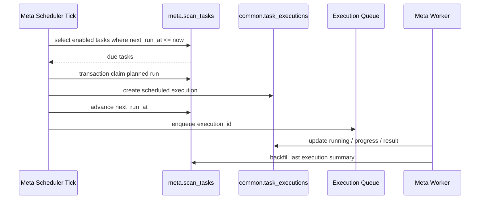

# ADDP 元数据扫描机制规范

本文定义 Meta 扫描的深度、目标、覆盖、跳过判断和跨模块触发规则。术语以 [ADDP 术语表](../concepts/addp术语表.md)、[ADDP 元数据体系图](../concepts/addp元数据体系图.md) 和 [ADDP 任务体系规范](addp任务体系规范.md) 为准。

## 本文边界

本文负责：

| 本文负责 | 不在本文定义 |
|---|---|
| `scan_depth`、`scanned_depth`、`scan_status` 的语义 | data item 识别、claims、exclusive 规则 |
| `force=true/false` 的覆盖策略 | attributes 的完整 JSON schema |
| engine / node / item 扫描目标，ScanSelector / ScanScope / `ref_groups` 边界 | FormatPlugin、info provider、content reader 接口形态 |
| ScanTask 任务定义、调度边界与 execution 关系 | 全平台所有模块任务体系的通用规范 |
| 手动 / 定时触发的默认组合 | Manager 前端 DTO 和预览 UI |
| 不强制扫描时的低成本跳过判断 | 具体格式 parser 的字段细节 |

data item 识别规则见 [ADDP 数据项探测器规范](addp数据项探测器规范.md)，attributes 写入规则见 [ADDP 元数据 attributes 规范](addp元数据attributes规范.md)，格式与数据类型能力边界见 [ADDP 数据类型与格式能力规范](addp数据类型与格式能力规范.md)。全平台任务定义、执行记录、TaskProvider、Orchestrator 和 Monitor 的通用约束见 [ADDP 任务体系规范](addp任务体系规范.md)。

## 核心维度

Meta 扫描只保留四个核心维度：

| 维度 | 字段 | 取值 | 说明 |
|---|---|---|---|
| 触发方式 | `trigger_type` | `manual` / `scheduled` | 只区分手动和定时。System 立即扫描、Manager 刷新、Meta 前端手动扫描都属于 `manual`。 |
| 请求深度 | `scan_depth` | `basic` / `deep` | 本次扫描要达到的深度。 |
| 已扫深度 | `scanned_depth` | `none` / `basic` / `deep` | 当前 node / item 已经达到的扫描深度。 |
| 是否强制 | `force` | `true` / `false` | 是否不管已有元数据和时间戳都重新扫描。 |

`source` 是扫描来源标记，不是核心扫描维度。它只记录触发模块，例如 `meta`、`manager`、`system`、`transfer`、`asset`、`orchestrator`、`develop`、`graph`，用于审计、排查和执行记录，不得进入 `trigger_type` 枚举，也不得驱动不同扫描主路径。`source` 不承载调度器、前后端通道或具体业务场景；定时调度只能由 `trigger_type=scheduled` 表达。

身份型扫描目标只抽象为三类：

1. engine
2. node
3. item

`catalog_paths` 和 `ref_groups` 是 selector/scope 输入形态，不是新的身份层。它们进入 Meta 后必须解析为 `ScanScope`，再由扫描主线决定如何枚举候选内容、构造 node / item plan 和落库。

如果使用 locator，locator 本身已经能表达目标对象，不需要额外 `target_type`。

## ScanSelector 与 ScanScope

`ScanSelector` 表示 API 层或模块调用方提交的扫描选择器。它是请求输入模型，不是扫描执行模型。

允许的 selector 形态：

| selector | 字段 | 语义 |
|---|---|---|
| engine selector | `engine_id` | 从指定引擎的显性 catalog root 开始扫描。 |
| node selector | `node_id` | 从指定 `meta_node` 范围开始扫描。 |
| item selector | `item_id` | 刷新或补齐已入库 data item。 |
| locator selector | `targets` | 使用 ResourceLocator 表达 engine / node / item 目标。 |
| catalog path selector | `catalog_paths` | 使用引擎 catalog model 下的路径坐标表达扫描范围。 |
| content refs selector | `ref_groups` | 使用一组共同参与识别的 content refs 表达本次内容边界。 |

`ScanScope` 是 Meta 内部扫描主链路消费的唯一范围模型。所有 selector 进入扫描执行前必须先由 resolver 解析为 `ScanScope`，后续 scanner、detector、processor 和 repository 不应继续各自解析请求 DTO。

`ScanScope` 至少应表达：

- `engine_id`：所属引擎。
- `mode`：engine / node / item / catalog path / refs group 等内部范围模式。
- `catalog_paths`：路径型 catalog selector 解析后的 catalog path 集合。
- `targets`：保留类型与完整路径的 ResourceLocator 集合；执行配置必须冻结该集合，Worker 不得将叶子转换为父目录。
- `ref_groups`：内容引用边界集合。
- `source`：扫描来源标记。
- `scan_depth`：本次目标扫描深度。
- `force`：是否强制覆盖。

约束：

1. `catalog_paths` 只能表达路径型 catalog selector，不能承载 sibling refs 或 multi content 边界。
2. `ref_groups` 只表达内容引用边界，不表达资源树父 node，也不要求 Meta 枚举父目录。
3. 同一个外部事件产生的同一批内容，不能同时用父目录 `catalog_paths` 和 `ref_groups` 表达。
4. item refresh 必须由已入库 item 标准事实还原内容输入，不得退回为父目录 catalog scan。
5. `item_id` selector 解析出的 `ScanScope` 和 execution config 必须保持 item 模式，不得为了执行方便补写父级 `catalog_paths` 或 sibling `ref_groups`。
6. Manager preview、Meta 查询 API 和其他消费方只能读取已落库 attributes 与 `access_index`；缺失或不可用时应降级读取或提示用户执行 item refresh，不得在预览或查询链路自动触发扫描、写回 attributes 或临时构建 `access_index`。
7. 公共表格 Provider 通过必需的 `GetTable` 按命名空间与目标表名称查询；`ResolvePath` 不列举兄弟表、不读取字段，事实接口再读取该表详情。table、collection、graph、直接 catalog leaf、file 和 object 目标只扫描自身。复用 `EngineCatalogProvider.ResolvePath` 精确解析与既有事实／内容处理能力；不支持精确解析、路径无效或跨引擎时拒绝执行，不枚举父级作为兜底。只有显式 root 或 branch selector 才枚举该范围。
8. 局部扫描不得清理未覆盖的兄弟 item，也不得更新祖先 node 的扫描完成时间、深度或状态。为落库建立结构父链不代表完成父范围扫描；只有成功完整枚举对应范围才允许清理该范围及标记完成。字符串路径不得按 `.` 或首段截断来扩大范围。
9. 执行归属、扫描深度与数据访问授权是独立边界。租户集中采集、交互扫描与自动产物扫描应由 System 提供相应操作的当前授权裁决，Meta 对解析后的实际范围执行裁决并在 Worker 重核。建立 DataItem 身份所必需的基础识别采用显式、限范围的扫描资格，不能要求一个尚未形成的数据项先有内容 Grant，也不能借此读取任意样本；deep 内容采样另受数据访问授权约束。本期范围精确化不宣称已经完成该授权闭环，不直接套用 Service 查询定义或 Manager 数据预览的专用契约。统一方向见[授权上下文规范 5.5.7](addp授权上下文规范.md#557-dataitem-授权的统一目标契约)。

精确 file/object leaf 必须把已解析的 `EngineCatalogEntry` 交给内容运行时，复用完整扫描的 entry → 存储资源 → processor 路径，保留大小、修改时间、MIME 和对象 ETag 等可用存储事实；不得降为仅含路径的 `ref_groups` 后以零值落库。`ref_groups` 继续只表达显式多内容引用边界，不能承载调用方自报的存储事实。

### 采集资格与两种范围语义

System 负责当前采集资格及源读取裁决；Meta 不以服务连接、扫描 Permission、执行来源或 Worker lease 代替该裁决。User 交互扫描的内容读取按本人当前权限；租户集中采集按明确批准的范围、用途及深度执行，不永久借用创建人的个人读取权，也不向操作人授予源内容读取权。完整规则见[授权上下文规范的 Meta 采集资格与范围](addp授权上下文规范.md#meta-采集资格与范围已确认)。

- **精确目标采集**仅覆盖指定 DataItem 及其经核验的合法组成；item、leaf 或显式 refs 不因位于同一目录而获得兄弟项权限。
- **完整范围采集**须明确批准 Engine、schema 或目录等边界，并包含范围内未来新增项；不另设未来成员开关，不把普通 node 变为 whole 或自动向用户签发内容 Grant。现有 root／branch selector 只声明请求范围，不能单独证明已经获得完整范围资格。
- Worker 在实际读取前及重试／接管时重核当前资格，核验对象与实际 Provider／reader 计划一致。目录遍历、实际成员及外部引用受该边界约束，不能以路径字符串前缀替代 Provider 的类型化路径与归属核验。
- 新产物先凭可信实际产出事实做精确 basic，再由 System 裁决读取授权；内容 deep 必须获权。覆盖、追加、同名重建、扫描新增行不推导首次产出资格；临时执行结果不伪造为业务 DataItem。
- deep 申请不能在缺权时静默降为 basic 并报成功。采集与结果读取分别控制，样本、正文及含业务值的派生结果不进入普通目录或通用执行诊断。

上述资格接入尚未形成完整实现，不把当前范围解析当作已完成授权。实现验证至少覆盖：精确项不读取兄弟／未来项；完整范围合法新项可采集而越界／外部依赖拒绝；basic 不触发内容采样或哈希；deep 缺权、撤权、过期、错 Tenant／attempt 拒绝且不打开源；核验后计划变化拒绝；集中采集不增授操作人预览／下载权限；新产物身份、授权与 deep 状态分别反馈。复用受影响 owner 的 Go T1、PostgreSQL T2 及真实 Online 标准入口，不以规范落地宣称这些门禁已通过。

### 对象目录归属不变量

对象 item 的父 node 只能由其规范 bucket 内路径决定，与 selector、扫描起点及扫描深度无关。`full_name = 父 node.full_name + "/" + item.name` 必须成立；whole 布局使用逻辑 item 路径的父目录，不能使用内部主文件的父目录。

- `scanresource` 规划 item 身份与 bucket 内父路径；repository 从 bucket 构造完整 prefix 链，普通对象、组合对象与上传 `ref_groups` 共用这一条实现。
- 对象 detector 的 scope、content refs 与回调参数统一使用 bucket 内路径；构造持久化 item plan 时只添加一次 bucket。禁止通过首段是否等于 bucket 猜测路径类型，否则同名目录会被误删。进入 processor 的 refs 则使用外部完整 content path。
- 不得将扫描起点当作资源树根、从 item 路径剥离扫描前缀后另行拼接父链，或要求调用者预先建好扫描起点作为隐式前置条件。
- 创建 prefix 链不等于枚举父目录，不扩大 `ref_groups` 的内容边界。节点扫描状态只覆盖本次完整枚举的范围；引用组扫描不宣称完成父目录扫描，也不写目录数量或大小。
- 写入前必须检查对象 item 身份与父节点是否一致，不能把挂错目录的写入报告为成功。目录扫描遇到既有错误归属时，即使内容未变化，也必须按规范路径重新归属。


## ScanTask 与 Execution 边界

Meta 扫描必须区分任务定义和执行记录：

| 对象 | 归属 | 含义 | 目标存储 |
|---|---|---|---|
| `ScanTask` | Meta | “未来应该按什么计划扫描什么范围”的定义态。 | `meta.scan_tasks` |
| `TaskExecution` | Common | “某一次扫描实际执行了什么、进度如何、结果如何”的运行态。 | `common.task_executions` |

约束：

1. `common.task_executions` 只记录执行，不保存调度定义。
2. `ScanTask` 只记录任务定义和最近一次执行摘要，不保存每次执行历史。
3. `scan_task_runs` 这类模块私有执行历史表不再保留；执行历史统一进入 `common.task_executions`。
4. `TaskExecution.source_task_id` 指向产生本次执行的模块任务定义；在 Meta 扫描中指向 `ScanTask.id`。
5. `TaskExecution.trigger_type` 只允许 `manual` / `scheduled`。公共执行表通过迁移将历史 `schedule`、`api`、`orchestrator`、`retry` 等值收敛到这两个枚举。
6. `TaskExecution.source` 只记录触发来源模块；未能追溯的历史记录按 `module` 回填。

`ScanTask` 的目标模型应至少表达：

- `tenant_id`
- `engine_id`
- `scope`：结构化 ScanScope/selector 范围模型。
- `schedule`：标准 Cron 表达式；空值表示无定时计划。
- `enabled`
- `scan_depth`
- `force`
- `next_run_at`
- `last_run_at`
- `last_execution_id`
- `last_execution_status`
- `owner_module`：任务定义绑定的对象所属模块，例如 `system`、`meta`。
- `owner_ref`：任务定义在绑定模块内的稳定引用，例如 `engine:{engine_id}`。

`owner_module` 与 execution `source` 不是同一个概念：

- `owner_module` 表达任务绑定在哪个模块的对象上。
- `source` 表达这次 execution 是哪个模块触发的。

### 扫描执行的失败聚合

Meta 扫描允许在同一执行中继续处理多个目标，但不得因为“继续扫描”而丢失已发生的失败。

1. 任一已请求的 path、namespace、branch 或 item 因枚举、读取、解析或持久化错误未能完成扫描时，本次 `TaskExecution` 终态必须是 `failed`；不得返回 `success`。
2. 扫描器可继续处理其他独立目标，已成功落库的 node、item 和 field 事实保留，不因整体执行失败回滚。
3. 失败执行的 `metadata` 仍应记录本次已处理的 `catalog_nodes_scanned`、`items_scanned`、`fields_scanned` 和可用的 extraction 统计。
4. `error_details` 应记录 `failed_targets_count` 和 `failed_target_samples`。样本最多保留 20 个，每个样本只包含可安全展示的 `target` 和 `message`，避免错误信息无界增长。
5. 有失败目标时不新增 `partial` 状态；公共执行状态仍严格遵循 `pending / running / success / failed / timeout / cancelled`。
6. 由 capability 边界明确判定为不支持的可选 deep facts，或因未取得去重锁而明确跳过的重复扫描，不计为目标失败。

“一键补扫未扫描引擎”跨引擎提交多个独立 execution。单个引擎提交失败时，Meta 继续提交后续引擎，并在提交响应的 `submission_failures` 中返回该引擎 ID、名称和失败原因；`runs` 只包含已成功提交的 execution。前端等待每个已提交 execution 进入终态，单个 execution 失败或查询失败不得中断后续 execution 的等待。全部处理完毕后统一展示成功数、失败数，以及每个失败引擎的提交错误或 `error_details.failed_target_samples`；单个 execution 内的失败终态仍遵守上述聚合规则。

例如 System 注册 engine 时创建的自动扫描任务：

| 字段 | 取值 |
|---|---|
| `ScanTask.owner_module` | `system` |
| `ScanTask.owner_ref` | `engine:{engine_id}` |
| `TaskExecution.module` | `meta` |
| `TaskExecution.task_type` | `scan` |
| `TaskExecution.trigger_type` | `scheduled` |
| `TaskExecution.source` | `meta` |
| `TaskExecution.source_task_id` | `ScanTask.id` |

System 不接收、不保存、不投递 Meta 扫描策略；授权资源事实查询也不编排扫描。System 注册引擎时“默认带有 Meta 扫描配置”的产品体验由 Console 编排完成，相关 manual execution 的 `source` 应记录为 `console`：

1. Console 承载 System engine 注册体验；System 只保存 engine 身份、连接、能力、租户和生命周期等自身事实。
2. System iframe 保存 engine 后，只通过 `postMessage` 向父级 Console 提交扫描策略编排请求，不直接调用 Meta。
3. Console 拿到 `engine_id` 后调用 Meta upsert / delete 该 engine 绑定的 `ScanTask`。
4. 如果用户选择“注册后立即扫描”，Console 调用 Meta manual execution API 创建一次 `trigger_type=manual` 的 execution。
5. UI 如需展示 engine 的扫描计划，应查询 Meta 的 `ScanTask`，或由 Console 聚合 System engine 与 Meta task。

System engine 注册 / 编辑体验中，默认扫描行为应为“保存后立即触发一次基础扫描”，不默认创建定时 `ScanTask`。只有用户显式启用定时自动扫描时，Console 才维护 engine 绑定的 `ScanTask`。

当 Console 收到的扫描策略为未启用或未启用定时扫描时，必须调用 Meta 删除该 engine 绑定的 `ScanTask`；不得保留一个 disabled 绑定任务表达“已关闭”，避免任务定义状态漂移。

System 只发布通用 engine lifecycle event，不携带 Meta 扫描策略。Meta 可以监听 System engine create / update / delete 事件，用于清缓存、维护 catalog root、删除 engine 后清理 metadata 和对应 `ScanTask`，但不得从 System 回查并解释 `scan_config`。

`ScanTask.owner_module=system`、`owner_ref=engine:{engine_id}` 只表达任务绑定的外部领域对象是 System engine，不表示 System 管理 Meta。

## ScanTask 层级调度关系

Meta 中的调度不属于 engine、schema、bucket 或其他 node 本身；调度只属于 `ScanTask`。所谓 engine 层调度、node 层调度，都是不同 `scope` 的 `ScanTask`。

约束：

1. engine 级 `ScanTask` 是粗粒度默认扫描计划，不是对所有下级范围的强制独占调度。
2. node、`catalog_paths` 或其他更具体 scope 上的 `ScanTask` 是独立扫描计划，不是 engine 级任务的附属字段。
3. 更具体 scope 的独立调度优先于更粗 scope 的默认调度。
4. 某个下级范围一旦启用独立调度，该范围必须从上级定时扫描范围中排除，避免同一计划窗口内被父任务和子任务重复扫描。
5. 某个下级范围没有独立调度时，默认继承上级范围的调度；不得要求用户为所有 node 显式创建调度定义。
6. `enabled=false` 只表示该 `ScanTask` 自身不参与调度；不得被解释为“显式排除父级调度”。
7. 如需表达“某个下级范围不独立调度，且也不继承父级调度”，必须单独设计显式排除语义；在专题规范完成前不得用 disabled 任务、空 schedule 或其他旁路状态偷渡该语义。
8. 同一稳定范围只允许一条启用的独立定时 `ScanTask` 作为权威计划，避免同 scope 多条计划互相重叠。

推荐理解方式：

| 场景 | 语义 |
|---|---|
| engine 级配置定时扫描 | 为整个 engine 下尚未独立配置调度的范围提供默认计划 |
| node 级配置定时扫描 | 为该 node 对应范围建立独立计划，并从 engine 级计划中摘出该范围 |
| 删除 node 级定时扫描 | 该范围回到继承上级计划的状态，而不是进入“永不扫描”状态 |

示例：

- engine `postgres-A` 每天 00:00 扫描全库。
- schema `public` 每 15 分钟独立扫描。

则调度语义应为：

1. `public` 范围由自己的 `ScanTask` 每 15 分钟扫描。
2. engine 级 `ScanTask` 在每天 00:00 扫描 `postgres-A` 时，必须排除 `public` 范围，只扫描剩余未独立配置调度的范围。
3. 若 `public` 的独立调度被删除，则 `public` 重新回到 engine 级默认扫描计划中。

## 定时调度保证

Meta 定时调度目标上应使用 DB-driven due task claim，不应只依赖进程内 Cron 注册。

目标流程：



调度保证：

1. Meta 重启后，必须能通过 `next_run_at <= now()` 找回应该触发的任务。
2. 多实例部署时，必须通过数据库行锁、唯一 fire key 或分布式锁避免同一个 planned run 重复创建 execution。
3. scheduled execution 应记录 `planned_run_at`，表示本次执行对应的计划触发时间。
4. 同一个 `task_id + planned_run_at` 只能创建一条有效 execution。
5. 默认只补最近一次 due run，避免 Meta 长时间停机后集中创建大量历史执行；如需补跑多个错过时间点，应另行定义补跑策略。

## 扫描去重锁

Meta 扫描执行需要短时去重锁，但锁粒度必须和扫描范围对齐，不得只按 engine 粗粒度阻塞所有入口。

约束：

1. 执行锁优先按 `item_id`、`catalog_paths`、`ref_groups` 生成，最后才退化到 engine 级。
2. 不同 scope 的执行不得复用同一把锁。
3. 执行锁必须原子获取，不得先查再写。
4. 执行锁的 owner 应使用 `execution_id`，释放时必须校验 owner。
5. execution 创建失败或事务回滚时必须立即释放锁，不得依赖 TTL 自然过期。
6. catalog namespace / branch / bucket 级短锁可复用同一 primitive，但仍应独立于 execution 锁。
7. 手动扫描及 node / item 刷新提交遇到同范围 execution 锁已被持有时，返回 HTTP `409 Conflict`，稳定错误码为 `scan_scope_active`，错误文案按请求语言翻译。拒绝重复提交不创建 execution、不释放原 owner 的锁，也不改变原执行状态。资源树前端仅提示该范围正在扫描，不把提交冲突展示为扫描执行失败，不覆盖已有扫描进度。

## 扫描编排依据

Meta 的扫描编排必须分开回答三类问题：

| 问题 | 事实源 |
|---|---|
| 目录层级如何组织、各层叫什么、哪一层是 leaf | `EngineCatalogModelSpec` |
| 能否列目录、描述 Engine Catalog facts、采样字段、读取内容 | 已实现的 provider 组合 |
| Meta 需要怎样执行和落库 | Meta 自己的 scan strategy |

`engine_family` 只保留粗分类意义，不能单独决定扫描流程。Meta 可以因为执行语义不同而保留多种 strategy，例如：

- direct leaf 型：root 下只有一层业务 leaf，直接把 leaf 投影为 item，例如 Kafka 的 `service -> topic`。
- branch/leaf 型：动态 schema、图等先扫描 root 下业务 branch，再扫描 leaf。
- object catalog 型：对象存储按 bucket / prefix / object 模型扫描，可做复合对象聚合。
- file catalog 型：文件系统按 root / directory / file 模型扫描，可做复合文件聚合。

这些 strategy 的差异来自 Engine Catalog model 和 provider 语义，不等于为每个具体引擎重建一套上层抽象。新增引擎时，优先复用已有 strategy；只有当 `EngineCatalogModelSpec` 与 provider 组合都无法表达真实差异时，才新增 strategy。

`direct_leaves` 的选择条件固定为：`EngineCatalogModelSpec.Levels` 只有一个业务层，且该层 `role=leaf`。Meta 通过 `EngineCatalogProvider.ListChildren(root)` 枚举 leaf，直接挂到结构 root 下；不得按 `engine_type` 写特例，也不得为 leaf 创建额外 branch node。Kafka 第一版按该策略扫描 topic，只落 item identity 和规范要求的基础 item attributes，不读取消息、不推断 schema、不创建 partition node/item。

对象存储 Engine Catalog 与文件系统 Engine Catalog 可以共用 Meta 内容目录扫描主链路，但不得抹平两者的 Engine Catalog model 术语：

- object catalog：`service -> bucket -> prefix? -> object`
- file catalog：`root -> directory? -> file`

Meta 内部可以通过 object / file adapter 处理路径转换、父 node 计划、storage attributes 和 item leaf 术语差异；枚举 candidate、组织 refs group、调用 data item detector、deep enrich、content hash、extraction、index 和 persist 应收敛到同一条主链路。single / multi / whole item 不应分别拥有多套落库路径，差异应由 detector 结果和 adapter 的 parent node / path plan 表达。

## 扫描目标字段

Meta API 和扫描任务参数中，路径型扫描目标统一使用 `catalog_paths`：

```json
{
  "engine_id": 1,
  "catalog_paths": ["bucket/path", "/data"],
  "scan_depth": "deep",
  "force": false
}
```

`catalog_paths` 表达的是对应引擎 `EngineCatalogModelSpec` 下的 Engine Catalog path，不是对象存储专属 object key，也不是文件系统物理路径。MinIO / S3 的路径遵守 `bucket -> prefix -> object`，NFS 的路径遵守 `root -> directory -> file`。该字段由 Engine 上下文限定并继续作为唯一线上字段；新增调用方、前端表单和模块间客户端必须统一使用 `catalog_paths`。

`catalog_paths` 只表示“从这些 Engine Catalog 路径开始枚举或刷新范围”。它不表示“这些 sibling content 共同组成一个 data item”。Shapefile 等 multi content 的本次 refs 边界必须使用 `ref_groups`。

内容引用边界使用 `ref_groups`：

```json
{
  "engine_id": 1,
  "ref_groups": [
    {
      "primary": "bucket/path/roads.shp",
      "refs": [
        {"path": "bucket/path/roads.shp", "role": "main", "required": true},
        {"path": "bucket/path/roads.shx", "role": "sidecar", "required": true},
        {"path": "bucket/path/roads.dbf", "role": "sidecar", "required": true}
      ]
    }
  ],
  "scan_depth": "deep",
  "force": false,
  "trigger_type": "manual",
  "source": "transfer"
}
```

规则：

- `ref_groups[].primary` 表示该组的主 content path。
- `ref_groups[].refs[]` 表示本组可见的完整 content refs；`role` 和 `required` 只描述 ref 在组内的约束，不决定最终 data item 类型。
- `ref_groups` 进入 Meta 后必须转为 engine 对应的 content ref 或 `plugin.EngineCatalogPath`，再进入统一 detector；不得在 Transfer、Manager 或调用方提前判断 refs 是否构成 data item。
- 对于 Transfer 写出结果，Transfer 应提交本次实际生成的 refs group，不得为了触发识别而扩大到父目录 `catalog_paths`。

### Transfer 产物扫描

Transfer 写后扫描、持续同步首次扫描和结构审批补扫都受同一精确范围约束：

| 入口 | 扫描范围 |
|---|---|
| bounded 执行写后扫描（含自有定时执行） | 原生表提交完整的 `type=table` locator；文件产物提交本次实际内容引用。 |
| Kafka／数据库 CDC 首次扫描 | 提交已准备完成并保存为本次执行产物的完整目标表 locator。 |
| 结构审批补扫 | 提交本次审批实际应用的唯一目标表 locator。 |

目标父位置为 schema／database 时，必须结合实际目标表名形成完整表 locator；不得直接提交父位置，也不得按 `.` 截断表名或命名空间。内容引用缺失、目标不完整或来源不可验证时拒绝提交，不回退为父范围或整引擎扫描。

Transfer 通过 Meta 手动扫描入口提交上述扫描，使用 `source=transfer`、`trigger_type=manual`、`scan_depth=deep` 和 `force=true`。即使产物来自 `trigger_type=scheduled` 的 Transfer 执行，子扫描也不因此成为 Meta 定时任务。父执行、实际输出、审批主体及定时授权的核验规则统一见 [任务体系规范](addp任务体系规范.md)。

回归验证必须同时核对请求范围和落库影响：目标产物得到更新，未覆盖的兄弟项及祖先节点扫描事实保持不变。创建必要的结构父链不计为父范围扫描完成。

## Basic / Deep 边界

### EngineCatalogEntry / EngineCatalogFacts 消费规则

Meta 扫描按已解析的 `ScanScope` 获取 `EngineCatalogEntry`：显式 root／branch 范围通过 `EngineCatalogProvider.ListChildren()` 枚举，精确 leaf 通过 `ResolvePath` 直接解析，显式 `ref_groups` 沿内容引用边界进入统一 detector。不得为获取单个 leaf 的条目而枚举父级。取得条目后，再按条目角色、扫描深度和 provider 组合决定是否进一步读取 `EngineCatalogFacts`。

对 `meta_node`，通常只消费 `EngineCatalogEntry`：root、schema、database、bucket、prefix、directory 等 branch 的身份、层级、展示名、`full_name` 和低成本 `Storage.Path` 足以建立资源树。node 的 `scan_status`、`scanned_depth`、`scanned_at` 来自扫描过程，不是 engine 对 node 的原生 facts。第一阶段不为 node 设计 deep-only facts；如果后续要持久化 bucket region、owner、目录权限、生命周期策略等原生事实，必须先单独扩展规范，不能把它们混入 item facts。

### 节点统计的唯一事实来源

- 节点 API 的 `item_count`、`total_size_bytes` 是 Meta 查询层的派生结果，不是 `meta_node` 存储字段，也不是上次扫描快照。所有树、详情、子节点和祖先链入口共用 repository 的批量子树聚合。
- 子树按当前 `parent_node_id` 关系确定，包含节点自身，限定相同 tenant、engine，并排除已删除节点及其不可达后代。只统计这些节点下未删除的 `meta_item`；每个逻辑 DataItem 计一次，multi/whole 的 content refs 和容器内部 children 不单独计数。
- `total_size_bytes` 汇总已登记 item 的 `size_bytes`，忽略未知值；没有已知大小时返回 0。这是已知大小合计，不声称大小信息完整，也不访问源引擎补全。
- 上传、覆盖、删除、归属修正只改变节点和 item 事实；查询自然反映最新已提交记录。不得逐入口加减计数、写回祖先统计或维护另一份统计缓存。API 保持现有字段和路由，不增加兼容字段。
- 目录统计与扫描状态独立。局部内容同步不能更新父目录完整扫描时间、深度或状态。Manager 等待 Meta 同步完成后重新读取目录；同步失败不能以文件上传成功代替目录已同步。

对 `meta_item`，`EngineCatalogEntry` 只提供路径坐标、身份和列表级摘要，不能当作完整详情事实使用。`basic` 可以使用 `EngineCatalogEntry.Table`、`EngineCatalogEntry.Storage`、`EngineCatalogEntry.UpdatedAt` 等低成本摘要建立 item 身份、存储属性和跳过判断；需要字段、主键、索引、graph schema、动态 schema 采样、文件内容格式信息、容器 children 或访问索引时，必须显式通过 `EngineCatalogFactsProvider`、`DynamicSchemaSamplingProvider`、content reader 或 format info provider 获取。

`EngineCatalogFacts` 不是每个 entry 自动携带的隐含字段。Meta 需要详情时必须使用 `EngineCatalogEntry.Path` 显式调用对应 provider；不得把 `EngineCatalogEntry` 原样写入 `meta_item.attributes`，也不得从 `EngineCatalogEntry.Table` 推断字段、主键或索引。

### Basic 扫描

`basic` 的目标是低成本建立资源目录，以及可被授权与读取流程可靠引用的 data item 身份和组成边界。原则上不读取业务内容；为确定身份与边界所必需的有限 manifest、入口或 header 结构读取属于基础识别，不等于 deep 内容增强。

基础边界识别是 basic / deep 的共用阶段。仅凭完整可见清单及格式规则能确认的 multi / whole 必须在 basic 登记，后续 deep 与再次 basic 保持相同身份和组成；字段、空间信息及其它内容增强只在 deep 执行。确需读取 manifest 才能确认的组合，也应通过有上限的基础结构识别确定，不把正式组合边界留到 deep 才形成。目录与显式 refs 都不得借组合识别读取内容增强，亦不得为补全 refs 扩大输入范围。精确单文件目标不枚举同级文件；边界重识别仍须显式扫描必要目录或提交完整 refs。组件记录的精确收敛遵循[数据项探测器规范](addp数据项探测器规范.md)。

2026-10-13 实施状态：上述“必要结构读取属于 basic”与 DataItem 授权前置是已确认目标，不能把当前仅凭清单完成的组合识别当作所有格式已经支持。各格式须声明身份识别所需入口、读取字节／数量上限、引用范围和失败语义，并经对应门禁验证；超限、缺失、格式不支持或边界不确定时明确报告识别未完成，不退回独立叶子并宣称整体可授权。不新增无消费者的状态字段，不以 `scanned_depth=basic` 单独证明授权边界可靠。

允许写入：

- `meta_node` 树。
- `meta_item` 身份字段：`item_type`、`name`、`full_name`、`fingerprint`、`node_id`。
- `attributes.schema_version`。
- `attributes.storage` 中由 catalog 直接返回的事实，例如 bucket、path、name、size、etag、last_modified_at、content_type。
- `attributes.item` 中由 catalog、格式／路径规则或必要的有限结构读取确定的身份与组成事实，例如 `layout`、`data_type`、`format`、`refs`、`scope_exclusive`。`file_count` 仅在已有低成本可靠事实时写入，不为授权枚举 whole 的全部成员；内容画像仍归 deep。
- 来自 `EngineCatalogEntry` 或只读 catalog/system table 的低成本摘要，例如 table / collection 的估算 `row_count`、`size_bytes`、storage `etag` 和 `last_modified_at`。这类事实可用于列表展示、跳过判断和 basic attributes，但不得为了得到它们执行全表扫描、读取 file/object 内容或触发统计刷新。
- 轻量格式判断：扩展名、MIME、catalog 声明，以及确定组合边界所必需的有限 manifest／header。必须有明确理由、读取上限与受控引用范围；不执行内容采样、全量解析或统计刷新。

不应写入：

- 表字段、主键、索引。
- 需要执行 `COUNT(*)`、全量扫描、统计刷新或读取内容才能得到的真实行数和数据分布分析。
- Shapefile / CSV / Parquet 等文件内部 schema。
- 容器 children，例如 Excel sheet、SQLite table、GeoPackage layer、ZIP entry。
- `access_index`。
- 文档正文、媒体宽高、图片 EXIF、全文摘要、向量索引引用。
- 为了获取 extent、真实 geometry 类型分布而扫描全量数据。

### 授权消费与基础事实刷新

System 的数据授权消费 Meta 已可靠识别的 DataItem，不要求 deep 或企业 Catalog 编目。注册引擎后的立即 basic 仍使用既有编排；注册成功不等于扫描成功。目标无基础事实、组成不完整或已有证据表明边界改变时，授权办理须先经 Meta 唯一扫描入口补齐或刷新目标范围，再进入签发；普通资源查询、展开和内容读取不暗中触发扫描。

授权判断需要新鲜的是身份与合法组成边界，不是全部元数据。旧行数、大小、统计时间或合法内容更新本身不使 Grant 失效；既定 whole scope 内按原组成规则新增 OSGB、TIFF 等成员，不要求 System 重批、保存成员清单或强制全量重扫。Meta 提供整体边界，内容执行端验证实际成员未越界。根范围、布局或包含规则发生实质变化、外部引用无法证明合法时，先核验边界，不因指纹相同自动扩大授权。具体授权分工与未实施范围见[授权上下文规范 5.5.7](addp授权上下文规范.md#557-dataitem-授权的统一目标契约)。

### 授权资源描述契约

本节定义 Meta → System／Catalog 最小事实投影；当前实现范围见本节“实施与验收”。它只描述数据项及其组成；System 仍独立判断操作者、接收方、批准要求、Grant、Deny 与期限。Meta 的完整详情、Catalog 变化摘要和 `common/dataitem.ItemDescriptor` 均不能直接当作这一可信契约：前两者的用途不同，后者尚未表达基础识别完整性与授权组成约束。

接口为 `GET /api/v1/meta/runtime/data-items/{fingerprint}/authorization-facts`，仅供当前 Tenant Context 的 `addp-system`、`addp-catalog` Service 使用。两者均通过唯一的 `common/client.MetaClient.ReadAuthorizationFacts` 和各自独立服务凭据读取，不直查 Meta 数据库、不从祖先链或完整详情另造授权边界。Tenant 从 AuthContext 派生；`meta.authorization_facts.read` 只授予内置 `tenant.system_runtime` 与 `tenant.catalog_runtime`，不可委托或租户定制。Catalog 用于核验业务批准目标，System 仍独占 Grant／Deny 与访问裁决；该机器读取资格不授予人员数据权限。该 GET 在同一已提交快照中读取 Meta 持久事实，不访问源内容、不扫描、不写回，也不持有调用方的业务／授权事务锁。响应使用 `Cache-Control: no-store`，不能跨请求缓存为许可。

| 响应部分 | 最小内容与事实来源 |
| --- | --- |
| 协议 | `schema_version=meta.data_item_authorization_facts/v1`；共享 wire 类型与严格校验归轻量纯值包 `common/dataitem/authorizationfacts`，不得使 HTTP Client 传递依赖格式解析器或引擎实现；HTTP Client 归 `common/client` |
| 身份 | `item_fingerprint`、`engine_id`、`item_type`、`full_name`，取自当前未删除的 `meta_item`；指纹按现有 `engine_id + full_name` 算法复核，不输出 Meta 行号作为授权身份 |
| 边界 | `boundary`，包含 `layout`、规范读取入口与下述布局对应的组成约束；定位所需的 `data_type`／`format` 复用标准 item 事实，不要求 deep 字段结构或样本 |
| 识别依据 | `basis_state`，由已有持久事实、探测规则的明确支持范围及已知失效依据派生；不把查询状态写入 attributes，不以 `scanned_depth=basic/deep` 单独判定完整 |
| 比对 | `boundary_hash`，仅完整边界可生成；System 保存它及被批准的最小边界绑定，用于复核而非同步 Meta 目录 |
| 观察时间 | `observed_at`，表示本次 Meta 快照观察时刻；不承诺源端在此刻已全量复查，也不是许可期限 |

路径复用现有 EngineCatalogPath／content ref 语义和共享转换，保留原生名称。响应不得携带连接信息、挂载配置、正文、字段值、全量 attributes、whole 叶子清单或 Catalog 责任信息。所有身份、入口与 refs 必须属于响应 Engine；接收端核对目标身份与 Engine，拒绝未知 Schema、缺项、重复或矛盾内容。

| 布局 | `boundary` 的组成表达 | 当次读取约束 |
| --- | --- | --- |
| `single` | 一个规范原生目标或 content ref，不附加目录递归范围 | 只打开该对象；内容增加行或覆盖本身不扩大目标 |
| `multi` | 唯一 primary 和明确 refs，保留路径、role、required／primary 语义；完整性由对应格式规则检查 | 使用被确认的完整组合，不自行枚举 sibling 补全；缺少必需 ref 时拒绝完整内容读取 |
| `whole` | 根 scope、manifest／关键入口，以及格式明确声明的成员约束与引用范围 | 逐次打开均限制在该边界内；合法动态成员按同一规则进入，不列举或逐个签发 Grant |

whole 的成员约束必须能由内容 I/O／Provider 执行，包括路径范围、成员角色及关联引用限制。格式名、`scope_exclusive=true` 或 `claim_policy=whole_scope` 单独不足以证明任意目录内容可读。当前格式不能提供可执行约束时，明确报告不支持；不能复制 detector 到 System，也不能用任意 glob／SQL／表达式建立第二套规则语言。

`basis_state` 固定为 `complete | incomplete | needs_refresh | unsupported`。`complete` 只表示已有依据足以描述边界；其余状态的 `boundary` 与 `boundary_hash` 为 null，分别表示基础组成缺失、已有边界失效证据、或当前格式／引擎无法提供契约。现有持久事实无法证明完整时返回 incomplete，不补造成功扫描、版本或历史依据。`data_type=unknown` 本身不使一个已确定的原生 single 目标失效；是否完整取决于该布局实际需要的事实。

查询成功返回 200 及上述状态，不等于授予权限。不存在、已删除或跨 Tenant 的目标返回 404；输入错误、凭据失效和功能拒绝分别为 400／401／403。数据库或服务依赖失败使用实际 5xx 与稳定 `error_code`，不得伪装 404 或识别未完成。System 将非 complete 状态作为对应授权办理／读取的阻断原因；首次扫描与刷新经 Meta 已有显式扫描编排完成，再重新查询，不在 GET 中自动补扫。

**边界比对。** 规范化集合排序、去重并校验一致性，路径按既有引擎语义比较，不能一律转小写、修剪名称或仅做字符串前缀判断。`boundary_hash` 为协议定义的规范身份与边界表示的 SHA-256；字段和序列化规则由同一共享实现拥有。它包含布局、规范入口、明确 refs 与 whole 成员约束，排除行数、大小、成员数量、内容哈希、mtime／ETag、扫描时间、Meta 行号及变化游标。whole 内 manifest 更新只按解析后的边界语义判断，不能把原始 manifest 字节变化直接当作授权扩大。

| 变化 | 授权处理 |
| --- | --- |
| 同目标内容更新、whole 原 scope 和规则内新增合法 OSGB／TIFF | 边界摘要保持不变；继续核验当前 Grant／Deny、真实成员和 Security |
| layout、根范围、规范入口、明确 refs 或成员约束变化 | 标出边界差异并阻止旧 Grant 绑定自动覆盖新范围；先完成识别核验，扩大许可须显式重新批准；同一 DataItem 上有效的 Deny 不因摘要改变而失效 |
| 缺少必需组成、已知边界失效或能力不支持 | 保留原规则与历史，阻断对应新办理／内容读取；刷新或支持补齐不自动恢复已撤销 Grant |

镶嵌 manifest 引用 scope 外另一独立 DataItem 时，该资源是额外读取依赖，须核验它自己的许可；不能因写进 manifest 就成为已授权 whole 的合法新增成员。依赖缺权时拒绝完整预览，不静默舍弃无权影像。manifest／路径解析、链接及实际打开共用同一受约束计划，防止检查后重新解析成更大的范围。

System 在本地权威写事务外取得这一事实，事务内核验当前管理资格、规则及批准边界。新增授权的显式确认须绑定展示时的预期边界摘要；服务端从 Meta 重取可信事实，比对不同返回 409，重新展示差异后确认，不能自动换成更大的最新边界继续签发。浏览器摘要只是并发期望值，不是可信资源事实。实际读取 owner 使用同一共享边界表示核验计划与 System 当次检查的绑定；边界不一致则重新计划／核验或拒绝，不执行旧检查对应之外的入口。原生 SQL／文件 URL 到 DataItem 的归属须由 Meta 已确认的身份与组成证明，不能由消费方按名称或路径前缀猜测；该归属解析与真实 I/O 约束仍须随读取消费者单独接入。

**实施与验收。** 正式事实查询、严格共享 DTO、状态投影、摘要及 single 批准绑定已实现。支持持久化的 server → schema → 普通 table、server → database → 普通 table（MySQL）及 server → database → collection（MongoDB）三类 `single`；原生坐标取自父节点名称和独立 item 名称，不拆分 `full_name`。普通表沿用标准 `storage.schema_name`（关系型扫描对 schema/database 的统一存储字段），并与父节点核对；集合以持久化 database 父节点、collection 类型、名称、身份及 single 布局为依据，不要求 deep 采样字段。已有身份、布局、类型化父子节点及存储坐标须一致；缺失、矛盾或其他布局明确返回对应状态。摘要包含 namespace 与叶子类型，相同字符串坐标不能跨 schema/database 或 table/collection 继承批准。统计、basic/deep 深度及观察时间不改变边界摘要。System 与 Catalog 均通过共享 MetaClient 消费；Manager 的预览、手工剖析和结果读取按完整原生计划反查并核验同一数据项绑定。当前不支持文件 single、multi 或 whole；Meta 事实本身不证明源对象仍存在，不代替 Provider 及 Security 核验。

System 的 `GET /api/v1/system/engines/{id}/data-items/{fingerprint}/authorization-facts` 供有当前 `system.engine_access_grant.read` 及引擎管理资格的 User 只读核对；服务端以独立 `addp-system` Tenant Service 调用 Meta，返回后再次检查 User 资格和目标 Engine。目标不存在或属于其他 Engine 时返回 404 `authorization_target_not_found`，不混同认证故障；缺少服务配置或依赖故障返回明确 503，不影响 System Ready，不回退到实时目录或浏览器自报事实。该入口不创建授权；新增批准及正式读取独立消费同一事实契约，不把前端展示结果当作凭据。

T1 覆盖严格 DTO、摘要稳定性、状态派生、服务凭据及错误区分；既有 Meta PostgreSQL 门禁覆盖持久身份、删除、租户隔离和 basic/deep 一致。System IAM PostgreSQL 门禁另覆盖边界变化阻断旧 Grant、Deny 持续约束同一数据项、跨边界版本聚合与撤销，以及前向迁移保留 IAM、委托和通用审计。重启后真实 PostgreSQL 调用及跨模块 Online T4 仍待验收。后续按格式补齐 multi／whole 可执行组成契约，不以接口成功宣称全平台权限贯通。相关 owner 使用 `make test-module MODULE=meta|system|common`（分别运行）；代码变更按共享依赖扩散 CI，消费者沿用对应既有跨模块入口。

### Deep 扫描

`deep` 的目标是补充 Manager、Transfer、Asset、Search 等模块需要稳定消费的元数据事实。

允许写入：

- `type_info.table.fields`、`row_count`、`primary_key`。
- `capabilities.indexing.indexes`。索引是访问/查询能力事实，不写入 `type_info.table`。
- `type_info.container.children`，仅记录容器直接 children，例如 ZIP entry、Excel sheet、SQLite table、GeoPackage layer。
- `type_info.document`、`type_info.media`、`type_info.graph`。
- `format_info.<format>`。
- `capabilities.spatial`、`statistics`、`extraction`、`semantic`、`partitioning`、`indexing`。
- `access_index`，例如 CSV 稀疏行索引。

Deep 扫描可以读取内容，但仍应遵守 provider / reader 边界：

- 元数据事实通过 info provider 写入 `type_info` / `format_info` / `capabilities`。
- 数据库 table deep 扫描应通过 `EngineCatalogFactsProvider.DescribeEngineCatalogFacts()` 获取 `TableInfo.Fields`、`PrimaryKey` 和索引等详情；collection deep 扫描可通过 `DynamicSchemaSamplingProvider` 获取采样字段和索引；graph item 即使在 basic 下如果需要建立稳定图 item 语义，也可以读取低成本 `EngineCatalogFacts.Graph`，但 deep 才允许请求样本。
- 内容窗口、样本、原始文本、缩略图不直接塞进 `type_info`。
- 大文件 deep 扫描应由 provider 自己控制成本和阈值，不能无边界全量读取。
- Meta deep 扫描不得继续识别并持久化容器 children 的下一层 data item。比如 ZIP 中的 Shapefile 组件应作为 ZIP 的直接 entry 写入 children；把这些 entry 临时组合成 Shapefile 预览项属于 Manager 动态预览职责，不写回 Meta。

单文件 deep 增强必须先确认格式与数据类型，再按 data type 分派。`TableInfoProvider` 只证明插件能读取表，不证明父文件是 table；SQLite、GeoPackage、UDBX、Excel 等 descriptor 声明的 container 必须走容器枚举，内部表只能在显式 child 上下文读取。文档类格式可以由其表解析能力确认记录集合并精化为 table；不得将这一规则推广到所有非 table 类型。known-item refresh 同样重新确认容器身份，并清除旧类型的内容派生分区后重建，不能保留历史误判的父级 table fields 或 access index。容器打开或解析失败必须向上返回错误，不得伪装为空容器成功。

`access_index` 纳入 deep 的默认目标。具体格式是否生成、是否因为文件过大而跳过，由对应 provider 决定；跳过不应阻断 deep 扫描完成。

Deep 扫描完成状态不写入 `attributes`。`attributes` 只表达从数据源抽取出的稳定事实，例如字段、children、文档结构、媒体信息、空间能力、正文抽取状态和索引引用；不表达“本次 deep scan 已经补齐完成”这类扫描过程状态。不得新增或继续使用 `metadata_extracted`、`deep_metadata_ready` 等 attributes 标记判断 deep 是否完成。

### DataItem 技术元数据搜索投影

Manager 独占全文搜索索引。所有已登记 DataItem 均应能按技术事实搜索，不按数据库厂商、catalog leaf 类型或扫描深度划分搜索资格。Meta 对 table、collection、graph、index、keyspace、topic、object、file 等 item 的 basic / deep 扫描落库和 known-item 单项刷新完成后，使用统一技术投影构造器，经 Manager 正式内容客户端提交；未变化而跳过更新的 item 也从当前已登记事实重新提交，不额外读取源记录或采样。引擎根、schema、database、bucket、目录等 node 不作为 DataItem 搜索文档。

技术投影只通过明确字段白名单包含 fingerprint、引擎身份、catalog item 类型、名称、完整定位、所属命名空间或存储路径，以及已登记的字段名称、类型、注释和规模等事实。不传递完整 attributes、样本、原始记录、字段值或统计分布，不额外调用内容读取或采样 Provider。Meta 不再保留关系表、MongoDB 集合各自的投影构造路线；内容深度扫描使用同一技术事实构造器提交技术快照，再由既有内容路线独立提交正文快照。Manager 继续负责载荷校验、持久投递、保护出口和 Meilisearch 任务终态核查。Manager 是运行时软依赖；提交失败记录告警，不把元数据扫描完成解释为搜索索引已经完成。

同一 fingerprint 的技术信息与正文信息必须并存，分别按完整快照幂等更新。唯一写入口为 `POST /api/v1/manager/runtime/content-documents/batch_update`，请求体为 `{"documents":[...]}`，每批 1–100 项，拒绝重复 fingerprint 和非法成员；单项也提交长度为 1 的批次。每项以 `payload_kind` 选择字段归属；它是入站载荷类别，不是合并后文档的类别。技术快照覆盖名称、路径、类型、结构和规模字段，正文快照经原有 Security 保护后只覆盖正文、预览、内容 hash、标题、作者、关键词、标签、正文统计与正文派生 metadata。每个快照必须显式更新所属字段的空值，以清除该部分已失效的值；不得覆盖另一部分，提交顺序不得影响两部分并存的结果。身份字段固定为 fingerprint、Tenant 和 engine_id；正文请求中的名称与 catalog 类型只作为请求身份上下文，不更新技术字段。技术与正文的投影时间分别保存为 `projection_time` 和 `content_projection_time`。Meta 深度文件扫描分别提交已登记技术事实与正文，不把完整 attributes 作为正文 metadata 重复发送；basic 或未变化路径只提交技术快照。重复提交可能产生新的持久投递记录，但不能新增搜索文档或累积旧字段、旧正文。

关系数据库扫描按命名空间在当前扫描调用内聚合技术快照，满 100 项提交一次，返回前提交剩余项；未变化项同样进入该批次，不跨扫描运行共享缓冲。Manager 在同一保护 checkpoint 事务校验全部成员、登记一次批次投递，事务外只发起一次 Meilisearch 更新；所有成员共享任务标记、回执及终态。只有该任务已成功才返回 204。投递记录的 `document_ids` 只持久保存排序后的成员指纹，不保存载荷或凭据；任何成员与同租户未完成批次重叠时拒绝新写入。删除和保护清理继续等待全部既有写入终结，未知回执与超时沿既有恢复机制收敛，不重发批次。Manager 仍是扫描的软依赖；批次失败记录告警，不伪造索引成功，也不回退为逐项重发。

源条目消失后的索引删除必须按 fingerprint 精确作用于目标 DataItem；删除一个关系表时不得删除整个 schema 的有效投影。范围清理只用于明确的范围删除操作，不得作为单项删除的替代路径。

Manager 正式 Upsert 必须允许首次创建搜索文档，不得设置会跳过新文档的 `skipCreation=true`。同一 Upsert 请求明确指定既有主键 `id`，避免索引意外丢失时从多个身份字段推断主键。索引意外丢失时，接受 Meilisearch 随本次写入创建索引；该行为只写入本次快照，不自动补录历史 DataItem，也不表示完整索引恢复。历史补录和完整恢复仍按明确范围确认后执行。保护版本、持久投递登记、任务关联和终态核查保持原有要求。

历史集合补索引使用已有 `POST /api/v1/meta/scan/run/manual`：以精确 collection locator 放入 `targets`，选择 `basic + force=true`。已有集合的 basic 扫描保留已登记的深度结构，只更新 catalog 轻量事实并提交搜索投影，不扩大到所属 database，不清理兄弟 item，不改变祖先扫描状态。此操作会创建一次扫描 execution、更新目标 item 的扫描时间并在 Manager 登记投递；实施前须说明目标和影响范围并获得确认。item selector 的单项刷新仍为 deep，会调用既有动态 schema 采样，不能作为无采样补索引路线。补录后必须核对 Manager 投递终态及同租户、同引擎搜索结果，不能以 execution 成功代替索引验收。

### 技术投影的检索消费与覆盖边界

当前结构字段投影只读取已登记的 `type_info.table.fields`。graph、keyspace、topic 等 item 接入统一名称与路径投影，不代表它们全部具备关系表字段模型；Neo4j 的 `type_info.graph` 标签、关系及属性尚未作为搜索结构投影。扫描代码覆盖、历史投递覆盖和结构可检索范围必须分别说明，不能相互替代。

Manager `GET /search` 的 `results[].field_matches` 只包含搜索服务实际高亮命中的已登记字段，保留 `name`、`data_type`、`comment` 与对应 `highlights`。不返回未命中的完整结构，不新增业务行读取或采样，不由前端按关键词猜测命中；纯向量命中不声明字段命中。页面展示字段上下文，较多字段按需展开；源文本先转义，仅允许无属性的 `mark` 标签表达高亮，不执行源字段中的 HTML。

可选 `engine_id` 在 Manager 全文和向量查询中同时生效，调用方不得先全局截断再过滤。技术投影仍按现有载荷职责处理，正文仍执行既有 Security 保护，字段展示不改变权限或保护路线。验证沿用 Meta/Manager PostgreSQL、Manager 前端、Go 及 Swagger 标准门禁，不增加独立索引写入或目录枚举兜底。

## Scanned Depth

`meta_node` 和 `meta_item` 使用 `scanned_depth` 字段记录已完成扫描深度。

| 字段 | 位置 | 说明 |
|---|---|---|
| `scanned_depth` | `meta_item` | 当前 item 已达到的扫描深度。 |
| `scanned_depth` | `meta_node` | 当前 node 范围已达到的扫描深度。 |

`scan_status` 继续表达过程状态，例如 `pending`、`running`、`completed`、`failed`。不要把 `basic` / `deep` 混入 `scan_status`，否则“正在扫描”和“已扫深度”两个维度会互相覆盖。

`scanned_at` 表示最近一次成功扫描完成时间；开始、失败或取消扫描均不得覆盖它。尚无成功扫描时为空。第一阶段不新增 `basic_scanned_at` / `deep_scanned_at`，避免状态膨胀。失败执行的开始、结束时间由 execution 记录，不借用 `scanned_at`。

node 的 `scan_status` 表达最近一次覆盖该 node 范围的扫描过程状态，而非当前数据可用性。范围内任一目标失败，该 node 及本次同样覆盖的祖先范围不得标记成功或提升 `scanned_depth`；未受影响的兄弟范围可独立成功。状态归属必须使用完整目标路径，不能使用执行报告中截断或限量的失败样本。空目录也必须收尾；单 item / `ref_groups` 扫描不改变父目录状态。Manager 分别展示“最近范围扫描状态”“已完成扫描深度”“最近成功扫描时间”，不以局部刷新覆盖父目录历史失败。

一次性迁移清空旧实现中 running / failed node 的歧义 `scanned_at`：这些值记录的是开始时间，无法还原先前成功时间，不得伪装成成功完成时间。保留状态、已完成深度及内容事实；后续成功扫描重新建立可信时间，迁移不得在每次启动时重复清空。

`scanned_depth` 是 Manager、Asset、Search 等上层模块判断 item / node 是否已经完成 basic 或 deep 扫描的唯一标准字段。上层模块不得通过检查 `attributes` 中某个 provider 字段是否存在来推断 deep 扫描是否完成。

`scanned_depth` 更新规则：

| 本次 scan_depth | 成功后 item.scanned_depth |
|---|---|
| `basic` | `basic`，但如果原来已是 `deep`，保持 `deep` |
| `deep` | `deep` |

同一内容布局下，Basic 重新发现资源时不能把已有 deep 状态降级。 对相同格式、相同布局且已完成 deep 的文件型 item，basic 合并新的目录级存储事实时，应保留 deep 已确认的数据类型与增强事实，不能用扩展名默认的数据类型覆盖内容识别结果；这一保留不触发内容读取，也不把 basic 当成重新完成了 deep。目录或完整 refs 重新裁决改变既有 item 的内容布局时，旧布局的 deep 状态及内容增强不证明新布局已完成 deep；按本次实际完成深度登记，后续 deep 补齐新布局事实。single 归并为 multi 时保留 primary 身份；whole 的身份仍由 scope 根范围决定。

## 覆盖策略

只保留一个请求字段：

```json
{
  "force": false
}
```

语义：

- `force=true`：不管已有元数据和时间戳，重新扫描并覆盖本次深度对应的元数据。
- `force=false`：默认策略。已有且未过时就跳过；未达到目标深度或已过时就扫描。

不引入 `refresh_policy`、`if_stale`、provider version 等额外策略。解析器升级或规范调整后的重建由用户或运维通过 `force=true` 解决。

## 是否需要扫描

默认判断顺序：

1. 目标不存在：扫描。
2. `force=true`：扫描。
3. 请求 `scan_depth=deep`，但目标 `scanned_depth != deep`：扫描。
4. 请求 `scan_depth=basic`，但目标 `scanned_depth=none` 或为空：扫描。
5. 源数据时间晚于 `scanned_at`：扫描。
6. 源大小变化：扫描。
7. 其他情况跳过。

这个判断不是新的复杂状态机。实现落地时以 provider / catalog 能低成本提供的事实为准，`scanned_at` 是最近扫描完成时间，可用于展示和兜底判断，不要求所有 provider 都精确维护源端更新时间。

对象和文件：

- 优先使用 catalog 返回的 `last_modified_at` / `data_updated_at` 与 `scanned_at` 对比。
- 没有 `last_modified_at` 时，用 size 变化兜底。
- etag 可作为增强判断，但第一阶段不强依赖。

数据库：

- 如果插件能提供 table `last_modified`，用它和 `scanned_at` 对比。
- 如果不能提供 `last_modified`，用 row_count / size 等 catalog 可得事实做低成本辅助判断。
- 如果这些事实都不可得，不强制时默认跳过已有目标；用户需要重建时使用 `force=true`。

这个判断不追求数据库场景下的绝对精准，优先保持机制简单、成本可控。

## 扫描目标

扫描目标只保留 engine、node、item 三种抽象。

engine 目标表示从该存储引擎的显性结构 root 开始扫描。node 目标表示从指定 `meta_node` 范围开始扫描；当该 node 是 root node 时，语义与 engine 目标一致，扫描服务不得把 root node 的展示名当作业务路径。root node 的 ResourceLocator path 为空，但仍按普通 node 规则携带 `type` 和 `node_id`。

请求可以使用 engine_id：

```json
{
  "engine_id": 1,
  "scan_depth": "basic",
  "force": false
}
```

也可以使用 locator：

```json
{
  "targets": [
    "addp://engine/1/path/addp/shp/farmland.shp?type=object&item_id=100"
  ],
  "scan_depth": "deep",
  "force": false
}
```

也可以使用明确 ID：

```json
{
  "item_id": 100,
  "scan_depth": "deep",
  "force": true
}
```

接口层可以支持 `engine_id`、`node_id`、`item_id`、`targets`、`catalog_paths` 或 `ref_groups`，但进入扫描服务内部后必须统一解析为 `ScanScope`。

不需要 `target_type`。locator 已经包含 engine、path、type，以及互斥的 `node_id` / `item_id`。`type` 表达 catalog 术语，ID 字段负责区分 node / item。

### 已入库 item 的刷新输入

CSV / TSV 的单个已知 item 深度刷新允许请求体显式提交 `encoding`（`utf-8`、`gbk`、`utf-16le`、`utf-16be`）及可选布尔 `has_header`；两者可单独或共同声明，只适用于 `layout=single + data_type=table`，不接受目录、其他格式或 basic 扫描。省略 `has_header` 表示保留已扫描模式，显式 `false` 表示首条记录是数据，不能由零值或字符串转换覆盖；尚无已扫描事实时默认 `true`，不自动猜测。读取设置随同一条 manual execution 冻结，Worker 通过共享格式 reader 解析，Unicode BOM 仍优先。只有解析与 item 持久化成功后，实际编码、`type_info.table.native.has_header`、表结构和索引摘要一起替换；失败保留旧摘要，不提前把用户输入写成技术事实。未显式提交的设置由 item 刷新和目录重扫复用该 item 已成功扫描的对应事实。Manager 在原有 item 刷新入口提供编码和表头选择并重读成功后的事实，预览从同一 Meta 摘要派生读取参数；不另设配置表、临时预览参数或持久配置路线。读取设置取值或目标范围不合法返回 `400/scan_delimited_options_invalid`，替换原仅描述编码的错误分类。JSON 解码失败保持各入口的请求错误分类（Meta 为 `scan_request_invalid`，Manager 为 `invalid_params`），不回传原始解码错误或用户输入。

item 已入库后的 refresh 不等同于 catalog scan。它的输入必须来自已入库 data item 的标准事实，而不是只根据 `meta_item.item_type + full_name` 做路径猜测，也不得重新枚举同级资源来改变 item 边界。

刷新输入规则：

| item layout | refresh 输入 |
|---|---|
| `single` | primary content。优先使用 `attributes.storage.physical_path`，没有时使用 `meta_item.full_name`。 |
| `multi` | 完整 related refs。必须使用 `attributes.item.refs` 中的所有 content path 作为 provider 读取输入；`meta_item.full_name` 只是 primary content，不能替代 refs 集合。 |
| `whole` | whole scope 根范围。优先使用 `attributes.storage.physical_path` 或 `meta_item.full_name`。 |

同一套已入库 item 解释逻辑应服务：

- item 已入库后的 deep 属性刷新。
- Manager 对 item 的刷新。
- Transfer 或其他模块需要把 meta item 转换为内容读取计划。

node 扫描仍由 detector 从 catalog 范围重新发现 item 并落库。item refresh 只更新当前已知 item 的 attributes、字段、format info、access index 和横切能力，不负责重新裁决 item 身份。如果 item 的 layout、refs 或 full_name 本身已经错误，item refresh 不应扩大范围去“顺便修正” item 边界；应由用户从 node 层重新扫描，让 detector 重新识别 item。

对 `layout=multi` 的已知 item，item refresh 必须使用已落库的 `attributes.item.refs` 还原读取计划。即使 `storage.physical_path` 指向目录或 scope 根，也不得在 item refresh 中把它当成普通文件读取，或扩大为父目录扫描。

## 默认组合

扫描调度和扫描深度是两个维度，可以自由组合。默认组合如下：

| 场景 | trigger_type | scan_depth | force |
|---|---|---|---|
| System 新建引擎后立即扫描 | `manual` | `basic` | `false` |
| System 定时扫描 | `scheduled` | `deep` | `false` |
| Meta 前端手动扫描 | `manual` | 用户选择，默认 `basic` | 用户选择；已扫描范围重新扫描默认 `true`，首次扫描默认 `false` |
| Meta 前端定时扫描 | `scheduled` | 用户选择，默认 `deep` | 默认 `false` |
| Manager node 行内刷新 | `manual` | `basic` | `true` |
| Manager node 详情深度扫描 | `manual` | `deep` | `true` |
| Manager item 刷新 | `manual` | `deep` | `true` |
| Manager 预览前 deep 补齐 | `manual` | `deep` | `false` |
| Transfer 完成后触发 | `manual` | `basic` 或按导入结果决定 | `false` |

`manual` 可以在执行配置中额外记录来源模块，例如 `source=system`、`source=manager`、`source=meta`、`source=transfer`，用于审计和排查。但来源不进入 trigger type 枚举，也不表达具体场景。

Meta 手动扫描在提交前统一展示引擎、精确目标、深度和强制更新选项，点击扫描／重新扫描入口只打开配置，不直接创建 execution。单项选择复用共享资源树选择器的完整 locator，原样提交 `targets`；顶层范围和批量范围使用原有 `catalog_paths`，不得将单表改为父 schema。提交后使用同一 manual execution 入口和执行等待逻辑，不创建调度任务。

确定授权边界只需要可靠完成基础识别，不要求 deep。手动界面默认 basic；deep 由用户显式选择，用于补充字段、统计等增强事实，不能作为签发读取授权的隐式前提。

Transfer 完成后触发 Meta 扫描时，应按本次执行实际写出的内容提交 `ref_groups`。Transfer 不应调用 data item detector，不应判断 refs 是否组成 Shapefile、GeoPackage 等 data item，也不应为了让 Meta 重新识别而把目标扩大为父目录 `catalog_paths`。

## Manager 边界

Manager 不应判断各类格式内部需要哪些 deep 字段，否则会和 Meta、format provider 过耦合。

Manager 预览 item 前的 deep 补齐流程：

1. Manager 预览 item 前读取 item。
2. 如果 `item.scanned_depth != deep`，调用 Meta Client 对该 item 发起 `scan_depth=deep, force=false`。
3. Meta 内部判断是否需要真正扫描。
4. 扫描完成后 Manager 重新读取 item 并继续预览。

如果 `item.scanned_depth=deep`，Manager 直接预览，不检查 Shapefile、CSV、Excel 等具体 attributes。

Manager 不检查 `attributes.capabilities.extraction.metadata_extracted`，也不检查 `format_info`、`type_info`、`access_index` 中的格式专有字段来判断是否需要补齐。具体 provider 是否能抽取某类事实、是否因为格式不支持或成本限制而跳过，只由 Meta deep scan 结果表达。

Manager node 行内刷新固定：

```json
{
  "scan_depth": "basic",
  "force": true
}
```

Manager node 详情的“深度扫描”通过 `POST /api/v1/meta/scan/run/manual` 提交当前 node 的完整 ResourceLocator，扫描该节点及其全部下级资源。请求固定使用 `scan_depth=deep, force=true, source=manager`，不扩大为整个 engine；选中 root node 时，范围才与 engine 目标一致。例如：

```json
{
  "engine_id": 1,
  "targets": [
    "addp://engine/1/path/public?type=schema&node_id=100"
  ],
  "scan_depth": "deep",
  "force": true,
  "source": "manager"
}
```

node 行内刷新与 node 详情深度扫描共用执行等待和扫描后的资源树回读流程。前端等待该次 execution 成功后，重新读取目标节点及其祖先事实；扫描期间切换节点不得改变扫描目标或覆盖新的选择。提交冲突与执行失败分别展示，不能把提交成功当作扫描完成。交互细则见 [Manager 数据预览与资源树实现规范](../../manager/docs/数据预览与资源树实现规范.md)。

文件系统范围扫描的执行观测通过 Meta `ScanExecutionResponse.scan_progress` 返回固定类型的快照，不开放 execution 的任意 metadata 或配置。阶段为 `discovering`（枚举）、`identifying`（识别数据项）、`processing`（处理）、`finalizing`（收尾）；当前操作为 `listing`、`identifying`、`enriching`、`hashing`、`extracting`、`saving` 或 `indexing`。当前路径仅为引擎内相对路径，不含挂载位置、连接信息或 ResourceLocator query。

同一次文件系统范围扫描按规范 fingerprint 对逻辑数据项去重。非 whole 数据项归主文件实际父目录；祖先 resolver 发现的结果转交该目录，不能在祖先和后代重复增强、持久化或计数。认领组件仍在完整可见范围内抑制独立 single，force 回收不能误删其他目录已登记的逻辑数据项。

组合数据项收敛旧组件时，Meta 在原持久化事务中按精确 ID 分批删除旧元数据；提交后通过既有 `DELETE /api/v1/manager/runtime/content-documents`，以重复的 `document_id` query 一批提交 1–100 个精确指纹，固定 `engine_id`，不得混用 schema、bucket、path_prefix 或 data_item_type 范围筛选。单项也使用同一数组契约；不新增删除端点、不按目录前缀扩大删除范围。Manager 校验重复、空白、长度及控制字符，并复用原持久投递和外部成功确认；204 才表示该批完成，503 保留原有未决语义，Meta 不自动重试该批。

`cleaning_index` 操作显示旧组件索引清理进度，`index_cleanup_total`、`index_cleanup_completed`、`index_cleanup_failed` 为本次范围的累计指纹数量，后两项分别只统计已确认成功及本次未确认成功的批次；失败不表示外部任务已取消。Meta 每批检查取消、逐批上报，索引清理未确认不冒充数据项扫描失败，也不计入成功清理数；不得以后台心跳伪造进展。

- `files_discovered`、`directories_discovered` 是本次清单中排除系统噪声后的物理条目数，目录数包含扫描起点；`files_total_known` 表示枚举完整。计数、组合识别与扫描复用同一清单，每个目录仅枚举一次，不额外遍历仅为计算分母。
- `items_planned` 是识别后实际要处理的逻辑 DataItem 数；`items_total_known` 仅在全部范围识别完成且无清单/识别错误时为真。multi / whole 按逻辑数据项计数，不能以物理文件或历史 `meta_item` 数作分母。`items_completed = items_succeeded + items_failed`，复用未变化项也属于已处理；尚未进入处理的项不算成功。
- `current_bytes_read` / `current_bytes_total` 仅表示当前文件的内容指纹读取，不累加元数据采样、解压或重复读取；切换操作时清零。内容读取过程持续上报字节变化，并检查取消。
- 属性提取期间，`current_range_bytes_read` 累计实际范围读取的返回字节，`current_ranges_read` 统计已经返回至少一个字节的范围流，每个流只计一次；重复采样读取仍按实际 I/O 计数。二者仅描述当前数据项的属性范围读取，切换操作或数据项时清零，不混入内容指纹字节、物理文件总数、采样点总数或数据项处理比例。只在真实读取有变化时更新进展，不因打开空范围、EOF 或后台心跳增加计数；每次范围打开和读取前检查取消，保留原范围参数、采样算法与 provider 能力。
- `last_progress_at` 只随清单、阶段、当前操作、计数或读取字节的真实变化更新，不随 Worker 租约心跳刷新。前端分别显示耗时与距最近进展的时间；长时间未变化表示“未收到新进展”，不据此判定执行失败。
- 总量未确定时使用不定进度，不制造最低百分比；已知分母时百分比仅表示数据项处理比例，执行成功前不显示 100%。执行终态保留最后快照，失败不伪装成 100% 完成。扫描成功后的资源树回读独立显示收尾状态。
- 本次执行状态与 node 的历史范围扫描结果、已完成深度、最近成功时间分别展示。内容索引投影的成功与失败仍遵循其独立交付契约，不以索引依赖的可用性代替扫描进度。

Manager item 刷新固定：

```json
{
  "scan_depth": "deep",
  "force": true
}
```

Manager 的扫描入口必须区分操作和目标：

| 操作与目标 | 行为要求 |
|---|---|
| node 行内刷新 | 异步触发 Meta basic + force 扫描，用于重新枚举该范围并发现新 node / item；不打开 file / object 内容做深度增强。扫描完成后前端重新读取资源树。 |
| node 详情深度扫描 | 异步触发 Meta deep + force 扫描，覆盖当前 node 及全部下级资源，补充或重建各 item 的深层事实；不逐 item 派发独立刷新。扫描完成后前端重新读取资源树。 |
| item 刷新 | 创建单个 known item refresh execution；前端对该 execution 做局部等待，完成后重新读取 item 元数据和预览。 |

Manager 的 item refresh 不保留后端同步扫描入口。所谓“立等可用”是 UI 对同一条 execution 的前台等待体验，不是绕过 execution 的另一条刷新实现。

item 刷新只刷新 item 本身，但必须包含该 item 的所有 content。对于 Shapefile 这类 `layout=multi` 的 item，刷新时必须使用已入库 `attributes.item.refs` 的完整 refs 集合作为 provider 输入；只读取 `.shp` 主文件会导致字段或空间信息被错误覆盖或丢失。`refs` 不是 catalog scan target，Manager 也不得把它展开后自行发起目录扫描。

Manager 预览前的 deep 补齐与 item 刷新按钮不同：补齐使用 `force=false`，只在 item 未达到 deep 或源数据过期时扫描；item 刷新按钮使用 `force=true`，用于用户明确要求重建当前 item 元数据。node 行内刷新不执行 deep 增强，只重新发现范围内的资源树与 data item 身份；对整个 node 范围的 deep 增强由节点详情的“深度扫描”显式发起。

树行刷新按钮的语义是强制 Meta 按当前目标类型重新生成事实：node 使用 basic 重新发现身份，item 使用 deep 重建已知 item 的深层事实。内容提取的全文投影、content hash、access index 等派生事实由 item deep scan 和对应 provider 根据规则统一处理；所有 DataItem 的无值技术元数据投影也由 basic 扫描或未变化跳过路径从已登记事实提交。Manager 不应绕过 Meta 扫描链路读取源内容或写局部 attributes；搜索投影仍由 Manager 正式内容接口独占落索引。

Manager 刷新目标必须是当前选中的 engine / node / item，不能默认全 engine。

| 前端选中对象 | 扫描目标 |
|---|---|
| engine root | engine |
| schema / database / bucket / prefix / root / dir | node |
| table / collection / graph / object / file | item |

对于 item 目标，Meta 内部负责从已入库 attributes 还原最小内容输入：

- single item：扫描该 item。
- multi item：使用已入库 `refs` 构造组件输入，不重新枚举父 node。
- whole item：使用 whole scope 根范围。

这个复杂度留在 Meta 内部，Manager 不关心。

## API 约束

统一请求模型：

```json
{
  "engine_id": 1,
  "node_id": 0,
  "item_id": 0,
  "targets": [],
  "catalog_paths": [],
  "ref_groups": [],
  "scan_depth": "deep",
  "force": false,
  "trigger_type": "manual",
  "source": "meta"
}
```

规则：

- `scan_depth` 只允许 `basic` / `deep`。
- `force` 默认为 `false`。
- `trigger_type` 只允许 `manual` / `scheduled`。Meta 新写入的 execution 必须遵守该枚举；公共 `task_executions.trigger_type` 也按该枚举加固。
- `source` 是来源模块标记，不参与扫描策略分支；未提供时由 Meta 根据入口填入默认模块，例如 `meta`、`manager`、`system`、`transfer`。
- `engine_id`、`node_id`、`item_id`、`targets`、`catalog_paths`、`ref_groups` 至少提供一种。
- `catalog_paths` 只表示路径型 catalog selector。
- `ref_groups` 只表示内容引用边界；同一批 Transfer 生成物不得同时用父目录 `catalog_paths` 表达。
- 不保留 `full` / `shallow`。
- 所有手动扫描请求统一通过 `POST /scan/run/manual` 创建 execution；调用方通过任务监控查询进度和结果，不保留同步扫描入口。

### Develop 产物自动扫描来源

Develop 自动扫描使用既有 `/scan/run/manual`，提交已持久化产物及 `parent_execution_id`，由 Meta 校验专用 Develop 服务身份、同租户 running workflow 父执行及请求目标与已保存产物的精确匹配，原子继承发起主体。实际扫描保留完整叶子目标，仅解析该产物及明确内容引用，不展开到所属 schema／database。它不创建 ScanTask，不复制数据执行授权，不放宽一次性扫描读取权限；具体契约见任务体系规范“Develop 产物自动扫描的执行归属”。

Manager 的 `raster_mosaic_generation` 自动扫描沿用同一手动入口，使用专用 `manager` 来源及直接父 execution UUID。只接受 `addp-manager`；在创建事务内以父执行的有效 lease、完整主体和本 attempt 已持久化的真实产物核验唯一 dataset 目录，保持 `deep + force` 及原范围规划，不扩大到父目录、兄弟目录或其他任务类型。子扫描仅继承来源身份，不继承数据访问授权；用户读取仍需 Meta Permission 与本人归属。详见任务体系规范“Manager 栅格 mosaic 产物自动扫描的执行归属”。

该来源的成功扫描在受当前扫描 lease 保护的收尾事务内保存 whole DataItem 身份回执。回执只来自本次精确目录扫描形成的、deep 且扫描时间不早于本次开始时间的 `raster_mosaic + whole` item，复用 Meta 资源树转换器生成 locator；缺少正式身份不得标扫描成功。专用结果读取只允许 Manager 查询与仍有效的父执行及其持久扫描关联一致的回执，不接受调用方自报目标或主体，不读取任意其他执行。Manager 等待和失败语义见任务体系规范；通用诊断与用户专业执行读取边界不变。

Transfer 产物扫描使用 `source=transfer` 与直接父 execution UUID，核对同租户 running sync、完整主体及已持久化实际输出。持续同步初次扫描的目标结构准备事实由 Transfer 在有效 runtime lease 内保存；Meta 不跨读 Transfer 私有表。Manager 矢量瓦片集使用 `source=manager`、直接父 execution UUID 和精确 PMTiles 内容引用，核对当前 lease、attempt 及实际路径，不套用 mosaic whole 完成回执。服务提交缺失来源时拒绝；Transfer 保存明确失败反馈。具体范围和未接入路径见任务体系规范“生产执行与后台扫描的来源”。

Transfer 结构审批补扫的独立来源为 `schema_change_source`（阻塞 execution UUID、审批 request ID、当前 claim token），只能由 `addp-transfer` 使用，不能同时提供父 execution。Meta 在创建事务中核验 Transfer 已在 Common execution 保存的已应用审批事实、独立审批主体、当前 claim 及精确目标表；保留 table leaf `targets`，拒绝所属 schema／database 和附加范围。新扫描归属于审批人，不成为已失败 CDC execution 的子执行；专业读取继续按 Meta Permission 与本人一次性执行范围。完整契约见任务体系规范“生产执行与后台扫描的来源”。
