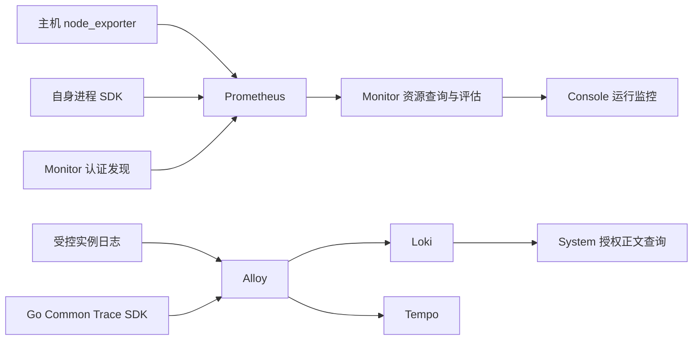

# ADDP 平台运行观测规范

本文维护已实现的主机、采集、进程资源、受限查询和平台告警契约。概念见[监控与执行体系图](../concepts/addp监控与执行体系图.md)，尚未实施的引擎/容器专业观测、Trace、受控运维及验证缺口见[后续专题](../next/ADDP平台运行监控与可观测性设计.md)。正文标明待实现的内容仅界定边界，不作为开放能力。

## 一、适用范围

适用于平台主机、当前模块运行实例、受限资源查询和平台告警。租户任务执行、日志正文与引擎业务数据仍由各自 owner 维护。

## 二、交付边界

主机台账、采集发现、基础资源、进程 CPU/RSS/时长、趋势/总览与主机 CPU/内存规则已实现。引擎专业观测、容器配额、拓扑追踪与生产规模等剩余范围，以及各层验收状态，按后续专题分别记录；实现就绪不等于相应验收通过。

## 三、对象与模块边界

### 3.1 身份与事实来源

| 对象 | 唯一事实来源 | 约束 |
| --- | --- | --- |
| 纳管主机 | System `node_id` | System 分配 UUID；物理主机与虚拟机均可纳管，容器不是主机 |
| 模块与运行实例 | System 模块登记、实例身份和租约 | UP/DOWN 来自租约，不由采集成功或 CPU 值决定 |
| 业务引擎 | System 引擎登记 | `engine_id` 与主机身份不同；远端、云端、集群引擎不按连接数推算节点数 |
| 容器 | 运行环境的容器身份及配额 | 与进程关联必须有明确证据，不能按名称或资源量猜测 |
| 任务执行 | 既有执行 Owner 与共享执行协议 | 执行身份、槽位和结果不转移到遥测存储 |
| 采集目标 | Monitor 配置身份及版本 | 引用已有主体，不重复创建主体或实例租约 |

IP、DNS、主机名、服务 URL 和 `registered_host` 均不是稳定主机身份。ResourceLocator 继续表示引擎业务数据位置，不加入主机节点语义。

部署关联与调用关联分开：前者记录声明来源及有效时间，后者来自明确配置或 Trace 观测窗口。拓扑染色不能作为已经确认根因的证据。

### 3.2 模块职责

| Owner | 职责 |
| --- | --- |
| System | 主机、模块、实例及引擎身份，当前用户对象授权，IAM 与统一审计；日志正文授权读取 |
| Monitor | 采集配置、发现投影、资源查询与预算、规则、平台事件和通知、监控页面 |
| Common / Common-Python | 共享采样 SDK、DTO、身份声明与服务客户端；不成为第二个事实 Owner |
| Infra | Prometheus、Alloy、Loki 等中心组件及节点来源的部署、传输保护、Secret 与物理资源预算 |
| Console | 统一入口、上下文和 iframe 导航；前端隐藏不替代服务端授权 |

Monitor 不直接查询 System 私有表，不直接读取主机文件，不复制 System 的实例运行状态。业务请求和执行事实不依赖观测设施才可写入或读取。

### 3.3 平台与租户权限

当前主机、平台实例资源、总览及平台资源告警只开放 Platform Context。Tenant 执行监控、执行告警保留自身事实和权限；租户引擎未来的专业观测还须单独明确归属与读取契约。

平台系统管理员承担首期主机、采集和平台告警管理职责，权限在 Owner manifest、内置角色及正式迁移中显式发布。平台安全管理员、审计管理员不因此获得资源管理或日志正文权限；平台角色也不自动取得全部租户 SQL、参数和执行结果。

- 用户请求转发已验证的当前 User Token，由 System 再裁决主体；后台投影不能代替用户对象授权。
- `addp-monitor` 使用独立 Platform Service 身份，只读取有界当前身份投影。同一 `/runtime/observability-identities` 返回必须为数组的字段 `engine_deployments`（真实无对象时为 `[]`），最多 1000 个启用且承载主机有效的平台部署；与节点、模块实例在同一只读可重复读事务内裁决，共用五秒和四 MiB 预算。每项仅含 `deployment_id`、`version`、`scope=infra|business`、`engine_type=postgresql`、`node_id` 与 `source_key={docker_engine_id,project,service}`；来源键沿用部署发现的 Docker 引擎／Compose 项目／服务三元组，`infra` 对应 `addp-infra`，`business` 对应 `business`，当前服务为 `postgres`。不含名称、地址、端口、连接、凭据、租户引擎或运行状态，不因登记存在就视作实时来源可用。超量、异常及控制面错误整份拒绝，不截断或保留旧身份；后台投影不授予用户查询权，专业查询仍逐请求转交当前 User Token 给 System。
- `addp-prometheus` 使用独立最小身份和 `monitor.metrics_discovery.read`，不能访问业务 API。
- 采集 mTLS、发现身份、日志上报及资源查询证书分别管理；不保存长期管理员 Token，不复用业务数据库凭据。
- 资源观测、告警事件、规则管理、通知管理和日志正文分别授权。切换身份或 Context 时清除旧数据、凭据草稿，并拒绝迟到响应。

## 四、主机接入与采集发现

### 4.1 主机与服务绑定

主机保存 `display_name`、`node_kind=physical|virtual`、`addresses`、`enabled`、`version` 及 UTC 创建/更新时间。名称是可编辑属性，地址允许为空；`enabled` 表示纳管意图，不表示电源或网络状态。编辑采用版本 CAS；首期只停用纳管，不提供主机物理删除或关机。

主机的允许模块集合明确列举模块服务 Client 与模块名；“添加模块”表示允许这些服务声明部署于该主机，不是安装服务。集合为空不允许绑定，不能根据浏览器提交或来源标签自行扩权。

部署为实际所在进程注入 `ADDP_HOST_NODE_ID`。System 在首次登记时固定实例的节点声明，按当前主机状态和允许集合裁决 `unbound/bound/rejected`；同一实例重登记不得改挂主机。位置变化产生新实例身份，历史声明不反写。非法部署输入仅停用绑定并记录安全诊断，不阻断合法业务登记和续租；API 仍严格拒绝恶意或非规范请求。

缺少或失效的主机关联不阻断实例自身资源观测，也不改变租约。引擎部署的显式承载声明由 System 维护，首批单主机关联见 4.4；不以数据库地址、容器名或 VM 总消耗推断。

### 4.2 管理员确认的部署清单接入

唯一导出入口 `scripts/infra/node-metrics.py export-admission` 输出 `schema=addp.host-admission/v2`。默认核验已运行的本地 Linux/Docker Desktop 受控 node_exporter，包含主机和采集配置；显式 `--host-only` 只声明当前原生 macOS/Linux 宿主，不访问 Docker 或采集凭据，要求明确物理/虚拟类型。`--module` 可重复指定该宿主允许的 ADDP 模块，生成既有固定模块 Client 对应关系；不按进程名、地址或容器名发现承载，不包含 Business 租户引擎。

清单最多 16 KiB，根字段仅为 `schema/host` 和可选 `collection`。主机字段为 `display_name/node_kind/addresses/allowed_module_bindings`；采集存在时仅允许 `monitor_kind=host_resources`、`source.type=node_exporter` 及显式 HTTPS `/metrics` 端点。拒绝旧版本、未知字段、身份和凭据；空采集对象不等于省略。Desktop 来源声明独立 Linux VM，原生宿主不得据此归入 VM。名称与地址不作为稳定身份或自动合并键，清单本身不授予权限。

System `/host-admission` 是 Console 中唯一接入编排入口；独立模块打开该跨模块流程时先进入 Console，再接受草稿。管理员导入后预览并显式选择已有主机或按清单创建；已有主机不被改写，当前读取必须仍启用且类型匹配，创建仅用既有 `platform.host_node.create`。主机保存结果或当前读取结果生成 `ADDP_HOST_NODE_ID` 部署参数；只应用于实际部署在该宿主上的新进程，不修改全局 `.env`、不自动重启、不在线改挂已有实例。

采集可选。存在来源且用户有独立 Monitor 管理权限时，System 通过共享 Console 内存导航草稿将同一主机和来源交给 Monitor 原新建页面。草稿最多 4 KiB、60 秒、一次消费，绑定当前身份/权限及精确目的路由；只允许当前同源 iframe 取回，不写 URL、浏览器存储或最近访问。取消、另行导航、身份或权限变化、退出与超时均清除；端点仍由 Monitor 重新验证，不据草稿授予权限。页面刷新仅恢复 URL 中稳定主机 ID，不恢复未保存来源。

两个 Owner 分别写入：System 创建成功后冻结该主机，未知创建结果或版本冲突阻止再次创建并要求核验；明确拒绝可修正重试。转到 Monitor 后固定所交接的主机，只保存采集，不再创建主机；明确的采集失败仅重试该配置，未知结果或冲突先到原列表核验。清单与主机身份选择在授权/页面变化后失效，迟到响应不能恢复旧草稿。Monitor 原导入、主机创建编排及私有解析器删除，采集管理只消费已存在的 System 身份。

### 4.3 采集目标与认证发现

当前主机采集配置由 Monitor 管理，含主体、固定来源类型、受控端点、启停及独立版本。同一主体和类别最多一个启用来源。模块进程来源来自 System 首次登记的不可变采集声明，随当前租约自动投影，无需每次重启人工登记。

Prometheus 只通过 Monitor 的单一认证 HTTP SD 获取全量有界快照；不分页、不接受调用者标签。身份标签由控制面覆盖，按实际端点去重；已结束实例、停用主机或目标、失效绑定从成功快照移除。控制面失败返回错误，不伪装成功空列表。

发现刷新为 30 秒。Prometheus 在发现失败时可能保留旧快照，因此当前查询和告警仍重新裁决主体及配置；发现列表不能作为读取授权或即时停采保证。紧急阻断依靠凭据撤销或网络策略，历史按原身份与保留期存在。

主机列表与采集配置区分纳管、启停和实际采集结果；配置版本不符、证据过期或无资源读取权时不得沿用“最近成功”。列表按当前页一次去重批量读取，不逐行扇出、跨页预取或拆请求绕过预算；观测失败仍保留配置管理能力。

### 4.4 平台引擎部署登记

引擎部署属于平台运维对象，与租户 Engine Instance 分开。System `/platform/engine_deployments` 提供集合 POST 批量确认、GET 分页/详情和 PUT 管理更新，分配稳定 `deployment_id`；支持 Infra 与 Business 的标准单容器 PostgreSQL／Redis／MinIO，显式关联一个已纳管主机。其他服务只显示发现事实与未适配原因；集群多主机、云服务及租户引擎关联尚未开放。不接受 `tenant_id/engine_id`、连接凭据或 SQL，不从 Web 请求执行 Docker 或数据库探测。

页面入口统一称为“登记发现的引擎”，状态使用“已纳管／待登记”，避免将部署登记误解为租户业务连接或安装／启动指标采集。管理员在“引擎纳管”读取部署侧发现结果，选择待登记服务、核对名称和实际承载主机后批量确认，无需运行导出命令或导入文件。纳管列表按 Infra／Business 来源分别查询。登记弹窗同样以 Infra／Business 标签分别展示，默认跟随当前列表来源；全选仅作用于当前来源的可登记项，切换标签保留待登记选择和名称草稿，重新读取来源清空选择以重新核对。已纳管项在前列显示只读勾，未适配项灰显并显示叉号，两者不提供待登记复选框；勾表示已纳管，不代表运行或采集健康。已纳管项提供原部署详情入口，创建弹窗不修改已有纳管记录。仅在勾选待登记服务后展示承载主机及“新登记引擎的纳管状态”，明确该状态只作用于本次新登记批次；未选服务、当前标签无候选或缺少承载主机时显示具体提交提示，保留原保存约束。详情沿原权限和版本更新已有纳管状态，停用不停止引擎或删除业务数据。来源项目、容器运行身份、状态及对应数据库端口来自 4.5 的唯一发现链路；Docker Desktop 只可关联 virtual 主机，不按地址、名称或容器 ID 猜测承载关系。发现可用与纳管、专业采集成功分别表达。

POST 仅接受 `items`，每次 1—16 个显式成员；成员为 `scope/service/fingerprint/display_name/enabled/declared_node_id`。服务端重读来源，验证 120 秒时效和预览事实摘要，再按来源键排序、整批事务写入；任何来源过期、变化、重复、主机无效或写入失败均整批回滚。摘要不含每次刷新时间，不代替持久资源版本。确认后的规范快照为 `addp.engine-deployment-inventory/v1`；旧根记录由前向迁移规范化，不改稳定身份、版本或不可变历史。

部署详情通过同一只读发现接口展示最近一次来源，按已确认的 Docker Engine、Compose 项目和服务匹配；不按名称、端口或地址猜测。来源过期、不可用、运行环境不符或服务未发现时不展示旧容器为当前结果；容器运行身份变化只更新来源展示，不改部署 ID、声明版本、主机关联或历史。容器运行状态不等于数据库可用或专业采集成功。来源单独刷新不清除管理草稿，也不解除写入冲突阻断；切换账号、对象或关闭详情后，迟到响应不得恢复旧来源。

来源按 Docker Engine ID、Compose 项目和服务唯一，停用也不可重复登记。PUT 仅接受名称、纳管意图、主机与当前 `version`，不接受客户端重写来源；实时运行变化由发现结果表达。列表只接受 `page/page_size/search/node_id/engine_type/scope`，scope精确限定infra或business，按已确认来源项目addp-infra或business在计数／分页前过滤；响应的只读scope由同一来源事实派生，不持久化第二份范围、不按显示名识别。类型精确限定postgresql、redis或minio并在计数／分页前过滤，名称按字面片段搜索，主机筛选按声明身份；详情不接受 query。请求正文最多 32 KiB，拒绝未知字段、重复键、大小写别名及附加 query。结果未知或来源变化时保留草稿并停止提交，必须显式重读核对，不自动重试创建。

创建与更新在同一 PostgreSQL 事务保存根版本、声明有效区间及统一审计；并发旧版本返回 409，不自动刷新版本重试。声明时间统一取数据库时间，表示管理员声明的生效/结束时刻，不能回填为实际部署历史。闭合历史不可更改或删除；首批不物理删除部署。读取在同一快照核对当前主机和部署纳管状态：有效关联为 `bound`，停用或 Desktop 主机类型变化为 `rejected`，保留原声明；这些状态均不表示服务在线、专业指标采集成功或租户业务可用性，不参与业务 Ready。

接口仅接受非委托 Platform User，独立 `platform.engine_deployment.read/create/update`，创建/更新还须 `platform.host_node.read`；迁移 000220 只向既有平台系统管理员发布三项权限，并沿既有触发器推进授权版本、撤销相关旧刷新族。其他角色、Tenant、Service、委托调用不因部署登记获得权限。界面保留冲突或失败输入；CAS 冲突和结果不明确时停止再次提交，只允许用户显式重新读取核对，首次登记则关闭后刷新列表，不构造已成功身份。

T0 权限目录/Swagger、T1 输入与身份拒绝、T2 PostgreSQL 唯一性/CAS/声明历史/审计回滚及权限前向迁移、System/Console 前端门禁沿现有注册自动发现。精确 T2 入口为 `make test-system-iam-postgres SYSTEM_IAM_POSTGRES_TEST_ARGS="--package repository --test engine-deployments"`、同参数的 `--package api`（HTTP Handler 与 PostgreSQL 审计事务）和 `--package migration`；本地须使用标准脚本核验的 `addp_iam_test`。产品接入 T4 与上述确定性验证分开登记，尚未通过不能写作真实运行已验收。

引擎监控入口先按部署来源分为“Infra 基础设施”和“Business 业务引擎”，默认Infra。两者仍是Platform运维对象，不表示Tenant范围或新增授权。每个范围以卡片展示当页已纳管的全部已支持引擎类型，卡片显示名称、类型、明确承载主机、实际采集状态和该类型四项摘要；不再以数据库类型下拉作为入口。沿System同一scope列表一次查询、每页20项，再沿Monitor既有混合类型摘要一次查询；不跨页预取、不逐卡片查询指标、不扩大100序列预算。搜索沿既有防抖／Enter与可见性规则，切换scope重置页码并清除原观测。URL保留scope、搜索与页码；详情按当前System事实校正scope与引擎类型，返回列表保持来源、搜索和页码。原按类型列表路径删除，详情固定指标目录、权限及采集来源不变。

### 采集来源统一部署分组（2026-11-04）

完整本地ADDP启动／重启负责恢复已启用且已安装的本机主机来源及Infra／Business引擎来源，再刷新部署事实；局部模块启动和Hosted精确进程启动不执行该恢复。主机沿唯一安装证明核验，只恢复匹配的既有容器；引擎沿原来源身份／账号核验，正常来源不重建。首次安装、证明失效、身份或输入变化、迁移及改账号／认证仍须部署者显式应用，不因应用重启扩大操作范围。Infra管理指标中心和本域专业来源，Business管理本域专业来源，主机每台部署一份，不因承载两域而重复部署。

全量本地启动结束输出一次监控摘要：复用Infra容器归属及运行／健康检查报告指标中心、已选择的控制入口，复用统一来源status列出主机及两域来源；服务进程运行与采样分开表达。该摘要只读，不读取业务数据、账号私钥内容或浏览器Token，不另建指标有效性判断；明确提示实际采样、关联与有效指标须在Monitor核对。恢复或摘要失败不阻止其他业务启动，但保留可选观测失败的非零退出状态；局部及Hosted启动不执行摘要，也不改变模块自身Ready条件。

当前只读状态与本次启动阶段结果分别表达：启动中遇到日志配置预检、指标配置预检、可选Infra健康、可选设施应用、日志端口读取或采集恢复失败时，在本次启动进程内保存固定阶段名称；末尾列出这些阶段及摘要自身失败，不回显原始错误或凭据，不以随后正常清除前序失败，也不将前序失败表述为当前来源仍失败。阶段记录不持久化、不重试操作；早期具体原因仍以当次原输出为证，当前检查正常不能补造历史根因。

主机恢复安装事实采用同一规范化比较：仅Docker HostConfig的 `Dns`、`DnsOptions`、`DnsSearch` 三个已存在字段允许将JSON null规范化为空数组，二者均表示未配置该容器的DNS覆盖，依据[Moby v28.5.1网络配置](https://github.com/moby/moby/blob/v28.5.1/daemon/container_operations.go#L63-L76)。非空数组、字段缺失、其他类型及其他HostConfig字段不作此归一化，仍严格比较；输入／容器／网络／挂载／安全身份不放宽。读取既有证明与新快照沿同一函数比较，健康检查不重写证明、不收养新容器，不为表示差异要求用户重建来源。

主机模板与 TLS 文件的跨次安装证明比较仅忽略 `st_dev`（文件系统设备号）的数值差异；该字段须仍为有效非负整数。内容摘要、inode、大小、mtime／ctime、文件模式、UID／GID、文件集合和路径继续精确核验，Docker Engine／内核、容器、网络、挂载、卷及安全事实不变。同次读取前后和同次安装／恢复操作中的稳定性核验仍包含设备号，防止读取或操作期间切换文件系统。该比较规则不重写证明，不重建健康来源，不为设备号单独变化要求重新应用。

#### 采集项目与来源隔离

同一 Docker Engine 上的一套 ADDP 部署，主机、Infra 与 Business 专业采集来源共用固定名称 `addp-metrics-sources` 的 Compose 项目。分组仅用于部署呈现与操作组织，不改变平台／租户归属、数据库部署、指标中心、账号权限和采集协议。主机服务保留唯一名称；引擎采集服务以 scope 前缀区分。各来源私有声明仍是唯一部署输入，不另存集中配置副本。统一入口 `metrics-sources.py` 只依次操作选定来源，失败独立汇报。

共用项目不表示共用信任域：每个引擎来源保留专属私有卷、账号与证书，仅加入原数据库的明确私网；主机来源独立使用宿主／Desktop 网络视图。PostgreSQL Exporter 与 mTLS 入口继续分容器，数据库凭据不交给入口容器。Redis／MinIO 与 CDC 固定来源统一使用各自精确采集镜像中的工具读取及初始化本方私有卷，不借用被监控引擎的镜像，不挂载引擎数据卷。读取辅助容器以非 root、无网络、只读卷运行；初始化辅助容器仅在本方私有卷使用 root 与 CHOWN，运行中的采集进程仍为非 root、只读文件系统。Redis／MinIO 安装声明必须标记私有卷工具来自采集镜像；旧 scratch 采集安装须由部署者显式 `up`，不自动迁移或退回引擎镜像。所有查询、清理和恢复必须同时限定项目及明确服务集，并核验工作区、scope、当前数据库身份；禁止项目级 `down`、`--remove-orphans`、跨来源清理和自动采用同名陌生资源。选择单个来源不得启动、重建或停止其他来源。

#### 旧来源退役边界

原带工作区摘要的项目仅允许显式 `up` 中按来源退役：先核验所选服务的容器、工作区／scope、专属卷和主机私有网络归属，全部通过才精确移除该来源，再沿固定名称部署。遇到未知资源立即拒绝；不删除数据库、业务卷或指标历史。不保留旧发现／旧恢复路径；普通 `recover` 遇到旧安装声明应提示显式应用，不构建镜像、不迁移、不重新安装账号。应用失败只清理当次来源，不声称整批回滚或无采集间断。实际采集成功仍须 Monitor 验证。

### 4.5 部署侧自动发现来源

唯一 Docker 读取实现位于 `scripts/utils/deployment-inventory.py`，由 Infra、普通 Business 启停和开发启动按各自作用域自动刷新，不调用 System API 或数据库。发现协议为 `addp.deployment-discovery/v2`，最多 256 KiB；仅核验本地 Unix Socket Context 的 Linux Docker 或 macOS Desktop Linux VM，以当前工作区的 Compose project/working_dir 校验归属。最多读取 128 个容器、64 个服务、单服务 16 个容器和单容器 64 个实际端口，整体 Docker 读取期限 30 秒；前后读取服务运行身份、状态、启动时间、重启次数、端口及 Docker Engine 身份一致才输出。

快照区分 `scope=infra|business`、`state=available|unavailable`，带 UTC 读取时间；成功空集合与失败分别表达。未知组件只标记未分类，不猜测集群、主机关联、引擎专业监控或租户归属。快照不含环境变量、密码、SQL、租户或授权，System Web 服务不因此获得 Docker 权限。

快照写入部署用户独占目录，独立作用域锁内完成读取并以私有临时文件原子替换；发布失败不写半份数据，来源失败则发布不可用结果并清除有效候选。不得把磁盘中较早快照当作实时服务状态。

System `GET /platform/engine_deployments/discovery` 仅接受非委托 Platform User 与已有 `platform.engine_deployment.read`，不接受 query/body；只读 `ADDP_DEPLOYMENT_DISCOVERY_DIR` 下固定的两个作用域文件，不执行 Docker 或接受请求文件路径。开发入口注入工作区私有目录，其他部署未配置则明确返回未配置。成功响应固定包含两个作用域，分别标记未配置、缺失、来源不可用、过期或有效；普通文件及目录须为私有权限，符号链接、非普通文件、超预算、重复或未知 JSON 字段、错误作用域、来源身份及端口均拒绝。有效窗口为 120 秒，最多允许来源时钟领先 30 秒；过期仅保留读取时间，不保留服务或来源身份，单侧失败不抹除另一侧合法结果。

持续来源由同一入口的独立部署观测进程发布，每轮完成后间隔 30 秒；不在 System 请求中执行 Docker。Infra 启动管理进程、停止时核验退出；Business 和开发启动幂等确保其存在，开发启动同时注入实际目录并刷新两组快照。观测器只继承 Docker 所需的环境，不继承 ADDP／SQL 凭据或开发生命周期锁；通过私有运行记录、当次随机标识及实际命令核对 PID，拒绝接管或停止不明进程；标准启动发现源码或 Docker 运行环境指纹变化时只替换已核验归属的观测进程。需要新建观测进程时，在既有控制锁内先校验并移除上一代 ready 记录，再启动本代进程；已有归属进程须先确认退出，运行环境未变的幂等启动保留当前记录。ready 只等待本代首次发布，避免原子替换将读取中的上一代文件描述符变成零链接；文件类型、UID、私有权限、单链接和大小校验不放宽。启动记录发布失败须回收刚创建的子进程；停止立即将两组来源置为不可用。停止观测失败不阻止实际 Infra 停服，但退出码须反映无法确认清理，Hosted 不得将其计为零残留。

观测进程退出时仅在即时取得快照锁的情况下失效来源，不等待其他写入者；停止控制流程负责确认进程退出、再取得快照锁并清空两组来源。锁竞争不能阻塞观测进程退出；控制流程无法确认退出或清空来源时仍须报告失败，不删除尚未确认退出的运行记录。退出核验失败仅追加有界、脱敏的即时诊断：最后归属判定、Linux进程状态及固定等待类型、SIGTERM挂起／屏蔽／忽略／处理状态、直接子进程数量；不可读取或非Linux时明确未知，不输出命令行、路径、随机运行标识或原始proc文件。诊断不能改变信号次数、期限、归属裁决或记录保留，也不能代替实际根因证据。

SIGTERM／SIGINT处理器只锁存停止请求，由非阻塞唤醒管道打断原30秒空闲等待；不在异步处理器直接抛退出异常，避免信号命中Python析构器时成为被忽略异常。主循环、锁等待和Docker读取在显式检查点响应停止；Docker命令仍仅启动一次，分段等待同一子进程，不重置原单次10秒／整轮30秒预算。取消读取先回收当次自有子进程，再按原非阻塞失效及退出核验流程清理；归属、单次停止信号与未退出保留记录不变。

PostgreSQL／Redis／MinIO 专业来源沿同一发现文件发布：部署侧仅核对 PostgreSQL 配对来源或 Redis／MinIO 单来源的 Owner、scope、project、数据库容器完整 ID／启动时刻及显式 HTTPS 发布端口；不读环境、Secret 或 SQL。采集身份不加入管理员确认摘要或不可变部署声明，公开发现 DTO 排除专业端点。

该接口不创建纳管身份、不更改管理员声明、历史或租户权限；管理员批量确认遵循 [4.4](#44-平台引擎部署登记)，专业来源的私有投影与准入见 [4.7](#47-postgresql-受保护的固定指标来源)。候选读取、来源自动发布、专业采集与用户查询分别验证，不以发现成功代替产品接入验收。

PostgreSQL 只读发现在共享 `addp-metrics-sources` 项目中按同一作用域的 `<scope>-postgres-metrics`（SQL Exporter）和 `<scope>-postgres-metrics-web`（mTLS 入口）定位配对来源。每个服务须恰有一个正在运行的常驻容器，且项目、工作区 Owner、作用域、服务标签、当前数据库容器完整 ID 及启动时刻均匹配。mTLS 入口须共享该 Exporter 的网络命名空间。唯一显式的 HTTPS `9443/tcp` 映射记录在 Exporter 容器上，入口容器自身的发布端口应为空。两个服务都未发现时记为 `not_deployed`。配对不全、重复、身份或网络命名空间错配、端口不符时记为 `unavailable`。专业来源状态与基础数据库部署状态分别判定。[采集来源统一部署分组](#采集来源统一部署分组2026-11-04)

Redis 和 MinIO 的只读发现在共享 `addp-metrics-sources` 项目内按 `<scope>-redis-metrics` 或 `<scope>-minio-metrics` 服务名定位唯一来源。发现时核对工作区 Owner、作用域及服务标签、当前数据库容器的完整 ID 与启动时刻、私网网络 ID 和唯一显式的 `9443/tcp` HTTPS 映射，并复核前后事实一致。[采集来源统一部署分组](#采集来源统一部署分组2026-11-04)

Redis 私有来源字段沿同一v2文件的 `redis_metrics` 发布，形状复用唯一 `EngineMetricsSource`：状态、HTTPS端点、当前数据库容器完整ID和启动时刻。无源为 `not_deployed`，错配或重复为 `unavailable`。只读发现不读取采集密码、TLS 文件或容器环境。System独立校验与单个运行中redis容器精确相符、快照时效、来源键及已纳管主机绑定，仅向既有Monitor后台身份提供该最小字段；普通浏览器发现和持久声明均不含专业端点。Redis与PostgreSQL分别失效，不能互相顶替；Monitor仍沿唯一准入和HTTP SD，以真实引擎类型标记来源，不新增并行查询入口或租户归算。

MinIO 复用上述平台部署登记、主机绑定与私有来源链路，平台部署类型沿已有发现协议使用 `minio`（不是租户 S3 插件标识）。`minio_metrics` 复用同一私有字段形状。Infra数据库可在多个网络，但来源必须只加入同一数据库的标准 `addp-network`；Business为 `business-network`。只读核对网络ID及Compose归属，不以网络名称猜测。登记只保留9000 API端口，不接收9001控制台端口。来源缺失、错配或关闭独立失效，公开DTO及声明不含端点；Monitor沿同一准入和HTTP SD发布真实minio类型。本批不新增权限、角色、租户关联、查询指标或页面指标。前向迁移只扩展平台部署类型和来源服务匹配约束，保留既有身份、历史与权限。

#### CDC 基础设施组件的自动发现

CDC 基础设施组件首期覆盖当前标准 Infra Compose 项目的 `redpanda` 和 `kafka-connect`，每个服务最多一个运行实例。部署侧沿现有只读发现核验工作区归属、Docker Engine、Compose 项目和服务，采集来源同时绑定当前容器完整 ID、启动时刻、私网及唯一显式 HTTPS 发布端口。System 沿唯一私有观测投影发布核验后的当前事实，Monitor 复用统一 HTTP SD、mTLS 准入、端点去重与容量限制。组件按部署事实自动纳入，用户读取继续由平台权限裁决。PostgreSQL 继续沿各自引擎部署及原授权读取。

用户确认统一来源失败隔离：进程、引擎和 CDC 动态来源的连接、解析、防护或采集探测失败，仅使该来源退出本轮发现，不发布未经准入的端点；其他合法来源继续发布。手工主机来源继续由保存时准入和运行时地址策略管理，运行时解析失败同样只剔除自身。身份快照、身份结构、重复声明／已解析物理端点、总预留容量、整批截止时间仍是全局门禁，任何失败都拒绝整批。容量在探测前按已声明启用／可用来源预留，剔除失败来源不能腾出名额绕过总限额。先完成全部地址解析及去重，再对固定 IP 做动态来源准入，避免失败来源掩盖重复端点；不重复解析、不重试、不复用失败来源的旧地址。发现剔除不表示来源健康，资源查询仍按当前身份与实际采样表达未连接／缺样。

私有观测快照以 `infrastructure_components` 独立发布 CDC 部署事实，包含发现状态和组件集合；发现不可用时集合为空且状态明确为 unavailable，不冒充部署清单为空。每项以 Docker Engine、标准 Infra 项目及组件名形成稳定身份，容器 ID 和启动时刻表达本次运行。来源沿既有私有指标传输字段形状复用，不创建平台引擎登记、不授予主机关联。Monitor 的 `cdc_resources` 与现有主机、进程、引擎目标共享一份端点去重表与预算。

两个组件的部署缺失、来源未启用或核验失败分别处理。容器重建后原来源失效，只有当前容器及来源重新匹配后才采集。空 Connector 或消费组清单是独立的运行事实，缺样不填零，组件汇总不用于推算单个任务的端到端延迟。采集仅发布固定指标与有界标签，发现和指标均不携带连接凭据、Connector 配置、事件正文或异常原文。当前个人部署已有 34 个目标，启用两个新目标前在隔离环境验证至少 36 个目标的并存采集、超额和恢复。

CDC 来源安装与恢复沿统一 `metrics-sources.py` 入口，仅允许 Infra 的 `redpanda`、`kafka-connect` 两种来源。启用、监听地址和 TLS 材料由各自部署配置声明，未安装的来源不因重启而自动创建。安装只构建／应用当前来源，恢复只使用已安装的精确镜像及私有材料；身份、TLS、来源配置或来源镜像失配时拒绝恢复。来源私有卷由其自身的固定镜像初始化，不使用 Redpanda 或 Connect 镜像作为初始化工具；运行进程仍以非 root、只读文件系统及受限资源启动。CDC 生命周期不管理组件数据卷、连接凭据和 Connector 配置，也不重启组件。Connect 的只读 JMX 白名单由标准 Infra Compose 挂载，JMX 端口用于私网只读采样；开发宿主访问仅显式绑定 `127.0.0.1`，不继承 Infra 对外监听地址。

CDC 固定来源复用 `sourceserver` 的单次完整投影和私有 mTLS `/metrics`，不提供任意地址或 JMX 查询入口。Redpanda 只读取 `/public_metrics`，聚合磁盘与不可用分区；消费组积压只在每个已提交分区都有对应末端 offset 时发布，空消费组只发布分区数为零，不伪造积压值。Kafka Connect 只读取 `/connectors?expand=status` 和两个固定 JMX 属性集合：Task 的 offset 提交失败比例，以及 Debezium PostgreSQL streaming 的连接状态、源端延迟。只输出固定状态计数和最大值，不输出 Connector、Topic、Group 或 MBean 名称。源端延迟为 Debezium 的毫秒值换算秒，offset 失败比例为原生 0～1 比例，均不能解释成整条链路延迟或失败率。

CDC 页面唯一入口为 `/cdc-resources`，以 `view=tasks|resources` 区分任务链路和运行资源；默认按当前 Tenant／Platform Context 进入对应视图。页签和视图内容按当前 Context 及功能权限显示：Platform 仅显示有权读取的运行资源，Tenant 仅显示同时具备两项读取权限的任务链路，不提供另一域的可点击页签。显式 URL 指向另一域时仅显示身份范围提示，保留该 URL；离开的子视图不得再规范化路由或请求数据。Tenant User 的任务链路要求 `transfer.task.read` 与 `monitor.execution.read`，直接沿 Transfer 正式任务列表的 `change_detection=cdc` 服务端筛选和任务详情读取源／目标定位符、捕获代次及公开捕获状态，沿 Monitor 既有授权执行详情读取该任务最近 execution 的 continuous 诊断。源／目标不从部署范围推断，Connector／Topic 私有名称不进入页面；积压与提交位置只展示 Owner 最近观测及其采样时间，不用 Broker 消费组 offset 重算，不把历史 execution 样本当成当前任务状态。任务当前消息缓冲沿 Transfer 的 `capture.buffer_observation` 展示保留范围、目标提交位置及积压位点差，暂停期间继续由 Owner 采样，失败或过期时隐藏数值；与最近 execution 的历史采样分开。PostgreSQL 源端沿 Owner 的 `capture.postgresql_observation` 展示当前任务 generation 已登记且已取得所有权的逻辑槽活跃状态、WAL 保留字节距离、待确认字节距离及 PostgreSQL 原生保留风险；沿 `capture.delay_observation` 展示本任务 Connector 的 Debezium streaming 连接状态与事件捕获延迟。两项只读采样互不阻断，分别处理缺失、身份错配、不可用和过期，不使用 Infra PostgreSQL 或组件最大值替代。完整语义见 [Transfer 数据库 CDC](tasks/Transfer数据库CDC.md#postgresql-任务源端指标)。完整诊断跳转既有执行详情，不复制诊断页面。未启动、无任务、缺样与失去读取权限分别表达，Context／任务变更及失败清除对应旧值。Platform User 只读取运行资源；跨 Context 不发起另一域的请求，不自动切换身份或扩大权限。

运行资源中的组件即时读取使用 `GET /platform/cdc_resource_observations`，不接受 query，按当前部署事实返回至多两项；发现 unavailable 与 available 的空集合分别表达。读取沿非委托 Platform User 的 `monitor.resource_observation.read`，不授予引擎、主机或业务数据读取权。运行资源仅展示实际承担 CDC 捕获和缓冲的 Connect、Redpanda 共享组件，不提供通用 PostgreSQL 部署选择。Infra PostgreSQL 保存任务、捕获登记、runtime lease 和目标提交后的同步位点，其通用连接／锁等待／容量指标沿引擎监控读取，不能以其逻辑槽或 WAL 汇总推断 CDC 源端风险。源数据库必须由任务配置确定；未建立任务与源复制资源的正式关联前，不展示部署级复制槽汇总作为任务指标。Redpanda 首页优先展示磁盘使用率、不可用分区与剩余磁盘；消费组积压置于详情并明确其不能代表 Transfer 已应用进度，任务积压继续沿 Owner committed position 诊断。Transfer 服务及 Continuous Worker 的进程指标复用服务监控，不在此复制通用资源页面。

组件固定目录按每类最多十二项查询：Redpanda 为磁盘总量／空闲／使用率、不可用分区、消费组已提交分区数及待消费记录数；Connect 为 Connector／Task 总量、失败 Connector／Task、运行／暂停 Task、offset 提交观测 Task 数与最大失败百分比、Debezium streaming Connector／已连接数、有延迟样本 Connector 数与最大源端延迟秒数。所有指标均来自现有固定采集器；没有消费组时积压不补零，空 Connector 为有效零计数，未初始化延迟无值，原生负延迟保留表示时钟偏差，不能作为端到端延迟。页面常用指标直接展示，其余在卡片内部展开。

`GET /platform/cdc_resource_trends` 只接受一个当前 `component_id`、该类型固定 `metrics`（最多十二项）及 RFC3339 `start/end`。最多七天，只读取当前容器 ID、启动时刻和受控实例地址，不拼接旧运行段。查询复用同一策略、并发和点数预算；即时集合的总时序数计入整批预算。每个值要求唯一、同次抓取的 up 与 observed_at 证据；来源故障、过期、缺样不回用旧值。返回前重读组件身份与查询策略，变化时丢弃本次结果。响应只含公开组件身份、类型、本次运行开始时刻、采集状态和固定序列，不含 Docker Engine、容器 ID、私网地址或凭据。

Jolokia 必须使用属性级只读白名单，禁止 write、exec、list、search 和其他属性；不发布宿主机原生 JMX 端口。每次采集共享 4 秒截止时间，单次上游响应最多 1 MiB，Redpanda 最多 4096 个样本、Connect 最多 256 个 Connector / 1024 个 Task。超限、协议异常或必需读取失败时整个组件返回采集失败，不保留上次样本。空集合允许成功；Jolokia 对没有匹配 MBean 返回的 `404 + javax.management.InstanceNotFoundException` 表示空集合，其他 404 和权限拒绝仍为失败。尚未出现的 streaming / offset 属性不生成零值，Debezium 的延迟 `-1` 表示尚无事件或指标已重置，不生成延迟值；同时发布有延迟样本的 Connector 数，其余负值保留以反映时钟偏差。新增来源的 T1 与真实组件 T2 沿既有 Monitor 门禁执行；它们通过不等同于统一发现、36 目标并存或页面验收通过。[Jolokia 属性级权限](https://jolokia.org/reference/html/manual/security.html)

### 4.6 PostgreSQL 数据库侧汇总读取边界

Infra 与平台自管 Business 的 PostgreSQL 分别由部署 owner 通过唯一来源生命周期安装版本化的 `scripts/infra/postgres-observation/000003_replication_slots.sql`，不进入 System IAM 迁移；前两版保留为不可变历史。支持 PostgreSQL 15 数据库侧读取及可选来源部署；专业来源发现、Monitor 授权查询与页面沿本文同一观测链实现。数据库侧验证只证明其读取边界，不能替代专业查询与页面的正式身份 T4。

各实例分别使用 `addp_infra_observer` 或 `addp_business_observer`，密码独立；非登录的 `addp_observation_owner` 仅继承 `pg_read_all_stats`，Login 无任何角色成员资格，不获该统计角色、业务对象或服务管理权限。安装在单事务中校验作用域、SCRAM 校验值、身份标记、成员资格、schema／函数归属与 ACL；陌生对象、额外权限、PUBLIC 业务读权或不安全默认授权均拒绝并回滚，不接管或全局撤销其他用户权限。Login 只授当前连接库 CONNECT、私有 schema USAGE 和唯一无参数 `addp_observation.snapshot()` EXECUTE。密码校验值通过部署侧私有 stdin 的 psql 变量注入，不进入参数、普通配置、发现快照、System API 或日志；原始密码不参与 SQL 文本。

固定函数返回一行、19 个有类型字段：采样时间、服务启动时间、统计代际、统计开关；当前客户端连接、活跃、空闲、事务内空闲、活跃等待、活跃锁等待、活跃 IO 等待及最大连接数；非模板数据库的事务提交／回滚／死锁累计值及容量字节。排除本次采集会话，不输出数据库／表／用户名称、PID、客户端地址或 SQL。等待仅计 active，空闲 ClientRead 不作为压力；事务保留 PostgreSQL 原累计口径，包含采集自身带来的事务，不冒充业务吞吐或租户用量。统计关闭时三项累计值为 NULL；容量不完整不能填零，超过 256 个非模板数据库拒绝而非截断。统计代际覆盖数据库集合与各库统计重置，配合服务启动时间裁决后续速率窗口。复制槽额外输出本实例逻辑槽数、不活跃逻辑槽数，以及从当前 WAL 位置到最早非空 restart LSN 的字节差。用最早位置计算重叠 WAL，不相加，不输出槽名或 LSN，不代表数据卷实际占用，也不证明这些 WAL 仍可回放。主库没有非空保留点时字节差为 0，恢复中的实例字节差为空。读取不创建、不删除或推进槽。

函数采用固定 `pg_catalog, pg_temp` 搜索路径、全限定目录和固定 SQL，Login 不可更改函数；只读默认值和三秒语句超时是附加约束，不能替代对象权限或来源侧期限。PostgreSQL 的 PUBLIC 授权可叠加，单个角色 REVOKE 不能覆盖它；当前安装核查只覆盖所连数据库。正式部署须选择无业务对象的维护连接库，并以认证／网络策略限制其他数据库连接；未完成该部署准入不启用采集，不声称已经隔离整个实例的所有业务库。安全依据见 [PostgreSQL 函数权限](https://www.postgresql.org/docs/15/sql-createfunction.html)、[统计角色](https://www.postgresql.org/docs/15/predefined-roles.html)及[统计字段](https://www.postgresql.org/docs/15/monitoring-stats.html)。

验证复用独占 `make test-monitor-metrics`；精确数据库专项为 `make test-monitor-metrics MONITOR_METRICS_TEST_ARGS=--case=postgres-observation`。私有 PostgreSQL 强制 TCP SCRAM，覆盖真实密码、固定数值与独立目录对照、等待／锁等待、统计关闭／重置、越权拒绝、临时关系遮蔽、重入／密码轮换、陌生身份、默认权限漂移和失败回滚；业务对象夹具仅用 `addp_test`，认证拒绝探测另使用镜像自带 `postgres`，退出按原门禁核验物理零残留。默认完整门禁仍执行全部指标链路及该专项，现有 Monitor metrics CI 按声明自动发现新增 SQL 与探针；不新建 Job、不修改生产权限、不修改个人库。

数据库认证准入沿同一 `source.py` 的唯一规则生成器：部署 owner 在角色／函数归属校验通过后，才可为该实例对应的采集 Login 生成置于 `pg_hba.conf` 最前的受管块。只允许显式维护连接库、显式私网／回环 CIDR 与 SCRAM；拒绝该 Login 的其他数据库、Unix socket 和物理复制连接，不修改其他用户的既有记录。维护库名按字面量引用，不能把 `all` 等特殊词误作通配符。认证规则不代替函数和对象权限，也不授予 Monitor 编辑认证文件的能力。

受管块包含无凭据的作用域、维护库与有界规范 CIDR 声明；原文件其余内容原样保留。既有块不在首部、作用域冲突、声明／规则漂移、残缺标记、非注释记录含保留采集账号标识或超量输入均拒绝，不修补覆盖。相同输入幂等，部署 owner 明确提交的新 CIDR 可替换经核验的本方块；来源启动前仍须确认文件原子替换、数据库配置重载及真实认证结果。HBA 只约束新连接；正式安装须先停止旧来源，并确认该受管账号没有遗留连接，存在旧会话则拒绝激活，不自动终止不明会话。当前先由独占 T2 验证生成与认证，不自动更改个人实例。T2 仅在其原生 `addp_test` 与镜像自带 `postgres` 之间验证跨库连接拒绝，不创建新 database，不读取业务表；覆盖允许连接、错误密码、回环／Docker 私网、跨库／socket 拒绝、管理员连接不受影响及原文件恢复。规则依据为 [PostgreSQL 15 HBA](https://www.postgresql.org/docs/15/auth-pg-hba-conf.html) 的首条匹配和特殊词引用语义。

### 4.7 PostgreSQL 受保护的固定指标来源

PostgreSQL 来源由唯一部署入口 `scripts/infra/postgres-observation/lifecycle.py` 管理，分别接入 Infra 与 Business 标准启停。`ADDP_POSTGRES_METRICS_ENABLED=false` 独立选择来源，不依赖中心开关；选中后必须提供仓库外三文件 `ADDP_POSTGRES_METRICS_TLS_DIR` 和显式本机 `ADDP_POSTGRES_METRICS_LISTEN=IP:端口`，不自动分配或避让端口。`ADDP_POSTGRES_METRICS_STATE_DIR` 是可选私有状态根目录，按作用域隔离凭据和生成配置。默认使用当前部署用户仓库外、工作区摘要隔离的状态目录；状态、密码及 TLS 私钥不进入发现、环境变量或参数。标准脚本不签发或追加 CA 信任。来源仅连接本机受管 Docker PostgreSQL 15 的实际私网地址；独立来源故障报告非零可选结果，核心服务继续运行。

活动安装版本为 `000003_replication_slots.sql`，前两版只保留为历史。部署输入仍只决定本方 Login 的启停；原函数输出形状在同一事务内前向升级，权限集合保持原有范围。启用先停止旧来源、验证工作区／容器／私网／角色归属和无遗留采集会话；同一数据库部署锁下先完整安装为 NOLOGIN，再按唯一规则生成器原子更新 HBA、检查语法并重载，确认无旧会话后才完整复核并开启 Login。密码首次随机生成，后续沿用私有文件；已有账号但凭据丢失时拒绝自动重置。停用只关闭本方采集容器及已验证归属的 Login，保留函数、配置、历史和数据卷，不终止未知数据库会话。失败不得保留运行中的旧来源或宣称就绪，不重启数据库、不撤销其他用户权限。账号安装及数据库操作仅由部署 owner 执行，不交给 System Web、普通发现进程或 Monitor 后台身份。

Business PostgreSQL 的运行认证文件由部署 owner 在仓库外维护，唯一容器路径为 `/etc/addp-postgres-auth/pg_hba.conf`，只读挂载其父目录，不再单文件绑定仓库模板。标准 Business 启动入口在启动 PostgreSQL 前准备该目录；默认状态目录为当前部署用户的 `~/.local/state/addp/<工作区路径摘要>/postgres-auth`，可由 `ADDP_POSTGRES_AUTH_STATE_DIR` 显式指定仓库外绝对目录。目录归属绑定当前工作区，不接管其他 owner、符号链接、硬链接或被外部改写的文件。模板仍为 `business/postgres/pg_hba.conf`，首次原样复制，后续保留经校验的采集首部块；模板和运行文件之间不存在双轨读取。模板有明确更新时，只有运行文件仍与上次生成事实一致才可重新生成，不覆盖人工漂移。

部署侧文件更新使用同一受管目录锁、输入版本校验及同目录原子替换，保持原文件属主和模式；数据库容器无写权。该入口不保存数据库密码、不签发证书、不安装角色、不重启或重载运行数据库。首次切换由部署方使用标准 Business 启动入口重建容器，保留数据卷；后续认证安装仍须先检查归属／遗留会话、更新文件、检查 `pg_hba_file_rules` 并重载及验证连接。文件准备成功不能计为专业采集已生效。Infra 仍使用其数据目录内的认证文件，不为统一形式迁移数据。

来源模板 `scripts/infra/postgres-metrics.yml` 与独占 T2 共用固定 SQL Exporter 0.24.11 多架构摘要；固定配置唯一生成实现为 `scripts/infra/postgres-observation/source.py`，只查询 4.6 的函数，关闭 ping、缓存和动态目标，不接受用户 SQL。每个作用域独立来源、单 SQL 连接、零空闲连接，查询上限四秒。数据库密码只在部署用户私有的只读来源配置内，不进入环境变量、命令参数、发现快照或平台 DTO。源侧 SQL 当前限定受控 Docker 私网；生产数据库 TLS 另须认证，不把本机 T2 计为生产验收。

SQL Exporter 只监听其网络命名空间的回环 HTTP `127.0.0.1:9399`，同命名空间 Nginx 在 `9443` 提供独立 mTLS。TLS 进程仅挂载自己的服务端证书／CA，不挂载含数据库密码的来源配置；两进程均使用显式非特权 UID/GID、只读文件系统、移除全部 capabilities 及资源限制。外部只允许无 query 的 GET `/metrics`，配置、重载、exporter 自身诊断、其他路径及方法均拒绝；凭据不因持有采集证书而可读取。保持 `ssl_verify_client on`；Nginx 的客户端证书缺失／校验失败（内部 496／495）统一返回 403，不转发上游。来源准入仍只认可明确的 TLS 证书拒绝或 HTTP 401／403，不把通用 400 当作保护证据。没有默认宿主机端口；标准 Infra／Business 入口仅按各自显式开关部署，不自动修改个人环境选择。

当前固定输出 `addp_postgresql_` 前缀的指标，对应 4.6 的有类型汇总；指标目录与来源配置的唯一生成实现为 `scripts/infra/postgres-observation/source.py`。时间输出 Unix 秒，容量为字节，连接为数量，累计量后缀 `_total`。累计量带固定计算的 `counter_epoch`，同时覆盖统计代际与服务启动时间；代际信息独立表达，不以数据库名、SQL 或租户作为标签。统计关闭时不输出三项累计值，不填有效零。

所选版本在 SQL 失败时可能仍返回 HTTP 200 和累计 `scrape_errors_total`，此时不得输出旧数据库样本。HTTP `up` 只证明传输可达，累计错误计数也不是当前失败状态；专业读取必须验证固定样本及新鲜采样时间。T2 覆盖权限撤销后的两次真实失败、错误计数递增与无旧样本、恢复新样本、统计关闭／恢复，以及错误客户端证书、明文 HTTP、路径和方法拒绝。精确入口为 `make test-monitor-metrics MONITOR_METRICS_TEST_ARGS=--case=postgres-source`，默认完整门禁同样包含；业务／Infra 全退出核验由同一门禁负责。

PostgreSQL 专业来源经 [4.5](#45-部署侧自动发现来源) 的同一发现文件进入 System 私有观测投影；Monitor 继续统一 mTLS／CIDR／端口准入、端点去重及样本预算。专业来源缺失、停用、归属不明或数据库容器变化时只移除该来源，不清空合法主机／进程身份。

该契约包含可选部署生命周期及独占传输验证，不代表个人实例已经启用或专业页面已通过正式身份 T4。用户授权及当前容器运行段分别沿 [6.2](#62-资源查询与预算)、[6.3](#63-趋势时段比较与总览)，不将来源模板直接登记成节点或租户 Engine。数据库侧、来源 T2 与专业查询／页面 T4 的固定版本、失败及未覆盖项见[采集来源与引擎指标证据](testing/evidence/Monitor采集来源与引擎指标历史证据.md)，不外推当前 HEAD 或生产验收。上游行为参照 [SQL Exporter 固定版本](https://github.com/burningalchemist/sql_exporter/tree/0.24.11)；不引入 PostgreSQL exporter 已弃用的自定义查询作为并行路线。

完整开发启动（无参数或 `-all`）在刷新发现快照前，分别按根与 Business 配置自检已安装的 PostgreSQL 来源；单模块及 `ADDP_ONLINE_HOST=1` 入口不执行。关闭／未配置的作用域不接触 Docker 或数据库；无私有安装状态时不自动安装。健康且声明匹配的来源不重建、不改文件；来源停止或同一数据库容器启动时刻改变时，复用唯一来源生成／启动实现恢复。恢复须锁内核对工作区、Docker Engine、项目／服务、旧部署文件中的完整数据库容器 ID、现有凭据与 TLS，并通过采集账号的固定只读权限及快照校验；数据库前后事实变化则拒绝。新数据库容器、停用数据库、账号停用、权限漂移、私有状态缺失／漂移或符号链接均拒绝，不自动接管。

自动恢复不安装、轮换或启用账号，不写／重载 HBA、不执行管理 SQL、不创建证书或启动数据库。恢复失败只回收当次明确拥有的来源，报告可选能力不可用并继续业务启动；不会把恢复进程加入只读部署发现观测器。根与 Business 配置在独立子进程清空采集变量后分别加载，不能因继承根开关而启用 Business。正常停用仍沿原部署入口；后续完整启动不重新启用已停用的采集账号。宿主／Docker 不执行标准完整启动时不承诺无人值守恢复，不安装系统自启动或定时任务。门禁沿既有 Infra／开发生命周期确定性入口与 PostgreSQL 来源 T2，实际结果按测试规范分别记录。

### Redis 专业观测首期边界（2026-11-01 确认，分阶段实施）

Infra 与平台自管 Business 的 Redis 是两个独立 Platform 运维对象；首期仅支持标准部署中的单机 Redis 7，不包含 Cluster、Sentinel、FalkorDB、外部租户引擎或租户用量归算。沿既有管理员确认、System 当前部署／主机关联、私有来源投影、Monitor HTTP SD、Prometheus、当前 User 授权查询及 Console 引擎页接入；不得另建手填连接、JSON 导入或 Monitor 直连数据库路径。System 沿同一管理员确认接口接入 Redis，仍只允许 Platform 自管 Infra／Business、显式有效主机关联和既有平台权限；不因部署发现直接创建纳管身份。

数据库侧分别使用独立的 `addp_infra_observer`、`addp_business_observer`；不同物理引擎中的同名账号不共享密码或权限。部署 owner 持有私有凭据及管理身份，采集进程只持本方采集凭据，不复用默认用户、Business admin 或可读业务键的 reader。准确命令白名单为 `HELLO`、`PING`、`INFO`：HELLO 用于现有 Go Redis 客户端的 RESP3 认证握手，关闭客户端名称／版本上报、维护通知、自动重试和数据库切换。账号无键模式、频道或其他 selector，不授 `@read/@connection` 类别、GET／SCAN／KEYS、脚本、CONFIG、ACL、CLIENT LIST、SLOWLOG、MONITOR、持久化管理或写命令。账号配方从完整 reset 构建，停用配方同时清空命令／键／频道／密码，不仅设 off；既有会话不能因 off 继续读取。配方生成不代表正式部署已经安装，账号归属、启停、持久化及凭据丢失拒绝必须在部署生命周期接通后另验。

`INFO` 权限允许实例级运维元数据，不保证服务端只返回产品列出的字段；键模式不能限制无键参数命令，不依赖已弃用的首参数 ACL。采集器仅请求固定 server／clients／memory／persistence／stats／errorstats 分区，按固定字段输出数值；原始 INFO、键名／值、客户端／复制地址、路径、命令参数及凭据不得进入 DTO、指标标签、普通错误或日志。依据：[Redis ACL](https://redis.io/docs/latest/operate/oss_and_stack/management/security/acl/)、[INFO](https://redis.io/docs/latest/commands/info/)。当前首批采用部署专用固定采集内核并复用仓库已有 Go Redis 客户端，不引入默认 INFO ALL／键扫描的通用 exporter 或新依赖；Monitor Web 不调用该读取内核。

固定读取包括运行时长、Redis 分配内存、RSS、maxmemory、参与限额判定的内存、当前连接／maxclients、阻塞连接、处理命令、键查找命中／未命中、淘汰、拒绝连接及 OOM 累计值，以及 loading、AOF 开关／最近写入／重写、最近 RDB 保存结果。当前连接包含采集连接，命令累计包含采集命令；不虚构业务连接数或业务 QPS。阻塞连接不直接表示故障。OOM 仅在有效 errorstats 分区内没有 OOM 记录时表示零；缺分区／字段、ERRORSTATS_DISABLED、无效整数／状态、重复字段、非 standalone 模式或启动身份不一致须拒绝相应快照，不能补零。输入解析上限256 KiB，不输出原始内容。

查询的内存限额占用率为 `(used_memory-mem_not_counted_for_evict)/maxmemory`，不剪裁100%；扣减大于分配内存时拒绝，不制造负数或有效零。maxmemory=0时不计算比例，不用主机／容器内存作分母。该比例不是RSS／容器硬限额或OOM安全保证。命中率沿完整评估窗口的hits／misses增量，无查找请求时不计算；计数速率是Redis实例整体值。AOF关闭与失败分开解释；RDB返回ok不证明配置已启用或已有可恢复备份。不请求SLOWLOG正文、keyspace扫描、大键／热键或自动阈值告警。

专业趋势限当前容器运行段、最多七天，且以 INFO run_id 分隔同容器内的进程重启；来源重启不伪造数据库重启，采样前后须核对同一run_id。缺样、重置可见或身份变化处不计算速率；离散INFO不能保证识别采样间所有统计重置。run_id仅为私有采样身份，不作为用户标签；来源端点身份和当前容器仍由部署侧及System裁决，不以run_id替代主机关联。采集默认关闭，失败不影响数据库／业务Ready；来源启停、账号漂移拒绝和清理沿部署owner职责，不由Web或只读发现进程实施。

Redis专业查询复用engine_resource_observations／engine_resource_summaries／engine_resource_trends，按System当前User裁决的引擎类型选择固定目录，查询后重核用户、部署版本、有效主机、容器及来源；不从浏览器提供类型或端点取得授权。固定目录22项：运行时长；分配内存、RSS、maxmemory、不计入限额的内存、参与限额的内存及限额占用率；当前／最大／阻塞连接；一分钟处理命令、键命中／未命中、淘汰、拒绝连接和OOM速率，以及一分钟键命中率；loading、AOF开关、最近RDB保存／AOF写入／AOF重写结果。布尔状态保持0／1；RDB成功仍不证明备份可恢复。比率使用百分数，maxmemory=0或无查找增量时留空，不输出0％。

一分钟指标沿现有15秒采样与完整窗口要求：至少四样本、有一分钟前边界、当前及历史边界快照新鲜且完整、无可见重置、counter_epoch精确相同；同一容器内Redis进程重启也留空。INFO计数不可证明观察间未发生不可见重置；不夸大此覆盖。来源up必须唯一且为1，必需原始字段同次scrape且采样时刻贴近scrape。AOF开启时，最近写入和重写结果均须来自同次采集，且为0或1。AOF关闭时，两项结果均缺省，其余指标仍按完整快照展示。错误、必需字段缺样、重复代际或不一致快照不得带出旧值。Redis与PG共用唯一Prometheus传输、批量摘要、归一化、并发／点数预算和结束前授权重核。

单次最多12项的现有预算不扩大。Redis详情按“资源与连接”（10项）、“吞吐与命中”（7项）、“持久化状态”（5项）显式切换，仅查询当前组；趋势仅查询选中指标，不暗中拆分全目录请求绕预算。列表按类型筛选后分页，Redis摘要固定为分配内存、限额占用率、当前连接、每秒命令四项；两类摘要均每对象四项，统一预留整批预算。类型、指标／分组及趋势范围随原URL恢复，未知类型和跨类型指标拒绝。说明位于指标旁tip；零内存限额显示未设置上限，状态按各自语义显示，容量和时长用共享格式化。

Redis详情的空值解释仅使用当前已授权、已校验的同一即时响应：采集状态为 collecting、比率为 no_data，且同一评估／采样时点的有效 maxmemory 为零时，说明当前未设置内存上限、当前占用率无法计算；同一完整一分钟的有效命中与未命中速率均精确为零时，说明当前没有键查询、当前命中率不计算。不能用显示四舍五入后的零、陈旧或缺失的依赖、不同采样时点或当前值推断历史空点的原因。具体说明就近显示于该指标卡和选中趋势旁，只解释当前值，保留历史曲线及原断点；证据不足或来源失败仍用通用缺样说明，撤权／对象变更同步清除。列表摘要不额外查询依赖，不改变数值、公式、目录、权限或预算。

账号持久化由标准 Redis 启动和唯一 `scripts/infra/redis-metrics.py` 生命周期管理。Infra保留default账号的原密码／权限，Business保留原admin／reader配方；两者生成唯一运行ACL文件，不同时使用requirepass或旧ACL文件路线。采集账号的两行受管记录位于Redis数据卷的私有目录：无凭据的随机部署owner标识和唯一账号规则，启动时严格校验后合成到运行ACL。采集记录损坏时跳过该可选账号并输出固定诊断，保留原业务认证；生命周期拒绝接管，不能把启动成功视为观测恢复。只在VM内原子替换本方记录，不依赖macOS共享目录动态更新；不调用会持久化所有用户运行修改的ACL SAVE，不重写其他用户规则。首次切换由用户沿标准入口重建Redis容器并保留数据卷，AI不重启个人服务。

根和Business的 `ADDP_REDIS_METRICS_ENABLED=false`、TLS目录、显式监听及仓库外私有状态分别加载，不相互继承；密码首次随机生成，后续沿用，发现已有账号而无本方状态／凭据时拒绝，不自动重置。状态绑定工作区、Docker Engine、Compose项目／服务和具备同项目标签的Redis数据卷，当前容器须唯一、运行中且仅有一个受管私网。账号变更前后核对当前容器事实；部署锁内核对本方磁盘记录和当前精确ACL，陌生账号、权限漂移、丢失状态、符号链接或未预期的文件内容均拒绝接管。

启用先停止已核验的旧来源，再以部署管理员身份安装／启用最小采集账号并持久化；停用先停来源，再完整reset/off清权并持久化，保留数据卷、私有密码和身份供再次显式启用。写入失败不得宣称持久化成功，运行态或磁盘态可能不一致时报告失败并尽力清权，不以重启修复。管理员密码仅经当次stdin进入受控redis-cli子进程，不进入长期采集容器、命令参数、发现或日志；原生ACL读取及本方记录更新不执行业务命令、不改其他账号。来源故障不阻断数据库／业务Ready，停止清理失败仍通过退出码反映，不虚报零残留。

来源为独立、非特权、只读、限额的部署容器，复用固定采集内核和现有Go客户端；仅连接当前Redis实际私网IP。配置／采集密码／TLS材料经有归属标签的专用临时卷传入，长期来源不挂载Docker Socket、Redis数据卷或管理员凭据；停用清理本方容器和该配置卷。对外只提供mTLS GET /metrics，无query、动态目标或其他管理入口，证书由部署方提供，不签发或扩大CA信任。固定数值、采样时间及私有运行代际输出不包含原始INFO／run_id／错误文本；传输可达不代表当前读取成功。标准Infra／Business启停接续调用生命周期；未配置且无本方状态时不操作Redis，不引入定时任务或只读发现进程写职责。

已接通账号配方、固定采集内核、原生ACL持久化及标准Infra／Business来源启停；具体本地分层证据见[采集来源历史证据](testing/evidence/Monitor采集来源与引擎指标历史证据.md#redis-账号持久化与来源生命周期2026-11-01)。发现／System类型扩展、Monitor目录／页面已在工作区接通，迁移261须待前置259／260提交后发布；本地来源T2、原生PromQL边界与受控页面T3分层记录，真实身份T4未运行。T1沿Monitor Go和配置入口自动发现；T2沿 `make test-monitor-redis-source` 复用现有Redis独占夹具、固定镜像、随机密码及物理零残留核验，不读取或修改个人Redis。Monitor门禁、根串行集成及Release作业自动发现同一专项，禁止使用局部协议通过代替已部署来源、页面、CI或Hosted通过。

### MinIO 专业观测首期边界（2026-11-02 已确认）

固定版本的原生 `mc admin user svcacct enable/disable` 只提交状态，会移除内联策略；本产品禁止调用该路径。启停唯一走同一镜像内的部署专用工具，沿该镜像已锁定的 MinIO 管理库，在一次请求中同时提交状态和唯一 `admin:Prometheus` 策略，随后重读原生策略及状态。工具只访问容器内回环9000，凭据仅从私有stdin输入，不提供任意端点、策略或管理操作；没有该工具的镜像在创建账号前拒绝。固定版本会将提交的资源通配符 `*` 持久化为 `**`，原生读回只按此唯一固定形状核验，不能把继承父账号策略视为合法结果。

首期仅覆盖仓库固定`RELEASE.2025-10-15T17-29-55Z`的Infra／平台自管Business单容器MinIO，两个独立Platform运维对象，不含集群／外部租户引擎、桶级明细、租户用量归算、自动告警或压测。复用原部署发现、System管理员确认及有效主机、私有来源、HTTP SD／Prometheus、当前User与Console链路；不新增手填连接、导入或Monitor直连S3路线。原生接口只使用v3，不与v2并行。

固定目录17项，容量与状态10项：MinIO进程运行时长、在线盘数、离线盘数、MinIO报告的可用总容量／剩余容量、空间占用率，以及最近扫描的对象容量／对象数／桶数量／统计距今秒数。请求与流量7项：S3请求速率、在途请求数、4xx／5xx错误速率、5xx占比、S3发送／接收字节速率。沿现有最多12项预算分两组显式查询；固定原生端点为`/minio/metrics/v3/system/process`、`/cluster/health`、`/cluster/usage/objects`、`/api/requests`（后者均相对于v3前缀），不抓根目录、桶端点或任意query。容量来自MinIO可见存储，不代表对象占用或独占物理盘，Desktop下两部署共享底层容量不能相加。对象统计明确标记最近扫描与距今时间，无扫描不补零、不参与实时健康或告警；不把fresh scrape等同fresh scan。速率沿完整窗口、启动身份及重置保护；分母为零不计算错误占比，4xx不直接视作存储故障。跨端点采样不声称原子快照；来源／权限失败不保留失效即时值，不抹去仍合法的历史点。

来源适配只输出固定原始数值，速率、空间占比与错误占比由唯一查询层计算。当前固定版本的`MetricValues.Set`只发布大于零的值，实测零离线盘数、零在途／5xx及尚未扫描的对象统计会缺席；不能据HTTP200把缺席系列补为0，也不能宣称健康时17项均有值。接口成功但某项未发布与整个来源失败分别表达；若需明确零值，须另行确认可靠的生产端事实协议，不启用v2或其他接口兜底。

MinIO来源仅读部署方提供的当前私网IP:9000，以受限账号签发短JWT；每轮总限三秒、固定四端点并在前后重读进程边界，共最多五次读取，每响应256KiB、最多4096样本。关闭重定向、代理、重试与任意DNS；原生启动时刻必须一致、运行时长不回退，失败整轮不输出旧样本。固定单容器中只对S3操作名分片的同一计数／在途指标求和，标签只允许固定端点原生的server／name／type并核对type=s3；重复、额外主体或非法数值拒绝。所有原生标签在输出前删除，计数仅保留由部署身份与进程启动边界计算的私有代际摘要；扫描时间独立保留，不与采集时间混同。

TLS来源复用Monitor内部唯一固定来源HTTP／TLS服务内核：非root、只读、0.25CPU／128MiB，mTLS TLS1.3，仅GET /metrics、无query／请求体，单并发，失败503且无失效数据。Redis沿同一内核删除重复HTTP／TLS实现，仍保留各自协议与字段适配。来源配置只含受限AK／SK、明确当前MinIO容器／启动身份和目标IP，不含根凭据、Docker Socket或数据卷；部署方提供证书，不签发CA。来源启停、私有卷及发现／查询／页面继续分层验证，不将账号准备或来源运行计为完整17项产品验收。

主机 node_exporter 与 PostgreSQL／Redis／MinIO 的采集来源共用证书预检内核，在原信任链、服务器用途、监听 IP SAN 和密钥配对校验中启用 OpenSSL `-x509_strict`，提前拒绝缺少非自签发叶证书 AKI、CA SKI 或其他严格链约束的材料；不把可选的叶证书 SKI 单独设为必填。各来源保留自己的目录形状、文件预算和保护检查，PostgreSQL 原三文件目录及读取上限不变；只统一 HTTPS 采集入口的证书验证，不改变 SQL 连接或两容器部署。`check`、`up` 和 `recover` 复用同一校验，不降级重试、不改写证书或私钥，不增加网络请求。主机启用时在原部署输入检查中验证；安装证明的 schema、指纹／元数据、归属及拒绝规则不变，校验失败不使既有证明失效或触发恢复变更。停用、未启用和仅导出原生宿主声明仍可执行，不要求有效证书。预检通过仍不代表实际 mTLS、客户端认证或新鲜采样通过。

上述预检的诊断沿原中文部署入口展示，使用封闭的证书链／必要扩展、尚未生效、过期、服务器用途、监听 IP SAN、密钥不匹配及未确认类别；仅从同次失败的 OpenSSL 标准验证错误码及本地公钥比较取得依据。错误文本只解析最多 4 KiB、最多 8 条标准错误行；未知码、不同类别冲突、缺少依据或超预算均为未确认，不从路径、证书主题或自由文本猜测。协议来源只传递封闭类别，统一入口在 `check/up/recover` 使用同一中文映射，保留原非零退出、阶段和清理未确认标记，不输出证书内容、主题、路径、命令或凭据，也不增加校验命令／重试。

两个部署使用各自独立、非root的MinIO原生受限Access Key（service account），仅附加自定义内联策略`admin:Prometheus`，不得授予S3权限、内置readonly／diagnostics或admin:*。它是MinIO内部采集凭据，不是ADDP角色或Service Principal，不改生产IAM内核。该原生权限允许全套运维指标，可能包含桶级元数据，不能宣称仅能读取17项；实际采集仅允许上述端点及固定数值字段，进入Prometheus前排除桶名、对象名／内容、节点地址、磁盘路径及原始输出，过滤不冒充权限隔离。采集侧只持该受限Access Key／Secret Key，按MinIO原生HS512、issuer=prometheus、subject=Access Key生成最多300秒JWT，不持root密钥、不照搬mc默认百年Token，不增加续期运维进程。

唯一部署owner复用固定镜像内mc与既有Docker归属／私有文件内核，核验工作区、scope、Docker引擎、Compose项目／服务、固定版本镜像和命名数据卷；凭据、安装日志状态仅保存在仓库外0700目录／0600文件，密钥不进入argv、外部环境、日志或System普通DTO。管理身份只在当次安装／核验内使用。创建前写入私有归属意图，原生账号的名称／描述／parent／明确内联策略必须与本方事实一致；同卷容器重建可复用账号，异卷、外来账号、策略漂移或凭据丢失拒绝接管／自动重置。显式安装／应用进入来源替换阶段后失败或停用时，先移除经核验的本方来源及配置卷，再关闭本方原生Key并核验旧JWT拒绝，不撤销其他账号、修改root或重启MinIO；账号／策略沿MinIO原生数据卷持久化，不复制第二份用户库或在启动时批量重写IAM。未知创建结果不自动再造账号，后续先核对本方事实并失败关闭。

账号生命周期、固定原始指标适配和受管mTLS来源已接入标准启停；发现／System私有来源、HTTP SD、固定查询与页面已接通；个人部署实际应用和正式身份全链路验收分别记录。来源选择默认关闭，失败不阻断MinIO与业务Ready；标准启动／停止负责本方账号启停，账号准备不能报告为专业指标已接入。隔离T2使用当次两MinIO与独立账号，验证指标读取、S3列桶／读写／用户管理拒绝、错误／过期JWT拒绝、策略漂移、停用／恢复、数据库重启持久化与scope隔离；不读取或修改个人环境。T0/T1、独占T2、受控页面与正式身份T4分别记录；CI及Hosted由专门会话安排回传，本会话不触发、重跑或设置定时任务。

MinIO固定查询复用engine_resource_observations／summaries／trends及现有当前User重核、预算和当前容器段边界。十项容量／状态与七项请求／流量分组按需读取，列表仅取总容量、剩余容量、空间占用率和请求速率四项，不跨部署合计。基础来源有效只要求同次唯一up、observed_at、进程start_time及uptime、当前容器启动边界；start_time沿固定MinIO的procfs启动估算，uptime沿应用启动记录计算，不能假定二者同一计时基准，不使用start_time＋uptime＝采集时刻的等式作为有效性条件。仍核验原始字段唯一、非负、同次采样、启动时刻在当前容器边界后且不晚于采集时刻；每项再独立核验唯一系列、非负值与同次采样，缺席单项不使其他项失效、不补零。空间占用率须总容量大于零且剩余不超总量；扫描值须有同次合法最近扫描时间，统计距今以查询评估时刻减该时间，不要求扫描发生于当前容器启动后。计数速率要求一分钟完整边界、四样本、无重置、相同counter_epoch与进程启动身份；5xx占比还要求请求增量大于零且错误增量不超请求增量。当前采集失效清除即时值，合法历史点保留。提示紧贴指标，容量不声称独占物理盘，4xx不等同存储故障。用户可用现有组页签、图例／悬停／缩放及隐藏暂停刷新；不新增权限、路由、自动告警或Hosted用途。本批本地T1／PromQL T2／受控页面T3分别验证，CI与Hosted仍由专门会话回传。

### 4.8 服务部署预期与分组租约观测

服务失联的预期来源唯一属于标准部署入口。受管目录中的 `service-expectations.json` 使用 `addp.service-expectations/v1`，包含工作区摘要 `deployment_id`、单调递增的 `revision` 和按模块／角色／用途排序且唯一的 `groups`。每组仅含 `module_name`、`role=backend|worker`、`runtime_name`、`expected_replicas`（1—1000）、`desired_state=running|planned_stopped` 与 UTC `changed_at`；Backend 用途为空，Worker 必须与正式登记的用途相同。最多1000组、256 KiB，重复键、未知字段、非法或未来时间拒绝。发布器沿既有私有目录、所有权检查、互斥锁与原子替换；相同声明重发不推进版本或时间，局部启停保留其他组，失败保留旧文件。组实质变更的changed_at使用真实UTC微秒且严格晚于该组原值，拒绝停滞／回退时钟，不合成未来时间；同秒停用、重启或副本变更不得复用旧标记。没有存活进程扫描、手工管理第二路线或个人服务自动启停。

用途对应 Meta `scan`、Transfer `sync`／`continuous_sync`、Quality `quality-bounded`；Backend 按角色分组，Security Worker 不在本批新增范围。`metadata.runtime_name` 可随再次登记更新，不能直接作为不可变部署身份；用途缺失或不规范时不得按模块名、PID、IP 或其他用途补算。分组与当前在线副本以 System 同一时点裁决为准，分组变化中断连续窗口，不改写旧事件证据。

System 在唯一 `/runtime/observability-identities` 中只读提供 `service_groups`：声明身份／版本、同一控制面 `observed_at` 及每组预期、正式登记总数与当前在线副本数。在线仅表示登记状态UP且租约晚于同一观测时间，不要求绑定主机或已接指标；不同Worker用途不互代。读取声明前后内容变化时清除该子域。全域状态为 `available/unconfigured/unavailable`；可读组为 `observed`，计划停用或模块停用为 `paused`，模块未登记或活跃Worker用途不明为 `unknown`。零在线只是租约事实，不在System产生失联／恢复结论。组候选最多10000个登记，共用原五秒／四MiB预算；仅组文件异常或组预算耗尽使子域不可用，数据库事务失败仍拒绝整份投影。Common客户端核验可解码子域的形状和时间，非法子域清为空的不可用状态，保留合法的独立资源身份；响应JSON无法解码或原控制面身份异常仍拒绝整份响应。

模块 `enabled` 不代表某类 Worker 已部署，缺席或历史登记总数不能推断应运行，也不授予运行确认资格。持久预期不随发布器退出自动过期，计划停用必须明确发布。

该私有观测投影沿现有固定 Monitor 后台身份读取，本投影不新增角色、权限、凭据或浏览器 DTO。标准开发／生产停止入口先发布所选模块的计划停用，失败立即退出，尚不停止任何服务。

开发启动使用所选后端及正式Worker单元，生产启动使用当前Compose与Profile声明，不由存活进程反推预期。Compose声明副本取规范化的scale／deploy.replicas，两者不一致拒绝；零副本或未选Profile不声明运行，完整计划将已有但不再选中的组置为计划停用，局部开发启动仍保留其他组。启动发布故障沿可选观测边界报告，核心启动继续，不能把原声明解释为本次启动成功。

生产System的受管目录只读挂载独立于指标开关且只有一个所有者，标准操作沿既有工作区生命周期锁串行。停止与启动读取同一根 `.env` 目录配置，局部停止仅改所选模块；计划停用发布失败不停止进程、不卸载 launchd、不执行 Compose down。文件发布不证明真实启动就绪或停止成功。

首次运行确认、连续窗口与告警规则管理权限统一见 [7.1.1](#711-服务组失联规则)；部署声明和组计数只提供事实，失联／恢复仍由 Monitor 按该规则判定，不能把文件发布或零在线直接当作告警验收。

#### 开发 Backend 启动失败

标准开发入口在成功发布运行预期后，为所选 Go Backend 开始本次尝试。受管目录中的 `service-startup-results.json` 使用 `addp.service-startup-results/v1`，以同一 `deployment_id` 和模块定位最近尝试，保留尝试标识、开始时间及可选失败时间和固定原因 `build_failed`、`process_exited`、`readiness_timeout`。选择性重试只替换所选模块，旧尝试不得写入新尝试。只记录实际执行到的检查，进程退出优先于同次就绪超时；不公开原始错误、命令、路径、PID 或凭据。无明确结果、未执行、探测暂停或文档无法核验不产生失败。生产、Worker、Agent 和 Copilot 另行接入。

System 按同一部署和当前 Backend 运行预期核验，并剔除计划停用、已被有效在线实例或失败后登记覆盖的记录。标准生产入口使用同一发现目录时清除开发结果，不把它作为生产部署的结果。只读 `GET /api/v1/system/platform/module_startup_failures` 复用一方平台用户和 `platform.module.read`，返回模块、失败时刻及固定原因。服务监控在原权限下独立展示，不插入实例列表或影响其分页。本投影不进入失联告警、租约或就绪判定。控制面未就绪时由启动终端提供诊断。

## 五、技术路线与故障隔离

### 5.1 唯一数据路径

指标使用单一 pull 路线，不并存 remote_write；原始高频时序留在 Prometheus，配置、事件、投递和审计留在各 Owner 的 PostgreSQL。日志正文保持受控文件 → Alloy → Loki → System，不在失败时退回主机文件读取。Go 同步 HTTP Trace 范围与预算沿 6.5；自身 cgroup、实例资源组与 cAdvisor 的当前接入范围见 [5.2](#52-部署与运行环境)。

不增加独立 Alertmanager 告警 Owner，不要求 Grafana 成为产品入口。成熟组件负责采集、存储和传输，Monitor 负责领域规则、事件和授权体验。

### 5.2 部署与运行环境

中心组件和节点来源统一由标准 Infra 脚本组织，根 `.env.example` 为唯一部署模板。

| 输入 | 行为 |
| --- | --- |
| `ADDP_OBSERVABILITY_METRICS_ENABLED` | 默认 false，选择指标中心及明确来源；不自动为全部机器安装 exporter |
| `ADDP_OBSERVABILITY_LOGS_ENABLED` | 默认 true，可显式关闭现有集中日志组合 |
| `ADDP_OBSERVABILITY_TRACES_ENABLED` | 默认 false，显式选择 6.5 的 Go HTTP 追踪、Alloy 与 Tempo 路径 |
| `ADDP_NODE_METRICS_ENABLED` | 默认 false，单独选择本节点来源；中心开启不自动调用节点部署 |
| `ADDP_PROCESS_METRICS_DEPLOYMENTS` | 显式声明自身进程指标端点，SDK 成功启动后才随实例登记发布 |
| `ADDP_HOST_NODE_ID` | 单个进程的实际部署主机声明，可空，不为不同宿主注入同一个 ID |
| 各设施端点与 Secret 引用 | 所选能力独立预检；未选择的能力不要求其专用凭据 |

布尔值只接受 true/false，不由探测结果猜开关。端点、证书、物理预算与保留参数随组件生命周期生效；Monitor 普通查询预算、规则和配置版本按各自热生效契约管理。

节点来源只消费显式部署输入，`ADDP_NODE_METRICS_LISTEN` 为受控本机 IP 与显式端口，不接受通配监听或自动避让；`ADDP_NODE_METRICS_TLS_DIR` 为仓库外绝对目录，只放 `ca.crt/server.crt/server.key`，不挂 CA 签发私钥或客户端私钥。原生 Linux 来源要求内核 5.12+，采用 host 网络/PID 及只读宿主挂载；Desktop 使用下述受限部署层，不自动放宽主机权限。

节点指标采用独立 mTLS。node_exporter 使用原生 exporter-toolkit；需要保护原始容器来源时只能使用节点专用的固定路径入口，不开放 Web UI、调试或任意代理。日志 Alloy 不获得 Docker Socket、宿主特权或 Shell 权限。

| 环境 | 当前支持与边界 |
| --- | --- |
| 原生 Linux 主机 | 标准节点入口校验宿主内核与部署条件，支持完整主机指标；按来源实际挂载/设备/网卡展示 |
| Docker Desktop Linux VM | 独立 virtual 主机，承载 Business/Infra；支持 CPU、内存、负载、运行时长及内核磁盘统计 |
| Desktop 文件系统与网络 | filesystem、netdev、netstat 仍关闭，不用容器挂载或网卡冒充 VM 全局数据 |
| 原生 macOS 服务 | 观察自身 Go 进程 CPU、当前 RSS 和时长，不绑定到 Desktop VM 冒充其进程 |
| 自身 cgroup 采样 | Linux Common SDK 显式选择 `cgroup_v2=true` 后已接入自身组原始量及内核身份；仅有组样本不证明独立容器或配额，见 [6.1](#61-固定指标目录) |
| 单实例资源组观测 | 已接通部署证明关联、System 投影及 Monitor 单实例即时查询／页面；利用率仍须完整、新鲜且匹配的限制层级证明，见 [6.1](#61-固定指标目录)、[6.2](#62-资源查询与预算) |
| cAdvisor 容器视图 | 已有受控来源准入内核；其标准节点部署与容器资源视图尚未交付 |

自身采样、部署关联与正式身份验收分别认定。共享组 T2 不证明独立 Linux 容器的完整限制层级或正式身份配额页面；固定版本、失败及未覆盖项见[实例与服务发现证据](testing/evidence/Monitor实例与服务发现历史证据.md)。容器配额、进程消耗与 VM/宿主容量不混用。

Desktop 来源固定启用 cpu、meminfo、loadavg、diskstats、stat、uname、time；保持独立 bridge/PID/挂载命名空间、非 root、只读根、cap_drop=ALL 和 no-new-privileges，不挂宿主根、设备或 Docker Socket。磁盘代表 VM 内核设备统计，不证明 Mac 物理磁盘或某个引擎的独占消耗。远程 Engine、非 Linux Engine 和未知环境拒绝接入。

### 已安装引擎采集来源的统一恢复

Redis／MinIO 的显式 `up` 分为准备和应用两段：先检查候选 TLS 和当前引擎部署身份，准备本方采集镜像，再停止旧来源并应用账号及来源配置。准备失败返回非零，保留尚未替换的原来源和账号，不宣称候选配置已生效；应用开始后失败仍移除本方来源并关闭本方账号。`down` 不依赖候选 TLS 或构建。

来源镜像按构建输入摘要命名。已存在的同摘要镜像须核验确切 ID 与工作区归属后复用，只有不存在时构建；读取或归属核验失败不得当作不存在而覆盖。相同输入不得重复导出覆盖标签，避免构建证明变化导致镜像索引 ID 改变，破坏其他作用域仍引用的原镜像。恢复继续核验安装记录中的确切镜像，不回退标签或替换其他镜像。

统一 `status` 只读核验容器归属、运行身份、精确采集镜像及 Redis／MinIO 的私有卷工具声明，逐来源分别报告安装声明变化或原采集镜像不可用。异常计数覆盖这些检查；镜像可用不等同完整恢复核验通过，账号／私有卷／配置沿 `recover` 核验，实际采样由 Monitor 核验。

标准完整本地 ADDP 启动通过唯一采集管理入口检查主机来源、Infra／Business 的 PostgreSQL／Redis／MinIO，以及 Infra 的 Redpanda／Kafka Connect；单模块及 Hosted 启动不自动恢复。根与 Business 配置分域加载，不重新启用未选择、未安装或已停用的账号，不启动数据库。此路径只读核验已启用账号，不安装、变更或轮换账号／权限／凭据，不执行业务读取；来源部署与账号安装仍使用原标准显式 up 路径。

Redis／MinIO 恢复复用唯一受管来源内核：先核验私有安装状态、账号及持久记录／策略、原 Compose 声明、镜像归属、来源组件及私有卷，按唯一固定结构核对配置字段及凭据，逐字节比较证书内容；只允许同容器的原私网地址与原启动时刻进入恢复判断。私有卷核对只使用短时无网络、非 root、只读挂载、固定资源预算的校验容器，不挂数据库数据卷、宿主目录或 Docker Socket，退出核验回收。未完成安装、账号停用／权限漂移、证书内容／端口变化、外部资源、陌生卷或新的数据库容器 ID 均拒绝自动接管；管理员须通过标准部署入口明确重新应用。同一数据库容器重新启动、其私网地址变化及本方来源停止／丢失时，在原安装和账号仍有效的前提下可只重建来源。

来源容器、端点、网络及数据库启动边界均匹配时不构建或重建。确需恢复时只使用已安装的受管镜像和原凭据，重新发布当前数据库身份／启动时刻，并在变更前后重读数据库和账号事实。开始重建前的验证失败不修改旧来源；重建后失败仅清理本方来源，单独报告清理缺口，不停用账号或改变权限。数据库、账号或文件在过程中变化时不能算成功；容器 Running 仍不代表 mTLS／Prometheus／Monitor 查询通过。无独立恢复守护进程、系统自启动或定时任务。

统一管理入口将固定失败阶段映射为中文步骤与核对建议。PostgreSQL复用现有账号／HBA／来源阶段；Redis、MinIO在既有部署校验、私有状态、账号处理和来源构建／部署／恢复／移除边界标注阶段，共用来源内核的异常标注能力。阶段只说明失败发生的位置，不证明具体根因或操作未生效；内层已知阶段优先，保留原异常、主要原因及独立清理标记，未知阶段不透传。诊断不增加数据库读取、权限、重试或修复，不改变命令、期限、启停顺序及回收范围；结果未知时仍先核对状态，不建议盲目重试。

门禁沿现有采集管理、Infra／开发生命周期、Redis／MinIO 来源 T1 与独占 T2；T2 验证健康不重建、停止／删除来源与同容器重启后的恢复、停用与漂移拒绝、账号／私有记录不变及零残留，不替代个人运行或 Hosted。主机来源使用独立的安装证明与恢复规则。[主机采集来源的显式安全恢复](#主机采集来源的显式安全恢复)

### 主机采集来源的显式安全恢复

采集管理入口恢复主机来源时须显式选择 `--scope host`。本地全量 ADDP 启动和重启由启动脚本选择主机，局部模块与 Hosted 精确进程启动跳过此恢复。部署者也可单独执行 `python3 scripts/infra/metrics-sources.py recover --scope host --kind node`，省略 `--scope host` 的批量 `recover` 会跳过主机。[采集来源统一部署分组](#采集来源统一部署分组2026-11-04)

标准up成功后在仓库外当前工作区私有目录保存安装摘要，包含Docker引擎／内核、部署输入及活动模板／证书的摘要、确切容器身份和安全配置、可选容量卷归属，不保存私钥内容或新增凭据。摘要与生命周期共用非阻塞锁；down标记安装停用，失败的up不得保留旧摘要为有效安装证明。

首期recover只启动已存在、完全匹配原安装证明的停止容器；健康容器保持不动。节点服务集合须完整，只有采样器停止时只启动该采样器；不拉镜像、不创建或重建缺失容器、不新增宿主挂载。摘要缺失／停用、来源丢失、配置／证书／内核／Engine变化、容器或卷身份／权限漂移时拒绝，部署者须显式up重新应用。旧部署没有摘要时也拒绝自动收养；不保留兼容恢复路线。

统一入口的恢复失败提示只映射固定原因码，区分安装证明缺失、已停用、读取校验失败、来源组件不完整、归属校验失败、部署输入变化、安装身份或安全配置变化及原镜像不可用。提示依据原有检查结果，不增加读取、自动重试或修复；未知错误仍显示操作失败，不推断具体原因。原始提供方日志、路径、标识和凭据不透传，清理未确认单独附加，不能被主要原因覆盖。归属或私有文件校验失败先提示核对，不能暗示重新应用能绕过校验。

恢复前后重核原输入、镜像与容器安全配置；启动失败或发生并发漂移时，只停止本轮启动的原停止容器，并单独报告清理缺口，不停止原健康来源、删除容器或容量卷。容器运行仍不等同真实mTLS采集。沿统一采集T1和节点独占T2验证健康保持、停止恢复、完整集合及漂移拒绝、失败清理；不更改个人Docker设置或启停其服务，不新增系统自启／定时任务。

### 5.3 故障与状态

| 场景 | 影响 |
| --- | --- |
| 指标未部署、配置不全或 Prometheus 故障 | 对应资源区域明确不可用；不改变业务 Ready、实例租约、路由、任务和结果读取 |
| 单个来源采集失败 | 仅该来源缺值/过期，其他来源继续；不能补零或恢复活动资源告警 |
| Loki 或日志发送故障 | 影响日志正文/链路状态；不改变资源和执行事实，不退回直接读文件 |
| Trace 未启用或故障 | 仅追踪不可用；部署声明、指标和日志不因此丢失 |
| Monitor 必需依赖故障 | Monitor 按自身依赖报告不可用，业务 Owner 仍独立写入和读取执行事实 |
| 设施恢复 | 无需重启业务进程，等待新样本；保留停采缺口，不伪造历史回填 |

能力配置意图、后端可用性、目标采集状态、单项数据质量分别表达。数值状态区分 `not_connected/valid/no_data/stale/unsupported`；未查询成功不能包装成“没有样本”。控制读取成功可返回能力不可用状态，实际查询的未启用、未配置、故障、超时、预算与并发拒绝按 API 错误契约返回。

观测发送使用有界队列、超时与丢弃记录，不能无限积压或阻塞业务。标准生命周期分开记录必需服务和可选能力的结果，所选能力失败可使命令非零，但不能因此中止已满足必需依赖的业务。停用只处理本工作区拥有的设施，保留数据卷。

共用 Alloy 的日志/Trace 故障可能相关；共享磁盘耗尽也可能影响业务，不能把软依赖说成物理隔离。生产还需独立外部存活探针，不能靠已不可用的监控系统给自己告警。

## 六、指标、查询与展示口径

### 6.1 固定指标目录

唯一目录定义公式、单位及窗口，前端和规则复用，不接受任意 PromQL、标签搜索、脚本或调用者自选端点。

| 主机指标族 | 数量 | 口径 |
| --- | --- | --- |
| 标量概览 | 10 | CPU 逻辑核数、一分钟忙碌率、内存总量/可用量/使用率、1/5/15 分钟系统平均负载、运行时长、TCP 当前连接数 |
| 文件系统容量 | 5 | 总量、空闲、非特权可用、已用及使用率，保留精确挂载维度 |
| 文件系统 inode | 4 | 总量、空闲、已用及使用率，与字节容量分开 |
| 磁盘 | 5 | 读写吞吐、IO 忙碌时间占比、平均读写耗时，保留 device 维度 |
| 网络 | 2 | 网卡收发字节速率，保留 device 维度 |
| 磁盘与卷容量 | 1 | 仅即时的 `node.block.capacity_bytes`，保留 device／kind，不提供趋势或汇总 |

容量用 IEC 自适应单位，运行时长用天/小时/分钟；解释放在对应指标或列旁。系统平均负载是运行/等待 CPU 以及不可中断等待（常见于 IO）的任务数量平均值，不是百分比，也不是内存或 CPU 使用率，必须结合核数及其他指标判断。

TCP 当前连接数为 `node.tcp.current_connections`（unit=`connections`，瞬时 Gauge），唯一原始来源 `node_netstat_Tcp_CurrEstab`，按 RFC 4022 统计 ESTABLISHED＋CLOSE_WAIT；不是累计建连次数，也不包含监听或 TIME_WAIT。沿既有主机、来源及 instance 限定，只有单条、有限、非负且不超过 JavaScript 安全整数上限的整数样本才有效，沿原 60 秒新鲜度和查询预算读取当前值／趋势。无宿主网络命名空间统计（包括当前受限 Docker Desktop 来源）、缺样或重复来源不生成有效零值；页面在指标旁解释不可用，不从容器、数据库连接数或其他状态推算。保留 CPU／内存总览、TOP5 与告警既有范围，不新增连接告警、权限或采集控制面。

主机内存使用率基于可用内存，不把缓存当泄漏；文件系统使用率采用非特权可用容量口径，绑定挂载、内存和网络文件系统不计作物理容量合计。磁盘速率与 CPU 要求完整一分钟计数窗口、同次启动与来源证据；计数重置、重复/异步来源或窗口不足不生成有效值。

磁盘忙碌时间占比不是饱和度，平均读写耗时包含排队和处理；没有完成请求时平均耗时为空，有请求且耗时确为零才可显示零。设备层级、桥接与虚拟接口不简单累加；不通过插值、截断异常值或用相似指标伪装缺值。磁盘列表优先展示活动设备，无活动设备可展开。

PostgreSQL 专业观测的固定查询目录的「资源与活动」组保留 12 项：总连接、活跃连接、空闲连接、事务内空闲连接、活跃等待、锁等待、IO 等待、最大连接数（均为数量）；每秒提交、每秒回滚、每秒死锁（各自为独立累计量的速率）；非模板数据库总容量（字节、页面自动换算）。这是整体 PostgreSQL 观测，不将采集事务当业务吞吐、不归算租户用量，也不凭连接数直接判断健康。「逻辑复制」组显示逻辑槽总数、不活跃逻辑槽数、逻辑槽保留 WAL，复用同一即时与趋势接口。列表摘要保持四项，每次详情仍最多请求 12 项。

速率使用固定一分钟完整窗口，至少四次有效采样，并验证过去和当前属于同一服务启动／统计代际、无计数回退且窗口两端新鲜；重启、统计重置或统计关闭时留空，不补零、不跨代际计算。SQL Exporter 的 HTTP 200／up=1 仍不足以证明 SQL 成功，必须验证固定快照、采样时间与字段完整性；来源不可用或 SQL 失败清空当前值，缺样形成趋势断点。

进程目录独立：CPU 使用 `process.cpu.core_equivalents`，1 核表示消耗一个逻辑核的计算时间；内存为当前 `process.memory.resident_bytes`，时长从本次启动计算。无明确配额不生成配额利用率，不用宿主总内存计算进程使用率，也不用 Go 堆或峰值 RSS 替代当前 RSS。macOS 自身采样严格核对系统接口成功与返回长度，失败不生成有效零值。

自身 cgroup 采样与容器身份分开：Linux Common SDK 仅在进程部署输入显式选择 `cgroup_v2=true` 时，才可在既有 mTLS 来源发布当前 cgroup v2 的 `addp_cgroup_identity_info`、`addp_cgroup_cpu_usage_seconds_total` 和 `addp_cgroup_memory_current_bytes`。身份只含内核 boot UUID、cgroup inode 和 PID namespace inode，均以规范字符串标识；只读 `/proc/self/cgroup`、`/proc/self/mountinfo`、自身 PID／cgroup namespace、内核 boot ID 及当前组固定资源文件，不扫描其他进程或组。路径、凭据和原始错误不发布；文件、字段、读取量及路径严格有界。迁组／身份变化或读取失败时清除本次组指标，不能变为有效零值，也不能影响原进程 CPU／RSS／启动指标。这三项仅是私有采集事实，不直接成为用户查询目录；单实例资源组观测沿本节部署证明及 [6.2](#62-资源查询与预算) 的既有契约处理，列表摘要与告警范围不随采样声明扩大。

`cpu.stat` 沿 Linux 扁平键值格式读取 `usage_usec`；内核的 `core_sched.force_idle_usec` 等点号命名空间键不应使整组样本失效。仍严格校验有界字段名、每行两项、唯一键及规范无符号整数；不把其他计数并入 CPU 用量、不改变指标目录。字段依据见 [Linux v6.11 内核实现](https://github.com/torvalds/linux/blob/v6.11/kernel/cgroup/rstat.c#L555)。

2026-10-24 已确认由部署侧提供容器身份及限制层级的只读证明，应用不开放宿主 cgroup 命名空间、不持有 Docker socket。仅在当前登记实例／本次进程启动、真实容器／本次容器启动及内核边界完全匹配，且限制层级证明完整新鲜时，才可进入容器配额观测。可见组用量不证明独立容器、独享额度或完整父级限制。自身采集、部署证明、System 关联、Monitor 查询与页面分别验证；新增自身采集基础不能替代后续产品链路及对应验收。

容器资源沿同一进程来源接入：SDK 在启动时取得的 boot UUID／cgroup inode／PID namespace inode 随不可变私有声明登记，后续采样仍核对当前边界。部署发布器在原有受管目录发布 `addp.container-proofs/v1`，仅可信本机 Linux Docker、当前工作区 `addp-platform`、标准 runtime-log 单应用入口；读完整容器 ID／启动／宿主 PID及真实完整 cgroup v2 层级，双读核对，最长 90 秒。父级隐藏、平台不支持、读取失败或来源中断清除当前证明，不以 Docker 配置额度替代真实父级限制。首期要求层级 CPU burst 为零；CPU 上界来自完整层级 quota/period 与有效 cpuset，内存取有限 memory.max 最小值；均为硬上界，不是独享或保证容量。连续快照一致的限制记录重新启动／变化／超时即重新累计；CPU 比率要求记录覆盖完整一分钟及边界裕量。

System 只在当前有效实例的 module／role、三项内核身份及进程／容器启动时间匹配且容器边界唯一时，沿既有后台投影附带证明；不改变主机关联、IAM、普通实例 DTO 或登记租约。Monitor 先按当前 User 精确读取实例，再查询对应来源；CPU 复用至少四样本、完整一分钟边界、无重置及双端身份保护，内存使用整组 memory.current，不能用 RSS 替代。查询在证明时点评估，返回前重读同一投影，限制／实例／租约变化则拒绝，不缓存旧额度。比例不裁剪到 100%，无有限上界、稳定记录不足或无有效采样时保留空值并在对应卡片解释；原生开发仍是宿主进程。

### 磁盘与卷容量

2026-10-28 用户确认：只展示当前纳管节点内核可见的已就绪非分区块设备及可核实结构类型，不合计整机／集群物理总量，不计算块设备使用率，不增加趋势或告警。排除分区、RAM、loop、零容量对象；选择依据内核属性及设备关系，不按设备名猜物理身份。映射卷与底层设备分别显示，不能相加。原文件系统明细与规则保持原契约。

部署侧沿唯一节点来源入口显式选择 `ADDP_NODE_BLOCK_CAPACITY_ENABLED=true`，默认关闭。专属非特权只读采集器仅读受控 sysfs 的容量、设备号、分区、映射关系与启动证明；原生 Linux 读取宿主 sysfs／proc，Desktop 仅在内核与设备号核对成立时提供 VM 视图，不增加宿主根、Docker Socket、原始设备或业务文件访问。System 不新增实体或后台投影。

唯一发布路径为专用目录内 node_exporter Textfile Collector。每十五秒原子替换唯一 `block-capacity.prom`；仅允许 `addp_block_capacity_` 前缀，非受管文件拒绝。帧含 success、supported、sample_time_seconds、boot_time_seconds、device_count、bytes（device／kind），文件不带 Prometheus 样本时间戳；失败帧不含容量，未选不发布。容量为 sysfs size 的512字节扇区换算，限制精确整数范围；扫描上限4096对象、100就绪设备，超限整帧失败，不截断。按内核 major driver 排除 ramdisk／loop，按 partition 属性排除分区；结构类型仅使用 device、mapped、raid、unknown，不表示物理性。

源时间、原生 node_boot_time_seconds、当前抓取状态和整帧完整性共同裁定当前值；旧文件不能因新抓取变新鲜，设备消失不能沿 lookback 拼回旧帧。采集关闭、失败、过期、空集合及不支持分别表示，不能伪造零容量。后端沿既有 User／主机读取裁决、固定目录和原查询预算；不得直连 Docker、执行远程命令、增加 System 读取或绕过预算。设备明细及 IEC 容量就近展示来源范围，不暴露 sysfs 路径、序列号或私有证明。

来源 T0／T1、真实来源与 Prometheus T2、页面 T3分别验证；API 变动同步 Swagger。原生隔离验收的容量证明必须精确绑定同内核采集器、只读白名单宿主元数据、受管程序及双端同一tmpfs卷，发布帧与当前sysfs逐设备一致；真实页面通过同一共享DOM收据核对完整设备集合、结构类型及IEC容量，打开／刷新各一次，保持原时限。既有隔离 Hosted 的临时管理员只读用途扩展为当次节点容量、状态及同页读取；沿原真实密码／MFA、独立 Prometheus 身份和退出清理，不造盘、不挂卸载、不加压。CI／Hosted 实际执行等专门会话安排，本会话不调度或设置定时任务。

### 6.2 资源查询与预算

资源读取仅允许非委托 Platform User，使用 `monitor.resource_observation.read` 并按主体要求核验 System 读取权限。System 当前身份投影和普通用户读取共同检查当前主体、来源、版本、启动边界及租约，不能用后台身份跳过用户授权。

PostgreSQL 专业查询同时核验 `monitor.resource_observation.read` 与 System 的 `platform.engine_deployment.read`，查询完成后重核；私有观测投影不代替当前 User 的读取授权。

| 接口（Monitor `/api/v1/monitor` 下） | 约束 |
| --- | --- |
| `/platform/resource_observations`、`/platform/resource_trends` | 显式 node_id、固定 metrics 白名单；趋势使用整秒 RFC3339 start/end，维度严格匹配 |
| `/platform/resource_summaries` | 显式 `node_ids` 和 `metrics`，当前授权节点的批量摘要；指标仅允许 CPU 核数／一分钟忙碌率、内存总量／使用率、运行时长、三档系统平均负载和 TCP 当前连接数九项的非空无重复子集，同一评估锚点，不逐行查询 |
| `/platform/process_resource_summaries` | 当前授权实例批量 CPU/RSS/时长，固定目录；普通实例 DTO 仅公开采集声明布尔值 |
| `/platform/process_resource_trends` | 仅 instance_id/start/end，固定 CPU/RSS 两条序列；不读取已退出实例历史 |
| `/platform/container_resource_observations` | `instance_ids` 恰好一个当前实例；固定资源组 CPU 核消耗、memory.current 及两项硬上界利用率，不改变批量摘要目录；无有效证明时只读当前声明内核边界的绝对用量 |
| `/platform/engine_resource_observations` | 单部署即时观测，固定专业目录，每次最多十二指标 |
| `/platform/engine_resource_summaries` | 当前授权页部署的四项摘要，沿同一查询预算 |
| `/platform/engine_resource_trends` | 单部署固定专业目录，仅读当前数据库容器运行段 |
| `/platform/resource_overview` | 不接受 query/body，完整授权主机范围及 CPU/内存 TOP5 |
| `/settings/resource-query-policy` | Monitor 普通平台配置，沿 `monitor.configuration.read/update`，版本 CAS 与审计 |

传输采用固定 `MONITOR_PROMETHEUS_URL` 和独立 CA/client cert/key 部署输入；浏览器不读取私有地址或凭据。查询响应标明身份、单位、预算版本、评估/采样时间、窗口和步长，按每条序列判断有效性；null 与 0 区别明确，缺值形成断点。

| 预算项 | 当前默认上限或初值 |
| --- | --- |
| scrape / 超时 / 发现 | 15 秒 / 5 秒 / 30 秒；首期固定，不提供无实际效果的采样编辑项 |
| 新鲜度 | 60 秒；速率及告警仍另须完整窗口 |
| 单请求 | 12 指标、100 序列、每序列 1,000 点、总计 20,000 点、最长 7 天 |
| 步长 | 至少 15 秒，随范围和预计序列规划；返回后再次核验，不静默截断 |
| 查询超时与并发 | 总期限 5 秒；单主体 2、单 Monitor 进程上游 8；超限快速拒绝，无无界等待 |
| TSDB 保留 | 7 天与 10 GiB 体积同时限制，可能提前淘汰；另预留 WAL/压缩空间 |
| 来源序列预留 | 每端点和中心自身各 20,000。Monitor 和 Prometheus 使用同一部署变量 `ADDP_METRICS_TARGET_LIMIT`，接受 1 至 36 的整数，缺省 12。总预留为（外部来源上限 + 1）× 20,000。开发部署可选 36，对应 740,000。 |
| 组件预算 | Prometheus 1 CPU/2 GiB，node_exporter 0.25 CPU/256 MiB；节点入口 0.25 CPU/128 MiB |

来源准入按去重端点的预留配额原子校验，不能把当前少量序列或单端点 sample_limit 当作全局限额。查询预算可收紧并热生效，在途请求保持开始时版本；物理资源、卷与保留归 Infra。默认预算不是已证明的生产规模上限。

开发部署扩至 36 个端点前，沿 `make test-monitor-metrics MONITOR_METRICS_TEST_ARGS=--case=target-budget` 在独立网络、卷及 mTLS 凭据内，从 24、34 个目标基线增加两个真实 CDC 来源到 36 个，再验证第 37 个拒绝及回到 36 个恢复。34 个受控容量目标保留一台主机、六个引擎、五个 Worker 和一个网关，其余为后端；新增 Redpanda 与 Connect 来源沿正式生命周期安装、恢复及停用。受控 HTTP SD 夹具验证 Prometheus 传输和容量，System 当前事实及 Monitor 准入另由身份投影门禁核对，不能将夹具算作正式页面验收。用代表性的 HTTP 路由直方图和失败计数运行即时与区间 PromQL，记录抓取成功与耗时、时序与写入量、查询延迟、容器内存及磁盘增长。短时估算不证明生产满载、正式页面或七天留存。

开发部署有进程采集计划时，启动、重启和指标配置渲染均在应用前校验计划单元数、选中的本机主机来源以及 Infra 和 Business 引擎来源之和。即使来源暂未运行，也预留其名额。超额报告各类数量和上限，重启入口在停止进程前退出，指标配置渲染保留现有配置。手工添加的远程来源仍由 Monitor 在真实发现时纳入总预算。

标签仅保存必要身份及有限维度，不加入 TraceId、请求/执行/用户 ID、完整 URL、SQL 或 Token。服务质量后续采用规范化 route 和有界直方图；无请求不虚构错误率和延迟。

### 6.3 趋势、时段比较与总览

主机磁盘读写吞吐同图展示同一设备的两个方向，纵轴就近显示“磁盘读写吞吐”及当前统一缩放后的速率单位，不仅在tip中说明。沿共享图表valueAxes和既有IEC缩放，两条序列使用同一单位；不改原始数值、统计窗口、设备范围、缺样或查询预算。

主机详情在CPU一分钟忙碌率卡片内就近展示“CPU空闲率”，仅对当前有效忙碌率计算 `100 - busy_percent`，两者沿用同一分钟、采样与评估状态，并各自复用共享百分比格式化。预热缺样、陈旧或未接入时空闲率显示“—”，不将未知视为全部空闲。该值仅为同卡辅助展示，不增加固定指标、独立查询、趋势或规则；原CPU忙碌率口径、列表五项摘要及查询预算保持原契约。

主机列表提供“核心资源”和“负载与连接”两种列视图，默认核心资源；以 `list_view=load-connections` 恢复后者，默认值省略。切换只替换列与本批指标选择，保留已提交筛选、分页和刷新间隔，不提交搜索草稿；详情返回与重载保留视图，重置筛选也保留视图。负载与连接只请求 1／5／15 分钟系统平均负载和 TCP 当前连接数四项，默认 20 台共 80 条序列；列标题就近解释任务数量及 TCP 状态口径，缺样不补零。核心资源列采用 2026-10-23 用户确认的五项：CPU 逻辑核数、CPU 一分钟忙碌率、内存总量、内存使用率和运行时长。默认每页 20 台，复用当前页一次批量摘要与原单位／新鲜度，不逐台补查详情。每次显式请求所需指标，按“本批节点数 × 所选指标数”在逐节点 Owner 裁决与 Prometheus 读取前校验同一预算；默认五项 × 20 台正好 100 序列。实际返回页超预算或策略收紧时整批拒绝，保留主机列表并提示减少每页数量，不拆批绕过、不部分返回、不自动提高预算。内存使用 IEC 容量，时长使用复合时长；有效零、缺样和陈旧沿原口径。总览 TOP5 仍只规划 CPU／内存百分比两项，默认最多 50 台；采集配置页亦显式请求原两项，二者不随列表展示扩大读取。摘要接口只接受上述九项固定标量的非空无重复子集。仅保留这一条带明确指标选择的摘要契约，不接受省略 metrics 的旧请求。

主机监控列表复用 System 已有 `node_kind=physical|virtual`、`enabled=true|false` 与名称／地址组合查询，由 System 在计数／分页前筛选；省略表示全部，纳管启用不表示电源或采集状态。System 与 Monitor 的同义类型／状态选择及规范值投影由共享前端 `HostNodeFilters`／`resolveHostNodeFilters` 唯一实现，原 System 页面重复控件与解析分支删除，页面各自拥有查询与路由组合。Monitor 类型／状态选择同时提交当前名称草稿并回首页；重置清除检索条件及页码，保留每页数量、列表视图与刷新偏好。已提交条件沿详情、返回、刷新及 Console 单历史恢复；自动刷新不提交名称草稿，列表条件不进入资源即时／趋势接口。只请求匹配当前页及所选视图的四项或五项摘要，空页不查询指标，错误／撤权清除旧值，不在浏览器过滤分页结果或扩大查询。尚未返回或读取失败的列表总数为未知，不以零代替；分页仅消费成功返回的总数，不能因请求中的临时清空反向改写当前页。

主机列表的资源明细按 2026-10-26 用户确认方案临时行内展开，复用详情页唯一的磁盘／网卡／文件系统展示实现；最多展开当前页一台主机的一类明细。未展开不读取明细；磁盘沿既有五项、网卡沿两项，文件系统沿详情既有分组顺序各读取一次容量五项和 inode 四项，各组分别沿原预算与错误边界，不合并为九项请求、也不拆分超限组绕过预算。容量与 inode 按完整 device／mountpoint／fstype 对齐，分别保留查询及采样时间，一组失败不补造或抹去另一组的有效值；不跨挂载或设备求和、不生成整机 IO 使用率，沿既有来源、完整一分钟窗口、数据状态和单次查询预算，超限不截断或拆批绕过。切换主机／类别、收起、离页、身份变化或撤权取消旧请求并清除其显示；筛选、分页、视图切换及整页重载关闭展开，手动／自动刷新在主机仍属于当前授权页时保留选择并重读。隐藏页面暂停自动刷新，失败不保留旧值；明细接口的 401／403／404 关闭展开并清除列表观测、停止自动读取，用户手动刷新后重新取得当前授权页。展开属于临时交互，不增加 URL 或持久化配置；可进入同一主机、同一设备或完整挂载身份的既有趋势，列表上下文保留。不新增接口或权限；本批前端标准门禁及 Platform CI 的既有 Monitor 前端入口自动覆盖。

主机详情的资源热力面板复用当前已授权的即时 CPU 忙碌率、内存使用率及每个完整挂载身份的文件系统使用率，不另发查询或重算百分比。CPU 保留原一分钟窗口，文件系统继续使用 `used/(used+available)`；不同指标的采样时间分别保留。有效值以主题色从低使用率到高使用率连续着色，并同步显示精确百分比和 0～100% 进度条；颜色不设告警阈值、不计算健康分、不替代资源规则或推导泄漏。合法零值为有效零；陈旧、缺样或未接入只显示中性占位与原数据状态，不着色、不补零。文件系统来源不可用时明确显示原因，不用 inode 或其他挂载补造使用率。每个分区保留设备、挂载点和文件系统类型，可沿既有可恢复路由查看同一指标与挂载的趋势；刷新、错误、撤权及迟到响应沿原页面生命周期，不新增权限或持久化状态。

页面复用共享图表、格式化、自动刷新及请求代数隔离。默认 15 秒刷新、最短 10 秒；刷新、范围、实例和筛选沿唯一 URL 恢复，隐藏页面暂停并取消在途请求。错误、撤权或上下文变化清除旧内容，迟到响应不得覆盖当前对象。主机详情与引擎页允许原位保留的上下文还须与本轮System对象事实一致：主机详情核对UUID、名称、版本和纳管状态，引擎页另核对引擎类型及当前有效主机关联；任一变化立即清除旧即时值、趋势及缩放，再等待本轮观测，不能在已知停用或解绑后继续显示旧“正在采集”。主机详情同时清除旧挂载、设备及比较结果，独立设备观察组件沿其既有对象版本守卫失效。相同事实的手动／自动刷新保留原内容与视窗，不把每次返回的新对象引用当作事实变化。列表按当前授权页整份判定，不跨版本拼接摘要。

服务趋势弹窗的补充说明复用共享 FieldHelp，就近放在时间范围、CPU／RSS 标题及资源组标题／指标旁，支持悬停和键盘焦点；不再常驻铺开统计含义、断点及缩放说明。资源组证明以简短状态显示，详细限制放在旁边提示；未接入采集、缺样／无法计算、读取错误、比较样本不足及七天比较不可用的当前状态仍直接可见，不用 tip 隐藏问题。查询窗口、实际数值、限额核验时间及硬上界保留，指标含义、授权、查询和刷新生命周期不变。

主机详情的统计含义与操作说明同样复用 FieldHelp：CPU／系统负载的详细说明放在指标标题旁，采样折叠区只保留实际时间；文件系统、磁盘排序与网卡范围放在各自标题旁，逐设备容量范围放在容量列旁。磁盘列只保留列名及完整指标提示，删除独立点击弹出层与重复短说明。趋势的双轴／双向单位、断点和缩放说明随当前指标在指标选择器旁提示，不再常驻重复段落；实际图轴、方向末次值、查询窗口、固定历史说明、短负载／TCP口径、设备数量与异常／缺样原因继续可见。列表展开复用同一设备／挂载组件，不增加单独展示路线；查询、公式、设备／挂载身份、权限、刷新和图表交互口径不变。

引擎专业监控的指标含义在列表列名与详情卡片标题旁复用 FieldHelp；当前趋势的含义／缩放说明和当前数据库容器运行段／七天范围分别放在指标及时间选择器旁，不再常驻铺开说明段落。采集状态、当前缺样、权限／读取错误、查询窗口、数值与单位继续直接展示；指标范围、采集事务与业务吞吐区别、容量不按租户归算、当前容器边界和查询／刷新／图表交互均不变。

主机列表、详情与按设备展开的明细，以及服务列表与当前实例趋势，同一已提交查询上下文内的手动／自动刷新均原位更新：请求在途保留读数、分页、设备表、趋势和已显示的时段比较，不覆盖整块加载遮罩；仅首次加载显示相应加载反馈，刷新按钮与 aria-busy 表示在途。刷新间隔变化不属于数据上下文变化。对象、指标组／维度、时段／历史锚点／比较方式、已提交列表筛选／分页／列视图或当前身份改变时，沿原上下文边界立即清除旧内容；主机同一页手动刷新保留合法行内展开。各独立资源组失败立即清除该组旧值，其他本轮合法组可保留；服务摘要失败不得保留旧趋势或容器证明，当前实例不再有效时不得保留其旧容器值；401／403／404沿原停止与清空规则，取消和迟到响应不恢复旧值。容器证明、挂载／设备归属、采样新鲜度、权限及查询预算不变，隐藏暂停沿各页面原生命周期。复用现有请求代数、自动刷新及领域展示组件，不新增查询、缓存兜底或后台任务；本批由既有 Monitor 前端 T1／T3与构建门禁自动发现。

主机趋势沿共享 ChartRenderer 提供图例显隐与悬停提示。图例只控制当前图中的序列显示，不改变 URL 所选指标、查询、完整样本、采样明细或时段比较；全部隐藏时不显示旧提示值。悬停按对应评估点显示本地化时间、指标名、数值与各自单位，内存容量与使用率不混用单位，缩放后仍映射原始评估点，真实零与空值明确区分，不把陈旧值恢复为有效值。查询失败或身份撤销时，图表与提示一并清除。

主机页全部既有趋势（CPU、内存、负载、运行时长、文件系统容量与 inode、磁盘及网络）统一复用共享缩放滑块；只改变本地可见范围，不新增查询、改变窗口／步长、裁剪返回点或重算指标，采样明细与时段对比仍沿原范围。临时视口绑定主机、指标组、设备维度、时段、固定历史锚点、比较模式及当前身份；刷新和主题／语言重绘保留相对视口，同组内存指标或同设备读写／收发方向切换保留。不同指标组、主机、设备、时段、锚点、比较模式或身份变化，以及查询失败时清空；整页重载不持久化视口。文件系统视口绑定完整的 device／mountpoint／fstype，不按挂载路径或设备名猜测同一对象；容量、比例与 inode 指标切换属于不同指标组，重置视口。

主机详情在登录凭据续期期间仍立即清除资源、趋势与当前显示的缩放，取消在途请求，并在权限未知时停止读取。2026-11-04用户确认：仅对本页已成功展示的详情，可在Token轮换前把滚动位置、缩放比例及原身份／权限、查询和四项System主机事实的核对依据暂存于组件内存；不保留旧数据或凭据，不写URL／持久存储。重新核验账号、平台上下文、委托和完整有效权限均相同，且UUID、名称、版本、纳管状态及查询条件均未改变后，重新取得并校验本轮各组资源和趋势，才一次恢复原滚动与缩放；新鲜度及失败清除规则不变。真实身份／权限／查询／主机事实变化、重核失败、任一资源读取／校验失败、再次轮换时尚未恢复授权或离页均丢弃暂存，不得稍后恢复。该临时等待不视作已确认的新身份，不改变共享认证、权限裁决、Console或其他页面的生命周期；完整重载不恢复视口。

主机运行时长曲线仅做显示换算：按已加载完整时窗内有效点的最大时长选择秒／分钟／小时／天（60／3,600／86,400 秒换级），共用共享时长量级函数，轴与悬停同单位、两位小数。缩放不重新选单位；刷新后跨量级可更新，零值保留，陈旧或缺样不参与量级选择且仍为空点，全缺样时轴默认秒。API 及原始采样秒值不变，当前卡片和采样明细继续沿原复合时长格式，不改变重启或缺样的判断。

同一磁盘设备的读／写吞吐、同一网卡的收／发吞吐分别同图对比，使用一次现有固定指标查询及同一设备、时窗和评估网格。两方向共用按有效样本选择的容量单位，保留各自图例和缺值断点，不累加设备或方向、不插值、不把一分钟平均字节速率改称分钟流量总量。URL 中所选方向仍决定采样明细；刷新或切换方向不借用响应数组顺序。返回其他设备、缺少一条序列或评估网格错位时整幅趋势拒绝；一条序列中的缺样不将另一条有效值改为零。除下述内存组合外，其他指标继续沿原单指标趋势及比较口径，不增加接口、权限或查询参数。

网卡收／发速率沿同一共享 ChartRenderer 以并排柱状展示，磁盘吞吐继续使用折线。每根柱保留该评估点之前完整一分钟的平均字节速率（B/s 及 IEC 自适应单位），横轴仍为原评估时间，不将滚动速率换算成每分钟流量、累计流量或带宽利用率；保留原时段、步长、全部返回点及最多 1,000 点上限，不抽样、求和或重新分桶。两方向共用一条明确单位的速率轴及独立图例，密集常显标签关闭，具体数值可悬停或查看采样明细；图旁保留各方向末次评估值。真实零值保持有效零，陈旧／缺样为 null，不画成零流量；切换方向仍沿原 URL 和明细口径，不增加接口或查询参数。

主机内存总量、可用内存、使用率同图展示；一次固定指标查询返回同一时窗和评估网格，按指标身份映射，不依赖响应顺序。左轴为总量和可用量共用的 IEC 容量单位，右轴为 0–100% 使用率，轴名和图旁说明明确各自含义；只对字节值换算单位，不缩放百分比。各指标独立保留缺值断点，不由容量推导有效使用率，不由单张图判断内存泄漏。所选指标仍决定采样明细；时段比较仅对使用率沿既有完整网格计算，容量缺样不改写有效使用率。缺序列或评估网格错位时整幅趋势拒绝。不新增接口、权限、指标或持久化图表配置。

运行监控导航按资源总览、主机监控、引擎监控、服务监控、HTTP 监控、调用链的顺序呈现。主机、服务和引擎监控列表不再提供搜索按钮：有限选项选择／清空和完整时间范围立即提交，文本输入使用共享createAutoFilter的300毫秒防抖，Enter或清空可立即提交；同一轮只提交当前完整筛选，各自保留原System匹配、分页和权限口径，不把主机／引擎名称查询改为服务的精确匹配。筛选提交回第一页，URL与Console单历史沿原replace路径恢复，服务关闭旧趋势；主机保留当前列视图与页大小，引擎保留刷新选择。重置、手动刷新、路由／身份变化和离页取消未提交计时，隐藏时暂停并保留待提交文本、回前台后提交，不让旧定时覆盖新范围；相同URL不重复查询且恢复刷新调度。未完成自定义时间不提交，仍显示就近校验。字段解释统一由共享FieldHelp显示在对应控件旁，支持悬停和键盘焦点；不铺常驻说明，也不把校验反馈藏进提示。

服务监控的模块筛选使用 System 持久模块定义作为可搜索的单选项，选定或清空时沿既有 `module_name` 精确查询，选项独立于实例页和采集状态。当前页按模块归入卡片，每个实例独立显示角色、租约、采集状态和 CPU／RSS，卡内展开查看运行时长及时间信息，已有实例趋势入口继续提供详细观测。分组不改变 System 实例级筛选、分页与权限，不跨页合并或汇总实例指标。

服务列表默认显示在线且已声明采集的实例，采集失败或缺样的行仍保留；可切换“全部实例”，筛选由 System 在计数和分页前完成。服务监控沿既有 `registered_host` 按登记端点的主机名或 IP 精确筛选，不含协议和端口，不把运行环境主机名或承载主机作为匹配地址；未登记监听端点的 Worker 不凭宿主地址补匹配。地址与其他已提交筛选沿唯一 URL 恢复，分页、趋势、刷新及主机跳转返回继续保留；自动刷新仅读取已提交范围，文本待提交期间暂停调度。重置清空筛选、页码和趋势选择，恢复在线且已声明采集的默认范围，保留用户的自动刷新选择。在线状态只按 System 租约返回值显示绿色 `UP`、红色 `DOWN` 标签，并保留当前语言的在线/离线文字；采集失败、未接入或缺样不能将在线实例改为离线，配色沿统一主题。Worker 用途只消费既有 `metadata.runtime_name`，未知时仅显示正式角色，不由模块名猜测。

服务与引擎监控列表、引擎监控详情的主机关联只消费 System 返回的有效 `node_id`，不以部署时的 `host_node_name` 作为当前纳管名称。另有主机读取权限时，复用当页去重、最多四并发的主机引用解析，显示当前名称并沿原路由进入主机资源；没有权限或主机读取失败时保留节点 ID 文本，不提供链接，也不影响服务或引擎自身的资源读取。服务未绑定明确显示未关联；引擎无有效 `node_id` 时显示当前关联无效，不回用声明中的旧主机。名称读取与指标读取独立，名称失败不清除合法指标；刷新失败、身份或页面变化后丢弃旧名称和迟到结果。主机名称链接由 Monitor 唯一领域组件渲染，复用既有导航入口并以 push 保留原引擎筛选、详情及趋势地址；浏览器返回恢复原地址，不新增承载声明或推断关系。

服务列表独立展示登记地址与端口，System 实例管理和 Monitor 复用共享 `getRegisteredEndpoint`：从 `module_url`（为空时使用 `health_check_url`）提取 HTTP(S) 主机与显式或协议默认端口，保留 IPv6 方括号；不显示账号、路径、查询或片段，不解析 DNS 或以运行主机名补地址。无监听端点的 Worker 可以为空，页面明确显示未登记监听端点；此列不表示宿主节点 IP 或新的主机关联。

服务时间查询复用 System 既有实例口径与共享时间控件／参数换算：默认登记时间、全部时间；可选择离线判定时间及 `15m/30m/1h/6h/12h/24h/7d/custom`。相对时段在每次列表请求时按同一当前时刻重算，自定义起止固定在 URL，按 UTC 发送；下界含、上界不含。离线判定时间只查当前仍保留离线观测的实例，恢复后退出，不重建历史在线状态；时间依据与在线状态独立，不能自动将 UP 改为 DOWN。切换时间筛选回到第 1 页并关闭旧趋势，分页／刷新／返回保留已提交范围；未完成的自定义输入不提交，重置恢复登记时间和全部时间。时间筛选只约束 System 实例列表，不能改变进程趋势自身的启动边界或混入退出实例历史。

服务离线原因筛选沿 System 已有 `stop_reason=graceful|lease_expired`，默认不筛选；只消费当前有效离线观测，恢复后退出结果。租约超时只表示失联，不证明进程已退出；Monitor 不按本地时钟、采集失败或指标缺样推断原因。原因与状态、采集声明及时间取交集，不自动切换状态或时间依据。共享原因选择器、枚举规范化及译名由 Common Frontend 单点维护；System 与 Monitor 均在选择后立即查询。查询回到第 1 页并关闭旧趋势；分页、刷新、重载及导航保留已提交原因，重置清除原因；原因参数仅传入 System 实例列表，不进入进程趋势。

服务承载主机 IP 筛选复用 System 的 `node_ip` 与实例登记的 `host_node_ips`，由 System 在计数／分页前规范化 IPv4／IPv6 并精确匹配；与登记端点、角色、状态、采集声明、原因及时间取交集。前端只规范化单值字符串的首尾空白，不另建 IP 解析器；无效地址显示查询错误，不自动撤掉条件查询全部实例。未登记监听端点的 Worker 仍可按已声明的承载 IP 查询；缺少承载 IP 时不按登记端点、运行环境名、DNS 或主机详情补匹配，也不由 IP 声明推导有效主机关联。输入框旁提示说明这是运行主机地址；已提交筛选沿 URL、分页、刷新、趋势及导航返回恢复，草稿不参与自动刷新，重置清除，条件不进入趋势 API。

服务列表的宿主／运行环境名筛选复用 System `node_name`：按登记的 `host_node_name` 或 `runtime_hostname` 做大小写不敏感的精确匹配，并与承载 IP、登记端点及其他条件取交集。它不按主机管理中的当前显示名称查询，也不要求 Worker 有监听端点；不由名称推断 `node_id` 或读取主机详情来补匹配。输入框旁提示明确匹配对象和精确匹配口径；自动提交、分页、刷新、重载、趋势及导航恢复沿现有服务列表规则，重置清除，名称只传 System 列表 API。

服务趋势仅针对当前有效租约且已声明采集的实例，起点裁剪到本次启动，CPU 仍须完整一分钟；重启后新旧实例独立。只从当前有权读取的实例打开对话框，不按服务名自动换成新实例。

服务实例 CPU 与 RSS 趋势分别复用共享 ChartRenderer 的时间缩放滑块，两个视口独立；仅改变本地图中可见时段，不裁剪响应、改变采样窗口、增加查询或保存到 URL／持久存储。相同实例和已提交筛选／时段下，手动或自动刷新及主题／语言重绘保留相对视口；切换实例、时段、已提交筛选、关闭弹窗或当前身份变化时重置。趋势无效、查询失败或撤权时清除旧图与视口，恢复后从完整时段显示，不能由旧视口继续展示失效来源。

服务进程 CPU／RSS 可选择 5 分钟、1 小时、24 小时与上一等长时段比较；7 天不提供比较。复用主机的相邻时段完整评估网格计算，按同一服务端查询锚点一次读取两倍时窗，本期为 `(T-W,T]`、上期为 `(T-2W,T-W]`，分界点仅计上期。每个指标独立要求两期全量评估点有效且整个比较时窗处于本次进程启动后，才显示两期未舍入均值及本期减上期的绝对变化量；CPU 用核，RSS 用自适应 IEC 容量，不计算增长百分比。真实零与零基线有效；缺样、陈旧或启动裁剪均显示样本不足及各期有效／预期点数，不由部分时段推算均值。CPU 点仍为此前完整一分钟平均核占用，启动预热期不计有效点；评估点完整不等于原始抓取无丢失。比较结果和起止时间就近放在各图旁，曲线只显示本期；本地缩放不重算比较。比较模式沿唯一 URL 恢复，换实例、关闭趋势、分页或提交列表筛选时清除；支持时段间切换保留，7 天清除；失败、撤权或身份变化清除旧比较与迟到响应，不新增后端接口、权限或退出实例历史。

主机 CPU/内存比较支持 5 分钟、1 小时、24 小时：以 T 为结束锚点、W 为时长，一次原趋势请求读取两倍范围，比较本期 `(T-W,T]` 与上期 `(T-2W,T-W]`；分界点只计上期。两期预期评估点均全部有效且非空，才对未舍入值计算算术均值，显示本期减上期的“百分点”；缺样显示两期有效点数及“样本不足，暂不比较”。结果旁标明绝对时间和评估间隔；不是原始抓取完整度或精确时间积分。固定历史 end 不推进；7 天曲线保留，但当前保留不支持约 14 天历史的比较。

总览读取本次完整授权主机集合，包括停用主机，独立于列表分页/筛选。System 单页最多 100 个并在同一只读快照计数、取数；双指标受默认 100 序列预算约束，当前最多评估 50 台。超范围或预算整份 422，不读取前页冒充平台总览。

资源总览首页用同一次授权聚合展示主机纳管、采集配置、正在采集及采集待关注数量。待关注仅包含失败、过期和等待首次采样的已接入主机；采集状态分布将启用未接入与停用分开展示。CPU、内存榜单以绝对百分比条显示观测值和覆盖数，并链接到主机详情。监控入口按 Console 同一入口权限展示。

总览在各自入口权限下独立呈现引擎部署采集覆盖、在线服务实例采集缺口。复用 System 各自的第一页（最多 100 条），仅在返回条数与总数相等时汇总；引擎覆盖含 Infra 与 Business，按纳管、启用且有效绑定、至少一项有效摘要和待采集分别呈现，停用或绑定无效不计入采集分母。服务范围是 System 当前在线实例；分别显示未声明采集、已声明但无有效摘要、至少一项有效摘要。有效摘要以既有 Monitor 批量响应中至少一个 valid 点为准，采集目标 UP 不直接视为有效样本。每类最多请求一次现有批量摘要，并沿其原查询预算与当前用户裁决；预算不足保留完整台账计数并标明样本覆盖未知，不拆批、不使用部分页估算。各类单独处理读取失败及撤权，沿现有总览刷新周期串行提交 Monitor 查询。

在线服务卡片使用同一台账和样本响应，按模块列出已知采集缺口及各类实例数。点击对应数量进入服务监控，按模块和是否声明进程采集筛选；样本预算不足时仅列出能从台账确认的未声明项。

CPU/内存分别报告应覆盖、有效、缺失、过期及未接入数量；仅 valid 参与前五名，按值降序、同值 node_id 升序，真实零值参与。缺覆盖明确“不完整”；整轮成功原子发布，不发部分榜单。不合计主机容量、进程 RSS、容器配额、共享挂载或引擎集群容量，后续先明确去重与分母。

页面在运行监控下提供“引擎监控”，从现有 System 引擎部署列表进入；不让用户重复填写节点或端点，复用共享格式化、图表、自动刷新与 URL 恢复。

PostgreSQL 专业观测的历史范围：即时值与最多七天趋势只读取当前 PostgreSQL 容器运行段；采集器重启但数据库运行身份不变时可延续，数据库容器重建后不混入旧容器数据。数据库进程重启或统计重置位置的速率仍按前述代际检查留空。退出容器历史及跨运行段拼接另定保留／授权规则。

引擎专业趋势复用共享 ChartRenderer 的时间缩放滑块；只改变本地可见范围，不增加查询、裁剪响应点或重新计算指标。相同部署、指标、时段与当前身份下，手动／自动刷新及主题／语言重绘保留相对视口；部署、指标、时段或身份变化，以及查询／响应校验失败时清空。返回列表或整页重载不保存视口；零值、缺样断点、图例与悬停沿同一共享图表契约，不向 URL 或持久化配置增加缩放参数。

引擎列表与详情在同一查询上下文内手动／自动刷新时保留当前内容，成功响应原位更新，不先清空卡片、表格或销毁趋势，不以整块加载遮罩覆盖已展示的数据；刷新按钮显示在途状态，页面标记忙碌。首次加载仍显示加载反馈。部署、指标、时段、列表筛选／页码或当前身份变化时立即清空，隐藏暂停仍取消在途读取并清除观测；刷新间隔变化不构成新的数据上下文。请求或响应校验失败立即清除对应旧结果，趋势单独失败只清除旧图并显示错误，不清除本次有效即时值；401／403／404沿既有规则停止刷新，迟到响应不得复活旧内容。保留只限请求在途期间，不是失败后回用旧值或改变新鲜度、采样及授权口径。前端 T1／T3与构建由原 Monitor 标准门禁自动发现，本批无 API、权限或后端改动。

### 6.4 HTTP 接口质量（分阶段接入）

2026-10-20 确认：平台共享 HTTP 接口的整体运行质量由平台运维负责；现有职责对应平台系统管理员。Tenant 发布的数据服务质量继续归 Service 按对象权限提供，不向 Tenant 开放平台总体指标，不用客户端自报租户进行遥测归属。统计读取与规则管理分别授权，功能权限不能代替 System 当前运行实例读取裁决；后台身份只取得既有最小身份投影，不读取租户正文或业务结果。

唯一 Go/Gin 原始采集内核为 Common `httpmetrics`，使用 [OpenTelemetry HTTP 指标语义](https://opentelemetry.io/docs/specs/semconv/http/http-metrics/)的秒级耗时直方图及独立活动请求数，复用现有进程 mTLS 指标来源与 Prometheus，不新增公开 `/metrics` 或遥测 Ready 依赖。仅有间接 OTel 依赖不表示 Trace 已接入；HTTP 指标覆盖已接入实例的全部 HTTP 请求，包括认证拒绝、健康、就绪、未匹配路由及异常，不依赖抽样 Trace。尚未接入的实例明确未接入，不能展示为零流量；Python 首接范围及验收边界沿本节专题。

| 口径 | 契约 |
| --- | --- |
| 请求与失败 | 请求处理结束或中断后计一次。HTTP 5xx、超时、取消、响应正文写失败或异常中断计服务端失败，同请求不重复计数；4xx 单列。业务拒绝只按 HTTP 状态记录，不解析正文或异步 execution 结果。 |
| 维度与敏感内容 | 服务、实际运行实例来自 System 及受控发现；路由只取框架匹配模板，404 没有匹配模板则留空，不能用路径补齐。方法归一到固定集合及 `_OTHER`，状态限制合法 HTTP 码，错误仅固定类别。不采集完整 URL、Host/转发头、用户/租户/请求/execution/trace ID、SQL、Token 或正文作为指标标签。 |
| 网关与后端 | Gateway ingress 表示入口请求，Backend 表示实际处理，分别聚合、分别排名，禁止相加为全局 QPS。Gateway 通配模板保持通配模板，不从路径猜测后端接口。后端内部调用不冒充外部入口流量。 |
| 窗口与聚合 | 固定 1/5/15 分钟窗口，默认 1 分钟；QPS 是完整窗口边界的请求计数增量／窗口秒数，失败率为同窗口失败增量／请求增量，平均响应时间为耗时增量／请求增量。跨实例先合计计数和直方图桶，再计算均值或 P95/P99；禁止平均百分比或分位值。并发独立读取活动请求 Gauge。 |
| 有效性 | 要求来源身份、本次启动、HTTP 采集启动边界、当前租约、采集新鲜度及完整窗口证据。真实无请求时 QPS 可为 0，失败率、平均/P95/P99 无值；缺样、过期、未接入、采集失败和中心不可用分别表达，不能补零或恢复告警。 |
| 查询与管理 | 仅固定目录和有界实例/接口筛选，接口排行按平均耗时或 QPS 返回前 10 个有完整窗口的模板，预算更小时收紧数量；复用现有超时、并发、序列及点数预算，不开放任意 PromQL、标签或端点。规则、事件、通知复用 Monitor 唯一平台协调器及事务 outbox；新类别显式订阅，旧目标不自动扩订。 |

本节确认统计与职责契约；当前实现/接入及 T1–T4 证据按后续专题分别记录，不能由内核存在推断产品入口和告警已经开放。

接口质量规则绑定 System 模块名与 `backend|ingress` 角色，可进一步固定路由模板/方法及 QPS、失败率或平均耗时指标。规则创建时通过当前 User 的一个真实实例核验模块及角色，之后从同一授权身份投影选择当前实例，不绑定临时端点或退出实例。新实例、规则配置或查询策略变化重新积累窗口；无有效来源及缺样均保持未知，不恢复旧事件。阈值及恢复阈值、连续时长显式配置，新建规则停用，启用/编辑/删除使用 CAS；活动事件阻止删除。统计读取使用独立 `monitor.http_observation.read`，规则使用 `monitor.platform_http_rule.read/create/update/delete`，各写入还须读取权。默认仅现有平台系统管理员获这些权限，不创建运维角色或责任台账。

HTTP 事件类别为 `http_quality`、主体为模块，触发/恢复沿同一平台协调器与 outbox；阈值和实际实例证据保留在事件，不以配置编辑改写恢复条件。通知协议为 `addp.platform-http-alert/v1`，只传模块、角色、规则、模板、指标、阈值与有界采样证据；现有目标不自动订阅新类别，未配目标仍保存事件。HTTP 规则最近评估中，已启用的精确模板平均耗时规则达到配置的连续触发条件时标记“持续慢接口”，不设置隐藏的统一慢阈值。确认和抑制不改变采样结论，通知复用现有签名、限次重试与人工重投。

#### 停源实例的 HTTP 历史趋势

首期沿同一个 `GET /platform/http_trends`，以一个 System 登记 ID 和显式绝对 `start/end` 读取。非委托 Platform User 须同时通过 Monitor 的 `monitor.http_observation.read` 及 System 逐请求的 `platform.module.read` 精确实例裁决。复用已有 System 记录的启动实例 ID、模块、角色、进程启动、首次登记、采集声明及离线事实。正常注销用停止时刻，租约超时用 System 的失联判定时刻。恢复续租不重建过去的在线区间。历史读取不使用当前采集身份投影、今天解析的源地址或其他实例的声明。

已离线实例只在请求终点严格早于 System 离线判定时刻时读取历史。超出该边界保持 `not_active` 和空观测，提示重新选择。历史回看外边界为距服务端查询锚点 7 天，复用原可收紧的范围、5 秒总期限及并发、指标、序列和点数预算。完整统计窗口的起点不得早于进程启动、首次登记与回看下界的最晚者。保留原评估网格，边界外的点、缺样、身份或窗口校验未通过的点为 null；活动请求数沿原瞬时采样口径。历史读取不将没有采集证据的零填入曲线。TSDB 体积限制可能提前淘汰，范围内缺数据仅表述为无可用历史样本。

Monitor 在授权后通过固定指标、固定范围，从 Prometheus 受控模块／角色／启动实例标签的已存身份样本定位唯一历史采集序列，复核进程启动时间。出现多个采集地址或不一致的身份事实时拒绝归属；禁止使用当前 DNS、重新探测原端点、用模块名接续重启后的实例或向浏览器泄露地址。之后复用同一 HTTP 指标表达式及两端采样、计数器重置、采集完整性校验。查询保持 `collection.state=not_active`，趋势回执以 `history_state=available|no_data|outside_instance|outside_retention` 单独解释历史可用性。实时摘要、接口排行、告警评估、恢复和通知继续沿当前来源，历史样本不参与裁决。

Console 导航和页面标题使用「HTTP 监控」。模块筛选从 System 持久模块定义取可搜索单选项，选择或清空模块、切换观测层或实例范围立即按原条件提交并回到第一页；统计窗口沿原范围切换。当前页复用服务监控的模块卡片，同模块实例分开展示。在线实例常显 QPS、失败率与 P95，卡内展开其余指标；排行和趋势沿既有实例入口。刷新保留当前页卡片直至新结果返回，授权失效或读失败时清除旧数据。

HTTP 监控默认在线，显式切换已停源实例后用原 System 分页条件查询，复用原趋势图；固定 5 分钟／1 小时／24 小时从离线前最后一个整秒反推。选择后 URL 绑定原登记 ID 和绝对区间，重载不滑动窗口或替换实例。离线视图只显示历史趋势，按既有请求生命周期清理撤权和实例切换后的旧数据。

2026-10-20 用户限定本轮只做本地验证，暂不扩展或运行 Hosted HTTP 验收；不得借既有资源观测 Hosted 身份执行本专项规则操作或受控请求，也不得将本地受控身份 T2/T3 计为正式身份 T4。

本地 HTTP 专项复用标准入口 `make test-monitor-metrics MONITOR_METRICS_TEST_ARGS=--case=http-quality`：使用当次专属 Prometheus、mTLS 来源和 `addp_test`，验证真实请求、历史趋势、规则评估与签名通知恢复；不执行 PostgreSQL 专业来源探针。默认完整入口继续运行原主机、进程与 PostgreSQL 来源回归；HTTP 专项通过不能替代完整入口或正式身份 T4。

#### Python 全量 HTTP 质量：已确认接入边界

##### ASGI 计量、来源与权限

Common Python 唯一 ASGI 观测入口向全量 HTTP 指标和可选 Trace 提供生命周期事实，替换仅 Trace 中间件，不叠加计量路径。指标不依赖 Trace 开关／采样；正常响应在最后 body 成功发送时结束，取消、超时、写失败或异常只结束一次。Ready、认证拒绝、404、健康请求均计量，正文／流式消息原样透传，响应完成后的后台异常不改 HTTP 结果。当前接入 Agent／Copilot 单进程 backend，不接 WebSocket／其他 Runtime。

复用 `addp.process-metrics/v1`、进程实例／启动时间、`ADDP_PROCESS_METRICS_DEPLOYMENTS` 和开发启动单元计划；来源只发布身份、启动时间及与 Go 同名／同桶／同维度的 HTTP 指标，Python CPU／RSS／cgroup 不在此范围、不补零。服务器启动成功后才交正式 ModuleRegistration，来源故障／配置失败／关闭不改变业务 Ready 或同实例不可变声明；每副本独立地址、证书、实例及 Registry，不多进程共享。

私有 Registry 经独立 mTLS HTTPS `/metrics` 暴露，仅 GET、无 query／正文，不挂业务端口；证书、显式地址、固定 IP 准入、采集身份及唯一 HTTP SD 沿既有链路，新增来源占原预算。开发／产品部署同批支持 Agent／Copilot，不新增配置路线、用户权限／角色或 Monitor 公开 API。统计／规则沿 Platform 权限和当前 User 实例裁决，Tenant 发布服务质量仍归 Service。

每进程最多 512 组详细标签，方法／状态／错误为有限值，route 仅框架模板；超限锁存采集失败至进程退出，停止增加组合但业务继续，不截断／合并模板冒充完整。单次输出 ≤4 MiB，应用指标缓存／序列化 ≤16 MiB（非进程 RSS 硬限），采集处理单并发、等待／关闭有界；中心仍为 20000 样本／10 MiB／五秒及原查询预算，失败／缺样不得恢复告警。

##### Linux 功能实链与请求预算

本节是独立 SDK／采样专项，不混用[正式产品本机验收](#正式-python-后端与接口质量页面的本机隔离验收)的身份、负载或配额。实际结果与失败见[Linux 关键证据](testing/evidence/MonitorHTTP质量与采样历史证据.md#http-history-ci-polls)及[采样与编译协调](testing/evidence/MonitorHTTP质量与采样历史证据.md#http-history-sampling)。

| 范围 | 固定预算与判定 |
| --- | --- |
| 整轮 | 准备至清理共 1200 秒（20 分钟），工作 1080 秒、清理 120 秒；受控容器硬配额合计 ≤4 CPU／4 GiB，卷及私有可写达到 2 GiB 即停。tmpfs 配置上界与实际卷／目录分列保守核算，不冒充实际占用；完整采样含锁等待／读取／解析限四秒。首败即停清理，超期即使清零仍失败，不重试／补跑／续窗、忽略 du 失败或缩小统计。 |
| 业务 | 最多 5 QPS／4 并发／300 次，不发真实模型／工具调用。Go、Python Agent、Copilot 的失败／恢复额度各为 90／90、45／45、15／15，累计各 ≤180／90／30。失败阶段最短启动间隔分别 2／4／12 秒，既有健康切换后才启用恢复阶段的 1／2／6 秒；不重置总数、借阶段余额或补错过时隙，连续请求仍遵守上一请求间隔。阶段仅向健康推进，清理删除控制文件不使来源重新失败。 |
| 计数 | 每源封闭保存阶段、两阶段尝试计数／额度及各阶段最后请求相对启动的单调毫秒数；先持久化再请求，失败尝试也计，不存路径／身份／正文／错误原文。退出先停来源、删私有目录前汇总，包含未进入后续阶段的尝试；已启动来源记录缺失／损坏／与总数冲突不能证明预算或通过。公共 mTLS 前置零业务、无阶段来源，完整 HTTP 须三源均有失败／恢复记录。 |
| 功能结论 | 一分钟自然完整窗验证 SDK→mTLS→HTTP SD→Prometheus→Monitor 查询及 HTTP 规则／outbox；恢复阶段启用不等于告警恢复，须真实采集、原连续恢复窗、同一事件及通知断言通过，停流零分母／未知不恢复。5／15 分钟公式的确定性结果不算长窗实测；真实身份、共享 ASGI Trace、Hosted、容量、72 小时及定时分别验收，不接管个人环境。 |

##### 编译阶段回执与调用归属

标准入口创建回执时固定唯一 `case`，完整序列为：

| case | 唯一 `compile_stages` 序列 |
| --- | --- |
| `http-quality` | `gateway_control → process_source → resource_windows → http_query → http_alert` |
| `mtls-preflight` | `gateway_control → resource_windows`（真实 Gateway 协议夹具与资源窗口，业务请求为零） |

未知／缺失／中途改变 case 拒绝，不兼容旧回执或保留 `process_compile`／直接编译旁路，不以短预检代完整 HTTP。Gateway 通过 `run_owned_compile`，准备最多 180 秒且受工作剩余截止约束；其他编译沿原参数、cwd、环境与期限，共用当次私有缓存／临时目录及进程归属、采样锁、暂停／确认／恢复／清理内核，阶段顺序以表为准。无回执的其他专项仍沿原有界调用，不扩预算。

每阶段最多一次开始／观察结束，分别记单调纳秒与实际退出码：未开始 `not_started`，仅开始／超时或取消未见返回 `incomplete`，非法、倒退、越序或前序未成功即启动后序为 `invalid`；不补造结束、覆盖前序或回填历史阶段成功。Python 负信号退出码与 shell 的 128 加信号语义分开，不充作同一内核事件。

失败保存采样起点、命令开始／观察退出的原始单调秒端点，与编译纳秒同属宿主时钟、不由舍入耗时反推。`compile_stages_at_sample_read` 仅表示获采样锁后读回执所见，退出最终 `compile_stages` 不能回填为失败时状态；两 case 仍各须全部阶段完整成功。取证异常不覆盖业务／编译／du 首因，阶段不证明删除者。

##### Go 进程组与稳定读取

全部编译由同一受管 Go 内核启动，子进程独占当次会话／进程组并先自停；持采样锁登记阶段、组长 PID／出生身份（Linux tick、Darwin 起始时刻摘要）、会话／组及直接调用者后才恢复。组长退出须持锁回收，采样期间不释放 PID 身份。Linux `/proc` 与 Darwin 原生 ps／会话调用只读固定身份／状态，最多 4096 个 PID 目录、64 个当次成员、每份 stat ≤4 KiB；超限拒绝。组长／调用者／UID／出生／组／会话不符不得发信号；回执发布复用当次有界元数据锁，防止编译／提前清理互相覆盖，不引入全局锁／按进程名猜测。

四秒绝对截止从等锁前起计。获锁后对已登记组只发一次 SIGSTOP，须两次连续清单成员集一致、全部存活成员停止，变化／未知／超时即失败；随后原范围完整采样，根目录缺失不补零。finally 始终尝试恢复同一自有组并确认存活成员退出停止态；从四秒内预留 50 毫秒恢复，最终恢复／判定也须按时。确认无存活写者的退出组保留身份至持锁回收，下一阶段不越锁启动，不重试 du／换组补读；恢复错误不覆盖更早 du 首因，暂停／确认／恢复实耗及固定结果另列。

confirmation 只保留原组清单读取的尝试／完整返回数、成员集变化数、末次尝试起点及末份完整清单的单调起止、R／S／D／T／t／Z／X／I／other 状态计数；不存成员 PID／出生列表、原始状态、命令／路径。未完整返回或未进入确认留空，不加清单／信号，诊断计原四秒。D 等非停止状态不因此安全，缺取证不证明已停、vfork 或超时根因。

仅暂停确认持续 ≥100 毫秒且当前完整清单仍有 D 成员时，允许每次暂停采一组等待位置：复用该清单（≤64 成员）聚合组长／其他成员九类状态及 D 父→T／t 子的直接关系，不存身份或推未见祖先。仅 Linux 对各 D 成员读一次 wchan（每份 ≤128 字节，达上限整份 over_budget、不截断分类），在同一已打开 proc 目录前后核对出生／UID／会话／组／D 状态；身份／状态变化、消失、无权、读失败、空／无效／0／未知分别封闭记录，不重试／提权。原符号只在内存按白名单分为进程启动等待候选、I/O 等待候选、通用 completion 等待或 other，输出类别／角色／关系计数及组单调起止；仅候选、不唯一证明 vfork／I/O，Darwin 为 not_supported、不加替代探针。

上述逐次读取前后检查同一四秒截止，耗尽记 deadline／剩余未尝试数，不补读；缺失／不完整不改变全成员停止要求，较早等待位置不替代最终清单。HTTP 查询／告警调用者仍计原 180 秒编译墙钟，Common 来源计整体工作截止，暂停不扣时。取消／超时／异常先恢复、再 TERM／必要时 KILL 并回收同组；清理已接管时调用者只回收子进程，不再启动／发布成功。未确认归属／回收不得删私有材料或称零残留，恢复／回收超时仍失败并继续强制清理，不重置清理期限。本协调仅限当次 Go 组，不扩到产品服务／其他进程；修正可变临时树采样竞态不等于直接观测到历史删除者。

##### 目录失败的安全取证

`du -sk` 失败立即保留首因，不忽略短命文件、缓存／临时目录或缩小范围。命令局部固定 C 语言，只解析已捕获 stderr ≤4 KiB，超限明确标记并留字节数，不存前缀／截断冒充完整；这是解析上限，不是原子进程输出捕获硬限。CLI 文本类别限路径消失、权限拒绝、I/O、混合、未知、空、超预算，不作为 errno 或唯一根因。

`directory_objects` 在原 4 KiB 内另限八个非空诊断行，超限整组 over_budget；仅认严格 GNU／BSD 绝对路径，须属于当次私有根、无穿越／歧义引号／控制字符；只存位置类别和以 project 为域的相对路径 SHA256，不存路径／stderr／命令／环境／文件名／删除者。根为 root，第一层 go-cache／go-tmp／tmp／source／postgres-auth／tls／deployment／node-tls／control／query-tls 及任意深度后代依次归 go_cache／go_tmp／tmp／source／postgres_auth／tls／deployment／node_tls／control／query_tls，其他为 other；不按后代名称、近似前缀／临时命名推来源，不由旧 other 哈希回填新类。分类不增加文件系统读取或输入范围，不证明删除者／原子发布／根因，无法识别／越界／歧义／混合均明确记录。

只在原截止内对根作一次不跟随符号链接的存在性观察：directory／missing／other／unavailable，余量不足 deadline、不补探针。命令实耗、完整采样累计耗时及命令启动时余量均取同一单调时钟；诊断／序列化计四秒、不重置截止／互斥或覆盖首因。go_tmp 历史删除进程仍未确定，不用新诊断追认已清理运行。

##### Python 来源准备与清理交接

两测试来源沿唯一入口封闭记录复制、依赖安装、导入、配置、指标监听、HTTP 就绪、身份发布、运行阶段；只含固定阶段／状态／错误类／数值。安装日志留当次容器临时目录，最多解析 64 KiB 已捕获内容，超限明确标记、不当捕获硬限；不输出日志／异常／路径／凭据或猜版本、放宽只读／UID／身份约束。安装到进程启动时不存在的依赖目录后先刷新导入器缓存，不以补装／改版本绕过。导入检查点、ImportError 组件类别仅固定白名单（未知 unknown），实际版本只读预声明发行包、短版本字符或 unavailable；不将入口检查点当唯一异常来源。

唯一 256 MiB `/tmp` tmpfs 显式 exec／nosuid／nodev，仅限两个隔离来源，保留非 root、只读根、cap_drop ALL、no-new-privileges 及原配额，不改宿主／产品挂载。安装前实读 noexec／nosuid／nodev 标志，noexec 或缺后两项即拒绝，仅留封闭布尔；安装后由扩展加载器实际导入 Pydantic Core 本地扩展，才进框架／业务，无两类证据不算启动通过。各自从 Agent／Copilot 正式 requirements.txt 唯一完整提取 FastAPI／Uvicorn（原 extras）／HTTPX／Pydantic 声明，约束原文不变；缺失／重复失败，不保留共用第三套版本／requirements。依赖文件纳入 Metrics 输入摘要和自然 CI 选择。

采样与清理共用当次私有预算目录文件锁：获锁后重核 project／私有目录及清理状态，发布清理标记后不再开始 Docker 读取；等在途完整采样退出释放锁后才删资源。采样取锁／重读计原四秒，清理等待／删除共享原 120 秒，不无锁删除、重试或忽略消失对象。若守卫已失败且同归属回执进入 mandatory cleanup，停止新采样、等待原清理，不再次 SIGTERM 打断；未进入／归属不符仍原取消路线。真实命令首因保留，释放锁仍强制清理，超期清零也不算整轮通过；该锁不扩到产品、daemon、开发服务。

两个已创建来源均须停止／检查退出，单项失败仍继续另一来源及发现范围恢复；清理错误另记，不由 finally 覆盖首因。down 必须启用同一 `python-http` profile 覆盖全部已创建服务，停止／退出检查不等于删除容器。阶段与清理回执归原预算报告，不新增运行入口。

##### 验证范围与证据

确定性门禁覆盖两种编译序列及错 case、缺 Gateway、乱序／重复／前序失败拒绝、超时、采样暂停互斥、回收后再删除，以及目录分类／脱敏和 Python 来源准备／清理；原生 Linux／Darwin 信号／身份夹具与模型夹具分列。配置验证用 `make test-monitor-metrics-config`，预算及清理回归归既有 `make test-infra-runtime-log-lifecycle`；真实实链仅沿另行确认的自然 Linux `make test-monitor-metrics MONITOR_METRICS_TEST_ARGS=--case=http-quality`，不因条款或确定性门禁完成而新开窗口／手动重跑。历史记录和未覆盖项以[证据专题](testing/evidence/MonitorHTTP质量与采样历史证据.md)为准，不将本节技术验收外推为正式身份页面或 Hosted／容量／长测结论。

#### 正式 Python 后端与接口质量页面的本机隔离验收

##### 入口、身份与部署范围

人工入口 `make test-monitor-http-local` 使用正式 Agent／Copilot 后端和 Console／Monitor 接口质量页；确定性入口为 `make test-monitor-http-local-runner`。真实入口拒绝 GitHub Actions／Hosted／容量／定时标记，运行须有当次明确授权。历史结果见[HTTP 质量与采样证据](testing/evidence/MonitorHTTP质量与采样历史证据.md)，SDK Linux T2 不替代正式产品实测。

复用本机隔离生命周期、产品构建／Compose、IAM Bootstrap、真实密码／MFA／AuthContext、浏览器及清理内核，不复制实现或扩大 Trace 夹具权限。System-owned HTTP 身份夹具须同时核对私有目录、回环独占 PostgreSQL `addp_test` 和随机 `cluster_name`；不连接共享 addp-postgres、不直接签发会话或写授权表。Platform 系统管理员读取观测及 Copilot 配置；普通 Tenant User 仅持有 `agent.session.read`，安全管理员和 Tenant 为平台观测拒绝负例。`copilot.configuration.read` 不可放入自定义租户角色，不新增产品权限／角色。

当次独立网络仅含 System／Gateway／Monitor／Agent／Copilot 五后端，PostgreSQL／Redis／Prometheus、Gateway 内嵌指标私有 mTLS、Console／System／Monitor 前端及 Nginx；不启动模型／工具依赖或其他 Runtime。Compose 选择 `observability-metrics` 并叠加 Gateway 私有 mTLS 配置，缺所选服务即失败。产品卷保留原初始化选项，不统一覆盖 `nocopy`；TLS 输入沿受控复制、只读挂载。卷测量及 TLS 准备仅使用既定摘要的本地缓存 Nginx：只读核验仓库摘要、不可变 ID 和 Linux ARM64 后，以该 ID、`--pull=never` 运行；缺失、错配或读取失败即停，不拉取／换镜像或放宽 TLS。镜像准入不证明后续构建或进程已验。

##### HTTP／Trace 共用资源与构建守卫

下列规则由两入口共用；Trace 的卷初始化与阶段配额另见[正式身份闭环](#正式身份的本机隔离闭环)。full 窗口含准备、构建、初始化、业务、浏览器和清理，最多 60 分钟，55 分钟停止新业务，清理须在 60 分钟内完成；首次失败即停，不重试或续窗。全部当次受控容器（含构建、运行、浏览器及辅助容器）合计硬配额不超过 8 CPU／12 GiB；卷、容器可写层及私有目录的实际分配合计达到 4 GiB 即停，源码、依赖、缓存和浏览器材料均计入，缺失大小不能按零处理；tmpfs 受容器内存硬上限约束。4 GiB 是停止线，不是文件系统硬配额。

每次完整检查从等待采样锁起使用同一单调四秒绝对截止，涵盖创建／等待命令、`inspect --size`、读取解析、状态与最终判定，重扫不重置；正常开始间隔最多五秒，实际间隔及超量须记录。OOM、非预期退出、资源读取／采样或业务断言失败均停止业务；清理关闭新采样并等待在途采样退出，不缩小统计范围。单镜像仍限 600 秒；取消、恢复和清理实耗分别记录，不借此延长成功截止。

`product_compile` 的 Go 编译复用原镜像、命令、挂载、标签和配额，创建／启动／等待共享原 2200 秒单调期限。按创建返回的完整 ID 启动，与采样共用锁；锁等待及启动确认合计四秒且受编译期限约束，确认后解锁、锁外等待退出码。启动失败／超时须先关闭采样准入再解锁，排队采样获锁后先检查停止状态；非零退出、状态缺失和既有首因均沿失败清理路径。

为避免运行中 Go 临时目录变化导致 `inspect --size` 失败，守卫只暂停同次列表中完整 ID、精确名称、角色均匹配的运行中编译容器；已创建／退出对象仍完整计量但不暂停。归属冲突、意外已暂停或其他不支持状态即失败。暂停对象继续计入配额，完整检查确认对象身份及全部容器／卷／私有目录。四秒中预留 0.5 秒恢复，锁等待、列表、暂停和测量最多 3.5 秒：发暂停前测量余量已耗尽则超时，尚有余量但不足 2.25 秒则以 `compile_pause_budget_insufficient` 首败，不发暂停／恢复、不写成功样本；恰好 2.25 秒允许暂停。该门槛不用于无需暂停的对象。

尝试暂停后，无论测量成败均用原四秒剩余时间尝试恢复同一对象，完整测量及恢复都按时完成才写成功。恢复失败仅在没有更早错误时成为首因；余量耗尽仍保留原首因并按归属清理、核验零残留。仅成功暂停后，将原宿主 `du -sk` 与原顺序的 Docker 只读测量重叠，复用命令内核、共享 3.5 秒截止，不增加线程或对象，结果各计一次；无需暂停时仍串行。各自 command_id／步骤耗时可重叠，延后等待 du 的区间从启动计至观察退出，不相加冒充整轮耗时。任一错误先取消回收其他测量，再在剩余时间恢复；子进程未回收不得恢复或删除测量目录。容器／卷清单的两读取重叠仅按[清单取证规则](#采样命令时序与清单读取)执行。

Go 编译成功后删除当次 `.cache/go-build` 前，先按完整内核预检（含锁／读取／解析四秒）；已有失败、预检失败或达到停止线不得先删缓存。删除复用 `sample_lock`，锁等待与可中止删除另限四秒，超时须终止并回收子进程，未退出不得解锁。预检／删除分别记时，采样自己的锁等待仍计原四秒；只删当次私有源码 Go 对象缓存，拒绝越界、符号链接及共享缓存，不重试、跳过或排除目录。

##### 启动交接与失败取证

`compile_start_handoff` 是 HTTP full／compile-checkpoints 和 Trace 共用的唯一编译交接回执，紧凑 JSON UTF-8 最多 2 KiB。字段限 run_id、固定阶段、启动期限、请求锁／获锁／释放前后单调端点、启动尝试／结果，以及同一次 `docker start` 的 command_id、请求签名、宿主启动／等待／输出／判定／取消端点。释放前后只包围交接，不能当作精确解锁；宿主端点不证明 daemon 耗时。未到达为空，锁超时未启动时命令回执为空。签名由已核验完整 ID 计算但不保存 ID、PID、路径、参数、环境、墙钟或输出；缺失／冲突／类型非法／取证异常记不可用，超限明确标记，不以部分数据冒充完整。

Nginx 缓存准入只对原一次 `docker image inspect` 增加 `sampler_image_inspect`：GET、去 API 版本前缀并解码一次的固定镜像路径、空查询参数计算 SHA256；记录 run_id／command_id、结果、原五秒截止及宿主单调命令端点，命令前后以单调时间包围 UTC 墙钟采样，取消实耗另列。未到达为空，不保存参数、socket、环境或输出，不改变 API 协商。若获准窗口以该检查超时结束且清理完成，可立即只读摘取对应时间窗的现存 Docker Desktop 代理／daemon 日志，独立保留最小脱敏事件、覆盖与原行哈希；不重发、不占清理预算、不反转失败。daemon 到达须同请求入口证据，轮转断档、歧义、缺阶段边界或跨时钟关系不明均不可判定。

原 Go 恢复命令仅记录 `POST`、固定接口类别和完整当次 ID 派生的请求签名 SHA256，不保存 ID／路径／查询／原文。获准 HTTP 窗口以恢复超时为首因且清理零残留后，可在报告之外只读关联现存 VM apiproxy 日志：命令边界前后各两秒，固定日志及轮转副本最多 24 MiB、同签名最多 24 条事件；仅取消前唯一、有序、无同 run 竞争的开始／返回对可为候选。缺两端宿主锚点、轮转断档、不完整或超限均未知；没有独立校时与 daemon 对应边界时只能报告代理跨度，不能推断 daemon 到达／结果／分段耗时。旧报告缺签名不补造。卷检查点、构建取消和清理后 events 的封闭字段见[共用取证规则](#卷检查点与清理后取证)。

命令内诊断只复用原调用与输出，不新增进程、线程、Docker 请求／探针，不改变启动、采样、等待、暂停／恢复、取消／清理顺序和预算；异常不得覆盖首因或反转结论。`make test-monitor-http-local-runner` 与 `make test-monitor-traces-local-runner` 的确定性回归须覆盖归属、脱敏／上限、锁与截止、暂停门槛上下及等值、测量完成顺序／失败回收、缓存互斥和两个报告入口。真实运行另行授权。

##### 业务、页面与注销断言

| 场景 | 必须核验的独有范围 |
| --- | --- |
| 只读请求 | 两源计划各 60 次 GET：会话列表／不存在会话、Copilot 场景绑定／未知场景，含真实匿名、无权限、非法参数。受控业务合计最多 300 次，单并发、最多 1 QPS；不注入 5xx、不调用模型／工具或重演告警，不借健康／采集增加业务请求。控制面累计 200 次，其中浏览器最多 80 次、关闭自动刷新；产品原有健康／注册／采集另记但仍纳全量 HTTP 指标。 |
| 真实采样 | 每源当次独立证书前后各读取一次，共四次、各五秒、每源输出最多 4 MiB；用正式 Agent 镜像内 Prometheus 解析器按方法／模板／状态核对增量。前置认证拒绝归未匹配，不硬凑模板或记录完整 URL／用户／会话 ID。至少一个自然完整一分钟，5／15 分钟不足记未验，不补数据或续窗。 |
| 在线页面 | Console 真实密码／MFA → Monitor iframe，同次正式 API 核对实例身份、模块／backend 隔离、七项汇总、模板及六项排行数值／排序、中英文；最多三位小数（活动数为整数），缺失显示破折号而非零。趋势须有自然有效点，以真实画布提示值比同次趋势响应，不以容器可见代替数值。选择模板后等内路由及 Console URL 提交相同实例、模板／方法、范围、排序和关闭刷新参数，再刷新核对控件、请求、数值及单 iframe 恢复；不 mock 或注入 Token。 |
| 一次停源 | 仅登记并停止当次确切 Copilot 容器，正常退出才算预期停源；原身份实时摘要须 `not_active`、空观测，在线列表不显示离线实例，清除旧汇总／排行／趋势，旧详情可提示重选。Agent 须仍为 `collecting`、采样不早于停源。存活／停源用同一浏览器用例独立登录、独立回执，但共用 80／200 次预算、失败也计数；确定性用例另在已有数据的同页刷新后核对旧数据清空。历史趋势只验存活阶段，[离线前窗口历史读取](#停源实例的-http-历史趋势)另验。 |
| 正式注销 | 两浏览器阶段均由 Console 真实退出发送 `POST /api/v1/system/logout`，System 存活时观察 204，再以同次 logout 携带的旧凭证请求 `GET /api/v1/system/auth/context`，须 401。旧凭证仅检查函数局部内存短存，不注入状态或写日志／回执／截图／Trace／录像，响应只读状态。每阶段最多两次、共四次，纳入累计 80／200 次且失败计数；不足两次须在退出前失败，不重试。回执须有退出／旧会话拒绝断言及两次计数；API 三身份原注销检查独立执行。不以关页、匿名 401、其他客户端注销或销毁数据库替代会话撤销。 |

全部子链、守卫和容器／网络／卷／标签／私有文件／秘密清理通过才可判该本机轮次通过；受控夹具、真实浏览器两阶段、离线历史和 Hosted 专用 Runner T4、生产／容量／72 小时分别认定。

##### 私有证书与离线验证

仅在当次 certificates 私有目录（0700）生成 0600 最小请求配置，不读外部 include／provider／用户配置。所有 OpenSSL 子进程局部 `OPENSSL_CONF` 与 req 的显式 `-config` 指向同一文件，父进程／产品／Compose／系统环境不变。叶子签发保留既有 `-extfile`、三套独立 CA、RSA2048、一天有效期、显式 CA 约束、用途、DNS／实际来源 IP SAN；不依赖系统默认配置、不安装或降级工具。既有 phase 区分材料准备、CA／CSR／签发、配置生成和 Compose 投影，成功恢复外层阶段，失败保留确切步骤及首因；文件失败不误记为前一命令，不输出路径、参数、stderr 或秘密。

`make test-monitor-http-local-runner` 及自然 CI 核对配置缺失／污染、失败／超时、停止后续步骤和清理首因。离线证书 T1 调用同一 TLS 实现、配置渲染用受控替身，不调用 Docker、网络或产品身份：单并发、最多 40 条 OpenSSL 命令，含清理 60 秒，材料与在途输出预留合计 ≤1 MiB；单命令最多原十秒并扣减剩余总预算。核对链／CA 约束／用途／DNS／来源 IP 和错误 CA／用途／名称拒绝，缺工具、失败、超限或未执行不能按跳过通过。沿既有入口及登记检查准备依赖，不新增 workflow／版本路线。离线通过仅证明证书前置，不证明产品实链或历史失败命令的唯一归属。

#### 公共 mTLS 前置复验：已确认收窄边界

2026-10-26 用户另行确认：先复用当次 Prometheus 容器执行 promtool，不增加临时 2 GiB 容器；来源证书按实际容器 IP 签发后，经 stdin 单次发布到当次来源容器的私有 tmpfs 并在容器内原子替换；Nginx 只从容器内路径加载证书，宿主挂载文件仅更新为下次启动的引导输入，不承担在线换证。验证实际呈送的叶子摘要及严格 IP 名称校验，失败仅输出封闭 TLS 子类。标准入口 `make test-monitor-metrics MONITOR_METRICS_TEST_ARGS=--case=mtls-preflight` 只执行公共配置／窗口语义／身份拒绝／发现与自然采样前置，通过或失败均清理并停止，不启动 Go／Python 业务请求或 Python 来源进程，不替代 HTTP 功能实链通过。

本次一次性窗口含准备和清理最多 20 分钟、4 CPU／4 GiB、卷及私有可写 2 GiB 停止线；完整资源检查仍限四秒，不忽略消失的容器。新增只读 TLS 连接最多四次、每次共享五秒绝对预算，不对失败连接重试；原 15 秒采样和 65 秒自然等待保持。实际叶子不匹配、TLS 失败、未知／缺失证据或守卫失败即停并清理，不自动进入后续功能验收、重跑或续窗；不运行 Hosted、容量或定时。

### 6.5 分布式追踪与日志关联

现行范围包括已登记 Go backend/ingress 同步 HTTP、[Agent／Copilot Python 同步 HTTP](#python-同步-http-追踪接入第二批)及[Orchestrator→Develop bounded 短阶段／Trace Link](#执行短阶段与-trace-link第三批)。接入／未支持边界由各专题维护。数据库／SQL Span、浏览器采集、真实 72 小时保留／删除、长期合并和生产 HA 不由本节补证；本机、正式身份闭环、Hosted T4／T5 沿[分项证据](testing/evidence/MonitorTrace与日志历史证据.md)，条款不授权实跑或代表已验。

唯一路径为 Common Go／Python SDK→Alloy OTLP→Tempo，Monitor 读 Trace、System 沿 Loki 授权日志。Go Common Router 工厂独占服务端追踪／请求关联，Common Client／Gateway 复用唯一传输并保留 Context、超时、TLS、响应流；Python ASGI／HTTPX 归其共享内核。Trace 不另设指标路径或推算全量 QPS，计量沿 [6.4](#64-http-接口质量分阶段接入)。

Gateway 外部入口重建 W3C Trace Context，内部同步传播 traceparent，不传播 baggage／外部 tracestate 或向平台外泄漏上下文。request_id 入口生成、约束格式并内部继承，trace/span ID 不证明身份。同步调用边仅由可信来源、实际匹配的 Client/Server Span 证明，parent-id、目标名、注册关系不能补造边；执行 Link 沿其专题，不冒充调用边。

公共身份／HTTP 属性仅取正式模块／角色／启动实例、模板、有限方法／状态及固定错误，阶段字段沿专题白名单。不采集完整 URL、Host、转发头、SQL、正文、原始错误、Token、用户／租户身份。日志从 Context 取 trace_id/span_id，校验长度／十六进制／非零后仅作 Loki 结构化元数据、不作索引；精确过滤绑定模块／实例、正文权限、游标指纹。

##### 共同预算与 HTTP 保留口径

| 范围 | 契约 |
| --- | --- |
| 生产端 | 已结束 Span 异步导出，队列最多 2048，满计丢弃、不阻业务；导出超时／退出刷新有界，关闭／配置失败不改 Ready。 |
| HTTP 保留 | 服务端失败沿 6.4 优先，4xx 不自动算失败；Server 请求 ≥1 秒优先，普通成功 5%，例行成功健康／心跳不留，遥测导出不递归追踪。阶段保留见专题。 |
| 等待／分配 | 120 秒、10000 待决 Trace、采样后 100 Span/秒；错误／慢／普通依次分配 70%／20%／10%，不保证任意负载都留全部错误或 5% 普通请求。超长、迟到、队列满、限额、重启的不完整性须计数。 |
| 部署／存储 | 沿 Alloy v1.10.2 支持参数，不提前裁剪 Trace 字节／增加 Kafka；初始 Alloy 1 CPU／1 GiB、单进程 Tempo 2 CPU／2 GiB，内存保护与硬限分开，共享故障不称物理隔离。Tempo 72 小时、独立 MinIO bucket／凭据及 20 GiB 硬配额，另预留约 5 GiB 工作空间（非文件系统硬限）；容量优先、不保证任意负载均留满。日志仍 168 小时。 |
| 查询 | 默认 15 分钟、最长 1 小时、最多 100 条 Trace；整次 1000 Span／2 MiB JSON，单个上游响应也 ≤2 MiB，共享五秒、单主体 2／单 Monitor 8 并发，无任意 TraceQL／端点／标签／属性查询。 |

容量公式为 `保留 Span/秒 × 实测平均压缩字节/Span × 259200 秒 × 索引/冗余系数`。预算示例：100 Span/秒、512 字节、系数 1.5 约 18.5 GiB；1 KiB 未计额外开销已超 20 GiB。50 请求/秒、每请求八 Span、普通 5% 约 20 Span/秒，错误／慢请求另占预算；10000 待决在 120 秒下约容纳 83 条新 Trace/秒，超出须有丢弃证据，不当作已保留。上线前按实测大小、吞吐、丢失和存储占用复核；示例／小样本不是容量证据，须独立核对[隔离容量基线](#隔离容量基线)。查询代理另限 0.25 CPU／128 MiB，日志／MinIO 复用成本另计。

列表明细采用唯一有界并发路径：每请求最多四个明细读取，System 当前 User 裁决、Tempo 搜索／明细合计最多八个活动上游调用；仍占原主体／Monitor 请求数及五秒总额。结果保序，Span／参与实例／JSON 累计检查；任一失败／耗尽即取消剩余读取并等待工作者退出，不返回部分或尚未整体授权的数据，不靠增时、缩小原抽查数或扩大 CPU 配额掩盖失败。串行读取首败及复验见容量证据。

##### Manager 本机接入与证据

证书追加及只读 `/api/v1/manager/preview` 接线统一见[本机开发准备](configuration/Monitor与运行观测.md#本机开发的-trace-部署准备)。复用既有 SDK／请求完成日志，不新增采集内核、权限、SQL／参数／结果或业务阶段日志；准备不含个人来源启动、Hosted／容量／定时，实跑请求数、期限及 Safari 依当次授权。

生产端成本按实际结束的 Server＋出站 Client Span 合计，普通成功由 Alloy 尾采样，不缩减入站估算：整链 20 Span、0.2 QPS 约有 4 Span/秒进入采样，普通保留均值约 0.2 Span/秒，只是估算、不保证样本／容量，共用上述预算。日志关联与 Span 留存分别验收，已验／未覆盖项只维护于[Manager 证据与待办](testing/evidence/MonitorTrace与日志历史证据.md#trace-manager-partial-conclusions)。

[容量基线](#隔离容量基线) · [采样定义与授权](#采样定义与-trace-读取授权) · [查询与页面](#trace-查询与页面交互)

#### 隔离容量基线

本地 disposable 专项仅适用于固定三 Go 进程 Gateway→Monitor→System、每请求五 Span 的同步 HTTP 链；沿 SDK 属性白名单，不注入正文／膨胀属性，不运行 Hosted 或连接个人服务。普通 T2 不隐式执行容量负载，入口为 `make test-monitor-traces MONITOR_TRACES_TEST_ARGS=--capacity`。

| 档次 | 持续时间与真实入口负载 |
| --- | --- |
| 常态 | 600 秒、50 请求/秒，普通／5xx／≥1 秒慢请求为 90%／5%／5% |
| 预算边界 | 600 秒、70 请求/秒，比例 60%／30%／10% |

慢请求实际等待 1.1 秒，恒定速率调度、并发最多 64，不以积压后突发补发掩盖入口不足。入口速率、请求结果和实际保留速率分列，不从采样反推业务吞吐。

- **预算**：模型保持 120 秒等待、10000 待决、100 Span/秒、72 小时 TTL、20 GiB bucket 配额；全部当次运行容器（含发生器）合计硬限 ≤6 CPU／6 GiB，生产 Alloy 1 CPU／1 GiB、Tempo 2 CPU／2 GiB 不变，不在宿主无配额施压。总时限 40 分钟；每轮检查全部当次卷实际分配后等五秒，记录完整实际间隔及间隔内超量。达到 2 GiB、退出／OOM、失败或采样中断即停清理并判失败；2 GiB 是停止线、非文件系统硬限，不放宽条件补完成。
- **完整性**：每档发送后等真实尾采样／自然落盘，不缩 TTL、等待或切块、不直写对象。记录生产端队列／导出失败，Alloy 接收／决策／导出／早退，Tempo 接收／拒绝／刷块，块／索引对象字节、MinIO 物理分配及 WAL／本地块／其他卷峰值；经授权路径抽查五 Span／两条匹配边。传输丢失、早退、OOM、负载不足、未完整落盘、缺关键计数或样本不足均失败；策略内未采样／配额舍弃另报，不当遥测故障或全量保留。
- **外推**：取完整落盘档次中最大的物理字节/保留 Span，含块、索引、MinIO 元数据／分配开销。短测未覆盖长期合并峰值时加一份完整副本作保守上界，不称合并实测；实测速率的场景预测另列，预算上界按 `max(100, 实测最大保留速率)` Span/秒 × 259200 秒 × 单位成本 × 副本系数。20 GiB 留 20% 余量，总预测 ≤16 GiB 才满足容量条件；工作空间另对照 5 GiB 预留、不纳 bucket 配额。超线须给同模型最大可承载速率，不靠提高丢弃率过关。

2026-10-21 两档本地基线通过：72000 请求、78540 保留 Span 自然落盘，两次二十条完整查询 4.69／1.97 秒；以 226.83 字节/Span、100 Span/秒、双份副本外推 72 小时约 10.95 GiB，低于 16 GiB。维持初值与采样目标。[容量证据](testing/evidence/MonitorTrace与日志历史证据.md#http-追踪隔离容量基线本地)保留私有冻结源码标识（非 Git SHA）、原始报告、查询首败／复验、清理及共享宿主重叠限制；[原历史入口](testing/evidence/Monitor历史证据.md#http-追踪隔离容量基线本地)仍可定位。

原报告须留固定输入摘要、每档时段／样本量、物理／逻辑字节、公式、成败及退出零残留。短测只证明该 HTTP 链、属性、版本、资源及单节点存储模型，八 Span 示例不是实测；不外推任意大小／链深、长期增长、独占宿主性能、实际 72 小时留存／过期物理删除、长期合并或生产 HA，后者仍待独立验证。

#### 采样定义与 Trace 读取授权

采样定义由 Monitor 维护为不可变版本：首批容量模型为 v1，[执行短阶段契约](#执行短阶段与-trace-link第三批)升级为 v2；当前入口读取 policy.json 并把实际策略写入报告，历史 v1 容量结论不证明当前 v2 已验。Infra 生成唯一 Alloy 配置并记录版本，无策略编辑／热发布控制面。端点、证书、资源／存储额度归部署输入，不以环境变量并列维护采样策略。版本发布／门禁、配置意图、运行生效和投递确认分别认定。Tempo WAL 时间容差由尾采样等待加 180 秒生成（首批 300 秒），覆盖结束 Span 的尾采样／导出／入库延迟，不沿恰好 120 秒默认值导致历史窗口漏查。

OTLP 沿独立 TLS／认证及部署来源约束，不开放任意写入。Trace 查询须非委托 Platform User 及独立 `monitor.trace.read`，默认授既有平台系统管理员；逐请求由 System 按当前 User 裁决；读取每条 Trace 须核验全部所涉模块／实例及 Link 目标，任一无权／不可裁决整份 Trace 拒绝，历史不以当前租约 UP 为条件。日志另需 `platform.module_log.read`，正文归 System 独立授权；Tenant 不开放平台链路，浏览器不直连 Tempo。以下入口共用 6.5 的查询时限、大小、并发和授权约束。

调用关系只从同一有界查询内实际匹配跨度派生，不存第二份调用事实；展示窗口、采样限制和不完整性，不推根因、血缘或部署关系。查无 Trace 不单独判为未采样／过期／丢弃，能力故障与未找到分开。异步任务沿执行短阶段契约自建 Trace、用 Link 关联，不延长创建请求 Span。

#### Trace 查询与页面交互

[筛选与时间](#trace-筛选与时间窗口) · [当前页样本](#当前页调用链样本检查) · [HTTP 5xx 联动](#http-5xx-样本联动) · [精确定位与日志](#精确-trace-定位与日志入口) · [详情与时间线](#trace-详情摘要与时间线)

##### Trace 筛选与时间窗口

筛选栏按模块、时间、Trace ID 排列，窄屏换行；模块选项来自 System 已授权目录，只表示已登记、不保证启用 Trace／有样本。选择／清空模块立即提交，实例列表回第一页并清除原实例、时间及 Trace 详情，由 Console 单历史恢复筛选。观测层由实例／关联深链传入，普通列表默认 backend，不另设层选择器。

完整规范 Trace ID 自动精确查询，无须模块／实例；清空后可按已选实例查。已选模块仅有一个授权实例时自动查，多实例一次选一个运行实例 ID；无实例且无 Trace ID 时，时间条件等待后续定位。

| 时间方式 | URL 与查询窗口 |
| --- | --- |
| 相对 | 默认最近 15 分钟，可选 30 分钟／1 小时；URL 仅存预设、默认省略，刷新／返回按当次查询时刻重算 |
| 历史 | 只选开始，结束取开始后 15 分钟与当前时刻较早者；与相对预设互斥，清空历史开始恢复最近 15 分钟 |
| 显式／入口深链 | 恢复原 start／end，不滑动／扩窗；服务端一小时上限及保留期约束不变 |

同身份、同实例、同筛选下，实例内“查看调用链”仅切换下方列表／详情，保留顶部标题、返回实例按钮、筛选／时间、实例表及分页内容与布局，不重读实例信息；“返回调用链列表”回到该实例的调用链列表及原窗口。无实例的精确定位在输入框回显查询 ID，实例内详情 ID 只在摘要显示；全局定位详情可返回运行实例列表。

刷新、筛选／实例／权限变化沿读取、取消与失效清除规则，迟到响应不覆盖新上下文，不留失效授权数据。未命中、实例不明或服务故障保留表单／输入、清旧 Trace，并区分提示、允许编辑重查；一次查询由路由、身份变化或显式操作触发，不依赖 iframe 可见性。只有实例列表成功返回空集才显示“无匹配实例”。

##### 当前页调用链样本检查

“本时段调用链”仅异步检查已授权当前页最多 10 实例，先呈列表，再显示检查中／有样本／本时段未发现／暂无法确认；不扫全量或后台轮询。唯一批量入口 `GET /platform/traces/samples?instance_ids=...&start=...&end=...` 要求同组显式起止、1—10 个不重复 System 实例记录 ID，不接受 TraceQL／扩展筛选，不新增权限。

整批占单主体 2／单 Monitor 8 名额中的一个，共用五秒绝对截止、100 参与实例／1000 Span／2 MiB 投影及最多八个活动上游调用；批内至多两实例并发、每实例只搜一个候选。候选经明细、全部参与实例及 Link 目标授权核验才为 `has_samples`；成功但无候选为 `not_found`，只表示本时段没有已保留样本。候选不可读／超预算／读取失败／未知为 `unavailable`，不由首候选失败推无样本或继续补扫。

身份／权限失效整批失败并清前端状态；只返回实例记录 ID／状态和 start／end／queried_at／policy_version／coverage，不扩身份或计调用链数量，超时／整体失败显示“暂无法确认”，不冒充空样本。每批冻结顶部时段，点击实例携同组显式 start／end 入列表／详情，不重新滑动；刷新／翻页／换时段重查，取消旧请求、隔离迟到结果。单实例自动查询、精确 ID 和 5xx 深链沿原入口，已有详情不额外批查。

##### HTTP 5xx 样本联动

在线 HTTP 实例选接口后，从已读趋势的同一起止、实例、精确方法／模板跳转；趋势超过一小时须先选可查范围。`http_method`／`http_route` 必须成对并指定实例；实例、角色、方法、模板、500–599 须命中同一 HTTP Server Span，且完成于窗口内。Tempo 先按同 Span 搜索，Monitor 再按明细／权限核验，返回整条已授权调用链，仅代表已保留样本。

详情先列“所选接口的 5xx”，再列从命中 Span 沿已观测父子关系及匹配调用边可达的最深失败 HTTP Server Span，同深度取时间线顺序。无匹配边、仅失败 Client 或只在别支失败时省略下游项；各项提供定位／原权限日志，和最长下游项指向同 Span 时合一行。它们表示已观测失败位置，不证明根因；普通查询／详情沿原规则。

##### 精确 Trace 定位与日志入口

`GET /platform/traces/{trace_id}` 可省 `instance_id`，省略时仅向 Tempo 点查该 ID 一次，不枚举实例／扩窗。沿上述逐项授权，无权或归属不符整份拒绝、沿未找到语义；实例列表、行内详情及因果 Link 仍保留实例约束。

精确 Trace 未找到且页面仍有本次 User 已授权明确实例时，保留模块／实例／筛选／完整 Trace ID；有 `platform.module_log.read` 才显示“查看该实例关联日志”。只跳 System 现有实例日志页，传原实例、Trace ID 和同次点查的显式起止；相对窗在点查前冻结，不等点击再滑动。零日志预取、不读其他实例／枚举模块，不因未找到授其参与实例读取权；System 重核所选实例及正文权限。

404 只说明当前条件无可读保留链路，不代表完整 Span 或确定未采样；无明确实例的全局 ID 不猜日志归属／显示入口。查询中、503、401／403、实例列表失败或无效响应均清旧入口，切换查询／身份与迟到响应沿失效规则。

##### Trace 详情摘要与时间线

普通详情先显示入口结果、整链耗时、已观测失败和时间线。失败摘要取最深非 Client 失败节点，无此节点则取时间线首个失败 Client；显示模块、接口／执行阶段及状态，可定位 Span／按原权限查日志。多失败 Span 不等于多个独立故障，优先定位不等于根因。

存在匹配跨模块调用边时，另列被调用方 Server 中耗时最长的一条；无边不显示，与失败摘要同 Span 合行。耗时含下游等待，不相加／归因。时间线只沿已有父子关系，同级按开始排序，位置／宽度按整链时间范围；缺父节点单列、不补关系。实例／Span 标识按需展开，日志逐行直达，调用边／异步关联按原授权事实显示；浏览实例时展示启动时间，便于选择请求时实例。

##### Trace 交互验证与证据

确定性／受控页面须覆盖上述正反例、共享窗口、权限失效、取消与迟到隔离，并核对中英文、窄屏及日志零预取；失败提示不得伪装空样本。

沿现有 Monitor Go／前端、Console 导航、Swagger 生成／覆盖与 CI 路径登记，不改变 API、采样、权限或编排；前端入口为 `make test-monitor-frontend`。受控回归、真实采集和 Safari 实操分别认定，不因门禁通过补成实链通过；已验、历史失败及待办见[本机来源与页面证据](testing/evidence/MonitorTrace与日志历史证据.md#本机真实来源与页面结论)和[Manager 部分通过范围](testing/evidence/MonitorTrace与日志历史证据.md#trace-manager-partial-conclusions)。

#### Python 同步 HTTP 追踪接入（第二批）

2026-10-22 用户确认本批并行实现 `common-python` 共享内核、Agent/Copilot 接入及结构化日志关联，仅本地验证；异步 execution、SQL、其他 Python Runtime、真实 72 小时长测和 Hosted 不在本批。Python 接入只补同步 HTTP Trace，不表示已有全量 HTTP 指标、进程指标或 QPS 告警来源；不得从采样 Trace 推导这些能力。

`common-python/addp_common/httptrace` 唯一维护显式 OpenTelemetry Python SDK、ASGI Server 与 HTTPX Client 传输；Agent/Copilot 只负责把同一实际 ModuleRegistration 的模块、backend 角色及进程实例身份接入生命周期。复用 `ADDP_OBSERVABILITY_TRACES_ENABLED` 与严格 `ADDP_TRACE_DEPLOYMENTS` 四字段部署声明、仓库外私有 mTLS 目录和同一 Alloy `/v1/traces`，不引入新的 OTEL 环境变量配置路线、自动全局 instrument 或采样策略。关闭、缺少声明或配置失败不影响业务 Ready；生产端仍为已结束 Span 的 2048 非阻塞队列、失败/丢弃计数、两秒内判定导出失败与三秒有界退出。HTTPX 不提供活动 socket 取消接口；极端持续滴流最多保留一个网络守护线程，结束前不得重复出站或重建 Runtime 累积线程，迟到结果不计成功。普通成功、失败与慢请求均交现有唯一尾采样，SDK 不按远端 sampled 标志丢弃本地跨度。第三方 SDK 初始化异常也仅禁用追踪，不影响客户端导入与业务启动；不修改进程全局环境。

纯 ASGI 中间件位于用户中间件最外层，作为统一 HTTP 观测入口，覆盖 Ready/认证拒绝；生命周期延续至最后响应 body、发送错误、未完成取消或异常，不缓存请求/响应正文、不改变流式协议。只从正式 route 模板取路由，方法归一为现有有限集合，5xx 与未完成请求失败分类沿 6.4，4xx 单列语义不变。内部保留合法 W3C traceparent 和既有 request_id 格式，拒绝传播 baggage/tracestate；不将后台任务自动变成异步 execution 关联。

所有本批共享 Owner Client（含真实推理、服务消费、认证及登记所用 HTTPX 路径）复用唯一传输包装。每次请求/重定向先剥关联头，仅与该 Client 原配置的完整 origin 相同时注入当前上下文，不由用户输入或重定向目标扩展信任；第三方 LLM 及外部目标不携带平台关联。保持原 TLS、认证及精确 401 刷新、超时、取消和流式响应语义，流式 Client Span 在 EOF/关闭/错误时结束。遥测导出使用独立非追踪传输，不递归采集。

安全属性、资源和状态沿 Go 白名单，不采集 URL/query、正文、Token、用户/租户、SQL 或原始异常文本。共享 `runtime_logging` 唯一 JSON Formatter 只附当前合法非零 request_id/trace_id/span_id，作为现有日志接收和 Loki 结构化元数据；不新增日志出口、索引标签或查询权限。Trace 查询继续由 System 当前 User 核验全部参与实例，关联日志仍需 System 正文权限。

本批在既有 Common Python、Agent/Copilot 标准门禁验证：跨并发上下文、Server/Client 父子、流式取消/写失败、外域重定向剥离、4xx/5xx分类、无敏感数据、关闭与配置失败的Ready隔离、队列/导出/退出边界及实际mTLS/OTLP protobuf接收。新增依赖固定版本并同步锁与消费者准备；Python CI owner/输入登记须同批覆盖。与真实 Alloy/Tempo 的混合语言 T2 证据、正式身份及长时容量分别记录，不以测试替身或短测宣称已通过未执行的验收。

#### 执行短阶段与 Trace Link（第三批）

2026-10-23 用户确认先修订规范和验收标准，再实施本批；仅本地验证，不运行 Hosted、不重跑容量。Common 统一持久关联及 Trace Link；Orchestrator 父编排的入队、领取、终态接入，向 Develop bounded query 的派发及 Develop query 的入队、领取、派发、终态首接。其他下游 Runtime、continuous、SQL Span、Python 异步执行、真实 72 小时保留和生产 HA 均另批；父编排已有阶段不能证明其其他下游已接入。

阶段各自创建独立新 Trace：enqueue 为 PRODUCER，claim 为 CONSUMER，dispatch 为 PRODUCER，terminal 为 INTERNAL，scope 唯一为 `addp.execution`。enqueue 仅 Link 当前正式 Runtime 的真实本地 HTTP Span；后续阶段 Link 持久 enqueue 和最新阶段，去重后最多两个，不从远端自报 SpanContext 或参数构造引用。新 root 只切断 Span parent，原业务 Context 的取消、截止和安全值继续生效。长任务、SQL 执行、等待轮询、租约心跳与后台整轮扫描均不包在这些 Span 内；任务总耗时仍取 execution。

Span 名称由阶段固定生成，唯一阶段属性为 `addp.execution.phase/attempt/outcome`，阶段值 `enqueue/claim/dispatch/terminal`。outcome 固定 `success/failed/timeout/cancelled/rejected`：非 terminal 表示该阶段动作结果；已提交 terminal 才表达任务终态；`rejected` 表示事务未提交或所有权已失效，不表示任务失败。failed/timeout 使用 Error 状态；cancelled/rejected 不推断 HTTP 服务端失败。Span 不记录原始异常文本、SQL／参数／结果、业务 execution UUID 或用户租户身份。2026-10-23 用户确认增加真实短阶段检查点日志：仅固定事件、规范 execution UUID、phase、attempt、outcome；trace/span ID 从当前真实短阶段 Context 取得。execution UUID 只作为受平台日志正文权限保护的正文属性，不进入 Span、Loki 索引或 Tenant 新字段；不记录 SQL、参数、结果、原始错误或用户租户身份。检查点与阶段结束共用唯一幂等路径，最外层事务结束后才表达结果；关闭／无效追踪不伪造关联。 Go SDK 自动合并的 OTEL_RESOURCE_ATTRIBUTES／OTEL_SERVICE_NAME 也不构成部署身份或属性来源；导出端仅保留正式模块、角色、启动实例三项资源白名单，不修改进程全局环境。

持久引用沿[执行记录与租约规范](tasks/执行记录与租约.md#执行追踪的私有关联)，不新增表或 Tenant 契约。观测更新保留业务 metadata，业务终态显式替换／清空业务 metadata 时保留私有观测 namespace，不保留原本应清除的旧业务结果。Link 只含 target trace/span ID 与 `addp.link.module_name/role/instance_id/started_at` 四个安全属性；目标角色可为正式 backend/ingress，阶段本身只来自 backend。Link 不生成 Client/Server 调用边，也不跨 Trace 累加 duration 或保证整条任务被采样。

采样定义统一发布为 Monitor-owned 版本 2，删除版本 1 当前执行路径，不留双策略。HTTP 失败口径不变；新增 scope 为 addp.execution 且 outcome 为 failed/timeout 的阶段进入同一失败优先预算，cancelled/rejected 按普通阶段采样。慢请求仍仅 `addp.http` SERVER ≥1 秒，不能将长任务耗时当慢 HTTP。普通 5%、120 秒等待、10000 待决、100 Span/秒及 70/20/10 分配、队列 2048、72 小时／20 GiB 初值全部保持；阶段增加会消耗同一预算，原 HTTP 容量短测不构成异步吞吐或保留保证，不因此重跑已禁止的容量基线。

共享 Go 追踪处理器仅允许 `addp.http` 和 `addp.execution` 的 Span 进入导出队列。第三方依赖即使从当前 Context 的父 Span 取得同一 TracerProvider，也不能将其自有 scope 发送给 Alloy 或占用平台追踪队列；这种过滤不计为队列溢出或导出失败。

Monitor 只接受两种已定义 scope 和对应 kind／属性契约，HTTP Span 不接收 Link。执行阶段可独立为 root，不以无 parent 判不完整。每个 Link 目标与实际参与 Span 一起，沿当前 Platform User 的 System 实例读取逐项核验；授权不可裁决、目标身份不匹配或超出预算整份拒绝。目标不必出现在本次 Trace 中，不递归拉取 Link 目标。原 100 实例、1000 Span、2 MiB、5 秒及主体／Monitor／上游并发上限不变。该平台入口不向Tenant、Service或Delegated开放；2026-11-13另确认的[Tenant执行阶段安全投影](tasks/执行监控.md#租户执行阶段追踪)仅由当前Owner执行授权消费精确锚点，复用同一查询总额，不授予平台Trace或日志权。

平台 DTO 增加 scope、阶段、attempt、outcome 与独立 links；目标数字 runtime_instance_id 仅由本次 System 裁决绑定，不能相信采集自报数字 ID。页面显示阶段与因果 Link，点击目标作为一次新的普通授权查询，按 target.started_at 建立小窗口，不沿来源 Trace 的当前窗口误查数小时前的入口；保留期、未来时刻和原查询窗口约束继续执行。撤权和失败清除旧详情及链接；查无数据仍可能由采样、过期或丢弃造成，不断言未执行。实例列表与 Trace 查询分别解释：仅同次成功读取并通过校验的授权实例列表，可在后续 Trace 返回既有 `503 trace_backend_unavailable` 时保留；清空 Trace 详情／Link 并显示服务不可用，不将 503 推断为未启用。列表读取失败、权限失效或其他查询失败沿原清空行为；任何失败都不得显示正常空结果结论，迟到响应仍受原请求代数约束。

最小验收（先识别门禁，再实现）：

- T0/T1：`make test-go` 扩散共享 Go 消费者，覆盖严格纯值、无循环依赖、不可变入口／单条最新引用、Context 取消与新 root、幂等结束、两 Link 去重、敏感属性拒绝、无效或关闭不阻业务。Monitor 覆盖两 scope、phase/kind/attempt/outcome、目标身份重核／撤权、整体限额及不递归；`make test-dev-lifecycle` 核验唯一 v2 配置渲染，现有 Platform consistency 自动发现。
- T2：先 `bash scripts/infra/status.sh`；`make test-orchestrator-postgres`、`make test-develop-postgres` 在唯一 addp_test 使用原 owner 事务，验证持久快照重读、真实 attempt／lease、提交拒绝不造成功、重启后续阶段沿入口 Link、metadata 保留与请求伪造剥离；不改变队列或恢复语义。既有 Release/T2 两 owner Job 自动发现，不新增数据库或测试旁路。
- T2：`make test-monitor-traces` 继续真实 mTLS／Alloy／Tempo／日志功能链，同时加入短阶段独立 Trace、失败优先、真实 Link 安全查询、缺目标拒绝及全退出零残留；保留真实 120 秒采样，不执行 --capacity。Common execution 及 owner 新测试须纳入现有输入／路径登记，不能仅依文件存在推定 CI 选中。
- T3：`make test-monitor-frontend` 验证阶段显示、跨窗口 Link 跳转及撤权清除；标准 Monitor Swagger 生成、覆盖检查及文档同步。隔离身份／夹具不计正式身份 T4，所有未运行、失败、跳过项分别记证据，不宣称全域追踪完工。

#### 正式身份的本机隔离闭环

##### 入口、四身份与执行链

唯一人工入口 `make test-monitor-traces-local` 使用当前已提交源码的仓库外私有副本、产品构建与正式 Compose、动态回环端口、独占平台 PostgreSQL `addp_online` 及独立 Redis／MinIO／Alloy／Tempo／Loki／凭据。仅本机一次性隔离技术验收，拒绝共享 addp-postgres、个人会话／开发服务接管、Hosted／schedule／容量及其他 Runtime；System-owned `execution-trace-local` 夹具须核对本地标记、独占库及私有目录，不借 Hosted／SGM 标记放宽准入。运行须有当次授权，历史单次窗口不自动续用。实际结果见[Trace 与日志证据](testing/evidence/MonitorTrace与日志历史证据.md)、[部署前置诊断](testing/evidence/Monitor部署与前置诊断历史证据.md)，本机结果不替代正式专用 Runner T4。

| 身份 | 唯一职责与授权边界 |
| --- | --- |
| 独立 Tenant 初始管理员（准备 User） | 正式密码登录、当前密码确认的 TOTP 登记／验证取得 AAL2 和有效 step-up，经正式 IAM API 自分配既有 `tenant.infrastructure_administrator`，准备合成 Engine；不执行任务或读平台观测。该内置角色 11 项为健康、回收、引擎读／创／改／删／测试、目录及栅格策略，不以自定义准备角色取得不可租户定制的 Engine 权限。 |
| 普通 Tenant User | 保留原 11 项业务权限，经正式密码／AuthContext／原执行授权提交 Orchestrator → Develop bounded query，不持准备角色或平台 Trace／日志权。 |
| Platform 系统管理员 | 真实密码／TOTP／AuthContext 读取 Trace 和日志。 |
| 安全管理员 | 平台读取无权限负例。 |

夹具仅建初始管理员及原业务用户，不预授准备角色、不建准备自定义角色或签发会话。入口读取真实 AuthContext 的 Membership，核对内置角色精确权限；MFA 后更换 HttpOnly Cookie／Access Token 并核对旧令牌拒绝。自分配前核对 AAL2／step-up，分配后正式 Refresh／AuthContext 重读同 User／Tenant／Membership 及准确角色／权限，准备完成再核对执行 User 权限未变。不改权限目录、直接写授权表或伪造认证事实；旧自定义准备角色方案已退役，失败证据不因此改判。

业务为临时最小权限、合成只读查询，单并发各执行一次成功和受控失败；正式 API 建定义，核对父／子 execution 及终态。System 日志按 execution UUID 定位真实检查点，再精确 Trace ID 查 Monitor、核对 Link、回读同实例精确 trace/span 日志；不得直读执行私有列、注入日志或手工引用。采样 v2／5% 和原查询预算保持，失败终态须实际可查；普通阶段／Link 目标独立未保留可按规范无数据，不强制全采样或补链。Tenant 不新增私有观测字段，负例不得读平台 Trace／日志；正式退出须验证旧令牌拒绝，不以会话撤销充作单实例撤权。

新 Tenant 导出凭据前复用 `waitForOwnerProtection`，只读等待该 Tenant 的 Develop 持久保护初始化 checkpoint，最多 60 秒计入身份准备／总窗口；固定 Owner，不开放参数，不直接写投影／checkpoint 或重试业务拒绝。Security 完整消费后才执行，实例 `/health/ready` 不替代租户状态。

##### 租户阶段与浏览器首败

租户浏览器和平台检查点／Trace 的输入、会话隔离；普通 User 只经 Gateway 调用[租户阶段接口](tasks/执行监控.md#租户执行阶段追踪)。失败父／子 latest 须逐字段匹配 Tempo 精确 terminal。正常缺样只用本 Owner 预定的失败／成功 enqueue 候选，须有真实检查点及平台精确 404；错误、无关联或超窗不算缺样，两个候选均可读则缺样未覆盖、不得判全通过。固定尾采样等待 125 秒后，平台可见性与租户读取共享最多 90 秒：最多六轮、间隔至少 15 秒，失败父／子每轮各一次、成功父／子末轮各一次（共最多 14 次），浏览器最多四次显式打开；请求各至多五秒并受剩余总预算约束。Owner／上游错误立即停，不重跑业务或调采样。

按同 request_id 的原请求完成日志核对 Gateway／Monitor／准确 Owner 及另一 Owner 未被调用，不依赖 HTTP 留样。报告仅封闭断言／执行身份；原始 Trace／Span／实例引用仅当轮私有核对、退出销毁。成功或失败均尝试定义删除与四身份登出，失败如实记，再由外层只销毁自有对象；零残留不替代正式删除或旧会话拒绝。细化断言见[租户阶段链路方案](../next/ADDP任务执行管理统一收口专题.md#tenant-stage-chain-acceptance)。

浏览器经 Console／Monitor 真实密码／MFA，不 mock API 或注入 Token。causal-link 首败仅记录原绑定、点击、实例响应／状态／JSON／身份、目标 Trace 响应／状态／范围／JSON 及页面断言的固定步骤、已收 HTTP 状态和 `timeout`／`assertion_failed`／`invalid_json`／`operation_failed` 类别。两个原响应 Promise 原位观察，不新增请求／探针／等待／重试；首次失败冻结，后续不得覆盖，不输出异常、URL、正文、凭据或技术引用。

外部总报告旁独占创建 0600 的 `<report-stem>-browser-first-failure.json`，仅将空文件绑定原浏览器容器；首败同步写入并 fsync，最多 2048 字节，最终报告引用同一回执。不放入退出销毁的部署目录，不等 finally／清理后才保存；无首败保持空文件、不作通过证明。写入失败仅 `filesystem_error`，不重试／覆盖原失败。观察或写入前硬终止仍可能无证，缺失为未知、不补写；私有完整回执沿原 finally 生成并销毁。原浏览器 240 秒／容器 300 秒及整轮预算不变；诊断开销计入，受控门禁不替代真实窗口。

既有 bounded query 请求首败冻结为 `bounded_query_failure`，清理前写入总报告，清理失败不覆盖。样本只为 success／failure，操作只为 `develop_definition_create`、`orchestration_definition_create`、`orchestration_execute`、`parent_execution_read`、`diagnostic_child_execution_read`、`child_execution_read`、`monitor_tree_read`；类别仅 `http_status`、`transport_failed`、`invalid_json`、`response_shape`、`request_failed`。状态取同次请求异常，稳定码仅接受小写字母开头的字母／数字／下划线，其他为 unknown，不补状态；只定位请求边界、不证明根因。不存 URL／参数／正文／异常／令牌／身份引用，不加请求、等待或重试。确定性门禁逐操作注入失败，核对首因、安全投影及请求序列不变。

##### 凭据与产品准备

Trace fixture 只在私有 prepare 创建 0600 最小 `openssl.cnf`，含无交互 req／dn、CA 的 SKID／AKID；原九次 OpenSSL 子进程局部环境绑定，六次 req 显式 `-config`，不继承／修补宿主配置、切换工具链或改全局环境。保留 RSA 2048、一天有效期、CN、CA／keyUsage、用途、SAN／EKU 和权限；CA 显式 `subjectKeyIdentifier=hash`、`authorityKeyIdentifier=keyid:always`，叶扩展为 `subjectKeyIdentifier=hash`、`authorityKeyIdentifier=keyid,issuer`，不依赖版本默认或兼容分支。

原 16 步仅记录 prepare、ca_server/source/query、各身份 csr／sign／tls、publish_ca、render、finalize。退出封闭 JSON 最多 2048 字节，只含 schema、已完成／当前步骤及 none／openssl_command_failed／timeout／filesystem_error／renderer_rejected／unknown；配置创建失败归 prepare／filesystem_error。仅从本次 fixture 原捕获流读取，缺失、超限、冲突、非规范或乱序明确不可用；不存异常／参数／路径／证书／密钥／环境，不加命令、等待或重试，不改退出码／清理。未产生完整回执仍按原失败，不追填旧报告。

`make test-monitor-traces-local-runner` 的故障注入不执行真实凭据命令；受控离线 T1 用缺失环境配置路径验证覆盖，实际执行原九次生成，核对用途／名称／算法／有效期／信任拒绝及目录销毁。离线组 60 秒、材料／输出峰值 1 MiB、含验证读取最多 24 次命令；缺 OpenSSL 即失败。随 Platform consistency 生命周期执行，不启动 Docker、个人服务／身份或真实窗口，仅证明证书前置。

产品配置先校验，再启动同一组独占依赖，对当次库执行 `scripts/infra/init-postgresql.sql`、`ON_ERROR_STOP=1` 初始化扩展／schema，实际就绪后才构建业务；不另建依赖或在预检建身份／执行任务。依赖运行时先停构建器，以 2 CPU／3 GiB、两个 Go 编译线程编译；随后恢复 1 CPU／2 GiB 构建器，确认同容器运行且非 OOM 才清除计划停止状态，守卫核对并存配额。镜像构建后只替换同一私有 Compose 的实际不可变 ID；Trace 查询代理保持 T2 的宿主所有者私有证书与 capability 限制，一次性容器退出状态留至统一清理，非零／OOM 拒绝。

MinIO 复用当前提交 `scripts/infra/Dockerfile.minio` 固定 MinIO／mc 发布版本及源码提交：核验缓存镜像不可变 ID、Linux ARM64、两个二进制版本／嵌入提交，同 ID 用于卷测量、真实 MinIO 和两个存储初始化步骤。缺失／不符即拒绝，不冷构建或接管现有服务；后端、runtime-log 和前端仍由当前提交标准构建，核验／部署／等待计入原窗口。

新 Trace 数据卷禁用镜像 copy-up，由既有脚本／产品初始化，不在初始化后覆盖所有者／权限；HTTP 卷保留自身初始化选项。周期采样前，按私有 Compose 完整创建带当次所有权／Compose 标签的空卷、受限构建器及只读测量器。测量器准备最多 30 秒，0.25 CPU／64 MiB，计总预算／清理，此时依赖未启动；首次完整测量含全部产品卷及 builder 状态卷，随后才启依赖，不随服务启动反复换挂载集合。

共用[资源与构建守卫](#httptrace-共用资源与构建守卫)的完整四秒、最长五秒间隔、8 CPU／12 GiB、4 GiB 停止线、60／55 分钟及失败即停规则；公共 Go 依赖缓存仅只读，不借其凭据／写共享缓存，当次已完成对象缓存及时清理。清理须完成，不被业务截止截断，超期仍失败；核对容器、网络、卷、镜像标签、源码副本及秘密零残留，仅留脱敏断言、构建身份、阶段时间、资源峰值和清理摘要。

##### 产品构建分类与增量观测

以下仅复用当次 `product_image_*` 已捕获输出和原命令，HTTP／Trace 共用 `public_build`，不额外读取 Docker／Registry／网络／APT 源文件或加探针。分类只留固定原因／失败步骤、已知产物输入名、Dockerfile 行号和有界 HTTP 状态／进程退出码。正常非零构建整份分类输入最多 128 KiB、紧凑 UTF-8 JSON 诊断最多 4 KiB；整份超限记 `over_budget`，不截尾当完整。缺失／不唯一明确不可用；不输出日志、任意符号、URL、路径、凭据。这是解析／回执上限，不是原捕获流硬上限。原退出码、output_sha256、首因、采样／资源／清理保持，身份／业务正文不进入构建分类。

| 投影 | 唯一取证规则 |
| --- | --- |
| 失败步骤与 APT | 仅唯一失败 BuildKit 步骤编号及其 RUN apt-get 带编号输出；索引／deb 下载、dpkg／unknown 取实际错误，不从其他步骤、缓存或全局 timed out／not found 推因。明确错误行及同一步骤紧随的缩进／固定 HTTP 状态／签名诊断续行构成上下文；空行、跨步骤、成功 Get／Hit／Ign、进度、RUN 标题及最终 ERROR 命令回显即中断。HTTP、错误类及 transport 共用此上下文，不保留并行识别路线。固定错误含 DNS、超时、连接、HTTP、TLS、签名、包缺失、下载、dpkg、锁、空间及 other；状态须实际错误上下文，不从包名／版本／哈希／字节数取数字。 |
| `base` 基础镜像 | 只保留同输出精确白名单 FROM 的 sha256：公共 Python3.11／3.12 slim（含 bookworm）、Debian Bookworm slim，以及 `localhost:5001/debian-slim:bookworm@sha256:<64位十六进制>`（kind=`debian_bookworm_slim`）。相同候选去重、不同候选 ambiguous、缺摘要／非白名单 unavailable；不查当前 tag／宿主 inspect 补历史，不输出私有镜像名或任意摘要。 |
| 源与代理 | 官方 Debian 只输出 HTTP／HTTPS、仓库类别和固定发行套件，未知或含凭据／查询 URL 不导出。代理只复用原 prepare_builder 的 docker info、原宿主环境及无凭据本地代理校验，分别记 BuildKit／RUN 参数／host CLI 来源与 none／loopback／desktop_internal，不留端点、端口、值或环境。 |
| `apt.transport` | operation=`connect`／`body_read`／`unknown`，endpoint=`desktop_proxy`／`official_debian`／`unknown`，两维各有 explicit／unavailable／ambiguous。仅明确 Could not／Failed to／Unable to connect 或正文读取失败语句判环节；端点须同句直接主机精确匹配，不从通用 timeout、Failed to fetch 源 URL、成功请求、IP 注释、DNS／当前代理反推。缺失 unknown／unavailable，冲突 unknown／ambiguous，两维独立、不选最后一条。凭据 URL、私有／相似域名、IP／端口及原文不导出。`transport.endpoint_candidates` 为同一明确错误指向的 desktop_proxy／official_debian／unknown，字典序去重、最多三项；未给目标为空，明确但不识别为 unknown。候选不等于物理故障点，缺失／不可归属／超限为空，旧 endpoint 判定不变。 |
| 签名 | `apt.signature_kinds` 去重枚举 missing_key、expired_key、bad_signature、unsigned_repository、invalid_clearsigned；只有明确验证失败而无更具体证据才为 verification_failed。必须来自签名诊断，不从包名／版本／URL／命令／成功输出提取；无证／不可归属／超限为空，不代表签名成功，不输出密钥 ID／指纹／时间／NOSPLIT 等附带值。多项可并存，不推因果。 |
| 前序与顺序 | `apt.prerequisite_kinds` 仅 temporary_config_failed、temporary_keyring_failed、signature_split_failed、verifier_execution_failed、signed_file_invalid、hash_mismatch、size_mismatch，按 APT 原生固定消息识别，沿同一上下文中断规则，不推断权限／磁盘／网络／代理根因。`apt.error_sequence` 最多 16 条，保留原输出顺序，每条仅 kind（fetch／warning／error／continuation）、signals（前序／既有错误／签名类或 unclassified）及明确 HTTP 状态数组；明确但无法分类为 unclassified。汇总去重，无证为空；超过 16 条或输入／输出上限须整组 over_budget、清空新增集合，不截断称完整。顺序不证明跨源因果，不选首／末条作根因。 |

APT 离线用例依据 [2.6.1 签名辅助源码](https://github.com/Debian/apt/blob/2.6.1/apt-pkg/contrib/gpgv.cc)、[校验方法](https://github.com/Debian/apt/blob/2.6.1/methods/gpgv.cc)、[apt-key](https://github.com/Debian/apt/blob/2.6.1/cmdline/apt-key.in)及[下载错误](https://github.com/Debian/apt/blob/2.6.1/apt-pkg/acquire-item.cc)，不据此声称历史镜像版本或根因。代理 502、同时段日志／HTTP200、当前 tag 不能回填 APT／签名／FROM 或证明下载归属，单次通过不证明间歇故障修复。旧报告不追填；不改 Dockerfile、源／包／重试／签名校验、镜像或代理策略，真实构建另行确认。

产品构建增量观测仅限非采样线程、当次 `product_image_*` 和原精确 `make build-images`：复用等待循环，位置读取同捕获文件连续字节，不改文件偏移；每轮最多 32 KiB、累计 8 MiB、单行含换行 4 KiB、最多 64 个编号步骤，不加进程／线程／请求或改通用构建／转发。标题只在内存分 apt／python_dependency／common_package／verification／other，状态 running／done／cached／error／canceled；重复标题、未知编号终态、捕获缩短／偏移缺口为 invalid。DONE／CACHED／ERROR 结束候选，CANCELED 仍为未完成；不从末行、CONNECT 或下载正文猜步骤。

增量摘要最多 4 KiB，仅计数、封闭类别／状态、观察单调端点、扫描字节及实际解析用量，不存步骤号／命令／包名／URL／路径／原文。端点是宿主看到行的时刻，不是 BuildKit 执行／网络耗时。解析当前线程 CPU 累计限一秒，逐块前后检查，读／解析／摘要实耗计原 600 秒，不称内核硬限额；达到任一上限或读取异常即停止诊断，不拖延／反转原构建。原取消返回后最多读一块已有输出，不等新日志；剩余尾部 unread、无完整换行 truncated、缺失 unavailable，异常不覆盖原超时或将 exit143 当正常退出。仅连续完整读至所见 EOF 且无截断／预算失败时，唯一未完成步骤可定位，多候选 ambiguous／unknown，无候选 unavailable／unknown。超时不再读 128 KiB 快照或存构建输出哈希；正常非零仍走原哈希及 public_build，不以增量状态代替错误归属。

##### 卷检查点与清理后取证

原同一次 Docker exec 测量管道前后仅输出固定进入／返回标记，沿独占捕获流、command_id／run_id／phase 归属，不拼其他输出。成功须唯一、有序、完整标记及数字／错误校验，不保留旧纯数字成功路线；返回不证明 `du` 成功／完整统计。失败仅解析已捕获残片最多 4 KiB，检查点与卷归属摘要合计 512 字节；缺失 not_observed，冲突／畸形 invalid，超限 over_limit，读取失败 unavailable，不推测未执行／送达／故障点。

完整检查点帧至多 4 KiB、16 条诊断，只识别明确 du 路径消失格式及当次只读挂载表的规范 `/space/<编号>`，按编号记固定卷类别、缺失卷根／后代计数和 run_id 域的规范路径集合 SHA256。不存路径、卷名、诊断原文或凭据；混合、缺失、截断、越界、歧义、超限均未知，只证明缺失位置、不推断删除者。诊断用原四秒余量，耗尽即停；失败诊断／取消实耗单列计实际总耗时，不重置截止或反转首因。成功解析也须在原截止内，不加请求／容器／线程／探针／proc 读取／跨 VM 校时或改 API 协商、原测量顺序／互斥。

资源守卫首败导致同阶段精确构建命令取消时，只在取消前冻结该命令已解析增量摘要及原捕获文件大小，绑定 run_id／phase／command_id／单调时间、校验样本与命令时序；不补读正文或用取消后输出回填。缺失、未读尾部、截断、归属冲突或步骤不唯一均未知，沿 4 KiB／CPU 预算，取证故障不替换守卫首因。

仅获准 HTTP `compile-checkpoints` 的 `product_compile` 或 `full` 镜像阶段，在完整检查首败为卷测量超时、报告／命令同 run 且清理确认零残留后，允许一次原私有 Docker 端点的只读 `docker events`：限定当次测量容器名／所有权标签、容器类型及 `exec_create`／`exec_start`／`exec_die`；原宿主锚点前后各两秒，首尾墙钟偏移差 >50 毫秒、缺锚点／异常边界记未知。命令三秒，事件输入 ≤64 KiB／256 条，取消沿原有界回收；发生在原验收／清理计时结束后，不改变原结论／预算。

容器名、标签、容器 ID、`execID`、固定命令、顺序全部一致且无竞争才留一组候选，缺退出事件单列。只存宿主 command_id、固定状态、事件类型／纳秒时间、容器／exec ID 哈希及 exec 启动路径哈希；缺失／歧义／截断／查询失败均未知。候选不证明宿主唯一归属或已进入扫描，后者仍由原检查点证明。恢复超时代理关联和镜像 inspect 超时取证沿[HTTP 取证规则](#启动交接与失败取证)，均不重发原请求或改判历史失败。

##### 编译检查点与随行采集

`make test-monitor-http-local` 用 `MONITOR_HTTP_LOCAL_CASE=compile-checkpoints` 选择 Go 编译诊断；默认 full 为产品闭环，非法 case 在资源准备前拒绝，复用同一源码冻结／私有准备／构建／守卫／检查点／清理路径，不新增脚本／构建路线。原 2026-11-03 单次授权已限定一次，不自动再次执行；真实 case 拒绝 Actions／Hosted／容量／定时，公共 CI 只跑确定性 runner。

| 项目 | 编译诊断边界 |
| --- | --- |
| 实际工作 | 原缓存／原生 ARM64、私有源码、证书／Compose、网络／空卷、受限构建器／测量器准备；停构建器后只编译 System／Gateway／Monitor／runtime-log，2 CPU／3 GiB、`GOMAXPROCS=2`、`GOFLAGS=-p=2`、只读公共依赖缓存。完成即返回，不进缓存回收、构建器恢复、镜像／APT／Agent／Copilot／浏览器依赖、服务启动、身份或业务／页面／停源／注销；不循环编译／压测。 |
| 时间及资源 | 准备起 900 秒绝对截止，780 秒停新工作，清理最多 120 秒且不得越过 900；命令均扣剩余预算。沿完整四秒、开始间隔 ≤五秒、8 CPU／12 GiB、4 GiB；首败即停清理，不重试／补样／续窗，清零但超期仍失败。 |
| 通过条件 | report 明确 case、900／780 秒及零业务／未验范围；同源码与 run_id／phase／command_id 的 product_compile 至少 12 次完整检查、唯一进入／返回、四秒和间隔合格，编译／完整守卫／最终检查／总时限／零残留均通过。不足不延时，部分样本不反转首败；只证明编译检查点采集，不证明偶发超时修复或产品闭环。 |

随行采集仅附着以后另行获准的原专项隔离生命周期，不新增入口／采集器／选项／编排，当前无有效窗口即待授权；不为取证重建、重试或附着个人／其他会话对象。新增业务／压测／构建次数／Docker 请求均为零，编译至少 12 次完整样本只从原 report 离线核验，不改运行断言或延时补样、借空闲样本。共享所附运行全部截止／清理／资源预算，不另加 120 秒或 40 分钟。确切 helper／卷集、固定源码／输入摘要及原命令端点共同归属，残片 4 KiB／摘要 512 字节，不跨命令／阶段拼接。

固定输入、真实归属、最小样本、完整统计／检查点、预算和清理全部满足，才判“真实采集链路通过”。未复发不证明修复；复发仍首败停止，完整取证不算稳定性通过。未见标记是未观测、返回不是 du 成功，均不单独裁决 CLI／daemon／VM 根因；采集、繁忙稳定性、根因、正式页面分列。历史自检／繁忙授权不构成新随行运行授权。

##### 采样命令时序与清单读取

每轮保留阶段、容器／卷数及列表、inspect、状态、helper 准备、卷／私有目录扫描、最终校验步骤实耗；命令记录创建、等待、输出及取消，不由外层计时覆盖已完成／失败步骤。仅固定操作／状态／数值，不存正文、环境、inspect 或凭据；耗尽位置不等于该操作独自耗时四秒。

命令记录整数单调端点：进入、创建前后、观察退出、输出结束、判定、命令结束、取消开始／结束；PID 只在创建成功后有值。耗时取端点差，不由舍入步骤反推；观察退出不是内核实际退出。等待仅沿原 `p.wait`，以 `min(0.05, deadline-now)` 有界轮询，检查片不超过 50 毫秒，不固定睡满 50 毫秒。`wait_poll` 每命令 ≤512 字节，字段 `calls`、`timeouts`、`timeout_overrun_total_ns`、`timeout_overrun_max_ns`；calls 含成功／TimeoutExpired／其他异常，后两项仅对 TimeoutExpired 累计／取最大 `max(0, 调用包围区间单调耗时 − 当次传给p.wait的timeout)`，不足 50 毫秒不按 50 算，无超时计零，取消的一秒等待不纳入。不存逐次／异常／命令／环境，不从总等待扣它推 daemon 时间或认定调度／退出／唯一根因。计量开销计原四秒／600 秒，首因照常传播，旧报告不补算。

2026-11-17用户确认资源采样的最小等待收敛：仅将同一轮容器清单与卷清单两个既有读取重叠，替换原串行清单路线。复用pending_command、原Unix socket／CLI、标签过滤、编译详情参数与请求签名，每次仍各一次；只在同一采样锁及同一绝对4秒截止内启动两个CLI子进程，不新增线程／请求／采样／重试。两清单完整读取及子进程回收之后，才进入原编译暂停、inspect、状态校验、builder卷合并、全部卷与私有目录测量；不重叠du，不缓存上一轮值，不减少检查对象。清单阶段最多两个采样子进程，不能与后续并行私有目录测量叠成第三个；原严格／普通模式、资源停止线、最长开始间隔和整轮预算保持。此条仅修改上述两清单的发起／等待顺序与并发峰值，不推广到其他命令或改变既有轮询、测量和取消期限。

每项清单显式绑定独立step、command_id及单调端点，记录可重叠的耗时，不把两项耗时相加冒充整轮耗时；观察退出仍不等于内核实际退出。任一观察到失败、到期或启动第二子进程失败，按原TERM一秒／KILL一秒上限回收尚存子进程，取消清理单列且不延长成功采样截止；原首失败及其命令诊断冻结，另一取消失败不能替换。未确认停止的清单子进程保留引用，外层清理先有界KILL／确认，仍未停止则不删除私有目录并报告清理失败；守卫线程未确认结束时同样停止删除，防止后继清单仍在启动。原同签名重叠拒绝保持，不同签名只限此明确清单组。清单不是原子快照，不从并发推导更强一致性；对象／卷集变化沿当次清单及原builder挂载规则验证。共享Lifecycle的Trace和HTTP确定性入口必须同批验证；原历史超时不追认修复，真实运行仍单独确认。

##### 跨层归属与独立诊断预算

准备、采样、清理的归属列表调用均登记 command_id、run_id、固定操作、phase、PID 和规范化请求签名；本地 command_id 不是服务端请求 ID。同签名重叠拒绝，不以无界锁延长采样，不改标签过滤、原 Unix socket／CLI 或 API 协商。可靠关联须当次标签、方法／路径／查询签名、无重叠请求对、顺序、校准区间一致且未被其他命令占用；准备／清理不算成功采样，不按时间邻近强配 ping／inspect／缺失或重叠记录。登记容量有界、超限拒绝而非静默丢弃，清理后报告包含全部归属命令。

校时前须有当前可核对版本依据，证明 Docker Desktop apiproxy 时间戳为请求处理而非接收／落盘；路径／请求文本／时间相近不足证明。语义不明即停，不发送自检或加代理／VM 容器。只校代理日志时间轴，不证明 VM 内核同步或 daemon 耗时。独立只读探针用唯一随机标签、不建对象，以宿主命令起止包事件估偏差，不假设往返对称或用业务匹配反向拟合；每组前后区间取保守外包络，宽 >50 毫秒、矛盾／跳变、轮转断档、多解均失败，不放宽容差。

归档离线判定只读同 run 已有命令登记、目标编号和连续时段归一化事件，最多 4104 条命令／8208 条事件，不读实时状态或存原文；目标须完整成功的归属列表命令。无独立校时／版本依据时，仅同签名开始／返回唯一成对、落入目标包围区间且无竞争可记唯一候选，缺失／多解／断档／冲突未知。可靠关联另须当前事件语义、覆盖区间的宿主单调／墙钟锚点、独立前后校时及 50 毫秒／跳变／一对一校验；已给但无效校时不得降级候选。仅留固定状态／原因及适用的代理跨度，跨层分段须对应边界／可靠时钟，daemon 分段另须同请求进出记录；独立归档不改采样首因／结论。

下列是不同的历史专项模型，不是可复用的执行授权；均须当次确认，不重试、补样、续窗或借结果替代完整扫描／业务 T4。诊断本身不创建容器／卷／网络、不构建或改全局 Docker 配置；繁忙专项只运行表内既定产品负载。

| 专项 | 工作、资源与通过条件 |
| --- | --- |
| 代理校时只读自检 | 120 秒、最多 20 组，每组前校时／归属容器列表／卷列表／后校时，最多 80 次 CLI；单并发、启动间隔 ≥一秒，每组等待／命令／记录 ≤四秒。一个编排进程、一个日志线程、一个 CLI，累计 CPU 达 30 秒停；编排与 CLI 峰值 RSS 各自达 256 MiB 即失败，不称聚合硬配额。原始日志累计 20 MiB、缓冲 16 MiB、脱敏输出 5 MiB；共享 daemon 不受独占配额。20 组连续可靠关联、资源／校时都通过才算取证链路通过；语义未知或首败即停。≥一秒慢列表有则全部说明，无则未覆盖，不算繁忙／完整扫描。 |
| 宿主 CLI 独立对照 | 原私有 Docker 配置／Unix socket，一个编排进程和一个 CLI，不跑守卫／日志线程／其他子进程，不跨 VM 关联。每次前后确认无额外／未回收子进程，以 `RUSAGE_CHILDREN` 用户／系统 CPU 差记该 CLI，不能借共享构建累计值。单调墙钟与 CPU 分列，CPU 可因多线程大于墙钟，不能相减为等待或据低 CPU 推 I/O／daemon／VM 故障。主机及已回收子进程 RSS 各自累计高水位按字节归一，不相减／冒充逐命令峰值；任一 ≥256 MiB 失败，编排＋子进程 CPU 达 30 秒停，非内核硬配额。 |
| 对照次数与文件预算 | 120 秒含准备／私有文件清理，20 组串行容器／卷列表，共 40 次 CLI，间隔 ≥一秒；随机归属标签预期空，非空拒绝且不删对象。每组严格 <四秒，20 组／40 命令端点及 CPU 完整、成功／资源合格才通过。缓冲 16 MiB、脱敏输出 5 MiB，配置每份／命令输出各 ≤64 KiB，超限不截断称成功。最后两秒只留取消回收、不发新请求，取消单列、超过 120 秒仍失败。仓库外一次性驱动复用同函数，留固定源码、分组／命令／资源、零新增对象及私有清理证据；没有 ≥一秒慢调用则未覆盖，不计繁忙／跨 VM／完整扫描。 |
| 繁忙守卫 | 从准备起 40 分钟，前 30 分钟复用原七二进制、十镜像串行构建及当次缓存清理；依赖空闲 120 秒，再按 System／其余五后端／四前端与代理三组在 ≤180 秒内启动，每组前后完整检查；就绪稳态 300 秒。不登录／执行业务／页面或另加压测，首败即清理，清理不被业务截止截断。固定已提交 SHA，不混其他会话未提交内容／接管个人环境；复用构建／部署／守卫／清理及仓库外驱动，不加产品参数或 Hosted／定时入口。 |
| 繁忙证据 | 8 CPU／12 GiB、4 GiB、完整样本单调时长严格 <四秒，沿四秒周期、开始间隔 ≤五秒，完成间隔／锁／取消单列；空闲 ≥25、稳态 ≥65、编译和镜像阶段各 ≥12 完整样本，三组启动六次检查。不足不延时补样；按阶段／操作给 P50／P95／P99／最大值、对象数／重扫数，失败留全步骤。只能定位 Docker 等待时，CLI／daemon 待分层；标准清理与独立零残留都通过才算本轮模型通过，不证明历史尖峰根因修复。 |

##### 页面路由与门禁归属

根 Nginx 模块页复用请求时 DNS，去模块前缀并保留子路径／查询；缺模块应代理失败，不用虚假 Backend／其他页面代替。仅构建 Console／System／Monitor 页面和根 Nginx，原六 Backend、身份／执行／采样／Trace／日志断言不变。真实 Nginx 路由 T2 核对缺模块 502、嵌套路径／参数／静态资源，共享同一检查；独占回显服务不算正式身份／业务闭环。

准入、守卫、采样、身份与清理确定性测试归既有 Platform／owner，公共 workflow 拒绝真实人工入口；按影响分别走 Go、IAM／owner PostgreSQL、Trace T2、生命周期及前端标准门禁，详见 [T0–T3 专项](testing/T0-T3测试规范.md#trace-传播查询与容量)。未运行／失败／跳过不算通过；本机闭环不覆盖 Hosted、容量重跑、定时、其他 Runtime、continuous、SQL Span、真实 72 小时或生产 HA。

## 七、平台告警与通知

### 7.1 领域、入口与权限

平台告警由 Monitor 统一管理，Tenant 执行告警保持独立事实与权限。原平台日志告警事件/通知四表已原位收敛为 `platform_alert_*`，唯一事件、事务 outbox、投递与重试主链保留；被替换的管理 API、System 表单和旧权限入口已删除，不保留别名或回退。

Monitor `/platform-alerts` 提供事件、资源规则、通知目标和投递管理；System 保留日志健康、日志源策略、正文诊断及携带来源上下文的跳转。事件读取/处理、通知读取/管理、资源规则读取/创建/修改/删除分别显式授权，首期授予既有平台系统管理员；不修改 IAM 内核、其他角色或 Tenant 范围。

日志观测器主体不冒充 System 主机 UUID。日志链路和资源类别使用明确主体与恢复语义：事件生命周期为 opened/resolved；确认只表示接手，限时抑制只影响通知，未知或暂停均不证明恢复。

事件列表支持 `severity=critical|warning` 精确筛选，省略或空值表示全部级别，与类别、状态及主体条件取交集，在计数和分页之前执行。按2026-10-25确认口径，`critical` 且状态为 `open/acknowledged` 的未恢复事件优先，确认或限时抑制不取消优先级；其余事件排在后面。两组各自按首次发现时间 `opened_at DESC,id DESC` 稳定排序，不使用最近观测时间、不把其他级别整体排在已恢复严重事件后；恢复后按普通组顺序读取。排序由同一服务端查询在分页前执行，页面保留接口顺序，不增加排序参数、置顶字段或手动置顶路径，不改变总数、事件级别、通知或生命周期。只接受已声明的单值查询参数，未知参数、重复参数、编码错误及未知级别返回 400，不忽略条件扩大查询。页面选择级别即回到第 1 页，沿同一 URL 保留已提交条件；刷新、分页及浏览器返回恢复同一筛选，不增加权限或其他告警类别。

时间范围沿列表现有“发现时间” `opened_at`，不按最近观测、确认或恢复时间重判。`time_from/time_to` 沿 System 既有 RFC3339 时间参数，UTC 年份限定为公元 1—9999 年，下界含、上界不含；可单独提供任一边界，两者均为空表示不限，同时提供时必须开始早于结束。时间与其他条件取交集，在计数和分页前执行，保留原排序；非法时间、反向／相等范围及重复参数返回 400，不撤去条件查询全部。页面直接复用日期时间控件与共享时间规范化，按本地时间输入、UTC参数提交；确认有效时间边界后自动提交并回到首页，不保留搜索按钮，单边界仍为合法范围。事件名称、主机名称和来源主体ID统一复用共享createAutoFilter的300毫秒防抖，点击清空／Enter立即提交；类别、状态、级别与已确认时间立即提交当前完整有效筛选，非法或反向时间只就近提示，不查询或撤掉条件；URL中的非法边界须显式修正该边界或清除时间，修改其他字段不能静默删除它。清除时间只撤去已提交时间条件；刷新、分页、通知页切换及导航恢复已提交范围并取消旧待提交计时，手动刷新恢复URL中的已提交值。隐藏暂停待提交文本、回前台后恢复；不新增定时刷新。时间与主机名称的解释由共享FieldHelp就近展示，校验继续直接显示；错误、撤权和迟到响应沿现有清理机制。

类别、状态、严重级别的“全部”是有效筛选选项，选择框应分别显示“全部类别／全部状态／全部级别”及对应英文，不能显示为未选择的通用占位文字。沿现有空字符串表示不限、默认未恢复和 `status=all` 的地址规范，切换、刷新及重载保持选项标签与实际查询一致，不增加查询枚举或额外状态。

事件名称采用首次触发事实：主机／服务实例／HTTP 规则在创建 incident 的同一事务，将该版规则名称写入已有 `resource_evidence/http_evidence/process_evidence.rule_name`；incident 存续、确认、恢复及通知重投不更换该名称。后续规则改名或删除不影响历史检索；老证据缺少名称时保持缺失，不查当前规则、不回填或按指标名称猜测。日志告警的名称来自固定 signal 目录，按当前请求语言翻译；它不是可编辑规则名。列表只读投影 `name` 与检索使用同一事实源，旧规则告警返回空名称，页面明确显示“未记录名称”，异常原因列仍独立展示指标／信号。名称不作为身份、去重或权限依据，不新增通知协议或订阅类别。

`search` 仅检索上述告警名称，去除首尾空白后最多 100 个 Unicode 字符，大小写不敏感的字面包含匹配；`%`、`_` 和反斜线均为普通字符。空值不限，非法 UTF-8、控制字符、超长或重复参数返回 400。日志名称按本次请求语言匹配，规则自定义名称不翻译；缺失名称不匹配任何非空检索。名称与现有类别／状态／主体／级别／发现时间取交集，先过滤再计数和分页，排序不变。页面名称自动提交或清除后回首页，URL、刷新、通知页往返及浏览器导航恢复已提交检索；无第二查询入口、新权限或数据库列。

`host_name` 为当前主机名称筛选，使用与 `search` 相同的100字符、去首尾空白和大小写不敏感字面包含口径；它不搜索地址、宿主登记名或运行环境名。非空时沿当前 User Bearer 复用 System 完整有界主机投影及既有 `platform.host_node.read`，最多100台、五秒／四MiB，包含停用主机；无权、读取失败或集合超限须拒绝，不把分页首批或旧缓存当完整集合。仅将匹配的 UUID 用于 `category=resource AND subject_kind=host_node` 的事件过滤，其他条件仍取交集，先过滤再计数和分页；无匹配返回空页。主机改名后按当前 `display_name` 查询，不保存或补造触发时主机名，不按名称猜测日志观测器、服务实例或模块的主机关联。空值不增加主机读取依赖。页面就近标明“仅主机资源告警”，提交／清空回首页，沿原 URL 恢复与失败清空机制；无主机读取权限时禁止编辑该框，但已有非空 URL 条件不能静默丢弃。

### 7.1.1 服务组失联规则

服务组按部署ID、模块、Backend／Worker角色及用途定位，不绑定单个副本。独立 `monitor.platform_service_availability_rule.read/create/update/delete` 仅授予既有平台系统管理员，候选与管理逐请求转交当前User Token读取System模块投影，后台身份不能代替用户授权。唯一管理集合为 `/platform/service-availability-alert-rules`，候选集合为其 `/groups`；候选仅含当前用户可读模块的已声明组，不含端点、租户或凭据。每组最多一条、全局最多1000条，分页／名称／CAS／活动事件禁止删除沿原规则契约。创建停用，配置时长显式提交，取15—300秒的15秒倍数，界面初始60／30秒，严重级别warning。

后台每15秒有界单轮、独立于Prometheus。先在当前有效组预期中观察至少一个有效在线副本，Monitor将确认资格与该组预期签名持久保存到规则；历史登记总数不授予资格。首次未确认显示“等待确认运行”，不触发或恢复。当前组预期实质变化、规则从停用改为启用后重新确认，其他组变化不抹除资格；Monitor重启保留资格但重新积累连续窗口。确认后全副本失联持续达到触发时长才打开事件，至少一个副本在线持续达到恢复时长才恢复；不得用调度时间代替新鲜System观测，重复、倒退或间隔超过16秒的观测重建窗口。System失败／预算／用途未知中断窗口且不触发、恢复；计划停用／模块停用暂停，不伪造恢复。提交前重核同轮观测，规则状态、确认、事件及outbox同事务，其他并发评估不能重复打开。

事件类别 `service_availability`、主体 `service_group`，仅有原opened／resolved事件及open／acknowledged／resolved状态。打开时冻结规则名称、组身份、有效预期、时长和窗口证据；活动事件恢复沿打开时恢复时长，不按后续修改重释历史。新通知类别必须显式订阅，旧目标不自动增加；类别过滤、名称检索、详情与独立签名通知沿统一平台生命周期，等待、未知、暂停不触发通知。首次启动失败不在本批范围，须另有部署结果事实才判定。

部署预期与分组租约事实来源见 [4.8](#48-服务部署预期与分组租约观测)。真实租约故障、正式身份、通知与退出清理的范围由[服务组失联测试场景](testing/scenarios/平台观测与语义生命周期.md#服务组失联恢复与通知)维护；已执行的分层结果、固定版本、失败和未覆盖项分别见[规则与持久确认](testing/evidence/Monitor告警与规则历史证据.md#2026-10-25-服务组失联规则与持久确认)及[专项准备证据](testing/evidence/Monitor告警与规则历史证据.md#服务失联hosted专项准备与本地runner验证2026-10-26)。受控投影／时钟、页面或 runner 回归不代替真实故障闭环及清理验收。

### 7.2 主机 CPU 与内存规则

规则绑定一台主机和一个固定指标，主体、指标、严重级别不可编辑；同主机/指标最多一条，严重级别固定 warning。创建一律停用，管理员另行启用；当前最多保存 1,000 条，不随主机登记或通知订阅自动创建。

| 指标 | 默认打开条件 | 默认恢复条件 |
| --- | --- | --- |
| CPU 一分钟忙碌率 | 严格超过 90%，持续 300 秒 | 严格低于 80%，持续 120 秒 |
| 内存使用率 | 严格超过 80%，持续 300 秒 | 严格低于 75%，持续 120 秒 |

四个阈值/时长参数必须显式提供；百分比有限且 `0 < recovery < trigger <= 100`，持续时间为 15 秒整数倍、范围 15–300 秒。参数、名称、启停按 CAS 更新；评估状态不推进配置版本。删除采用 CAS，有未恢复事件时 409；停用不伪造恢复，已恢复历史不随规则删除而删除。

后台每 15 秒有界单轮评估，不重叠排队；按主机同次读取所需指标和 uptime（最多三项），固定 15 秒网格、最多 22 点，无法满足预算则拒绝本轮。规则、主机/目标版本、来源、启动边界、策略或采集生命周期变化均重建窗口；CPU 窗口也必须全部在有效边界之后。原始样本必须不断推进，重复 lookback 点、插值或最新单点不能证明持续时长。

评估结果为 risk/normal/unknown/paused。缺样、失效、预算、查询失败或暂停时保留未恢复事件，恢复采集后重新积累完整窗口。活动事件按触发时快照的恢复条件核验，编辑阈值不能使旧事件消失；新参数只用于未来新事件。

触发和恢复分别保存规则/主机/目标/策略版本、参数、原始样本首尾及样本数、最小/最大/最新值，不覆盖打开证据。网络读取在事务外完成，写入前锁定校验版本与评估时间，丢弃迟到结果；事件和 outbox 原子提交，竞争不重复打开。

唯一规则 API 为 `/api/v1/monitor/platform/resource-alert-rules` 及 `/:id`；页面在平台告警中按权限独立加载页签。主机选择来自当前有权读取的 System 列表，不手填私有端点。主机详情、资源事件与对应时段趋势通过同一主体和 URL 关联；无权时不附带额外数据。

### 文件系统容量规则

主机列表行内展开及主机详情的完整挂载行提供“创建容量告警”。仅当前非委托Platform User同时具有资源观测、主机读取及资源规则读取／创建权限时显示；当前容量观测无效时不可创建。入口只打开唯一ResourceAlertRuleEditor表单，带入并固定主机和完整挂载，不立即写入或启用。打开后沿原接口重读当前主机、固定预设和有效挂载，缺失、拒绝或版本不一致时保留该挂载并禁止保存，不改选其他挂载。用户仍须填写名称并明确保存，创建停用；取消不写入，冲突保留输入；主机刷新明确返回401／403／404时关闭并清空已打开草稿。规则列表与挂载入口共用同一编辑器，未保存表单不进入URL或持久存储；不新增API、权限或判定口径。验收沿既有Monitor前端T1／T3和构建自动发现，本批不需要重启后端或重复运行指标／数据库门禁。

挂载行另提供“查看已有容量规则”：具有既有规则读取权限即可进入唯一规则页，不要求创建／修改权限，也不依赖当前容量采样有效。主机、固定容量指标及完整device／mountpoint／fstype作为稳定筛选保存在`/platform-alerts?tab=rules`，服务端在计数／分页前取交集精确筛选，不在当前页猜测“没有规则”。读取包含启用和停用规则；无匹配显示空列表，读取失败或非法／不完整筛选显示错误，不退回全量规则。刷新、分页保留精确筛选，浏览器返回恢复原主机页；切离规则页移除规则专属筛选。创建仍沿唯一编辑器固定此挂载并重核来源，编辑／启用须原修改权限，已有活动事件及缺样处理不变。复用原列表GET，补充metric_key与完整挂载三个查询参数，不增加权限、角色、后台读取或规则实体；本批同步Go T1／PostgreSQL筛选T2、前端T1／T3、Swagger与既有CI自动发现。

2026-10-27 用户确认首期按单个完整挂载观测身份评估 `node.filesystem.used_percent`：严格超过85%持续300秒打开 warning，严格低于80%持续120秒恢复，每15秒有界单轮；阈值和时长可沿原规则范围显式修改，创建停用。沿 `used/(used+available)`，不以五分钟均值替代全段连续有效样本，不新增绝对容量、inode、耗尽预测或升级状态。来源不提供文件系统时明确不可用，Docker Desktop不以容器挂载代替VM数据。

复用唯一资源规则API、Platform User／主机读取及既有资源规则权限，不改角色或后台身份范围。filesystem规则的 `dimensions` 必须精确含 device／mountpoint／fstype，标量规则为空对象；主机、指标和维度创建后不可改，页面从当前授权观测选择，不手填或按路径推断卷。创建及重新启用时须核验该挂载有当前有效容量观测，停用和编辑已有条件不依赖来源健康，永久移除时仍可停用。同主机／指标／完整维度最多一条；受原1000条上限和CAS约束。

规则存储沿Monitor唯一EnsureMonitorStore前向收敛，新增维度及其规范哈希键，删除旧主机／指标唯一索引并替换为含挂载键的唯一约束；已有标量规则与历史证据保持原意。filesystem事件仍属resource／host_node，signal由固定指标与完整维度哈希组成，跨挂载不互相覆盖；既有标量signal不变。触发／恢复证据增加完整维度及同次采样总量、已用量和普通用户可用量，通知继续沿既有resource订阅、协议、协调器和事务outbox，列表／历史／趋势用保存证据精确定位同一挂载，不查询当前规则补造历史。

每个挂载沿唯一资源查询内核精确读取使用率、总量、已用量、普通用户可用量及uptime；维度、同次采样、来源／主机／目标／策略版本及预算均核验，原始采样须不断推进，不以lookback重复点证明持续。完整窗口与最新样本一致性分别核验；总容量改变、重启、来源／规则／采集生命周期改变均重建窗口。容量查询失败／重复／过期／预算不足、目标挂载缺失均为unknown，采集停用为paused；无活动事件不打开，有活动事件不恢复，恢复观测后从新连续样本计时。不同设备或文件系统类型不自动转绑；相同三元组不能保证识别同名换盘，不增加未具备的卷UUID或挂载代际能力。

永久卸载由管理员停用规则；未恢复事件及停用规则保留，仍禁止删除有活动事件的规则，不伪造恢复、不增加结束状态或隐式人工结案。活动事件始终沿触发时恢复条件，停用、编辑或缺样不改写历史。页面就近显示完整挂载、未知原因及容量IEC单位，通知同样保留容量事实。Go T1、Monitor PostgreSQL T2、既有metrics门禁的 `--case=filesystem-alerts` 受控挂载指标经真实Prometheus／持久化／HTTP限定专项（同一准备／来源／清理内核；all保留该专项，host-resources保留原主机回归）、前端T3及Swagger覆盖本批；沿既有owner／测试自动发现，CI与Hosted仅等专门会话回传，不设置定时任务，不操作个人挂载或加压。

### 服务实例 CPU 与 RSS 超限规则

服务实例规则复用现有平台资源规则权限与 opened/resolved 生命周期，不增加退出结束状态。从 System 当前授权实例列表选择一个实际运行实例，固定其登记 ID、运行实例身份和启动时刻；不按模块名称自动迁移到重启后的新实例。适用于已声明进程采集的 backend、worker、scheduler、ingress；不读取 Tenant 业务数据或扩大后台身份投影。

指标仅为 `process.cpu.core_equivalents`（最近一分钟 CPU 占用核数）和 `process.memory.resident_bytes`（RSS 字节，表单以 GiB 输入）。无配额时不显示使用率，不将 RSS 超限称为内存泄漏。阈值必须显式填写有限正数且恢复值小于触发值，持续时间为 15–300 秒且为 15 秒整数倍；不预填统一业务阈值，新建停用。同一运行实例/指标最多一条规则，总数最多 1,000；实例、启动边界和指标不可修改，名称、条件及启停按 CAS 更新。

后台复用固定进程指标查询、查询预算和私有来源准入，每 15 秒单轮有界评估；CPU 完整一分钟窗口和 RSS 当前值分别核验，连续样本必须不断推进且间隔不超过 16 秒。启用、编辑、评估器重启、来源变化或缺样后重新积累完整窗口。写入前再次核验来源身份、租约、查询策略与规则版本；未接入、离线、退出、缺样、查询失败和暂停均不自动恢复活动事件。已有事件始终使用打开时保存的恢复条件，有活动事件时禁止删除规则。

规则入口为 `/api/v1/monitor/platform/process-resource-alert-rules` 及 `/{id}`，使用既有 `monitor.platform_resource_rule.read/create/update/delete`。事件类别 `process_resource`、主体 `module_instance`，使用登记 ID 及不可变运行实例身份隔离；证据只含公开实例身份、指标、阈值和有界采样统计，不含采集端点或凭据。通知须显式订阅新类别，协议为 `addp.platform-process-resource-alert/v1`，复用唯一事件协调器和事务 outbox；旧订阅及历史不改写。

本批验证由 Monitor Go T1、PostgreSQL T2、前端 T3 与 Swagger 标准入口覆盖；既有 Monitor 路径自动发现覆盖本批，无新增外部依赖。CI 与 Hosted 由专门会话回传，本会话不调度或设置定时；未执行的真实采样验收不得算通过。

### 7.3 历史、订阅与通知

原位迁移保留历史 ID、时间、投递身份、密文及尝试记录，不改写历史载荷、不重造或重发旧通知。旧通知目标仅订日志，资源类别必须显式选择；规则启用与通知订阅分别管理。

日志消息继续使用日志类别的 `addp.platform-log-alert/v1`，资源类别使用 `addp.platform-resource-alert/v1`；由同一 outbox 和 sender 按类别处理，不在失败时跨协议回退。Webhook、邮件、企业微信沿既有有界重试及人工失败重投；没有通知目标仍保存事件，发送失败不回滚事件，关闭采集或删除规则不取消已生成事实通知。

跨类别修改订阅、地址或凭据必须核验所有受影响类别的管理能力。测试只通知一次性受控接收端，不向真实群注入验收消息；至少一次投递不宣称网络恰好一次。

## 九、验证与交付

### 9.1 标准门禁

按 [测试与验收规范](addp测试与验收规范.md) 识别变更的实际 Owner、依赖、入口与 CI 注册；只验证本任务及真实影响范围。新入口、服务、权限或数据库依赖必须同次接入门禁，未执行、失败、跳过分别报告。

| 层级 | 主要验证内容 | 现有标准入口 |
| --- | --- | --- |
| T0 | 权限目录、Swagger、配置、生命周期、CI 与来源登记 | `make test-platform`、授权及 Swagger 标准检查 |
| T1 | 目录公式、身份、窗口、预算、未知/恢复及清单边界 | 对应 Owner Go/Python 测试，`make test-node-metrics-online-runner` |
| T2 | 真实采集与 mTLS、Prometheus 故障/恢复/保留，规则 CAS、事务与签名通知 | `make test-monitor-metrics`、`make test-monitor-postgres`、`make test-system-iam-postgres` |
| T3 | 权限、URL、缺样、刷新、部分完成、迟到响应、中英文和窄屏 | `make test-monitor-frontend`、`make test-system-frontend`、`make test-console-frontend` |
| T4 | 正式 System/Gateway/User/Service 身份和真实 SDK/exporter/页面闭环 | 已登记 `platform-node-metrics` Hosted suite |
| T5 | 生产安装/停用/升级、真实 OS 权限、资源预算与发布 | 对应 Release suite，不能以本地或 Hosted Linux 替代 |

工作区默认 `make test-changed`，单 Owner 使用 `make test-module MODULE=<owner>`；部署选择/清单导出使用 `make test-dev-lifecycle`。本地数据库先执行 `bash scripts/infra/status.sh` 核实实际映射，仅通过标准入口使用 `addp_test/addp_iam_test`，不接管个人 Infra、不另建数据库。

核心故障覆盖：未部署所有观测设施、仅部署部分、单来源故障、中心故障与恢复、配置/凭据错误、进程重启和地址变化、配额/窗口缺失、跨上下文越权、预算耗尽及退出零残留。生产 HA、规模和全平台容量必须另有证据，不能从设计默认值推断。

### 9.2 Hosted 身份与操作范围

`platform-node-metrics` Hosted 场景的 Online 总预算固定为 1800 秒，覆盖进程、浏览器、资源告警及后续故障恢复；不改变各单步等待、浏览器 240/300 秒期限或 Job 60 分钟上限。告警检查完成后原子保存当前阶段证据，整体仍须全部后续场景和外层退出清理通过，不以阶段成功提前宣称整体验收通过。

验收脚本重新登录平台管理员前须等待下一个自然 TOTP 周期，确保不复用浏览器刚验证的验证码；随后只进行一次正式密码/MFA 登录。认证失败直接失败，不重试认证、不更改时钟、凭据、防重放规则或总预算。浏览器阶段成功不能替代后续 Owner 独立读取、退役和外层清理。

同一标准入口按 `node_metrics_case` 显式选择 `regression`（默认既有回归）、`complete-comparison`（完整样本比较）、`cpu-pressure`（受限 CPU 告警）或 `host-admission`（主机清单接入）。主机清单专项验证 System 确认主机、Monitor 正式拒绝后的同主机重试、刷新读取、两 Owner 独立核验和退役，仍须外层清理零残留，不重复告警加压。

宿主绑定检查沿同一专项，仅允许当次新主机显式放行 Monitor，使用标准生命周期停止旧 Monitor、为新进程注入清单生成的 `ADDP_HOST_NODE_ID`。须核对新旧实例不同、System 对新实例当前绑定、原 System 实例保持未绑定、主机停用后拒绝且自身进程资源和 Ready 不受影响、重新启用后同一实例恢复，并在真实服务页面显示当前主机名称、跳转原主机资源及返回/刷新恢复。原生 macOS 与 Desktop VM 不混用；不修改个人部署、生产 IAM、已登记实例声明或 Tenant 引擎。

完整样本比较复用原身份、真实来源与浏览器，只读等待最多 720 秒的自然采样，要求 CPU/内存各连续覆盖十分钟网格，随后 CPU、内存及刷新恢复三次比较必须全部完整；缺样、坏网格、版本不符或超时均失败，不补历史或降低完整度。该场景不执行已通过的内存压力和故障注入，结果明确标注所选场景，结束经原 API 退役当次配置并由原 Hosted 生命周期销毁、核验零残留；不改变 1800 秒总预算和浏览器期限。

仅在一次性干净 Hosted Linux 部署中，通过正式三员 Bootstrap 建立临时平台系统管理员，以真实密码/MFA 登录；不借用个人凭据、不注入 Token 或拦截业务 API 冒充链路。具体已确认用途以测试规范为准，集中为：

- 当次主机/采集管理、26 项即时/趋势查询（含 TCP 当前连接数，限定读取用途于 2026-10-23 确认），以及当次查询预算读写、CAS 与热生效。
- 当前运行实例摘要、CPU/RSS 趋势和真实 Console/Monitor iframe 页面；不读取退出实例历史或 Tenant 业务数据。
- 当次单真实主机的完整授权集合总览；不把单主机结果宣称多真实主机排序或全部权限撤销场景已验收。
- 当次资源规则管理、事件/投递查询、仅指向回环 HTTPS 接收端的临时 Webhook 与凭据；真实 CPU/内存压力打开、释放后恢复及签名重试，内存场景另覆盖来源缺样保持。
- 当次 Infra／Business PostgreSQL 的来源发现、批量接入、管理版本冲突及退役；核验明确的临时主机关联，不读取租户连接或业务数据、不执行业务 SQL。

告警负载仅允许专属 Hosted VM 内受限匿名内存（最大 2 GiB 且不超过当前可用内存 25%）或受限 CPU 容器（最多 1 个逻辑核且不超过整机 CPU 的 25%，单次最多 300 秒）。CPU 专项复用已有固定镜像，启动前核验 Docker 硬配额，启动后核验 cgroup v2 `cpu.max`；容器内超时和原 Hosted 销毁双重清理，失败立即移除本轮容器。只验证打开、释放后恢复及签名重试；缺样故障继续使用原内存场景证据，不重复加压或推定生产满载能力。不加压个人或生产，不修改历史、数据库或 exporter 内容，不扩展确认/抑制、人工重投、邮件等未授权验收用途。控制面准备结束后取得新鲜样本再定标，在加压前发布阈值，不事后调阈值迁就结果。

Prometheus 始终使用原独立最小身份。每次退出释放压力和接收端、清理当次配置，并销毁临时身份、部署、卷和仓库外凭据，核验零残留；历史事实按契约保留到隔离环境销毁。

## 十、相关文档

- [术语表](../concepts/addp术语表.md)、[模块架构](../concepts/addp模块架构图.md)、[监控与执行体系](../concepts/addp监控与执行体系图.md)
- [API 设计规范](addp-API设计规范.md)、[授权上下文规范](addp授权上下文规范.md)、[配置介绍](addp配置介绍.md)
- [测试与验收规范](addp测试与验收规范.md)、[技术栈规约](addp技术栈规约.md)
- [Monitor 模块说明](../../monitor/CLAUDE.md)、[System 模块说明](../../system/CLAUDE.md)、[Infra 部署与节点来源](../../scripts/infra/README.md)
- [模块服务运行日志规范](addp模块服务运行日志规范.md)
- [运行日志验收与后续事项](../next/ADDP模块服务运行日志设计.md)

技术依据（组件行为参考，实际版本与部署条件以技术栈及 Infra 契约为准）：

- [Prometheus HTTP SD](https://prometheus.io/docs/prometheus/latest/http_sd/)、[配置](https://prometheus.io/docs/prometheus/latest/configuration/configuration/)、[存储](https://prometheus.io/docs/prometheus/latest/storage/)
- [node_exporter 容器部署](https://github.com/prometheus/node_exporter#docker)、[exporter-toolkit Web/TLS](https://github.com/prometheus/exporter-toolkit/blob/master/docs/web-configuration.md)
- [Linux 磁盘统计](https://www.kernel.org/doc/html/latest/admin-guide/iostats.html)、[OpenTelemetry 采样](https://opentelemetry.io/docs/concepts/sampling/)
