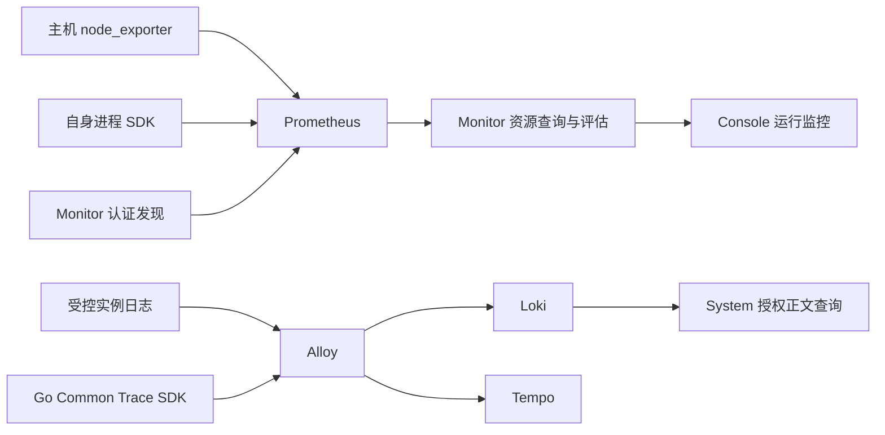

# ADDP 平台运行观测规范

本文维护已实现的主机、采集、进程资源、受限查询和平台告警契约。概念见[监控与执行体系图](../concepts/addp监控与执行体系图.md)，尚未实施的引擎/容器专业观测、Trace、受控运维及验证缺口见[后续专题](../next/ADDP平台运行监控与可观测性设计.md)。正文标明待实现的内容仅界定边界，不作为开放能力。

## 一、适用范围

适用于平台主机、当前模块运行实例、受限资源查询和平台告警。租户任务执行、日志正文与引擎业务数据仍由各自 owner 维护。

## 二、交付边界

主机台账、采集发现、基础资源、进程 CPU/RSS/时长、趋势/总览与主机 CPU/内存规则已实现。引擎专业观测、容器配额、拓扑追踪与生产规模等剩余范围，以及各层验收状态，按后续专题分别记录；实现就绪不等于相应验收通过。

## 三、对象与模块边界

### 3.1 身份与事实来源

| 对象 | 唯一事实来源 | 约束 |
| --- | --- | --- |
| 纳管主机 | System `node_id` | System 分配 UUID；物理主机与虚拟机均可纳管，容器不是主机 |
| 模块与运行实例 | System 模块登记、实例身份和租约 | UP/DOWN 来自租约，不由采集成功或 CPU 值决定 |
| 业务引擎 | System 引擎登记 | `engine_id` 与主机身份不同；远端、云端、集群引擎不按连接数推算节点数 |
| 容器 | 运行环境的容器身份及配额 | 与进程关联必须有明确证据，不能按名称或资源量猜测 |
| 任务执行 | 既有执行 Owner 与共享执行协议 | 执行身份、槽位和结果不转移到遥测存储 |
| 采集目标 | Monitor 配置身份及版本 | 引用已有主体，不重复创建主体或实例租约 |

IP、DNS、主机名、服务 URL 和 `registered_host` 均不是稳定主机身份。ResourceLocator 继续表示引擎业务数据位置，不加入主机节点语义。

部署关联与调用关联分开：前者记录声明来源及有效时间，后者来自明确配置或 Trace 观测窗口。拓扑染色不能作为已经确认根因的证据。

### 3.2 模块职责

| Owner | 职责 |
| --- | --- |
| System | 主机、模块、实例及引擎身份，当前用户对象授权，IAM 与统一审计；日志正文授权读取 |
| Monitor | 采集配置、发现投影、资源查询与预算、规则、平台事件和通知、监控页面 |
| Common / Common-Python | 共享采样 SDK、DTO、身份声明与服务客户端；不成为第二个事实 Owner |
| Infra | Prometheus、Alloy、Loki 等中心组件及节点来源的部署、传输保护、Secret 与物理资源预算 |
| Console | 统一入口、上下文和 iframe 导航；前端隐藏不替代服务端授权 |

Monitor 不直接查询 System 私有表，不直接读取主机文件，不复制 System 的实例运行状态。业务请求和执行事实不依赖观测设施才可写入或读取。

### 3.3 平台与租户权限

当前主机、平台实例资源、总览及平台资源告警只开放 Platform Context。Tenant 执行监控、执行告警保留自身事实和权限；租户引擎未来的专业观测还须单独明确归属与读取契约。

平台系统管理员承担首期主机、采集和平台告警管理职责，权限在 Owner manifest、内置角色及正式迁移中显式发布。平台安全管理员、审计管理员不因此获得资源管理或日志正文权限；平台角色也不自动取得全部租户 SQL、参数和执行结果。

- 用户请求转发已验证的当前 User Token，由 System 再裁决主体；后台投影不能代替用户对象授权。
- `addp-monitor` 使用独立 Platform Service 身份，只读取有界当前身份投影。同一 `/runtime/observability-identities` 返回必须为数组的字段 `engine_deployments`（真实无对象时为 `[]`），最多 1000 个启用且承载主机有效的平台部署；与节点、模块实例在同一只读可重复读事务内裁决，共用五秒和四 MiB 预算。每项仅含 `deployment_id`、`version`、`scope=infra|business`、`engine_type=postgresql`、`node_id` 与 `source_key={docker_engine_id,project,service}`；来源键沿用部署发现的 Docker 引擎／Compose 项目／服务三元组，`infra` 对应 `addp-infra`，`business` 对应 `business`，当前服务为 `postgres`。不含名称、地址、端口、连接、凭据、租户引擎或运行状态，不因登记存在就视作实时来源可用。超量、异常及控制面错误整份拒绝，不截断或保留旧身份；后台投影不授予用户查询权，专业查询仍逐请求转交当前 User Token 给 System。
- `addp-prometheus` 使用独立最小身份和 `monitor.metrics_discovery.read`，不能访问业务 API。
- 采集 mTLS、发现身份、日志上报及资源查询证书分别管理；不保存长期管理员 Token，不复用业务数据库凭据。
- 资源观测、告警事件、规则管理、通知管理和日志正文分别授权。切换身份或 Context 时清除旧数据、凭据草稿，并拒绝迟到响应。

## 四、主机接入与采集发现

### 4.1 主机与服务绑定

主机保存 `display_name`、`node_kind=physical|virtual`、`addresses`、`enabled`、`version` 及 UTC 创建/更新时间。名称是可编辑属性，地址允许为空；`enabled` 表示纳管意图，不表示电源或网络状态。编辑采用版本 CAS；首期只停用纳管，不提供主机物理删除或关机。

主机的允许模块集合明确列举模块服务 Client 与模块名；“添加模块”表示允许这些服务声明部署于该主机，不是安装服务。集合为空不允许绑定，不能根据浏览器提交或来源标签自行扩权。

部署为实际所在进程注入 `ADDP_HOST_NODE_ID`。System 在首次登记时固定实例的节点声明，按当前主机状态和允许集合裁决 `unbound/bound/rejected`；同一实例重登记不得改挂主机。位置变化产生新实例身份，历史声明不反写。非法部署输入仅停用绑定并记录安全诊断，不阻断合法业务登记和续租；API 仍严格拒绝恶意或非规范请求。

缺少或失效的主机关联不阻断实例自身资源观测，也不改变租约。引擎部署的显式承载声明由 System 维护，首批单主机关联见 4.4；不以数据库地址、容器名或 VM 总消耗推断。

### 4.2 管理员确认的部署清单接入

唯一导出入口 `scripts/infra/node-metrics.py export-admission` 输出 `schema=addp.host-admission/v2`。默认核验已运行的本地 Linux/Docker Desktop 受控 node_exporter，包含主机和采集配置；显式 `--host-only` 只声明当前原生 macOS/Linux 宿主，不访问 Docker 或采集凭据，要求明确物理/虚拟类型。`--module` 可重复指定该宿主允许的 ADDP 模块，生成既有固定模块 Client 对应关系；不按进程名、地址或容器名发现承载，不包含 Business 租户引擎。

清单最多 16 KiB，根字段仅为 `schema/host` 和可选 `collection`。主机字段为 `display_name/node_kind/addresses/allowed_module_bindings`；采集存在时仅允许 `monitor_kind=host_resources`、`source.type=node_exporter` 及显式 HTTPS `/metrics` 端点。拒绝旧版本、未知字段、身份和凭据；空采集对象不等于省略。Desktop 来源声明独立 Linux VM，原生宿主不得据此归入 VM。名称与地址不作为稳定身份或自动合并键，清单本身不授予权限。

System `/host-admission` 是 Console 中唯一接入编排入口；独立模块打开该跨模块流程时先进入 Console，再接受草稿。管理员导入后预览并显式选择已有主机或按清单创建；已有主机不被改写，当前读取必须仍启用且类型匹配，创建仅用既有 `platform.host_node.create`。主机保存结果或当前读取结果生成 `ADDP_HOST_NODE_ID` 部署参数；只应用于实际部署在该宿主上的新进程，不修改全局 `.env`、不自动重启、不在线改挂已有实例。

采集可选。存在来源且用户有独立 Monitor 管理权限时，System 通过共享 Console 内存导航草稿将同一主机和来源交给 Monitor 原新建页面。草稿最多 4 KiB、60 秒、一次消费，绑定当前身份/权限及精确目的路由；只允许当前同源 iframe 取回，不写 URL、浏览器存储或最近访问。取消、另行导航、身份或权限变化、退出与超时均清除；端点仍由 Monitor 重新验证，不据草稿授予权限。页面刷新仅恢复 URL 中稳定主机 ID，不恢复未保存来源。

两个 Owner 分别写入：System 创建成功后冻结该主机，未知创建结果或版本冲突阻止再次创建并要求核验；明确拒绝可修正重试。转到 Monitor 后固定所交接的主机，只保存采集，不再创建主机；明确的采集失败仅重试该配置，未知结果或冲突先到原列表核验。清单与主机身份选择在授权/页面变化后失效，迟到响应不能恢复旧草稿。Monitor 原导入、主机创建编排及私有解析器删除，采集管理只消费已存在的 System 身份。

### 4.3 采集目标与认证发现

当前主机采集配置由 Monitor 管理，含主体、固定来源类型、受控端点、启停及独立版本。同一主体和类别最多一个启用来源。模块进程来源来自 System 首次登记的不可变采集声明，随当前租约自动投影，无需每次重启人工登记。

Prometheus 只通过 Monitor 的单一认证 HTTP SD 获取全量有界快照；不分页、不接受调用者标签。身份标签由控制面覆盖，按实际端点去重；已结束实例、停用主机或目标、失效绑定从成功快照移除。控制面失败返回错误，不伪装成功空列表。

发现刷新为 30 秒。Prometheus 在发现失败时可能保留旧快照，因此当前查询和告警仍重新裁决主体及配置；发现列表不能作为读取授权或即时停采保证。紧急阻断依靠凭据撤销或网络策略，历史按原身份与保留期存在。

主机列表与采集配置区分纳管、启停和实际采集结果；配置版本不符、证据过期或无资源读取权时不得沿用“最近成功”。列表按当前页一次去重批量读取，不逐行扇出、跨页预取或拆请求绕过预算；观测失败仍保留配置管理能力。

### 4.4 平台引擎部署登记

引擎部署属于平台运维对象，与租户 Engine Instance 分开。System `/platform/engine_deployments` 提供集合 POST 批量确认、GET 分页/详情和 PUT 管理更新，分配稳定 `deployment_id`；首批支持 Infra 与 Business 的单容器 PostgreSQL，显式关联一个已纳管主机。其他服务只显示发现事实与未适配原因；集群多主机、云服务及租户引擎关联尚未开放。不接受 `tenant_id/engine_id`、连接凭据或 SQL，不从 Web 请求执行 Docker 或数据库探测。

管理员在“平台引擎部署”读取部署侧发现结果，选择待接入服务、核对名称和实际承载主机后批量确认，无需运行导出命令或导入文件。来源项目、容器运行身份、状态及 SQL 端口来自 4.5 的唯一发现链路；Docker Desktop 只可关联 virtual 主机，不按地址、名称或容器 ID 猜测承载关系。发现可用与纳管、专业采集成功分别表达。

POST 仅接受 `items`，每次 1—16 个显式成员；成员为 `scope/service/fingerprint/display_name/enabled/declared_node_id`。服务端重读来源，验证 120 秒时效和预览事实摘要，再按来源键排序、整批事务写入；任何来源过期、变化、重复、主机无效或写入失败均整批回滚。摘要不含每次刷新时间，不代替持久资源版本。确认后的规范快照为 `addp.engine-deployment-inventory/v1`；旧根记录由前向迁移规范化，不改稳定身份、版本或不可变历史。

部署详情通过同一只读发现接口展示最近一次来源，按已确认的 Docker Engine、Compose 项目和服务匹配；不按名称、端口或地址猜测。来源过期、不可用、运行环境不符或服务未发现时不展示旧容器为当前结果；容器运行身份变化只更新来源展示，不改部署 ID、声明版本、主机关联或历史。容器运行状态不等于数据库可用或专业采集成功。来源单独刷新不清除管理草稿，也不解除写入冲突阻断；切换账号、对象或关闭详情后，迟到响应不得恢复旧来源。

来源按 Docker Engine ID、Compose 项目和服务唯一，停用也不可重复登记。PUT 仅接受名称、纳管意图、主机与当前 `version`，不接受客户端重写来源；实时运行变化由发现结果表达。列表只接受 `page/page_size/search/node_id`，名称按字面片段搜索，主机筛选按声明身份；详情不接受 query。请求正文最多 32 KiB，拒绝未知字段、重复键、大小写别名及附加 query。结果未知或来源变化时保留草稿并停止提交，必须显式重读核对，不自动重试创建。

创建与更新在同一 PostgreSQL 事务保存根版本、声明有效区间及统一审计；并发旧版本返回 409，不自动刷新版本重试。声明时间统一取数据库时间，表示管理员声明的生效/结束时刻，不能回填为实际部署历史。闭合历史不可更改或删除；首批不物理删除部署。读取在同一快照核对当前主机和部署纳管状态：有效关联为 `bound`，停用或 Desktop 主机类型变化为 `rejected`，保留原声明；这些状态均不表示服务在线、专业指标采集成功或租户业务可用性，不参与业务 Ready。

接口仅接受非委托 Platform User，独立 `platform.engine_deployment.read/create/update`，创建/更新还须 `platform.host_node.read`；迁移 000220 只向既有平台系统管理员发布三项权限，并沿既有触发器推进授权版本、撤销相关旧刷新族。其他角色、Tenant、Service、委托调用不因部署登记获得权限。界面保留冲突或失败输入；CAS 冲突和结果不明确时停止再次提交，只允许用户显式重新读取核对，首次登记则关闭后刷新列表，不构造已成功身份。

T0 权限目录/Swagger、T1 输入与身份拒绝、T2 PostgreSQL 唯一性/CAS/声明历史/审计回滚及权限前向迁移、System/Console 前端门禁沿现有注册自动发现。精确 T2 入口为 `make test-system-iam-postgres SYSTEM_IAM_POSTGRES_TEST_ARGS="--package repository --test engine-deployments"`、同参数的 `--package api`（HTTP Handler 与 PostgreSQL 审计事务）和 `--package migration`；本地须使用标准脚本核验的 `addp_iam_test`。产品接入 T4 与上述确定性验证分开登记，尚未通过不能写作真实运行已验收。

### 4.5 部署侧自动发现来源

唯一 Docker 读取实现位于 `scripts/utils/deployment-inventory.py`，由 Infra、普通 Business 启停和开发启动按各自作用域自动刷新，不调用 System API 或数据库。发现协议为 `addp.deployment-discovery/v2`，最多 256 KiB；仅核验本地 Unix Socket Context 的 Linux Docker 或 macOS Desktop Linux VM，以当前工作区的 Compose project/working_dir 校验归属。最多读取 128 个容器、64 个服务、单服务 16 个容器和单容器 64 个实际端口，整体 Docker 读取期限 30 秒；前后读取服务运行身份、状态、启动时间、重启次数、端口及 Docker Engine 身份一致才输出。

快照区分 `scope=infra|business`、`state=available|unavailable`，带 UTC 读取时间；成功空集合与失败分别表达。未知组件只标记未分类，不猜测集群、主机关联、引擎专业监控或租户归属。快照不含环境变量、密码、SQL、租户或授权，System Web 服务不因此获得 Docker 权限。

快照写入部署用户独占目录，独立作用域锁内完成读取并以私有临时文件原子替换；发布失败不写半份数据，来源失败则发布不可用结果并清除有效候选。不得把磁盘中较早快照当作实时服务状态。

System `GET /platform/engine_deployments/discovery` 仅接受非委托 Platform User 与已有 `platform.engine_deployment.read`，不接受 query/body；只读 `ADDP_DEPLOYMENT_DISCOVERY_DIR` 下固定的两个作用域文件，不执行 Docker 或接受请求文件路径。开发入口注入工作区私有目录，其他部署未配置则明确返回未配置。成功响应固定包含两个作用域，分别标记未配置、缺失、来源不可用、过期或有效；普通文件及目录须为私有权限，符号链接、非普通文件、超预算、重复或未知 JSON 字段、错误作用域、来源身份及端口均拒绝。有效窗口为 120 秒，最多允许来源时钟领先 30 秒；过期仅保留读取时间，不保留服务或来源身份，单侧失败不抹除另一侧合法结果。

持续来源由同一入口的独立部署观测进程发布，每轮完成后间隔 30 秒；不在 System 请求中执行 Docker。Infra 启动管理进程、停止时核验退出；Business 和开发启动幂等确保其存在，开发启动同时注入实际目录并刷新两组快照。观测器只继承 Docker 所需的环境，不继承 ADDP／SQL 凭据或开发生命周期锁；通过私有运行记录、当次随机标识及实际命令核对 PID，拒绝接管或停止不明进程；标准启动发现源码或 Docker 运行环境指纹变化时只替换已核验归属的观测进程。启动记录发布失败须回收刚创建的子进程；停止立即将两组来源置为不可用。停止观测失败不阻止实际 Infra 停服，但退出码须反映无法确认清理，Hosted 不得将其计为零残留。

观测进程退出时仅在即时取得快照锁的情况下失效来源，不等待其他写入者；停止控制流程负责确认进程退出、再取得快照锁并清空两组来源。锁竞争不能阻塞观测进程退出；控制流程无法确认退出或清空来源时仍须报告失败，不删除尚未确认退出的运行记录。

该接口不创建纳管身份、不更改管理员声明、历史或租户权限；管理员批量确认遵循 4.4；专业指标尚待实施，不以候选读取或来源自动发布代替产品接入验收。

### 4.6 PostgreSQL 数据库侧汇总读取边界

Infra 与平台自管 Business 的 PostgreSQL 分别由部署 owner 通过唯一来源生命周期安装版本化的 `scripts/infra/postgres-observation/000002_lifecycle.sql`，不进入 System IAM 迁移；`000001_init.sql` 保留为不可变历史。支持 PostgreSQL 15 数据库侧读取及可选来源部署；专业来源发现、Monitor 授权查询与页面沿本文同一观测链实现。数据库侧验证只证明其读取边界，不能替代专业查询与页面的正式身份 T4。

各实例分别使用 `addp_infra_observer` 或 `addp_business_observer`，密码独立；非登录的 `addp_observation_owner` 仅继承 `pg_read_all_stats`，Login 无任何角色成员资格，不获该统计角色、业务对象或服务管理权限。安装在单事务中校验作用域、SCRAM 校验值、身份标记、成员资格、schema／函数归属与 ACL；陌生对象、额外权限、PUBLIC 业务读权或不安全默认授权均拒绝并回滚，不接管或全局撤销其他用户权限。Login 只授当前连接库 CONNECT、私有 schema USAGE 和唯一无参数 `addp_observation.snapshot()` EXECUTE。密码校验值通过部署侧私有 stdin 的 psql 变量注入，不进入参数、普通配置、发现快照、System API 或日志；原始密码不参与 SQL 文本。

固定函数返回一行、16 个有类型字段：采样时间、服务启动时间、统计代际、统计开关；当前客户端连接、活跃、空闲、事务内空闲、活跃等待、活跃锁等待、活跃 IO 等待及最大连接数；非模板数据库的事务提交／回滚／死锁累计值及容量字节。排除本次采集会话，不输出数据库／表／用户名称、PID、客户端地址或 SQL。等待仅计 active，空闲 ClientRead 不作为压力；事务保留 PostgreSQL 原累计口径，包含采集自身带来的事务，不冒充业务吞吐或租户用量。统计关闭时三项累计值为 NULL；容量不完整不能填零，超过 256 个非模板数据库拒绝而非截断。统计代际覆盖数据库集合与各库统计重置，配合服务启动时间裁决后续速率窗口。

函数采用固定 `pg_catalog, pg_temp` 搜索路径、全限定目录和固定 SQL，Login 不可更改函数；只读默认值和三秒语句超时是附加约束，不能替代对象权限或来源侧期限。PostgreSQL 的 PUBLIC 授权可叠加，单个角色 REVOKE 不能覆盖它；当前安装核查只覆盖所连数据库。正式部署须选择无业务对象的维护连接库，并以认证／网络策略限制其他数据库连接；未完成该部署准入不启用采集，不声称已经隔离整个实例的所有业务库。安全依据见 [PostgreSQL 函数权限](https://www.postgresql.org/docs/15/sql-createfunction.html)、[统计角色](https://www.postgresql.org/docs/15/predefined-roles.html)及[统计字段](https://www.postgresql.org/docs/15/monitoring-stats.html)。

验证复用独占 `make test-monitor-metrics`；精确数据库专项为 `make test-monitor-metrics MONITOR_METRICS_TEST_ARGS=--case=postgres-observation`。私有 PostgreSQL 强制 TCP SCRAM，覆盖真实密码、固定数值与独立目录对照、等待／锁等待、统计关闭／重置、越权拒绝、临时关系遮蔽、重入／密码轮换、陌生身份、默认权限漂移和失败回滚；业务对象夹具仅用 `addp_test`，认证拒绝探测另使用镜像自带 `postgres`，退出按原门禁核验物理零残留。默认完整门禁仍执行全部指标链路及该专项，现有 Monitor metrics CI 按声明自动发现新增 SQL 与探针；不新建 Job、不修改生产权限、不修改个人库。

数据库认证准入沿同一 `source.py` 的唯一规则生成器：部署 owner 在角色／函数归属校验通过后，才可为该实例对应的采集 Login 生成置于 `pg_hba.conf` 最前的受管块。只允许显式维护连接库、显式私网／回环 CIDR 与 SCRAM；拒绝该 Login 的其他数据库、Unix socket 和物理复制连接，不修改其他用户的既有记录。维护库名按字面量引用，不能把 `all` 等特殊词误作通配符。认证规则不代替函数和对象权限，也不授予 Monitor 编辑认证文件的能力。

受管块包含无凭据的作用域、维护库与有界规范 CIDR 声明；原文件其余内容原样保留。既有块不在首部、作用域冲突、声明／规则漂移、残缺标记、非注释记录含保留采集账号标识或超量输入均拒绝，不修补覆盖。相同输入幂等，部署 owner 明确提交的新 CIDR 可替换经核验的本方块；来源启动前仍须确认文件原子替换、数据库配置重载及真实认证结果。HBA 只约束新连接；正式安装须先停止旧来源，并确认该受管账号没有遗留连接，存在旧会话则拒绝激活，不自动终止不明会话。当前先由独占 T2 验证生成与认证，不自动更改个人实例。T2 仅在其原生 `addp_test` 与镜像自带 `postgres` 之间验证跨库连接拒绝，不创建新 database，不读取业务表；覆盖允许连接、错误密码、回环／Docker 私网、跨库／socket 拒绝、管理员连接不受影响及原文件恢复。规则依据为 [PostgreSQL 15 HBA](https://www.postgresql.org/docs/15/auth-pg-hba-conf.html) 的首条匹配和特殊词引用语义。

### 4.7 PostgreSQL 受保护的固定指标来源

PostgreSQL 来源由唯一部署入口 `scripts/infra/postgres-observation/lifecycle.py` 管理，分别接入 Infra 与 Business 标准启停。`ADDP_POSTGRES_METRICS_ENABLED=false` 独立选择来源，不依赖中心开关；选中后必须提供仓库外三文件 `ADDP_POSTGRES_METRICS_TLS_DIR` 和显式本机 `ADDP_POSTGRES_METRICS_LISTEN=IP:端口`，不自动分配或避让端口。`ADDP_POSTGRES_METRICS_STATE_DIR` 是可选私有状态根目录，按作用域隔离凭据和生成配置。默认使用当前部署用户仓库外、工作区摘要隔离的状态目录；状态、密码及 TLS 私钥不进入发现、环境变量或参数。标准脚本不签发或追加 CA 信任。来源仅连接本机受管 Docker PostgreSQL 15 的实际私网地址；独立来源故障报告非零可选结果，核心服务继续运行。

活动安装版本为 `000002_lifecycle.sql`，原 `000001_init.sql` 保留为不可变历史，不作为安装 fallback。新增部署输入仅决定本方 Login 的启停，不改变固定函数、输出或权限集合。启用先停止旧来源、验证工作区／容器／私网／角色归属和无遗留采集会话；同一数据库部署锁下先完整安装为 NOLOGIN，再按唯一规则生成器原子更新 HBA、检查语法并重载，确认无旧会话后才完整复核并开启 Login。密码首次随机生成，后续沿用私有文件；已有账号但凭据丢失时拒绝自动重置。停用只关闭本方采集容器及已验证归属的 Login，保留函数、配置、历史和数据卷，不终止未知数据库会话。失败不得保留运行中的旧来源或宣称就绪，不重启数据库、不撤销其他用户权限。账号安装及数据库操作仅由部署 owner 执行，不交给 System Web、普通发现进程或 Monitor 后台身份。

Business PostgreSQL 的运行认证文件由部署 owner 在仓库外维护，唯一容器路径为 `/etc/addp-postgres-auth/pg_hba.conf`，只读挂载其父目录，不再单文件绑定仓库模板。标准 Business 启动入口在启动 PostgreSQL 前准备该目录；默认状态目录为当前部署用户的 `~/.local/state/addp/<工作区路径摘要>/postgres-auth`，可由 `ADDP_POSTGRES_AUTH_STATE_DIR` 显式指定仓库外绝对目录。目录归属绑定当前工作区，不接管其他 owner、符号链接、硬链接或被外部改写的文件。模板仍为 `business/postgres/pg_hba.conf`，首次原样复制，后续保留经校验的采集首部块；模板和运行文件之间不存在双轨读取。模板有明确更新时，只有运行文件仍与上次生成事实一致才可重新生成，不覆盖人工漂移。

部署侧文件更新使用同一受管目录锁、输入版本校验及同目录原子替换，保持原文件属主和模式；数据库容器无写权。该入口不保存数据库密码、不签发证书、不安装角色、不重启或重载运行数据库。首次切换由部署方使用标准 Business 启动入口重建容器，保留数据卷；后续认证安装仍须先检查归属／遗留会话、更新文件、检查 `pg_hba_file_rules` 并重载及验证连接。文件准备成功不能计为专业采集已生效。Infra 仍使用其数据目录内的认证文件，不为统一形式迁移数据。

来源模板 `scripts/infra/postgres-metrics.yml` 与独占 T2 共用固定 SQL Exporter 0.24.11 多架构摘要；固定配置唯一生成实现为 `scripts/infra/postgres-observation/source.py`，只查询 4.6 的函数，关闭 ping、缓存和动态目标，不接受用户 SQL。每个作用域独立来源、单 SQL 连接、零空闲连接，查询上限四秒。数据库密码只在部署用户私有的只读来源配置内，不进入环境变量、命令参数、发现快照或平台 DTO。源侧 SQL 当前限定受控 Docker 私网；生产数据库 TLS 另须认证，不把本机 T2 计为生产验收。

SQL Exporter 只监听其网络命名空间的回环 HTTP `127.0.0.1:9399`，同命名空间 Nginx 在 `9443` 提供独立 mTLS。TLS 进程仅挂载自己的服务端证书／CA，不挂载含数据库密码的来源配置；两进程均使用显式非特权 UID/GID、只读文件系统、移除全部 capabilities 及资源限制。外部只允许无 query 的 GET `/metrics`，配置、重载、exporter 自身诊断、其他路径及方法均拒绝；凭据不因持有采集证书而可读取。保持 `ssl_verify_client on`；Nginx 的客户端证书缺失／校验失败（内部 496／495）统一返回 403，不转发上游。来源准入仍只认可明确的 TLS 证书拒绝或 HTTP 401／403，不把通用 400 当作保护证据。没有默认宿主机端口；标准 Infra／Business 入口仅按各自显式开关部署，不自动修改个人环境选择。

当前固定输出 `addp_postgresql_` 前缀的 16 项指标，对应 4.6 的有类型汇总；时间输出 Unix 秒，容量为字节，连接为数量，累计量后缀 `_total`。累计量带固定计算的 `counter_epoch`，同时覆盖统计代际与服务启动时间；代际信息独立表达，不以数据库名、SQL 或租户作为标签。统计关闭时不输出三项累计值，不填有效零。

所选版本在 SQL 失败时可能仍返回 HTTP 200 和累计 `scrape_errors_total`，此时不得输出旧数据库样本。HTTP `up` 只证明传输可达，累计错误计数也不是当前失败状态；专业读取必须验证固定样本及新鲜采样时间。T2 覆盖权限撤销后的两次真实失败、错误计数递增与无旧样本、恢复新样本、统计关闭／恢复，以及错误客户端证书、明文 HTTP、路径和方法拒绝。精确入口为 `make test-monitor-metrics MONITOR_METRICS_TEST_ARGS=--case=postgres-source`，默认完整门禁同样包含；业务／Infra 全退出核验由同一门禁负责。

该契约包含可选部署生命周期及独占传输验证，不代表个人实例已经启用或专业页面已通过正式身份 T4。已实现的自动关联、引擎指标读取及页面仍须沿明确身份投影与当前 User 授权，不将来源模板直接登记成节点或租户 Engine。上游行为参照 [SQL Exporter 固定版本](https://github.com/burningalchemist/sql_exporter/tree/0.24.11)；不引入 PostgreSQL exporter 已弃用的自定义查询作为并行路线。

## 五、技术路线与故障隔离

### 5.1 唯一数据路径

指标使用单一 pull 路线，不并存 remote_write；原始高频时序留在 Prometheus，配置、事件、投递和审计留在各 Owner 的 PostgreSQL。日志正文保持受控文件 → Alloy → Loki → System，不在失败时退回主机文件读取。Go 同步 HTTP Trace 范围与预算沿 6.5；cAdvisor 已有受控来源准入内核，节点部署与容器资源视图尚未交付。

不增加独立 Alertmanager 告警 Owner，不要求 Grafana 成为产品入口。成熟组件负责采集、存储和传输，Monitor 负责领域规则、事件和授权体验。

### 5.2 部署与运行环境

中心组件和节点来源统一由标准 Infra 脚本组织，根 `.env.example` 为唯一部署模板。

| 输入 | 行为 |
| --- | --- |
| `ADDP_OBSERVABILITY_METRICS_ENABLED` | 默认 false，选择指标中心及明确来源；不自动为全部机器安装 exporter |
| `ADDP_OBSERVABILITY_LOGS_ENABLED` | 默认 true，可显式关闭现有集中日志组合 |
| `ADDP_OBSERVABILITY_TRACES_ENABLED` | 默认 false，显式选择 6.5 的 Go HTTP 追踪、Alloy 与 Tempo 路径 |
| `ADDP_NODE_METRICS_ENABLED` | 默认 false，单独选择本节点来源；中心开启不自动调用节点部署 |
| `ADDP_PROCESS_METRICS_DEPLOYMENTS` | 显式声明自身进程指标端点，SDK 成功启动后才随实例登记发布 |
| `ADDP_HOST_NODE_ID` | 单个进程的实际部署主机声明，可空，不为不同宿主注入同一个 ID |
| 各设施端点与 Secret 引用 | 所选能力独立预检；未选择的能力不要求其专用凭据 |

布尔值只接受 true/false，不由探测结果猜开关。端点、证书、物理预算与保留参数随组件生命周期生效；Monitor 普通查询预算、规则和配置版本按各自热生效契约管理。

节点来源只消费显式部署输入，`ADDP_NODE_METRICS_LISTEN` 为受控本机 IP 与显式端口，不接受通配监听或自动避让；`ADDP_NODE_METRICS_TLS_DIR` 为仓库外绝对目录，只放 `ca.crt/server.crt/server.key`，不挂 CA 签发私钥或客户端私钥。原生 Linux 来源要求内核 5.12+，采用 host 网络/PID 及只读宿主挂载；Desktop 使用下述受限部署层，不自动放宽主机权限。

节点指标采用独立 mTLS。node_exporter 使用原生 exporter-toolkit；需要保护原始容器来源时只能使用节点专用的固定路径入口，不开放 Web UI、调试或任意代理。日志 Alloy 不获得 Docker Socket、宿主特权或 Shell 权限。

| 环境 | 当前支持与边界 |
| --- | --- |
| 原生 Linux 主机 | 标准节点入口校验宿主内核与部署条件，支持完整主机指标；按来源实际挂载/设备/网卡展示 |
| Docker Desktop Linux VM | 独立 virtual 主机，承载 Business/Infra；支持 CPU、内存、负载、运行时长及内核磁盘统计 |
| Desktop 文件系统与网络 | filesystem、netdev、netstat 仍关闭，不用容器挂载或网卡冒充 VM 全局数据 |
| 原生 macOS 服务 | 观察自身 Go 进程 CPU、当前 RSS 和时长，不绑定到 Desktop VM 冒充其进程 |
| 容器资源 | 待独立实现；容器配额、进程消耗与 VM/宿主容量不混用 |

Desktop 来源固定启用 cpu、meminfo、loadavg、diskstats、stat、uname、time；保持独立 bridge/PID/挂载命名空间、非 root、只读根、cap_drop=ALL 和 no-new-privileges，不挂宿主根、设备或 Docker Socket。磁盘代表 VM 内核设备统计，不证明 Mac 物理磁盘或某个引擎的独占消耗。远程 Engine、非 Linux Engine 和未知环境拒绝接入。

### 5.3 故障与状态

| 场景 | 影响 |
| --- | --- |
| 指标未部署、配置不全或 Prometheus 故障 | 对应资源区域明确不可用；不改变业务 Ready、实例租约、路由、任务和结果读取 |
| 单个来源采集失败 | 仅该来源缺值/过期，其他来源继续；不能补零或恢复活动资源告警 |
| Loki 或日志发送故障 | 影响日志正文/链路状态；不改变资源和执行事实，不退回直接读文件 |
| Trace 未启用或故障 | 仅追踪不可用；部署声明、指标和日志不因此丢失 |
| Monitor 必需依赖故障 | Monitor 按自身依赖报告不可用，业务 Owner 仍独立写入和读取执行事实 |
| 设施恢复 | 无需重启业务进程，等待新样本；保留停采缺口，不伪造历史回填 |

能力配置意图、后端可用性、目标采集状态、单项数据质量分别表达。数值状态区分 `not_connected/valid/no_data/stale/unsupported`；未查询成功不能包装成“没有样本”。控制读取成功可返回能力不可用状态，实际查询的未启用、未配置、故障、超时、预算与并发拒绝按 API 错误契约返回。

观测发送使用有界队列、超时与丢弃记录，不能无限积压或阻塞业务。标准生命周期分开记录必需服务和可选能力的结果，所选能力失败可使命令非零，但不能因此中止已满足必需依赖的业务。停用只处理本工作区拥有的设施，保留数据卷。

共用 Alloy 的日志/Trace 故障可能相关；共享磁盘耗尽也可能影响业务，不能把软依赖说成物理隔离。生产还需独立外部存活探针，不能靠已不可用的监控系统给自己告警。

## 六、指标、查询与展示口径

### 6.1 固定指标目录

唯一目录定义公式、单位及窗口，前端和规则复用，不接受任意 PromQL、标签搜索、脚本或调用者自选端点。

| 主机指标族 | 数量 | 口径 |
| --- | --- | --- |
| 标量概览 | 9 | CPU 逻辑核数、一分钟忙碌率、内存总量/可用量/使用率、1/5/15 分钟系统平均负载、运行时长 |
| 文件系统容量 | 5 | 总量、空闲、非特权可用、已用及使用率，保留精确挂载维度 |
| 文件系统 inode | 4 | 总量、空闲、已用及使用率，与字节容量分开 |
| 磁盘 | 5 | 读写吞吐、IO 忙碌时间占比、平均读写耗时，保留 device 维度 |
| 网络 | 2 | 网卡收发字节速率，保留 device 维度 |

容量用 IEC 自适应单位，运行时长用天/小时/分钟；解释放在对应指标或列旁。系统平均负载是运行/等待 CPU 以及不可中断等待（常见于 IO）的任务数量平均值，不是百分比，也不是内存或 CPU 使用率，必须结合核数及其他指标判断。

主机内存使用率基于可用内存，不把缓存当泄漏；文件系统使用率采用非特权可用容量口径，绑定挂载、内存和网络文件系统不计作物理容量合计。磁盘速率与 CPU 要求完整一分钟计数窗口、同次启动与来源证据；计数重置、重复/异步来源或窗口不足不生成有效值。

磁盘忙碌时间占比不是饱和度，平均读写耗时包含排队和处理；没有完成请求时平均耗时为空，有请求且耗时确为零才可显示零。设备层级、桥接与虚拟接口不简单累加；不通过插值、截断异常值或用相似指标伪装缺值。磁盘列表优先展示活动设备，无活动设备可展开。

进程目录独立：CPU 使用 `process.cpu.core_equivalents`，1 核表示消耗一个逻辑核的计算时间；内存为当前 `process.memory.resident_bytes`，时长从本次启动计算。无明确配额不生成配额利用率，不用宿主总内存计算进程使用率，也不用 Go 堆或峰值 RSS 替代当前 RSS。macOS 自身采样严格核对系统接口成功与返回长度，失败不生成有效零值。

### 6.2 资源查询与预算

资源读取仅允许非委托 Platform User，使用 `monitor.resource_observation.read` 并按主体要求核验 System 读取权限。System 当前身份投影和普通用户读取共同检查当前主体、来源、版本、启动边界及租约，不能用后台身份跳过用户授权。

| 接口（Monitor `/api/v1/monitor` 下） | 约束 |
| --- | --- |
| `/platform/resource_observations`、`/platform/resource_trends` | 显式 node_id、固定 metrics 白名单；趋势使用整秒 RFC3339 start/end，维度严格匹配 |
| `/platform/resource_summaries` | 当前授权节点的批量摘要，同一评估锚点，不逐行查询 |
| `/platform/process_resource_summaries` | 当前授权实例批量 CPU/RSS/时长，固定目录；普通实例 DTO 仅公开采集声明布尔值 |
| `/platform/process_resource_trends` | 仅 instance_id/start/end，固定 CPU/RSS 两条序列；不读取已退出实例历史 |
| `/platform/resource_overview` | 不接受 query/body，完整授权主机范围及 CPU/内存 TOP5 |
| `/settings/resource-query-policy` | Monitor 普通平台配置，沿 `monitor.configuration.read/update`，版本 CAS 与审计 |

传输采用固定 `MONITOR_PROMETHEUS_URL` 和独立 CA/client cert/key 部署输入；浏览器不读取私有地址或凭据。查询响应标明身份、单位、预算版本、评估/采样时间、窗口和步长，按每条序列判断有效性；null 与 0 区别明确，缺值形成断点。

| 预算项 | 当前默认上限或初值 |
| --- | --- |
| scrape / 超时 / 发现 | 15 秒 / 5 秒 / 30 秒；首期固定，不提供无实际效果的采样编辑项 |
| 新鲜度 | 60 秒；速率及告警仍另须完整窗口 |
| 单请求 | 12 指标、100 序列、每序列 1,000 点、总计 20,000 点、最长 7 天 |
| 步长 | 至少 15 秒，随范围和预计序列规划；返回后再次核验，不静默截断 |
| 查询超时与并发 | 总期限 5 秒；单主体 2、单 Monitor 进程上游 8；超限快速拒绝，无无界等待 |
| TSDB 保留 | 7 天与 10 GiB 体积同时限制，可能提前淘汰；另预留 WAL/压缩空间 |
| 来源序列预留 | 每端点 20,000，中心自身 20,000，全部署 200,000；当前最多九个启用来源 |
| 组件预算 | Prometheus 1 CPU/2 GiB，node_exporter 0.25 CPU/256 MiB；节点入口 0.25 CPU/128 MiB |

来源准入按去重端点的预留配额原子校验，不能把当前少量序列或单端点 sample_limit 当作全局限额。查询预算可收紧并热生效，在途请求保持开始时版本；物理资源、卷与保留归 Infra。默认预算不是已证明的生产规模上限。

标签仅保存必要身份及有限维度，不加入 TraceId、请求/执行/用户 ID、完整 URL、SQL 或 Token。服务质量后续采用规范化 route 和有界直方图；无请求不虚构错误率和延迟。

### 6.3 趋势、时段比较与总览

页面复用共享图表、格式化、自动刷新及请求代数隔离。默认 15 秒刷新、最短 10 秒；刷新、范围、实例和筛选沿唯一 URL 恢复，隐藏页面暂停并取消在途请求。错误、撤权或上下文变化清除旧内容，迟到响应不得覆盖当前对象。

服务列表默认显示在线且已声明采集的实例，采集失败或缺样的行仍保留；可切换“全部实例”，筛选由 System 在计数和分页前完成。服务监控沿既有 `registered_host` 按登记端点的主机名或 IP 精确筛选，不含协议和端口，不把运行环境主机名或承载主机作为匹配地址；未登记监听端点的 Worker 不凭宿主地址补匹配。地址与其他已提交筛选沿唯一 URL 恢复，分页、趋势、刷新及主机跳转返回继续保留；未提交的输入不影响自动刷新。重置清空筛选、页码和趋势选择，恢复在线且已声明采集的默认范围，保留用户的自动刷新选择。在线状态只按 System 租约返回值显示绿色 `UP`、红色 `DOWN` 标签，并保留当前语言的在线/离线文字；采集失败、未接入或缺样不能将在线实例改为离线，配色沿统一主题。Worker 用途只消费既有 `metadata.runtime_name`，未知时仅显示正式角色，不由模块名猜测。

服务与引擎监控列表、引擎监控详情的主机关联只消费 System 返回的有效 `node_id`，不以部署时的 `host_node_name` 作为当前纳管名称。另有主机读取权限时，复用当页去重、最多四并发的主机引用解析，显示当前名称并沿原路由进入主机资源；没有权限或主机读取失败时保留节点 ID 文本，不提供链接，也不影响服务或引擎自身的资源读取。服务未绑定明确显示未关联；引擎无有效 `node_id` 时显示当前关联无效，不回用声明中的旧主机。名称读取与指标读取独立，名称失败不清除合法指标；刷新失败、身份或页面变化后丢弃旧名称和迟到结果。主机名称链接由 Monitor 唯一领域组件渲染，复用既有导航入口并以 push 保留原引擎筛选、详情及趋势地址；浏览器返回恢复原地址，不新增承载声明或推断关系。

服务列表独立展示登记地址与端口，System 实例管理和 Monitor 复用共享 `getRegisteredEndpoint`：从 `module_url`（为空时使用 `health_check_url`）提取 HTTP(S) 主机与显式或协议默认端口，保留 IPv6 方括号；不显示账号、路径、查询或片段，不解析 DNS 或以运行主机名补地址。无监听端点的 Worker 可以为空，页面明确显示未登记监听端点；此列不表示宿主节点 IP 或新的主机关联。

服务时间查询复用 System 既有实例口径与共享时间控件／参数换算：默认登记时间、全部时间；可选择离线判定时间及 `15m/30m/1h/6h/12h/24h/7d/custom`。相对时段在每次列表请求时按同一当前时刻重算，自定义起止固定在 URL，按 UTC 发送；下界含、上界不含。离线判定时间只查当前仍保留离线观测的实例，恢复后退出，不重建历史在线状态；时间依据与在线状态独立，不能自动将 UP 改为 DOWN。切换时间筛选回到第 1 页并关闭旧趋势，分页／刷新／返回保留已提交范围；未完成的自定义输入不提交，重置恢复登记时间和全部时间。时间筛选只约束 System 实例列表，不能改变进程趋势自身的启动边界或混入退出实例历史。

服务离线原因筛选沿 System 已有 `stop_reason=graceful|lease_expired`，默认不筛选；只消费当前有效离线观测，恢复后退出结果。租约超时只表示失联，不证明进程已退出；Monitor 不按本地时钟、采集失败或指标缺样推断原因。原因与状态、采集声明及时间取交集，不自动切换状态或时间依据。共享原因选择器、枚举规范化及译名由 Common Frontend 单点维护；System 保留选择立即查询，Monitor 沿既有搜索提交草稿。查询回到第 1 页并关闭旧趋势；分页、刷新、重载及导航保留已提交原因，重置清除原因；原因参数仅传入 System 实例列表，不进入进程趋势。

服务趋势仅针对当前有效租约且已声明采集的实例，起点裁剪到本次启动，CPU 仍须完整一分钟；重启后新旧实例独立。只从当前有权读取的实例打开对话框，不按服务名自动换成新实例。

CPU/内存比较支持 5 分钟、1 小时、24 小时：以 T 为结束锚点、W 为时长，一次原趋势请求读取两倍范围，比较本期 `(T-W,T]` 与上期 `(T-2W,T-W]`；分界点只计上期。两期预期评估点均全部有效且非空，才对未舍入值计算算术均值，显示本期减上期的“百分点”；缺样显示两期有效点数及“样本不足，暂不比较”。结果旁标明绝对时间和评估间隔；不是原始抓取完整度或精确时间积分。固定历史 end 不推进；7 天曲线保留，但当前保留不支持约 14 天历史的比较。

总览读取本次完整授权主机集合，包括停用主机，独立于列表分页/筛选。System 单页最多 100 个并在同一只读快照计数、取数；双指标受默认 100 序列预算约束，当前最多评估 50 台。超范围或预算整份 422，不读取前页冒充平台总览。

CPU/内存分别报告应覆盖、有效、缺失、过期及未接入数量；仅 valid 参与前五名，按值降序、同值 node_id 升序，真实零值参与。缺覆盖明确“不完整”；整轮成功原子发布，不发部分榜单。不合计主机容量、进程 RSS、容器配额、共享挂载或引擎集群容量，后续先明确去重与分母。

### 6.4 HTTP 接口质量（分阶段接入）

2026-10-20 确认：平台共享 HTTP 接口的整体运行质量由平台运维负责；现有职责对应平台系统管理员。Tenant 发布的数据服务质量继续归 Service 按对象权限提供，不向 Tenant 开放平台总体指标，不用客户端自报租户进行遥测归属。统计读取与规则管理分别授权，功能权限不能代替 System 当前运行实例读取裁决；后台身份只取得既有最小身份投影，不读取租户正文或业务结果。

唯一 Go/Gin 原始采集内核为 Common `httpmetrics`，使用 [OpenTelemetry HTTP 指标语义](https://opentelemetry.io/docs/specs/semconv/http/http-metrics/)的秒级耗时直方图及独立活动请求数，复用现有进程 mTLS 指标来源与 Prometheus，不新增公开 `/metrics` 或遥测 Ready 依赖。仅有间接 OTel 依赖不表示 Trace 已接入；HTTP 指标覆盖已接入实例的全部 HTTP 请求，包括认证拒绝、健康、就绪、未匹配路由及异常，不依赖抽样 Trace。Python 及尚未接入的实例明确未接入，不能展示为零流量。

| 口径 | 契约 |
| --- | --- |
| 请求与失败 | 请求处理结束或中断后计一次。HTTP 5xx、超时、取消、响应正文写失败或异常中断计服务端失败，同请求不重复计数；4xx 单列。业务拒绝只按 HTTP 状态记录，不解析正文或异步 execution 结果。 |
| 维度与敏感内容 | 服务、实际运行实例来自 System 及受控发现；路由只取框架匹配模板，404 没有匹配模板则留空，不能用路径补齐。方法归一到固定集合及 `_OTHER`，状态限制合法 HTTP 码，错误仅固定类别。不采集完整 URL、Host/转发头、用户/租户/请求/execution/trace ID、SQL、Token 或正文作为指标标签。 |
| 网关与后端 | Gateway ingress 表示入口请求，Backend 表示实际处理，分别聚合、分别排名，禁止相加为全局 QPS。Gateway 通配模板保持通配模板，不从路径猜测后端接口。后端内部调用不冒充外部入口流量。 |
| 窗口与聚合 | 固定 1/5/15 分钟窗口，默认 1 分钟；QPS 是完整窗口边界的请求计数增量／窗口秒数，失败率为同窗口失败增量／请求增量，平均响应时间为耗时增量／请求增量。跨实例先合计计数和直方图桶，再计算均值或 P95/P99；禁止平均百分比或分位值。并发独立读取活动请求 Gauge。 |
| 有效性 | 要求来源身份、本次启动、HTTP 采集启动边界、当前租约、采集新鲜度及完整窗口证据。真实无请求时 QPS 可为 0，失败率、平均/P95/P99 无值；缺样、过期、未接入、采集失败和中心不可用分别表达，不能补零或恢复告警。 |
| 查询与管理 | 仅固定目录和有界实例/接口筛选，接口排行按平均耗时或 QPS 返回前 10 个有完整窗口的模板，预算更小时收紧数量；复用现有超时、并发、序列及点数预算，不开放任意 PromQL、标签或端点。规则、事件、通知复用 Monitor 唯一平台协调器及事务 outbox；新类别显式订阅，旧目标不自动扩订。 |

本节确认统计与职责契约；当前实现/接入及 T1–T4 证据按后续专题分别记录，不能由内核存在推断产品入口和告警已经开放。

接口质量规则绑定 System 模块名与 `backend|ingress` 角色，可进一步固定路由模板/方法及 QPS、失败率或平均耗时指标。规则创建时通过当前 User 的一个真实实例核验模块及角色，之后从同一授权身份投影选择当前实例，不绑定临时端点或退出实例。新实例、规则配置或查询策略变化重新积累窗口；无有效来源及缺样均保持未知，不恢复旧事件。阈值及恢复阈值、连续时长显式配置，新建规则停用，启用/编辑/删除使用 CAS；活动事件阻止删除。统计读取使用独立 `monitor.http_observation.read`，规则使用 `monitor.platform_http_rule.read/create/update/delete`，各写入还须读取权。默认仅现有平台系统管理员获这些权限，不创建运维角色或责任台账。

HTTP 事件类别为 `http_quality`、主体为模块，触发/恢复沿同一平台协调器与 outbox；阈值和实际实例证据保留在事件，不以配置编辑改写恢复条件。通知协议为 `addp.platform-http-alert/v1`，只传模块、角色、规则、模板、指标、阈值与有界采样证据；现有目标不自动订阅新类别，未配目标仍保存事件。HTTP 规则最近评估中，已启用的精确模板平均耗时规则达到配置的连续触发条件时标记“持续慢接口”，不设置隐藏的统一慢阈值。确认和抑制不改变采样结论，通知复用现有签名、限次重试与人工重投。

2026-10-20 用户限定本轮只做本地验证，暂不扩展或运行 Hosted HTTP 验收；不得借既有资源观测 Hosted 身份执行本专项规则操作或受控请求，也不得将本地受控身份 T2/T3 计为正式身份 T4。

本地 HTTP 专项复用标准入口 `make test-monitor-metrics MONITOR_METRICS_TEST_ARGS=--case=http-quality`：使用当次专属 Prometheus、mTLS 来源和 `addp_test`，验证真实请求、历史趋势、规则评估与签名通知恢复；不执行 PostgreSQL 专业来源探针。默认完整入口继续运行原主机、进程与 PostgreSQL 来源回归；HTTP 专项通过不能替代完整入口或正式身份 T4。

### 6.5 分布式追踪与日志关联（二期第一批）

2026-10-20 用户确认以下初值，本次仅本地验证，不扩展或运行 Hosted 验收。第一批覆盖已登记 Go 平台模块（backend/ingress）的同步 HTTP Server/Client、日志关联与实际跨度证明的调用关系；Python、异步 execution 关联、数据库/SQL 跨度、浏览器采集及生产 HA 不在本批。实现状态须由分项证据证明。

唯一路径为 Go Common Trace SDK → Alloy OTLP → Tempo；Trace 读取归 Monitor，日志仍由 System 沿原 Loki 路径授权。Common Router 工厂独占服务端追踪及请求关联，Common Client 与 Gateway 代理复用唯一传输实现，保留 Context、超时、TLS 和响应流语义。不安装第二套 HTTP 指标，不从采样追踪推算全量 QPS。

Gateway 外部入口重新生成 W3C Trace Context；内部同步 HTTP 传播 traceparent，不传播 baggage 或外部 tracestate，不向平台之外泄漏平台上下文。request_id 在入口生成并约束格式、内部继承；trace/span ID 只做关联，不证明调用者身份。仅可信遥测来源、实际匹配的 Client/Server Span 可证明调用边，来报 parent-id、目标名称或注册关系不能补造边。

属性白名单只含正式模块/角色/启动实例、模板、有限方法、状态与固定错误类别；不收集完整 URL、Host、转发头、SQL、正文、原始错误文本、Token 或用户/租户身份。日志处理器从 Context 提取 trace_id/span_id，接收器校验长度、十六进制及非零，作为 Loki 结构化元数据而非索引标签。精确 Trace 日志过滤仍绑定模块/实例、正文权限和游标指纹。

| 策略 | 首批契约 |
| --- | --- |
| 生产端 | 异步导出已结束 Span，队列最多 2048，满时丢弃计数、不阻塞业务；导出超时和退出刷新有界；关闭或配置失败不影响业务 Ready。 |
| 保留 | 服务端失败沿 6.4 优先保留，4xx 不自动归为服务端失败；单次 Server 请求 ≥1 秒优先保留；普通成功保留 5%，例行成功健康/心跳不保留；遥测导出自身不递归追踪。 |
| 等待与容量 | 等待 120 秒，最多 10000 待决 Trace，采样后目标预算 100 Span/秒；超长、迟到、队列满、限额及重启可能不完整，须计数并说明缺口。 |
| 部署 | 复用 Alloy v1.10.2 已支持参数，不使用新版提前 Trace 字节裁剪；初始 Alloy 1 CPU/1 GiB、Tempo 单进程 2 CPU/2 GiB，不增加 Kafka；内存保护与容器硬上限分别解释，共享故障不宣称物理隔离。 |
| 存储 | Tempo 72 小时、独立 MinIO bucket/凭据，初始 bucket 硬配额 20 GiB，另预留约 5 GiB 工作空间（工作空间预留不是文件系统硬配额）；容量优先，不保证任何负载均留满 72 小时；日志仍为 168 小时。 |
| 查询 | 默认 15 分钟，单次最长 1 小时，最多 100 条调用链；整次最多 1000 Span/2 MiB JSON 响应，单个上游响应同样受 2 MiB 限额、整次 5 秒，单主体 2、单 Monitor 8 并发；无任意 TraceQL、端点、标签或属性查询。 |

容量估算按 `保留 Span/秒 × 实测平均压缩字节/Span × 259200 秒 × 索引/冗余系数` 计算。仅作预算示例：100 Span/秒、512 字节/Span、系数 1.5 约占 18.5 GiB；若平均 1 KiB，即使未计额外开销也超过 20 GiB，不能保证 72 小时。正常 50 请求/秒、每请求 8 Span、5% 普通采样约为 20 Span/秒，错误和慢请求额外占用预算。10000 待决 Trace 在 120 秒下最多容纳约 83 条新 Trace/秒的稳态等待，超过须有丢弃证据，不能视为已保留。固定 100 Span/秒预算内错误、慢、普通依次分配 70%/20%/10%；这是有界优先级，不承诺任意负载都保留 5% 普通请求或所有错误。上线前必须按实测 Span 大小、吞吐、丢失与对象存储占用复核；二期第一批的小样本不构成容量证据，隔离容量基线须按下述标准独立执行。查询代理另限 0.25 CPU/128 MiB，复用的日志与 MinIO 成本单独计算。

2026-10-20 容量首档暴露串行明细读取累加耗尽五秒预算，用户确认先修查询再按原条件重跑。列表明细采用唯一有界并发路径：每请求最多四个明细读取；System 当前 User 裁决、Tempo 搜索与明细共同受单 Monitor 最多八个活动上游调用限制，仍保留每主体二、每 Monitor 八个请求及整次五秒。结果保持搜索顺序，Span／参与实例／JSON 总预算累加检查；任一失败或预算耗尽取消剩余读取，等待当次工作者退出，不返回部分、尚未整体授权的数据。不得通过增加超时、缩小原抽查数或扩大 CPU 配额覆盖失败。

#### 隔离容量基线

2026-10-20 用户确认仅运行本地 disposable 基线，不运行 Hosted、不连接个人服务。固定使用真实 Go 三进程同步链（Gateway → Monitor → System，每请求 5 Span），属性沿 SDK 白名单，不注入正文或自定义膨胀属性。两档各持续 600 秒：常态 50 请求/秒，普通/5xx/≥1 秒慢请求为 90%/5%/5%；预算边界 70 请求/秒，比例为 60%/30%/10%。慢请求实际等待 1.1 秒；恒定速率调度、最大 64 并发，不通过积压后突发补发掩盖入口不足。入口速率、请求结果、实际保留速率分别记录，不以采样结果反推业务吞吐。

保持策略 v1 的 120 秒等待、10000 待决、100 Span/秒目标、72 小时 TTL 及 20 GiB bucket 配额。所有运行中的当次容器合计硬限制不超过 6 CPU/6 GiB（生产 Alloy 1 CPU/1 GiB、Tempo 2 CPU/2 GiB 不变）；包括负载发生器，禁止在宿主无配额运行压力生产端。总运行最长 40 分钟；每轮检查当次各数据卷实际分配空间后等待五秒，报告记录完整的实际采样间隔，达到 2 GiB、容器退出/OOM、失败或资源采样中断即停止、清理并报告失败。2 GiB 是本次停止线，不是文件系统硬配额，必须记录探测间隔内可能的超量；不得为了完成测试放宽限制。

每档发送完毕须等尾采样与自然落盘，不缩短 TTL、采样等待或切块参数，不用直写对象替代真实链。记录生产端队列/导出失败、Alloy 接收/策略决策/导出/早退、Tempo 接收/拒绝/刷块、实际块及索引对象字节、MinIO 物理分配、WAL/本地块和其他卷峰值，并通过授权查询路径抽查 5 Span/2 条匹配调用边。传输丢失、早退、OOM、实际负载不足、未完整落盘、缺少关键计数或样本不足时不能判通过。策略内未采样/配额舍弃另报，不伪装成遥测故障或全量保留。

以完整落盘档次的最大物理字节/保留 Span 外推，涵盖块、索引及 MinIO 元数据/分配开销；若短测未覆盖长期合并峰值，额外按一份完整副本计入保守上界，不能声称已实测长期合并。按实测速率报告场景预测，另以 `max(100, 实测最大保留速率)` Span/秒核算预算上界，乘 259200 秒及上述副本系数。20 GiB 留 20% 余量，预测总占用 ≤16 GiB 才通过容量条件；工作空间另对照既有 5 GiB 预留，并明确其不属于 bucket 配额。超过通过线须给出在相同数据模型下的最大可承载速率，不能通过提高采样丢弃率得出容量合格。

短时外推只证明所测 HTTP 链、属性、版本、资源及单节点存储形态下的容量条件，不证明任意 Span 大小、链深、长期增长、实际 72 小时过期删除或生产 HA。原有 8 Span 示例仍是预算示例，不计为本次实测。原始报告保留固定输入摘要、每档时段/样本量、物理与逻辑字节、预测公式、通过/失败及退出零残留证据。

2026-10-21 本地两档基线已通过：共 72000 请求，累计 78540 保留 Span 自然落盘，两次二十条完整查询为 4.69／1.97 秒；以较高单位物理成本 226.83 字节/Span、100 Span/秒和双份副本外推 72 小时约 10.95 GiB，低于 16 GiB 判定线。保持 20 GiB／72 小时初值，不扩大采样目标；真实 72 小时留存/删除及长期合并仍待独立窗口验证，详情与共享主机重叠限制见[历史证据](testing/evidence/Monitor历史证据.md#http-追踪隔离容量基线本地)。

首批采样使用 Monitor-owned 不可变版本化定义（版本 1），Infra 生成唯一 Alloy 配置并记录版本；不新增策略编辑/热发布控制面。端点、证书及资源/存储额度归部署输入，不通过环境变量并列维护采样策略。策略变更沿版本发布和门禁，配置意图不等于运行生效或投递确认。Tempo WAL 的时间范围容差由尾采样等待加 180 秒生成（首批 300 秒），覆盖已结束跨度在尾采样、导出和入库期间的延迟；不得沿用恰好 120 秒的默认容差，否则原始时间窗口可能查不到已入库追踪。

OTLP 使用独立 TLS/认证和部署来源约束，不公开任意写入。查询用独立 monitor.trace.read，限非委托 Platform User，默认现有平台系统管理员；逐请求核验 System 对所涉模块/实例的读取，历史不以当前租约 UP 作为可读条件，不可裁决/无权整份拒绝。日志跳转独立核验 platform.module_log.read，Tenant 不开放平台链路，浏览器不直连 Tempo。

调用关系沿同一有界查询从实际匹配跨度派生，不另存第二份调用事实，显示窗口、采样局限和不完整性；不推导根因、血缘或部署关系。查无 Trace 不能单独判定未采样、过期或丢弃；能力故障与未找到分开。异步任务后续另建 Trace 并通过 Link 关联，不延长创建请求跨度。

## 七、平台告警与通知

### 7.1 领域、入口与权限

平台告警由 Monitor 统一管理，Tenant 执行告警保持独立事实与权限。原平台日志告警事件/通知四表已原位收敛为 `platform_alert_*`，唯一事件、事务 outbox、投递与重试主链保留；被替换的管理 API、System 表单和旧权限入口已删除，不保留别名或回退。

Monitor `/platform-alerts` 提供事件、资源规则、通知目标和投递管理；System 保留日志健康、日志源策略、正文诊断及携带来源上下文的跳转。事件读取/处理、通知读取/管理、资源规则读取/创建/修改/删除分别显式授权，首期授予既有平台系统管理员；不修改 IAM 内核、其他角色或 Tenant 范围。

日志观测器主体不冒充 System 主机 UUID。日志链路和资源类别使用明确主体与恢复语义：事件生命周期为 opened/resolved；确认只表示接手，限时抑制只影响通知，未知或暂停均不证明恢复。

### 7.2 主机 CPU 与内存规则

规则绑定一台主机和一个固定指标，主体、指标、严重级别不可编辑；同主机/指标最多一条，严重级别固定 warning。创建一律停用，管理员另行启用；当前最多保存 1,000 条，不随主机登记或通知订阅自动创建。

| 指标 | 默认打开条件 | 默认恢复条件 |
| --- | --- | --- |
| CPU 一分钟忙碌率 | 严格超过 90%，持续 300 秒 | 严格低于 80%，持续 120 秒 |
| 内存使用率 | 严格超过 80%，持续 300 秒 | 严格低于 75%，持续 120 秒 |

四个阈值/时长参数必须显式提供；百分比有限且 `0 < recovery < trigger <= 100`，持续时间为 15 秒整数倍、范围 15–300 秒。参数、名称、启停按 CAS 更新；评估状态不推进配置版本。删除采用 CAS，有未恢复事件时 409；停用不伪造恢复，已恢复历史不随规则删除而删除。

后台每 15 秒有界单轮评估，不重叠排队；按主机同次读取所需指标和 uptime（最多三项），固定 15 秒网格、最多 22 点，无法满足预算则拒绝本轮。规则、主机/目标版本、来源、启动边界、策略或采集生命周期变化均重建窗口；CPU 窗口也必须全部在有效边界之后。原始样本必须不断推进，重复 lookback 点、插值或最新单点不能证明持续时长。

评估结果为 risk/normal/unknown/paused。缺样、失效、预算、查询失败或暂停时保留未恢复事件，恢复采集后重新积累完整窗口。活动事件按触发时快照的恢复条件核验，编辑阈值不能使旧事件消失；新参数只用于未来新事件。

触发和恢复分别保存规则/主机/目标/策略版本、参数、原始样本首尾及样本数、最小/最大/最新值，不覆盖打开证据。网络读取在事务外完成，写入前锁定校验版本与评估时间，丢弃迟到结果；事件和 outbox 原子提交，竞争不重复打开。

唯一规则 API 为 `/api/v1/monitor/platform/resource-alert-rules` 及 `/:id`；页面在平台告警中按权限独立加载页签。主机选择来自当前有权读取的 System 列表，不手填私有端点。主机详情、资源事件与对应时段趋势通过同一主体和 URL 关联；无权时不附带额外数据。

### 7.3 历史、订阅与通知

原位迁移保留历史 ID、时间、投递身份、密文及尝试记录，不改写历史载荷、不重造或重发旧通知。旧通知目标仅订日志，资源类别必须显式选择；规则启用与通知订阅分别管理。

日志消息继续使用日志类别的 `addp.platform-log-alert/v1`，资源类别使用 `addp.platform-resource-alert/v1`；由同一 outbox 和 sender 按类别处理，不在失败时跨协议回退。Webhook、邮件、企业微信沿既有有界重试及人工失败重投；没有通知目标仍保存事件，发送失败不回滚事件，关闭采集或删除规则不取消已生成事实通知。

跨类别修改订阅、地址或凭据必须核验所有受影响类别的管理能力。测试只通知一次性受控接收端，不向真实群注入验收消息；至少一次投递不宣称网络恰好一次。

## 九、验证与交付

### 9.1 标准门禁

按 [测试与验收规范](addp测试与验收规范.md) 识别变更的实际 Owner、依赖、入口与 CI 注册；只验证本任务及真实影响范围。新入口、服务、权限或数据库依赖必须同次接入门禁，未执行、失败、跳过分别报告。

| 层级 | 主要验证内容 | 现有标准入口 |
| --- | --- | --- |
| T0 | 权限目录、Swagger、配置、生命周期、CI 与来源登记 | `make test-platform`、授权及 Swagger 标准检查 |
| T1 | 目录公式、身份、窗口、预算、未知/恢复及清单边界 | 对应 Owner Go/Python 测试，`make test-node-metrics-online-runner` |
| T2 | 真实采集与 mTLS、Prometheus 故障/恢复/保留，规则 CAS、事务与签名通知 | `make test-monitor-metrics`、`make test-monitor-postgres`、`make test-system-iam-postgres` |
| T3 | 权限、URL、缺样、刷新、部分完成、迟到响应、中英文和窄屏 | `make test-monitor-frontend`、`make test-system-frontend`、`make test-console-frontend` |
| T4 | 正式 System/Gateway/User/Service 身份和真实 SDK/exporter/页面闭环 | 已登记 `platform-node-metrics` Hosted suite |
| T5 | 生产安装/停用/升级、真实 OS 权限、资源预算与发布 | 对应 Release suite，不能以本地或 Hosted Linux 替代 |

工作区默认 `make test-changed`，单 Owner 使用 `make test-module MODULE=<owner>`；部署选择/清单导出使用 `make test-dev-lifecycle`。本地数据库先执行 `bash scripts/infra/status.sh` 核实实际映射，仅通过标准入口使用 `addp_test/addp_iam_test`，不接管个人 Infra、不另建数据库。

核心故障覆盖：未部署所有观测设施、仅部署部分、单来源故障、中心故障与恢复、配置/凭据错误、进程重启和地址变化、配额/窗口缺失、跨上下文越权、预算耗尽及退出零残留。生产 HA、规模和全平台容量必须另有证据，不能从设计默认值推断。

### 9.2 Hosted 身份与操作范围

`platform-node-metrics` Hosted 场景的 Online 总预算固定为 1800 秒，覆盖进程、浏览器、资源告警及后续故障恢复；不改变各单步等待、浏览器 240/300 秒期限或 Job 60 分钟上限。告警检查完成后原子保存当前阶段证据，整体仍须全部后续场景和外层退出清理通过，不以阶段成功提前宣称整体验收通过。

验收脚本重新登录平台管理员前须等待下一个自然 TOTP 周期，确保不复用浏览器刚验证的验证码；随后只进行一次正式密码/MFA 登录。认证失败直接失败，不重试认证、不更改时钟、凭据、防重放规则或总预算。浏览器阶段成功不能替代后续 Owner 独立读取、退役和外层清理。

同一标准入口按 `node_metrics_case` 显式选择 `regression`（默认既有回归）、`complete-comparison`（完整样本比较）、`cpu-pressure`（受限 CPU 告警）或 `host-admission`（主机清单接入）。主机清单专项验证 System 确认主机、Monitor 正式拒绝后的同主机重试、刷新读取、两 Owner 独立核验和退役，仍须外层清理零残留，不重复告警加压。

宿主绑定检查沿同一专项，仅允许当次新主机显式放行 Monitor，使用标准生命周期停止旧 Monitor、为新进程注入清单生成的 `ADDP_HOST_NODE_ID`。须核对新旧实例不同、System 对新实例当前绑定、原 System 实例保持未绑定、主机停用后拒绝且自身进程资源和 Ready 不受影响、重新启用后同一实例恢复，并在真实服务页面显示当前主机名称、跳转原主机资源及返回/刷新恢复。原生 macOS 与 Desktop VM 不混用；不修改个人部署、生产 IAM、已登记实例声明或 Tenant 引擎。

完整样本比较复用原身份、真实来源与浏览器，只读等待最多 720 秒的自然采样，要求 CPU/内存各连续覆盖十分钟网格，随后 CPU、内存及刷新恢复三次比较必须全部完整；缺样、坏网格、版本不符或超时均失败，不补历史或降低完整度。该场景不执行已通过的内存压力和故障注入，结果明确标注所选场景，结束经原 API 退役当次配置并由原 Hosted 生命周期销毁、核验零残留；不改变 1800 秒总预算和浏览器期限。

仅在一次性干净 Hosted Linux 部署中，通过正式三员 Bootstrap 建立临时平台系统管理员，以真实密码/MFA 登录；不借用个人凭据、不注入 Token 或拦截业务 API 冒充链路。具体已确认用途以测试规范为准，集中为：

- 当次主机/采集管理、25 项即时/趋势查询，以及当次查询预算读写、CAS 与热生效。
- 当前运行实例摘要、CPU/RSS 趋势和真实 Console/Monitor iframe 页面；不读取退出实例历史或 Tenant 业务数据。
- 当次单真实主机的完整授权集合总览；不把单主机结果宣称多真实主机排序或全部权限撤销场景已验收。
- 当次资源规则管理、事件/投递查询、仅指向回环 HTTPS 接收端的临时 Webhook 与凭据；真实 CPU/内存压力打开、释放后恢复及签名重试，内存场景另覆盖来源缺样保持。
- 当次 Infra／Business PostgreSQL 的来源发现、批量接入、管理版本冲突及退役；核验明确的临时主机关联，不读取租户连接或业务数据、不执行业务 SQL。

告警负载仅允许专属 Hosted VM 内受限匿名内存（最大 2 GiB 且不超过当前可用内存 25%）或受限 CPU 容器（最多 1 个逻辑核且不超过整机 CPU 的 25%，单次最多 300 秒）。CPU 专项复用已有固定镜像，启动前核验 Docker 硬配额，启动后核验 cgroup v2 `cpu.max`；容器内超时和原 Hosted 销毁双重清理，失败立即移除本轮容器。只验证打开、释放后恢复及签名重试；缺样故障继续使用原内存场景证据，不重复加压或推定生产满载能力。不加压个人或生产，不修改历史、数据库或 exporter 内容，不扩展确认/抑制、人工重投、邮件等未授权验收用途。控制面准备结束后取得新鲜样本再定标，在加压前发布阈值，不事后调阈值迁就结果。

Prometheus 始终使用原独立最小身份。每次退出释放压力和接收端、清理当次配置，并销毁临时身份、部署、卷和仓库外凭据，核验零残留；历史事实按契约保留到隔离环境销毁。

## 十、相关文档

- [术语表](../concepts/addp术语表.md)、[模块架构](../concepts/addp模块架构图.md)、[监控与执行体系](../concepts/addp监控与执行体系图.md)
- [API 设计规范](addp-API设计规范.md)、[授权上下文规范](addp授权上下文规范.md)、[配置介绍](addp配置介绍.md)
- [测试与验收规范](addp测试与验收规范.md)、[技术栈规约](addp技术栈规约.md)
- [Monitor 模块说明](../../monitor/CLAUDE.md)、[System 模块说明](../../system/CLAUDE.md)、[Infra 部署与节点来源](../../scripts/infra/README.md)
- [模块服务运行日志规范](addp模块服务运行日志规范.md)
- [运行日志验收与后续事项](../next/ADDP模块服务运行日志设计.md)

技术依据（组件行为参考，实际版本与部署条件以技术栈及 Infra 契约为准）：

- [Prometheus HTTP SD](https://prometheus.io/docs/prometheus/latest/http_sd/)、[配置](https://prometheus.io/docs/prometheus/latest/configuration/configuration/)、[存储](https://prometheus.io/docs/prometheus/latest/storage/)
- [node_exporter 容器部署](https://github.com/prometheus/node_exporter#docker)、[exporter-toolkit Web/TLS](https://github.com/prometheus/exporter-toolkit/blob/master/docs/web-configuration.md)
- [Linux 磁盘统计](https://www.kernel.org/doc/html/latest/admin-guide/iostats.html)、[OpenTelemetry 采样](https://opentelemetry.io/docs/concepts/sampling/)

PostgreSQL 专业来源沿同一发现文件与 System 私有观测投影提供：部署侧仅核对两个自有采集容器的 Owner、scope、project、数据库容器完整 ID／启动时刻及显式 HTTPS 发布端口；不读环境、Secret 或 SQL。采集身份不加入管理员确认摘要或不可变部署声明，公开发现 DTO 排除专业端点。专业来源缺失、停用、归属不明或数据库容器变化时只移除该来源，不清空合法主机／进程身份。Monitor 继续统一 mTLS／CIDR／端口准入、端点去重及样本预算。当前用户查询同时核验 monitor.resource_observation.read 与 System 的 platform.engine_deployment.read，查询后重核；仅显示当前数据库容器运行段，最长七天，重启／统计重置处的速率留空。
