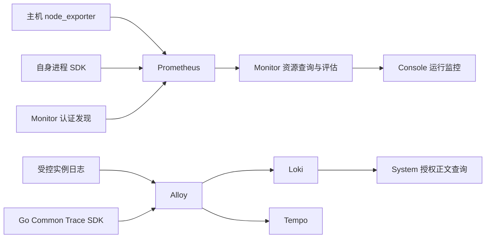

# ADDP 平台运行观测规范

本文维护平台运行观测的共同身份、权限、资源、查询和告警边界，并导航到各专题的唯一正文。概念见[监控与执行体系图](../concepts/addp监控与执行体系图.md)，实现状态、剩余范围及验收缺口统一见[后续专题](../next/ADDP平台运行监控与可观测性设计.md)。标明待实现的内容仅界定边界，不作为开放能力。

专题正文：

| 主题 | 权威正文 |
| --- | --- |
| 主机与采集发现 | [主机与模块绑定、纳管接入、采集发现、引擎部署及 PostgreSQL／Redis／MinIO 专业来源](observability/主机与采集发现.md) |
| HTTP 接口质量 | [全量 HTTP 指标、查询与规则、Python 来源、停源历史和正式产品本机验收](observability/HTTP接口质量.md) |
| 追踪与日志关联 | [SDK 传播、采样与容量、读取授权、查询交互、执行短阶段／Link 和正式身份本机闭环](observability/追踪与日志关联.md) |

## 一、适用范围

适用于平台主机、当前模块运行实例、受限资源查询和平台告警。租户任务执行、日志正文与引擎业务数据仍由各自 owner 维护。

## 二、交付边界

主机台账、采集发现、基础资源、进程 CPU/RSS/时长、趋势/总览与主机 CPU/内存规则已实现。引擎专业观测、容器配额、拓扑追踪与生产规模等剩余范围，以及各层验收状态，按后续专题分别记录；实现就绪不等于相应验收通过。

## 三、对象与模块边界

### 3.1 身份与事实来源

| 对象 | 唯一事实来源 | 约束 |
| --- | --- | --- |
| 纳管主机 | System `node_id` | System 分配 UUID；物理主机与虚拟机均可纳管，容器不是主机 |
| 模块与运行实例 | System 模块登记、实例身份和租约 | UP/DOWN 来自租约，不由采集成功或 CPU 值决定 |
| 业务引擎 | System 引擎登记 | `engine_id` 与主机身份不同；远端、云端、集群引擎不按连接数推算节点数 |
| 容器 | 运行环境的容器身份及配额 | 与进程关联必须有明确证据，不能按名称或资源量猜测 |
| 任务执行 | 既有执行 Owner 与共享执行协议 | 执行身份、槽位和结果不转移到遥测存储 |
| 采集目标 | Monitor 配置身份及版本 | 引用已有主体，不重复创建主体或实例租约 |

IP、DNS、主机名、服务 URL 和 `registered_host` 均不是稳定主机身份。ResourceLocator 继续表示引擎业务数据位置，不加入主机节点语义。

部署关联与调用关联分开：前者记录声明来源及有效时间，后者来自明确配置或 Trace 观测窗口。拓扑染色不能作为已经确认根因的证据。

### 3.2 模块职责

| Owner | 职责 |
| --- | --- |
| System | 主机、模块、实例及引擎身份，当前用户对象授权，IAM 与统一审计；日志正文授权读取 |
| Monitor | 采集配置、发现投影、资源查询与预算、规则、平台事件和通知、监控页面 |
| Common / Common-Python | 共享采样 SDK、DTO、身份声明与服务客户端；不成为第二个事实 Owner |
| Infra | Prometheus、Alloy、Loki 等中心组件及节点来源的部署、传输保护、Secret 与物理资源预算 |
| Console | 统一入口、上下文和 iframe 导航；前端隐藏不替代服务端授权 |

Monitor 不直接查询 System 私有表，不直接读取主机文件，不复制 System 的实例运行状态。业务请求和执行事实不依赖观测设施才可写入或读取。

### 3.3 平台与租户权限

当前主机、平台实例资源、总览及平台资源告警只开放 Platform Context。Tenant 执行监控、执行告警保留自身事实和权限；租户引擎未来的专业观测还须单独明确归属与读取契约。

平台系统管理员承担首期主机、采集和平台告警管理职责，权限在 Owner manifest、内置角色及正式迁移中显式发布。平台安全管理员、审计管理员不因此获得资源管理或日志正文权限；平台角色也不自动取得全部租户 SQL、参数和执行结果。

- 用户请求转发已验证的当前 User Token，由 System 再裁决主体；后台投影不能代替用户对象授权。
- `addp-monitor` 使用独立 Platform Service 身份，只读取有界当前身份投影。同一 `/runtime/observability-identities` 返回必须为数组的字段 `engine_deployments`（真实无对象时为 `[]`），最多 1000 个启用且承载主机有效的平台部署；与节点、模块实例在同一只读可重复读事务内裁决，共用五秒和四 MiB 预算。每项仅含 `deployment_id`、`version`、`scope=infra|business`、`engine_type=postgresql`、`node_id` 与 `source_key={docker_engine_id,project,service}`；来源键沿用部署发现的 Docker 引擎／Compose 项目／服务三元组，`infra` 对应 `addp-infra`，`business` 对应 `business`，当前服务为 `postgres`。不含名称、地址、端口、连接、凭据、租户引擎或运行状态，不因登记存在就视作实时来源可用。超量、异常及控制面错误整份拒绝，不截断或保留旧身份；后台投影不授予用户查询权，专业查询仍逐请求转交当前 User Token 给 System。
- `addp-prometheus` 使用独立最小身份和 `monitor.metrics_discovery.read`，不能访问业务 API。
- 采集 mTLS、发现身份、日志上报及资源查询证书分别管理；不保存长期管理员 Token，不复用业务数据库凭据。
- 资源观测、告警事件、规则管理、通知管理和日志正文分别授权。切换身份或 Context 时清除旧数据、凭据草稿，并拒绝迟到响应。

## 四、主机接入与采集发现

主机与模块绑定、纳管接入、采集发现、引擎部署及 PostgreSQL／Redis／MinIO 专业来源，统一见[专题正文](observability/主机与采集发现.md)。

| 条款导航 |
| --- |
| [4.1 主机与服务绑定](observability/主机与采集发现.md#41-主机与服务绑定) |
| [4.2 管理员确认的部署清单接入](observability/主机与采集发现.md#42-管理员确认的部署清单接入) |
| [4.3 采集目标与认证发现](observability/主机与采集发现.md#43-采集目标与认证发现) |
| [4.4 平台引擎部署登记](observability/主机与采集发现.md#44-平台引擎部署登记) |
| [采集来源统一部署分组（2026-11-04）](observability/主机与采集发现.md#采集来源统一部署分组2026-11-04) |
| [采集项目与来源隔离](observability/主机与采集发现.md#采集项目与来源隔离) |
| [旧来源退役边界](observability/主机与采集发现.md#旧来源退役边界) |
| [4.5 部署侧自动发现来源](observability/主机与采集发现.md#45-部署侧自动发现来源) |
| [PostgreSQL 配对来源发现](observability/主机与采集发现.md#postgresql-source-pair-discovery) |
| [CDC 基础设施组件的自动发现](observability/主机与采集发现.md#cdc-基础设施组件的自动发现) |
| [4.6 PostgreSQL 数据库侧汇总读取边界](observability/主机与采集发现.md#46-postgresql-数据库侧汇总读取边界) |
| [4.7 PostgreSQL 受保护的固定指标来源](observability/主机与采集发现.md#47-postgresql-受保护的固定指标来源) |
| [Redis 专业观测首期边界（2026-11-01 确认，分阶段实施）](observability/主机与采集发现.md#redis-专业观测首期边界2026-11-01-确认分阶段实施) |
| [MinIO 专业观测首期边界（2026-11-02 已确认）](observability/主机与采集发现.md#minio-专业观测首期边界2026-11-02-已确认) |
| [4.8 服务部署预期与分组租约观测](observability/主机与采集发现.md#48-服务部署预期与分组租约观测) |
| [开发 Backend 启动失败](observability/主机与采集发现.md#开发-backend-启动失败) |

## 五、技术路线与故障隔离

### 5.1 唯一数据路径

指标使用单一 pull 路线，不并存 remote_write；原始高频时序留在 Prometheus，配置、事件、投递和审计留在各 Owner 的 PostgreSQL。日志正文保持受控文件 → Alloy → Loki → System，不在失败时退回主机文件读取。Go 同步 HTTP Trace 范围与预算沿 6.5；自身 cgroup、实例资源组与 cAdvisor 的当前接入范围见 [5.2](#52-部署与运行环境)。

不增加独立 Alertmanager 告警 Owner，不要求 Grafana 成为产品入口。成熟组件负责采集、存储和传输，Monitor 负责领域规则、事件和授权体验。

### 5.2 部署与运行环境

中心组件和节点来源统一由标准 Infra 脚本组织，根 `.env.example` 为唯一部署模板。

| 输入 | 行为 |
| --- | --- |
| `ADDP_OBSERVABILITY_METRICS_ENABLED` | 默认 false，选择指标中心及明确来源；不自动为全部机器安装 exporter |
| `ADDP_OBSERVABILITY_LOGS_ENABLED` | 默认 true，可显式关闭现有集中日志组合 |
| `ADDP_OBSERVABILITY_TRACES_ENABLED` | 默认 false，显式选择 6.5 的 Go HTTP 追踪、Alloy 与 Tempo 路径 |
| `ADDP_NODE_METRICS_ENABLED` | 默认 false，单独选择本节点来源；中心开启不自动调用节点部署 |
| `ADDP_PROCESS_METRICS_DEPLOYMENTS` | 显式声明自身进程指标端点，SDK 成功启动后才随实例登记发布 |
| `ADDP_HOST_NODE_ID` | 单个进程的实际部署主机声明，可空，不为不同宿主注入同一个 ID |
| 各设施端点与 Secret 引用 | 所选能力独立预检；未选择的能力不要求其专用凭据 |

布尔值只接受 true/false，不由探测结果猜开关。端点、证书、物理预算与保留参数随组件生命周期生效；Monitor 普通查询预算、规则和配置版本按各自热生效契约管理。

节点来源只消费显式部署输入，`ADDP_NODE_METRICS_LISTEN` 为受控本机 IP 与显式端口，不接受通配监听或自动避让；`ADDP_NODE_METRICS_TLS_DIR` 为仓库外绝对目录，只放 `ca.crt/server.crt/server.key`，不挂 CA 签发私钥或客户端私钥。原生 Linux 来源要求内核 5.12+，采用 host 网络/PID 及只读宿主挂载；Desktop 使用下述受限部署层，不自动放宽主机权限。

节点指标采用独立 mTLS。node_exporter 使用原生 exporter-toolkit；需要保护原始容器来源时只能使用节点专用的固定路径入口，不开放 Web UI、调试或任意代理。日志 Alloy 不获得 Docker Socket、宿主特权或 Shell 权限。

| 环境 | 当前支持与边界 |
| --- | --- |
| 原生 Linux 主机 | 标准节点入口校验宿主内核与部署条件，支持完整主机指标；按来源实际挂载/设备/网卡展示 |
| Docker Desktop Linux VM | 独立 virtual 主机，承载 Business/Infra；支持 CPU、内存、负载、运行时长及内核磁盘统计 |
| Desktop 文件系统与网络 | filesystem、netdev、netstat 仍关闭，不用容器挂载或网卡冒充 VM 全局数据 |
| 原生 macOS 服务 | 观察自身 Go 进程 CPU、当前 RSS 和时长，不绑定到 Desktop VM 冒充其进程 |
| 自身 cgroup 采样 | Linux Common SDK 显式选择 `cgroup_v2=true` 后已接入自身组原始量及内核身份；仅有组样本不证明独立容器或配额，见 [6.1](#61-固定指标目录) |
| 单实例资源组观测 | 已接通部署证明关联、System 投影及 Monitor 单实例即时查询／页面；利用率仍须完整、新鲜且匹配的限制层级证明，见 [6.1](#61-固定指标目录)、[6.2](#62-资源查询与预算) |
| cAdvisor 容器视图 | 已有受控来源准入内核；其标准节点部署与容器资源视图尚未交付 |

自身采样、部署关联与正式身份验收分别认定。共享组 T2 不证明独立 Linux 容器的完整限制层级或正式身份配额页面；固定版本、失败及未覆盖项见[实例与服务发现证据](testing/evidence/Monitor实例与服务发现历史证据.md)。容器配额、进程消耗与 VM/宿主容量不混用。

Desktop 来源固定启用 cpu、meminfo、loadavg、diskstats、stat、uname、time；保持独立 bridge/PID/挂载命名空间、非 root、只读根、cap_drop=ALL 和 no-new-privileges，不挂宿主根、设备或 Docker Socket。磁盘代表 VM 内核设备统计，不证明 Mac 物理磁盘或某个引擎的独占消耗。远程 Engine、非 Linux Engine 和未知环境拒绝接入。

### 已安装引擎采集来源的统一恢复

Redis／MinIO 的显式 `up` 分为准备和应用两段：先检查候选 TLS 和当前引擎部署身份，准备本方采集镜像，再停止旧来源并应用账号及来源配置。准备失败返回非零，保留尚未替换的原来源和账号，不宣称候选配置已生效；应用开始后失败仍移除本方来源并关闭本方账号。`down` 不依赖候选 TLS 或构建。

来源镜像按构建输入摘要命名。已存在的同摘要镜像须核验确切 ID 与工作区归属后复用，只有不存在时构建；读取或归属核验失败不得当作不存在而覆盖。相同输入不得重复导出覆盖标签，避免构建证明变化导致镜像索引 ID 改变，破坏其他作用域仍引用的原镜像。恢复继续核验安装记录中的确切镜像，不回退标签或替换其他镜像。

统一 `status` 只读核验容器归属、运行身份、精确采集镜像及 Redis／MinIO 的私有卷工具声明，逐来源分别报告安装声明变化或原采集镜像不可用。异常计数覆盖这些检查；镜像可用不等同完整恢复核验通过，账号／私有卷／配置沿 `recover` 核验，实际采样由 Monitor 核验。

标准完整本地 ADDP 启动通过唯一采集管理入口检查主机来源、Infra／Business 的 PostgreSQL／Redis／MinIO，以及 Infra 的 Redpanda／Kafka Connect；单模块及 Hosted 启动不自动恢复。根与 Business 配置分域加载，不重新启用未选择、未安装或已停用的账号，不启动数据库。此路径只读核验已启用账号，不安装、变更或轮换账号／权限／凭据，不执行业务读取；来源部署与账号安装仍使用原标准显式 up 路径。

Redis／MinIO 恢复复用唯一受管来源内核：先核验私有安装状态、账号及持久记录／策略、原 Compose 声明、镜像归属、来源组件及私有卷，按唯一固定结构核对配置字段及凭据，逐字节比较证书内容；只允许同容器的原私网地址与原启动时刻进入恢复判断。私有卷核对只使用短时无网络、非 root、只读挂载、固定资源预算的校验容器，不挂数据库数据卷、宿主目录或 Docker Socket，退出核验回收。未完成安装、账号停用／权限漂移、证书内容／端口变化、外部资源、陌生卷或新的数据库容器 ID 均拒绝自动接管；管理员须通过标准部署入口明确重新应用。同一数据库容器重新启动、其私网地址变化及本方来源停止／丢失时，在原安装和账号仍有效的前提下可只重建来源。

来源容器、端点、网络及数据库启动边界均匹配时不构建或重建。确需恢复时只使用已安装的受管镜像和原凭据，重新发布当前数据库身份／启动时刻，并在变更前后重读数据库和账号事实。开始重建前的验证失败不修改旧来源；重建后失败仅清理本方来源，单独报告清理缺口，不停用账号或改变权限。数据库、账号或文件在过程中变化时不能算成功；容器 Running 仍不代表 mTLS／Prometheus／Monitor 查询通过。无独立恢复守护进程、系统自启动或定时任务。

统一管理入口将固定失败阶段映射为中文步骤与核对建议。PostgreSQL复用现有账号／HBA／来源阶段；Redis、MinIO在既有部署校验、私有状态、账号处理和来源构建／部署／恢复／移除边界标注阶段，共用来源内核的异常标注能力。阶段只说明失败发生的位置，不证明具体根因或操作未生效；内层已知阶段优先，保留原异常、主要原因及独立清理标记，未知阶段不透传。诊断不增加数据库读取、权限、重试或修复，不改变命令、期限、启停顺序及回收范围；结果未知时仍先核对状态，不建议盲目重试。

门禁沿现有采集管理、Infra／开发生命周期、Redis／MinIO 来源 T1 与独占 T2；T2 验证健康不重建、停止／删除来源与同容器重启后的恢复、停用与漂移拒绝、账号／私有记录不变及零残留，不替代个人运行或 Hosted。主机来源使用独立的安装证明与恢复规则。[主机采集来源的显式安全恢复](#主机采集来源的显式安全恢复)

### 主机采集来源的显式安全恢复

采集管理入口恢复主机来源时须显式选择 `--scope host`。本地全量 ADDP 启动和重启由启动脚本选择主机，局部模块与 Hosted 精确进程启动跳过此恢复。部署者也可单独执行 `python3 scripts/infra/metrics-sources.py recover --scope host --kind node`，省略 `--scope host` 的批量 `recover` 会跳过主机。[采集来源统一部署分组](observability/主机与采集发现.md#采集来源统一部署分组2026-11-04)

标准up成功后在仓库外当前工作区私有目录保存安装摘要，包含Docker引擎／内核、部署输入及活动模板／证书的摘要、确切容器身份和安全配置、可选容量卷归属，不保存私钥内容或新增凭据。摘要与生命周期共用非阻塞锁；down标记安装停用，失败的up不得保留旧摘要为有效安装证明。

首期recover只启动已存在、完全匹配原安装证明的停止容器；健康容器保持不动。节点服务集合须完整，只有采样器停止时只启动该采样器；不拉镜像、不创建或重建缺失容器、不新增宿主挂载。摘要缺失／停用、来源丢失、配置／证书／内核／Engine变化、容器或卷身份／权限漂移时拒绝，部署者须显式up重新应用。旧部署没有摘要时也拒绝自动收养；不保留兼容恢复路线。

统一入口的恢复失败提示只映射固定原因码，区分安装证明缺失、已停用、读取校验失败、来源组件不完整、归属校验失败、部署输入变化、安装身份或安全配置变化及原镜像不可用。提示依据原有检查结果，不增加读取、自动重试或修复；未知错误仍显示操作失败，不推断具体原因。原始提供方日志、路径、标识和凭据不透传，清理未确认单独附加，不能被主要原因覆盖。归属或私有文件校验失败先提示核对，不能暗示重新应用能绕过校验。

恢复前后重核原输入、镜像与容器安全配置；启动失败或发生并发漂移时，只停止本轮启动的原停止容器，并单独报告清理缺口，不停止原健康来源、删除容器或容量卷。容器运行仍不等同真实mTLS采集。沿统一采集T1和节点独占T2验证健康保持、停止恢复、完整集合及漂移拒绝、失败清理；不更改个人Docker设置或启停其服务，不新增系统自启／定时任务。

### 5.3 故障与状态

| 场景 | 影响 |
| --- | --- |
| 指标未部署、配置不全或 Prometheus 故障 | 对应资源区域明确不可用；不改变业务 Ready、实例租约、路由、任务和结果读取 |
| 单个来源采集失败 | 仅该来源缺值/过期，其他来源继续；不能补零或恢复活动资源告警 |
| Loki 或日志发送故障 | 影响日志正文/链路状态；不改变资源和执行事实，不退回直接读文件 |
| Trace 未启用或故障 | 仅追踪不可用；部署声明、指标和日志不因此丢失 |
| Monitor 必需依赖故障 | Monitor 按自身依赖报告不可用，业务 Owner 仍独立写入和读取执行事实 |
| 设施恢复 | 无需重启业务进程，等待新样本；保留停采缺口，不伪造历史回填 |

能力配置意图、后端可用性、目标采集状态、单项数据质量分别表达。数值状态区分 `not_connected/valid/no_data/stale/unsupported`；未查询成功不能包装成“没有样本”。控制读取成功可返回能力不可用状态，实际查询的未启用、未配置、故障、超时、预算与并发拒绝按 API 错误契约返回。

观测发送使用有界队列、超时与丢弃记录，不能无限积压或阻塞业务。标准生命周期分开记录必需服务和可选能力的结果，所选能力失败可使命令非零，但不能因此中止已满足必需依赖的业务。停用只处理本工作区拥有的设施，保留数据卷。

共用 Alloy 的日志/Trace 故障可能相关；共享磁盘耗尽也可能影响业务，不能把软依赖说成物理隔离。生产还需独立外部存活探针，不能靠已不可用的监控系统给自己告警。

## 六、指标、查询与展示口径

### 6.1 固定指标目录

唯一目录定义公式、单位及窗口，前端和规则复用，不接受任意 PromQL、标签搜索、脚本或调用者自选端点。

| 主机指标族 | 数量 | 口径 |
| --- | --- | --- |
| 标量概览 | 10 | CPU 逻辑核数、一分钟忙碌率、内存总量/可用量/使用率、1/5/15 分钟系统平均负载、运行时长、TCP 当前连接数 |
| 文件系统容量 | 5 | 总量、空闲、非特权可用、已用及使用率，保留精确挂载维度 |
| 文件系统 inode | 4 | 总量、空闲、已用及使用率，与字节容量分开 |
| 磁盘 | 5 | 读写吞吐、IO 忙碌时间占比、平均读写耗时，保留 device 维度 |
| 网络 | 2 | 网卡收发字节速率，保留 device 维度 |
| 磁盘与卷容量 | 1 | 仅即时的 `node.block.capacity_bytes`，保留 device／kind，不提供趋势或汇总 |

容量用 IEC 自适应单位，运行时长用天/小时/分钟；解释放在对应指标或列旁。系统平均负载是运行/等待 CPU 以及不可中断等待（常见于 IO）的任务数量平均值，不是百分比，也不是内存或 CPU 使用率，必须结合核数及其他指标判断。

TCP 当前连接数为 `node.tcp.current_connections`（unit=`connections`，瞬时 Gauge），唯一原始来源 `node_netstat_Tcp_CurrEstab`，按 RFC 4022 统计 ESTABLISHED＋CLOSE_WAIT；不是累计建连次数，也不包含监听或 TIME_WAIT。沿既有主机、来源及 instance 限定，只有单条、有限、非负且不超过 JavaScript 安全整数上限的整数样本才有效，沿原 60 秒新鲜度和查询预算读取当前值／趋势。无宿主网络命名空间统计（包括当前受限 Docker Desktop 来源）、缺样或重复来源不生成有效零值；页面在指标旁解释不可用，不从容器、数据库连接数或其他状态推算。保留 CPU／内存总览、TOP5 与告警既有范围，不新增连接告警、权限或采集控制面。

主机内存使用率基于可用内存，不把缓存当泄漏；文件系统使用率采用非特权可用容量口径，绑定挂载、内存和网络文件系统不计作物理容量合计。磁盘速率与 CPU 要求完整一分钟计数窗口、同次启动与来源证据；计数重置、重复/异步来源或窗口不足不生成有效值。

磁盘忙碌时间占比不是饱和度，平均读写耗时包含排队和处理；没有完成请求时平均耗时为空，有请求且耗时确为零才可显示零。设备层级、桥接与虚拟接口不简单累加；不通过插值、截断异常值或用相似指标伪装缺值。磁盘列表优先展示活动设备，无活动设备可展开。

PostgreSQL 专业观测的固定查询目录的「资源与活动」组保留 12 项：总连接、活跃连接、空闲连接、事务内空闲连接、活跃等待、锁等待、IO 等待、最大连接数（均为数量）；每秒提交、每秒回滚、每秒死锁（各自为独立累计量的速率）；非模板数据库总容量（字节、页面自动换算）。这是整体 PostgreSQL 观测，不将采集事务当业务吞吐、不归算租户用量，也不凭连接数直接判断健康。「逻辑复制」组显示逻辑槽总数、不活跃逻辑槽数、逻辑槽保留 WAL，复用同一即时与趋势接口。列表摘要保持四项，每次详情仍最多请求 12 项。

速率使用固定一分钟完整窗口，至少四次有效采样，并验证过去和当前属于同一服务启动／统计代际、无计数回退且窗口两端新鲜；重启、统计重置或统计关闭时留空，不补零、不跨代际计算。SQL Exporter 的 HTTP 200／up=1 仍不足以证明 SQL 成功，必须验证固定快照、采样时间与字段完整性；来源不可用或 SQL 失败清空当前值，缺样形成趋势断点。

进程目录独立：CPU 使用 `process.cpu.core_equivalents`，1 核表示消耗一个逻辑核的计算时间；内存为当前 `process.memory.resident_bytes`，时长从本次启动计算。无明确配额不生成配额利用率，不用宿主总内存计算进程使用率，也不用 Go 堆或峰值 RSS 替代当前 RSS。macOS 自身采样严格核对系统接口成功与返回长度，失败不生成有效零值。

自身 cgroup 采样与容器身份分开：Linux Common SDK 仅在进程部署输入显式选择 `cgroup_v2=true` 时，才可在既有 mTLS 来源发布当前 cgroup v2 的 `addp_cgroup_identity_info`、`addp_cgroup_cpu_usage_seconds_total` 和 `addp_cgroup_memory_current_bytes`。身份只含内核 boot UUID、cgroup inode 和 PID namespace inode，均以规范字符串标识；只读 `/proc/self/cgroup`、`/proc/self/mountinfo`、自身 PID／cgroup namespace、内核 boot ID 及当前组固定资源文件，不扫描其他进程或组。路径、凭据和原始错误不发布；文件、字段、读取量及路径严格有界。迁组／身份变化或读取失败时清除本次组指标，不能变为有效零值，也不能影响原进程 CPU／RSS／启动指标。这三项仅是私有采集事实，不直接成为用户查询目录；单实例资源组观测沿本节部署证明及 [6.2](#62-资源查询与预算) 的既有契约处理，列表摘要与告警范围不随采样声明扩大。

`cpu.stat` 沿 Linux 扁平键值格式读取 `usage_usec`；内核的 `core_sched.force_idle_usec` 等点号命名空间键不应使整组样本失效。仍严格校验有界字段名、每行两项、唯一键及规范无符号整数；不把其他计数并入 CPU 用量、不改变指标目录。字段依据见 [Linux v6.11 内核实现](https://github.com/torvalds/linux/blob/v6.11/kernel/cgroup/rstat.c#L555)。

2026-10-24 已确认由部署侧提供容器身份及限制层级的只读证明，应用不开放宿主 cgroup 命名空间、不持有 Docker socket。仅在当前登记实例／本次进程启动、真实容器／本次容器启动及内核边界完全匹配，且限制层级证明完整新鲜时，才可进入容器配额观测。可见组用量不证明独立容器、独享额度或完整父级限制。自身采集、部署证明、System 关联、Monitor 查询与页面分别验证；新增自身采集基础不能替代后续产品链路及对应验收。

容器资源沿同一进程来源接入：SDK 在启动时取得的 boot UUID／cgroup inode／PID namespace inode 随不可变私有声明登记，后续采样仍核对当前边界。部署发布器在原有受管目录发布 `addp.container-proofs/v1`，仅可信本机 Linux Docker、当前工作区 `addp-platform`、标准 runtime-log 单应用入口；读完整容器 ID／启动／宿主 PID及真实完整 cgroup v2 层级，双读核对，最长 90 秒。父级隐藏、平台不支持、读取失败或来源中断清除当前证明，不以 Docker 配置额度替代真实父级限制。首期要求层级 CPU burst 为零；CPU 上界来自完整层级 quota/period 与有效 cpuset，内存取有限 memory.max 最小值；均为硬上界，不是独享或保证容量。连续快照一致的限制记录重新启动／变化／超时即重新累计；CPU 比率要求记录覆盖完整一分钟及边界裕量。

System 只在当前有效实例的 module／role、三项内核身份及进程／容器启动时间匹配且容器边界唯一时，沿既有后台投影附带证明；不改变主机关联、IAM、普通实例 DTO 或登记租约。Monitor 先按当前 User 精确读取实例，再查询对应来源；CPU 复用至少四样本、完整一分钟边界、无重置及双端身份保护，内存使用整组 memory.current，不能用 RSS 替代。查询在证明时点评估，返回前重读同一投影，限制／实例／租约变化则拒绝，不缓存旧额度。比例不裁剪到 100%，无有限上界、稳定记录不足或无有效采样时保留空值并在对应卡片解释；原生开发仍是宿主进程。

### 磁盘与卷容量

2026-10-28 用户确认：只展示当前纳管节点内核可见的已就绪非分区块设备及可核实结构类型，不合计整机／集群物理总量，不计算块设备使用率，不增加趋势或告警。排除分区、RAM、loop、零容量对象；选择依据内核属性及设备关系，不按设备名猜物理身份。映射卷与底层设备分别显示，不能相加。原文件系统明细与规则保持原契约。

部署侧沿唯一节点来源入口显式选择 `ADDP_NODE_BLOCK_CAPACITY_ENABLED=true`，默认关闭。专属非特权只读采集器仅读受控 sysfs 的容量、设备号、分区、映射关系与启动证明；原生 Linux 读取宿主 sysfs／proc，Desktop 仅在内核与设备号核对成立时提供 VM 视图，不增加宿主根、Docker Socket、原始设备或业务文件访问。System 不新增实体或后台投影。

唯一发布路径为专用目录内 node_exporter Textfile Collector。每十五秒原子替换唯一 `block-capacity.prom`；仅允许 `addp_block_capacity_` 前缀，非受管文件拒绝。帧含 success、supported、sample_time_seconds、boot_time_seconds、device_count、bytes（device／kind），文件不带 Prometheus 样本时间戳；失败帧不含容量，未选不发布。容量为 sysfs size 的512字节扇区换算，限制精确整数范围；扫描上限4096对象、100就绪设备，超限整帧失败，不截断。按内核 major driver 排除 ramdisk／loop，按 partition 属性排除分区；结构类型仅使用 device、mapped、raid、unknown，不表示物理性。

源时间、原生 node_boot_time_seconds、当前抓取状态和整帧完整性共同裁定当前值；旧文件不能因新抓取变新鲜，设备消失不能沿 lookback 拼回旧帧。采集关闭、失败、过期、空集合及不支持分别表示，不能伪造零容量。后端沿既有 User／主机读取裁决、固定目录和原查询预算；不得直连 Docker、执行远程命令、增加 System 读取或绕过预算。设备明细及 IEC 容量就近展示来源范围，不暴露 sysfs 路径、序列号或私有证明。

来源 T0／T1、真实来源与 Prometheus T2、页面 T3分别验证；API 变动同步 Swagger。原生隔离验收的容量证明必须精确绑定同内核采集器、只读白名单宿主元数据、受管程序及双端同一tmpfs卷，发布帧与当前sysfs逐设备一致；真实页面通过同一共享DOM收据核对完整设备集合、结构类型及IEC容量，打开／刷新各一次，保持原时限。既有隔离 Hosted 的临时管理员只读用途扩展为当次节点容量、状态及同页读取；沿原真实密码／MFA、独立 Prometheus 身份和退出清理，不造盘、不挂卸载、不加压。CI／Hosted 实际执行等专门会话安排，本会话不调度或设置定时任务。

### 6.2 资源查询与预算

资源读取仅允许非委托 Platform User，使用 `monitor.resource_observation.read` 并按主体要求核验 System 读取权限。System 当前身份投影和普通用户读取共同检查当前主体、来源、版本、启动边界及租约，不能用后台身份跳过用户授权。

PostgreSQL 专业查询同时核验 `monitor.resource_observation.read` 与 System 的 `platform.engine_deployment.read`，查询完成后重核；私有观测投影不代替当前 User 的读取授权。

| 接口（Monitor `/api/v1/monitor` 下） | 约束 |
| --- | --- |
| `/platform/resource_observations`、`/platform/resource_trends` | 显式 node_id、固定 metrics 白名单；趋势使用整秒 RFC3339 start/end，维度严格匹配 |
| `/platform/resource_summaries` | 显式 `node_ids` 和 `metrics`，当前授权节点的批量摘要；指标仅允许 CPU 核数／一分钟忙碌率、内存总量／使用率、运行时长、三档系统平均负载和 TCP 当前连接数九项的非空无重复子集，同一评估锚点，不逐行查询 |
| `/platform/process_resource_summaries` | 当前授权实例批量 CPU/RSS/时长，固定目录；普通实例 DTO 仅公开采集声明布尔值 |
| `/platform/process_resource_trends` | 仅 instance_id/start/end，固定 CPU/RSS 两条序列；不读取已退出实例历史 |
| `/platform/container_resource_observations` | `instance_ids` 恰好一个当前实例；固定资源组 CPU 核消耗、memory.current 及两项硬上界利用率，不改变批量摘要目录；无有效证明时只读当前声明内核边界的绝对用量 |
| `/platform/engine_resource_observations` | 单部署即时观测，固定专业目录，每次最多十二指标 |
| `/platform/engine_resource_summaries` | 当前授权页部署的四项摘要，沿同一查询预算 |
| `/platform/engine_resource_trends` | 单部署固定专业目录，仅读当前数据库容器运行段 |
| `/platform/resource_overview` | 不接受 query/body，完整授权主机范围及 CPU/内存 TOP5 |
| `/settings/resource-query-policy` | Monitor 普通平台配置，沿 `monitor.configuration.read/update`，版本 CAS 与审计 |

传输采用固定 `MONITOR_PROMETHEUS_URL` 和独立 CA/client cert/key 部署输入；浏览器不读取私有地址或凭据。查询响应标明身份、单位、预算版本、评估/采样时间、窗口和步长，按每条序列判断有效性；null 与 0 区别明确，缺值形成断点。

| 预算项 | 当前默认上限或初值 |
| --- | --- |
| scrape / 超时 / 发现 | 15 秒 / 5 秒 / 30 秒；首期固定，不提供无实际效果的采样编辑项 |
| 新鲜度 | 60 秒；速率及告警仍另须完整窗口 |
| 单请求 | 12 指标、100 序列、每序列 1,000 点、总计 20,000 点、最长 7 天 |
| 步长 | 至少 15 秒，随范围和预计序列规划；返回后再次核验，不静默截断 |
| 查询超时与并发 | 总期限 5 秒；单主体 2、单 Monitor 进程上游 8；超限快速拒绝，无无界等待 |
| TSDB 保留 | 7 天与 10 GiB 体积同时限制，可能提前淘汰；另预留 WAL/压缩空间 |
| 来源序列预留 | 每端点和中心自身各 20,000。Monitor 和 Prometheus 使用同一部署变量 `ADDP_METRICS_TARGET_LIMIT`，接受 1 至 36 的整数，缺省 12。总预留为（外部来源上限 + 1）× 20,000。开发部署可选 36，对应 740,000。 |
| 组件预算 | Prometheus 1 CPU/2 GiB，node_exporter 0.25 CPU/256 MiB；节点入口 0.25 CPU/128 MiB |

来源准入按去重端点的预留配额原子校验，不能把当前少量序列或单端点 sample_limit 当作全局限额。查询预算可收紧并热生效，在途请求保持开始时版本；物理资源、卷与保留归 Infra。默认预算不是已证明的生产规模上限。

开发部署扩至 36 个端点前，沿 `make test-monitor-metrics MONITOR_METRICS_TEST_ARGS=--case=target-budget` 在独立网络、卷及 mTLS 凭据内，从 24、34 个目标基线增加两个真实 CDC 来源到 36 个，再验证第 37 个拒绝及回到 36 个恢复。34 个受控容量目标保留一台主机、六个引擎、五个 Worker 和一个网关，其余为后端；新增 Redpanda 与 Connect 来源沿正式生命周期安装、恢复及停用。受控 HTTP SD 夹具验证 Prometheus 传输和容量，System 当前事实及 Monitor 准入另由身份投影门禁核对，不能将夹具算作正式页面验收。用代表性的 HTTP 路由直方图和失败计数运行即时与区间 PromQL，记录抓取成功与耗时、时序与写入量、查询延迟、容器内存及磁盘增长。短时估算不证明生产满载、正式页面或七天留存。

开发部署有进程采集计划时，启动、重启和指标配置渲染均在应用前校验计划单元数、选中的本机主机来源以及 Infra 和 Business 引擎来源之和。即使来源暂未运行，也预留其名额。超额报告各类数量和上限，重启入口在停止进程前退出，指标配置渲染保留现有配置。手工添加的远程来源仍由 Monitor 在真实发现时纳入总预算。

标签仅保存必要身份及有限维度，不加入 TraceId、请求/执行/用户 ID、完整 URL、SQL 或 Token。服务质量后续采用规范化 route 和有界直方图；无请求不虚构错误率和延迟。

### 6.3 趋势、时段比较与总览

主机磁盘读写吞吐同图展示同一设备的两个方向，纵轴就近显示“磁盘读写吞吐”及当前统一缩放后的速率单位，不仅在tip中说明。沿共享图表valueAxes和既有IEC缩放，两条序列使用同一单位；不改原始数值、统计窗口、设备范围、缺样或查询预算。

主机详情在CPU一分钟忙碌率卡片内就近展示“CPU空闲率”，仅对当前有效忙碌率计算 `100 - busy_percent`，两者沿用同一分钟、采样与评估状态，并各自复用共享百分比格式化。预热缺样、陈旧或未接入时空闲率显示“—”，不将未知视为全部空闲。该值仅为同卡辅助展示，不增加固定指标、独立查询、趋势或规则；原CPU忙碌率口径、列表五项摘要及查询预算保持原契约。

主机列表提供“核心资源”和“负载与连接”两种列视图，默认核心资源；以 `list_view=load-connections` 恢复后者，默认值省略。切换只替换列与本批指标选择，保留已提交筛选、分页和刷新间隔，不提交搜索草稿；详情返回与重载保留视图，重置筛选也保留视图。负载与连接只请求 1／5／15 分钟系统平均负载和 TCP 当前连接数四项，默认 20 台共 80 条序列；列标题就近解释任务数量及 TCP 状态口径，缺样不补零。核心资源列采用 2026-10-23 用户确认的五项：CPU 逻辑核数、CPU 一分钟忙碌率、内存总量、内存使用率和运行时长。默认每页 20 台，复用当前页一次批量摘要与原单位／新鲜度，不逐台补查详情。每次显式请求所需指标，按“本批节点数 × 所选指标数”在逐节点 Owner 裁决与 Prometheus 读取前校验同一预算；默认五项 × 20 台正好 100 序列。实际返回页超预算或策略收紧时整批拒绝，保留主机列表并提示减少每页数量，不拆批绕过、不部分返回、不自动提高预算。内存使用 IEC 容量，时长使用复合时长；有效零、缺样和陈旧沿原口径。总览 TOP5 仍只规划 CPU／内存百分比两项，默认最多 50 台；采集配置页亦显式请求原两项，二者不随列表展示扩大读取。摘要接口只接受上述九项固定标量的非空无重复子集。仅保留这一条带明确指标选择的摘要契约，不接受省略 metrics 的旧请求。

主机监控列表复用 System 已有 `node_kind=physical|virtual`、`enabled=true|false` 与名称／地址组合查询，由 System 在计数／分页前筛选；省略表示全部，纳管启用不表示电源或采集状态。System 与 Monitor 的同义类型／状态选择及规范值投影由共享前端 `HostNodeFilters`／`resolveHostNodeFilters` 唯一实现，原 System 页面重复控件与解析分支删除，页面各自拥有查询与路由组合。Monitor 类型／状态选择同时提交当前名称草稿并回首页；重置清除检索条件及页码，保留每页数量、列表视图与刷新偏好。已提交条件沿详情、返回、刷新及 Console 单历史恢复；自动刷新不提交名称草稿，列表条件不进入资源即时／趋势接口。只请求匹配当前页及所选视图的四项或五项摘要，空页不查询指标，错误／撤权清除旧值，不在浏览器过滤分页结果或扩大查询。尚未返回或读取失败的列表总数为未知，不以零代替；分页仅消费成功返回的总数，不能因请求中的临时清空反向改写当前页。

主机列表的资源明细按 2026-10-26 用户确认方案临时行内展开，复用详情页唯一的磁盘／网卡／文件系统展示实现；最多展开当前页一台主机的一类明细。未展开不读取明细；磁盘沿既有五项、网卡沿两项，文件系统沿详情既有分组顺序各读取一次容量五项和 inode 四项，各组分别沿原预算与错误边界，不合并为九项请求、也不拆分超限组绕过预算。容量与 inode 按完整 device／mountpoint／fstype 对齐，分别保留查询及采样时间，一组失败不补造或抹去另一组的有效值；不跨挂载或设备求和、不生成整机 IO 使用率，沿既有来源、完整一分钟窗口、数据状态和单次查询预算，超限不截断或拆批绕过。切换主机／类别、收起、离页、身份变化或撤权取消旧请求并清除其显示；筛选、分页、视图切换及整页重载关闭展开，手动／自动刷新在主机仍属于当前授权页时保留选择并重读。隐藏页面暂停自动刷新，失败不保留旧值；明细接口的 401／403／404 关闭展开并清除列表观测、停止自动读取，用户手动刷新后重新取得当前授权页。展开属于临时交互，不增加 URL 或持久化配置；可进入同一主机、同一设备或完整挂载身份的既有趋势，列表上下文保留。不新增接口或权限；本批前端标准门禁及 Platform CI 的既有 Monitor 前端入口自动覆盖。

主机详情的资源热力面板复用当前已授权的即时 CPU 忙碌率、内存使用率及每个完整挂载身份的文件系统使用率，不另发查询或重算百分比。CPU 保留原一分钟窗口，文件系统继续使用 `used/(used+available)`；不同指标的采样时间分别保留。有效值以主题色从低使用率到高使用率连续着色，并同步显示精确百分比和 0～100% 进度条；颜色不设告警阈值、不计算健康分、不替代资源规则或推导泄漏。合法零值为有效零；陈旧、缺样或未接入只显示中性占位与原数据状态，不着色、不补零。文件系统来源不可用时明确显示原因，不用 inode 或其他挂载补造使用率。每个分区保留设备、挂载点和文件系统类型，可沿既有可恢复路由查看同一指标与挂载的趋势；刷新、错误、撤权及迟到响应沿原页面生命周期，不新增权限或持久化状态。

页面复用共享图表、格式化、自动刷新及请求代数隔离。默认 15 秒刷新、最短 10 秒；刷新、范围、实例和筛选沿唯一 URL 恢复，隐藏页面暂停并取消在途请求。错误、撤权或上下文变化清除旧内容，迟到响应不得覆盖当前对象。主机详情与引擎页允许原位保留的上下文还须与本轮System对象事实一致：主机详情核对UUID、名称、版本和纳管状态，引擎页另核对引擎类型及当前有效主机关联；任一变化立即清除旧即时值、趋势及缩放，再等待本轮观测，不能在已知停用或解绑后继续显示旧“正在采集”。主机详情同时清除旧挂载、设备及比较结果，独立设备观察组件沿其既有对象版本守卫失效。相同事实的手动／自动刷新保留原内容与视窗，不把每次返回的新对象引用当作事实变化。列表按当前授权页整份判定，不跨版本拼接摘要。

服务趋势弹窗的补充说明复用共享 FieldHelp，就近放在时间范围、CPU／RSS 标题及资源组标题／指标旁，支持悬停和键盘焦点；不再常驻铺开统计含义、断点及缩放说明。资源组证明以简短状态显示，详细限制放在旁边提示；未接入采集、缺样／无法计算、读取错误、比较样本不足及七天比较不可用的当前状态仍直接可见，不用 tip 隐藏问题。查询窗口、实际数值、限额核验时间及硬上界保留，指标含义、授权、查询和刷新生命周期不变。

主机详情的统计含义与操作说明同样复用 FieldHelp：CPU／系统负载的详细说明放在指标标题旁，采样折叠区只保留实际时间；文件系统、磁盘排序与网卡范围放在各自标题旁，逐设备容量范围放在容量列旁。磁盘列只保留列名及完整指标提示，删除独立点击弹出层与重复短说明。趋势的双轴／双向单位、断点和缩放说明随当前指标在指标选择器旁提示，不再常驻重复段落；实际图轴、方向末次值、查询窗口、固定历史说明、短负载／TCP口径、设备数量与异常／缺样原因继续可见。列表展开复用同一设备／挂载组件，不增加单独展示路线；查询、公式、设备／挂载身份、权限、刷新和图表交互口径不变。

引擎专业监控的指标含义在列表列名与详情卡片标题旁复用 FieldHelp；当前趋势的含义／缩放说明和当前数据库容器运行段／七天范围分别放在指标及时间选择器旁，不再常驻铺开说明段落。采集状态、当前缺样、权限／读取错误、查询窗口、数值与单位继续直接展示；指标范围、采集事务与业务吞吐区别、容量不按租户归算、当前容器边界和查询／刷新／图表交互均不变。

主机列表、详情与按设备展开的明细，以及服务列表与当前实例趋势，同一已提交查询上下文内的手动／自动刷新均原位更新：请求在途保留读数、分页、设备表、趋势和已显示的时段比较，不覆盖整块加载遮罩；仅首次加载显示相应加载反馈，刷新按钮与 aria-busy 表示在途。刷新间隔变化不属于数据上下文变化。对象、指标组／维度、时段／历史锚点／比较方式、已提交列表筛选／分页／列视图或当前身份改变时，沿原上下文边界立即清除旧内容；主机同一页手动刷新保留合法行内展开。各独立资源组失败立即清除该组旧值，其他本轮合法组可保留；服务摘要失败不得保留旧趋势或容器证明，当前实例不再有效时不得保留其旧容器值；401／403／404沿原停止与清空规则，取消和迟到响应不恢复旧值。容器证明、挂载／设备归属、采样新鲜度、权限及查询预算不变，隐藏暂停沿各页面原生命周期。复用现有请求代数、自动刷新及领域展示组件，不新增查询、缓存兜底或后台任务；本批由既有 Monitor 前端 T1／T3与构建门禁自动发现。

主机趋势沿共享 ChartRenderer 提供图例显隐与悬停提示。图例只控制当前图中的序列显示，不改变 URL 所选指标、查询、完整样本、采样明细或时段比较；全部隐藏时不显示旧提示值。悬停按对应评估点显示本地化时间、指标名、数值与各自单位，内存容量与使用率不混用单位，缩放后仍映射原始评估点，真实零与空值明确区分，不把陈旧值恢复为有效值。查询失败或身份撤销时，图表与提示一并清除。

主机页全部既有趋势（CPU、内存、负载、运行时长、文件系统容量与 inode、磁盘及网络）统一复用共享缩放滑块；只改变本地可见范围，不新增查询、改变窗口／步长、裁剪返回点或重算指标，采样明细与时段对比仍沿原范围。临时视口绑定主机、指标组、设备维度、时段、固定历史锚点、比较模式及当前身份；刷新和主题／语言重绘保留相对视口，同组内存指标或同设备读写／收发方向切换保留。不同指标组、主机、设备、时段、锚点、比较模式或身份变化，以及查询失败时清空；整页重载不持久化视口。文件系统视口绑定完整的 device／mountpoint／fstype，不按挂载路径或设备名猜测同一对象；容量、比例与 inode 指标切换属于不同指标组，重置视口。

主机详情在登录凭据续期期间仍立即清除资源、趋势与当前显示的缩放，取消在途请求，并在权限未知时停止读取。2026-11-04用户确认：仅对本页已成功展示的详情，可在Token轮换前把滚动位置、缩放比例及原身份／权限、查询和四项System主机事实的核对依据暂存于组件内存；不保留旧数据或凭据，不写URL／持久存储。重新核验账号、平台上下文、委托和完整有效权限均相同，且UUID、名称、版本、纳管状态及查询条件均未改变后，重新取得并校验本轮各组资源和趋势，才一次恢复原滚动与缩放；新鲜度及失败清除规则不变。真实身份／权限／查询／主机事实变化、重核失败、任一资源读取／校验失败、再次轮换时尚未恢复授权或离页均丢弃暂存，不得稍后恢复。该临时等待不视作已确认的新身份，不改变共享认证、权限裁决、Console或其他页面的生命周期；完整重载不恢复视口。

主机运行时长曲线仅做显示换算：按已加载完整时窗内有效点的最大时长选择秒／分钟／小时／天（60／3,600／86,400 秒换级），共用共享时长量级函数，轴与悬停同单位、两位小数。缩放不重新选单位；刷新后跨量级可更新，零值保留，陈旧或缺样不参与量级选择且仍为空点，全缺样时轴默认秒。API 及原始采样秒值不变，当前卡片和采样明细继续沿原复合时长格式，不改变重启或缺样的判断。

同一磁盘设备的读／写吞吐、同一网卡的收／发吞吐分别同图对比，使用一次现有固定指标查询及同一设备、时窗和评估网格。两方向共用按有效样本选择的容量单位，保留各自图例和缺值断点，不累加设备或方向、不插值、不把一分钟平均字节速率改称分钟流量总量。URL 中所选方向仍决定采样明细；刷新或切换方向不借用响应数组顺序。返回其他设备、缺少一条序列或评估网格错位时整幅趋势拒绝；一条序列中的缺样不将另一条有效值改为零。除下述内存组合外，其他指标继续沿原单指标趋势及比较口径，不增加接口、权限或查询参数。

网卡收／发速率沿同一共享 ChartRenderer 以并排柱状展示，磁盘吞吐继续使用折线。每根柱保留该评估点之前完整一分钟的平均字节速率（B/s 及 IEC 自适应单位），横轴仍为原评估时间，不将滚动速率换算成每分钟流量、累计流量或带宽利用率；保留原时段、步长、全部返回点及最多 1,000 点上限，不抽样、求和或重新分桶。两方向共用一条明确单位的速率轴及独立图例，密集常显标签关闭，具体数值可悬停或查看采样明细；图旁保留各方向末次评估值。真实零值保持有效零，陈旧／缺样为 null，不画成零流量；切换方向仍沿原 URL 和明细口径，不增加接口或查询参数。

主机内存总量、可用内存、使用率同图展示；一次固定指标查询返回同一时窗和评估网格，按指标身份映射，不依赖响应顺序。左轴为总量和可用量共用的 IEC 容量单位，右轴为 0–100% 使用率，轴名和图旁说明明确各自含义；只对字节值换算单位，不缩放百分比。各指标独立保留缺值断点，不由容量推导有效使用率，不由单张图判断内存泄漏。所选指标仍决定采样明细；时段比较仅对使用率沿既有完整网格计算，容量缺样不改写有效使用率。缺序列或评估网格错位时整幅趋势拒绝。不新增接口、权限、指标或持久化图表配置。

运行监控导航按资源总览、主机监控、引擎监控、服务监控、HTTP 监控、调用链的顺序呈现。主机、服务和引擎监控列表不再提供搜索按钮：有限选项选择／清空和完整时间范围立即提交，文本输入使用共享createAutoFilter的300毫秒防抖，Enter或清空可立即提交；同一轮只提交当前完整筛选，各自保留原System匹配、分页和权限口径，不把主机／引擎名称查询改为服务的精确匹配。筛选提交回第一页，URL与Console单历史沿原replace路径恢复，服务关闭旧趋势；主机保留当前列视图与页大小，引擎保留刷新选择。重置、手动刷新、路由／身份变化和离页取消未提交计时，隐藏时暂停并保留待提交文本、回前台后提交，不让旧定时覆盖新范围；相同URL不重复查询且恢复刷新调度。未完成自定义时间不提交，仍显示就近校验。字段解释统一由共享FieldHelp显示在对应控件旁，支持悬停和键盘焦点；不铺常驻说明，也不把校验反馈藏进提示。

服务监控的模块筛选使用 System 持久模块定义作为可搜索的单选项，选定或清空时沿既有 `module_name` 精确查询，选项独立于实例页和采集状态。当前页按模块归入卡片，每个实例独立显示角色、租约、采集状态和 CPU／RSS，卡内展开查看运行时长及时间信息，已有实例趋势入口继续提供详细观测。分组不改变 System 实例级筛选、分页与权限，不跨页合并或汇总实例指标。

服务列表默认显示在线且已声明采集的实例，采集失败或缺样的行仍保留；可切换“全部实例”，筛选由 System 在计数和分页前完成。服务监控沿既有 `registered_host` 按登记端点的主机名或 IP 精确筛选，不含协议和端口，不把运行环境主机名或承载主机作为匹配地址；未登记监听端点的 Worker 不凭宿主地址补匹配。地址与其他已提交筛选沿唯一 URL 恢复，分页、趋势、刷新及主机跳转返回继续保留；自动刷新仅读取已提交范围，文本待提交期间暂停调度。重置清空筛选、页码和趋势选择，恢复在线且已声明采集的默认范围，保留用户的自动刷新选择。在线状态只按 System 租约返回值显示绿色 `UP`、红色 `DOWN` 标签，并保留当前语言的在线/离线文字；采集失败、未接入或缺样不能将在线实例改为离线，配色沿统一主题。Worker 用途只消费既有 `metadata.runtime_name`，未知时仅显示正式角色，不由模块名猜测。

服务与引擎监控列表、引擎监控详情的主机关联只消费 System 返回的有效 `node_id`，不以部署时的 `host_node_name` 作为当前纳管名称。另有主机读取权限时，复用当页去重、最多四并发的主机引用解析，显示当前名称并沿原路由进入主机资源；没有权限或主机读取失败时保留节点 ID 文本，不提供链接，也不影响服务或引擎自身的资源读取。服务未绑定明确显示未关联；引擎无有效 `node_id` 时显示当前关联无效，不回用声明中的旧主机。名称读取与指标读取独立，名称失败不清除合法指标；刷新失败、身份或页面变化后丢弃旧名称和迟到结果。主机名称链接由 Monitor 唯一领域组件渲染，复用既有导航入口并以 push 保留原引擎筛选、详情及趋势地址；浏览器返回恢复原地址，不新增承载声明或推断关系。

服务列表独立展示登记地址与端口，System 实例管理和 Monitor 复用共享 `getRegisteredEndpoint`：从 `module_url`（为空时使用 `health_check_url`）提取 HTTP(S) 主机与显式或协议默认端口，保留 IPv6 方括号；不显示账号、路径、查询或片段，不解析 DNS 或以运行主机名补地址。无监听端点的 Worker 可以为空，页面明确显示未登记监听端点；此列不表示宿主节点 IP 或新的主机关联。

服务时间查询复用 System 既有实例口径与共享时间控件／参数换算：默认登记时间、全部时间；可选择离线判定时间及 `15m/30m/1h/6h/12h/24h/7d/custom`。相对时段在每次列表请求时按同一当前时刻重算，自定义起止固定在 URL，按 UTC 发送；下界含、上界不含。离线判定时间只查当前仍保留离线观测的实例，恢复后退出，不重建历史在线状态；时间依据与在线状态独立，不能自动将 UP 改为 DOWN。切换时间筛选回到第 1 页并关闭旧趋势，分页／刷新／返回保留已提交范围；未完成的自定义输入不提交，重置恢复登记时间和全部时间。时间筛选只约束 System 实例列表，不能改变进程趋势自身的启动边界或混入退出实例历史。

服务离线原因筛选沿 System 已有 `stop_reason=graceful|lease_expired`，默认不筛选；只消费当前有效离线观测，恢复后退出结果。租约超时只表示失联，不证明进程已退出；Monitor 不按本地时钟、采集失败或指标缺样推断原因。原因与状态、采集声明及时间取交集，不自动切换状态或时间依据。共享原因选择器、枚举规范化及译名由 Common Frontend 单点维护；System 与 Monitor 均在选择后立即查询。查询回到第 1 页并关闭旧趋势；分页、刷新、重载及导航保留已提交原因，重置清除原因；原因参数仅传入 System 实例列表，不进入进程趋势。

服务承载主机 IP 筛选复用 System 的 `node_ip` 与实例登记的 `host_node_ips`，由 System 在计数／分页前规范化 IPv4／IPv6 并精确匹配；与登记端点、角色、状态、采集声明、原因及时间取交集。前端只规范化单值字符串的首尾空白，不另建 IP 解析器；无效地址显示查询错误，不自动撤掉条件查询全部实例。未登记监听端点的 Worker 仍可按已声明的承载 IP 查询；缺少承载 IP 时不按登记端点、运行环境名、DNS 或主机详情补匹配，也不由 IP 声明推导有效主机关联。输入框旁提示说明这是运行主机地址；已提交筛选沿 URL、分页、刷新、趋势及导航返回恢复，草稿不参与自动刷新，重置清除，条件不进入趋势 API。

服务列表的宿主／运行环境名筛选复用 System `node_name`：按登记的 `host_node_name` 或 `runtime_hostname` 做大小写不敏感的精确匹配，并与承载 IP、登记端点及其他条件取交集。它不按主机管理中的当前显示名称查询，也不要求 Worker 有监听端点；不由名称推断 `node_id` 或读取主机详情来补匹配。输入框旁提示明确匹配对象和精确匹配口径；自动提交、分页、刷新、重载、趋势及导航恢复沿现有服务列表规则，重置清除，名称只传 System 列表 API。

服务趋势仅针对当前有效租约且已声明采集的实例，起点裁剪到本次启动，CPU 仍须完整一分钟；重启后新旧实例独立。只从当前有权读取的实例打开对话框，不按服务名自动换成新实例。

服务实例 CPU 与 RSS 趋势分别复用共享 ChartRenderer 的时间缩放滑块，两个视口独立；仅改变本地图中可见时段，不裁剪响应、改变采样窗口、增加查询或保存到 URL／持久存储。相同实例和已提交筛选／时段下，手动或自动刷新及主题／语言重绘保留相对视口；切换实例、时段、已提交筛选、关闭弹窗或当前身份变化时重置。趋势无效、查询失败或撤权时清除旧图与视口，恢复后从完整时段显示，不能由旧视口继续展示失效来源。

服务进程 CPU／RSS 可选择 5 分钟、1 小时、24 小时与上一等长时段比较；7 天不提供比较。复用主机的相邻时段完整评估网格计算，按同一服务端查询锚点一次读取两倍时窗，本期为 `(T-W,T]`、上期为 `(T-2W,T-W]`，分界点仅计上期。每个指标独立要求两期全量评估点有效且整个比较时窗处于本次进程启动后，才显示两期未舍入均值及本期减上期的绝对变化量；CPU 用核，RSS 用自适应 IEC 容量，不计算增长百分比。真实零与零基线有效；缺样、陈旧或启动裁剪均显示样本不足及各期有效／预期点数，不由部分时段推算均值。CPU 点仍为此前完整一分钟平均核占用，启动预热期不计有效点；评估点完整不等于原始抓取无丢失。比较结果和起止时间就近放在各图旁，曲线只显示本期；本地缩放不重算比较。比较模式沿唯一 URL 恢复，换实例、关闭趋势、分页或提交列表筛选时清除；支持时段间切换保留，7 天清除；失败、撤权或身份变化清除旧比较与迟到响应，不新增后端接口、权限或退出实例历史。

主机 CPU/内存比较支持 5 分钟、1 小时、24 小时：以 T 为结束锚点、W 为时长，一次原趋势请求读取两倍范围，比较本期 `(T-W,T]` 与上期 `(T-2W,T-W]`；分界点只计上期。两期预期评估点均全部有效且非空，才对未舍入值计算算术均值，显示本期减上期的“百分点”；缺样显示两期有效点数及“样本不足，暂不比较”。结果旁标明绝对时间和评估间隔；不是原始抓取完整度或精确时间积分。固定历史 end 不推进；7 天曲线保留，但当前保留不支持约 14 天历史的比较。

总览读取本次完整授权主机集合，包括停用主机，独立于列表分页/筛选。System 单页最多 100 个并在同一只读快照计数、取数；双指标受默认 100 序列预算约束，当前最多评估 50 台。超范围或预算整份 422，不读取前页冒充平台总览。

资源总览首页用同一次授权聚合展示主机纳管、采集配置、正在采集及采集待关注数量。待关注仅包含失败、过期和等待首次采样的已接入主机；采集状态分布将启用未接入与停用分开展示。CPU、内存榜单以绝对百分比条显示观测值和覆盖数，并链接到主机详情。监控入口按 Console 同一入口权限展示。

总览在各自入口权限下独立呈现引擎部署采集覆盖、在线服务实例采集缺口。复用 System 各自的第一页（最多 100 条），仅在返回条数与总数相等时汇总；引擎覆盖含 Infra 与 Business，按纳管、启用且有效绑定、至少一项有效摘要和待采集分别呈现，停用或绑定无效不计入采集分母。服务范围是 System 当前在线实例；分别显示未声明采集、已声明但无有效摘要、至少一项有效摘要。有效摘要以既有 Monitor 批量响应中至少一个 valid 点为准，采集目标 UP 不直接视为有效样本。每类最多请求一次现有批量摘要，并沿其原查询预算与当前用户裁决；预算不足保留完整台账计数并标明样本覆盖未知，不拆批、不使用部分页估算。各类单独处理读取失败及撤权，沿现有总览刷新周期串行提交 Monitor 查询。

在线服务卡片使用同一台账和样本响应，按模块列出已知采集缺口及各类实例数。点击对应数量进入服务监控，按模块和是否声明进程采集筛选；样本预算不足时仅列出能从台账确认的未声明项。

CPU/内存分别报告应覆盖、有效、缺失、过期及未接入数量；仅 valid 参与前五名，按值降序、同值 node_id 升序，真实零值参与。缺覆盖明确“不完整”；整轮成功原子发布，不发部分榜单。不合计主机容量、进程 RSS、容器配额、共享挂载或引擎集群容量，后续先明确去重与分母。

页面在运行监控下提供“引擎监控”，从现有 System 引擎部署列表进入；不让用户重复填写节点或端点，复用共享格式化、图表、自动刷新与 URL 恢复。

PostgreSQL 专业观测的历史范围：即时值与最多七天趋势只读取当前 PostgreSQL 容器运行段；采集器重启但数据库运行身份不变时可延续，数据库容器重建后不混入旧容器数据。数据库进程重启或统计重置位置的速率仍按前述代际检查留空。退出容器历史及跨运行段拼接另定保留／授权规则。

引擎专业趋势复用共享 ChartRenderer 的时间缩放滑块；只改变本地可见范围，不增加查询、裁剪响应点或重新计算指标。相同部署、指标、时段与当前身份下，手动／自动刷新及主题／语言重绘保留相对视口；部署、指标、时段或身份变化，以及查询／响应校验失败时清空。返回列表或整页重载不保存视口；零值、缺样断点、图例与悬停沿同一共享图表契约，不向 URL 或持久化配置增加缩放参数。

引擎列表与详情在同一查询上下文内手动／自动刷新时保留当前内容，成功响应原位更新，不先清空卡片、表格或销毁趋势，不以整块加载遮罩覆盖已展示的数据；刷新按钮显示在途状态，页面标记忙碌。首次加载仍显示加载反馈。部署、指标、时段、列表筛选／页码或当前身份变化时立即清空，隐藏暂停仍取消在途读取并清除观测；刷新间隔变化不构成新的数据上下文。请求或响应校验失败立即清除对应旧结果，趋势单独失败只清除旧图并显示错误，不清除本次有效即时值；401／403／404沿既有规则停止刷新，迟到响应不得复活旧内容。保留只限请求在途期间，不是失败后回用旧值或改变新鲜度、采样及授权口径。前端 T1／T3与构建由原 Monitor 标准门禁自动发现，本批无 API、权限或后端改动。

### 6.4 HTTP 接口质量（分阶段接入）

全量 HTTP 指标、查询与规则、Python 来源、停源历史和正式产品本机验收，统一见[专题正文](observability/HTTP接口质量.md)。

| 条款导航 |
| --- |
| [停源实例的 HTTP 历史趋势](observability/HTTP接口质量.md#停源实例的-http-历史趋势) |
| [Python 全量 HTTP 质量：已确认接入边界](observability/HTTP接口质量.md#python-全量-http-质量已确认接入边界) |
| [ASGI 计量、来源与权限](observability/HTTP接口质量.md#asgi-计量来源与权限) |
| [Linux 功能实链与请求预算](observability/HTTP接口质量.md#linux-功能实链与请求预算) |
| [编译阶段回执与调用归属](observability/HTTP接口质量.md#编译阶段回执与调用归属) |
| [Go 进程组与稳定读取](observability/HTTP接口质量.md#go-进程组与稳定读取) |
| [目录失败的安全取证](observability/HTTP接口质量.md#目录失败的安全取证) |
| [Python 来源准备与清理交接](observability/HTTP接口质量.md#python-来源准备与清理交接) |
| [验证范围与证据](observability/HTTP接口质量.md#验证范围与证据) |
| [正式 Python 后端与接口质量页面的本机隔离验收](observability/HTTP接口质量.md#正式-python-后端与接口质量页面的本机隔离验收) |
| [入口、身份与部署范围](observability/HTTP接口质量.md#入口身份与部署范围) |
| [HTTP／Trace 共用资源与构建守卫](observability/HTTP接口质量.md#httptrace-共用资源与构建守卫) |
| [启动交接与失败取证](observability/HTTP接口质量.md#启动交接与失败取证) |
| [业务、页面与注销断言](observability/HTTP接口质量.md#业务页面与注销断言) |
| [私有证书与离线验证](observability/HTTP接口质量.md#私有证书与离线验证) |
| [公共 mTLS 前置复验：已确认收窄边界](observability/HTTP接口质量.md#公共-mtls-前置复验已确认收窄边界) |

### 6.5 分布式追踪与日志关联

SDK 传播、采样与容量、读取授权、查询交互、执行短阶段／Link 和正式身份本机闭环，统一见[专题正文](observability/追踪与日志关联.md)。

| 条款导航 |
| --- |
| [共同预算与 HTTP 保留口径](observability/追踪与日志关联.md#共同预算与-http-保留口径) |
| [Manager 本机接入与证据](observability/追踪与日志关联.md#manager-本机接入与证据) |
| [隔离容量基线](observability/追踪与日志关联.md#隔离容量基线) |
| [采样定义与 Trace 读取授权](observability/追踪与日志关联.md#采样定义与-trace-读取授权) |
| [Trace 查询与页面交互](observability/追踪与日志关联.md#trace-查询与页面交互) |
| [Trace 筛选与时间窗口](observability/追踪与日志关联.md#trace-筛选与时间窗口) |
| [当前页调用链样本检查](observability/追踪与日志关联.md#当前页调用链样本检查) |
| [HTTP 5xx 样本联动](observability/追踪与日志关联.md#http-5xx-样本联动) |
| [精确 Trace 定位与日志入口](observability/追踪与日志关联.md#精确-trace-定位与日志入口) |
| [Trace 详情摘要与时间线](observability/追踪与日志关联.md#trace-详情摘要与时间线) |
| [Trace 交互验证与证据](observability/追踪与日志关联.md#trace-交互验证与证据) |
| [Python 同步 HTTP 追踪接入（第二批）](observability/追踪与日志关联.md#python-同步-http-追踪接入第二批) |
| [执行短阶段与 Trace Link（第三批）](observability/追踪与日志关联.md#执行短阶段与-trace-link第三批) |
| [正式身份的本机隔离闭环](observability/追踪与日志关联.md#正式身份的本机隔离闭环) |
| [入口、四身份与执行链](observability/追踪与日志关联.md#入口四身份与执行链) |
| [租户阶段与浏览器首败](observability/追踪与日志关联.md#租户阶段与浏览器首败) |
| [凭据与产品准备](observability/追踪与日志关联.md#凭据与产品准备) |
| [产品构建分类与增量观测](observability/追踪与日志关联.md#产品构建分类与增量观测) |
| [卷检查点与清理后取证](observability/追踪与日志关联.md#卷检查点与清理后取证) |
| [Go 编译检查点入口](observability/追踪与日志关联.md#http-compile-checkpoints-local) |
| [编译检查点与随行采集](observability/追踪与日志关联.md#编译检查点与随行采集) |
| [卷检查点随行采集](observability/追踪与日志关联.md#volume-checkpoint-follow-acceptance) |
| [采样命令时序与清单读取](observability/追踪与日志关联.md#采样命令时序与清单读取) |
| [跨层归属与独立诊断预算](observability/追踪与日志关联.md#跨层归属与独立诊断预算) |
| [页面路由与门禁归属](observability/追踪与日志关联.md#页面路由与门禁归属) |

## 七、平台告警与通知

### 7.1 领域、入口与权限

平台告警由 Monitor 统一管理，Tenant 执行告警保持独立事实与权限。原平台日志告警事件/通知四表已原位收敛为 `platform_alert_*`，唯一事件、事务 outbox、投递与重试主链保留；被替换的管理 API、System 表单和旧权限入口已删除，不保留别名或回退。

Monitor `/platform-alerts` 提供事件、资源规则、通知目标和投递管理；System 保留日志健康、日志源策略、正文诊断及携带来源上下文的跳转。事件读取/处理、通知读取/管理、资源规则读取/创建/修改/删除分别显式授权，首期授予既有平台系统管理员；不修改 IAM 内核、其他角色或 Tenant 范围。

日志观测器主体不冒充 System 主机 UUID。日志链路和资源类别使用明确主体与恢复语义：事件生命周期为 opened/resolved；确认只表示接手，限时抑制只影响通知，未知或暂停均不证明恢复。

事件列表支持 `severity=critical|warning` 精确筛选，省略或空值表示全部级别，与类别、状态及主体条件取交集，在计数和分页之前执行。按2026-10-25确认口径，`critical` 且状态为 `open/acknowledged` 的未恢复事件优先，确认或限时抑制不取消优先级；其余事件排在后面。两组各自按首次发现时间 `opened_at DESC,id DESC` 稳定排序，不使用最近观测时间、不把其他级别整体排在已恢复严重事件后；恢复后按普通组顺序读取。排序由同一服务端查询在分页前执行，页面保留接口顺序，不增加排序参数、置顶字段或手动置顶路径，不改变总数、事件级别、通知或生命周期。只接受已声明的单值查询参数，未知参数、重复参数、编码错误及未知级别返回 400，不忽略条件扩大查询。页面选择级别即回到第 1 页，沿同一 URL 保留已提交条件；刷新、分页及浏览器返回恢复同一筛选，不增加权限或其他告警类别。

时间范围沿列表现有“发现时间” `opened_at`，不按最近观测、确认或恢复时间重判。`time_from/time_to` 沿 System 既有 RFC3339 时间参数，UTC 年份限定为公元 1—9999 年，下界含、上界不含；可单独提供任一边界，两者均为空表示不限，同时提供时必须开始早于结束。时间与其他条件取交集，在计数和分页前执行，保留原排序；非法时间、反向／相等范围及重复参数返回 400，不撤去条件查询全部。页面直接复用日期时间控件与共享时间规范化，按本地时间输入、UTC参数提交；确认有效时间边界后自动提交并回到首页，不保留搜索按钮，单边界仍为合法范围。事件名称、主机名称和来源主体ID统一复用共享createAutoFilter的300毫秒防抖，点击清空／Enter立即提交；类别、状态、级别与已确认时间立即提交当前完整有效筛选，非法或反向时间只就近提示，不查询或撤掉条件；URL中的非法边界须显式修正该边界或清除时间，修改其他字段不能静默删除它。清除时间只撤去已提交时间条件；刷新、分页、通知页切换及导航恢复已提交范围并取消旧待提交计时，手动刷新恢复URL中的已提交值。隐藏暂停待提交文本、回前台后恢复；不新增定时刷新。时间与主机名称的解释由共享FieldHelp就近展示，校验继续直接显示；错误、撤权和迟到响应沿现有清理机制。

类别、状态、严重级别的“全部”是有效筛选选项，选择框应分别显示“全部类别／全部状态／全部级别”及对应英文，不能显示为未选择的通用占位文字。沿现有空字符串表示不限、默认未恢复和 `status=all` 的地址规范，切换、刷新及重载保持选项标签与实际查询一致，不增加查询枚举或额外状态。

事件名称采用首次触发事实：主机／服务实例／HTTP 规则在创建 incident 的同一事务，将该版规则名称写入已有 `resource_evidence/http_evidence/process_evidence.rule_name`；incident 存续、确认、恢复及通知重投不更换该名称。后续规则改名或删除不影响历史检索；老证据缺少名称时保持缺失，不查当前规则、不回填或按指标名称猜测。日志告警的名称来自固定 signal 目录，按当前请求语言翻译；它不是可编辑规则名。列表只读投影 `name` 与检索使用同一事实源，旧规则告警返回空名称，页面明确显示“未记录名称”，异常原因列仍独立展示指标／信号。名称不作为身份、去重或权限依据，不新增通知协议或订阅类别。

`search` 仅检索上述告警名称，去除首尾空白后最多 100 个 Unicode 字符，大小写不敏感的字面包含匹配；`%`、`_` 和反斜线均为普通字符。空值不限，非法 UTF-8、控制字符、超长或重复参数返回 400。日志名称按本次请求语言匹配，规则自定义名称不翻译；缺失名称不匹配任何非空检索。名称与现有类别／状态／主体／级别／发现时间取交集，先过滤再计数和分页，排序不变。页面名称自动提交或清除后回首页，URL、刷新、通知页往返及浏览器导航恢复已提交检索；无第二查询入口、新权限或数据库列。

`host_name` 为当前主机名称筛选，使用与 `search` 相同的100字符、去首尾空白和大小写不敏感字面包含口径；它不搜索地址、宿主登记名或运行环境名。非空时沿当前 User Bearer 复用 System 完整有界主机投影及既有 `platform.host_node.read`，最多100台、五秒／四MiB，包含停用主机；无权、读取失败或集合超限须拒绝，不把分页首批或旧缓存当完整集合。仅将匹配的 UUID 用于 `category=resource AND subject_kind=host_node` 的事件过滤，其他条件仍取交集，先过滤再计数和分页；无匹配返回空页。主机改名后按当前 `display_name` 查询，不保存或补造触发时主机名，不按名称猜测日志观测器、服务实例或模块的主机关联。空值不增加主机读取依赖。页面就近标明“仅主机资源告警”，提交／清空回首页，沿原 URL 恢复与失败清空机制；无主机读取权限时禁止编辑该框，但已有非空 URL 条件不能静默丢弃。

### 7.1.1 服务组失联规则

服务组按部署ID、模块、Backend／Worker角色及用途定位，不绑定单个副本。独立 `monitor.platform_service_availability_rule.read/create/update/delete` 仅授予既有平台系统管理员，候选与管理逐请求转交当前User Token读取System模块投影，后台身份不能代替用户授权。唯一管理集合为 `/platform/service-availability-alert-rules`，候选集合为其 `/groups`；候选仅含当前用户可读模块的已声明组，不含端点、租户或凭据。每组最多一条、全局最多1000条，分页／名称／CAS／活动事件禁止删除沿原规则契约。创建停用，配置时长显式提交，取15—300秒的15秒倍数，界面初始60／30秒，严重级别warning。

后台每15秒有界单轮、独立于Prometheus。先在当前有效组预期中观察至少一个有效在线副本，Monitor将确认资格与该组预期签名持久保存到规则；历史登记总数不授予资格。首次未确认显示“等待确认运行”，不触发或恢复。当前组预期实质变化、规则从停用改为启用后重新确认，其他组变化不抹除资格；Monitor重启保留资格但重新积累连续窗口。确认后全副本失联持续达到触发时长才打开事件，至少一个副本在线持续达到恢复时长才恢复；不得用调度时间代替新鲜System观测，重复、倒退或间隔超过16秒的观测重建窗口。System失败／预算／用途未知中断窗口且不触发、恢复；计划停用／模块停用暂停，不伪造恢复。提交前重核同轮观测，规则状态、确认、事件及outbox同事务，其他并发评估不能重复打开。

事件类别 `service_availability`、主体 `service_group`，仅有原opened／resolved事件及open／acknowledged／resolved状态。打开时冻结规则名称、组身份、有效预期、时长和窗口证据；活动事件恢复沿打开时恢复时长，不按后续修改重释历史。新通知类别必须显式订阅，旧目标不自动增加；类别过滤、名称检索、详情与独立签名通知沿统一平台生命周期，等待、未知、暂停不触发通知。首次启动失败不在本批范围，须另有部署结果事实才判定。

部署预期与分组租约事实来源见 [4.8](observability/主机与采集发现.md#48-服务部署预期与分组租约观测)。真实租约故障、正式身份、通知与退出清理的范围由[服务组失联测试场景](testing/scenarios/平台观测与语义生命周期.md#服务组失联恢复与通知)维护；已执行的分层结果、固定版本、失败和未覆盖项分别见[规则与持久确认](testing/evidence/Monitor告警与规则历史证据.md#2026-10-25-服务组失联规则与持久确认)及[专项准备证据](testing/evidence/Monitor告警与规则历史证据.md#服务失联hosted专项准备与本地runner验证2026-10-26)。受控投影／时钟、页面或 runner 回归不代替真实故障闭环及清理验收。

### 7.2 主机 CPU 与内存规则

规则绑定一台主机和一个固定指标，主体、指标、严重级别不可编辑；同主机/指标最多一条，严重级别固定 warning。创建一律停用，管理员另行启用；当前最多保存 1,000 条，不随主机登记或通知订阅自动创建。

| 指标 | 默认打开条件 | 默认恢复条件 |
| --- | --- | --- |
| CPU 一分钟忙碌率 | 严格超过 90%，持续 300 秒 | 严格低于 80%，持续 120 秒 |
| 内存使用率 | 严格超过 80%，持续 300 秒 | 严格低于 75%，持续 120 秒 |

四个阈值/时长参数必须显式提供；百分比有限且 `0 < recovery < trigger <= 100`，持续时间为 15 秒整数倍、范围 15–300 秒。参数、名称、启停按 CAS 更新；评估状态不推进配置版本。删除采用 CAS，有未恢复事件时 409；停用不伪造恢复，已恢复历史不随规则删除而删除。

后台每 15 秒有界单轮评估，不重叠排队；按主机同次读取所需指标和 uptime（最多三项），固定 15 秒网格、最多 22 点，无法满足预算则拒绝本轮。规则、主机/目标版本、来源、启动边界、策略或采集生命周期变化均重建窗口；CPU 窗口也必须全部在有效边界之后。原始样本必须不断推进，重复 lookback 点、插值或最新单点不能证明持续时长。

评估结果为 risk/normal/unknown/paused。缺样、失效、预算、查询失败或暂停时保留未恢复事件，恢复采集后重新积累完整窗口。活动事件按触发时快照的恢复条件核验，编辑阈值不能使旧事件消失；新参数只用于未来新事件。

触发和恢复分别保存规则/主机/目标/策略版本、参数、原始样本首尾及样本数、最小/最大/最新值，不覆盖打开证据。网络读取在事务外完成，写入前锁定校验版本与评估时间，丢弃迟到结果；事件和 outbox 原子提交，竞争不重复打开。

唯一规则 API 为 `/api/v1/monitor/platform/resource-alert-rules` 及 `/:id`；页面在平台告警中按权限独立加载页签。主机选择来自当前有权读取的 System 列表，不手填私有端点。主机详情、资源事件与对应时段趋势通过同一主体和 URL 关联；无权时不附带额外数据。

### 文件系统容量规则

主机列表行内展开及主机详情的完整挂载行提供“创建容量告警”。仅当前非委托Platform User同时具有资源观测、主机读取及资源规则读取／创建权限时显示；当前容量观测无效时不可创建。入口只打开唯一ResourceAlertRuleEditor表单，带入并固定主机和完整挂载，不立即写入或启用。打开后沿原接口重读当前主机、固定预设和有效挂载，缺失、拒绝或版本不一致时保留该挂载并禁止保存，不改选其他挂载。用户仍须填写名称并明确保存，创建停用；取消不写入，冲突保留输入；主机刷新明确返回401／403／404时关闭并清空已打开草稿。规则列表与挂载入口共用同一编辑器，未保存表单不进入URL或持久存储；不新增API、权限或判定口径。验收沿既有Monitor前端T1／T3和构建自动发现，本批不需要重启后端或重复运行指标／数据库门禁。

挂载行另提供“查看已有容量规则”：具有既有规则读取权限即可进入唯一规则页，不要求创建／修改权限，也不依赖当前容量采样有效。主机、固定容量指标及完整device／mountpoint／fstype作为稳定筛选保存在`/platform-alerts?tab=rules`，服务端在计数／分页前取交集精确筛选，不在当前页猜测“没有规则”。读取包含启用和停用规则；无匹配显示空列表，读取失败或非法／不完整筛选显示错误，不退回全量规则。刷新、分页保留精确筛选，浏览器返回恢复原主机页；切离规则页移除规则专属筛选。创建仍沿唯一编辑器固定此挂载并重核来源，编辑／启用须原修改权限，已有活动事件及缺样处理不变。复用原列表GET，补充metric_key与完整挂载三个查询参数，不增加权限、角色、后台读取或规则实体；本批同步Go T1／PostgreSQL筛选T2、前端T1／T3、Swagger与既有CI自动发现。

2026-10-27 用户确认首期按单个完整挂载观测身份评估 `node.filesystem.used_percent`：严格超过85%持续300秒打开 warning，严格低于80%持续120秒恢复，每15秒有界单轮；阈值和时长可沿原规则范围显式修改，创建停用。沿 `used/(used+available)`，不以五分钟均值替代全段连续有效样本，不新增绝对容量、inode、耗尽预测或升级状态。来源不提供文件系统时明确不可用，Docker Desktop不以容器挂载代替VM数据。

复用唯一资源规则API、Platform User／主机读取及既有资源规则权限，不改角色或后台身份范围。filesystem规则的 `dimensions` 必须精确含 device／mountpoint／fstype，标量规则为空对象；主机、指标和维度创建后不可改，页面从当前授权观测选择，不手填或按路径推断卷。创建及重新启用时须核验该挂载有当前有效容量观测，停用和编辑已有条件不依赖来源健康，永久移除时仍可停用。同主机／指标／完整维度最多一条；受原1000条上限和CAS约束。

规则存储沿Monitor唯一EnsureMonitorStore前向收敛，新增维度及其规范哈希键，删除旧主机／指标唯一索引并替换为含挂载键的唯一约束；已有标量规则与历史证据保持原意。filesystem事件仍属resource／host_node，signal由固定指标与完整维度哈希组成，跨挂载不互相覆盖；既有标量signal不变。触发／恢复证据增加完整维度及同次采样总量、已用量和普通用户可用量，通知继续沿既有resource订阅、协议、协调器和事务outbox，列表／历史／趋势用保存证据精确定位同一挂载，不查询当前规则补造历史。

每个挂载沿唯一资源查询内核精确读取使用率、总量、已用量、普通用户可用量及uptime；维度、同次采样、来源／主机／目标／策略版本及预算均核验，原始采样须不断推进，不以lookback重复点证明持续。完整窗口与最新样本一致性分别核验；总容量改变、重启、来源／规则／采集生命周期改变均重建窗口。容量查询失败／重复／过期／预算不足、目标挂载缺失均为unknown，采集停用为paused；无活动事件不打开，有活动事件不恢复，恢复观测后从新连续样本计时。不同设备或文件系统类型不自动转绑；相同三元组不能保证识别同名换盘，不增加未具备的卷UUID或挂载代际能力。

永久卸载由管理员停用规则；未恢复事件及停用规则保留，仍禁止删除有活动事件的规则，不伪造恢复、不增加结束状态或隐式人工结案。活动事件始终沿触发时恢复条件，停用、编辑或缺样不改写历史。页面就近显示完整挂载、未知原因及容量IEC单位，通知同样保留容量事实。Go T1、Monitor PostgreSQL T2、既有metrics门禁的 `--case=filesystem-alerts` 受控挂载指标经真实Prometheus／持久化／HTTP限定专项（同一准备／来源／清理内核；all保留该专项，host-resources保留原主机回归）、前端T3及Swagger覆盖本批；沿既有owner／测试自动发现，CI与Hosted仅等专门会话回传，不设置定时任务，不操作个人挂载或加压。

### 服务实例 CPU 与 RSS 超限规则

服务实例规则复用现有平台资源规则权限与 opened/resolved 生命周期，不增加退出结束状态。从 System 当前授权实例列表选择一个实际运行实例，固定其登记 ID、运行实例身份和启动时刻；不按模块名称自动迁移到重启后的新实例。适用于已声明进程采集的 backend、worker、scheduler、ingress；不读取 Tenant 业务数据或扩大后台身份投影。

指标仅为 `process.cpu.core_equivalents`（最近一分钟 CPU 占用核数）和 `process.memory.resident_bytes`（RSS 字节，表单以 GiB 输入）。无配额时不显示使用率，不将 RSS 超限称为内存泄漏。阈值必须显式填写有限正数且恢复值小于触发值，持续时间为 15–300 秒且为 15 秒整数倍；不预填统一业务阈值，新建停用。同一运行实例/指标最多一条规则，总数最多 1,000；实例、启动边界和指标不可修改，名称、条件及启停按 CAS 更新。

后台复用固定进程指标查询、查询预算和私有来源准入，每 15 秒单轮有界评估；CPU 完整一分钟窗口和 RSS 当前值分别核验，连续样本必须不断推进且间隔不超过 16 秒。启用、编辑、评估器重启、来源变化或缺样后重新积累完整窗口。写入前再次核验来源身份、租约、查询策略与规则版本；未接入、离线、退出、缺样、查询失败和暂停均不自动恢复活动事件。已有事件始终使用打开时保存的恢复条件，有活动事件时禁止删除规则。

规则入口为 `/api/v1/monitor/platform/process-resource-alert-rules` 及 `/{id}`，使用既有 `monitor.platform_resource_rule.read/create/update/delete`。事件类别 `process_resource`、主体 `module_instance`，使用登记 ID 及不可变运行实例身份隔离；证据只含公开实例身份、指标、阈值和有界采样统计，不含采集端点或凭据。通知须显式订阅新类别，协议为 `addp.platform-process-resource-alert/v1`，复用唯一事件协调器和事务 outbox；旧订阅及历史不改写。

本批验证由 Monitor Go T1、PostgreSQL T2、前端 T3 与 Swagger 标准入口覆盖；既有 Monitor 路径自动发现覆盖本批，无新增外部依赖。CI 与 Hosted 由专门会话回传，本会话不调度或设置定时；未执行的真实采样验收不得算通过。

### 7.3 历史、订阅与通知

原位迁移保留历史 ID、时间、投递身份、密文及尝试记录，不改写历史载荷、不重造或重发旧通知。旧通知目标仅订日志，资源类别必须显式选择；规则启用与通知订阅分别管理。

日志消息继续使用日志类别的 `addp.platform-log-alert/v1`，资源类别使用 `addp.platform-resource-alert/v1`；由同一 outbox 和 sender 按类别处理，不在失败时跨协议回退。Webhook、邮件、企业微信沿既有有界重试及人工失败重投；没有通知目标仍保存事件，发送失败不回滚事件，关闭采集或删除规则不取消已生成事实通知。

跨类别修改订阅、地址或凭据必须核验所有受影响类别的管理能力。测试只通知一次性受控接收端，不向真实群注入验收消息；至少一次投递不宣称网络恰好一次。

## 九、验证与交付

### 9.1 标准门禁

按 [测试与验收规范](addp测试与验收规范.md) 识别变更的实际 Owner、依赖、入口与 CI 注册；只验证本任务及真实影响范围。新入口、服务、权限或数据库依赖必须同次接入门禁，未执行、失败、跳过分别报告。

| 层级 | 主要验证内容 | 现有标准入口 |
| --- | --- | --- |
| T0 | 权限目录、Swagger、配置、生命周期、CI 与来源登记 | `make test-platform`、授权及 Swagger 标准检查 |
| T1 | 目录公式、身份、窗口、预算、未知/恢复及清单边界 | 对应 Owner Go/Python 测试，`make test-node-metrics-online-runner` |
| T2 | 真实采集与 mTLS、Prometheus 故障/恢复/保留，规则 CAS、事务与签名通知 | `make test-monitor-metrics`、`make test-monitor-postgres`、`make test-system-iam-postgres` |
| T3 | 权限、URL、缺样、刷新、部分完成、迟到响应、中英文和窄屏 | `make test-monitor-frontend`、`make test-system-frontend`、`make test-console-frontend` |
| T4 | 正式 System/Gateway/User/Service 身份和真实 SDK/exporter/页面闭环 | 已登记 `platform-node-metrics` Hosted suite |
| T5 | 生产安装/停用/升级、真实 OS 权限、资源预算与发布 | 对应 Release suite，不能以本地或 Hosted Linux 替代 |

工作区默认 `make test-changed`，单 Owner 使用 `make test-module MODULE=<owner>`；部署选择/清单导出使用 `make test-dev-lifecycle`。本地数据库先执行 `bash scripts/infra/status.sh` 核实实际映射，仅通过标准入口使用 `addp_test/addp_iam_test`，不接管个人 Infra、不另建数据库。

核心故障覆盖：未部署所有观测设施、仅部署部分、单来源故障、中心故障与恢复、配置/凭据错误、进程重启和地址变化、配额/窗口缺失、跨上下文越权、预算耗尽及退出零残留。生产 HA、规模和全平台容量必须另有证据，不能从设计默认值推断。

### 9.2 Hosted 身份与操作范围

`platform-node-metrics` Hosted 场景的 Online 总预算固定为 1800 秒，覆盖进程、浏览器、资源告警及后续故障恢复；不改变各单步等待、浏览器 240/300 秒期限或 Job 60 分钟上限。告警检查完成后原子保存当前阶段证据，整体仍须全部后续场景和外层退出清理通过，不以阶段成功提前宣称整体验收通过。

验收脚本重新登录平台管理员前须等待下一个自然 TOTP 周期，确保不复用浏览器刚验证的验证码；随后只进行一次正式密码/MFA 登录。认证失败直接失败，不重试认证、不更改时钟、凭据、防重放规则或总预算。浏览器阶段成功不能替代后续 Owner 独立读取、退役和外层清理。

同一标准入口按 `node_metrics_case` 显式选择 `regression`（默认既有回归）、`complete-comparison`（完整样本比较）、`cpu-pressure`（受限 CPU 告警）或 `host-admission`（主机清单接入）。主机清单专项验证 System 确认主机、Monitor 正式拒绝后的同主机重试、刷新读取、两 Owner 独立核验和退役，仍须外层清理零残留，不重复告警加压。

宿主绑定检查沿同一专项，仅允许当次新主机显式放行 Monitor，使用标准生命周期停止旧 Monitor、为新进程注入清单生成的 `ADDP_HOST_NODE_ID`。须核对新旧实例不同、System 对新实例当前绑定、原 System 实例保持未绑定、主机停用后拒绝且自身进程资源和 Ready 不受影响、重新启用后同一实例恢复，并在真实服务页面显示当前主机名称、跳转原主机资源及返回/刷新恢复。原生 macOS 与 Desktop VM 不混用；不修改个人部署、生产 IAM、已登记实例声明或 Tenant 引擎。

完整样本比较复用原身份、真实来源与浏览器，只读等待最多 720 秒的自然采样，要求 CPU/内存各连续覆盖十分钟网格，随后 CPU、内存及刷新恢复三次比较必须全部完整；缺样、坏网格、版本不符或超时均失败，不补历史或降低完整度。该场景不执行已通过的内存压力和故障注入，结果明确标注所选场景，结束经原 API 退役当次配置并由原 Hosted 生命周期销毁、核验零残留；不改变 1800 秒总预算和浏览器期限。

仅在一次性干净 Hosted Linux 部署中，通过正式三员 Bootstrap 建立临时平台系统管理员，以真实密码/MFA 登录；不借用个人凭据、不注入 Token 或拦截业务 API 冒充链路。具体已确认用途以测试规范为准，集中为：

- 当次主机/采集管理、26 项即时/趋势查询（含 TCP 当前连接数，限定读取用途于 2026-10-23 确认），以及当次查询预算读写、CAS 与热生效。
- 当前运行实例摘要、CPU/RSS 趋势和真实 Console/Monitor iframe 页面；不读取退出实例历史或 Tenant 业务数据。
- 当次单真实主机的完整授权集合总览；不把单主机结果宣称多真实主机排序或全部权限撤销场景已验收。
- 当次资源规则管理、事件/投递查询、仅指向回环 HTTPS 接收端的临时 Webhook 与凭据；真实 CPU/内存压力打开、释放后恢复及签名重试，内存场景另覆盖来源缺样保持。
- 当次 Infra／Business PostgreSQL 的来源发现、批量接入、管理版本冲突及退役；核验明确的临时主机关联，不读取租户连接或业务数据、不执行业务 SQL。

告警负载仅允许专属 Hosted VM 内受限匿名内存（最大 2 GiB 且不超过当前可用内存 25%）或受限 CPU 容器（最多 1 个逻辑核且不超过整机 CPU 的 25%，单次最多 300 秒）。CPU 专项复用已有固定镜像，启动前核验 Docker 硬配额，启动后核验 cgroup v2 `cpu.max`；容器内超时和原 Hosted 销毁双重清理，失败立即移除本轮容器。只验证打开、释放后恢复及签名重试；缺样故障继续使用原内存场景证据，不重复加压或推定生产满载能力。不加压个人或生产，不修改历史、数据库或 exporter 内容，不扩展确认/抑制、人工重投、邮件等未授权验收用途。控制面准备结束后取得新鲜样本再定标，在加压前发布阈值，不事后调阈值迁就结果。

Prometheus 始终使用原独立最小身份。每次退出释放压力和接收端、清理当次配置，并销毁临时身份、部署、卷和仓库外凭据，核验零残留；历史事实按契约保留到隔离环境销毁。

## 十、相关文档

- [术语表](../concepts/addp术语表.md)、[模块架构](../concepts/addp模块架构图.md)、[监控与执行体系](../concepts/addp监控与执行体系图.md)
- [API 设计规范](addp-API设计规范.md)、[授权上下文规范](addp授权上下文规范.md)、[配置介绍](addp配置介绍.md)
- [测试与验收规范](addp测试与验收规范.md)、[技术栈规约](addp技术栈规约.md)
- [Monitor 模块说明](../../monitor/CLAUDE.md)、[System 模块说明](../../system/CLAUDE.md)、[Infra 部署与节点来源](../../scripts/infra/README.md)
- [模块服务运行日志规范](addp模块服务运行日志规范.md)
- [运行日志验收与后续事项](../next/ADDP模块服务运行日志设计.md)

技术依据（组件行为参考，实际版本与部署条件以技术栈及 Infra 契约为准）：

- [Prometheus HTTP SD](https://prometheus.io/docs/prometheus/latest/http_sd/)、[配置](https://prometheus.io/docs/prometheus/latest/configuration/configuration/)、[存储](https://prometheus.io/docs/prometheus/latest/storage/)
- [node_exporter 容器部署](https://github.com/prometheus/node_exporter#docker)、[exporter-toolkit Web/TLS](https://github.com/prometheus/exporter-toolkit/blob/master/docs/web-configuration.md)
- [Linux 磁盘统计](https://www.kernel.org/doc/html/latest/admin-guide/iostats.html)、[OpenTelemetry 采样](https://opentelemetry.io/docs/concepts/sampling/)
