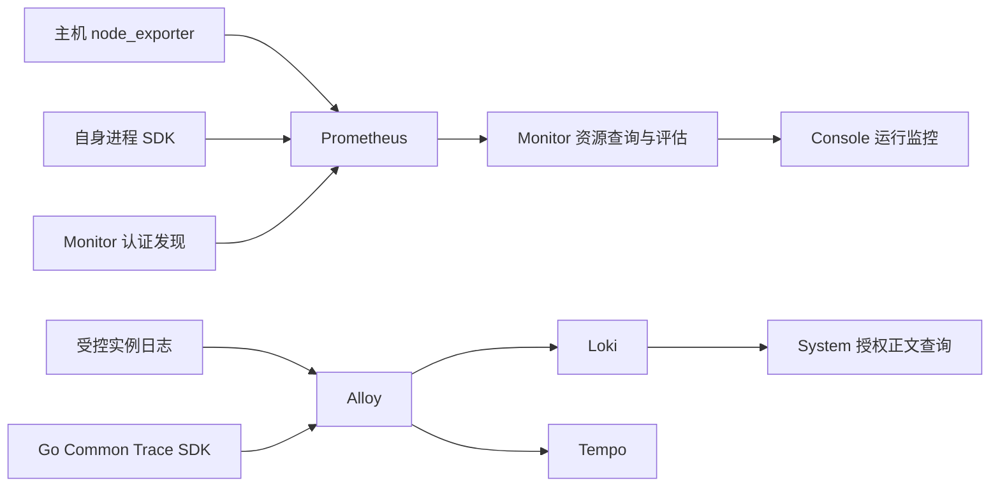

# ADDP 平台运行观测规范

本文维护平台运行观测的共同身份、权限、资源、查询和告警边界，并导航到各专题的唯一正文。概念见[监控与执行体系图](../concepts/addp监控与执行体系图.md)，实现状态、剩余范围及验收缺口统一见[后续专题](../next/ADDP平台运行监控与可观测性设计.md)。标明待实现的内容仅界定边界，不作为开放能力。

专题正文：

| 主题 | 权威正文 |
| --- | --- |
| 主机与采集发现 | [主机与模块绑定、纳管接入、采集发现、引擎部署及 PostgreSQL／Redis／MinIO 专业来源](observability/主机与采集发现.md) |
| HTTP 接口质量 | [全量 HTTP 指标、查询与规则、Python 来源、停源历史和正式产品本机验收](observability/HTTP接口质量.md) |
| 追踪与日志关联 | [SDK 传播、采样与容量、读取授权、查询交互、执行短阶段／Link 和正式身份本机闭环](observability/追踪与日志关联.md) |

## 一、适用范围

适用于平台主机、当前模块运行实例、受限资源查询和平台告警。租户任务执行、日志正文与引擎业务数据仍由各自 owner 维护。

## 二、交付边界

主机台账、采集发现、基础资源、进程 CPU/RSS/时长、趋势/总览与主机 CPU/内存规则已实现。引擎专业观测、容器配额、拓扑追踪与生产规模等剩余范围，以及各层验收状态，按后续专题分别记录；实现就绪不等于相应验收通过。

## 三、对象与模块边界

### 3.1 身份与事实来源

| 对象 | 唯一事实来源 | 约束 |
| --- | --- | --- |
| 纳管主机 | System `node_id` | System 分配 UUID；物理主机与虚拟机均可纳管，容器不是主机 |
| 模块与运行实例 | System 模块登记、实例身份和租约 | UP/DOWN 来自租约，不由采集成功或 CPU 值决定 |
| 业务引擎 | System 引擎登记 | `engine_id` 与主机身份不同；远端、云端、集群引擎不按连接数推算节点数 |
| 容器 | 运行环境的容器身份及配额 | 与进程关联必须有明确证据，不能按名称或资源量猜测 |
| 任务执行 | 既有执行 Owner 与共享执行协议 | 执行身份、槽位和结果不转移到遥测存储 |
| 采集目标 | Monitor 配置身份及版本 | 引用已有主体，不重复创建主体或实例租约 |

IP、DNS、主机名、服务 URL 和 `registered_host` 均不是稳定主机身份。ResourceLocator 继续表示引擎业务数据位置，不加入主机节点语义。

部署关联与调用关联分开：前者记录声明来源及有效时间，后者来自明确配置或 Trace 观测窗口。拓扑染色不能作为已经确认根因的证据。

### 3.2 模块职责

| Owner | 职责 |
| --- | --- |
| System | 主机、模块、实例及引擎身份，当前用户对象授权，IAM 与统一审计；日志正文授权读取 |
| Monitor | 采集配置、发现投影、资源查询与预算、规则、平台事件和通知、监控页面 |
| Common / Common-Python | 共享采样 SDK、DTO、身份声明与服务客户端；不成为第二个事实 Owner |
| Infra | Prometheus、Alloy、Loki 等中心组件及节点来源的部署、传输保护、Secret 与物理资源预算 |
| Console | 统一入口、上下文和 iframe 导航；前端隐藏不替代服务端授权 |

Monitor 不直接查询 System 私有表，不直接读取主机文件，不复制 System 的实例运行状态。业务请求和执行事实不依赖观测设施才可写入或读取。

### 3.3 平台与租户权限

当前主机、平台实例资源、总览及平台资源告警只开放 Platform Context。Tenant 执行监控、执行告警保留自身事实和权限；租户引擎未来的专业观测还须单独明确归属与读取契约。

平台系统管理员承担首期主机、采集和平台告警管理职责，权限在 Owner manifest、内置角色及正式迁移中显式发布。平台安全管理员、审计管理员不因此获得资源管理或日志正文权限；平台角色也不自动取得全部租户 SQL、参数和执行结果。

- 用户请求转发已验证的当前 User Token，由 System 再裁决主体；后台投影不能代替用户对象授权。
- `addp-monitor` 使用独立 Platform Service 身份，只读取有界当前身份投影。同一 `/runtime/observability-identities` 返回必须为数组的字段 `engine_deployments`（真实无对象时为 `[]`），最多 1000 个启用且承载主机有效的平台部署；与节点、模块实例在同一只读可重复读事务内裁决，共用五秒和四 MiB 预算。每项仅含 `deployment_id`、`version`、`scope=infra|business`、`engine_type=postgresql`、`node_id` 与 `source_key={docker_engine_id,project,service}`；来源键沿用部署发现的 Docker 引擎／Compose 项目／服务三元组，`infra` 对应 `addp-infra`，`business` 对应 `business`，当前服务为 `postgres`。不含名称、地址、端口、连接、凭据、租户引擎或运行状态，不因登记存在就视作实时来源可用。超量、异常及控制面错误整份拒绝，不截断或保留旧身份；后台投影不授予用户查询权，专业查询仍逐请求转交当前 User Token 给 System。
- `addp-prometheus` 使用独立最小身份和 `monitor.metrics_discovery.read`，不能访问业务 API。
- 采集 mTLS、发现身份、日志上报及资源查询证书分别管理；不保存长期管理员 Token，不复用业务数据库凭据。
- 资源观测、告警事件、规则管理、通知管理和日志正文分别授权。切换身份或 Context 时清除旧数据、凭据草稿，并拒绝迟到响应。

## 四、主机接入与采集发现

主机与模块绑定、纳管接入、采集发现、引擎部署及 PostgreSQL／Redis／MinIO 专业来源，统一见[专题正文](observability/主机与采集发现.md)。

| 条款导航 |
| --- |
| [4.1 主机与服务绑定](observability/主机与采集发现.md#41-主机与服务绑定) |
| [4.2 管理员确认的部署清单接入](observability/主机与采集发现.md#42-管理员确认的部署清单接入) |
| [4.3 采集目标与认证发现](observability/主机与采集发现.md#43-采集目标与认证发现) |
| [4.4 平台引擎部署登记](observability/主机与采集发现.md#44-平台引擎部署登记) |
| [采集来源统一部署分组（2026-11-04）](observability/主机与采集发现.md#采集来源统一部署分组2026-11-04) |
| [采集项目与来源隔离](observability/主机与采集发现.md#采集项目与来源隔离) |
| [旧来源退役边界](observability/主机与采集发现.md#旧来源退役边界) |
| [4.5 部署侧自动发现来源](observability/主机与采集发现.md#45-部署侧自动发现来源) |
| [PostgreSQL 配对来源发现](observability/主机与采集发现.md#postgresql-source-pair-discovery) |
| [CDC 基础设施组件的自动发现](observability/主机与采集发现.md#cdc-基础设施组件的自动发现) |
| [4.6 PostgreSQL 数据库侧汇总读取边界](observability/主机与采集发现.md#46-postgresql-数据库侧汇总读取边界) |
| [4.7 PostgreSQL 受保护的固定指标来源](observability/主机与采集发现.md#47-postgresql-受保护的固定指标来源) |
| [Redis 专业观测首期边界（2026-11-01 确认，分阶段实施）](observability/主机与采集发现.md#redis-专业观测首期边界2026-11-01-确认分阶段实施) |
| [MinIO 专业观测首期边界（2026-11-02 已确认）](observability/主机与采集发现.md#minio-专业观测首期边界2026-11-02-已确认) |
| [4.8 服务部署预期与分组租约观测](observability/主机与采集发现.md#48-服务部署预期与分组租约观测) |
| [开发 Backend 启动失败](observability/主机与采集发现.md#开发-backend-启动失败) |

## 五、技术路线与故障隔离

### 5.1 唯一数据路径

指标使用单一 pull 路线，不并存 remote_write；原始高频时序留在 Prometheus，配置、事件、投递和审计留在各 Owner 的 PostgreSQL。日志正文保持受控文件 → Alloy → Loki → System，不在失败时退回主机文件读取。Go 同步 HTTP Trace 范围与预算沿 6.5；自身 cgroup、实例资源组与 cAdvisor 的当前接入范围见 [5.2](#52-部署与运行环境)。

不增加独立 Alertmanager 告警 Owner，不要求 Grafana 成为产品入口。成熟组件负责采集、存储和传输，Monitor 负责领域规则、事件和授权体验。

### 5.2 部署与运行环境

中心组件和节点来源统一由标准 Infra 脚本组织，根 `.env.example` 为唯一部署模板。

| 输入 | 行为 |
| --- | --- |
| `ADDP_OBSERVABILITY_METRICS_ENABLED` | 默认 false，选择指标中心及明确来源；不自动为全部机器安装 exporter |
| `ADDP_OBSERVABILITY_LOGS_ENABLED` | 默认 true，可显式关闭现有集中日志组合 |
| `ADDP_OBSERVABILITY_TRACES_ENABLED` | 默认 false，显式选择 6.5 的 Go HTTP 追踪、Alloy 与 Tempo 路径 |
| `ADDP_NODE_METRICS_ENABLED` | 默认 false，单独选择本节点来源；中心开启不自动调用节点部署 |
| `ADDP_PROCESS_METRICS_DEPLOYMENTS` | 显式声明自身进程指标端点，SDK 成功启动后才随实例登记发布 |
| `ADDP_HOST_NODE_ID` | 单个进程的实际部署主机声明，可空，不为不同宿主注入同一个 ID |
| 各设施端点与 Secret 引用 | 所选能力独立预检；未选择的能力不要求其专用凭据 |

布尔值只接受 true/false，不由探测结果猜开关。端点、证书、物理预算与保留参数随组件生命周期生效；Monitor 普通查询预算、规则和配置版本按各自热生效契约管理。

节点来源只消费显式部署输入，`ADDP_NODE_METRICS_LISTEN` 为受控本机 IP 与显式端口，不接受通配监听或自动避让；`ADDP_NODE_METRICS_TLS_DIR` 为仓库外绝对目录，只放 `ca.crt/server.crt/server.key`，不挂 CA 签发私钥或客户端私钥。原生 Linux 来源要求内核 5.12+，采用 host 网络/PID 及只读宿主挂载；Desktop 使用下述受限部署层，不自动放宽主机权限。

节点指标采用独立 mTLS。node_exporter 使用原生 exporter-toolkit；需要保护原始容器来源时只能使用节点专用的固定路径入口，不开放 Web UI、调试或任意代理。日志 Alloy 不获得 Docker Socket、宿主特权或 Shell 权限。

| 环境 | 当前支持与边界 |
| --- | --- |
| 原生 Linux 主机 | 标准节点入口校验宿主内核与部署条件，支持完整主机指标；按来源实际挂载/设备/网卡展示 |
| Docker Desktop Linux VM | 独立 virtual 主机，承载 Business/Infra；支持 CPU、内存、负载、运行时长及内核磁盘统计 |
| Desktop 文件系统与网络 | filesystem、netdev、netstat 仍关闭，不用容器挂载或网卡冒充 VM 全局数据 |
| 原生 macOS 服务 | 观察自身 Go 进程 CPU、当前 RSS 和时长，不绑定到 Desktop VM 冒充其进程 |
| 自身 cgroup 采样 | Linux Common SDK 显式选择 `cgroup_v2=true` 后已接入自身组原始量及内核身份；仅有组样本不证明独立容器或配额，见 [6.1](#61-固定指标目录) |
| 单实例资源组观测 | 已接通部署证明关联、System 投影及 Monitor 单实例即时查询／页面；利用率仍须完整、新鲜且匹配的限制层级证明，见 [6.1](#61-固定指标目录)、[6.2](#62-资源查询与预算) |
| cAdvisor 容器视图 | 已有受控来源准入内核；其标准节点部署与容器资源视图尚未交付 |

自身采样、部署关联与正式身份验收分别认定。共享组 T2 不证明独立 Linux 容器的完整限制层级或正式身份配额页面；固定版本、失败及未覆盖项见[实例与服务发现证据](testing/evidence/Monitor实例与服务发现历史证据.md)。容器配额、进程消耗与 VM/宿主容量不混用。

Desktop 来源固定启用 cpu、meminfo、loadavg、diskstats、stat、uname、time；保持独立 bridge/PID/挂载命名空间、非 root、只读根、cap_drop=ALL 和 no-new-privileges，不挂宿主根、设备或 Docker Socket。磁盘代表 VM 内核设备统计，不证明 Mac 物理磁盘或某个引擎的独占消耗。远程 Engine、非 Linux Engine 和未知环境拒绝接入。

### 已安装引擎采集来源的统一恢复

Redis／MinIO 的显式 `up` 分为准备和应用两段：先检查候选 TLS 和当前引擎部署身份，准备本方采集镜像，再停止旧来源并应用账号及来源配置。准备失败返回非零，保留尚未替换的原来源和账号，不宣称候选配置已生效；应用开始后失败仍移除本方来源并关闭本方账号。`down` 不依赖候选 TLS 或构建。

来源镜像按构建输入摘要命名。已存在的同摘要镜像须核验确切 ID 与工作区归属后复用，只有不存在时构建；读取或归属核验失败不得当作不存在而覆盖。相同输入不得重复导出覆盖标签，避免构建证明变化导致镜像索引 ID 改变，破坏其他作用域仍引用的原镜像。恢复继续核验安装记录中的确切镜像，不回退标签或替换其他镜像。

统一 `status` 只读核验容器归属、运行身份、精确采集镜像及 Redis／MinIO 的私有卷工具声明，逐来源分别报告安装声明变化或原采集镜像不可用。异常计数覆盖这些检查；镜像可用不等同完整恢复核验通过，账号／私有卷／配置沿 `recover` 核验，实际采样由 Monitor 核验。

标准完整本地 ADDP 启动通过唯一采集管理入口检查主机来源、Infra／Business 的 PostgreSQL／Redis／MinIO，以及 Infra 的 Redpanda／Kafka Connect；单模块及 Hosted 启动不自动恢复。根与 Business 配置分域加载，不重新启用未选择、未安装或已停用的账号，不启动数据库。此路径只读核验已启用账号，不安装、变更或轮换账号／权限／凭据，不执行业务读取；来源部署与账号安装仍使用原标准显式 up 路径。

Redis／MinIO 恢复复用唯一受管来源内核：先核验私有安装状态、账号及持久记录／策略、原 Compose 声明、镜像归属、来源组件及私有卷，按唯一固定结构核对配置字段及凭据，逐字节比较证书内容；只允许同容器的原私网地址与原启动时刻进入恢复判断。私有卷核对只使用短时无网络、非 root、只读挂载、固定资源预算的校验容器，不挂数据库数据卷、宿主目录或 Docker Socket，退出核验回收。未完成安装、账号停用／权限漂移、证书内容／端口变化、外部资源、陌生卷或新的数据库容器 ID 均拒绝自动接管；管理员须通过标准部署入口明确重新应用。同一数据库容器重新启动、其私网地址变化及本方来源停止／丢失时，在原安装和账号仍有效的前提下可只重建来源。

来源容器、端点、网络及数据库启动边界均匹配时不构建或重建。确需恢复时只使用已安装的受管镜像和原凭据，重新发布当前数据库身份／启动时刻，并在变更前后重读数据库和账号事实。开始重建前的验证失败不修改旧来源；重建后失败仅清理本方来源，单独报告清理缺口，不停用账号或改变权限。数据库、账号或文件在过程中变化时不能算成功；容器 Running 仍不代表 mTLS／Prometheus／Monitor 查询通过。无独立恢复守护进程、系统自启动或定时任务。

统一管理入口将固定失败阶段映射为中文步骤与核对建议。PostgreSQL复用现有账号／HBA／来源阶段；Redis、MinIO在既有部署校验、私有状态、账号处理和来源构建／部署／恢复／移除边界标注阶段，共用来源内核的异常标注能力。阶段只说明失败发生的位置，不证明具体根因或操作未生效；内层已知阶段优先，保留原异常、主要原因及独立清理标记，未知阶段不透传。诊断不增加数据库读取、权限、重试或修复，不改变命令、期限、启停顺序及回收范围；结果未知时仍先核对状态，不建议盲目重试。

门禁沿现有采集管理、Infra／开发生命周期、Redis／MinIO 来源 T1 与独占 T2；T2 验证健康不重建、停止／删除来源与同容器重启后的恢复、停用与漂移拒绝、账号／私有记录不变及零残留，不替代个人运行或 Hosted。主机来源使用独立的安装证明与恢复规则。[主机采集来源的显式安全恢复](#主机采集来源的显式安全恢复)

### 主机采集来源的显式安全恢复

采集管理入口恢复主机来源时须显式选择 `--scope host`。本地全量 ADDP 启动和重启由启动脚本选择主机，局部模块与 Hosted 精确进程启动跳过此恢复。部署者也可单独执行 `python3 scripts/infra/metrics-sources.py recover --scope host --kind node`，省略 `--scope host` 的批量 `recover` 会跳过主机。[采集来源统一部署分组](observability/主机与采集发现.md#采集来源统一部署分组2026-11-04)

标准up成功后在仓库外当前工作区私有目录保存安装摘要，包含Docker引擎／内核、部署输入及活动模板／证书的摘要、确切容器身份和安全配置、可选容量卷归属，不保存私钥内容或新增凭据。摘要与生命周期共用非阻塞锁；down标记安装停用，失败的up不得保留旧摘要为有效安装证明。

首期recover只启动已存在、完全匹配原安装证明的停止容器；健康容器保持不动。节点服务集合须完整，只有采样器停止时只启动该采样器；不拉镜像、不创建或重建缺失容器、不新增宿主挂载。摘要缺失／停用、来源丢失、配置／证书／内核／Engine变化、容器或卷身份／权限漂移时拒绝，部署者须显式up重新应用。旧部署没有摘要时也拒绝自动收养；不保留兼容恢复路线。

统一入口的恢复失败提示只映射固定原因码，区分安装证明缺失、已停用、读取校验失败、来源组件不完整、归属校验失败、部署输入变化、安装身份或安全配置变化及原镜像不可用。提示依据原有检查结果，不增加读取、自动重试或修复；未知错误仍显示操作失败，不推断具体原因。原始提供方日志、路径、标识和凭据不透传，清理未确认单独附加，不能被主要原因覆盖。归属或私有文件校验失败先提示核对，不能暗示重新应用能绕过校验。

恢复前后重核原输入、镜像与容器安全配置；启动失败或发生并发漂移时，只停止本轮启动的原停止容器，并单独报告清理缺口，不停止原健康来源、删除容器或容量卷。容器运行仍不等同真实mTLS采集。沿统一采集T1和节点独占T2验证健康保持、停止恢复、完整集合及漂移拒绝、失败清理；不更改个人Docker设置或启停其服务，不新增系统自启／定时任务。

### 5.3 故障与状态

| 场景 | 影响 |
| --- | --- |
| 指标未部署、配置不全或 Prometheus 故障 | 对应资源区域明确不可用；不改变业务 Ready、实例租约、路由、任务和结果读取 |
| 单个来源采集失败 | 仅该来源缺值/过期，其他来源继续；不能补零或恢复活动资源告警 |
| Loki 或日志发送故障 | 影响日志正文/链路状态；不改变资源和执行事实，不退回直接读文件 |
| Trace 未启用或故障 | 仅追踪不可用；部署声明、指标和日志不因此丢失 |
| Monitor 必需依赖故障 | Monitor 按自身依赖报告不可用，业务 Owner 仍独立写入和读取执行事实 |
| 设施恢复 | 无需重启业务进程，等待新样本；保留停采缺口，不伪造历史回填 |

能力配置意图、后端可用性、目标采集状态、单项数据质量分别表达。数值状态区分 `not_connected/valid/no_data/stale/unsupported`；未查询成功不能包装成“没有样本”。控制读取成功可返回能力不可用状态，实际查询的未启用、未配置、故障、超时、预算与并发拒绝按 API 错误契约返回。

观测发送使用有界队列、超时与丢弃记录，不能无限积压或阻塞业务。标准生命周期分开记录必需服务和可选能力的结果，所选能力失败可使命令非零，但不能因此中止已满足必需依赖的业务。停用只处理本工作区拥有的设施，保留数据卷。

共用 Alloy 的日志/Trace 故障可能相关；共享磁盘耗尽也可能影响业务，不能把软依赖说成物理隔离。生产还需独立外部存活探针，不能靠已不可用的监控系统给自己告警。

## 六、指标、查询与展示口径

### 6.1 固定指标目录

唯一目录定义公式、单位及窗口，前端和规则复用，不接受任意 PromQL、标签搜索、脚本或调用者自选端点。

| 主机指标族 | 数量 | 口径 |
| --- | --- | --- |
| 标量概览 | 10 | CPU 逻辑核数、一分钟忙碌率、内存总量/可用量/使用率、1/5/15 分钟系统平均负载、运行时长、TCP 当前连接数 |
| 文件系统容量 | 5 | 总量、空闲、非特权可用、已用及使用率，保留精确挂载维度 |
| 文件系统 inode | 4 | 总量、空闲、已用及使用率，与字节容量分开 |
| 磁盘 | 5 | 读写吞吐、IO 忙碌时间占比、平均读写耗时，保留 device 维度 |
| 网络 | 2 | 网卡收发字节速率，保留 device 维度 |
| 磁盘与卷容量 | 1 | 仅即时的 `node.block.capacity_bytes`，保留 device／kind，不提供趋势或汇总 |

容量用 IEC 自适应单位，运行时长用天/小时/分钟；解释放在对应指标或列旁。系统平均负载是运行/等待 CPU 以及不可中断等待（常见于 IO）的任务数量平均值，不是百分比，也不是内存或 CPU 使用率，必须结合核数及其他指标判断。

TCP 当前连接数为 `node.tcp.current_connections`（unit=`connections`，瞬时 Gauge），唯一原始来源 `node_netstat_Tcp_CurrEstab`，按 RFC 4022 统计 ESTABLISHED＋CLOSE_WAIT；不是累计建连次数，也不包含监听或 TIME_WAIT。沿既有主机、来源及 instance 限定，只有单条、有限、非负且不超过 JavaScript 安全整数上限的整数样本才有效，沿原 60 秒新鲜度和查询预算读取当前值／趋势。无宿主网络命名空间统计（包括当前受限 Docker Desktop 来源）、缺样或重复来源不生成有效零值；页面在指标旁解释不可用，不从容器、数据库连接数或其他状态推算。保留 CPU／内存总览、TOP5 与告警既有范围，不新增连接告警、权限或采集控制面。

主机内存使用率基于可用内存，不把缓存当泄漏；文件系统使用率采用非特权可用容量口径，绑定挂载、内存和网络文件系统不计作物理容量合计。磁盘速率与 CPU 要求完整一分钟计数窗口、同次启动与来源证据；计数重置、重复/异步来源或窗口不足不生成有效值。

磁盘忙碌时间占比不是饱和度，平均读写耗时包含排队和处理；没有完成请求时平均耗时为空，有请求且耗时确为零才可显示零。设备层级、桥接与虚拟接口不简单累加；不通过插值、截断异常值或用相似指标伪装缺值。磁盘列表优先展示活动设备，无活动设备可展开。

PostgreSQL 专业观测的固定查询目录的「资源与活动」组保留 12 项：总连接、活跃连接、空闲连接、事务内空闲连接、活跃等待、锁等待、IO 等待、最大连接数（均为数量）；每秒提交、每秒回滚、每秒死锁（各自为独立累计量的速率）；非模板数据库总容量（字节、页面自动换算）。这是整体 PostgreSQL 观测，不将采集事务当业务吞吐、不归算租户用量，也不凭连接数直接判断健康。「逻辑复制」组显示逻辑槽总数、不活跃逻辑槽数、逻辑槽保留 WAL，复用同一即时与趋势接口。列表摘要保持四项，每次详情仍最多请求 12 项。

速率使用固定一分钟完整窗口，至少四次有效采样，并验证过去和当前属于同一服务启动／统计代际、无计数回退且窗口两端新鲜；重启、统计重置或统计关闭时留空，不补零、不跨代际计算。SQL Exporter 的 HTTP 200／up=1 仍不足以证明 SQL 成功，必须验证固定快照、采样时间与字段完整性；来源不可用或 SQL 失败清空当前值，缺样形成趋势断点。

进程目录独立：CPU 使用 `process.cpu.core_equivalents`，1 核表示消耗一个逻辑核的计算时间；内存为当前 `process.memory.resident_bytes`，时长从本次启动计算。无明确配额不生成配额利用率，不用宿主总内存计算进程使用率，也不用 Go 堆或峰值 RSS 替代当前 RSS。macOS 自身采样严格核对系统接口成功与返回长度，失败不生成有效零值。

自身 cgroup 采样与容器身份分开：Linux Common SDK 仅在进程部署输入显式选择 `cgroup_v2=true` 时，才可在既有 mTLS 来源发布当前 cgroup v2 的 `addp_cgroup_identity_info`、`addp_cgroup_cpu_usage_seconds_total` 和 `addp_cgroup_memory_current_bytes`。身份只含内核 boot UUID、cgroup inode 和 PID namespace inode，均以规范字符串标识；只读 `/proc/self/cgroup`、`/proc/self/mountinfo`、自身 PID／cgroup namespace、内核 boot ID 及当前组固定资源文件，不扫描其他进程或组。路径、凭据和原始错误不发布；文件、字段、读取量及路径严格有界。迁组／身份变化或读取失败时清除本次组指标，不能变为有效零值，也不能影响原进程 CPU／RSS／启动指标。这三项仅是私有采集事实，不直接成为用户查询目录；单实例资源组观测沿本节部署证明及 [6.2](#62-资源查询与预算) 的既有契约处理，列表摘要与告警范围不随采样声明扩大。

`cpu.stat` 沿 Linux 扁平键值格式读取 `usage_usec`；内核的 `core_sched.force_idle_usec` 等点号命名空间键不应使整组样本失效。仍严格校验有界字段名、每行两项、唯一键及规范无符号整数；不把其他计数并入 CPU 用量、不改变指标目录。字段依据见 [Linux v6.11 内核实现](https://github.com/torvalds/linux/blob/v6.11/kernel/cgroup/rstat.c#L555)。

2026-10-24 已确认由部署侧提供容器身份及限制层级的只读证明，应用不开放宿主 cgroup 命名空间、不持有 Docker socket。仅在当前登记实例／本次进程启动、真实容器／本次容器启动及内核边界完全匹配，且限制层级证明完整新鲜时，才可进入容器配额观测。可见组用量不证明独立容器、独享额度或完整父级限制。自身采集、部署证明、System 关联、Monitor 查询与页面分别验证；新增自身采集基础不能替代后续产品链路及对应验收。

容器资源沿同一进程来源接入：SDK 在启动时取得的 boot UUID／cgroup inode／PID namespace inode 随不可变私有声明登记，后续采样仍核对当前边界。部署发布器在原有受管目录发布 `addp.container-proofs/v1`，仅可信本机 Linux Docker、当前工作区 `addp-platform`、标准 runtime-log 单应用入口；读完整容器 ID／启动／宿主 PID及真实完整 cgroup v2 层级，双读核对，最长 90 秒。父级隐藏、平台不支持、读取失败或来源中断清除当前证明，不以 Docker 配置额度替代真实父级限制。首期要求层级 CPU burst 为零；CPU 上界来自完整层级 quota/period 与有效 cpuset，内存取有限 memory.max 最小值；均为硬上界，不是独享或保证容量。连续快照一致的限制记录重新启动／变化／超时即重新累计；CPU 比率要求记录覆盖完整一分钟及边界裕量。

System 只在当前有效实例的 module／role、三项内核身份及进程／容器启动时间匹配且容器边界唯一时，沿既有后台投影附带证明；不改变主机关联、IAM、普通实例 DTO 或登记租约。Monitor 先按当前 User 精确读取实例，再查询对应来源；CPU 复用至少四样本、完整一分钟边界、无重置及双端身份保护，内存使用整组 memory.current，不能用 RSS 替代。查询在证明时点评估，返回前重读同一投影，限制／实例／租约变化则拒绝，不缓存旧额度。比例不裁剪到 100%，无有限上界、稳定记录不足或无有效采样时保留空值并在对应卡片解释；原生开发仍是宿主进程。

### 磁盘与卷容量

2026-10-28 用户确认：只展示当前纳管节点内核可见的已就绪非分区块设备及可核实结构类型，不合计整机／集群物理总量，不计算块设备使用率，不增加趋势或告警。排除分区、RAM、loop、零容量对象；选择依据内核属性及设备关系，不按设备名猜物理身份。映射卷与底层设备分别显示，不能相加。原文件系统明细与规则保持原契约。

部署侧沿唯一节点来源入口显式选择 `ADDP_NODE_BLOCK_CAPACITY_ENABLED=true`，默认关闭。专属非特权只读采集器仅读受控 sysfs 的容量、设备号、分区、映射关系与启动证明；原生 Linux 读取宿主 sysfs／proc，Desktop 仅在内核与设备号核对成立时提供 VM 视图，不增加宿主根、Docker Socket、原始设备或业务文件访问。System 不新增实体或后台投影。

唯一发布路径为专用目录内 node_exporter Textfile Collector。每十五秒原子替换唯一 `block-capacity.prom`；仅允许 `addp_block_capacity_` 前缀，非受管文件拒绝。帧含 success、supported、sample_time_seconds、boot_time_seconds、device_count、bytes（device／kind），文件不带 Prometheus 样本时间戳；失败帧不含容量，未选不发布。容量为 sysfs size 的512字节扇区换算，限制精确整数范围；扫描上限4096对象、100就绪设备，超限整帧失败，不截断。按内核 major driver 排除 ramdisk／loop，按 partition 属性排除分区；结构类型仅使用 device、mapped、raid、unknown，不表示物理性。

源时间、原生 node_boot_time_seconds、当前抓取状态和整帧完整性共同裁定当前值；旧文件不能因新抓取变新鲜，设备消失不能沿 lookback 拼回旧帧。采集关闭、失败、过期、空集合及不支持分别表示，不能伪造零容量。后端沿既有 User／主机读取裁决、固定目录和原查询预算；不得直连 Docker、执行远程命令、增加 System 读取或绕过预算。设备明细及 IEC 容量就近展示来源范围，不暴露 sysfs 路径、序列号或私有证明。

来源 T0／T1、真实来源与 Prometheus T2、页面 T3分别验证；API 变动同步 Swagger。原生隔离验收的容量证明必须精确绑定同内核采集器、只读白名单宿主元数据、受管程序及双端同一tmpfs卷，发布帧与当前sysfs逐设备一致；真实页面通过同一共享DOM收据核对完整设备集合、结构类型及IEC容量，打开／刷新各一次，保持原时限。既有隔离 Hosted 的临时管理员只读用途扩展为当次节点容量、状态及同页读取；沿原真实密码／MFA、独立 Prometheus 身份和退出清理，不造盘、不挂卸载、不加压。CI／Hosted 实际执行等专门会话安排，本会话不调度或设置定时任务。

### 6.2 资源查询与预算

资源读取仅允许非委托 Platform User，使用 `monitor.resource_observation.read` 并按主体要求核验 System 读取权限。System 当前身份投影和普通用户读取共同检查当前主体、来源、版本、启动边界及租约，不能用后台身份跳过用户授权。

PostgreSQL 专业查询同时核验 `monitor.resource_observation.read` 与 System 的 `platform.engine_deployment.read`，查询完成后重核；私有观测投影不代替当前 User 的读取授权。

| 接口（Monitor `/api/v1/monitor` 下） | 约束 |
| --- | --- |
| `/platform/resource_observations`、`/platform/resource_trends` | 显式 node_id、固定 metrics 白名单；趋势使用整秒 RFC3339 start/end，维度严格匹配 |
| `/platform/resource_summaries` | 显式 `node_ids` 和 `metrics`，当前授权节点的批量摘要；指标仅允许 CPU 核数／一分钟忙碌率、内存总量／使用率、运行时长、三档系统平均负载和 TCP 当前连接数九项的非空无重复子集，同一评估锚点，不逐行查询 |
| `/platform/process_resource_summaries` | 当前授权实例批量 CPU/RSS/时长，固定目录；普通实例 DTO 仅公开采集声明布尔值 |
| `/platform/process_resource_totals` | 当前授权服务的一分钟 CPU、进程 RSS 和容器工作集，按模块、角色及指标返回有效覆盖 |
| `/platform/process_resource_trends` | 仅 instance_id/start/end，固定 CPU/RSS 两条序列；不读取已退出实例历史 |
| `/platform/container_resource_observations` | `instance_ids` 恰好一个当前实例；固定资源组 CPU 核消耗、memory.current 及两项硬上界利用率，不改变批量摘要目录；无有效证明时只读当前声明内核边界的绝对用量 |
| `/platform/engine_resource_observations` | 单部署即时观测，固定专业目录，每次最多十二指标 |
| `/platform/engine_resource_summaries` | 当前授权页部署的四项摘要，沿同一查询预算 |
| `/platform/engine_resource_trends` | 单部署固定专业目录，仅读当前数据库容器运行段 |
| `/platform/engine_runtime_observations` | Meilisearch 与 GeoPython 当前实例固定指标，趋势须绑定当前来源 UUID |
| `/platform/resource_overview` | 不接受 query/body，完整授权主机范围及 CPU/内存 TOP5 |
| `/platform/metrics_collection_health` | 不接受 query/body，固定采集目标、发现健康及留存空间摘要 |
| `/settings/resource-query-policy` | Monitor 普通平台配置，沿 `monitor.configuration.read/update`，版本 CAS 与审计 |

传输采用固定 `MONITOR_PROMETHEUS_URL` 和独立 CA/client cert/key 部署输入；浏览器不读取私有地址或凭据。查询响应标明身份、单位、预算版本、评估/采样时间、窗口和步长，按每条序列判断有效性；null 与 0 区别明确，缺值形成断点。

| 预算项 | 当前默认上限或初值 |
| --- | --- |
| scrape / 超时 / 发现 | 15 秒 / 5 秒 / 30 秒；首期固定，不提供无实际效果的采样编辑项 |
| 新鲜度 | 60 秒；速率及告警仍另须完整窗口 |
| 单请求 | 12 指标、100 序列、每序列 1,000 点、总计 20,000 点、最长 7 天 |
| 步长 | 至少 15 秒，随范围和预计序列规划；返回后再次核验，不静默截断 |
| 查询超时与并发 | 总期限 5 秒；单主体 2、单 Monitor 进程上游 8；超限快速拒绝，无无界等待 |
| TSDB 保留 | 7 天与 10 GiB 体积同时限制，可能提前淘汰；另预留 WAL/压缩空间 |
| 来源序列预留 | 每端点和中心自身各 20,000。Monitor 和 Prometheus 使用同一部署变量 `ADDP_METRICS_TARGET_LIMIT`，接受 1 至 96 的整数，缺省 12。总预留为（外部来源上限 + 1）× 20,000。选择 96 时对应 1,940,000。 |
| 组件预算 | Prometheus 1 CPU/2 GiB，node_exporter 0.25 CPU/256 MiB；节点入口 0.25 CPU/128 MiB |

来源准入按去重端点的预留配额原子校验，不能把当前少量序列或单端点 sample_limit 当作全局限额。查询预算可收紧并热生效，在途请求保持开始时版本；物理资源、卷与保留归 Infra。默认预算不是已证明的生产规模上限。

预算容量沿 `make test-monitor-metrics MONITOR_METRICS_TEST_ARGS=--case=target-budget` 验证。独立 Prometheus、网络、卷及 mTLS 凭据中，34 个基线保留一台主机、六个引擎、五个 Worker、一个网关及其余后端；加入两个真实 CDC 来源形成 36 个，再加入两个有界 HTTP 指标夹具达到 38 个。验证 39 个的整批拒绝、移除超额后 38 个恢复，以及 38 个时真实 CDC 单源故障隔离。记录抓取、新鲜样本、时序与写入量、查询耗时、内存和磁盘增长。受控 HTTP SD 夹具验证 Prometheus 传输和容量，System 当前事实及 Monitor 准入由身份投影门禁核对。夹具不计 Meilisearch、GeoPython 正式发现或页面通过，短时估算不证明七天留存。

扩容候选沿同一隔离入口运行 `ADDP_METRICS_T2_CAPACITY_SWEEP=1 make test-monitor-metrics MONITOR_METRICS_TEST_ARGS=--case=target-budget`。候选档位为 64、96、128。该参数仅改变当次隔离 Prometheus Job 和负载夹具，保留原 38 目标标准门禁。容量查询保留平台计数与按模块的 HTTP 分位趋势。全平台原始直方图范围查询单列 Prometheus 样本预算诊断。发布新上限前还须验证实际来源准入及发现期限，按测得的资源余量选择档位。

本机隔离容量档测得 64／96／128 个目标分别约 3,769／6,107／8,446 样本每秒。按每样本两字节外推，七天样本块约 4.25／6.88／9.51 GiB。96 是本轮通过 8 GiB 样本块余量条件的最高档，128 超过该条件。此估算未包含其他长期占用，生产真实留存须按部署实测。

开发部署有进程采集计划时，启动、重启和指标配置渲染均在应用前校验计划单元数、选中的本机主机来源以及 Infra 和 Business 引擎来源之和。即使来源暂未运行，也预留其名额。超额报告各类数量和上限，重启入口在停止进程前退出，指标配置渲染保留现有配置。手工添加的远程来源仍由 Monitor 在真实发现时纳入总预算。

标签仅保存必要身份及有限维度，不加入 TraceId、请求/执行/用户 ID、完整 URL、SQL 或 Token。服务质量后续采用规范化 route 和有界直方图；无请求不虚构错误率和延迟。

### 6.3 趋势、时段比较与总览

#### 页面导航、筛选与刷新

运行监控依次提供资源总览、主机监控、引擎监控、服务监控、HTTP 监控、调用链，入口沿 Console 权限。引擎监控沿 System 现有引擎部署进入，使用已登记部署和来源。[引擎监控跳转](../../common-frontend/docs/components/页面状态与导航.md#引擎监控跳转与请求隔离)

引擎监控的 Infra 页显示 Meilisearch 搜索任务，计算运行时页显示 GeoPython。固定查询 `/platform/engine_runtime_observations` 只允许持有 `monitor.resource_observation.read` 和 `platform.engine_deployment.read` 的非委托 Platform User。Monitor 沿 System 当前身份读取安全摘要，结束时重核部署或运行实例，GeoPython 续期允许同一实例的租约前进。Meilisearch 显示待处理、最老等待和当前保留失败任务数，GeoPython 显示有效 CPU 核数、内存上限、栅格任务运行数及等待数和准入状态。Meilisearch 时间范围限制在当前容器启动后，GeoPython 限制在当前运行实例启动后，趋势有缺样断点。空清单、发现不可用、来源不可用及有效零值分别表示。两项保持已有独立来源身份，结果不返回采集端点、容器 ID 或业务数据。

服务监控顶部按后端（含调度与入口）、前端和 Worker 汇总当前授权范围的资源。前端只计入具有主机读权的用户可见的已登记节点，查询结束重核节点、目标与版本。各角色 CPU 以同一实例一分钟内的累计 CPU 秒数计算平均核数；新实例与恢复后的新目标版本须先取得完整窗口。进程 RSS 包含 Vite，Compose 容器工作集另外汇总。各指标分别列出已知实例的有效采样数和应采数；已暂停或无当前部署观测的节点另列覆盖未知数。固定查询 `/platform/process_resource_totals` 由持有 `monitor.resource_observation.read` 和 `platform.module.read` 的非委托 Platform User 读取。服务进程分母取自 System 当前用户可读模块中租约有效的后端、Worker、调度和入口实例，按实例启动身份去重，范围独立于页面筛选和分页。复用进程目录的一分钟 CPU 核占用与当前 RSS，Prometheus 在同一评估时刻按模块汇总有效样本。CPU、RSS 各自返回有效覆盖和合计，零覆盖值为空。RSS 可能包含多个进程共用的内存页。查询结束重核模块与当前实例集合，权限或实例变化使本轮无效。独立引擎与数据基础设施的资源仍沿引擎和主机页。

资源总览的采集中心卡片经 `/platform/metrics_collection_health` 读取同一 Prometheus 自身采样。仅限有 `monitor.resource_observation.read` 的非委托 Platform User。使用固定 Job，展示已发现目标数、最近有效抓取在线及失败数、配置目标预算、最近五分钟是否发生发现失败、TSDB 块／Head chunks／WAL 体积及配置留存上限。目标变化造成发现与采样暂时错开时按缺样处理。体积口径为上述三项的合计，主机可用磁盘仍由主机监控提供。

- **筛选提交**。主机、服务和引擎列表自动提交完整筛选，无独立搜索按钮。有限选项和完整时段即时提交，未完成的自定义时段就近提示。输入防抖、Enter、隐藏后的待提交状态及计时取消沿共享规则。提交回首页，用 `replace` 更新唯一 URL 并沿 Console 单历史恢复。服务关闭旧趋势，主机保留列视图和每页数量，引擎保留刷新选择。相同 URL 只恢复刷新调度，手动或自动刷新仅读取已提交范围。列表条件由 System 在计数和分页前处理，各列表保持自己的匹配口径，条件不传入即时或趋势接口。[自动筛选与已提交范围](../../common-frontend/docs/components/页面状态与导航.md#自动筛选与已提交范围)
- **原位刷新**。默认 15 秒，最短 10 秒，刷新选择沿 URL 恢复。相同身份、对象与已提交范围下，列表、详情、合法的行内展开和趋势可在手动或自动刷新期间保留读数、分页、视口与比较，成功后原位更新。仅首次读取用整块加载反馈，刷新在途用控件状态和 `aria-busy`。刷新间隔变化不改变数据上下文。隐藏时暂停并取消在途读取，引擎页同时清除观测。[可见页面自动刷新](../../common-frontend/docs/components/页面状态与导航.md#可见页面自动刷新)
- **对象事实与失败**。主机详情核对本轮 System 的 UUID、名称、版本和纳管状态，引擎页核对本轮部署事实、引擎类型及有效主机关联。以事实值判断变化。事实、身份或查询范围变化即清除相应旧观测及视口。查询范围包括指标组、设备维度、时段、历史锚点、比较方式以及已提交筛选、分页和列视图。已知停用或解绑时，页面立即撤下旧采集状态。主机详情还清除旧设备、挂载和比较，独立设备组件按对象版本失效。列表只消费当前授权页的一份摘要。独立资源组或趋势失败只清除对应旧结果，保留本轮仍有效的其他结果。服务摘要失败还要清除旧趋势和容器证明，实例失效时清除旧容器值。401／403／404 停止自动读取并清除失效内容，用户手动刷新时重新取得当前授权范围。取消或迟到的结果不得恢复旧值。[请求取消与迟到响应隔离](../../common-frontend/docs/components/页面状态与导航.md#请求取消与迟到响应隔离)
- **就近说明**。FieldHelp 用于筛选、指标、单位、图表操作和限制说明。主机详情的说明贴近指标、设备或容量列，采样折叠区保留实际采样时间。服务趋势的说明贴近时段、CPU／RSS 和资源组，直接展示证明状态、核验时间及硬上界。引擎的指标和当前容器段说明分别贴近指标和时段选择。页面直接展示数值、轴与单位、查询时窗、固定历史、设备数量、采集和缺样状态、样本不足、七天比较不可用以及权限或读取错误。[共享基础控件](../../common-frontend/docs/components/基础控件与工具.md#表单组件)

#### 主机列表、行内明细与即时展示

- **列表范围**。沿 System 名称／地址查询和 `node_kind=physical|virtual`、`enabled=true|false`，省略表示全部。纳管启用仅表示管理意图。System 和 Monitor 共用 `HostNodeFilters`／`resolveHostNodeFilters`，各自组合查询和路由。Monitor 的类型或状态选择同时提交名称草稿。重置清空筛选与页码，保留每页数量、列视图和刷新偏好。列表总数在尚未读取或失败时为未知，分页只使用成功返回的总数。
- **列视图与批量预算**。默认“核心资源”显示 CPU 逻辑核数、一分钟忙碌率、内存总量和使用率、运行时长。以 `list_view=load-connections` 恢复“负载与连接”，仅请求 1／5／15 分钟系统平均负载及 TCP 当前连接数。默认视图省略该参数，切换保留已提交筛选、分页和刷新间隔，返回、重载和重置筛选均保留所选视图。默认 20 台分别请求 100 或 80 条序列，空页跳过摘要。按“本批节点数 × 所选指标数”在逐节点 Owner 裁决及上游读取前校验，超预算整批拒绝，保留台账并提示缩小页大小。总览与采集配置页仍各自显式请求原 CPU／内存两项。固定非空无重复指标选择沿 [6.2](#62-资源查询与预算)。
- **行内明细**。当前页最多临时展开一台主机的一类明细，展开后才读取，复用详情的设备和挂载组件。磁盘五项、网卡两项，文件系统分别按详情顺序读取容量五项与 inode 四项。两组按完整 `device/mountpoint/fstype` 对齐，各自保留采样和查询时间、预算及失败结果。沿来源、完整一分钟窗口和单次预算，禁止跨设备或挂载求和、估算整机 IO 使用率及拆批、截断或合并绕过预算。切换主机或类别、收起、离页、身份或权限变化时取消旧请求并清除明细。筛选、分页、列视图变化或重载关闭展开，同一授权页刷新可保留并重读。明细 401／403／404 同时关闭展开、清除列表观测。展开仅存于当前页面，可跳转到同一主机及设备或完整挂载身份的趋势，返回恢复列表上下文。
- **即时值**。CPU 空闲率在忙碌率卡片内按同一分钟有效值计算 `100 - busy_percent`，共用采样状态，预热、陈旧或缺样显示“—”。它只用于该卡片，无独立指标、查询、趋势或规则。热力面板直接复用已授权的 CPU 忙碌率、内存使用率及完整挂载身份的文件系统使用率，保留各自采样时间，CPU 保留一分钟口径，文件系统仍使用 `used/(used+available)`，展示时直接使用返回的比例。有效值用主题色、精确百分比和 0～100% 进度条，其他状态用中性占位，文件系统来源不可用时显示原因。颜色仅表示使用率，不计算健康分或告警阈值，inode 和其他挂载不能填补缺值。各挂载可打开同一指标和维度的趋势。[固定指标目录](#61-固定指标目录)

#### 服务列表与主机关联

服务监控默认读取 System 在线且已声明采集的实例，合并各页登记；有主机读权时，一并展示所选节点的前端观测。每个模块一张等尺寸摘要卡，依次列出后端（含入口与调度）、前端和 Worker 的 CPU 与内存。同角色多个实例在该项都有有效样本时求和，缺少角色或样本显示「—」。点击卡片进入独立模块详情页，返回时恢复列表位置与筛选。详情页按模块读取各角色与副本；历史实例沿用列表的状态与时间范围，在模块内单独分页。可查看每个实例的角色、租约、采集状态和趋势，以及前端运行方式、页面入口、脚本和重启次数。使用实例条件、历史或采集覆盖筛选时，沿 System 实例分页，仅汇总当前页匹配的实例。在线状态按租约显示 `UP`／`DOWN` 和本地化文字，采集状态与在线独立。Worker 用途只读 `metadata.runtime_name`，未知时只显示正式角色。

| 筛选 | Monitor 使用边界 |
| --- | --- |
| 模块 `module_name` | 使用 System 持久模块定义作可搜索单选，精确查询，选定或清空时提交，选项不受实例页或采集状态限制。 |
| 登记端点 `registered_host` | 仅匹配登记端点主机名或 IP，精确匹配，不含协议和端口。没有监听端点的 Worker 不补配宿主地址。登记地址与端口另列展示，无端点显示未登记。HTTP(S) 解析及 IPv6 展示沿共享实现。 |
| 承载 IP `node_ip` | 由 System 规范化 IPv4／IPv6 后与 `host_node_ips` 精确匹配。前端仅去单值首尾空白，无效值显示查询错误。未监听的 Worker 可用已声明 IP 匹配。IP 缺失不以其他地址补配，也不据此推断主机关联。 |
| 宿主或运行环境名 `node_name` | 与登记的 `host_node_name` 或 `runtime_hostname` 做大小写不敏感的精确匹配，不依赖监听端点，不用当前主机显示名称补配或推断 `node_id`。 |
| 时间 | 默认登记时间、全部时间，可选离线判定时间及共享时段目录，重置回默认。相对时段按每次请求的同一当前时刻重算，自定义起止固定在 URL。按 UTC 发送，下界含、上界不含。离线判定时间只查当前仍有离线观测的实例，恢复后退出。时间依据独立于在线状态，不改变实例趋势的启动边界。 |
| 原因 `stop_reason` | 默认全部原因，选择即提交。只读 System 当前离线观测，恢复后退出，租约超时仅表示失联。原因不自动切换状态或时间依据，也不从采样或本地时钟推断。 |

条件与角色、状态、采集声明按交集查询，分页、刷新、趋势及主机跳转返回保持已提交范围。重置清空筛选、页码和趋势，恢复默认在线及采集范围，保留刷新选择。共享规则见[登记端点](../../common-frontend/docs/components/页面状态与导航.md#模块实例登记端点)、[时间筛选](../../common-frontend/docs/components/页面状态与导航.md#运行实例时间筛选)和[离线原因](../../common-frontend/docs/components/页面状态与导航.md#服务实例离线原因)。

服务和引擎列表、引擎详情只使用 System 返回的有效 `node_id`。另有主机读取权限时，对当前页去重、最多四并发解析当前名称，复用同一领域链接并以 `push` 保留返回地址。无权或读取失败时仅显示 ID，独立于指标读取。服务未绑定显示未关联，引擎无有效关联显示失效，均不回用登记名称或旧绑定。刷新失败、身份或页面变化后清除旧名称，迟到结果不写回。

#### 趋势组合、视口与历史范围

趋势复用共享 ChartRenderer 的图例、提示、坐标轴和缩放。图例只改变显示，悬停对应原评估点及各自单位，全部隐藏时清除旧提示。缩放仅改变本地视口，查询、完整评估网格、采样明细和时段比较保持原范围。相同上下文的刷新及主题／语言重绘可保留相对视口，身份或上下文变化、查询或校验失败时清除。视口只存于页面或弹窗内存，URL 与持久配置不保存。[图表展示属性与状态保持](../../common-frontend/docs/components/预览与结果展示.md#图表展示属性与状态保持)

| 页面 | 视口归属与读取边界 |
| --- | --- |
| 主机 | 绑定主机、指标组、设备维度、时段、历史锚点、比较模式与当前身份。同组内存指标及同设备方向切换保留视口。文件系统按完整挂载身份区分，容量、比例与 inode 切换重置。 |
| 服务 | 仅当前有权读取、租约有效且已声明采集的实例可打开趋势。起点裁剪到本次启动，CPU 仍需完整一分钟。重启产生独立实例，不能按服务名替换。CPU 与 RSS 各有独立视口，关联实例、已提交筛选和时段，关闭弹窗即清除。 |
| 引擎 | 视口绑定部署、指标、时段和身份，返回列表或重载清除。PostgreSQL 即时和最多七天趋势仅读当前数据库容器运行段。采集器重启且数据库容器身份相同可延续。数据库进程重启或统计重置的速率依代际检查留空，容器重建后不得拼接旧运行段，退出容器历史另定保留与授权。 |

主机详情凭据续期时立即清除观测与可见缩放，取消在途请求，权限未知时暂停读取。仅对本页已成功显示的内容，可在轮换前于组件内存暂存滚动、缩放及核对依据，暂存不含读数或凭据。账号、平台上下文、委托、完整有效权限、查询及 System 主机四项事实均相同，且本轮各组资源与趋势按原新鲜度重读并校验成功后，才一次恢复滚动和缩放。任一事实变化、重核或任一读取失败、未恢复授权时再次轮换、离页或重载均丢弃暂存。

固定指标趋势遵循 [6.1](#61-固定指标目录) 与 [6.2](#62-资源查询与预算)。多序列组合用一次现有查询，按指标和设备身份匹配同一评估网格，错设备、缺序列或错网格时拒绝整图。显示单位从有效样本选择，各序列独立保留有效零和缺值断点。所选指标或方向仍决定采样明细。

| 主机趋势 | 专用展示与计算 |
| --- | --- |
| 运行时长 | 由完整已加载范围的最大有效时长选择秒／分钟／小时／天，换级点为 60／3,600／86,400 秒。轴与提示同单位并显示两位小数，全缺样时轴默认秒。缩放不重新选单位，API 保留秒，卡片和采样明细沿复合时长。 |
| 磁盘与网卡 | 同一磁盘读写画折线，同一网卡收发画并排柱，按完整一分钟平均字节速率展示。两方向使用同一 IEC 自适应速率轴、独立图例及末次评估值，磁盘轴标明“磁盘读写吞吐”和单位，网卡关闭密集常显标签。保留原时段、步长、全部返回点及每序列 1,000 点上限，不插值、求和、分桶或换算为流量总量和带宽利用率。 |
| 内存 | 总量、可用量、使用率同图，左轴为共用 IEC 容量单位，右轴为 0–100% 使用率。只换算容量单位，使用率独立消费，容量缺样不改写有效使用率。比较仅使用使用率，单图不能判定泄漏。 |

#### 相邻时段比较

主机 CPU 忙碌率和内存使用率、服务 CPU／RSS 支持 5 分钟、1 小时、24 小时。以服务端查询结束锚点 T 和时长 W 一次读取两倍范围，本期 `(T-W,T]`、上期 `(T-2W,T-W]`，分界点只计上期。主机固定历史 end 不推进。七天保留曲线，当前保留范围不足以支持约十四天的两期比较。

各指标独立校验两期完整评估网格，每个预期点都有效且非空时才按未舍入值计算两期算术均值和本期减上期的差。真实零和零基线有效。缺样、陈旧或启动裁剪时显示样本不足及两期有效／预期点数，不用部分平均。评估网格完整只证明比较输入，原始抓取完整性和精确时间积分另行判定。

- **主机**报告百分点差，并展示绝对时间和评估间隔。
- **服务**要求整个比较时窗在本次实例启动后，CPU 预热期不计有效点。CPU 差用核，RSS 差用自适应 IEC 容量，两者不计算增长百分比。图旁显示起止时间和比较结果，曲线只画本期。模式沿唯一 URL 恢复，在支持时段间切换保留，换实例、关闭趋势、分页、提交列表筛选或切至七天时清除。失败或撤权按页面规则清除旧比较。

#### 资源总览与验收入口

- **主机总览**依据同一只读快照中完整的当前授权集合，含停用主机，独立于列表筛选和分页。System 单页最多 100 台，默认双指标预算 100 序列，最多评估 50 台。超范围或预算整份 422。首页展示纳管、采集配置、正在采集和待关注数量，待关注限已接入且失败、过期或等待首次采样，启用未接入与停用分别显示。
- **CPU／内存榜单**分别报告应覆盖、有效、缺失、过期和未接入数量，缺覆盖显示不完整。仅 valid 点含真实零参与 TOP5，按值降序、同值按 `node_id` 升序，以绝对百分比条显示读数并链接详情。整轮成功后原子发布榜单，缺整页或超预算时不使用部分结果。跨主机容量、进程 RSS、容器配额、共享挂载及引擎集群容量需另定去重与分母。
- **引擎和在线实例**按各自入口权限独立读取 System 第一页（各至多 100 条），仅条数等于总数才汇总。引擎包含 Infra 与 Business，分列纳管、启用且有效绑定、至少一项有效摘要及待采集，停用和无效绑定不计采集分母。服务限当前在线实例，区分未声明、已声明但无有效摘要、至少一项有效摘要。至少一个 valid 点才计有效，目标 UP 仅为采集状态。每类最多一次现有批量摘要，超预算不拆批，沿各自预算和当前用户裁决，由总览周期串行提交。预算不足时保留完整台账计数，样本覆盖标为未知。服务卡片从同一响应按模块显示各类采集缺口并跳转相应筛选，预算不足时仅列可由台账确认的未声明项。各类独立处理失败和撤权。

前端确定性、受控浏览器与构建沿 `make test-monitor-frontend`，覆盖范围见 [9.1](#91-标准门禁)。真实采样、正式身份和 Safari 实操按各自证据认定。[节点与主机](testing/evidence/Monitor节点与主机资源历史证据.md) · [实例与服务](testing/evidence/Monitor实例与服务发现历史证据.md) · [引擎页面](testing/evidence/Monitor采集来源与引擎指标历史证据.md#引擎页面导航刷新与缩放)

### 6.4 HTTP 接口质量（分阶段接入）

全量 HTTP 指标、查询与规则、Python 来源、停源历史和正式产品本机验收，统一见[专题正文](observability/HTTP接口质量.md)。

| 条款导航 |
| --- |
| [停源实例的 HTTP 历史趋势](observability/HTTP接口质量.md#停源实例的-http-历史趋势) |
| [Python 全量 HTTP 质量：已确认接入边界](observability/HTTP接口质量.md#python-全量-http-质量已确认接入边界) |
| [ASGI 计量、来源与权限](observability/HTTP接口质量.md#asgi-计量来源与权限) |
| [Linux 功能实链与请求预算](observability/HTTP接口质量.md#linux-功能实链与请求预算) |
| [编译阶段回执与调用归属](observability/HTTP接口质量.md#编译阶段回执与调用归属) |
| [Go 进程组与稳定读取](observability/HTTP接口质量.md#go-进程组与稳定读取) |
| [目录失败的安全取证](observability/HTTP接口质量.md#目录失败的安全取证) |
| [Python 来源准备与清理交接](observability/HTTP接口质量.md#python-来源准备与清理交接) |
| [验证范围与证据](observability/HTTP接口质量.md#验证范围与证据) |
| [正式 Python 后端与接口质量页面的本机隔离验收](observability/HTTP接口质量.md#正式-python-后端与接口质量页面的本机隔离验收) |
| [入口、身份与部署范围](observability/HTTP接口质量.md#入口身份与部署范围) |
| [HTTP／Trace 共用资源与构建守卫](observability/HTTP接口质量.md#httptrace-共用资源与构建守卫) |
| [启动交接与失败取证](observability/HTTP接口质量.md#启动交接与失败取证) |
| [业务、页面与注销断言](observability/HTTP接口质量.md#业务页面与注销断言) |
| [私有证书与离线验证](observability/HTTP接口质量.md#私有证书与离线验证) |
| [公共 mTLS 前置复验：已确认收窄边界](observability/HTTP接口质量.md#公共-mtls-前置复验已确认收窄边界) |

### 6.5 分布式追踪与日志关联

SDK 传播、采样与容量、读取授权、查询交互、执行短阶段／Link 和正式身份本机闭环，统一见[专题正文](observability/追踪与日志关联.md)。

| 条款导航 |
| --- |
| [共同预算与 HTTP 保留口径](observability/追踪与日志关联.md#共同预算与-http-保留口径) |
| [Manager 本机接入与证据](observability/追踪与日志关联.md#manager-本机接入与证据) |
| [隔离容量基线](observability/追踪与日志关联.md#隔离容量基线) |
| [采样定义与 Trace 读取授权](observability/追踪与日志关联.md#采样定义与-trace-读取授权) |
| [Trace 查询与页面交互](observability/追踪与日志关联.md#trace-查询与页面交互) |
| [Trace 筛选与时间窗口](observability/追踪与日志关联.md#trace-筛选与时间窗口) |
| [当前页调用链样本检查](observability/追踪与日志关联.md#当前页调用链样本检查) |
| [HTTP 5xx 样本联动](observability/追踪与日志关联.md#http-5xx-样本联动) |
| [精确 Trace 定位与日志入口](observability/追踪与日志关联.md#精确-trace-定位与日志入口) |
| [Trace 详情摘要与时间线](observability/追踪与日志关联.md#trace-详情摘要与时间线) |
| [Trace 交互验证与证据](observability/追踪与日志关联.md#trace-交互验证与证据) |
| [Python 同步 HTTP 追踪接入（第二批）](observability/追踪与日志关联.md#python-同步-http-追踪接入第二批) |
| [执行短阶段与 Trace Link（第三批）](observability/追踪与日志关联.md#执行短阶段与-trace-link第三批) |
| [正式身份的本机隔离闭环](observability/追踪与日志关联.md#正式身份的本机隔离闭环) |
| [入口、四身份与执行链](observability/追踪与日志关联.md#入口四身份与执行链) |
| [租户阶段与浏览器首败](observability/追踪与日志关联.md#租户阶段与浏览器首败) |
| [凭据与产品准备](observability/追踪与日志关联.md#凭据与产品准备) |
| [产品构建分类与增量观测](observability/追踪与日志关联.md#产品构建分类与增量观测) |
| [卷检查点与清理后取证](observability/追踪与日志关联.md#卷检查点与清理后取证) |
| [Go 编译检查点入口](observability/追踪与日志关联.md#http-compile-checkpoints-local) |
| [编译检查点与随行采集](observability/追踪与日志关联.md#编译检查点与随行采集) |
| [卷检查点随行采集](observability/追踪与日志关联.md#volume-checkpoint-follow-acceptance) |
| [采样命令时序与清单读取](observability/追踪与日志关联.md#采样命令时序与清单读取) |
| [跨层归属与独立诊断预算](observability/追踪与日志关联.md#跨层归属与独立诊断预算) |
| [页面路由与门禁归属](observability/追踪与日志关联.md#页面路由与门禁归属) |

## 七、平台告警与通知

### 7.1 领域、入口与权限

Monitor 在 `/platform-alerts` 统一管理平台事件、规则、通知目标及投递。Tenant 执行告警保留独立事实与权限。System 保留日志健康、来源策略、正文诊断和携带来源上下文的跳转。事件读取／处理、通知读取／管理、规则读取／创建／修改／删除分别授权，首期沿既有平台系统管理员范围。原平台日志告警四表原位归入 `platform_alert_*`，管理入口和投递主链各保留一套。[历史、订阅与通知](#73-历史订阅与通知)

日志观测器、主机、模块实例和服务组按各自事实确定主体，日志观测器不使用 System 主机 UUID 替代。事件状态为 open／acknowledged／resolved，生命周期通知为 opened／resolved。确认只表示接手，限时抑制只影响通知。

#### 平台事件列表

服务端先按已提交条件取交集，再计数、排序及分页。严重级别为 `critical` 且仍 `open/acknowledged` 的事件排在首组，确认或抑制不改变优先级。恢复后进入普通组。两组均按 `opened_at DESC,id DESC` 排序，页面消费接口原序，无额外排序或置顶参数。只接受声明的单值参数，未知、重复、非法编码或非法值返回 400，不能丢弃条件扩大结果。

| 条件 | 口径 |
| --- | --- |
| 类别／状态／级别 | `severity=critical\|warning` 精确匹配，空值不限。类别、状态、级别分别显示本地化的“全部”选项，沿默认未恢复、显式 `status=all` 才查所有状态的 URL 约定，已提交选项须与查询一致。 |
| `time_from/time_to` | 只按首次发现 `opened_at`，RFC3339 转 UTC 后年份限 1–9999。下界含、上界不含，可单给一侧，两侧为空不限，同时提交须开始早于结束。 |
| `search` | 只检索告警名称。去首尾空白，最多 100 个 Unicode 字符，大小写不敏感的字面包含匹配，`%`、`_` 和反斜线按普通字符。非法 UTF-8、控制字符、超长或重复均拒绝。空值不限，缺失名称不匹配非空检索。 |
| `host_name` | 同上限和匹配口径，只查当前 `display_name`。非空时以当前 User Bearer 及 `platform.host_node.read` 获取 System 完整有界主机集合，含停用，最多 100 台、五秒／四 MiB。无权、失败或超限即拒绝，不用首批或旧缓存。匹配 UUID 只用于 `resource/host_node` 事件，无匹配为空页。空值无额外读取，不从地址、登记名、运行名或其他主体推断关联。 |

主机、服务实例及 HTTP 规则的名称随首次打开在同一事务冻结到 `resource_evidence/http_evidence/process_evidence.rule_name`，改名、删除、确认、恢复或重投均不改历史。旧证据缺名返回空并显示“未记录名称”。日志名称取固定 signal 目录并按请求语言翻译及检索，规则自定义名称不翻译。列表 `name` 与检索共用同一事实，异常原因独立，名称不用于身份、去重、权限或订阅。

页面统一自动提交有效筛选并回到首页。事件名称、主机名及主体 ID 沿共享文本筛选，类别、状态、级别及确认后的时间即时提交。时间按本地输入、UTC 提交。非法时间就近提示，URL 中的非法边界须显式修正或清除，改其他字段不得静默丢弃。清除时间只撤去时间范围。刷新、分页、通知页往返与导航恢复已提交条件，手动刷新从 URL 恢复输入。隐藏与回前台沿共享计时规则，页面无定时刷新。主机名控件标明仅主机资源告警，无主机读权时禁用编辑，已有 URL 条件仍须按权限裁决。说明复用 FieldHelp，失败、撤权及迟到结果按共享请求隔离处理。[自动筛选](../../common-frontend/docs/components/页面状态与导航.md#自动筛选与已提交范围) · [请求隔离](../../common-frontend/docs/components/页面状态与导航.md#请求取消与迟到响应隔离) · [检索与页面证据](testing/evidence/Monitor告警与规则历史证据.md#alert-evidence-name)

#### 平台规则与事件的共同约束

下列管理与评估约束适用于本章的服务组、主机资源及服务实例规则。HTTP 接口质量沿其专门契约，复用同一平台协调器和事务 outbox。[HTTP 接口质量](observability/HTTP接口质量.md)

- 新规则停用，启用须单独操作。时长显式提交，取 15–300 秒内 15 秒的倍数。名称、允许编辑的条件及启停按 CAS，评估状态不推进配置版本。删除亦按 CAS，有活动事件时返回 409。停用和删除不改写已有事件或清除历史。
- 后台每 15 秒有界单轮，避免重叠排队。以来源有效且不断推进的观测积累窗口，重复观测、未知或暂停不能证明连续触发或恢复，重新有效后重新积累。活动事件仍保留，恢复条件使用打开时冻结的事实，后续编辑只影响未来新事件。各来源的具体窗口与失效条件见下文。
- 网络读取在事务外。提交前重核当前规则版本、观测身份和时间，并按各类规则检查来源、目标、租约、策略或组预期。丢弃迟到和变更后的结果，状态及事件与 outbox 同事务，竞争不得重复打开。打开和恢复证据分别保存。通知与规则启用独立，未知、等待和暂停不产生触发或恢复投递。[通知规则](#73-历史订阅与通知)

### 7.1.1 服务组失联规则

服务组按部署 ID、模块、Backend／Worker 角色和用途定位，不绑定单副本。集合为 `/platform/service-availability-alert-rules`，候选为其 `/groups`。独立 `monitor.platform_service_availability_rule.read/create/update/delete` 仅授予既有平台系统管理员，另需 `platform.module.read`，候选与管理逐请求以当前 User 读取 System 模块投影。候选仅为可读模块的已声明组，无端点、租户或凭据。每组最多一条，全局 1,000 条，固定 warning，界面时长初始为触发 60 秒、恢复 30 秒。版本和活动事件沿共同约束。

评估独立于 Prometheus。须先在当前有效预期内确认至少一个有效在线副本，将资格与组预期签名持久保存。首次未确认显示“等待确认运行”，历史登记总数不授予资格。本组预期实质变化或规则重新启用后重确认，其他组变化不影响资格。Monitor 重启保留资格并重建连续窗口。首次启动失败须另有部署结果事实，超出本规则。

确认后，全副本失联连续达到触发时长才打开，至少一个在线连续达到恢复时长才恢复。只用新鲜 System 观察，拒绝用调度时钟补齐。重复、倒退或间隔超过 16 秒重建窗口。System 失败、超预算或用途未知时中断窗口，计划停用或模块停用暂停。提交前重核同轮观测，确认资格、规则状态、事件与 outbox 原子更新。

事件类别 `service_availability`、主体 `service_group`。打开时冻结组身份、规则名称、有效预期、时长和窗口证据。通知类别须显式订阅。[部署预期与租约事实](observability/主机与采集发现.md#48-服务部署预期与分组租约观测) · [服务组失联测试场景](testing/scenarios/平台观测与语义生命周期.md#服务组失联恢复与通知) · [规则与持久确认](testing/evidence/Monitor告警与规则历史证据.md#2026-10-25-服务组失联规则与持久确认) · [专项准备证据](testing/evidence/Monitor告警与规则历史证据.md#服务失联hosted专项准备与本地runner验证2026-10-26)

受控投影／时钟、页面和 runner 有独立证据。真实 Linux 租约失联及恢复、正式身份、签名通知实收与退出清理仍缺 Hosted 通过证据。

### 7.2 主机 CPU 与内存规则

唯一资源规则接口为 `/api/v1/monitor/platform/resource-alert-rules` 及 `/:id`，按既有资源规则权限加载页签。主体与指标固定，严重级别为 warning。主机从当前授权 System 列表选择，标量规则 `dimensions` 为空对象。按主机、指标和维度唯一，主机与挂载规则共享 1,000 条上限，不随登记或订阅创建。条件的四个参数显式提交，百分比有限且 `0 < recovery < trigger <= 100`，时长沿共同范围。主机详情、事件与对应时段趋势以同一主体和 URL 关联，无权时不附加数据。

| 指标 | 默认打开条件 | 默认恢复条件 |
| --- | --- | --- |
| CPU 一分钟忙碌率 | 严格超过 90%，持续 300 秒 | 严格低于 80%，持续 120 秒 |
| 内存使用率 | 严格超过 80%，持续 300 秒 | 严格低于 75%，持续 120 秒 |

每主机同次查询所需指标及 uptime，最多三项，使用 15 秒固定网格、最多 22 点，超预算拒绝本轮。规则、主机或目标版本、来源、启动、策略或采集生命周期变化时重建窗口。CPU 的整个窗口须在有效边界之后，原始样本时间持续推进，重复 lookback 点、插值和单个最新点不能证明持续。

评估为 risk／normal／unknown／paused。缺样、失效、预算、查询失败或暂停沿共同约束处理中断和活动事件。触发及恢复分别保存规则、主机、目标与策略版本、参数、原始样本首尾、样本数及最小／最大／最新值。

### 文件系统容量规则

与主机规则使用同一 API、Platform User、主机读取及资源规则权限。固定指标 `node.filesystem.used_percent` 按 `used/(used+available)` 对单个挂载求值，默认严格超过 85% 持续 300 秒打开 warning，严格低于 80% 持续 120 秒恢复。参数沿主机规则范围。`dimensions` 须精确包含 `device/mountpoint/fstype`，主机、指标和维度创建后固定。创建或重新启用须有该挂载当前有效容量观测，停用或编辑已有条件不依赖来源健康。来源无文件系统时显示不可用，Desktop 下不得用容器挂载代替 VM 事实。本规则不涵盖绝对容量、inode、耗尽预测或升级状态。

- **挂载行创建**。当前非委托 Platform User 同时具备资源观测、主机读取及资源规则读取／创建权限，且当前容量有效时显示。列表展开及主机详情使用同一 `ResourceAlertRuleEditor`，带入并固定主机和完整挂载，重读当前主机、预设与挂载。缺失、读取被拒或版本不一致时禁止保存，不替换挂载。填写名称并明确保存才创建停用规则，取消不写入，冲突保留输入。主机刷新返回 401／403／404 时关闭并清空草稿，草稿不进入 URL 或持久存储。
- **只读查看**。有规则读取权限的用户可从挂载行进入 `/platform-alerts?tab=rules`，独立于创建／修改权和实时采样。以主机、`metric_key` 及完整三项维度在计数和分页前精确取交集，包含启用和停用规则。无匹配显示空，非法／不完整筛选或读取失败显示错误。刷新与分页保留筛选，浏览器返回恢复主机页，离开规则页清除规则专属筛选。
- **样本与窗口**。精确读取使用率、总量、已用量、普通用户可用量和 uptime，逐次核对完整维度、同次采样及来源、主机、目标与策略版本。完整窗口与最新样本一致性分别核验，不用均值或重复 lookback 代替连续有效样本。总容量、启动、来源、规则或采集状态变化重建窗口。查询失败、重复、过期、超预算或挂载缺失为 unknown，停采为 paused。不同设备或类型不自动转绑，相同三元组也不证明未换盘。
- **证据与卸载**。存储由 `EnsureMonitorStore` 前向维护唯一的主机／指标／维度哈希约束。仍使用 `resource/host_node`，signal 由固定指标及完整维度哈希构成，标量 signal 保持原义。触发、恢复、趋势定位及通知使用保存的维度与同次容量事实，UI 就近显示完整挂载、IEC 容量及未知原因。永久卸载由管理员停用，未恢复事件保留，禁止删除活动规则或隐式结案。

`--case=filesystem-alerts` 专项使用受控挂载指标、真实 Prometheus／持久化及签名 HTTP，证据覆盖原事件打开、缺样保持、恢复与清理。原生主机磁盘压力、个人挂载入口、Hosted 和 T5 依各自实际证据认定。[容量告警历史证据](testing/evidence/Monitor告警与规则历史证据.md#alert-evidence-filesystem)

### 服务实例 CPU 与 RSS 超限规则

使用既有 `monitor.platform_resource_rule.read/create/update/delete` 和 `/api/v1/monitor/platform/process-resource-alert-rules` 及 `/{id}`。从当前授权 System 列表选择已声明采集的 backend、worker、scheduler 或 ingress。固定登记 ID、不可变运行实例身份、启动时刻及指标，不随重启或模块名称迁移。每实例／指标一条，集合最多 1,000 条。

仅支持 `process.cpu.core_equivalents`（最近一分钟 CPU 核占用）和 `process.memory.resident_bytes`（RSS 字节，表单用 GiB）。阈值显式提交有限正数且恢复值低于触发值，业务阈值无统一默认。无配额时不显示使用率，RSS 超限不等于泄漏。评估核对 CPU 完整一分钟或 RSS 当前值，持续样本间隔不超过 16 秒。启用、编辑、评估器重启、来源变化或缺样重建窗口，写入前重核来源、租约、策略及版本。未接入、离线、退出、缺样、失败和暂停都不使活动事件恢复，无独立退出结案状态。

事件为 `process_resource/module_instance`，证据仅含公开实例身份、指标、阈值及有界采样统计。通知协议为 `addp.platform-process-resource-alert/v1`，须显式订阅。固定版本 Linux T2 覆盖真实 SDK、负载解除后原事件恢复及签名重试，System 身份仍为夹具。正式密码／MFA 页面、容量和 T5 沿独立证据。[实例 CPU／RSS 历史证据](testing/evidence/Monitor告警与规则历史证据.md#alert-evidence-process)

### 7.3 历史、订阅与通知

原位迁移保留历史 ID、时间、投递身份、密文、历史载荷及尝试记录，不重发旧通知。旧目标只订日志，资源、服务组失联、实例资源及 HTTP 类别均须显式订阅。跨类别修改订阅、地址或凭据时须核验所有受影响类别的管理权。

日志与主机资源分别使用 `addp.platform-log-alert/v1` 和 `addp.platform-resource-alert/v1`。各类别沿同一事务 outbox 与 sender，Webhook、邮件和企业微信使用有界重试及人工失败重投，不跨协议回退。无订阅目标仍保存事件，投递失败不回滚，停采或删规则不取消已生成通知。至少一次投递不宣称网络恰好一次。验收只使用一次性受控接收端。[分层门禁](#91-标准门禁) · [告警与规则证据](testing/evidence/Monitor告警与规则历史证据.md)

## 九、验证与交付

### 9.1 标准门禁

按 [测试与验收规范](addp测试与验收规范.md) 识别变更的实际 Owner、依赖、入口与 CI 注册；只验证本任务及真实影响范围。新入口、服务、权限或数据库依赖必须同次接入门禁，未执行、失败、跳过分别报告。

| 层级 | 主要验证内容 | 现有标准入口 |
| --- | --- | --- |
| T0 | 权限目录、Swagger、配置、生命周期、CI 与来源登记 | `make test-platform`、授权及 Swagger 标准检查 |
| T1 | 目录公式、身份、窗口、预算、未知/恢复及清单边界 | 对应 Owner Go/Python 测试，`make test-node-metrics-online-runner` |
| T2 | 真实采集与 mTLS、Prometheus 故障/恢复/保留，规则 CAS、事务与签名通知 | `make test-monitor-metrics`、`make test-monitor-postgres`、`make test-system-iam-postgres` |
| T3 | 权限、URL、缺样、刷新、部分完成、迟到响应、中英文和窄屏 | `make test-monitor-frontend`、`make test-system-frontend`、`make test-console-frontend` |
| T4 | 正式 System/Gateway/User/Service 身份和真实 SDK/exporter/页面闭环 | 已登记 `platform-node-metrics` Hosted suite |
| T5 | 生产安装/停用/升级、真实 OS 权限、资源预算与发布 | 对应 Release suite，不能以本地或 Hosted Linux 替代 |

工作区默认 `make test-changed`，单 Owner 使用 `make test-module MODULE=<owner>`；部署选择/清单导出使用 `make test-dev-lifecycle`。本地数据库先执行 `bash scripts/infra/status.sh` 核实实际映射，仅通过标准入口使用 `addp_test/addp_iam_test`，不接管个人 Infra、不另建数据库。

核心故障覆盖：未部署所有观测设施、仅部署部分、单来源故障、中心故障与恢复、配置/凭据错误、进程重启和地址变化、配额/窗口缺失、跨上下文越权、预算耗尽及退出零残留。生产 HA、规模和全平台容量必须另有证据，不能从设计默认值推断。

### 9.2 Hosted 身份与操作范围

`platform-node-metrics` Hosted 场景的 Online 总预算固定为 1800 秒，覆盖进程、浏览器、资源告警及后续故障恢复；不改变各单步等待、浏览器 240/300 秒期限或 Job 60 分钟上限。告警检查完成后原子保存当前阶段证据，整体仍须全部后续场景和外层退出清理通过，不以阶段成功提前宣称整体验收通过。

验收脚本重新登录平台管理员前须等待下一个自然 TOTP 周期，确保不复用浏览器刚验证的验证码；随后只进行一次正式密码/MFA 登录。认证失败直接失败，不重试认证、不更改时钟、凭据、防重放规则或总预算。浏览器阶段成功不能替代后续 Owner 独立读取、退役和外层清理。

同一标准入口按 `node_metrics_case` 显式选择 `regression`（默认既有回归）、`complete-comparison`（完整样本比较）、`cpu-pressure`（受限 CPU 告警）或 `host-admission`（主机清单接入）。主机清单专项验证 System 确认主机、Monitor 正式拒绝后的同主机重试、刷新读取、两 Owner 独立核验和退役，仍须外层清理零残留，不重复告警加压。

宿主绑定检查沿同一专项，仅允许当次新主机显式放行 Monitor，使用标准生命周期停止旧 Monitor、为新进程注入清单生成的 `ADDP_HOST_NODE_ID`。须核对新旧实例不同、System 对新实例当前绑定、原 System 实例保持未绑定、主机停用后拒绝且自身进程资源和 Ready 不受影响、重新启用后同一实例恢复，并在真实服务页面显示当前主机名称、跳转原主机资源及返回/刷新恢复。原生 macOS 与 Desktop VM 不混用；不修改个人部署、生产 IAM、已登记实例声明或 Tenant 引擎。

完整样本比较复用原身份、真实来源与浏览器，只读等待最多 720 秒的自然采样，要求 CPU/内存各连续覆盖十分钟网格，随后 CPU、内存及刷新恢复三次比较必须全部完整；缺样、坏网格、版本不符或超时均失败，不补历史或降低完整度。该场景不执行已通过的内存压力和故障注入，结果明确标注所选场景，结束经原 API 退役当次配置并由原 Hosted 生命周期销毁、核验零残留；不改变 1800 秒总预算和浏览器期限。

仅在一次性干净 Hosted Linux 部署中，通过正式三员 Bootstrap 建立临时平台系统管理员，以真实密码/MFA 登录；不借用个人凭据、不注入 Token 或拦截业务 API 冒充链路。具体已确认用途以测试规范为准，集中为：

- 当次主机/采集管理、26 项即时/趋势查询（含 TCP 当前连接数，限定读取用途于 2026-10-23 确认），以及当次查询预算读写、CAS 与热生效。
- 当前运行实例摘要、CPU/RSS 趋势和真实 Console/Monitor iframe 页面；不读取退出实例历史或 Tenant 业务数据。
- 当次单真实主机的完整授权集合总览；不把单主机结果宣称多真实主机排序或全部权限撤销场景已验收。
- 当次资源规则管理、事件/投递查询、仅指向回环 HTTPS 接收端的临时 Webhook 与凭据；真实 CPU/内存压力打开、释放后恢复及签名重试，内存场景另覆盖来源缺样保持。
- 当次 Infra／Business PostgreSQL 的来源发现、批量接入、管理版本冲突及退役；核验明确的临时主机关联，不读取租户连接或业务数据、不执行业务 SQL。

告警负载仅允许专属 Hosted VM 内受限匿名内存（最大 2 GiB 且不超过当前可用内存 25%）或受限 CPU 容器（最多 1 个逻辑核且不超过整机 CPU 的 25%，单次最多 300 秒）。CPU 专项复用已有固定镜像，启动前核验 Docker 硬配额，启动后核验 cgroup v2 `cpu.max`；容器内超时和原 Hosted 销毁双重清理，失败立即移除本轮容器。只验证打开、释放后恢复及签名重试；缺样故障继续使用原内存场景证据，不重复加压或推定生产满载能力。不加压个人或生产，不修改历史、数据库或 exporter 内容，不扩展确认/抑制、人工重投、邮件等未授权验收用途。控制面准备结束后取得新鲜样本再定标，在加压前发布阈值，不事后调阈值迁就结果。

Prometheus 始终使用原独立最小身份。每次退出释放压力和接收端、清理当次配置，并销毁临时身份、部署、卷和仓库外凭据，核验零残留；历史事实按契约保留到隔离环境销毁。

## 十、相关文档

- [术语表](../concepts/addp术语表.md)、[模块架构](../concepts/addp模块架构图.md)、[监控与执行体系](../concepts/addp监控与执行体系图.md)
- [API 设计规范](addp-API设计规范.md)、[授权上下文规范](addp授权上下文规范.md)、[配置介绍](addp配置介绍.md)
- [测试与验收规范](addp测试与验收规范.md)、[技术栈规约](addp技术栈规约.md)
- [Monitor 模块说明](../../monitor/CLAUDE.md)、[System 模块说明](../../system/CLAUDE.md)、[Infra 部署与节点来源](../../scripts/infra/README.md)
- [模块服务运行日志规范](addp模块服务运行日志规范.md)
- [运行日志验收与后续事项](../next/ADDP模块服务运行日志设计.md)

技术依据（组件行为参考，实际版本与部署条件以技术栈及 Infra 契约为准）：

- [Prometheus HTTP SD](https://prometheus.io/docs/prometheus/latest/http_sd/)、[配置](https://prometheus.io/docs/prometheus/latest/configuration/configuration/)、[存储](https://prometheus.io/docs/prometheus/latest/storage/)
- [node_exporter 容器部署](https://github.com/prometheus/node_exporter#docker)、[exporter-toolkit Web/TLS](https://github.com/prometheus/exporter-toolkit/blob/master/docs/web-configuration.md)
- [Linux 磁盘统计](https://www.kernel.org/doc/html/latest/admin-guide/iostats.html)、[OpenTelemetry 采样](https://opentelemetry.io/docs/concepts/sampling/)
