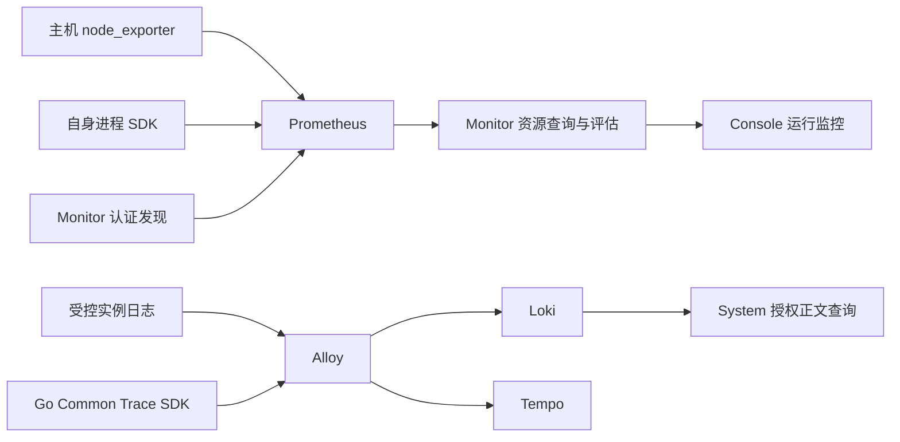

# ADDP 平台运行观测规范

本文维护已实现的主机、采集、进程资源、受限查询和平台告警契约。概念见[监控与执行体系图](../concepts/addp监控与执行体系图.md)，尚未实施的引擎/容器专业观测、Trace、受控运维及验证缺口见[后续专题](../next/ADDP平台运行监控与可观测性设计.md)。正文标明待实现的内容仅界定边界，不作为开放能力。

## 一、适用范围

适用于平台主机、当前模块运行实例、受限资源查询和平台告警。租户任务执行、日志正文与引擎业务数据仍由各自 owner 维护。

## 二、交付边界

主机台账、采集发现、基础资源、进程 CPU/RSS/时长、趋势/总览与主机 CPU/内存规则已实现。引擎专业观测、容器配额、拓扑追踪与生产规模等剩余范围，以及各层验收状态，按后续专题分别记录；实现就绪不等于相应验收通过。

## 三、对象与模块边界

### 3.1 身份与事实来源

| 对象 | 唯一事实来源 | 约束 |
| --- | --- | --- |
| 纳管主机 | System `node_id` | System 分配 UUID；物理主机与虚拟机均可纳管，容器不是主机 |
| 模块与运行实例 | System 模块登记、实例身份和租约 | UP/DOWN 来自租约，不由采集成功或 CPU 值决定 |
| 业务引擎 | System 引擎登记 | `engine_id` 与主机身份不同；远端、云端、集群引擎不按连接数推算节点数 |
| 容器 | 运行环境的容器身份及配额 | 与进程关联必须有明确证据，不能按名称或资源量猜测 |
| 任务执行 | 既有执行 Owner 与共享执行协议 | 执行身份、槽位和结果不转移到遥测存储 |
| 采集目标 | Monitor 配置身份及版本 | 引用已有主体，不重复创建主体或实例租约 |

IP、DNS、主机名、服务 URL 和 `registered_host` 均不是稳定主机身份。ResourceLocator 继续表示引擎业务数据位置，不加入主机节点语义。

部署关联与调用关联分开：前者记录声明来源及有效时间，后者来自明确配置或 Trace 观测窗口。拓扑染色不能作为已经确认根因的证据。

### 3.2 模块职责

| Owner | 职责 |
| --- | --- |
| System | 主机、模块、实例及引擎身份，当前用户对象授权，IAM 与统一审计；日志正文授权读取 |
| Monitor | 采集配置、发现投影、资源查询与预算、规则、平台事件和通知、监控页面 |
| Common / Common-Python | 共享采样 SDK、DTO、身份声明与服务客户端；不成为第二个事实 Owner |
| Infra | Prometheus、Alloy、Loki 等中心组件及节点来源的部署、传输保护、Secret 与物理资源预算 |
| Console | 统一入口、上下文和 iframe 导航；前端隐藏不替代服务端授权 |

Monitor 不直接查询 System 私有表，不直接读取主机文件，不复制 System 的实例运行状态。业务请求和执行事实不依赖观测设施才可写入或读取。

### 3.3 平台与租户权限

当前主机、平台实例资源、总览及平台资源告警只开放 Platform Context。Tenant 执行监控、执行告警保留自身事实和权限；租户引擎未来的专业观测还须单独明确归属与读取契约。

平台系统管理员承担首期主机、采集和平台告警管理职责，权限在 Owner manifest、内置角色及正式迁移中显式发布。平台安全管理员、审计管理员不因此获得资源管理或日志正文权限；平台角色也不自动取得全部租户 SQL、参数和执行结果。

- 用户请求转发已验证的当前 User Token，由 System 再裁决主体；后台投影不能代替用户对象授权。
- `addp-monitor` 使用独立 Platform Service 身份，只读取有界当前身份投影。同一 `/runtime/observability-identities` 返回必须为数组的字段 `engine_deployments`（真实无对象时为 `[]`），最多 1000 个启用且承载主机有效的平台部署；与节点、模块实例在同一只读可重复读事务内裁决，共用五秒和四 MiB 预算。每项仅含 `deployment_id`、`version`、`scope=infra|business`、`engine_type=postgresql`、`node_id` 与 `source_key={docker_engine_id,project,service}`；来源键沿用部署发现的 Docker 引擎／Compose 项目／服务三元组，`infra` 对应 `addp-infra`，`business` 对应 `business`，当前服务为 `postgres`。不含名称、地址、端口、连接、凭据、租户引擎或运行状态，不因登记存在就视作实时来源可用。超量、异常及控制面错误整份拒绝，不截断或保留旧身份；后台投影不授予用户查询权，专业查询仍逐请求转交当前 User Token 给 System。
- `addp-prometheus` 使用独立最小身份和 `monitor.metrics_discovery.read`，不能访问业务 API。
- 采集 mTLS、发现身份、日志上报及资源查询证书分别管理；不保存长期管理员 Token，不复用业务数据库凭据。
- 资源观测、告警事件、规则管理、通知管理和日志正文分别授权。切换身份或 Context 时清除旧数据、凭据草稿，并拒绝迟到响应。

## 四、主机接入与采集发现

### 4.1 主机与服务绑定

主机保存 `display_name`、`node_kind=physical|virtual`、`addresses`、`enabled`、`version` 及 UTC 创建/更新时间。名称是可编辑属性，地址允许为空；`enabled` 表示纳管意图，不表示电源或网络状态。编辑采用版本 CAS；首期只停用纳管，不提供主机物理删除或关机。

主机的允许模块集合明确列举模块服务 Client 与模块名；“添加模块”表示允许这些服务声明部署于该主机，不是安装服务。集合为空不允许绑定，不能根据浏览器提交或来源标签自行扩权。

部署为实际所在进程注入 `ADDP_HOST_NODE_ID`。System 在首次登记时固定实例的节点声明，按当前主机状态和允许集合裁决 `unbound/bound/rejected`；同一实例重登记不得改挂主机。位置变化产生新实例身份，历史声明不反写。非法部署输入仅停用绑定并记录安全诊断，不阻断合法业务登记和续租；API 仍严格拒绝恶意或非规范请求。

缺少或失效的主机关联不阻断实例自身资源观测，也不改变租约。引擎部署的显式承载声明由 System 维护，首批单主机关联见 4.4；不以数据库地址、容器名或 VM 总消耗推断。

### 4.2 管理员确认的部署清单接入

唯一导出入口 `scripts/infra/node-metrics.py export-admission` 输出 `schema=addp.host-admission/v2`。默认核验已运行的本地 Linux/Docker Desktop 受控 node_exporter，包含主机和采集配置；显式 `--host-only` 只声明当前原生 macOS/Linux 宿主，不访问 Docker 或采集凭据，要求明确物理/虚拟类型。`--module` 可重复指定该宿主允许的 ADDP 模块，生成既有固定模块 Client 对应关系；不按进程名、地址或容器名发现承载，不包含 Business 租户引擎。

清单最多 16 KiB，根字段仅为 `schema/host` 和可选 `collection`。主机字段为 `display_name/node_kind/addresses/allowed_module_bindings`；采集存在时仅允许 `monitor_kind=host_resources`、`source.type=node_exporter` 及显式 HTTPS `/metrics` 端点。拒绝旧版本、未知字段、身份和凭据；空采集对象不等于省略。Desktop 来源声明独立 Linux VM，原生宿主不得据此归入 VM。名称与地址不作为稳定身份或自动合并键，清单本身不授予权限。

System `/host-admission` 是 Console 中唯一接入编排入口；独立模块打开该跨模块流程时先进入 Console，再接受草稿。管理员导入后预览并显式选择已有主机或按清单创建；已有主机不被改写，当前读取必须仍启用且类型匹配，创建仅用既有 `platform.host_node.create`。主机保存结果或当前读取结果生成 `ADDP_HOST_NODE_ID` 部署参数；只应用于实际部署在该宿主上的新进程，不修改全局 `.env`、不自动重启、不在线改挂已有实例。

采集可选。存在来源且用户有独立 Monitor 管理权限时，System 通过共享 Console 内存导航草稿将同一主机和来源交给 Monitor 原新建页面。草稿最多 4 KiB、60 秒、一次消费，绑定当前身份/权限及精确目的路由；只允许当前同源 iframe 取回，不写 URL、浏览器存储或最近访问。取消、另行导航、身份或权限变化、退出与超时均清除；端点仍由 Monitor 重新验证，不据草稿授予权限。页面刷新仅恢复 URL 中稳定主机 ID，不恢复未保存来源。

两个 Owner 分别写入：System 创建成功后冻结该主机，未知创建结果或版本冲突阻止再次创建并要求核验；明确拒绝可修正重试。转到 Monitor 后固定所交接的主机，只保存采集，不再创建主机；明确的采集失败仅重试该配置，未知结果或冲突先到原列表核验。清单与主机身份选择在授权/页面变化后失效，迟到响应不能恢复旧草稿。Monitor 原导入、主机创建编排及私有解析器删除，采集管理只消费已存在的 System 身份。

### 4.3 采集目标与认证发现

当前主机采集配置由 Monitor 管理，含主体、固定来源类型、受控端点、启停及独立版本。同一主体和类别最多一个启用来源。模块进程来源来自 System 首次登记的不可变采集声明，随当前租约自动投影，无需每次重启人工登记。

Prometheus 只通过 Monitor 的单一认证 HTTP SD 获取全量有界快照；不分页、不接受调用者标签。身份标签由控制面覆盖，按实际端点去重；已结束实例、停用主机或目标、失效绑定从成功快照移除。控制面失败返回错误，不伪装成功空列表。

发现刷新为 30 秒。Prometheus 在发现失败时可能保留旧快照，因此当前查询和告警仍重新裁决主体及配置；发现列表不能作为读取授权或即时停采保证。紧急阻断依靠凭据撤销或网络策略，历史按原身份与保留期存在。

主机列表与采集配置区分纳管、启停和实际采集结果；配置版本不符、证据过期或无资源读取权时不得沿用“最近成功”。列表按当前页一次去重批量读取，不逐行扇出、跨页预取或拆请求绕过预算；观测失败仍保留配置管理能力。

### 4.4 平台引擎部署登记

引擎部署属于平台运维对象，与租户 Engine Instance 分开。System `/platform/engine_deployments` 提供集合 POST 批量确认、GET 分页/详情和 PUT 管理更新，分配稳定 `deployment_id`；首批支持 Infra 与 Business 的单容器 PostgreSQL，显式关联一个已纳管主机。其他服务只显示发现事实与未适配原因；集群多主机、云服务及租户引擎关联尚未开放。不接受 `tenant_id/engine_id`、连接凭据或 SQL，不从 Web 请求执行 Docker 或数据库探测。

管理员在“平台引擎部署”读取部署侧发现结果，选择待接入服务、核对名称和实际承载主机后批量确认，无需运行导出命令或导入文件。来源项目、容器运行身份、状态及 SQL 端口来自 4.5 的唯一发现链路；Docker Desktop 只可关联 virtual 主机，不按地址、名称或容器 ID 猜测承载关系。发现可用与纳管、专业采集成功分别表达。

POST 仅接受 `items`，每次 1—16 个显式成员；成员为 `scope/service/fingerprint/display_name/enabled/declared_node_id`。服务端重读来源，验证 120 秒时效和预览事实摘要，再按来源键排序、整批事务写入；任何来源过期、变化、重复、主机无效或写入失败均整批回滚。摘要不含每次刷新时间，不代替持久资源版本。确认后的规范快照为 `addp.engine-deployment-inventory/v1`；旧根记录由前向迁移规范化，不改稳定身份、版本或不可变历史。

部署详情通过同一只读发现接口展示最近一次来源，按已确认的 Docker Engine、Compose 项目和服务匹配；不按名称、端口或地址猜测。来源过期、不可用、运行环境不符或服务未发现时不展示旧容器为当前结果；容器运行身份变化只更新来源展示，不改部署 ID、声明版本、主机关联或历史。容器运行状态不等于数据库可用或专业采集成功。来源单独刷新不清除管理草稿，也不解除写入冲突阻断；切换账号、对象或关闭详情后，迟到响应不得恢复旧来源。

来源按 Docker Engine ID、Compose 项目和服务唯一，停用也不可重复登记。PUT 仅接受名称、纳管意图、主机与当前 `version`，不接受客户端重写来源；实时运行变化由发现结果表达。列表只接受 `page/page_size/search/node_id`，名称按字面片段搜索，主机筛选按声明身份；详情不接受 query。请求正文最多 32 KiB，拒绝未知字段、重复键、大小写别名及附加 query。结果未知或来源变化时保留草稿并停止提交，必须显式重读核对，不自动重试创建。

创建与更新在同一 PostgreSQL 事务保存根版本、声明有效区间及统一审计；并发旧版本返回 409，不自动刷新版本重试。声明时间统一取数据库时间，表示管理员声明的生效/结束时刻，不能回填为实际部署历史。闭合历史不可更改或删除；首批不物理删除部署。读取在同一快照核对当前主机和部署纳管状态：有效关联为 `bound`，停用或 Desktop 主机类型变化为 `rejected`，保留原声明；这些状态均不表示服务在线、专业指标采集成功或租户业务可用性，不参与业务 Ready。

接口仅接受非委托 Platform User，独立 `platform.engine_deployment.read/create/update`，创建/更新还须 `platform.host_node.read`；迁移 000220 只向既有平台系统管理员发布三项权限，并沿既有触发器推进授权版本、撤销相关旧刷新族。其他角色、Tenant、Service、委托调用不因部署登记获得权限。界面保留冲突或失败输入；CAS 冲突和结果不明确时停止再次提交，只允许用户显式重新读取核对，首次登记则关闭后刷新列表，不构造已成功身份。

T0 权限目录/Swagger、T1 输入与身份拒绝、T2 PostgreSQL 唯一性/CAS/声明历史/审计回滚及权限前向迁移、System/Console 前端门禁沿现有注册自动发现。精确 T2 入口为 `make test-system-iam-postgres SYSTEM_IAM_POSTGRES_TEST_ARGS="--package repository --test engine-deployments"`、同参数的 `--package api`（HTTP Handler 与 PostgreSQL 审计事务）和 `--package migration`；本地须使用标准脚本核验的 `addp_iam_test`。产品接入 T4 与上述确定性验证分开登记，尚未通过不能写作真实运行已验收。

### 4.5 部署侧自动发现来源

唯一 Docker 读取实现位于 `scripts/utils/deployment-inventory.py`，由 Infra、普通 Business 启停和开发启动按各自作用域自动刷新，不调用 System API 或数据库。发现协议为 `addp.deployment-discovery/v2`，最多 256 KiB；仅核验本地 Unix Socket Context 的 Linux Docker 或 macOS Desktop Linux VM，以当前工作区的 Compose project/working_dir 校验归属。最多读取 128 个容器、64 个服务、单服务 16 个容器和单容器 64 个实际端口，整体 Docker 读取期限 30 秒；前后读取服务运行身份、状态、启动时间、重启次数、端口及 Docker Engine 身份一致才输出。

快照区分 `scope=infra|business`、`state=available|unavailable`，带 UTC 读取时间；成功空集合与失败分别表达。未知组件只标记未分类，不猜测集群、主机关联、引擎专业监控或租户归属。快照不含环境变量、密码、SQL、租户或授权，System Web 服务不因此获得 Docker 权限。

快照写入部署用户独占目录，独立作用域锁内完成读取并以私有临时文件原子替换；发布失败不写半份数据，来源失败则发布不可用结果并清除有效候选。不得把磁盘中较早快照当作实时服务状态。

System `GET /platform/engine_deployments/discovery` 仅接受非委托 Platform User 与已有 `platform.engine_deployment.read`，不接受 query/body；只读 `ADDP_DEPLOYMENT_DISCOVERY_DIR` 下固定的两个作用域文件，不执行 Docker 或接受请求文件路径。开发入口注入工作区私有目录，其他部署未配置则明确返回未配置。成功响应固定包含两个作用域，分别标记未配置、缺失、来源不可用、过期或有效；普通文件及目录须为私有权限，符号链接、非普通文件、超预算、重复或未知 JSON 字段、错误作用域、来源身份及端口均拒绝。有效窗口为 120 秒，最多允许来源时钟领先 30 秒；过期仅保留读取时间，不保留服务或来源身份，单侧失败不抹除另一侧合法结果。

持续来源由同一入口的独立部署观测进程发布，每轮完成后间隔 30 秒；不在 System 请求中执行 Docker。Infra 启动管理进程、停止时核验退出；Business 和开发启动幂等确保其存在，开发启动同时注入实际目录并刷新两组快照。观测器只继承 Docker 所需的环境，不继承 ADDP／SQL 凭据或开发生命周期锁；通过私有运行记录、当次随机标识及实际命令核对 PID，拒绝接管或停止不明进程；标准启动发现源码或 Docker 运行环境指纹变化时只替换已核验归属的观测进程。启动记录发布失败须回收刚创建的子进程；停止立即将两组来源置为不可用。停止观测失败不阻止实际 Infra 停服，但退出码须反映无法确认清理，Hosted 不得将其计为零残留。

观测进程退出时仅在即时取得快照锁的情况下失效来源，不等待其他写入者；停止控制流程负责确认进程退出、再取得快照锁并清空两组来源。锁竞争不能阻塞观测进程退出；控制流程无法确认退出或清空来源时仍须报告失败，不删除尚未确认退出的运行记录。退出核验失败仅追加有界、脱敏的即时诊断：最后归属判定、Linux进程状态及固定等待类型、SIGTERM挂起／屏蔽／忽略／处理状态、直接子进程数量；不可读取或非Linux时明确未知，不输出命令行、路径、随机运行标识或原始proc文件。诊断不能改变信号次数、期限、归属裁决或记录保留，也不能代替实际根因证据。

SIGTERM／SIGINT处理器只锁存停止请求，由非阻塞唤醒管道打断原30秒空闲等待；不在异步处理器直接抛退出异常，避免信号命中Python析构器时成为被忽略异常。主循环、锁等待和Docker读取在显式检查点响应停止；Docker命令仍仅启动一次，分段等待同一子进程，不重置原单次10秒／整轮30秒预算。取消读取先回收当次自有子进程，再按原非阻塞失效及退出核验流程清理；归属、单次停止信号与未退出保留记录不变。

该接口不创建纳管身份、不更改管理员声明、历史或租户权限；管理员批量确认遵循 4.4；专业指标尚待实施，不以候选读取或来源自动发布代替产品接入验收。

### 4.6 PostgreSQL 数据库侧汇总读取边界

Infra 与平台自管 Business 的 PostgreSQL 分别由部署 owner 通过唯一来源生命周期安装版本化的 `scripts/infra/postgres-observation/000002_lifecycle.sql`，不进入 System IAM 迁移；`000001_init.sql` 保留为不可变历史。支持 PostgreSQL 15 数据库侧读取及可选来源部署；专业来源发现、Monitor 授权查询与页面沿本文同一观测链实现。数据库侧验证只证明其读取边界，不能替代专业查询与页面的正式身份 T4。

各实例分别使用 `addp_infra_observer` 或 `addp_business_observer`，密码独立；非登录的 `addp_observation_owner` 仅继承 `pg_read_all_stats`，Login 无任何角色成员资格，不获该统计角色、业务对象或服务管理权限。安装在单事务中校验作用域、SCRAM 校验值、身份标记、成员资格、schema／函数归属与 ACL；陌生对象、额外权限、PUBLIC 业务读权或不安全默认授权均拒绝并回滚，不接管或全局撤销其他用户权限。Login 只授当前连接库 CONNECT、私有 schema USAGE 和唯一无参数 `addp_observation.snapshot()` EXECUTE。密码校验值通过部署侧私有 stdin 的 psql 变量注入，不进入参数、普通配置、发现快照、System API 或日志；原始密码不参与 SQL 文本。

固定函数返回一行、16 个有类型字段：采样时间、服务启动时间、统计代际、统计开关；当前客户端连接、活跃、空闲、事务内空闲、活跃等待、活跃锁等待、活跃 IO 等待及最大连接数；非模板数据库的事务提交／回滚／死锁累计值及容量字节。排除本次采集会话，不输出数据库／表／用户名称、PID、客户端地址或 SQL。等待仅计 active，空闲 ClientRead 不作为压力；事务保留 PostgreSQL 原累计口径，包含采集自身带来的事务，不冒充业务吞吐或租户用量。统计关闭时三项累计值为 NULL；容量不完整不能填零，超过 256 个非模板数据库拒绝而非截断。统计代际覆盖数据库集合与各库统计重置，配合服务启动时间裁决后续速率窗口。

函数采用固定 `pg_catalog, pg_temp` 搜索路径、全限定目录和固定 SQL，Login 不可更改函数；只读默认值和三秒语句超时是附加约束，不能替代对象权限或来源侧期限。PostgreSQL 的 PUBLIC 授权可叠加，单个角色 REVOKE 不能覆盖它；当前安装核查只覆盖所连数据库。正式部署须选择无业务对象的维护连接库，并以认证／网络策略限制其他数据库连接；未完成该部署准入不启用采集，不声称已经隔离整个实例的所有业务库。安全依据见 [PostgreSQL 函数权限](https://www.postgresql.org/docs/15/sql-createfunction.html)、[统计角色](https://www.postgresql.org/docs/15/predefined-roles.html)及[统计字段](https://www.postgresql.org/docs/15/monitoring-stats.html)。

验证复用独占 `make test-monitor-metrics`；精确数据库专项为 `make test-monitor-metrics MONITOR_METRICS_TEST_ARGS=--case=postgres-observation`。私有 PostgreSQL 强制 TCP SCRAM，覆盖真实密码、固定数值与独立目录对照、等待／锁等待、统计关闭／重置、越权拒绝、临时关系遮蔽、重入／密码轮换、陌生身份、默认权限漂移和失败回滚；业务对象夹具仅用 `addp_test`，认证拒绝探测另使用镜像自带 `postgres`，退出按原门禁核验物理零残留。默认完整门禁仍执行全部指标链路及该专项，现有 Monitor metrics CI 按声明自动发现新增 SQL 与探针；不新建 Job、不修改生产权限、不修改个人库。

数据库认证准入沿同一 `source.py` 的唯一规则生成器：部署 owner 在角色／函数归属校验通过后，才可为该实例对应的采集 Login 生成置于 `pg_hba.conf` 最前的受管块。只允许显式维护连接库、显式私网／回环 CIDR 与 SCRAM；拒绝该 Login 的其他数据库、Unix socket 和物理复制连接，不修改其他用户的既有记录。维护库名按字面量引用，不能把 `all` 等特殊词误作通配符。认证规则不代替函数和对象权限，也不授予 Monitor 编辑认证文件的能力。

受管块包含无凭据的作用域、维护库与有界规范 CIDR 声明；原文件其余内容原样保留。既有块不在首部、作用域冲突、声明／规则漂移、残缺标记、非注释记录含保留采集账号标识或超量输入均拒绝，不修补覆盖。相同输入幂等，部署 owner 明确提交的新 CIDR 可替换经核验的本方块；来源启动前仍须确认文件原子替换、数据库配置重载及真实认证结果。HBA 只约束新连接；正式安装须先停止旧来源，并确认该受管账号没有遗留连接，存在旧会话则拒绝激活，不自动终止不明会话。当前先由独占 T2 验证生成与认证，不自动更改个人实例。T2 仅在其原生 `addp_test` 与镜像自带 `postgres` 之间验证跨库连接拒绝，不创建新 database，不读取业务表；覆盖允许连接、错误密码、回环／Docker 私网、跨库／socket 拒绝、管理员连接不受影响及原文件恢复。规则依据为 [PostgreSQL 15 HBA](https://www.postgresql.org/docs/15/auth-pg-hba-conf.html) 的首条匹配和特殊词引用语义。

### 4.7 PostgreSQL 受保护的固定指标来源

PostgreSQL 来源由唯一部署入口 `scripts/infra/postgres-observation/lifecycle.py` 管理，分别接入 Infra 与 Business 标准启停。`ADDP_POSTGRES_METRICS_ENABLED=false` 独立选择来源，不依赖中心开关；选中后必须提供仓库外三文件 `ADDP_POSTGRES_METRICS_TLS_DIR` 和显式本机 `ADDP_POSTGRES_METRICS_LISTEN=IP:端口`，不自动分配或避让端口。`ADDP_POSTGRES_METRICS_STATE_DIR` 是可选私有状态根目录，按作用域隔离凭据和生成配置。默认使用当前部署用户仓库外、工作区摘要隔离的状态目录；状态、密码及 TLS 私钥不进入发现、环境变量或参数。标准脚本不签发或追加 CA 信任。来源仅连接本机受管 Docker PostgreSQL 15 的实际私网地址；独立来源故障报告非零可选结果，核心服务继续运行。

活动安装版本为 `000002_lifecycle.sql`，原 `000001_init.sql` 保留为不可变历史，不作为安装 fallback。新增部署输入仅决定本方 Login 的启停，不改变固定函数、输出或权限集合。启用先停止旧来源、验证工作区／容器／私网／角色归属和无遗留采集会话；同一数据库部署锁下先完整安装为 NOLOGIN，再按唯一规则生成器原子更新 HBA、检查语法并重载，确认无旧会话后才完整复核并开启 Login。密码首次随机生成，后续沿用私有文件；已有账号但凭据丢失时拒绝自动重置。停用只关闭本方采集容器及已验证归属的 Login，保留函数、配置、历史和数据卷，不终止未知数据库会话。失败不得保留运行中的旧来源或宣称就绪，不重启数据库、不撤销其他用户权限。账号安装及数据库操作仅由部署 owner 执行，不交给 System Web、普通发现进程或 Monitor 后台身份。

Business PostgreSQL 的运行认证文件由部署 owner 在仓库外维护，唯一容器路径为 `/etc/addp-postgres-auth/pg_hba.conf`，只读挂载其父目录，不再单文件绑定仓库模板。标准 Business 启动入口在启动 PostgreSQL 前准备该目录；默认状态目录为当前部署用户的 `~/.local/state/addp/<工作区路径摘要>/postgres-auth`，可由 `ADDP_POSTGRES_AUTH_STATE_DIR` 显式指定仓库外绝对目录。目录归属绑定当前工作区，不接管其他 owner、符号链接、硬链接或被外部改写的文件。模板仍为 `business/postgres/pg_hba.conf`，首次原样复制，后续保留经校验的采集首部块；模板和运行文件之间不存在双轨读取。模板有明确更新时，只有运行文件仍与上次生成事实一致才可重新生成，不覆盖人工漂移。

部署侧文件更新使用同一受管目录锁、输入版本校验及同目录原子替换，保持原文件属主和模式；数据库容器无写权。该入口不保存数据库密码、不签发证书、不安装角色、不重启或重载运行数据库。首次切换由部署方使用标准 Business 启动入口重建容器，保留数据卷；后续认证安装仍须先检查归属／遗留会话、更新文件、检查 `pg_hba_file_rules` 并重载及验证连接。文件准备成功不能计为专业采集已生效。Infra 仍使用其数据目录内的认证文件，不为统一形式迁移数据。

来源模板 `scripts/infra/postgres-metrics.yml` 与独占 T2 共用固定 SQL Exporter 0.24.11 多架构摘要；固定配置唯一生成实现为 `scripts/infra/postgres-observation/source.py`，只查询 4.6 的函数，关闭 ping、缓存和动态目标，不接受用户 SQL。每个作用域独立来源、单 SQL 连接、零空闲连接，查询上限四秒。数据库密码只在部署用户私有的只读来源配置内，不进入环境变量、命令参数、发现快照或平台 DTO。源侧 SQL 当前限定受控 Docker 私网；生产数据库 TLS 另须认证，不把本机 T2 计为生产验收。

SQL Exporter 只监听其网络命名空间的回环 HTTP `127.0.0.1:9399`，同命名空间 Nginx 在 `9443` 提供独立 mTLS。TLS 进程仅挂载自己的服务端证书／CA，不挂载含数据库密码的来源配置；两进程均使用显式非特权 UID/GID、只读文件系统、移除全部 capabilities 及资源限制。外部只允许无 query 的 GET `/metrics`，配置、重载、exporter 自身诊断、其他路径及方法均拒绝；凭据不因持有采集证书而可读取。保持 `ssl_verify_client on`；Nginx 的客户端证书缺失／校验失败（内部 496／495）统一返回 403，不转发上游。来源准入仍只认可明确的 TLS 证书拒绝或 HTTP 401／403，不把通用 400 当作保护证据。没有默认宿主机端口；标准 Infra／Business 入口仅按各自显式开关部署，不自动修改个人环境选择。

当前固定输出 `addp_postgresql_` 前缀的 16 项指标，对应 4.6 的有类型汇总；时间输出 Unix 秒，容量为字节，连接为数量，累计量后缀 `_total`。累计量带固定计算的 `counter_epoch`，同时覆盖统计代际与服务启动时间；代际信息独立表达，不以数据库名、SQL 或租户作为标签。统计关闭时不输出三项累计值，不填有效零。

所选版本在 SQL 失败时可能仍返回 HTTP 200 和累计 `scrape_errors_total`，此时不得输出旧数据库样本。HTTP `up` 只证明传输可达，累计错误计数也不是当前失败状态；专业读取必须验证固定样本及新鲜采样时间。T2 覆盖权限撤销后的两次真实失败、错误计数递增与无旧样本、恢复新样本、统计关闭／恢复，以及错误客户端证书、明文 HTTP、路径和方法拒绝。精确入口为 `make test-monitor-metrics MONITOR_METRICS_TEST_ARGS=--case=postgres-source`，默认完整门禁同样包含；业务／Infra 全退出核验由同一门禁负责。

该契约包含可选部署生命周期及独占传输验证，不代表个人实例已经启用或专业页面已通过正式身份 T4。已实现的自动关联、引擎指标读取及页面仍须沿明确身份投影与当前 User 授权，不将来源模板直接登记成节点或租户 Engine。上游行为参照 [SQL Exporter 固定版本](https://github.com/burningalchemist/sql_exporter/tree/0.24.11)；不引入 PostgreSQL exporter 已弃用的自定义查询作为并行路线。

### 4.8 服务部署预期与分组租约观测

服务失联的预期来源唯一属于标准部署入口。受管目录中的 `service-expectations.json` 使用 `addp.service-expectations/v1`，包含工作区摘要 `deployment_id`、单调递增的 `revision` 和按模块／角色／用途排序且唯一的 `groups`。每组仅含 `module_name`、`role=backend|worker`、`runtime_name`、`expected_replicas`（1—1000）、`desired_state=running|planned_stopped` 与 UTC `changed_at`；Backend 用途为空，Worker 必须与正式登记的用途相同。最多1000组、256 KiB，重复键、未知字段、非法或未来时间拒绝。发布器沿既有私有目录、所有权检查、互斥锁与原子替换；相同声明重发不推进版本或时间，局部启停保留其他组，失败保留旧文件。组实质变更的changed_at使用真实UTC微秒且严格晚于该组原值，拒绝停滞／回退时钟，不合成未来时间；同秒停用、重启或副本变更不得复用旧标记。没有存活进程扫描、手工管理第二路线或个人服务自动启停。

System 在唯一 `/runtime/observability-identities` 中只读提供 `service_groups`：声明身份／版本、同一控制面 `observed_at` 及每组预期、正式登记总数与当前在线副本数。在线仅表示登记状态UP且租约晚于同一观测时间，不要求绑定主机或已接指标；不同Worker用途不互代。读取声明前后内容变化时清除该子域。全域状态为 `available/unconfigured/unavailable`；可读组为 `observed`，计划停用或模块停用为 `paused`，模块未登记或活跃Worker用途不明为 `unknown`。零在线只是租约事实，不在System产生失联／恢复结论。组候选最多10000个登记，共用原五秒／四MiB预算；仅组文件异常或组预算耗尽使子域不可用，数据库事务失败仍拒绝整份投影。Common客户端核验可解码子域的形状和时间，非法子域清为空的不可用状态，保留合法的独立资源身份；响应JSON无法解码或原控制面身份异常仍拒绝整份响应。

读取范围沿现有固定Monitor后台身份，不增加角色、权限、凭据或浏览器DTO。标准开发／生产停止入口先发布所选模块的计划停用，失败立即退出，尚不停止任何服务；此规则已于2026-10-25由用户确认。开发启动使用所选后端及正式Worker单元，生产启动使用当前Compose与Profile声明，不由存活进程反推预期。Compose声明副本取规范化的scale／deploy.replicas，两者不一致拒绝；零副本或未选Profile不声明运行，完整计划将已有但不再选中的组置为计划停用，局部开发启动仍保留其他组。启动发布故障沿可选观测边界报告，核心启动继续，不能把原声明解释为本次启动成功。生产System的受管目录只读挂载独立于指标开关，标准操作沿既有工作区生命周期锁串行。首次接入预热／持续窗口／告警规则权限仍须明确；基础发布和组计数不代表自动失联告警已经可用。

## 五、技术路线与故障隔离

### 5.1 唯一数据路径

指标使用单一 pull 路线，不并存 remote_write；原始高频时序留在 Prometheus，配置、事件、投递和审计留在各 Owner 的 PostgreSQL。日志正文保持受控文件 → Alloy → Loki → System，不在失败时退回主机文件读取。Go 同步 HTTP Trace 范围与预算沿 6.5；cAdvisor 已有受控来源准入内核，节点部署与容器资源视图尚未交付。

不增加独立 Alertmanager 告警 Owner，不要求 Grafana 成为产品入口。成熟组件负责采集、存储和传输，Monitor 负责领域规则、事件和授权体验。

### 5.2 部署与运行环境

中心组件和节点来源统一由标准 Infra 脚本组织，根 `.env.example` 为唯一部署模板。

| 输入 | 行为 |
| --- | --- |
| `ADDP_OBSERVABILITY_METRICS_ENABLED` | 默认 false，选择指标中心及明确来源；不自动为全部机器安装 exporter |
| `ADDP_OBSERVABILITY_LOGS_ENABLED` | 默认 true，可显式关闭现有集中日志组合 |
| `ADDP_OBSERVABILITY_TRACES_ENABLED` | 默认 false，显式选择 6.5 的 Go HTTP 追踪、Alloy 与 Tempo 路径 |
| `ADDP_NODE_METRICS_ENABLED` | 默认 false，单独选择本节点来源；中心开启不自动调用节点部署 |
| `ADDP_PROCESS_METRICS_DEPLOYMENTS` | 显式声明自身进程指标端点，SDK 成功启动后才随实例登记发布 |
| `ADDP_HOST_NODE_ID` | 单个进程的实际部署主机声明，可空，不为不同宿主注入同一个 ID |
| 各设施端点与 Secret 引用 | 所选能力独立预检；未选择的能力不要求其专用凭据 |

布尔值只接受 true/false，不由探测结果猜开关。端点、证书、物理预算与保留参数随组件生命周期生效；Monitor 普通查询预算、规则和配置版本按各自热生效契约管理。

节点来源只消费显式部署输入，`ADDP_NODE_METRICS_LISTEN` 为受控本机 IP 与显式端口，不接受通配监听或自动避让；`ADDP_NODE_METRICS_TLS_DIR` 为仓库外绝对目录，只放 `ca.crt/server.crt/server.key`，不挂 CA 签发私钥或客户端私钥。原生 Linux 来源要求内核 5.12+，采用 host 网络/PID 及只读宿主挂载；Desktop 使用下述受限部署层，不自动放宽主机权限。

节点指标采用独立 mTLS。node_exporter 使用原生 exporter-toolkit；需要保护原始容器来源时只能使用节点专用的固定路径入口，不开放 Web UI、调试或任意代理。日志 Alloy 不获得 Docker Socket、宿主特权或 Shell 权限。

| 环境 | 当前支持与边界 |
| --- | --- |
| 原生 Linux 主机 | 标准节点入口校验宿主内核与部署条件，支持完整主机指标；按来源实际挂载/设备/网卡展示 |
| Docker Desktop Linux VM | 独立 virtual 主机，承载 Business/Infra；支持 CPU、内存、负载、运行时长及内核磁盘统计 |
| Desktop 文件系统与网络 | filesystem、netdev、netstat 仍关闭，不用容器挂载或网卡冒充 VM 全局数据 |
| 原生 macOS 服务 | 观察自身 Go 进程 CPU、当前 RSS 和时长，不绑定到 Desktop VM 冒充其进程 |
| 容器资源 | 待独立实现；容器配额、进程消耗与 VM/宿主容量不混用 |

Desktop 来源固定启用 cpu、meminfo、loadavg、diskstats、stat、uname、time；保持独立 bridge/PID/挂载命名空间、非 root、只读根、cap_drop=ALL 和 no-new-privileges，不挂宿主根、设备或 Docker Socket。磁盘代表 VM 内核设备统计，不证明 Mac 物理磁盘或某个引擎的独占消耗。远程 Engine、非 Linux Engine 和未知环境拒绝接入。

### 5.3 故障与状态

| 场景 | 影响 |
| --- | --- |
| 指标未部署、配置不全或 Prometheus 故障 | 对应资源区域明确不可用；不改变业务 Ready、实例租约、路由、任务和结果读取 |
| 单个来源采集失败 | 仅该来源缺值/过期，其他来源继续；不能补零或恢复活动资源告警 |
| Loki 或日志发送故障 | 影响日志正文/链路状态；不改变资源和执行事实，不退回直接读文件 |
| Trace 未启用或故障 | 仅追踪不可用；部署声明、指标和日志不因此丢失 |
| Monitor 必需依赖故障 | Monitor 按自身依赖报告不可用，业务 Owner 仍独立写入和读取执行事实 |
| 设施恢复 | 无需重启业务进程，等待新样本；保留停采缺口，不伪造历史回填 |

能力配置意图、后端可用性、目标采集状态、单项数据质量分别表达。数值状态区分 `not_connected/valid/no_data/stale/unsupported`；未查询成功不能包装成“没有样本”。控制读取成功可返回能力不可用状态，实际查询的未启用、未配置、故障、超时、预算与并发拒绝按 API 错误契约返回。

观测发送使用有界队列、超时与丢弃记录，不能无限积压或阻塞业务。标准生命周期分开记录必需服务和可选能力的结果，所选能力失败可使命令非零，但不能因此中止已满足必需依赖的业务。停用只处理本工作区拥有的设施，保留数据卷。

共用 Alloy 的日志/Trace 故障可能相关；共享磁盘耗尽也可能影响业务，不能把软依赖说成物理隔离。生产还需独立外部存活探针，不能靠已不可用的监控系统给自己告警。

## 六、指标、查询与展示口径

### 6.1 固定指标目录

唯一目录定义公式、单位及窗口，前端和规则复用，不接受任意 PromQL、标签搜索、脚本或调用者自选端点。

| 主机指标族 | 数量 | 口径 |
| --- | --- | --- |
| 标量概览 | 10 | CPU 逻辑核数、一分钟忙碌率、内存总量/可用量/使用率、1/5/15 分钟系统平均负载、运行时长、TCP 当前连接数 |
| 文件系统容量 | 5 | 总量、空闲、非特权可用、已用及使用率，保留精确挂载维度 |
| 文件系统 inode | 4 | 总量、空闲、已用及使用率，与字节容量分开 |
| 磁盘 | 5 | 读写吞吐、IO 忙碌时间占比、平均读写耗时，保留 device 维度 |
| 网络 | 2 | 网卡收发字节速率，保留 device 维度 |

容量用 IEC 自适应单位，运行时长用天/小时/分钟；解释放在对应指标或列旁。系统平均负载是运行/等待 CPU 以及不可中断等待（常见于 IO）的任务数量平均值，不是百分比，也不是内存或 CPU 使用率，必须结合核数及其他指标判断。

TCP 当前连接数为 `node.tcp.current_connections`（unit=`connections`，瞬时 Gauge），唯一原始来源 `node_netstat_Tcp_CurrEstab`，按 RFC 4022 统计 ESTABLISHED＋CLOSE_WAIT；不是累计建连次数，也不包含监听或 TIME_WAIT。沿既有主机、来源及 instance 限定，只有单条、有限、非负且不超过 JavaScript 安全整数上限的整数样本才有效，沿原 60 秒新鲜度和查询预算读取当前值／趋势。无宿主网络命名空间统计（包括当前受限 Docker Desktop 来源）、缺样或重复来源不生成有效零值；页面在指标旁解释不可用，不从容器、数据库连接数或其他状态推算。保留 CPU／内存总览、TOP5 与告警既有范围，不新增连接告警、权限或采集控制面。

主机内存使用率基于可用内存，不把缓存当泄漏；文件系统使用率采用非特权可用容量口径，绑定挂载、内存和网络文件系统不计作物理容量合计。磁盘速率与 CPU 要求完整一分钟计数窗口、同次启动与来源证据；计数重置、重复/异步来源或窗口不足不生成有效值。

磁盘忙碌时间占比不是饱和度，平均读写耗时包含排队和处理；没有完成请求时平均耗时为空，有请求且耗时确为零才可显示零。设备层级、桥接与虚拟接口不简单累加；不通过插值、截断异常值或用相似指标伪装缺值。磁盘列表优先展示活动设备，无活动设备可展开。

进程目录独立：CPU 使用 `process.cpu.core_equivalents`，1 核表示消耗一个逻辑核的计算时间；内存为当前 `process.memory.resident_bytes`，时长从本次启动计算。无明确配额不生成配额利用率，不用宿主总内存计算进程使用率，也不用 Go 堆或峰值 RSS 替代当前 RSS。macOS 自身采样严格核对系统接口成功与返回长度，失败不生成有效零值。

自身 cgroup 采样与容器身份分开：Linux Common SDK 仅在进程部署输入显式选择 `cgroup_v2=true` 时，才可在既有 mTLS 来源发布当前 cgroup v2 的 `addp_cgroup_identity_info`、`addp_cgroup_cpu_usage_seconds_total` 和 `addp_cgroup_memory_current_bytes`。身份只含内核 boot UUID、cgroup inode 和 PID namespace inode，均以规范字符串标识；只读 `/proc/self/cgroup`、`/proc/self/mountinfo`、自身 PID／cgroup namespace、内核 boot ID 及当前组固定资源文件，不扫描其他进程或组。路径、凭据和原始错误不发布；文件、字段、读取量及路径严格有界。迁组／身份变化或读取失败时清除本次组指标，不能变为有效零值，也不能影响原进程 CPU／RSS／启动指标。该三项为后续容器来源的私有采集事实，不扩展当前用户查询目录、列表摘要或告警。

`cpu.stat` 沿 Linux 扁平键值格式读取 `usage_usec`；内核的 `core_sched.force_idle_usec` 等点号命名空间键不应使整组样本失效。仍严格校验有界字段名、每行两项、唯一键及规范无符号整数；不把其他计数并入 CPU 用量、不改变指标目录。字段依据见 [Linux v6.11 内核实现](https://github.com/torvalds/linux/blob/v6.11/kernel/cgroup/rstat.c#L555)。

2026-10-24 已确认由部署侧提供容器身份及限制层级的只读证明，应用不开放宿主 cgroup 命名空间、不持有 Docker socket。仅在当前登记实例／本次进程启动、真实容器／本次容器启动及内核边界完全匹配，且限制层级证明完整新鲜时，才可进入容器配额观测。可见组用量不证明独立容器、独享额度或完整父级限制。自身采集、部署证明、System 关联、Monitor 查询与页面分别验证；新增自身采集基础不能替代后续产品链路及对应验收。

容器资源沿同一进程来源接入：SDK 在启动时取得的 boot UUID／cgroup inode／PID namespace inode 随不可变私有声明登记，后续采样仍核对当前边界。部署发布器在原有受管目录发布 `addp.container-proofs/v1`，仅可信本机 Linux Docker、当前工作区 `addp-platform`、标准 runtime-log 单应用入口；读完整容器 ID／启动／宿主 PID及真实完整 cgroup v2 层级，双读核对，最长 90 秒。父级隐藏、平台不支持、读取失败或来源中断清除当前证明，不以 Docker 配置额度替代真实父级限制。首期要求层级 CPU burst 为零；CPU 上界来自完整层级 quota/period 与有效 cpuset，内存取有限 memory.max 最小值；均为硬上界，不是独享或保证容量。连续快照一致的限制记录重新启动／变化／超时即重新累计；CPU 比率要求记录覆盖完整一分钟及边界裕量。

System 只在当前有效实例的 module／role、三项内核身份及进程／容器启动时间匹配且容器边界唯一时，沿既有后台投影附带证明；不改变主机关联、IAM、普通实例 DTO 或登记租约。Monitor 先按当前 User 精确读取实例，再查询对应来源；CPU 复用至少四样本、完整一分钟边界、无重置及双端身份保护，内存使用整组 memory.current，不能用 RSS 替代。查询在证明时点评估，返回前重读同一投影，限制／实例／租约变化则拒绝，不缓存旧额度。比例不裁剪到 100%，无有限上界、稳定记录不足或无有效采样时保留空值并在对应卡片解释；原生开发仍是宿主进程。

### 6.2 资源查询与预算

资源读取仅允许非委托 Platform User，使用 `monitor.resource_observation.read` 并按主体要求核验 System 读取权限。System 当前身份投影和普通用户读取共同检查当前主体、来源、版本、启动边界及租约，不能用后台身份跳过用户授权。

| 接口（Monitor `/api/v1/monitor` 下） | 约束 |
| --- | --- |
| `/platform/resource_observations`、`/platform/resource_trends` | 显式 node_id、固定 metrics 白名单；趋势使用整秒 RFC3339 start/end，维度严格匹配 |
| `/platform/resource_summaries` | 显式 `node_ids` 和 `metrics`，当前授权节点的批量摘要；指标仅允许 CPU 核数／一分钟忙碌率、内存总量／使用率、运行时长、三档系统平均负载和 TCP 当前连接数九项的非空无重复子集，同一评估锚点，不逐行查询 |
| `/platform/process_resource_summaries` | 当前授权实例批量 CPU/RSS/时长，固定目录；普通实例 DTO 仅公开采集声明布尔值 |
| `/platform/process_resource_trends` | 仅 instance_id/start/end，固定 CPU/RSS 两条序列；不读取已退出实例历史 |
| `/platform/container_resource_observations` | `instance_ids` 恰好一个当前实例；固定资源组 CPU 核消耗、memory.current 及两项硬上界利用率，不改变批量摘要目录；无有效证明时只读当前声明内核边界的绝对用量 |
| `/platform/resource_overview` | 不接受 query/body，完整授权主机范围及 CPU/内存 TOP5 |
| `/settings/resource-query-policy` | Monitor 普通平台配置，沿 `monitor.configuration.read/update`，版本 CAS 与审计 |

传输采用固定 `MONITOR_PROMETHEUS_URL` 和独立 CA/client cert/key 部署输入；浏览器不读取私有地址或凭据。查询响应标明身份、单位、预算版本、评估/采样时间、窗口和步长，按每条序列判断有效性；null 与 0 区别明确，缺值形成断点。

| 预算项 | 当前默认上限或初值 |
| --- | --- |
| scrape / 超时 / 发现 | 15 秒 / 5 秒 / 30 秒；首期固定，不提供无实际效果的采样编辑项 |
| 新鲜度 | 60 秒；速率及告警仍另须完整窗口 |
| 单请求 | 12 指标、100 序列、每序列 1,000 点、总计 20,000 点、最长 7 天 |
| 步长 | 至少 15 秒，随范围和预计序列规划；返回后再次核验，不静默截断 |
| 查询超时与并发 | 总期限 5 秒；单主体 2、单 Monitor 进程上游 8；超限快速拒绝，无无界等待 |
| TSDB 保留 | 7 天与 10 GiB 体积同时限制，可能提前淘汰；另预留 WAL/压缩空间 |
| 来源序列预留 | 每端点 20,000，中心自身 20,000，全部署 200,000；当前最多九个启用来源 |
| 组件预算 | Prometheus 1 CPU/2 GiB，node_exporter 0.25 CPU/256 MiB；节点入口 0.25 CPU/128 MiB |

来源准入按去重端点的预留配额原子校验，不能把当前少量序列或单端点 sample_limit 当作全局限额。查询预算可收紧并热生效，在途请求保持开始时版本；物理资源、卷与保留归 Infra。默认预算不是已证明的生产规模上限。

标签仅保存必要身份及有限维度，不加入 TraceId、请求/执行/用户 ID、完整 URL、SQL 或 Token。服务质量后续采用规范化 route 和有界直方图；无请求不虚构错误率和延迟。

### 6.3 趋势、时段比较与总览

主机列表提供“核心资源”和“负载与连接”两种列视图，默认核心资源；以 `list_view=load-connections` 恢复后者，默认值省略。切换只替换列与本批指标选择，保留已提交筛选、分页和刷新间隔，不提交搜索草稿；详情返回与重载保留视图，重置筛选也保留视图。负载与连接只请求 1／5／15 分钟系统平均负载和 TCP 当前连接数四项，默认 20 台共 80 条序列；列标题就近解释任务数量及 TCP 状态口径，缺样不补零。核心资源列采用 2026-10-23 用户确认的五项：CPU 逻辑核数、CPU 一分钟忙碌率、内存总量、内存使用率和运行时长。默认每页 20 台，复用当前页一次批量摘要与原单位／新鲜度，不逐台补查详情。每次显式请求所需指标，按“本批节点数 × 所选指标数”在逐节点 Owner 裁决与 Prometheus 读取前校验同一预算；默认五项 × 20 台正好 100 序列。实际返回页超预算或策略收紧时整批拒绝，保留主机列表并提示减少每页数量，不拆批绕过、不部分返回、不自动提高预算。内存使用 IEC 容量，时长使用复合时长；有效零、缺样和陈旧沿原口径。总览 TOP5 仍只规划 CPU／内存百分比两项，默认最多 50 台；采集配置页亦显式请求原两项，二者不随列表展示扩大读取。摘要接口只接受上述九项固定标量的非空无重复子集。仅保留这一条带明确指标选择的摘要契约，不接受省略 metrics 的旧请求。

主机监控列表复用 System 已有 `node_kind=physical|virtual`、`enabled=true|false` 与名称／地址组合查询，由 System 在计数／分页前筛选；省略表示全部，纳管启用不表示电源或采集状态。System 与 Monitor 的同义类型／状态选择及规范值投影由共享前端 `HostNodeFilters`／`resolveHostNodeFilters` 唯一实现，原 System 页面重复控件与解析分支删除，页面各自拥有查询与路由组合。Monitor 类型／状态选择同时提交当前名称草稿并回首页；重置清除检索条件及页码，保留每页数量、列表视图与刷新偏好。已提交条件沿详情、返回、刷新及 Console 单历史恢复；自动刷新不提交名称草稿，列表条件不进入资源即时／趋势接口。只请求匹配当前页及所选视图的四项或五项摘要，空页不查询指标，错误／撤权清除旧值，不在浏览器过滤分页结果或扩大查询。尚未返回或读取失败的列表总数为未知，不以零代替；分页仅消费成功返回的总数，不能因请求中的临时清空反向改写当前页。

主机列表的资源明细按 2026-10-26 用户确认方案临时行内展开，复用详情页唯一的磁盘／网卡／文件系统展示实现；最多展开当前页一台主机的一类明细。未展开不读取明细；磁盘沿既有五项、网卡沿两项，文件系统沿详情既有分组顺序各读取一次容量五项和 inode 四项，各组分别沿原预算与错误边界，不合并为九项请求、也不拆分超限组绕过预算。容量与 inode 按完整 device／mountpoint／fstype 对齐，分别保留查询及采样时间，一组失败不补造或抹去另一组的有效值；不跨挂载或设备求和、不生成整机 IO 使用率，沿既有来源、完整一分钟窗口、数据状态和单次查询预算，超限不截断或拆批绕过。切换主机／类别、收起、离页、身份变化或撤权取消旧请求并清除其显示；筛选、分页、视图切换及整页重载关闭展开，手动／自动刷新在主机仍属于当前授权页时保留选择并重读。隐藏页面暂停自动刷新，失败不保留旧值；明细接口的 401／403／404 关闭展开并清除列表观测、停止自动读取，用户手动刷新后重新取得当前授权页。展开属于临时交互，不增加 URL 或持久化配置；可进入同一主机、同一设备或完整挂载身份的既有趋势，列表上下文保留。不新增接口或权限；本批前端标准门禁及 Platform CI 的既有 Monitor 前端入口自动覆盖。

主机详情的资源热力面板复用当前已授权的即时 CPU 忙碌率、内存使用率及每个完整挂载身份的文件系统使用率，不另发查询或重算百分比。CPU 保留原一分钟窗口，文件系统继续使用 `used/(used+available)`；不同指标的采样时间分别保留。有效值以主题色从低使用率到高使用率连续着色，并同步显示精确百分比和 0～100% 进度条；颜色不设告警阈值、不计算健康分、不替代资源规则或推导泄漏。合法零值为有效零；陈旧、缺样或未接入只显示中性占位与原数据状态，不着色、不补零。文件系统来源不可用时明确显示原因，不用 inode 或其他挂载补造使用率。每个分区保留设备、挂载点和文件系统类型，可沿既有可恢复路由查看同一指标与挂载的趋势；刷新、错误、撤权及迟到响应沿原页面生命周期，不新增权限或持久化状态。

页面复用共享图表、格式化、自动刷新及请求代数隔离。默认 15 秒刷新、最短 10 秒；刷新、范围、实例和筛选沿唯一 URL 恢复，隐藏页面暂停并取消在途请求。错误、撤权或上下文变化清除旧内容，迟到响应不得覆盖当前对象。

主机趋势沿共享 ChartRenderer 提供图例显隐与悬停提示。图例只控制当前图中的序列显示，不改变 URL 所选指标、查询、完整样本、采样明细或时段比较；全部隐藏时不显示旧提示值。悬停按对应评估点显示本地化时间、指标名、数值与各自单位，内存容量与使用率不混用单位，缩放后仍映射原始评估点，真实零与空值明确区分，不把陈旧值恢复为有效值。查询失败或身份撤销时，图表与提示一并清除。

主机页全部既有趋势（CPU、内存、负载、运行时长、文件系统容量与 inode、磁盘及网络）统一复用共享缩放滑块；只改变本地可见范围，不新增查询、改变窗口／步长、裁剪返回点或重算指标，采样明细与时段对比仍沿原范围。临时视口绑定主机、指标组、设备维度、时段、固定历史锚点、比较模式及当前身份；刷新和主题／语言重绘保留相对视口，同组内存指标或同设备读写／收发方向切换保留。不同指标组、主机、设备、时段、锚点、比较模式或身份变化，以及查询失败时清空；整页重载不持久化视口。文件系统视口绑定完整的 device／mountpoint／fstype，不按挂载路径或设备名猜测同一对象；容量、比例与 inode 指标切换属于不同指标组，重置视口。

主机运行时长曲线仅做显示换算：按已加载完整时窗内有效点的最大时长选择秒／分钟／小时／天（60／3,600／86,400 秒换级），共用共享时长量级函数，轴与悬停同单位、两位小数。缩放不重新选单位；刷新后跨量级可更新，零值保留，陈旧或缺样不参与量级选择且仍为空点，全缺样时轴默认秒。API 及原始采样秒值不变，当前卡片和采样明细继续沿原复合时长格式，不改变重启或缺样的判断。

同一磁盘设备的读／写吞吐、同一网卡的收／发吞吐分别同图对比，使用一次现有固定指标查询及同一设备、时窗和评估网格。两方向共用按有效样本选择的容量单位，保留各自图例和缺值断点，不累加设备或方向、不插值、不把一分钟平均字节速率改称分钟流量总量。URL 中所选方向仍决定采样明细；刷新或切换方向不借用响应数组顺序。返回其他设备、缺少一条序列或评估网格错位时整幅趋势拒绝；一条序列中的缺样不将另一条有效值改为零。除下述内存组合外，其他指标继续沿原单指标趋势及比较口径，不增加接口、权限或查询参数。

网卡收／发速率沿同一共享 ChartRenderer 以并排柱状展示，磁盘吞吐继续使用折线。每根柱保留该评估点之前完整一分钟的平均字节速率（B/s 及 IEC 自适应单位），横轴仍为原评估时间，不将滚动速率换算成每分钟流量、累计流量或带宽利用率；保留原时段、步长、全部返回点及最多 1,000 点上限，不抽样、求和或重新分桶。两方向共用一条明确单位的速率轴及独立图例，密集常显标签关闭，具体数值可悬停或查看采样明细；图旁保留各方向末次评估值。真实零值保持有效零，陈旧／缺样为 null，不画成零流量；切换方向仍沿原 URL 和明细口径，不增加接口或查询参数。

主机内存总量、可用内存、使用率同图展示；一次固定指标查询返回同一时窗和评估网格，按指标身份映射，不依赖响应顺序。左轴为总量和可用量共用的 IEC 容量单位，右轴为 0–100% 使用率，轴名和图旁说明明确各自含义；只对字节值换算单位，不缩放百分比。各指标独立保留缺值断点，不由容量推导有效使用率，不由单张图判断内存泄漏。所选指标仍决定采样明细；时段比较仅对使用率沿既有完整网格计算，容量缺样不改写有效使用率。缺序列或评估网格错位时整幅趋势拒绝。不新增接口、权限、指标或持久化图表配置。

服务列表默认显示在线且已声明采集的实例，采集失败或缺样的行仍保留；可切换“全部实例”，筛选由 System 在计数和分页前完成。服务监控沿既有 `registered_host` 按登记端点的主机名或 IP 精确筛选，不含协议和端口，不把运行环境主机名或承载主机作为匹配地址；未登记监听端点的 Worker 不凭宿主地址补匹配。地址与其他已提交筛选沿唯一 URL 恢复，分页、趋势、刷新及主机跳转返回继续保留；未提交的输入不影响自动刷新。重置清空筛选、页码和趋势选择，恢复在线且已声明采集的默认范围，保留用户的自动刷新选择。在线状态只按 System 租约返回值显示绿色 `UP`、红色 `DOWN` 标签，并保留当前语言的在线/离线文字；采集失败、未接入或缺样不能将在线实例改为离线，配色沿统一主题。Worker 用途只消费既有 `metadata.runtime_name`，未知时仅显示正式角色，不由模块名猜测。

服务与引擎监控列表、引擎监控详情的主机关联只消费 System 返回的有效 `node_id`，不以部署时的 `host_node_name` 作为当前纳管名称。另有主机读取权限时，复用当页去重、最多四并发的主机引用解析，显示当前名称并沿原路由进入主机资源；没有权限或主机读取失败时保留节点 ID 文本，不提供链接，也不影响服务或引擎自身的资源读取。服务未绑定明确显示未关联；引擎无有效 `node_id` 时显示当前关联无效，不回用声明中的旧主机。名称读取与指标读取独立，名称失败不清除合法指标；刷新失败、身份或页面变化后丢弃旧名称和迟到结果。主机名称链接由 Monitor 唯一领域组件渲染，复用既有导航入口并以 push 保留原引擎筛选、详情及趋势地址；浏览器返回恢复原地址，不新增承载声明或推断关系。

服务列表独立展示登记地址与端口，System 实例管理和 Monitor 复用共享 `getRegisteredEndpoint`：从 `module_url`（为空时使用 `health_check_url`）提取 HTTP(S) 主机与显式或协议默认端口，保留 IPv6 方括号；不显示账号、路径、查询或片段，不解析 DNS 或以运行主机名补地址。无监听端点的 Worker 可以为空，页面明确显示未登记监听端点；此列不表示宿主节点 IP 或新的主机关联。

服务时间查询复用 System 既有实例口径与共享时间控件／参数换算：默认登记时间、全部时间；可选择离线判定时间及 `15m/30m/1h/6h/12h/24h/7d/custom`。相对时段在每次列表请求时按同一当前时刻重算，自定义起止固定在 URL，按 UTC 发送；下界含、上界不含。离线判定时间只查当前仍保留离线观测的实例，恢复后退出，不重建历史在线状态；时间依据与在线状态独立，不能自动将 UP 改为 DOWN。切换时间筛选回到第 1 页并关闭旧趋势，分页／刷新／返回保留已提交范围；未完成的自定义输入不提交，重置恢复登记时间和全部时间。时间筛选只约束 System 实例列表，不能改变进程趋势自身的启动边界或混入退出实例历史。

服务离线原因筛选沿 System 已有 `stop_reason=graceful|lease_expired`，默认不筛选；只消费当前有效离线观测，恢复后退出结果。租约超时只表示失联，不证明进程已退出；Monitor 不按本地时钟、采集失败或指标缺样推断原因。原因与状态、采集声明及时间取交集，不自动切换状态或时间依据。共享原因选择器、枚举规范化及译名由 Common Frontend 单点维护；System 保留选择立即查询，Monitor 沿既有搜索提交草稿。查询回到第 1 页并关闭旧趋势；分页、刷新、重载及导航保留已提交原因，重置清除原因；原因参数仅传入 System 实例列表，不进入进程趋势。

服务承载主机 IP 筛选复用 System 的 `node_ip` 与实例登记的 `host_node_ips`，由 System 在计数／分页前规范化 IPv4／IPv6 并精确匹配；与登记端点、角色、状态、采集声明、原因及时间取交集。前端只规范化单值字符串的首尾空白，不另建 IP 解析器；无效地址显示查询错误，不自动撤掉条件查询全部实例。未登记监听端点的 Worker 仍可按已声明的承载 IP 查询；缺少承载 IP 时不按登记端点、运行环境名、DNS 或主机详情补匹配，也不由 IP 声明推导有效主机关联。输入框旁说明这是运行主机地址；已提交筛选沿 URL、分页、刷新、趋势及导航返回恢复，草稿不参与自动刷新，重置清除，条件不进入趋势 API。

服务列表的宿主／运行环境名筛选复用 System `node_name`：按登记的 `host_node_name` 或 `runtime_hostname` 做大小写不敏感的精确匹配，并与承载 IP、登记端点及其他条件取交集。它不按主机管理中的当前显示名称查询，也不要求 Worker 有监听端点；不由名称推断 `node_id` 或读取主机详情来补匹配。输入框旁明确匹配对象和精确匹配口径；草稿提交、分页、刷新、重载、趋势及导航恢复沿现有服务列表规则，重置清除，名称只传 System 列表 API。

服务趋势仅针对当前有效租约且已声明采集的实例，起点裁剪到本次启动，CPU 仍须完整一分钟；重启后新旧实例独立。只从当前有权读取的实例打开对话框，不按服务名自动换成新实例。

服务实例 CPU 与 RSS 趋势分别复用共享 ChartRenderer 的时间缩放滑块，两个视口独立；仅改变本地图中可见时段，不裁剪响应、改变采样窗口、增加查询或保存到 URL／持久存储。相同实例和已提交筛选／时段下，手动或自动刷新及主题／语言重绘保留相对视口；切换实例、时段、已提交筛选、关闭弹窗或当前身份变化时重置。趋势无效、查询失败或撤权时清除旧图与视口，恢复后从完整时段显示，不能由旧视口继续展示失效来源。

服务进程 CPU／RSS 可选择 5 分钟、1 小时、24 小时与上一等长时段比较；7 天不提供比较。复用主机的相邻时段完整评估网格计算，按同一服务端查询锚点一次读取两倍时窗，本期为 `(T-W,T]`、上期为 `(T-2W,T-W]`，分界点仅计上期。每个指标独立要求两期全量评估点有效且整个比较时窗处于本次进程启动后，才显示两期未舍入均值及本期减上期的绝对变化量；CPU 用核，RSS 用自适应 IEC 容量，不计算增长百分比。真实零与零基线有效；缺样、陈旧或启动裁剪均显示样本不足及各期有效／预期点数，不由部分时段推算均值。CPU 点仍为此前完整一分钟平均核占用，启动预热期不计有效点；评估点完整不等于原始抓取无丢失。比较结果和起止时间就近放在各图旁，曲线只显示本期；本地缩放不重算比较。比较模式沿唯一 URL 恢复，换实例、关闭趋势、分页或提交列表筛选时清除；支持时段间切换保留，7 天清除；失败、撤权或身份变化清除旧比较与迟到响应，不新增后端接口、权限或退出实例历史。

主机 CPU/内存比较支持 5 分钟、1 小时、24 小时：以 T 为结束锚点、W 为时长，一次原趋势请求读取两倍范围，比较本期 `(T-W,T]` 与上期 `(T-2W,T-W]`；分界点只计上期。两期预期评估点均全部有效且非空，才对未舍入值计算算术均值，显示本期减上期的“百分点”；缺样显示两期有效点数及“样本不足，暂不比较”。结果旁标明绝对时间和评估间隔；不是原始抓取完整度或精确时间积分。固定历史 end 不推进；7 天曲线保留，但当前保留不支持约 14 天历史的比较。

总览读取本次完整授权主机集合，包括停用主机，独立于列表分页/筛选。System 单页最多 100 个并在同一只读快照计数、取数；双指标受默认 100 序列预算约束，当前最多评估 50 台。超范围或预算整份 422，不读取前页冒充平台总览。

CPU/内存分别报告应覆盖、有效、缺失、过期及未接入数量；仅 valid 参与前五名，按值降序、同值 node_id 升序，真实零值参与。缺覆盖明确“不完整”；整轮成功原子发布，不发部分榜单。不合计主机容量、进程 RSS、容器配额、共享挂载或引擎集群容量，后续先明确去重与分母。

### 6.4 HTTP 接口质量（分阶段接入）

2026-10-20 确认：平台共享 HTTP 接口的整体运行质量由平台运维负责；现有职责对应平台系统管理员。Tenant 发布的数据服务质量继续归 Service 按对象权限提供，不向 Tenant 开放平台总体指标，不用客户端自报租户进行遥测归属。统计读取与规则管理分别授权，功能权限不能代替 System 当前运行实例读取裁决；后台身份只取得既有最小身份投影，不读取租户正文或业务结果。

唯一 Go/Gin 原始采集内核为 Common `httpmetrics`，使用 [OpenTelemetry HTTP 指标语义](https://opentelemetry.io/docs/specs/semconv/http/http-metrics/)的秒级耗时直方图及独立活动请求数，复用现有进程 mTLS 指标来源与 Prometheus，不新增公开 `/metrics` 或遥测 Ready 依赖。仅有间接 OTel 依赖不表示 Trace 已接入；HTTP 指标覆盖已接入实例的全部 HTTP 请求，包括认证拒绝、健康、就绪、未匹配路由及异常，不依赖抽样 Trace。尚未接入的实例明确未接入，不能展示为零流量；Python 首接范围及验收边界沿本节专题。

| 口径 | 契约 |
| --- | --- |
| 请求与失败 | 请求处理结束或中断后计一次。HTTP 5xx、超时、取消、响应正文写失败或异常中断计服务端失败，同请求不重复计数；4xx 单列。业务拒绝只按 HTTP 状态记录，不解析正文或异步 execution 结果。 |
| 维度与敏感内容 | 服务、实际运行实例来自 System 及受控发现；路由只取框架匹配模板，404 没有匹配模板则留空，不能用路径补齐。方法归一到固定集合及 `_OTHER`，状态限制合法 HTTP 码，错误仅固定类别。不采集完整 URL、Host/转发头、用户/租户/请求/execution/trace ID、SQL、Token 或正文作为指标标签。 |
| 网关与后端 | Gateway ingress 表示入口请求，Backend 表示实际处理，分别聚合、分别排名，禁止相加为全局 QPS。Gateway 通配模板保持通配模板，不从路径猜测后端接口。后端内部调用不冒充外部入口流量。 |
| 窗口与聚合 | 固定 1/5/15 分钟窗口，默认 1 分钟；QPS 是完整窗口边界的请求计数增量／窗口秒数，失败率为同窗口失败增量／请求增量，平均响应时间为耗时增量／请求增量。跨实例先合计计数和直方图桶，再计算均值或 P95/P99；禁止平均百分比或分位值。并发独立读取活动请求 Gauge。 |
| 有效性 | 要求来源身份、本次启动、HTTP 采集启动边界、当前租约、采集新鲜度及完整窗口证据。真实无请求时 QPS 可为 0，失败率、平均/P95/P99 无值；缺样、过期、未接入、采集失败和中心不可用分别表达，不能补零或恢复告警。 |
| 查询与管理 | 仅固定目录和有界实例/接口筛选，接口排行按平均耗时或 QPS 返回前 10 个有完整窗口的模板，预算更小时收紧数量；复用现有超时、并发、序列及点数预算，不开放任意 PromQL、标签或端点。规则、事件、通知复用 Monitor 唯一平台协调器及事务 outbox；新类别显式订阅，旧目标不自动扩订。 |

本节确认统计与职责契约；当前实现/接入及 T1–T4 证据按后续专题分别记录，不能由内核存在推断产品入口和告警已经开放。

接口质量规则绑定 System 模块名与 `backend|ingress` 角色，可进一步固定路由模板/方法及 QPS、失败率或平均耗时指标。规则创建时通过当前 User 的一个真实实例核验模块及角色，之后从同一授权身份投影选择当前实例，不绑定临时端点或退出实例。新实例、规则配置或查询策略变化重新积累窗口；无有效来源及缺样均保持未知，不恢复旧事件。阈值及恢复阈值、连续时长显式配置，新建规则停用，启用/编辑/删除使用 CAS；活动事件阻止删除。统计读取使用独立 `monitor.http_observation.read`，规则使用 `monitor.platform_http_rule.read/create/update/delete`，各写入还须读取权。默认仅现有平台系统管理员获这些权限，不创建运维角色或责任台账。

HTTP 事件类别为 `http_quality`、主体为模块，触发/恢复沿同一平台协调器与 outbox；阈值和实际实例证据保留在事件，不以配置编辑改写恢复条件。通知协议为 `addp.platform-http-alert/v1`，只传模块、角色、规则、模板、指标、阈值与有界采样证据；现有目标不自动订阅新类别，未配目标仍保存事件。HTTP 规则最近评估中，已启用的精确模板平均耗时规则达到配置的连续触发条件时标记“持续慢接口”，不设置隐藏的统一慢阈值。确认和抑制不改变采样结论，通知复用现有签名、限次重试与人工重投。

2026-10-20 用户限定本轮只做本地验证，暂不扩展或运行 Hosted HTTP 验收；不得借既有资源观测 Hosted 身份执行本专项规则操作或受控请求，也不得将本地受控身份 T2/T3 计为正式身份 T4。

本地 HTTP 专项复用标准入口 `make test-monitor-metrics MONITOR_METRICS_TEST_ARGS=--case=http-quality`：使用当次专属 Prometheus、mTLS 来源和 `addp_test`，验证真实请求、历史趋势、规则评估与签名通知恢复；不执行 PostgreSQL 专业来源探针。默认完整入口继续运行原主机、进程与 PostgreSQL 来源回归；HTTP 专项通过不能替代完整入口或正式身份 T4。

#### Python 全量 HTTP 质量：已确认接入边界

2026-10-26 用户确认先修订规范和门禁，再接入 Common Python 与 Agent/Copilot 单进程 backend。Common Python 唯一 ASGI 观测入口同时向全量 HTTP 指标和可选 Trace 提供请求生命周期事实，替换原仅 Trace 中间件，不叠加第二条请求计量路径。指标不依赖 Trace 开关或采样；正常响应在最后 body 成功发送时结束，未完成取消、超时、写失败或异常只结束一次。Ready、认证拒绝、404 和健康请求均计量；正文与流式消息原样透传，已完成响应后的后台异常不改写 HTTP 结果。WebSocket 和其他 Runtime 本批不接入。

复用 `addp.process-metrics/v1` 私有声明、进程实例／启动时间、`ADDP_PROCESS_METRICS_DEPLOYMENTS` 及开发启动单元计划。来源仅发布身份、启动时间及与 Go 同名／同桶／同维度的 HTTP 指标；声明不保证每项进程指标均已接入，Python CPU、RSS、cgroup 不在本批，不补零。服务器成功启动后才将声明交正式 ModuleRegistration；源故障、配置失败及关闭不改变业务 Ready，不在相同实例上改写不可变声明。每副本独立监听地址／证书／实例，不使用多进程共享 registry。

来源使用私有 Registry 和独立 mTLS HTTPS `/metrics`，不挂到业务端口。仅 GET、无 query／正文；证书、显式地址、固定 IP 准入、采集身份及唯一 HTTP SD 沿原链路，新增来源占用原有预算，不自动扩额。开发与产品部署入口同批支持 Agent/Copilot；不新设配置路线、用户权限、角色或 Monitor 公开 API。统计与规则继续使用本节既有 Platform 权限及当前 User 实例裁决，Tenant 发布服务质量仍归 Service。

每进程最多 512 组详细 HTTP 标签组合，方法／状态／错误为有限值，route 只来自框架模板；超过限制锁存采集失败并停止增加详细组合，直到进程退出。来源返回失败而非截断、合并模板或伪装完整成功；业务请求继续执行。单次输出最多 4 MiB，应用指标缓存／序列化预算 16 MiB（不作为整个进程 RSS 硬上限），采集处理单并发、等待与关闭均有界；保留中心 20000 样本／10 MiB／五秒及查询原预算。失败和缺样不得恢复告警。

本批只运行一次本地 HTTP 功能实链：准备及清理合计最多 20 分钟，当次容器硬配额合计最多 4 CPU／4 GiB，卷及私有可写目录达到 2 GiB 即停，tmpfs 配置上界与实际卷／目录分列保守核算，不冒充实际占用；受控业务请求最多 5 QPS／4 并发／300 次，不发真实模型或工具调用。完成一分钟自然完整窗口，核验实际 SDK→mTLS→HTTP SD→Prometheus→Monitor 查询及 HTTP 规则／outbox；5／15 分钟公式沿确定性门禁，不以一分钟实链冒充长窗验收。失败即停并清理，不自动重试、补跑或续窗；清理不完整不得通过。本批不运行 Hosted、容量、72 小时长测或定时，不接管个人环境。真实身份及共享 ASGI 的 Trace 实链结果分别记录，不用 HTTP 功能通过代替它们。

HTTP 功能夹具的请求预算按失败／恢复阶段预留：Go 各 90 次，Python Agent 各 45 次、Copilot 各 15 次，累计仍不超过 180／90／30 次及合计 300 次。失败阶段的最短启动间隔分别为 2／4／12 秒；只在既有健康切换后启用恢复预算，恢复阶段间隔分别为 1／2／6 秒，不重置此前总数、不借用另一阶段余额、不补发错过的时隙。阶段只向健康方向推进，清理删除控制文件不使已进入恢复的来源重新产生失败；连续请求仍遵守上一请求的启动间隔，不因切换形成突发。恢复阶段启用不等于告警恢复，仍须真实 SDK 采集、完整一分钟和原连续恢复窗口、同一事件及通知断言通过；停流造成的零分母／未知不得恢复告警。

每源保留封闭的阶段、两阶段尝试计数、额度及各阶段最后请求相对进程启动的单调毫秒数，不记录路径、身份、正文或错误原文；计数先持久化再发请求，保守计入尝试而非只计成功。退出先停止当次来源，再在删除私有目录前汇总，包含未进入后续阶段的失败尝试；已启动来源缺少、损坏或与总计数不符的记录不得证明预算或验收通过。公共 mTLS 前置仍为零业务请求，无阶段来源；完整 HTTP 功能通过还须三源均具备失败和恢复请求记录。2026-10-26 本次确认只授权修规范、夹具及确定性门禁，真实实链须另行确认窗口，不自动运行。

资源守卫的目录读取失败仍中止当次运行，不重试、不忽略短命文件、不排除 Go 缓存或临时目录。对同一次 `du -sk` 失败，只补封闭的 CLI 诊断文本分类和单调耗时：类别为路径消失、权限拒绝、I/O 错误、混合、未知、空诊断或诊断超预算；这不是系统 errno 证明，也不唯一确定根因。该命令单独固定 C 语言环境，不影响业务进程；仅当已捕获 stderr 不超过 4 KiB 时解析，超出则不分类正文、不保留前缀，记录超预算及字节数。原子进程输出捕获方式不在本次调整范围，不能把解析上限说成子进程输出捕获硬上限。报告只保存枚举、数值与布尔值，不保存 stderr、路径、命令或环境。失败保留命令本身耗时、当次完整采样累计耗时及该命令开始时剩余预算，三者沿同一单调时钟；完整四秒不重置。确定性门禁验证分类与脱敏，未运行新的设施、自检或实链，不用本次诊断补充反推已清理运行的根因。

Python 测试来源启动沿唯一入口按复制、依赖安装、导入、配置、指标监听、HTTP 就绪、身份发布和运行阶段输出封闭回执。回执只含固定阶段／状态／错误类别、数值，不留依赖日志、异常正文、路径或凭据；安装日志仍只在当次容器临时目录，最多解析 64 KiB 已捕获内容，超预算只标记超预算，不截断为成功。本次不改变原日志捕获方式，不把解析上限说成输出捕获硬上限。启动原因未知时明确未知，不猜版本或放宽只读／UID／身份约束。两个已创建来源都必须执行停止和退出检查，逐项失败仍继续其他来源及发现范围恢复；清理错误另记，已有首失败不得被 finally 覆盖。阶段与清理回执沿原预算报告归档，不增 Hosted 或新运行入口，原所有截止、资源和请求上限不变。

同进程安装到启动时尚不存在的依赖目录后，必须刷新 Python 导入器缓存，再导入运行依赖；不以补装包或修改版本绕过路径缓存。资源守卫已经判失败后，若同一归属 project／私有目录的回执明确进入 mandatory cleanup，则保留守卫失败、停止新采样并等待原清理，不再次 SIGTERM 中断清理；未进入清理或归属不符仍按原取消路线。已有失败不得改判通过，清理的原 120 秒预算及逾期失败语义不变，不忽略消失容器。 缺失模块只输出固定白名单组件类别，未知模块归 unknown，不输出异常中的模块路径。

导入失败另保留固定组件白名单的导入检查点、ImportError 组件类别和实际安装版本；版本只读取预声明发行包名，值限制为短版本字符或 unavailable，未知模块路径／异常正文不保留。检查点与异常组件分别解释，不将入口组件当作唯一错误来源。退出 down 必须启用与 Python 来源启动相同的 python-http profile，覆盖当次项目内所有已创建服务；不能将停止／退出检查等同于删除容器，也不改变资源或清理期限。

Python HTTP 测试来源的唯一 256 MiB /tmp tmpfs 显式使用 exec／nosuid／nodev，限当次两个隔离来源，以允许已安装本地扩展加载；保留非 root、只读根目录、cap_drop ALL、no-new-privileges、原 CPU／内存／私有可写／四秒／清理预算，不改变宿主或产品挂载。安装前从当前文件系统读取实际 noexec／nosuid／nodev 标志，禁止 noexec 或缺少其余两项隔离；实际标志仅以封闭布尔回执保存。安装后先验证 Pydantic Core 的本地扩展确实由扩展加载器导入，才进入框架及业务来源；无挂载或本地扩展通过证据不得将启动计为通过，不保留模块路径或异常正文。两源分别从 Agent／Copilot 正式 requirements.txt 提取 FastAPI／Uvicorn（含原 extras）／HTTPX／Pydantic 声明，保持约束原文，每项须唯一且齐全，缺失或重复立即失败；删除共用第三套框架版本及共用 requirements 文件，不改变消费者声明或绕过解析。相关依赖文件纳入 Metrics 固定输入摘要及自然 CI 选择，本批先运行确定性门禁，真实运行只沿自然 Linux Metrics CI，不新开本地窗口。

HTTP 资源采样与清理沿当次私有预算目录的同一文件锁交接：采样取得锁后重新核验相同 project／私有目录及清理状态，进入清理后不启动任何新 Docker 读取；已开始的完整采样退出释放锁后，清理才能删除资源。采样取锁和重读回执均计入原完整四秒，不在锁后重启计时；清理标记先发布，清理等待和删除共用原120秒，整轮1200秒及原资源／请求上限不变。交接锁无法确认或逾期均失败，不走无锁删除旁路、不重试读取、不忽略消失对象；真实命令失败保留首失败，释放锁后仍进入原强制清理，清理超期即使最终零残留也不得判整轮通过。该锁只协调当次预算父进程与原清理函数，不涉及产品、daemon全局锁、开发服务或新增运行入口。

#### 公共 mTLS 前置复验：已确认收窄边界

2026-10-26 用户另行确认：先复用当次 Prometheus 容器执行 promtool，不增加临时 2 GiB 容器；来源证书按实际容器 IP 签发后，经 stdin 单次发布到当次来源容器的私有 tmpfs 并在容器内原子替换；Nginx 只从容器内路径加载证书，宿主挂载文件仅更新为下次启动的引导输入，不承担在线换证。验证实际呈送的叶子摘要及严格 IP 名称校验，失败仅输出封闭 TLS 子类。标准入口 `make test-monitor-metrics MONITOR_METRICS_TEST_ARGS=--case=mtls-preflight` 只执行公共配置／窗口语义／身份拒绝／发现与自然采样前置，通过或失败均清理并停止，不启动 Go／Python 业务请求或 Python 来源进程，不替代 HTTP 功能实链通过。

本次一次性窗口含准备和清理最多 20 分钟、4 CPU／4 GiB、卷及私有可写 2 GiB 停止线；完整资源检查仍限四秒，不忽略消失的容器。新增只读 TLS 连接最多四次、每次共享五秒绝对预算，不对失败连接重试；原 15 秒采样和 65 秒自然等待保持。实际叶子不匹配、TLS 失败、未知／缺失证据或守卫失败即停并清理，不自动进入后续功能验收、重跑或续窗；不运行 Hosted、容量或定时。

### 6.5 分布式追踪与日志关联（二期第一批）

2026-10-20 用户确认以下初值，本次仅本地验证，不扩展或运行 Hosted 验收。第一批覆盖已登记 Go 平台模块（backend/ingress）的同步 HTTP Server/Client、日志关联与实际跨度证明的调用关系；Python、异步 execution 关联、数据库/SQL 跨度、浏览器采集及生产 HA 不在本批。实现状态须由分项证据证明。

唯一路径为 Go Common Trace SDK → Alloy OTLP → Tempo；Trace 读取归 Monitor，日志仍由 System 沿原 Loki 路径授权。Common Router 工厂独占服务端追踪及请求关联，Common Client 与 Gateway 代理复用唯一传输实现，保留 Context、超时、TLS 和响应流语义。不安装第二套 HTTP 指标，不从采样追踪推算全量 QPS。

Gateway 外部入口重新生成 W3C Trace Context；内部同步 HTTP 传播 traceparent，不传播 baggage 或外部 tracestate，不向平台之外泄漏平台上下文。request_id 在入口生成并约束格式、内部继承；trace/span ID 只做关联，不证明调用者身份。仅可信遥测来源、实际匹配的 Client/Server Span 可证明调用边，来报 parent-id、目标名称或注册关系不能补造边。

属性白名单只含正式模块/角色/启动实例、模板、有限方法、状态与固定错误类别；不收集完整 URL、Host、转发头、SQL、正文、原始错误文本、Token 或用户/租户身份。日志处理器从 Context 提取 trace_id/span_id，接收器校验长度、十六进制及非零，作为 Loki 结构化元数据而非索引标签。精确 Trace 日志过滤仍绑定模块/实例、正文权限和游标指纹。

| 策略 | 首批契约 |
| --- | --- |
| 生产端 | 异步导出已结束 Span，队列最多 2048，满时丢弃计数、不阻塞业务；导出超时和退出刷新有界；关闭或配置失败不影响业务 Ready。 |
| 保留 | 服务端失败沿 6.4 优先保留，4xx 不自动归为服务端失败；单次 Server 请求 ≥1 秒优先保留；普通成功保留 5%，例行成功健康/心跳不保留；遥测导出自身不递归追踪。 |
| 等待与容量 | 等待 120 秒，最多 10000 待决 Trace，采样后目标预算 100 Span/秒；超长、迟到、队列满、限额及重启可能不完整，须计数并说明缺口。 |
| 部署 | 复用 Alloy v1.10.2 已支持参数，不使用新版提前 Trace 字节裁剪；初始 Alloy 1 CPU/1 GiB、Tempo 单进程 2 CPU/2 GiB，不增加 Kafka；内存保护与容器硬上限分别解释，共享故障不宣称物理隔离。 |
| 存储 | Tempo 72 小时、独立 MinIO bucket/凭据，初始 bucket 硬配额 20 GiB，另预留约 5 GiB 工作空间（工作空间预留不是文件系统硬配额）；容量优先，不保证任何负载均留满 72 小时；日志仍为 168 小时。 |
| 查询 | 默认 15 分钟，单次最长 1 小时，最多 100 条调用链；整次最多 1000 Span/2 MiB JSON 响应，单个上游响应同样受 2 MiB 限额、整次 5 秒，单主体 2、单 Monitor 8 并发；无任意 TraceQL、端点、标签或属性查询。 |

容量估算按 `保留 Span/秒 × 实测平均压缩字节/Span × 259200 秒 × 索引/冗余系数` 计算。仅作预算示例：100 Span/秒、512 字节/Span、系数 1.5 约占 18.5 GiB；若平均 1 KiB，即使未计额外开销也超过 20 GiB，不能保证 72 小时。正常 50 请求/秒、每请求 8 Span、5% 普通采样约为 20 Span/秒，错误和慢请求额外占用预算。10000 待决 Trace 在 120 秒下最多容纳约 83 条新 Trace/秒的稳态等待，超过须有丢弃证据，不能视为已保留。固定 100 Span/秒预算内错误、慢、普通依次分配 70%/20%/10%；这是有界优先级，不承诺任意负载都保留 5% 普通请求或所有错误。上线前必须按实测 Span 大小、吞吐、丢失与对象存储占用复核；二期第一批的小样本不构成容量证据，隔离容量基线须按下述标准独立执行。查询代理另限 0.25 CPU/128 MiB，复用的日志与 MinIO 成本单独计算。

2026-10-20 容量首档暴露串行明细读取累加耗尽五秒预算，用户确认先修查询再按原条件重跑。列表明细采用唯一有界并发路径：每请求最多四个明细读取；System 当前 User 裁决、Tempo 搜索与明细共同受单 Monitor 最多八个活动上游调用限制，仍保留每主体二、每 Monitor 八个请求及整次五秒。结果保持搜索顺序，Span／参与实例／JSON 总预算累加检查；任一失败或预算耗尽取消剩余读取，等待当次工作者退出，不返回部分、尚未整体授权的数据。不得通过增加超时、缩小原抽查数或扩大 CPU 配额覆盖失败。

#### 隔离容量基线

2026-10-20 用户确认仅运行本地 disposable 基线，不运行 Hosted、不连接个人服务。固定使用真实 Go 三进程同步链（Gateway → Monitor → System，每请求 5 Span），属性沿 SDK 白名单，不注入正文或自定义膨胀属性。两档各持续 600 秒：常态 50 请求/秒，普通/5xx/≥1 秒慢请求为 90%/5%/5%；预算边界 70 请求/秒，比例为 60%/30%/10%。慢请求实际等待 1.1 秒；恒定速率调度、最大 64 并发，不通过积压后突发补发掩盖入口不足。入口速率、请求结果、实际保留速率分别记录，不以采样结果反推业务吞吐。

保持策略 v1 的 120 秒等待、10000 待决、100 Span/秒目标、72 小时 TTL 及 20 GiB bucket 配额。所有运行中的当次容器合计硬限制不超过 6 CPU/6 GiB（生产 Alloy 1 CPU/1 GiB、Tempo 2 CPU/2 GiB 不变）；包括负载发生器，禁止在宿主无配额运行压力生产端。总运行最长 40 分钟；每轮检查当次各数据卷实际分配空间后等待五秒，报告记录完整的实际采样间隔，达到 2 GiB、容器退出/OOM、失败或资源采样中断即停止、清理并报告失败。2 GiB 是本次停止线，不是文件系统硬配额，必须记录探测间隔内可能的超量；不得为了完成测试放宽限制。

每档发送完毕须等尾采样与自然落盘，不缩短 TTL、采样等待或切块参数，不用直写对象替代真实链。记录生产端队列/导出失败、Alloy 接收/策略决策/导出/早退、Tempo 接收/拒绝/刷块、实际块及索引对象字节、MinIO 物理分配、WAL/本地块和其他卷峰值，并通过授权查询路径抽查 5 Span/2 条匹配调用边。传输丢失、早退、OOM、实际负载不足、未完整落盘、缺少关键计数或样本不足时不能判通过。策略内未采样/配额舍弃另报，不伪装成遥测故障或全量保留。

以完整落盘档次的最大物理字节/保留 Span 外推，涵盖块、索引及 MinIO 元数据/分配开销；若短测未覆盖长期合并峰值，额外按一份完整副本计入保守上界，不能声称已实测长期合并。按实测速率报告场景预测，另以 `max(100, 实测最大保留速率)` Span/秒核算预算上界，乘 259200 秒及上述副本系数。20 GiB 留 20% 余量，预测总占用 ≤16 GiB 才通过容量条件；工作空间另对照既有 5 GiB 预留，并明确其不属于 bucket 配额。超过通过线须给出在相同数据模型下的最大可承载速率，不能通过提高采样丢弃率得出容量合格。

短时外推只证明所测 HTTP 链、属性、版本、资源及单节点存储形态下的容量条件，不证明任意 Span 大小、链深、长期增长、实际 72 小时过期删除或生产 HA。原有 8 Span 示例仍是预算示例，不计为本次实测。原始报告保留固定输入摘要、每档时段/样本量、物理与逻辑字节、预测公式、通过/失败及退出零残留证据。

2026-10-21 本地两档基线已通过：共 72000 请求，累计 78540 保留 Span 自然落盘，两次二十条完整查询为 4.69／1.97 秒；以较高单位物理成本 226.83 字节/Span、100 Span/秒和双份副本外推 72 小时约 10.95 GiB，低于 16 GiB 判定线。保持 20 GiB／72 小时初值，不扩大采样目标；真实 72 小时留存/删除及长期合并仍待独立窗口验证，详情与共享主机重叠限制见[历史证据](testing/evidence/Monitor历史证据.md#http-追踪隔离容量基线本地)。

首批采样引入 Monitor-owned 不可变版本化定义（当时版本 1，第三批统一升级为版本 2），Infra 生成唯一 Alloy 配置并记录版本；不新增策略编辑/热发布控制面。端点、证书及资源/存储额度归部署输入，不通过环境变量并列维护采样策略。策略变更沿版本发布和门禁，配置意图不等于运行生效或投递确认。Tempo WAL 的时间范围容差由尾采样等待加 180 秒生成（首批 300 秒），覆盖已结束跨度在尾采样、导出和入库期间的延迟；不得沿用恰好 120 秒的默认容差，否则原始时间窗口可能查不到已入库追踪。

OTLP 使用独立 TLS/认证和部署来源约束，不公开任意写入。查询用独立 monitor.trace.read，限非委托 Platform User，默认现有平台系统管理员；逐请求核验 System 对所涉模块/实例的读取，历史不以当前租约 UP 作为可读条件，不可裁决/无权整份拒绝。日志跳转独立核验 platform.module_log.read，Tenant 不开放平台链路，浏览器不直连 Tempo。

调用关系沿同一有界查询从实际匹配跨度派生，不另存第二份调用事实，显示窗口、采样局限和不完整性；不推导根因、血缘或部署关系。查无 Trace 不能单独判定未采样、过期或丢弃；能力故障与未找到分开。异步任务沿下述第三批契约另建 Trace 并通过 Link 关联，不延长创建请求跨度。

#### Python 同步 HTTP 追踪接入（第二批）

2026-10-22 用户确认本批并行实现 `common-python` 共享内核、Agent/Copilot 接入及结构化日志关联，仅本地验证；异步 execution、SQL、其他 Python Runtime、真实 72 小时长测和 Hosted 不在本批。Python 接入只补同步 HTTP Trace，不表示已有全量 HTTP 指标、进程指标或 QPS 告警来源；不得从采样 Trace 推导这些能力。

`common-python/addp_common/httptrace` 唯一维护显式 OpenTelemetry Python SDK、ASGI Server 与 HTTPX Client 传输；Agent/Copilot 只负责把同一实际 ModuleRegistration 的模块、backend 角色及进程实例身份接入生命周期。复用 `ADDP_OBSERVABILITY_TRACES_ENABLED` 与严格 `ADDP_TRACE_DEPLOYMENTS` 四字段部署声明、仓库外私有 mTLS 目录和同一 Alloy `/v1/traces`，不引入新的 OTEL 环境变量配置路线、自动全局 instrument 或采样策略。关闭、缺少声明或配置失败不影响业务 Ready；生产端仍为已结束 Span 的 2048 非阻塞队列、失败/丢弃计数、两秒内判定导出失败与三秒有界退出。HTTPX 不提供活动 socket 取消接口；极端持续滴流最多保留一个网络守护线程，结束前不得重复出站或重建 Runtime 累积线程，迟到结果不计成功。普通成功、失败与慢请求均交现有唯一尾采样，SDK 不按远端 sampled 标志丢弃本地跨度。第三方 SDK 初始化异常也仅禁用追踪，不影响客户端导入与业务启动；不修改进程全局环境。

纯 ASGI 中间件位于用户中间件最外层，作为统一 HTTP 观测入口，覆盖 Ready/认证拒绝；生命周期延续至最后响应 body、发送错误、未完成取消或异常，不缓存请求/响应正文、不改变流式协议。只从正式 route 模板取路由，方法归一为现有有限集合，5xx 与未完成请求失败分类沿 6.4，4xx 单列语义不变。内部保留合法 W3C traceparent 和既有 request_id 格式，拒绝传播 baggage/tracestate；不将后台任务自动变成异步 execution 关联。

所有本批共享 Owner Client（含真实推理、服务消费、认证及登记所用 HTTPX 路径）复用唯一传输包装。每次请求/重定向先剥关联头，仅与该 Client 原配置的完整 origin 相同时注入当前上下文，不由用户输入或重定向目标扩展信任；第三方 LLM 及外部目标不携带平台关联。保持原 TLS、认证及精确 401 刷新、超时、取消和流式响应语义，流式 Client Span 在 EOF/关闭/错误时结束。遥测导出使用独立非追踪传输，不递归采集。

安全属性、资源和状态沿 Go 白名单，不采集 URL/query、正文、Token、用户/租户、SQL 或原始异常文本。共享 `runtime_logging` 唯一 JSON Formatter 只附当前合法非零 request_id/trace_id/span_id，作为现有日志接收和 Loki 结构化元数据；不新增日志出口、索引标签或查询权限。Trace 查询继续由 System 当前 User 核验全部参与实例，关联日志仍需 System 正文权限。

本批在既有 Common Python、Agent/Copilot 标准门禁验证：跨并发上下文、Server/Client 父子、流式取消/写失败、外域重定向剥离、4xx/5xx分类、无敏感数据、关闭与配置失败的Ready隔离、队列/导出/退出边界及实际mTLS/OTLP protobuf接收。新增依赖固定版本并同步锁与消费者准备；Python CI owner/输入登记须同批覆盖。与真实 Alloy/Tempo 的混合语言 T2 证据、正式身份及长时容量分别记录，不以测试替身或短测宣称已通过未执行的验收。

#### 执行短阶段与 Trace Link（第三批）

2026-10-23 用户确认先修订规范和验收标准，再实施本批；仅本地验证，不运行 Hosted、不重跑容量。Common 统一持久关联及 Trace Link；Orchestrator 父编排的入队、领取、终态接入，向 Develop bounded query 的派发及 Develop query 的入队、领取、派发、终态首接。其他下游 Runtime、continuous、SQL Span、Python 异步执行、真实 72 小时保留和生产 HA 均另批；父编排已有阶段不能证明其其他下游已接入。

阶段各自创建独立新 Trace：enqueue 为 PRODUCER，claim 为 CONSUMER，dispatch 为 PRODUCER，terminal 为 INTERNAL，scope 唯一为 `addp.execution`。enqueue 仅 Link 当前正式 Runtime 的真实本地 HTTP Span；后续阶段 Link 持久 enqueue 和最新阶段，去重后最多两个，不从远端自报 SpanContext 或参数构造引用。新 root 只切断 Span parent，原业务 Context 的取消、截止和安全值继续生效。长任务、SQL 执行、等待轮询、租约心跳与后台整轮扫描均不包在这些 Span 内；任务总耗时仍取 execution。

Span 名称由阶段固定生成，唯一阶段属性为 `addp.execution.phase/attempt/outcome`，阶段值 `enqueue/claim/dispatch/terminal`。outcome 固定 `success/failed/timeout/cancelled/rejected`：非 terminal 表示该阶段动作结果；已提交 terminal 才表达任务终态；`rejected` 表示事务未提交或所有权已失效，不表示任务失败。failed/timeout 使用 Error 状态；cancelled/rejected 不推断 HTTP 服务端失败。Span 不记录原始异常文本、SQL／参数／结果、业务 execution UUID 或用户租户身份。2026-10-23 用户确认增加真实短阶段检查点日志：仅固定事件、规范 execution UUID、phase、attempt、outcome；trace/span ID 从当前真实短阶段 Context 取得。execution UUID 只作为受平台日志正文权限保护的正文属性，不进入 Span、Loki 索引或 Tenant 新字段；不记录 SQL、参数、结果、原始错误或用户租户身份。检查点与阶段结束共用唯一幂等路径，最外层事务结束后才表达结果；关闭／无效追踪不伪造关联。 Go SDK 自动合并的 OTEL_RESOURCE_ATTRIBUTES／OTEL_SERVICE_NAME 也不构成部署身份或属性来源；导出端仅保留正式模块、角色、启动实例三项资源白名单，不修改进程全局环境。

持久引用沿[执行记录与租约规范](tasks/执行记录与租约.md#执行追踪的私有关联)，不新增表或 Tenant 契约。观测更新保留业务 metadata，业务终态显式替换／清空业务 metadata 时保留私有观测 namespace，不保留原本应清除的旧业务结果。Link 只含 target trace/span ID 与 `addp.link.module_name/role/instance_id/started_at` 四个安全属性；目标角色可为正式 backend/ingress，阶段本身只来自 backend。Link 不生成 Client/Server 调用边，也不跨 Trace 累加 duration 或保证整条任务被采样。

采样定义统一发布为 Monitor-owned 版本 2，删除版本 1 当前执行路径，不留双策略。HTTP 失败口径不变；新增 scope 为 addp.execution 且 outcome 为 failed/timeout 的阶段进入同一失败优先预算，cancelled/rejected 按普通阶段采样。慢请求仍仅 `addp.http` SERVER ≥1 秒，不能将长任务耗时当慢 HTTP。普通 5%、120 秒等待、10000 待决、100 Span/秒及 70/20/10 分配、队列 2048、72 小时／20 GiB 初值全部保持；阶段增加会消耗同一预算，原 HTTP 容量短测不构成异步吞吐或保留保证，不因此重跑已禁止的容量基线。

Monitor 只接受两种已定义 scope 和对应 kind／属性契约，HTTP Span 不接收 Link。执行阶段可独立为 root，不以无 parent 判不完整。每个 Link 目标与实际参与 Span 一起，沿当前 Platform User 的 System 实例读取逐项核验；授权不可裁决、目标身份不匹配或超出预算整份拒绝。目标不必出现在本次 Trace 中，不递归拉取 Link 目标。原 100 实例、1000 Span、2 MiB、5 秒及主体／Monitor／上游并发上限不变；Tenant、Service、Delegated 无新增入口。

平台 DTO 增加 scope、阶段、attempt、outcome 与独立 links；目标数字 runtime_instance_id 仅由本次 System 裁决绑定，不能相信采集自报数字 ID。页面显示阶段与因果 Link，点击目标作为一次新的普通授权查询，按 target.started_at 建立小窗口，不沿来源 Trace 的当前窗口误查数小时前的入口；保留期、未来时刻和原查询窗口约束继续执行。撤权和失败清除旧详情及链接；查无数据仍可能由采样、过期或丢弃造成，不断言未执行。

最小验收（先识别门禁，再实现）：

- T0/T1：`make test-go` 扩散共享 Go 消费者，覆盖严格纯值、无循环依赖、不可变入口／单条最新引用、Context 取消与新 root、幂等结束、两 Link 去重、敏感属性拒绝、无效或关闭不阻业务。Monitor 覆盖两 scope、phase/kind/attempt/outcome、目标身份重核／撤权、整体限额及不递归；`make test-dev-lifecycle` 核验唯一 v2 配置渲染，现有 Platform consistency 自动发现。
- T2：先 `bash scripts/infra/status.sh`；`make test-orchestrator-postgres`、`make test-develop-postgres` 在唯一 addp_test 使用原 owner 事务，验证持久快照重读、真实 attempt／lease、提交拒绝不造成功、重启后续阶段沿入口 Link、metadata 保留与请求伪造剥离；不改变队列或恢复语义。既有 Release/T2 两 owner Job 自动发现，不新增数据库或测试旁路。
- T2：`make test-monitor-traces` 继续真实 mTLS／Alloy／Tempo／日志功能链，同时加入短阶段独立 Trace、失败优先、真实 Link 安全查询、缺目标拒绝及全退出零残留；保留真实 120 秒采样，不执行 --capacity。Common execution 及 owner 新测试须纳入现有输入／路径登记，不能仅依文件存在推定 CI 选中。
- T3：`make test-monitor-frontend` 验证阶段显示、跨窗口 Link 跳转及撤权清除；标准 Monitor Swagger 生成、覆盖检查及文档同步。隔离身份／夹具不计正式身份 T4，所有未运行、失败、跳过项分别记证据，不宣称全域追踪完工。

#### 正式身份的本机隔离闭环

2026-10-23 用户确认新增 `make test-monitor-traces-local` 人工入口，仅执行本机一次性隔离技术验收，不登记或运行 Hosted／schedule，也不冒充正式专用 Runner T4。入口使用当前已提交源码的仓库外私有副本、产品构建与正式 Compose 服务，动态回环端口、独占平台 PostgreSQL 的 `addp_online`、独立 Redis／MinIO／Alloy／Tempo／Loki／凭据；禁止连接共享 addp-postgres、复用个人会话或接管开发服务。System-owned `execution-trace-local` 身份夹具只在该本地标记、独占数据库及私有目录准入后创建当次身份；不得复用 Hosted 或 SGM 标记放宽验证。

当次独立 Tenant 初始管理员经公开密码登录、真实TOTP登记／验证及正式角色分配准备合成 Engine；不作执行或平台读取身份。普通 Tenant User 通过正式密码登录、AuthContext 与原执行授权提交 Orchestrator → Develop bounded query；Platform 系统管理员通过真实密码／TOTP／AuthContext 查询 Trace 和日志，安全管理员为无权限负例。只使用临时最小权限与合成只读查询，单并发一组成功和一组受控失败；正式 API 创建定义、核对父子 execution 和终态。通过 System 日志接口按 execution UUID 找到真实检查点，再以精确 Trace ID 查询 Monitor、核对 Link，并回到同一实例的精确 trace/span 日志；不得直读 execution 私有列、注入日志或手工返回 Trace 引用充当闭环。

准备身份不得通过自定义角色获取不可租户定制的Engine权限。2026-10-24用户确认仅在当次隔离Tenant内，准备User通过真实密码登录、当前密码确认的TOTP登记与验证码验证取得AAL2及有效step-up，再经正式IAM API给自身分配既有`tenant.infrastructure_administrator`。该内置角色当前11项权限包括健康、回收、引擎读／创／改／删／测试、目录及栅格策略；不得修改产品权限目录、直接写授权表或伪造认证事实。普通执行User仍精确限定原11项业务权限，不持有该准备角色。

夹具只创建初始Tenant管理员和原业务用户，不提前授准备角色、不创建准备自定义角色，也不签发会话。入口从真实AuthContext读取准备Membership，核对既有角色的准确权限集合；MFA完成须替换HttpOnly Cookie与Access Token，并验证旧令牌拒绝。自分配前使用真实AAL2及未过期step-up，分配后沿正式Refresh与AuthContext重读同一User／Tenant／Membership和准确角色／权限；完成准备后再次确认普通执行User权限未变。失败诊断仅保留固定操作码／HTTP状态／稳定错误码，不保存密码、TOTP Secret、验证码、Cookie或响应正文。第七窗口的自定义准备角色方案已被本唯一主路径取代，原失败证据仍保留。

产品镜像构建失败仅在`product_image_*`阶段补充封闭诊断：固定原因／失败步骤、已知产物输入名、Dockerfile行号及有界HTTP状态／进程退出码。未知原因明确记为未分类，不导出任意构建正文、URL、摘要值或凭据，不将其他身份／业务命令正文送入该分类。原输出哈希及固定标记继续服务全阶段诊断；单次构建复现通过只证明当前输入可构建，不能推定历史间歇失败的唯一根因已修复。

新Tenant创建后，身份夹具必须在导出凭据前复用既有`waitForOwnerProtection`，只读等待当次Tenant的Develop持久保护初始化checkpoint，最长60秒并计入原窗口／身份准备预算。固定Owner为Develop，不开放额外Owner参数，不直接写投影或checkpoint，也不把业务拒绝重试为成功。实际Owner从Security完整消费后才可开始执行；实例`/health/ready`不能替代该Tenant状态。此要求沿数据安全规范既有初始化边界，不改变普通User权限、源读取授权或数据保护裁决。

采样 v2 和所有查询预算保持；失败终态须实际可查，普通阶段或 Link 目标独立未保留可以按规范查无数据，不强制全采样或凭空补链。真实 Console/Monitor 页面必须经密码／MFA 登录，不 mock API／注入 Token。验证 Tenant 无新增私有观测字段，负例无权访问平台 Trace／日志，正式退出后旧令牌拒绝；不将会话撤销冒充单实例撤权。

2026-10-23 用户确认本地验收复用已有固定版本 MinIO 产品镜像：以当前提交的 `scripts/infra/Dockerfile.minio` 中 MinIO／mc 发布版本及源码提交为唯一预期，核验已有镜像的不可变 ID、Linux ARM64 身份及两个二进制的版本／嵌入提交声明。核验通过的同一镜像 ID 用于当次卷测量、真实 MinIO 和两个存储初始化步骤；缺失、不匹配或核验失败即拒绝运行，不回退冷构建，也不接管现有 MinIO 服务。本专项后端、runtime-log 及前端继续从当前已提交源码经标准产品入口构建。实际镜像核验、构建、部署及等待均计入当次已批准窗口，过期不自动续开。

总时间最多 60 分钟（包含准备、构建、业务等待），当次全部受控构建／运行容器与浏览器合计硬配额不超过 8 CPU／12 GiB；所有当次卷及私有可写挂载目录合计实际分配达到 4 GiB、OOM、退出或资源采样失败即停止业务并清理。卷阈值是停止线而非文件系统硬配额，最长五秒采样并记录实际间隔及超量；清理必须完成，不能被业务总超时截断。构建的公共 Go 依赖缓存只能只读挂载，不借用其凭据或写入共享缓存；已完成步骤的当次对象缓存及时清理，私有源码、构建产物和浏览器依赖同样计入停止线。前置条件不满足拒绝运行，不放宽预算补跑。退出核验当次容器、网络、卷、镜像标签、源码副本和秘密零残留；只保留脱敏断言／构建身份／阶段时间／资源峰值／清理摘要。

本地入口先校验产品配置并启动同一组独占基础依赖，对当次独占平台库执行现有 `scripts/infra/init-postgresql.sql`（`ON_ERROR_STOP=1`）初始化扩展与schema，确认实际就绪后再构建业务产品；不另建第二组依赖，不在预检中创建业务身份或执行任务。依赖保留运行时，先停止当次构建器，再以2 CPU／3 GiB、两个Go编译线程编译源码；完成后恢复1 CPU／2 GiB构建器，确认原容器已运行且非OOM才清除计划停止状态，仍由总资源守卫核对并存配额。业务镜像构建后仅把同一私有Compose中的业务镜像替换为本次实际不可变ID，再启动业务服务。Trace查询代理沿现有T2使用私有证书的宿主所有者身份，保留capability限制；一次性容器保留退出状态至统一清理，非零退出及OOM仍拒绝。

当次新建数据卷禁用镜像copy-up，由既有存储初始化脚本及产品入口初始化；不得在初始化完成后复制镜像目录并覆盖卷的所有者与权限。

周期资源测量开始前，先按当次私有Compose完整声明创建空卷，保留当次所有权与Compose标签，并准备受限构建器及只读卷测量辅助容器；辅助容器的创建属于准入准备，最长30秒，不与首次四秒完整测量混为一步。此时业务依赖未启动，辅助容器仍受0.25 CPU／64 MiB硬配额、全程总预算及清理约束。首次测量覆盖产品卷和构建器状态卷，之后才启动依赖。避免依赖逐步启动时反复更换测量器挂载集合；单次四秒检查预算、最长五秒间隔、所有资源及清理边界保持，任何测量失败仍立即停止。

资源守卫的单轮四秒预算使用同一单调时钟绝对截止，从取得采样锁后开始，包含进程创建、命令等待、输出读取及解析、状态校验和最终成功判定；重扫不得重置预算，最后一步完成后也须在截止前校验，超时或不完整结果不得记为成功样本。命令使用有界进程等待，取消检查切片不超过50毫秒；替换固定睡满50毫秒的轮询，保留进程组TERM／KILL与回收。锁等待和超时后的终止清理分别记录，不借其延长成功口径；最长五秒采样间隔保持。

每轮成功或失败均记录当时阶段、容器／卷数量，以及列表、inspect、状态校验、辅助容器准备、卷扫描、私有目录扫描和最终校验的分步骤耗时；命令另记进程创建、等待、输出处理及取消清理耗时。失败须保留当轮已完成步骤与失败步骤，不被监测循环的外层计时覆盖。诊断仅包含固定操作名、数值和固定结果码，不保存命令正文、环境变量、原始inspect输出或业务凭据。操作名表示累计预算耗尽的位置，不能据此断言该操作单独耗时四秒。本批沿用现有CLI全量检查，不引入状态缓存、并发采样或新的读取路线。

2026-10-25用户确认下一批分层取证先修订条款并通过确定性门禁，再作一次最多120秒的只读自检。现有命令封装直接保留整数单调时间端点：进入命令、进程创建前后、观察退出、输出处理结束、最终判定、命令结束及取消清理开始／结束；PID仅在创建成功后存在。端点由同一主机单调时钟取得，耗时由对应端点相减，不能用舍入后的顺序步骤反推绝对边界；观察到退出不是内核实际退出时刻。完整资源扫描原四秒截止及最长五秒开始间隔不变，新增记录开销也计入，锁等待和失败后的清理单列。

归属列表调用在准备、资源采样、清理各阶段均登记本地command_id、当次run_id、固定操作类别、阶段、PID和规范化请求签名哈希；本地command_id不充当服务端收到的请求ID。同一归属签名的重叠命令须拒绝，不以无界锁等待延长采样；不更改守卫原过滤条件、CLI到原Unix socket的路径或API版本协商。只有当次标签、方法／路径／查询签名、无重叠请求对、调用顺序和校准时间区间共同一致，且候选没有被其他命令占用时，才可判可靠关联；准备／清理调用不能混作成功采样。无归属ping、inspect和重叠／缺失记录不能按邻近时间强配。证据容量有界，超限拒绝，不静默丢弃。报告在清理结束后包含全部归属命令登记。

校时准入必须先核实当前Docker Desktop apiproxy日志时间戳属于请求处理事件而非日志接收／落盘时刻，并有可核对版本的事实依据；日志路径、已有请求文本或时间近似一致本身不足以证明。该语义不能确认即停止，不发送自检请求、不添加代理或VM辅助容器绕过。校准对象仅为VM侧apiproxy日志时间轴，不声称VM内核时钟精确同步或代理计时等于daemon内部耗时。独立只读探针使用每次唯一随机标签，不创建带该标签的对象；以主机命令起止包住探针事件计算偏差区间，不假设往返对称，不用业务匹配反向拟合。每组前后区间取保守外包络，宽度超过50毫秒、矛盾／跳变、日志轮转断档或候选多解均不能通过，不扩大容差补过。

120秒自检最多20组，每组为前校时探针、当次归属容器列表、卷列表、后校时探针，最多80次CLI调用，单并发且启动间隔至少一秒；每组包含等待／命令／记录在内最多四秒，仅证明只读取证链路，不替代完整资源扫描或繁忙验收。最多一个编排进程、一个日志线程和一个CLI子进程，累计CPU30秒触线停止；编排和CLI峰值RSS分别记录，任一达到256 MiB判资源失败，不宣称聚合硬限制。日志原始读取累计20 MiB、应用缓冲16 MiB、脱敏输出5 MiB；共享daemon不能伪称受本次独占配额限制。不创建容器／卷／网络、不构建镜像、不更改Docker配置。首次语义不明、失败或到期即停，不自动重试或续窗；20组连续可靠关联且资源／校时通过才判自检通过，至少一秒的列表命令有则全部说明，没有则单列慢路径未覆盖。规范、边界实现、确定性检查、自检、繁忙稳定性与历史根因分别报告；不运行Hosted、容量或定时。

本批经用户另行确认的主机侧CLI计量独立对照：仍使用现有命令封装、当次私有Docker配置和原Unix socket直连，不增加代理、VM辅助容器或跨VM时间关联。独立编排进程最多一个CLI子进程，不启动资源守卫／日志线程，不并发其他子进程；每次读取前后确认没有未回收／额外子进程，再用RUSAGE_CHILDREN用户／系统CPU累计量之差记录该CLI用量，不能把共享构建进程的累计值当单个CLI用量。主机单调墙钟与CPU分别报告，CPU可因多线程大于墙钟，二者不能相减为等待时长，也不能由CPU少直接证明I/O、daemon或VM调度故障。RSS使用主机和已回收子进程集合各自累计高水位，不相减、不冒充每命令独立峰值，按平台字节单位归一；任一达到256 MiB即失败。CPU总量包含当次编排进程与子进程，达到30秒停止；这些是有界检查的触线判定，不宣称为共享daemon或整个进程组的内核硬配额。

该独立对照最多120秒、20组，每组依次发送当次随机归属标签的容器／卷列表读取，共最多40次Docker CLI调用，单并发且CLI启动间隔至少一秒。预期均为空集合，发现对象即拒绝，不删除任何对象；不创建容器／卷／网络、不构建、不更改全局Docker配置。每组等待／查询／记录合计严格小于四秒，全部20组完成、40条命令端点与CPU记录完整、退出成功且资源合格才判主机计量链路通过。应用缓冲16 MiB、脱敏输出5 MiB；配置文件每份至多64 KiB、每命令输出至多64 KiB，超限拒绝，不截断为成功。总窗口包含准备及本次私有文件清理，预留两秒取消／回收时间，最后两秒不再开始请求；首个失败／到期即停，不重试、补样或续窗，取消清理单列，超过120秒不能判通过。已有完整资源扫描的四秒及最长五秒间隔不变，这20组空标签读取不计完整扫描、繁忙稳定性或跨VM可靠关联验收；至少一秒慢调用没有出现时须注明未覆盖。实现／门禁先完成，实际对照由仓库外一次性临时驱动调用同一函数，保留固定源码、分组／命令及资源记录、零新增Docker对象声明和私有目录清理证据，不运行Hosted、容量或定时。

2026-10-25用户确认资源守卫繁忙阶段诊断仅运行一轮：环境准备起计40分钟，前30分钟复用原准备／七个二进制编译／十个镜像串行构建及当次缓存清理；构建后保持依赖空闲观察120秒，按System、其余五后端、四前端／代理三组在最多180秒内启动，每组前后沿同一守卫各作一次完整检查；就绪后稳态观察300秒。沿用8 CPU／12 GiB、4 GiB停止线和四秒完整采样预算，不额外叠加压测，不进入登录、业务执行或页面验收。首次失败或到期即停止并清理，不自动重试、补跑或续窗，清理不因业务截止截断。冻结当前已提交SHA；所有当次私有源码副本和写入均计入停止线，不混入其他会话未提交改动，不接管个人环境。

该专项复用同一构建、部署、守卫及清理实现，由仓库外临时驱动编排，不增加产品参数、Hosted或定时入口。成功样本记录原始单调时钟开始／完成值，整轮严格小于四秒；沿现有四秒周期调度，开始间隔不超过五秒，完成间隔、锁等待、取消清理单列。空闲至少25个、稳态至少65个完整样本，编译与镜像阶段各至少12个，三组启动有六次明确检查；缺覆盖或不足均不能通过，不自动延时补样。按阶段及操作汇总P50／P95／P99、最大值、对象数量和重扫次数，失败保留当轮全部步骤；若只能定位到Docker命令等待，客户端与daemon仍记为待分层。仅本轮模型通过不等于历史尖峰根因已修复；标准清理及独立零残留核对通过后才计本轮通过。

2026-10-24用户确认根Nginx旧模块页面路由统一采用已有的请求时DNS解析，去除模块前缀后保留子路径及查询参数；缺失模块明确返回代理失败，不以虚假Backend或其他模块页面替代。本地仅构建及运行Console、System、Monitor页面和根Nginx，六个Backend及正式身份、执行、采样、Trace／日志／页面断言保持。真实Nginx路由契约先核验缺失模块502、嵌套路径／参数及静态资源；共享同一检查实现并纳入既有Trace T2，检查用的独占回显服务不计正式身份或产品业务闭环证据。

新增入口及准入、资源守卫、采样、身份与清理确定性测试纳入现有 Platform／owner 登记；公共 workflow 必须拒绝调用真实本地入口。涉及 Common 日志、System 身份、owner 状态、采集或页面的改动分别经标准 Go、IAM／owner PostgreSQL、Trace T2、生命周期及前端门禁核验。所有实际结果追加既有历史证据；未运行、失败、跳过不能计为通过。本轮不包含 Hosted、容量重跑、定时、其他 Runtime、continuous、SQL Span、真实 72 小时或生产 HA。

## 七、平台告警与通知

### 7.1 领域、入口与权限

平台告警由 Monitor 统一管理，Tenant 执行告警保持独立事实与权限。原平台日志告警事件/通知四表已原位收敛为 `platform_alert_*`，唯一事件、事务 outbox、投递与重试主链保留；被替换的管理 API、System 表单和旧权限入口已删除，不保留别名或回退。

Monitor `/platform-alerts` 提供事件、资源规则、通知目标和投递管理；System 保留日志健康、日志源策略、正文诊断及携带来源上下文的跳转。事件读取/处理、通知读取/管理、资源规则读取/创建/修改/删除分别显式授权，首期授予既有平台系统管理员；不修改 IAM 内核、其他角色或 Tenant 范围。

日志观测器主体不冒充 System 主机 UUID。日志链路和资源类别使用明确主体与恢复语义：事件生命周期为 opened/resolved；确认只表示接手，限时抑制只影响通知，未知或暂停均不证明恢复。

事件列表支持 `severity=critical|warning` 精确筛选，省略或空值表示全部级别，与类别、状态及主体条件取交集，在计数和分页之前执行。按2026-10-25确认口径，`critical` 且状态为 `open/acknowledged` 的未恢复事件优先，确认或限时抑制不取消优先级；其余事件排在后面。两组各自按首次发现时间 `opened_at DESC,id DESC` 稳定排序，不使用最近观测时间、不把其他级别整体排在已恢复严重事件后；恢复后按普通组顺序读取。排序由同一服务端查询在分页前执行，页面保留接口顺序，不增加排序参数、置顶字段或手动置顶路径，不改变总数、事件级别、通知或生命周期。只接受已声明的单值查询参数，未知参数、重复参数、编码错误及未知级别返回 400，不忽略条件扩大查询。页面选择级别即回到第 1 页，沿同一 URL 保留已提交条件；刷新、分页及浏览器返回恢复同一筛选，不增加权限或其他告警类别。

时间范围沿列表现有“发现时间” `opened_at`，不按最近观测、确认或恢复时间重判。`time_from/time_to` 沿 System 既有 RFC3339 时间参数，UTC 年份限定为公元 1—9999 年，下界含、上界不含；可单独提供任一边界，两者均为空表示不限，同时提供时必须开始早于结束。时间与其他条件取交集，在计数和分页前执行，保留原排序；非法时间、反向／相等范围及重复参数返回 400，不撤去条件查询全部。页面直接复用日期时间控件与共享时间规范化，按本地时间输入、UTC 参数提交；点击查询才提交草稿并回到首页，清除时间只撤去时间条件。刷新、分页、通知页切换及导航恢复已提交范围，未提交输入不参与请求；错误、撤权和迟到响应沿现有清理机制。

类别、状态、严重级别的“全部”是有效筛选选项，选择框应分别显示“全部类别／全部状态／全部级别”及对应英文，不能显示为未选择的通用占位文字。沿现有空字符串表示不限、默认未恢复和 `status=all` 的地址规范，切换、刷新及重载保持选项标签与实际查询一致，不增加查询枚举或额外状态。

事件名称采用首次触发事实：主机／服务实例／HTTP 规则在创建 incident 的同一事务，将该版规则名称写入已有 `resource_evidence/http_evidence/process_evidence.rule_name`；incident 存续、确认、恢复及通知重投不更换该名称。后续规则改名或删除不影响历史检索；老证据缺少名称时保持缺失，不查当前规则、不回填或按指标名称猜测。日志告警的名称来自固定 signal 目录，按当前请求语言翻译；它不是可编辑规则名。列表只读投影 `name` 与检索使用同一事实源，旧规则告警返回空名称，页面明确显示“未记录名称”，异常原因列仍独立展示指标／信号。名称不作为身份、去重或权限依据，不新增通知协议或订阅类别。

`search` 仅检索上述告警名称，去除首尾空白后最多 100 个 Unicode 字符，大小写不敏感的字面包含匹配；`%`、`_` 和反斜线均为普通字符。空值不限，非法 UTF-8、控制字符、超长或重复参数返回 400。日志名称按本次请求语言匹配，规则自定义名称不翻译；缺失名称不匹配任何非空检索。名称与现有类别／状态／主体／级别／发现时间取交集，先过滤再计数和分页，排序不变。页面名称输入提交或清除后回首页，URL、刷新、通知页往返及浏览器导航恢复已提交检索；无第二查询入口、新权限或数据库列。

`host_name` 为当前主机名称筛选，使用与 `search` 相同的100字符、去首尾空白和大小写不敏感字面包含口径；它不搜索地址、宿主登记名或运行环境名。非空时沿当前 User Bearer 复用 System 完整有界主机投影及既有 `platform.host_node.read`，最多100台、五秒／四MiB，包含停用主机；无权、读取失败或集合超限须拒绝，不把分页首批或旧缓存当完整集合。仅将匹配的 UUID 用于 `category=resource AND subject_kind=host_node` 的事件过滤，其他条件仍取交集，先过滤再计数和分页；无匹配返回空页。主机改名后按当前 `display_name` 查询，不保存或补造触发时主机名，不按名称猜测日志观测器、服务实例或模块的主机关联。空值不增加主机读取依赖。页面就近标明“仅主机资源告警”，提交／清空回首页，沿原 URL 恢复与失败清空机制；无主机读取权限时禁止编辑该框，但已有非空 URL 条件不能静默丢弃。

### 7.1.1 服务组失联规则

服务组按部署ID、模块、Backend／Worker角色及用途定位，不绑定单个副本。独立 `monitor.platform_service_availability_rule.read/create/update/delete` 仅授予既有平台系统管理员，候选与管理逐请求转交当前User Token读取System模块投影，后台身份不能代替用户授权。唯一管理集合为 `/platform/service-availability-alert-rules`，候选集合为其 `/groups`；候选仅含当前用户可读模块的已声明组，不含端点、租户或凭据。每组最多一条、全局最多1000条，分页／名称／CAS／活动事件禁止删除沿原规则契约。创建停用，配置时长显式提交，取15—300秒的15秒倍数，界面初始60／30秒，严重级别warning。

后台每15秒有界单轮、独立于Prometheus。先在当前有效组预期中观察至少一个有效在线副本，Monitor将确认资格与该组预期签名持久保存到规则；历史登记总数不授予资格。首次未确认显示“等待确认运行”，不触发或恢复。当前组预期实质变化、规则从停用改为启用后重新确认，其他组变化不抹除资格；Monitor重启保留资格但重新积累连续窗口。确认后全副本失联持续达到触发时长才打开事件，至少一个副本在线持续达到恢复时长才恢复；不得用调度时间代替新鲜System观测，重复、倒退或间隔超过16秒的观测重建窗口。System失败／预算／用途未知中断窗口且不触发、恢复；计划停用／模块停用暂停，不伪造恢复。提交前重核同轮观测，规则状态、确认、事件及outbox同事务，其他并发评估不能重复打开。

事件类别 `service_availability`、主体 `service_group`，仅有原opened／resolved事件及open／acknowledged／resolved状态。打开时冻结规则名称、组身份、有效预期、时长和窗口证据；活动事件恢复沿打开时恢复时长，不按后续修改重释历史。新通知类别必须显式订阅，旧目标不自动增加；类别过滤、名称检索、详情与独立签名通知沿统一平台生命周期，等待、未知、暂停不触发通知。首次启动失败不在本批范围，须另有部署结果事实才判定。

### 7.2 主机 CPU 与内存规则

规则绑定一台主机和一个固定指标，主体、指标、严重级别不可编辑；同主机/指标最多一条，严重级别固定 warning。创建一律停用，管理员另行启用；当前最多保存 1,000 条，不随主机登记或通知订阅自动创建。

| 指标 | 默认打开条件 | 默认恢复条件 |
| --- | --- | --- |
| CPU 一分钟忙碌率 | 严格超过 90%，持续 300 秒 | 严格低于 80%，持续 120 秒 |
| 内存使用率 | 严格超过 80%，持续 300 秒 | 严格低于 75%，持续 120 秒 |

四个阈值/时长参数必须显式提供；百分比有限且 `0 < recovery < trigger <= 100`，持续时间为 15 秒整数倍、范围 15–300 秒。参数、名称、启停按 CAS 更新；评估状态不推进配置版本。删除采用 CAS，有未恢复事件时 409；停用不伪造恢复，已恢复历史不随规则删除而删除。

后台每 15 秒有界单轮评估，不重叠排队；按主机同次读取所需指标和 uptime（最多三项），固定 15 秒网格、最多 22 点，无法满足预算则拒绝本轮。规则、主机/目标版本、来源、启动边界、策略或采集生命周期变化均重建窗口；CPU 窗口也必须全部在有效边界之后。原始样本必须不断推进，重复 lookback 点、插值或最新单点不能证明持续时长。

评估结果为 risk/normal/unknown/paused。缺样、失效、预算、查询失败或暂停时保留未恢复事件，恢复采集后重新积累完整窗口。活动事件按触发时快照的恢复条件核验，编辑阈值不能使旧事件消失；新参数只用于未来新事件。

触发和恢复分别保存规则/主机/目标/策略版本、参数、原始样本首尾及样本数、最小/最大/最新值，不覆盖打开证据。网络读取在事务外完成，写入前锁定校验版本与评估时间，丢弃迟到结果；事件和 outbox 原子提交，竞争不重复打开。

唯一规则 API 为 `/api/v1/monitor/platform/resource-alert-rules` 及 `/:id`；页面在平台告警中按权限独立加载页签。主机选择来自当前有权读取的 System 列表，不手填私有端点。主机详情、资源事件与对应时段趋势通过同一主体和 URL 关联；无权时不附带额外数据。

### 文件系统容量规则

主机列表行内展开及主机详情的完整挂载行提供“创建容量告警”。仅当前非委托Platform User同时具有资源观测、主机读取及资源规则读取／创建权限时显示；当前容量观测无效时不可创建。入口只打开唯一ResourceAlertRuleEditor表单，带入并固定主机和完整挂载，不立即写入或启用。打开后沿原接口重读当前主机、固定预设和有效挂载，缺失、拒绝或版本不一致时保留该挂载并禁止保存，不改选其他挂载。用户仍须填写名称并明确保存，创建停用；取消不写入，冲突保留输入；主机刷新明确返回401／403／404时关闭并清空已打开草稿。规则列表与挂载入口共用同一编辑器，未保存表单不进入URL或持久存储；不新增API、权限或判定口径。验收沿既有Monitor前端T1／T3和构建自动发现，本批不需要重启后端或重复运行指标／数据库门禁。

挂载行另提供“查看已有容量规则”：具有既有规则读取权限即可进入唯一规则页，不要求创建／修改权限，也不依赖当前容量采样有效。主机、固定容量指标及完整device／mountpoint／fstype作为稳定筛选保存在`/platform-alerts?tab=rules`，服务端在计数／分页前取交集精确筛选，不在当前页猜测“没有规则”。读取包含启用和停用规则；无匹配显示空列表，读取失败或非法／不完整筛选显示错误，不退回全量规则。刷新、分页保留精确筛选，浏览器返回恢复原主机页；切离规则页移除规则专属筛选。创建仍沿唯一编辑器固定此挂载并重核来源，编辑／启用须原修改权限，已有活动事件及缺样处理不变。复用原列表GET，补充metric_key与完整挂载三个查询参数，不增加权限、角色、后台读取或规则实体；本批同步Go T1／PostgreSQL筛选T2、前端T1／T3、Swagger与既有CI自动发现。

2026-10-27 用户确认首期按单个完整挂载观测身份评估 `node.filesystem.used_percent`：严格超过85%持续300秒打开 warning，严格低于80%持续120秒恢复，每15秒有界单轮；阈值和时长可沿原规则范围显式修改，创建停用。沿 `used/(used+available)`，不以五分钟均值替代全段连续有效样本，不新增绝对容量、inode、耗尽预测或升级状态。来源不提供文件系统时明确不可用，Docker Desktop不以容器挂载代替VM数据。

复用唯一资源规则API、Platform User／主机读取及既有资源规则权限，不改角色或后台身份范围。filesystem规则的 `dimensions` 必须精确含 device／mountpoint／fstype，标量规则为空对象；主机、指标和维度创建后不可改，页面从当前授权观测选择，不手填或按路径推断卷。创建及重新启用时须核验该挂载有当前有效容量观测，停用和编辑已有条件不依赖来源健康，永久移除时仍可停用。同主机／指标／完整维度最多一条；受原1000条上限和CAS约束。

规则存储沿Monitor唯一EnsureMonitorStore前向收敛，新增维度及其规范哈希键，删除旧主机／指标唯一索引并替换为含挂载键的唯一约束；已有标量规则与历史证据保持原意。filesystem事件仍属resource／host_node，signal由固定指标与完整维度哈希组成，跨挂载不互相覆盖；既有标量signal不变。触发／恢复证据增加完整维度及同次采样总量、已用量和普通用户可用量，通知继续沿既有resource订阅、协议、协调器和事务outbox，列表／历史／趋势用保存证据精确定位同一挂载，不查询当前规则补造历史。

每个挂载沿唯一资源查询内核精确读取使用率、总量、已用量、普通用户可用量及uptime；维度、同次采样、来源／主机／目标／策略版本及预算均核验，原始采样须不断推进，不以lookback重复点证明持续。完整窗口与最新样本一致性分别核验；总容量改变、重启、来源／规则／采集生命周期改变均重建窗口。容量查询失败／重复／过期／预算不足、目标挂载缺失均为unknown，采集停用为paused；无活动事件不打开，有活动事件不恢复，恢复观测后从新连续样本计时。不同设备或文件系统类型不自动转绑；相同三元组不能保证识别同名换盘，不增加未具备的卷UUID或挂载代际能力。

永久卸载由管理员停用规则；未恢复事件及停用规则保留，仍禁止删除有活动事件的规则，不伪造恢复、不增加结束状态或隐式人工结案。活动事件始终沿触发时恢复条件，停用、编辑或缺样不改写历史。页面就近显示完整挂载、未知原因及容量IEC单位，通知同样保留容量事实。Go T1、Monitor PostgreSQL T2、既有metrics门禁的 `--case=filesystem-alerts` 受控挂载指标经真实Prometheus／持久化／HTTP限定专项（同一准备／来源／清理内核；all保留该专项，host-resources保留原主机回归）、前端T3及Swagger覆盖本批；沿既有owner／测试自动发现，CI与Hosted仅等专门会话回传，不设置定时任务，不操作个人挂载或加压。

### 服务实例 CPU 与 RSS 超限规则

服务实例规则复用现有平台资源规则权限与 opened/resolved 生命周期，不增加退出结束状态。从 System 当前授权实例列表选择一个实际运行实例，固定其登记 ID、运行实例身份和启动时刻；不按模块名称自动迁移到重启后的新实例。适用于已声明进程采集的 backend、worker、scheduler、ingress；不读取 Tenant 业务数据或扩大后台身份投影。

指标仅为 `process.cpu.core_equivalents`（最近一分钟 CPU 占用核数）和 `process.memory.resident_bytes`（RSS 字节，表单以 GiB 输入）。无配额时不显示使用率，不将 RSS 超限称为内存泄漏。阈值必须显式填写有限正数且恢复值小于触发值，持续时间为 15–300 秒且为 15 秒整数倍；不预填统一业务阈值，新建停用。同一运行实例/指标最多一条规则，总数最多 1,000；实例、启动边界和指标不可修改，名称、条件及启停按 CAS 更新。

后台复用固定进程指标查询、查询预算和私有来源准入，每 15 秒单轮有界评估；CPU 完整一分钟窗口和 RSS 当前值分别核验，连续样本必须不断推进且间隔不超过 16 秒。启用、编辑、评估器重启、来源变化或缺样后重新积累完整窗口。写入前再次核验来源身份、租约、查询策略与规则版本；未接入、离线、退出、缺样、查询失败和暂停均不自动恢复活动事件。已有事件始终使用打开时保存的恢复条件，有活动事件时禁止删除规则。

规则入口为 `/api/v1/monitor/platform/process-resource-alert-rules` 及 `/{id}`，使用既有 `monitor.platform_resource_rule.read/create/update/delete`。事件类别 `process_resource`、主体 `module_instance`，使用登记 ID 及不可变运行实例身份隔离；证据只含公开实例身份、指标、阈值和有界采样统计，不含采集端点或凭据。通知须显式订阅新类别，协议为 `addp.platform-process-resource-alert/v1`，复用唯一事件协调器和事务 outbox；旧订阅及历史不改写。

本批验证由 Monitor Go T1、PostgreSQL T2、前端 T3 与 Swagger 标准入口覆盖；既有 Monitor 路径自动发现覆盖本批，无新增外部依赖。CI 与 Hosted 由专门会话回传，本会话不调度或设置定时；未执行的真实采样验收不得算通过。

### 7.3 历史、订阅与通知

原位迁移保留历史 ID、时间、投递身份、密文及尝试记录，不改写历史载荷、不重造或重发旧通知。旧通知目标仅订日志，资源类别必须显式选择；规则启用与通知订阅分别管理。

日志消息继续使用日志类别的 `addp.platform-log-alert/v1`，资源类别使用 `addp.platform-resource-alert/v1`；由同一 outbox 和 sender 按类别处理，不在失败时跨协议回退。Webhook、邮件、企业微信沿既有有界重试及人工失败重投；没有通知目标仍保存事件，发送失败不回滚事件，关闭采集或删除规则不取消已生成事实通知。

跨类别修改订阅、地址或凭据必须核验所有受影响类别的管理能力。测试只通知一次性受控接收端，不向真实群注入验收消息；至少一次投递不宣称网络恰好一次。

## 九、验证与交付

### 9.1 标准门禁

按 [测试与验收规范](addp测试与验收规范.md) 识别变更的实际 Owner、依赖、入口与 CI 注册；只验证本任务及真实影响范围。新入口、服务、权限或数据库依赖必须同次接入门禁，未执行、失败、跳过分别报告。

| 层级 | 主要验证内容 | 现有标准入口 |
| --- | --- | --- |
| T0 | 权限目录、Swagger、配置、生命周期、CI 与来源登记 | `make test-platform`、授权及 Swagger 标准检查 |
| T1 | 目录公式、身份、窗口、预算、未知/恢复及清单边界 | 对应 Owner Go/Python 测试，`make test-node-metrics-online-runner` |
| T2 | 真实采集与 mTLS、Prometheus 故障/恢复/保留，规则 CAS、事务与签名通知 | `make test-monitor-metrics`、`make test-monitor-postgres`、`make test-system-iam-postgres` |
| T3 | 权限、URL、缺样、刷新、部分完成、迟到响应、中英文和窄屏 | `make test-monitor-frontend`、`make test-system-frontend`、`make test-console-frontend` |
| T4 | 正式 System/Gateway/User/Service 身份和真实 SDK/exporter/页面闭环 | 已登记 `platform-node-metrics` Hosted suite |
| T5 | 生产安装/停用/升级、真实 OS 权限、资源预算与发布 | 对应 Release suite，不能以本地或 Hosted Linux 替代 |

工作区默认 `make test-changed`，单 Owner 使用 `make test-module MODULE=<owner>`；部署选择/清单导出使用 `make test-dev-lifecycle`。本地数据库先执行 `bash scripts/infra/status.sh` 核实实际映射，仅通过标准入口使用 `addp_test/addp_iam_test`，不接管个人 Infra、不另建数据库。

核心故障覆盖：未部署所有观测设施、仅部署部分、单来源故障、中心故障与恢复、配置/凭据错误、进程重启和地址变化、配额/窗口缺失、跨上下文越权、预算耗尽及退出零残留。生产 HA、规模和全平台容量必须另有证据，不能从设计默认值推断。

### 9.2 Hosted 身份与操作范围

`platform-node-metrics` Hosted 场景的 Online 总预算固定为 1800 秒，覆盖进程、浏览器、资源告警及后续故障恢复；不改变各单步等待、浏览器 240/300 秒期限或 Job 60 分钟上限。告警检查完成后原子保存当前阶段证据，整体仍须全部后续场景和外层退出清理通过，不以阶段成功提前宣称整体验收通过。

验收脚本重新登录平台管理员前须等待下一个自然 TOTP 周期，确保不复用浏览器刚验证的验证码；随后只进行一次正式密码/MFA 登录。认证失败直接失败，不重试认证、不更改时钟、凭据、防重放规则或总预算。浏览器阶段成功不能替代后续 Owner 独立读取、退役和外层清理。

同一标准入口按 `node_metrics_case` 显式选择 `regression`（默认既有回归）、`complete-comparison`（完整样本比较）、`cpu-pressure`（受限 CPU 告警）或 `host-admission`（主机清单接入）。主机清单专项验证 System 确认主机、Monitor 正式拒绝后的同主机重试、刷新读取、两 Owner 独立核验和退役，仍须外层清理零残留，不重复告警加压。

宿主绑定检查沿同一专项，仅允许当次新主机显式放行 Monitor，使用标准生命周期停止旧 Monitor、为新进程注入清单生成的 `ADDP_HOST_NODE_ID`。须核对新旧实例不同、System 对新实例当前绑定、原 System 实例保持未绑定、主机停用后拒绝且自身进程资源和 Ready 不受影响、重新启用后同一实例恢复，并在真实服务页面显示当前主机名称、跳转原主机资源及返回/刷新恢复。原生 macOS 与 Desktop VM 不混用；不修改个人部署、生产 IAM、已登记实例声明或 Tenant 引擎。

完整样本比较复用原身份、真实来源与浏览器，只读等待最多 720 秒的自然采样，要求 CPU/内存各连续覆盖十分钟网格，随后 CPU、内存及刷新恢复三次比较必须全部完整；缺样、坏网格、版本不符或超时均失败，不补历史或降低完整度。该场景不执行已通过的内存压力和故障注入，结果明确标注所选场景，结束经原 API 退役当次配置并由原 Hosted 生命周期销毁、核验零残留；不改变 1800 秒总预算和浏览器期限。

仅在一次性干净 Hosted Linux 部署中，通过正式三员 Bootstrap 建立临时平台系统管理员，以真实密码/MFA 登录；不借用个人凭据、不注入 Token 或拦截业务 API 冒充链路。具体已确认用途以测试规范为准，集中为：

- 当次主机/采集管理、26 项即时/趋势查询（含 TCP 当前连接数，限定读取用途于 2026-10-23 确认），以及当次查询预算读写、CAS 与热生效。
- 当前运行实例摘要、CPU/RSS 趋势和真实 Console/Monitor iframe 页面；不读取退出实例历史或 Tenant 业务数据。
- 当次单真实主机的完整授权集合总览；不把单主机结果宣称多真实主机排序或全部权限撤销场景已验收。
- 当次资源规则管理、事件/投递查询、仅指向回环 HTTPS 接收端的临时 Webhook 与凭据；真实 CPU/内存压力打开、释放后恢复及签名重试，内存场景另覆盖来源缺样保持。
- 当次 Infra／Business PostgreSQL 的来源发现、批量接入、管理版本冲突及退役；核验明确的临时主机关联，不读取租户连接或业务数据、不执行业务 SQL。

告警负载仅允许专属 Hosted VM 内受限匿名内存（最大 2 GiB 且不超过当前可用内存 25%）或受限 CPU 容器（最多 1 个逻辑核且不超过整机 CPU 的 25%，单次最多 300 秒）。CPU 专项复用已有固定镜像，启动前核验 Docker 硬配额，启动后核验 cgroup v2 `cpu.max`；容器内超时和原 Hosted 销毁双重清理，失败立即移除本轮容器。只验证打开、释放后恢复及签名重试；缺样故障继续使用原内存场景证据，不重复加压或推定生产满载能力。不加压个人或生产，不修改历史、数据库或 exporter 内容，不扩展确认/抑制、人工重投、邮件等未授权验收用途。控制面准备结束后取得新鲜样本再定标，在加压前发布阈值，不事后调阈值迁就结果。

Prometheus 始终使用原独立最小身份。每次退出释放压力和接收端、清理当次配置，并销毁临时身份、部署、卷和仓库外凭据，核验零残留；历史事实按契约保留到隔离环境销毁。

## 十、相关文档

- [术语表](../concepts/addp术语表.md)、[模块架构](../concepts/addp模块架构图.md)、[监控与执行体系](../concepts/addp监控与执行体系图.md)
- [API 设计规范](addp-API设计规范.md)、[授权上下文规范](addp授权上下文规范.md)、[配置介绍](addp配置介绍.md)
- [测试与验收规范](addp测试与验收规范.md)、[技术栈规约](addp技术栈规约.md)
- [Monitor 模块说明](../../monitor/CLAUDE.md)、[System 模块说明](../../system/CLAUDE.md)、[Infra 部署与节点来源](../../scripts/infra/README.md)
- [模块服务运行日志规范](addp模块服务运行日志规范.md)
- [运行日志验收与后续事项](../next/ADDP模块服务运行日志设计.md)

技术依据（组件行为参考，实际版本与部署条件以技术栈及 Infra 契约为准）：

- [Prometheus HTTP SD](https://prometheus.io/docs/prometheus/latest/http_sd/)、[配置](https://prometheus.io/docs/prometheus/latest/configuration/configuration/)、[存储](https://prometheus.io/docs/prometheus/latest/storage/)
- [node_exporter 容器部署](https://github.com/prometheus/node_exporter#docker)、[exporter-toolkit Web/TLS](https://github.com/prometheus/exporter-toolkit/blob/master/docs/web-configuration.md)
- [Linux 磁盘统计](https://www.kernel.org/doc/html/latest/admin-guide/iostats.html)、[OpenTelemetry 采样](https://opentelemetry.io/docs/concepts/sampling/)

PostgreSQL 专业来源沿同一发现文件与 System 私有观测投影提供：部署侧仅核对两个自有采集容器的 Owner、scope、project、数据库容器完整 ID／启动时刻及显式 HTTPS 发布端口；不读环境、Secret 或 SQL。采集身份不加入管理员确认摘要或不可变部署声明，公开发现 DTO 排除专业端点。专业来源缺失、停用、归属不明或数据库容器变化时只移除该来源，不清空合法主机／进程身份。Monitor 继续统一 mTLS／CIDR／端口准入、端点去重及样本预算。当前用户查询同时核验 monitor.resource_observation.read 与 System 的 platform.engine_deployment.read，查询后重核；仅显示当前数据库容器运行段，最长七天，重启／统计重置处的速率留空。
