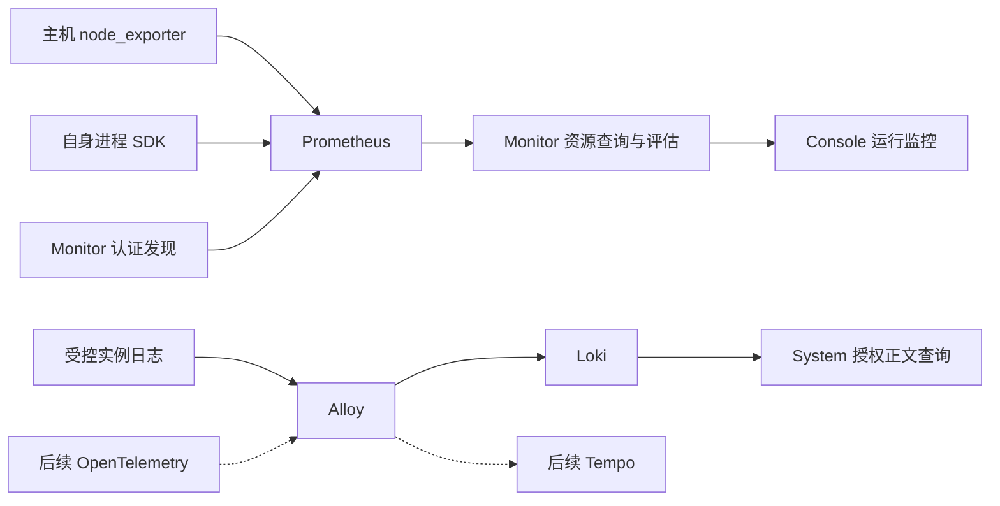

# ADDP 平台运行观测规范

本文维护已实现的主机、采集、进程资源、受限查询和平台告警契约。概念见[监控与执行体系图](../concepts/addp监控与执行体系图.md)，尚未实施的引擎/容器专业观测、Trace、受控运维及验证缺口见[后续专题](../next/ADDP平台运行监控与可观测性设计.md)。正文标明待实现的内容仅界定边界，不作为开放能力。

## 一、适用范围

适用于平台主机、当前模块运行实例、受限资源查询和平台告警。租户任务执行、日志正文与引擎业务数据仍由各自 owner 维护。

## 二、交付边界

主机台账、采集发现、基础资源、进程 CPU/RSS/时长、趋势/总览与主机 CPU/内存规则已实现。引擎专业观测、容器配额、拓扑追踪与生产规模等剩余范围，以及各层验收状态，按后续专题分别记录；实现就绪不等于相应验收通过。

## 三、对象与模块边界

### 3.1 身份与事实来源

| 对象 | 唯一事实来源 | 约束 |
| --- | --- | --- |
| 纳管主机 | System `node_id` | System 分配 UUID；物理主机与虚拟机均可纳管，容器不是主机 |
| 模块与运行实例 | System 模块登记、实例身份和租约 | UP/DOWN 来自租约，不由采集成功或 CPU 值决定 |
| 业务引擎 | System 引擎登记 | `engine_id` 与主机身份不同；远端、云端、集群引擎不按连接数推算节点数 |
| 容器 | 运行环境的容器身份及配额 | 与进程关联必须有明确证据，不能按名称或资源量猜测 |
| 任务执行 | 既有执行 Owner 与共享执行协议 | 执行身份、槽位和结果不转移到遥测存储 |
| 采集目标 | Monitor 配置身份及版本 | 引用已有主体，不重复创建主体或实例租约 |

IP、DNS、主机名、服务 URL 和 `registered_host` 均不是稳定主机身份。ResourceLocator 继续表示引擎业务数据位置，不加入主机节点语义。

部署关联与调用关联分开：前者记录声明来源及有效时间，后者来自明确配置或 Trace 观测窗口。拓扑染色不能作为已经确认根因的证据。

### 3.2 模块职责

| Owner | 职责 |
| --- | --- |
| System | 主机、模块、实例及引擎身份，当前用户对象授权，IAM 与统一审计；日志正文授权读取 |
| Monitor | 采集配置、发现投影、资源查询与预算、规则、平台事件和通知、监控页面 |
| Common / Common-Python | 共享采样 SDK、DTO、身份声明与服务客户端；不成为第二个事实 Owner |
| Infra | Prometheus、Alloy、Loki 等中心组件及节点来源的部署、传输保护、Secret 与物理资源预算 |
| Console | 统一入口、上下文和 iframe 导航；前端隐藏不替代服务端授权 |

Monitor 不直接查询 System 私有表，不直接读取主机文件，不复制 System 的实例运行状态。业务请求和执行事实不依赖观测设施才可写入或读取。

### 3.3 平台与租户权限

当前主机、平台实例资源、总览及平台资源告警只开放 Platform Context。Tenant 执行监控、执行告警保留自身事实和权限；租户引擎未来的专业观测还须单独明确归属与读取契约。

平台系统管理员承担首期主机、采集和平台告警管理职责，权限在 Owner manifest、内置角色及正式迁移中显式发布。平台安全管理员、审计管理员不因此获得资源管理或日志正文权限；平台角色也不自动取得全部租户 SQL、参数和执行结果。

- 用户请求转发已验证的当前 User Token，由 System 再裁决主体；后台投影不能代替用户对象授权。
- `addp-monitor` 使用独立 Platform Service 身份，只读取有界当前身份投影。
- `addp-prometheus` 使用独立最小身份和 `monitor.metrics_discovery.read`，不能访问业务 API。
- 采集 mTLS、发现身份、日志上报及资源查询证书分别管理；不保存长期管理员 Token，不复用业务数据库凭据。
- 资源观测、告警事件、规则管理、通知管理和日志正文分别授权。切换身份或 Context 时清除旧数据、凭据草稿，并拒绝迟到响应。

## 四、主机接入与采集发现

### 4.1 主机与服务绑定

主机保存 `display_name`、`node_kind=physical|virtual`、`addresses`、`enabled`、`version` 及 UTC 创建/更新时间。名称是可编辑属性，地址允许为空；`enabled` 表示纳管意图，不表示电源或网络状态。编辑采用版本 CAS；首期只停用纳管，不提供主机物理删除或关机。

主机的允许模块集合明确列举模块服务 Client 与模块名；“添加模块”表示允许这些服务声明部署于该主机，不是安装服务。集合为空不允许绑定，不能根据浏览器提交或来源标签自行扩权。

部署为实际所在进程注入 `ADDP_HOST_NODE_ID`。System 在首次登记时固定实例的节点声明，按当前主机状态和允许集合裁决 `unbound/bound/rejected`；同一实例重登记不得改挂主机。位置变化产生新实例身份，历史声明不反写。非法部署输入仅停用绑定并记录安全诊断，不阻断合法业务登记和续租；API 仍严格拒绝恶意或非规范请求。

缺少或失效的主机关联不阻断实例自身资源观测，也不改变租约。引擎的显式节点集合及有效区间属于 System 领域，当前尚未完成，不以数据库地址、容器名或 VM 总消耗推断。

### 4.2 管理员确认的部署清单接入

唯一导出入口 `scripts/infra/node-metrics.py export-admission` 输出 `schema=addp.host-admission/v2`。默认核验已运行的本地 Linux/Docker Desktop 受控 node_exporter，包含主机和采集配置；显式 `--host-only` 只声明当前原生 macOS/Linux 宿主，不访问 Docker 或采集凭据，要求明确物理/虚拟类型。`--module` 可重复指定该宿主允许的 ADDP 模块，生成既有固定模块 Client 对应关系；不按进程名、地址或容器名发现承载，不包含 Business 租户引擎。

清单最多 16 KiB，根字段仅为 `schema/host` 和可选 `collection`。主机字段为 `display_name/node_kind/addresses/allowed_module_bindings`；采集存在时仅允许 `monitor_kind=host_resources`、`source.type=node_exporter` 及显式 HTTPS `/metrics` 端点。拒绝旧版本、未知字段、身份和凭据；空采集对象不等于省略。Desktop 来源声明独立 Linux VM，原生宿主不得据此归入 VM。名称与地址不作为稳定身份或自动合并键，清单本身不授予权限。

System `/host-admission` 是 Console 中唯一接入编排入口；独立模块打开该跨模块流程时先进入 Console，再接受草稿。管理员导入后预览并显式选择已有主机或按清单创建；已有主机不被改写，当前读取必须仍启用且类型匹配，创建仅用既有 `platform.host_node.create`。主机保存结果或当前读取结果生成 `ADDP_HOST_NODE_ID` 部署参数；只应用于实际部署在该宿主上的新进程，不修改全局 `.env`、不自动重启、不在线改挂已有实例。

采集可选。存在来源且用户有独立 Monitor 管理权限时，System 通过共享 Console 内存导航草稿将同一主机和来源交给 Monitor 原新建页面。草稿最多 4 KiB、60 秒、一次消费，绑定当前身份/权限及精确目的路由；只允许当前同源 iframe 取回，不写 URL、浏览器存储或最近访问。取消、另行导航、身份或权限变化、退出与超时均清除；端点仍由 Monitor 重新验证，不据草稿授予权限。页面刷新仅恢复 URL 中稳定主机 ID，不恢复未保存来源。

两个 Owner 分别写入：System 创建成功后冻结该主机，未知创建结果或版本冲突阻止再次创建并要求核验；明确拒绝可修正重试。转到 Monitor 后固定所交接的主机，只保存采集，不再创建主机；明确的采集失败仅重试该配置，未知结果或冲突先到原列表核验。清单与主机身份选择在授权/页面变化后失效，迟到响应不能恢复旧草稿。Monitor 原导入、主机创建编排及私有解析器删除，采集管理只消费已存在的 System 身份。

### 4.3 采集目标与认证发现

当前主机采集配置由 Monitor 管理，含主体、固定来源类型、受控端点、启停及独立版本。同一主体和类别最多一个启用来源。模块进程来源来自 System 首次登记的不可变采集声明，随当前租约自动投影，无需每次重启人工登记。

Prometheus 只通过 Monitor 的单一认证 HTTP SD 获取全量有界快照；不分页、不接受调用者标签。身份标签由控制面覆盖，按实际端点去重；已结束实例、停用主机或目标、失效绑定从成功快照移除。控制面失败返回错误，不伪装成功空列表。

发现刷新为 30 秒。Prometheus 在发现失败时可能保留旧快照，因此当前查询和告警仍重新裁决主体及配置；发现列表不能作为读取授权或即时停采保证。紧急阻断依靠凭据撤销或网络策略，历史按原身份与保留期存在。

主机列表与采集配置区分纳管、启停和实际采集结果；配置版本不符、证据过期或无资源读取权时不得沿用“最近成功”。列表按当前页一次去重批量读取，不逐行扇出、跨页预取或拆请求绕过预算；观测失败仍保留配置管理能力。

## 五、技术路线与故障隔离

### 5.1 唯一数据路径

指标使用单一 pull 路线，不并存 remote_write；原始高频时序留在 Prometheus，配置、事件、投递和审计留在各 Owner 的 PostgreSQL。日志正文保持受控文件 → Alloy → Loki → System，不在失败时退回主机文件读取。Trace 尚未实施；cAdvisor 已有受控来源准入内核，节点部署与容器资源视图尚未交付。

不增加独立 Alertmanager 告警 Owner，不要求 Grafana 成为产品入口。成熟组件负责采集、存储和传输，Monitor 负责领域规则、事件和授权体验。

### 5.2 部署与运行环境

中心组件和节点来源统一由标准 Infra 脚本组织，根 `.env.example` 为唯一部署模板。

| 输入 | 行为 |
| --- | --- |
| `ADDP_OBSERVABILITY_METRICS_ENABLED` | 默认 false，选择指标中心及明确来源；不自动为全部机器安装 exporter |
| `ADDP_OBSERVABILITY_LOGS_ENABLED` | 默认 true，可显式关闭现有集中日志组合 |
| `ADDP_OBSERVABILITY_TRACES_ENABLED` | 默认 false，true 在首期明确报告尚未支持 |
| `ADDP_NODE_METRICS_ENABLED` | 默认 false，单独选择本节点来源；中心开启不自动调用节点部署 |
| `ADDP_PROCESS_METRICS_DEPLOYMENTS` | 显式声明自身进程指标端点，SDK 成功启动后才随实例登记发布 |
| `ADDP_HOST_NODE_ID` | 单个进程的实际部署主机声明，可空，不为不同宿主注入同一个 ID |
| 各设施端点与 Secret 引用 | 所选能力独立预检；未选择的能力不要求其专用凭据 |

布尔值只接受 true/false，不由探测结果猜开关。端点、证书、物理预算与保留参数随组件生命周期生效；Monitor 普通查询预算、规则和配置版本按各自热生效契约管理。

节点来源只消费显式部署输入，`ADDP_NODE_METRICS_LISTEN` 为受控本机 IP 与显式端口，不接受通配监听或自动避让；`ADDP_NODE_METRICS_TLS_DIR` 为仓库外绝对目录，只放 `ca.crt/server.crt/server.key`，不挂 CA 签发私钥或客户端私钥。原生 Linux 来源要求内核 5.12+，采用 host 网络/PID 及只读宿主挂载；Desktop 使用下述受限部署层，不自动放宽主机权限。

节点指标采用独立 mTLS。node_exporter 使用原生 exporter-toolkit；需要保护原始容器来源时只能使用节点专用的固定路径入口，不开放 Web UI、调试或任意代理。日志 Alloy 不获得 Docker Socket、宿主特权或 Shell 权限。

| 环境 | 当前支持与边界 |
| --- | --- |
| 原生 Linux 主机 | 标准节点入口校验宿主内核与部署条件，支持完整主机指标；按来源实际挂载/设备/网卡展示 |
| Docker Desktop Linux VM | 独立 virtual 主机，承载 Business/Infra；支持 CPU、内存、负载、运行时长及内核磁盘统计 |
| Desktop 文件系统与网络 | filesystem、netdev、netstat 仍关闭，不用容器挂载或网卡冒充 VM 全局数据 |
| 原生 macOS 服务 | 观察自身 Go 进程 CPU、当前 RSS 和时长，不绑定到 Desktop VM 冒充其进程 |
| 容器资源 | 待独立实现；容器配额、进程消耗与 VM/宿主容量不混用 |

Desktop 来源固定启用 cpu、meminfo、loadavg、diskstats、stat、uname、time；保持独立 bridge/PID/挂载命名空间、非 root、只读根、cap_drop=ALL 和 no-new-privileges，不挂宿主根、设备或 Docker Socket。磁盘代表 VM 内核设备统计，不证明 Mac 物理磁盘或某个引擎的独占消耗。远程 Engine、非 Linux Engine 和未知环境拒绝接入。

### 5.3 故障与状态

| 场景 | 影响 |
| --- | --- |
| 指标未部署、配置不全或 Prometheus 故障 | 对应资源区域明确不可用；不改变业务 Ready、实例租约、路由、任务和结果读取 |
| 单个来源采集失败 | 仅该来源缺值/过期，其他来源继续；不能补零或恢复活动资源告警 |
| Loki 或日志发送故障 | 影响日志正文/链路状态；不改变资源和执行事实，不退回直接读文件 |
| Trace 未启用或故障 | 仅追踪不可用；部署声明、指标和日志不因此丢失 |
| Monitor 必需依赖故障 | Monitor 按自身依赖报告不可用，业务 Owner 仍独立写入和读取执行事实 |
| 设施恢复 | 无需重启业务进程，等待新样本；保留停采缺口，不伪造历史回填 |

能力配置意图、后端可用性、目标采集状态、单项数据质量分别表达。数值状态区分 `not_connected/valid/no_data/stale/unsupported`；未查询成功不能包装成“没有样本”。控制读取成功可返回能力不可用状态，实际查询的未启用、未配置、故障、超时、预算与并发拒绝按 API 错误契约返回。

观测发送使用有界队列、超时与丢弃记录，不能无限积压或阻塞业务。标准生命周期分开记录必需服务和可选能力的结果，所选能力失败可使命令非零，但不能因此中止已满足必需依赖的业务。停用只处理本工作区拥有的设施，保留数据卷。

共用 Alloy 的日志/Trace 故障可能相关；共享磁盘耗尽也可能影响业务，不能把软依赖说成物理隔离。生产还需独立外部存活探针，不能靠已不可用的监控系统给自己告警。

## 六、指标、查询与展示口径

### 6.1 固定指标目录

唯一目录定义公式、单位及窗口，前端和规则复用，不接受任意 PromQL、标签搜索、脚本或调用者自选端点。

| 主机指标族 | 数量 | 口径 |
| --- | --- | --- |
| 标量概览 | 9 | CPU 逻辑核数、一分钟忙碌率、内存总量/可用量/使用率、1/5/15 分钟系统平均负载、运行时长 |
| 文件系统容量 | 5 | 总量、空闲、非特权可用、已用及使用率，保留精确挂载维度 |
| 文件系统 inode | 4 | 总量、空闲、已用及使用率，与字节容量分开 |
| 磁盘 | 5 | 读写吞吐、IO 忙碌时间占比、平均读写耗时，保留 device 维度 |
| 网络 | 2 | 网卡收发字节速率，保留 device 维度 |

容量用 IEC 自适应单位，运行时长用天/小时/分钟；解释放在对应指标或列旁。系统平均负载是运行/等待 CPU 以及不可中断等待（常见于 IO）的任务数量平均值，不是百分比，也不是内存或 CPU 使用率，必须结合核数及其他指标判断。

主机内存使用率基于可用内存，不把缓存当泄漏；文件系统使用率采用非特权可用容量口径，绑定挂载、内存和网络文件系统不计作物理容量合计。磁盘速率与 CPU 要求完整一分钟计数窗口、同次启动与来源证据；计数重置、重复/异步来源或窗口不足不生成有效值。

磁盘忙碌时间占比不是饱和度，平均读写耗时包含排队和处理；没有完成请求时平均耗时为空，有请求且耗时确为零才可显示零。设备层级、桥接与虚拟接口不简单累加；不通过插值、截断异常值或用相似指标伪装缺值。磁盘列表优先展示活动设备，无活动设备可展开。

进程目录独立：CPU 使用 `process.cpu.core_equivalents`，1 核表示消耗一个逻辑核的计算时间；内存为当前 `process.memory.resident_bytes`，时长从本次启动计算。无明确配额不生成配额利用率，不用宿主总内存计算进程使用率，也不用 Go 堆或峰值 RSS 替代当前 RSS。macOS 自身采样严格核对系统接口成功与返回长度，失败不生成有效零值。

### 6.2 资源查询与预算

资源读取仅允许非委托 Platform User，使用 `monitor.resource_observation.read` 并按主体要求核验 System 读取权限。System 当前身份投影和普通用户读取共同检查当前主体、来源、版本、启动边界及租约，不能用后台身份跳过用户授权。

| 接口（Monitor `/api/v1/monitor` 下） | 约束 |
| --- | --- |
| `/platform/resource_observations`、`/platform/resource_trends` | 显式 node_id、固定 metrics 白名单；趋势使用整秒 RFC3339 start/end，维度严格匹配 |
| `/platform/resource_summaries` | 当前授权节点的批量摘要，同一评估锚点，不逐行查询 |
| `/platform/process_resource_summaries` | 当前授权实例批量 CPU/RSS/时长，固定目录；普通实例 DTO 仅公开采集声明布尔值 |
| `/platform/process_resource_trends` | 仅 instance_id/start/end，固定 CPU/RSS 两条序列；不读取已退出实例历史 |
| `/platform/resource_overview` | 不接受 query/body，完整授权主机范围及 CPU/内存 TOP5 |
| `/settings/resource-query-policy` | Monitor 普通平台配置，沿 `monitor.configuration.read/update`，版本 CAS 与审计 |

传输采用固定 `MONITOR_PROMETHEUS_URL` 和独立 CA/client cert/key 部署输入；浏览器不读取私有地址或凭据。查询响应标明身份、单位、预算版本、评估/采样时间、窗口和步长，按每条序列判断有效性；null 与 0 区别明确，缺值形成断点。

| 预算项 | 当前默认上限或初值 |
| --- | --- |
| scrape / 超时 / 发现 | 15 秒 / 5 秒 / 30 秒；首期固定，不提供无实际效果的采样编辑项 |
| 新鲜度 | 60 秒；速率及告警仍另须完整窗口 |
| 单请求 | 12 指标、100 序列、每序列 1,000 点、总计 20,000 点、最长 7 天 |
| 步长 | 至少 15 秒，随范围和预计序列规划；返回后再次核验，不静默截断 |
| 查询超时与并发 | 总期限 5 秒；单主体 2、单 Monitor 进程上游 8；超限快速拒绝，无无界等待 |
| TSDB 保留 | 7 天与 10 GiB 体积同时限制，可能提前淘汰；另预留 WAL/压缩空间 |
| 来源序列预留 | 每端点 20,000，中心自身 20,000，全部署 200,000；当前最多九个启用来源 |
| 组件预算 | Prometheus 1 CPU/2 GiB，node_exporter 0.25 CPU/256 MiB；节点入口 0.25 CPU/128 MiB |

来源准入按去重端点的预留配额原子校验，不能把当前少量序列或单端点 sample_limit 当作全局限额。查询预算可收紧并热生效，在途请求保持开始时版本；物理资源、卷与保留归 Infra。默认预算不是已证明的生产规模上限。

标签仅保存必要身份及有限维度，不加入 TraceId、请求/执行/用户 ID、完整 URL、SQL 或 Token。服务质量后续采用规范化 route 和有界直方图；无请求不虚构错误率和延迟。

### 6.3 趋势、时段比较与总览

页面复用共享图表、格式化、自动刷新及请求代数隔离。默认 15 秒刷新、最短 10 秒；刷新、范围、实例和筛选沿唯一 URL 恢复，隐藏页面暂停并取消在途请求。错误、撤权或上下文变化清除旧内容，迟到响应不得覆盖当前对象。

服务列表默认显示在线且已声明采集的实例，采集失败或缺样的行仍保留；可切换“全部实例”，筛选由 System 在计数和分页前完成。在线状态只按 System 租约返回值显示绿色 `UP`、红色 `DOWN` 标签，并保留当前语言的在线/离线文字；采集失败、未接入或缺样不能将在线实例改为离线，配色沿统一主题。Worker 用途只消费既有 `metadata.runtime_name`，未知时仅显示正式角色，不由模块名猜测。

服务列表的主机关联只消费 System 返回的有效 `node_id`，不以部署时的 `host_node_name` 作为当前纳管名称。另有主机读取权限时，复用当页去重、最多四并发的主机引用解析，显示当前名称并沿原路由进入主机资源；没有权限或主机读取失败时保留节点 ID 文本，不提供链接，也不影响实例自身资源读取。未绑定仍明确显示未关联；刷新失败、身份或页面变化后丢弃旧名称和迟到结果，不新增承载声明或推断关系。

服务列表独立展示登记地址与端口，System 实例管理和 Monitor 复用共享 `getRegisteredEndpoint`：从 `module_url`（为空时使用 `health_check_url`）提取 HTTP(S) 主机与显式或协议默认端口，保留 IPv6 方括号；不显示账号、路径、查询或片段，不解析 DNS 或以运行主机名补地址。无监听端点的 Worker 可以为空，页面明确显示未登记监听端点；此列不表示宿主节点 IP 或新的主机关联。

服务趋势仅针对当前有效租约且已声明采集的实例，起点裁剪到本次启动，CPU 仍须完整一分钟；重启后新旧实例独立。只从当前有权读取的实例打开对话框，不按服务名自动换成新实例。

CPU/内存比较支持 5 分钟、1 小时、24 小时：以 T 为结束锚点、W 为时长，一次原趋势请求读取两倍范围，比较本期 `(T-W,T]` 与上期 `(T-2W,T-W]`；分界点只计上期。两期预期评估点均全部有效且非空，才对未舍入值计算算术均值，显示本期减上期的“百分点”；缺样显示两期有效点数及“样本不足，暂不比较”。结果旁标明绝对时间和评估间隔；不是原始抓取完整度或精确时间积分。固定历史 end 不推进；7 天曲线保留，但当前保留不支持约 14 天历史的比较。

总览读取本次完整授权主机集合，包括停用主机，独立于列表分页/筛选。System 单页最多 100 个并在同一只读快照计数、取数；双指标受默认 100 序列预算约束，当前最多评估 50 台。超范围或预算整份 422，不读取前页冒充平台总览。

CPU/内存分别报告应覆盖、有效、缺失、过期及未接入数量；仅 valid 参与前五名，按值降序、同值 node_id 升序，真实零值参与。缺覆盖明确“不完整”；整轮成功原子发布，不发部分榜单。不合计主机容量、进程 RSS、容器配额、共享挂载或引擎集群容量，后续先明确去重与分母。

## 七、平台告警与通知

### 7.1 领域、入口与权限

平台告警由 Monitor 统一管理，Tenant 执行告警保持独立事实与权限。原平台日志告警事件/通知四表已原位收敛为 `platform_alert_*`，唯一事件、事务 outbox、投递与重试主链保留；被替换的管理 API、System 表单和旧权限入口已删除，不保留别名或回退。

Monitor `/platform-alerts` 提供事件、资源规则、通知目标和投递管理；System 保留日志健康、日志源策略、正文诊断及携带来源上下文的跳转。事件读取/处理、通知读取/管理、资源规则读取/创建/修改/删除分别显式授权，首期授予既有平台系统管理员；不修改 IAM 内核、其他角色或 Tenant 范围。

日志观测器主体不冒充 System 主机 UUID。日志链路和资源类别使用明确主体与恢复语义：事件生命周期为 opened/resolved；确认只表示接手，限时抑制只影响通知，未知或暂停均不证明恢复。

### 7.2 主机 CPU 与内存规则

规则绑定一台主机和一个固定指标，主体、指标、严重级别不可编辑；同主机/指标最多一条，严重级别固定 warning。创建一律停用，管理员另行启用；当前最多保存 1,000 条，不随主机登记或通知订阅自动创建。

| 指标 | 默认打开条件 | 默认恢复条件 |
| --- | --- | --- |
| CPU 一分钟忙碌率 | 严格超过 90%，持续 300 秒 | 严格低于 80%，持续 120 秒 |
| 内存使用率 | 严格超过 80%，持续 300 秒 | 严格低于 75%，持续 120 秒 |

四个阈值/时长参数必须显式提供；百分比有限且 `0 < recovery < trigger <= 100`，持续时间为 15 秒整数倍、范围 15–300 秒。参数、名称、启停按 CAS 更新；评估状态不推进配置版本。删除采用 CAS，有未恢复事件时 409；停用不伪造恢复，已恢复历史不随规则删除而删除。

后台每 15 秒有界单轮评估，不重叠排队；按主机同次读取所需指标和 uptime（最多三项），固定 15 秒网格、最多 22 点，无法满足预算则拒绝本轮。规则、主机/目标版本、来源、启动边界、策略或采集生命周期变化均重建窗口；CPU 窗口也必须全部在有效边界之后。原始样本必须不断推进，重复 lookback 点、插值或最新单点不能证明持续时长。

评估结果为 risk/normal/unknown/paused。缺样、失效、预算、查询失败或暂停时保留未恢复事件，恢复采集后重新积累完整窗口。活动事件按触发时快照的恢复条件核验，编辑阈值不能使旧事件消失；新参数只用于未来新事件。

触发和恢复分别保存规则/主机/目标/策略版本、参数、原始样本首尾及样本数、最小/最大/最新值，不覆盖打开证据。网络读取在事务外完成，写入前锁定校验版本与评估时间，丢弃迟到结果；事件和 outbox 原子提交，竞争不重复打开。

唯一规则 API 为 `/api/v1/monitor/platform/resource-alert-rules` 及 `/:id`；页面在平台告警中按权限独立加载页签。主机选择来自当前有权读取的 System 列表，不手填私有端点。主机详情、资源事件与对应时段趋势通过同一主体和 URL 关联；无权时不附带额外数据。

### 7.3 历史、订阅与通知

原位迁移保留历史 ID、时间、投递身份、密文及尝试记录，不改写历史载荷、不重造或重发旧通知。旧通知目标仅订日志，资源类别必须显式选择；规则启用与通知订阅分别管理。

日志消息继续使用日志类别的 `addp.platform-log-alert/v1`，资源类别使用 `addp.platform-resource-alert/v1`；由同一 outbox 和 sender 按类别处理，不在失败时跨协议回退。Webhook、邮件、企业微信沿既有有界重试及人工失败重投；没有通知目标仍保存事件，发送失败不回滚事件，关闭采集或删除规则不取消已生成事实通知。

跨类别修改订阅、地址或凭据必须核验所有受影响类别的管理能力。测试只通知一次性受控接收端，不向真实群注入验收消息；至少一次投递不宣称网络恰好一次。

## 九、验证与交付

### 9.1 标准门禁

按 [测试与验收规范](addp测试与验收规范.md) 识别变更的实际 Owner、依赖、入口与 CI 注册；只验证本任务及真实影响范围。新入口、服务、权限或数据库依赖必须同次接入门禁，未执行、失败、跳过分别报告。

| 层级 | 主要验证内容 | 现有标准入口 |
| --- | --- | --- |
| T0 | 权限目录、Swagger、配置、生命周期、CI 与来源登记 | `make test-platform`、授权及 Swagger 标准检查 |
| T1 | 目录公式、身份、窗口、预算、未知/恢复及清单边界 | 对应 Owner Go/Python 测试，`make test-node-metrics-online-runner` |
| T2 | 真实采集与 mTLS、Prometheus 故障/恢复/保留，规则 CAS、事务与签名通知 | `make test-monitor-metrics`、`make test-monitor-postgres`、`make test-system-iam-postgres` |
| T3 | 权限、URL、缺样、刷新、部分完成、迟到响应、中英文和窄屏 | `make test-monitor-frontend`、`make test-system-frontend`、`make test-console-frontend` |
| T4 | 正式 System/Gateway/User/Service 身份和真实 SDK/exporter/页面闭环 | 已登记 `platform-node-metrics` Hosted suite |
| T5 | 生产安装/停用/升级、真实 OS 权限、资源预算与发布 | 对应 Release suite，不能以本地或 Hosted Linux 替代 |

工作区默认 `make test-changed`，单 Owner 使用 `make test-module MODULE=<owner>`；部署选择/清单导出使用 `make test-dev-lifecycle`。本地数据库先执行 `bash scripts/infra/status.sh` 核实实际映射，仅通过标准入口使用 `addp_test/addp_iam_test`，不接管个人 Infra、不另建数据库。

核心故障覆盖：未部署所有观测设施、仅部署部分、单来源故障、中心故障与恢复、配置/凭据错误、进程重启和地址变化、配额/窗口缺失、跨上下文越权、预算耗尽及退出零残留。生产 HA、规模和全平台容量必须另有证据，不能从设计默认值推断。

### 9.2 Hosted 身份与操作范围

`platform-node-metrics` Hosted 场景的 Online 总预算固定为 1800 秒，覆盖进程、浏览器、资源告警及后续故障恢复；不改变各单步等待、浏览器 240/300 秒期限或 Job 60 分钟上限。告警检查完成后原子保存当前阶段证据，整体仍须全部后续场景和外层退出清理通过，不以阶段成功提前宣称整体验收通过。

验收脚本重新登录平台管理员前须等待下一个自然 TOTP 周期，确保不复用浏览器刚验证的验证码；随后只进行一次正式密码/MFA 登录。认证失败直接失败，不重试认证、不更改时钟、凭据、防重放规则或总预算。浏览器阶段成功不能替代后续 Owner 独立读取、退役和外层清理。

同一标准入口按 `node_metrics_case` 显式选择 `regression`（默认既有回归）、`complete-comparison`（完整样本比较）、`cpu-pressure`（受限 CPU 告警）或 `host-admission`（主机清单接入）。主机清单专项验证 System 确认主机、Monitor 正式拒绝后的同主机重试、刷新读取、两 Owner 独立核验和退役；仍须外层清理零残留，不重复告警加压。完整样本比较复用原身份、真实来源与浏览器，只读等待最多 720 秒的自然采样，要求 CPU/内存各连续覆盖十分钟网格，随后 CPU、内存及刷新恢复三次比较必须全部完整；缺样、坏网格、版本不符或超时均失败，不补历史或降低完整度。该场景不执行已通过的内存压力和故障注入，结果明确标注所选场景，结束经原 API 退役当次配置并由原 Hosted 生命周期销毁、核验零残留；不改变 1800 秒总预算和浏览器期限。

仅在一次性干净 Hosted Linux 部署中，通过正式三员 Bootstrap 建立临时平台系统管理员，以真实密码/MFA 登录；不借用个人凭据、不注入 Token 或拦截业务 API 冒充链路。具体已确认用途以测试规范为准，集中为：

- 当次主机/采集管理、25 项即时/趋势查询，以及当次查询预算读写、CAS 与热生效。
- 当前运行实例摘要、CPU/RSS 趋势和真实 Console/Monitor iframe 页面；不读取退出实例历史或 Tenant 业务数据。
- 当次单真实主机的完整授权集合总览；不把单主机结果宣称多真实主机排序或全部权限撤销场景已验收。
- 当次资源规则管理、事件/投递查询、仅指向回环 HTTPS 接收端的临时 Webhook 与凭据；真实 CPU/内存压力打开、释放后恢复及签名重试，内存场景另覆盖来源缺样保持。

告警负载仅允许专属 Hosted VM 内受限匿名内存（最大 2 GiB 且不超过当前可用内存 25%）或受限 CPU 容器（最多 1 个逻辑核且不超过整机 CPU 的 25%，单次最多 300 秒）。CPU 专项复用已有固定镜像，启动前核验 Docker 硬配额，启动后核验 cgroup v2 `cpu.max`；容器内超时和原 Hosted 销毁双重清理，失败立即移除本轮容器。只验证打开、释放后恢复及签名重试；缺样故障继续使用原内存场景证据，不重复加压或推定生产满载能力。不加压个人或生产，不修改历史、数据库或 exporter 内容，不扩展确认/抑制、人工重投、邮件等未授权验收用途。控制面准备结束后取得新鲜样本再定标，在加压前发布阈值，不事后调阈值迁就结果。

Prometheus 始终使用原独立最小身份。每次退出释放压力和接收端、清理当次配置，并销毁临时身份、部署、卷和仓库外凭据，核验零残留；历史事实按契约保留到隔离环境销毁。

## 十、相关文档

- [术语表](../concepts/addp术语表.md)、[模块架构](../concepts/addp模块架构图.md)、[监控与执行体系](../concepts/addp监控与执行体系图.md)
- [API 设计规范](addp-API设计规范.md)、[授权上下文规范](addp授权上下文规范.md)、[配置介绍](addp配置介绍.md)
- [测试与验收规范](addp测试与验收规范.md)、[技术栈规约](addp技术栈规约.md)
- [Monitor 模块说明](../../monitor/CLAUDE.md)、[System 模块说明](../../system/CLAUDE.md)、[Infra 部署与节点来源](../../scripts/infra/README.md)
- [模块服务运行日志规范](addp模块服务运行日志规范.md)
- [运行日志验收与后续事项](../next/ADDP模块服务运行日志设计.md)

技术依据（组件行为参考，实际版本与部署条件以技术栈及 Infra 契约为准）：

- [Prometheus HTTP SD](https://prometheus.io/docs/prometheus/latest/http_sd/)、[配置](https://prometheus.io/docs/prometheus/latest/configuration/configuration/)、[存储](https://prometheus.io/docs/prometheus/latest/storage/)
- [node_exporter 容器部署](https://github.com/prometheus/node_exporter#docker)、[exporter-toolkit Web/TLS](https://github.com/prometheus/exporter-toolkit/blob/master/docs/web-configuration.md)
- [Linux 磁盘统计](https://www.kernel.org/doc/html/latest/admin-guide/iostats.html)、[OpenTelemetry 采样](https://opentelemetry.io/docs/concepts/sampling/)
