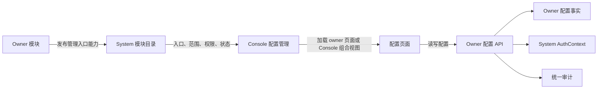

# ADDP 配置：配置归属与生效

[返回配置规范](../addp配置介绍.md)

## 核心决策

ADDP 的配置按事实来源和生命周期分层管理，不建立由 System 保存所有模块键值的中央配置表，也不允许同一个配置项同时存在数据库值、System 下发值和环境变量 fallback。

- Console 集中呈现配置管理入口，不保存配置值或解释业务字段。
- System 负责模块配置管理能力登记、AuthContext、Permission、统一审计及 System 自己拥有的配置，不理解其他模块的配置语义。
- 每个 owner 模块定义、校验、保存并应用自己的普通运行配置；平台级不等于 System-owned。
- 端口、数据库连接、基础设施地址和进程启动前必须可用的参数属于部署配置。
- 本地开发启动时可将根 `.env` 中的基础设施宿主机端口作为首选值，解析出本次实际端口并注入同一次启动的进程环境。实际映射以 ADDP Compose 容器为准，不另建可编辑的配置事实源，也不覆写根 `.env`。
- 模块加载根 `.env` 时只补齐进程环境中缺失的值；启动脚本或容器显式注入的部署值优先，避免运行时端口被 `.env` 中的首选值覆盖。
- 密钥、密码和 Token pepper 属于 Secret，不进入普通配置表和配置能力声明。
- 资源连接、任务定义和用户偏好保留各自的强类型实体，不降格为通用配置键值。

## 配置分类与事实来源

| 类别 | 典型内容 | 事实来源 | 维护者 |
| --- | --- | --- | --- |
| 部署配置 | 端口、数据库、Redis、MinIO、Kafka、模块间地址、启动开关 | ADDP 根 `.env`、本地 Business `business/.env`、容器 environment 或部署系统，按部署单元归属 | 部署运维人员 |
| Secret | 数据库密码、Service Client Secret、API Key、pepper、加密密钥 | Secret Manager 或受控环境注入 | 部署运维或安全人员 |
| 平台普通运行配置 | 模块运行策略、全局限额、重试和保留策略 | 对应 owner 模块的持久化配置 | Platform System Administrator |
| 平台安全配置 | 认证、MFA、平台 IdP 和安全策略 | System IAM | Platform Security Administrator |
| Tenant 核心治理配置 | Tenant IAM、组织和治理策略 | System | 当前 Tenant 的治理角色 |
| Tenant 模块业务配置 | 当前 Tenant 的模块策略和默认值 | 对应 owner 模块，必须绑定 `tenant_id` | 获得该模块配置 Permission 的 Tenant 角色 |
| 资源配置 | Engine、Webhook destination、Application 等 | 对应强类型资源实体 | 资源管理角色 |
| 任务与 execution 配置 | 任务定义和本次执行所需参数 | owner 任务定义及 `execution_config` 快照 | 任务维护者或执行发起者 |
| 用户偏好 | 语言、视图和个人默认选择 | 用户偏好实体 | 当前用户 |

代码默认值属于配置定义，不是可以与持久化值并行修改的第二事实源。没有显式持久化值时可以使用 owner 在配置定义中声明的默认值；一旦持久化，读取路径只能使用该值。

## 配置范围与有效值

普通运行配置必须明确声明一种范围策略：

| 范围策略 | 规则 |
| --- | --- |
| `platform_only` | 只存在平台统一值，Tenant 不得覆盖。 |
| `platform_default_with_tenant_override` | 平台提供默认值，Tenant 可以在 owner 声明的约束内覆盖。 |
| `tenant_only` | 只在当前 Tenant Context 中存在，不读取平台运行值。 |

`platform_default_with_tenant_override` 的有效值只按以下顺序解析：

```text
Tenant 显式值 > 平台显式默认值 > owner 配置定义默认值
```

解析链到此结束，不再回退到 System 内部配置 API、根 `.env` 或模块私有 `.env`。Platform Realm 与 Tenant Context 互斥；平台管理员不能通过平台配置入口修改或读取 Tenant 业务配置，Tenant 请求中的 `tenant_id` 必须来自 AuthContext，不能由客户端自报。

每个普通运行配置定义至少声明：

- 稳定 key、owner module 和配置范围；
- 数据类型、默认值、校验规则和可见说明；
- 是否敏感以及 API、日志和审计中的脱敏规则；
- 读取和修改 Permission；
- 生效方式：热更新、模块重启、任务快照或受控迁移；
- 变更后的影响评估、审计事件和必要的重建动作。

### 租户可见性与修改权限

配置的可见性与修改权限分别定义，`platform_only` 表示 Tenant 不得覆盖，并不表示一律向 Tenant 隐藏。对于实际约束租户使用、非敏感且 owner 明确允许租户查看的配置，owner 应在当前 Tenant 的配置读取接口中返回平台统一约束；仍校验该模块的读取 Permission，不授予平台管理权限，也不允许读取其他 Tenant 的配置。

租户页面将“本租户配置”与“平台统一约束（只读）”分组呈现。可覆盖字段标注已保存配置是否继承平台默认；平台约束以清晰的只读数值展示，说明“如需调整，请联系平台管理员”。共享容量必须说明共享范围，不能呈现为本租户独享配额。保存仅提交本租户可修改字段及其版本，后端继续拒绝租户改写平台约束。加载失败时不得把前端初始值呈现为当前平台约束。

Secret、内部连接信息及明确限制 Tenant 读取的安全策略不在此范围；不得因为某配置间接影响租户就自动公开。此规则不改变各 owner 的事实归属，不新增中央配置表或审批流程。

### Catalog 部署意图与直接授权默认值

2026-10-28 已实现、待真实验收：System 直接授权默认值复用 `module_definitions` 中 Catalog 的持久 `enabled`，不从心跳、运行实例、Ready 或 HTTP 可达性推导。部署初始化明确登记启用／未启用；未登记视为未知，不推导允许。平台模块管理员沿现有模块管理资格维护这一状态；显式停用将使未单独配置的数据项默认允许直接授权，界面须说明影响。启用恢复默认不允许，DataItem 显式许可始终优先；这不创建、撤销或变更任何已有 Grant。具体规则与实施状态以[授权上下文规范 5.5.5](../addp授权上下文规范.md#555-直接授权许可业务批准与明确交接)和[迁移方案](../../../system/docs/IAM数据模型与迁移规范.md#直接授权许可迁移计划2026-10-28)为准。

## 配置管理能力声明

各模块通过版本化的 `addp.configuration-management/v1` 契约向 System 发布配置管理入口。该声明是模块目录能力，不是配置定义或配置值，至少包含稳定 entry id、owner module、支持的 scope types、模块前端路由以及读写 Permission。一级配置管理入口按模块聚合：一个模块只呈现一个稳定的模块级配置页面；同一模块的多个配置域由该页面在内部使用 Tab、分组或其他二级导航组织。现有 `entries` 声明可按配置域分别登记原有读写 Permission 和适用范围，这些声明指向 owner 配置页面或其内部分组路由，Console 按 owner 聚合为一行，不能把权限声明拆成一级菜单。System 的安全策略和栅格引擎资源策略统一由 `/system/configuration` 页面承载，各分组仍使用原有 Permission 和 Platform/Tenant 边界。

System 的引擎配置遵循“已注册引擎实例 → 该实例可管理的配置域 → 配置字段”的从属关系：先选择引擎，再呈现该实例的资源策略等配置域，不能将引擎选择器嵌入某个配置域后再选择实例。IAM 安全策略是独立的 System 配置域，不从属于引擎。

约束如下：

1. 模块 Service Principal 只能发布与自身 owner 一致的入口，重复发布按稳定 entry id 幂等更新。入口引用的读写 Permission 必须在 System Permission 目录中存在、处于 `active` 且其 `owner_module` 等于入口 owner；Permission Key 的首段是资源命名空间，不能代替 `owner_module` 判断归属。
2. 声明不得携带配置键、默认值、当前值、Secret 或模块私有表结构。
3. System 只校验和登记通用契约，不能解释配置字段、代替 owner 校验或成为其他模块配置的 fallback。
4. Console 按当前 AuthContext、Permission 和模块状态聚合入口；具体页面可以由 owner 模块前端提供，也可以由 Console 在 `/configuration/{owner}/...` 下提供跨 owner 的组合视图，但配置 API、字段校验和配置事实始终属于 owner 模块。
   Console 一级列表只展示模块级入口，不按具体配置域拆分菜单；模块内部的二级导航由 owner 页面负责。
5. owner API 必须再次执行 Platform/Tenant Context 和 Permission 校验，不能信任 Console 是否展示了入口。
6. 模块下线时，Console 将入口显示为不可用；System 不代管该模块的配置值。



System 的 `platform.configuration.read/update` 只允许管理 System-owned 的普通平台配置，不能成为跨 owner 的万能权限。业务模块必须声明自己的平台或 Tenant 配置 Permission，并执行最终授权。

## 生效与变更规则

- `hot_reload`：保存成功后由 owner 原子发布新版本，新请求使用新值，运行中的 execution 保持原快照。
- `restart_required`：保存后记录待生效版本和原因，由平台运维按受控流程重启模块；不得伪装成已经生效。
- `execution_snapshot`：任务创建、更新或执行时固化完整有效配置，后续平台或 Tenant 默认值变化不能静默改变历史 execution。
- `migration_required`：涉及数据库结构、索引、加密材料或产物格式时，只能进入显式迁移流程，普通配置 API 必须拒绝直接修改。

配置变更必须记录 owner、scope、配置版本、操作者、结果和脱敏后的差异。Secret 只能记录是否设置、版本或引用，不能进入响应、日志、审计详情或管理能力声明。
