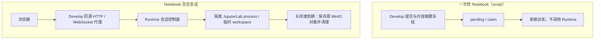

# Jupyter Engine

ADDP 的 Notebook 运行时，提供读取 MinIO、校验内容摘要、通过 Papermill 执行并写回结果的无头接口，以及由 Develop 创建和代理的短期隔离 JupyterLab 会话。

当前一次性 Notebook（`script`）仍按[Develop 执行监督与授权规范](../../docs/spec/tasks/模块任务契约.md#develop-执行监督与授权)拒绝实际派发，已有 Runtime 接口不表示平台已开放该能力。交互 Session 不进入此队列；当前接线与未完成项见 [Develop 执行架构](../../develop/CLAUDE.md#统一执行架构)。

## 架构设计



## API 接口

除 `/health` 外，下列端点均仅接受 `addp-develop` 的 Tenant Service Access Token；请求体携带的租户必须与认证上下文一致。以下示例为 Runtime 内部契约；浏览器仍经 Develop 同源会话代理访问。

### 1. 健康检查
```bash
GET http://jupyter-engine:8097/health
```

### 2. 执行 Notebook
```bash
POST http://jupyter-engine:8097/api/execute
Content-Type: application/json

{
  "tenant_id": 1,
  "notebook_path": "analysis.ipynb",
  "notebook_content_sha256": "<提交时源文件字节的 64 位小写 SHA-256>",
  "parameters": {
    "param1": "value1",
    "param2": 123
  },
  "kernel": "python3"
}
```

内容冻结与变更拒绝的规则见[任务契约](../../docs/spec/tasks/模块任务契约.md#develop-执行监督与授权)。Runtime 对实际下载字节校验：缺失或非法摘要返回 400，内容变化返回 409 和 `error_code=notebook_content_changed`，不调用 Papermill，也不写输出对象。路径仅允许当前租户 Notebook 根下的规范相对路径；当前 Kernel 仅支持 `python3`，拒绝 `ds_` 前缀参数注入。

响应：
```json
{
  "status": "success",
  "execution_time_seconds": 1.234,
  "output_path": "tenant_1/executions/analysis_exec_20260729_120000.ipynb",
  "output_count": 5,
  "outputs": [...]
}
```

### 3. 列出可用 Kernel
```bash
GET http://jupyter-engine:8097/api/kernels
```

### 4. 交互会话控制面

`POST /api/interactive-sessions` 创建、`DELETE /api/interactive-sessions/{id}` 关闭隔离会话。创建请求须携带 Tenant、User、Task、Notebook 路径、Kernel、外部 base path、TTL，以及当前 Session 的 owner API endpoint 和 Notebook Kernel Capability Token；响应中的内部端口与 Jupyter Token 只供 Develop 代理使用，不得返回浏览器。

Session 授权与每次只读数据访问的 Execution Authorization 分工统一见[会话授权规范](../../docs/spec/addp授权上下文规范.md#53-notebook-会话授权)。

每个会话使用独立临时目录和 JupyterLab process。Runtime 仅向该 process 注入 owner endpoint 和短期 Capability，供 `addp_common.notebook.engines.list()` 等受控调用使用；凭据的公开响应、存储与失效边界统一见[认证规范](../../docs/spec/addp登录认证的统一要求.md#七前端共享能力要求)，不提供共享 Lab、固定 8088 或 URL Token 入口。正常关闭与 TTL 清理先保存回原 MinIO 对象，再终止 process；Runtime 退出时统一清理全部会话。

镜像内预装 `@addp/notebook-bridge` JupyterLab 扩展。它只接受同源父页面、当前 Session ID 匹配的 `postMessage`，在当前 Notebook 中插入一个代码单元并保持未执行状态；不提供执行、文件覆盖或跨 Session 操作。

## 本地开发

```bash
# 在仓库根目录使用标准原生开发生命周期
bash scripts/dev/start.sh -jupyter
./scripts/dev/restart.sh -jupyter
```

镜像部署使用根 `docker-compose.runtimes.yml` 中的 `jupyter-engine`，不另用 `docker run` 建立开发实例。

产品镜像准备统一使用[标准构建入口](../../scripts/build/README.md#build-imagessh)；冷构建日志、依赖层及指定镜像的扩展／Node 检查见[Python 镜像排查](../../docs/guide/troubleshooting/开发服务与构建.md#python-镜像首次构建耗时过长)，短期镜像检查不能替代真实 Notebook 验收。

## 环境变量

- `API_PORT`: Notebook Runtime API 端口（默认 8097）
- `JUPYTER_GUNICORN_THREADS`: Runtime 控制面的线程数（默认 8；会话状态由单个 Gunicorn worker 持有）
- `JUPYTER_GUNICORN_TIMEOUT`: 单次 Notebook 执行超时秒数（默认 7200）
- `JUPYTER_SESSION_TTL_SECONDS`: 交互会话最大 TTL（默认 3600）
- `MINIO_ENDPOINT`、`MINIO_ROOT_USER`、`MINIO_ROOT_PASSWORD`: Notebook 存储连接

## 依赖库

依赖见 [requirements.txt](requirements.txt)。

确定性回归统一运行 `make test-jupyter`；根 `make test`、Engines 自动发现和 Platform CI 的 Jupyter Runtime job 均调用此入口。该门禁以 mock 验证 Runtime 身份、内容摘要及隔离会话等行为，不接管开发服务。Develop Owner 验证使用 `make test-module MODULE=develop`；两者均不能作为真实队列派发、撤权闭环或跨模块 Notebook T4 通过的证据，未运行、失败与未覆盖项分别记录。
