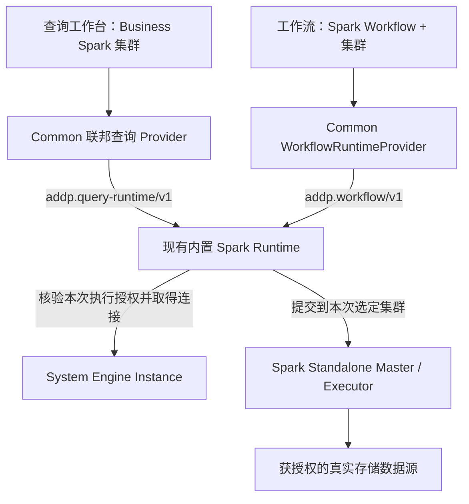

# Spark 内置运行时与 Business Spark 集群

本文描述已确认的统一方案：复用现有内置 Spark 运行时提供查询和工作流入口，执行时绑定 System 中登记的 Business Spark 集群。查询接入尚在技术准入，当前实现仍含待移除的 Thrift 查询与目录路径，不应将下述目标当作验收完成。部署与操作步骤见 [Runtime README](../README.md)和 [Spark 用户手册](spark-user-guide.md)。

## 两类引擎的职责

| 引擎 | `engine_type` / 来源 | 平台接口 | 连接用途 |
| --- | --- | --- | --- |
| Business Spark 集群 | `spark` / `general` | 查询和工作流的实际计算目标，不提供 Storage Catalog | Standalone Master 接收本次查询或工作流作业 |
| 内置 Spark Runtime | 复用 `spark_workflow` / `extension` | 工作流协议 `addp.workflow/v1`，查询协议 `addp.query-runtime/v1` | 同一 HTTP 服务提供算子、DAG 与联邦查询适配；自身不代表某个集群 |

查询工作台直接选择 Business Spark 集群，平台内部调用内置 Runtime；用户不用再次选择查询服务。工作流编辑器选择内置 Spark Workflow 后，再选择该任务使用的集群。一个任务只有一个集群，不同任务可绑定不同集群。两个入口由同一个内置服务承接，不新增 `spark-query` 服务或端口；Manager 不展示集群或 Runtime，因为两者均无存储能力。

## 架构关系

System 保存资源身份与连接事实；Spark 作业由实际集群执行，System 不转发计算任务。业务模块通过 Provider 调用 Runtime，不直接拼接 Spark Workflow 私有 URL。

## 执行期绑定

| 字段位置 | 指向对象 |
| --- | --- |
| Develop 查询 `execution_config.engine_id` | 用户选择的 Business Spark 集群；执行时另外冻结实际 Runtime 身份，不能把集群 ID 当作 Runtime ID |
| Develop 工作流 `execution_config.engine_id` | 具体 `spark_workflow` Runtime 实例 |
| `execution_config.engine_specific.spark_cluster_id` | 已登记、已启用的 `spark` 通用资源；Develop 校验后映射为 Runtime 请求顶层 `engine_id` |
| 输入或输出 ResourceLocator 中的引擎 ID | 实际存储资源；不用于选择 Runtime 或 Spark 集群 |

Spark 集群 ID 是执行期绑定，不写入 `spark_workflow` 的 capabilities，也不进入算子公开 `params`。绑定校验见 [Runtime 注册规范](../../../docs/spec/workflow/Runtime注册与扩展.md#引擎注册)。

用户和 AI 侧使用公开 locator 参数选择数据；Develop 在执行前按授权派生 `connection_info`、`schema/table` 或 `path`，对象存储路径转换为 Spark 使用的 `s3a://bucket/key`。Runtime 不解析公开 locator；支持哪些存储类型，以当前 Runtime 的 `compute.workflow.storage_access` 为准，详见 [Develop 资源适配](../../../docs/spec/workflow/Develop资源与执行.md#算子契约分层)。

Runtime 请求还必须包含后端注入的 `runtime.tenant_id` 与 `runtime.execution_authorization`，授权 effects 覆盖整个 DAG；公开工作流定义不能直接作为完整 Runtime 请求发送。字段来源、封装和错误响应统一见 [HTTP 执行协议](../../../docs/spec/workflow/HTTP协议.md#执行工作流)，本文不另维护请求模板。

Spark Workflow 执行空工作流或非法 `workflow_def.tasks` 时必须在本地校验失败，不应先连接 Spark 资源。DAG 校验、排序与引用解析复用公共 `WorkflowRunner`，Spark 仅适配领域算子与输出端口；实现见 [workflow_engine.py](../workflow_engine.py)，验证入口见 [Runtime 运行测试](../README.md#运行测试)。

## 查询准入与迁移

查询接口先限定 PostgreSQL、MySQL 只读联邦访问，使用本次 execution 的授权取源，不把源连接或用户令牌放入任务和公开请求。会话、凭据和临时状态必须在执行之间隔离；仅调用 `SparkSession.newSession()` 不足以证明隔离，因为它共享 SparkContext 与缓存。每次查询独立 Driver 的实现须验证启动开销、超时、子进程清理和实际 Worker 执行，再开放能力。

技术准入须验证跨源 JOIN、参数绑定、真实输出类型及 bigint/Decimal、未授权源拒绝、同名源冲突和无残留清理。正式接线还需覆盖 System 能力、Develop 预检/执行/结果、Meta 和 Manager 的能力拒绝，以及不再生成固定样例视图。旧目录与保存任务先盘点；不自动删除用户对象、不静默改绑集群，不把测试样例继续作为日常业务目录。
