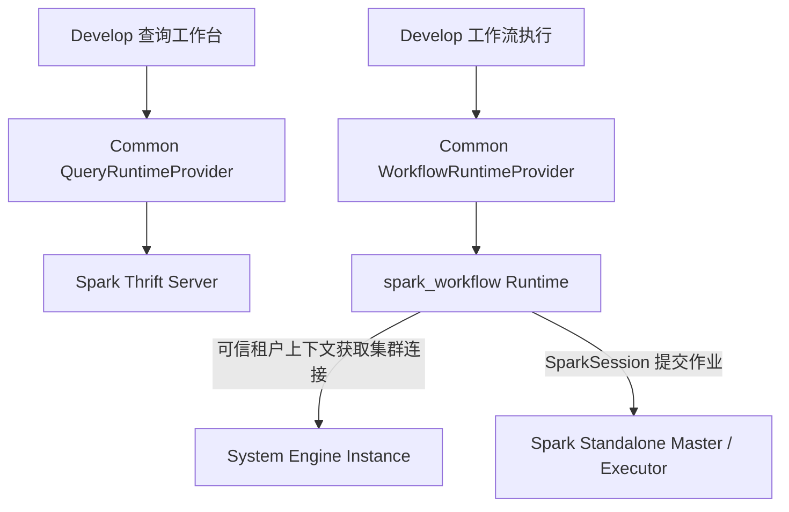

# Spark Workflow 与 Spark 通用引擎关系说明

Spark Workflow 是独立工作流运行时，执行时绑定 System 中登记的 Spark 通用资源。本文只说明两类引擎的职责和绑定关系；部署、存储与操作步骤见 [Runtime README](../README.md)和 [Spark 用户手册](spark-user-guide.md)。

## 两类引擎的职责

| 引擎 | `engine_type` / 来源 | 平台接口 | 连接用途 |
| --- | --- | --- | --- |
| Spark 通用资源 | `spark` / `general` | `QueryRuntimeProvider`、Engine Catalog | Thrift 提供 SQL 与目录；Standalone Master 接收 Workflow 作业 |
| Spark Workflow Runtime | `spark_workflow` / `extension` | `WorkflowRuntimeProvider`，协议 `addp.workflow/v1` | HTTP 提供算子发现与 DAG 执行，自身不代表某个 Spark 集群 |

SQL 工作台通过 Spark SQL 插件访问 Thrift Server；工作流编辑器通过 Common 的通用 HTTP Provider 调用 Spark Workflow。是否可用 Sedona SQL 函数取决于 Thrift 会话的依赖配置，不能用 Workflow 算子可用性代替核验；Business 默认情况见[用户手册](spark-user-guide.md#使用入口与当前范围)。

## 架构关系

System 保存资源身份与连接事实；Spark 作业由实际集群执行，System 不转发计算任务。业务模块通过 Provider 调用 Runtime，不直接拼接 Spark Workflow 私有 URL。

## 执行期绑定

| 字段位置 | 指向对象 |
| --- | --- |
| Develop 工作流 `execution_config.engine_id` | 具体 `spark_workflow` Runtime 实例 |
| `execution_config.engine_specific.spark_cluster_id` | 已登记、已启用的 `spark` 通用资源；Develop 校验后映射为 Runtime 请求顶层 `engine_id` |
| 输入或输出 ResourceLocator 中的引擎 ID | 实际存储资源；不用于选择 Runtime 或 Spark 集群 |

Spark 集群 ID 是执行期绑定，不写入 `spark_workflow` 的 capabilities，也不进入算子公开 `params`。绑定校验见 [Runtime 注册规范](../../../docs/spec/workflow/Runtime注册与扩展.md#引擎注册)。

用户和 AI 侧使用公开 locator 参数选择数据；Develop 在执行前按授权派生 `connection_info`、`schema/table` 或 `path`，对象存储路径转换为 Spark 使用的 `s3a://bucket/key`。Runtime 不解析公开 locator；支持哪些存储类型，以当前 Runtime 的 `compute.workflow.storage_access` 为准，详见 [Develop 资源适配](../../../docs/spec/workflow/Develop资源与执行.md#算子契约分层)。

Runtime 请求还必须包含后端注入的 `runtime.tenant_id` 与 `runtime.execution_authorization`，授权 effects 覆盖整个 DAG；公开工作流定义不能直接作为完整 Runtime 请求发送。字段来源、封装和错误响应统一见 [HTTP 执行协议](../../../docs/spec/workflow/HTTP协议.md#执行工作流)，本文不另维护请求模板。

Spark Workflow 执行空工作流或非法 `workflow_def.tasks` 时必须在本地校验失败，不应先连接 Spark 资源。DAG 校验、排序与引用解析复用公共 `WorkflowRunner`，Spark 仅适配领域算子与输出端口；实现见 [workflow_engine.py](../workflow_engine.py)，验证入口见 [Runtime 运行测试](../README.md#运行测试)。
