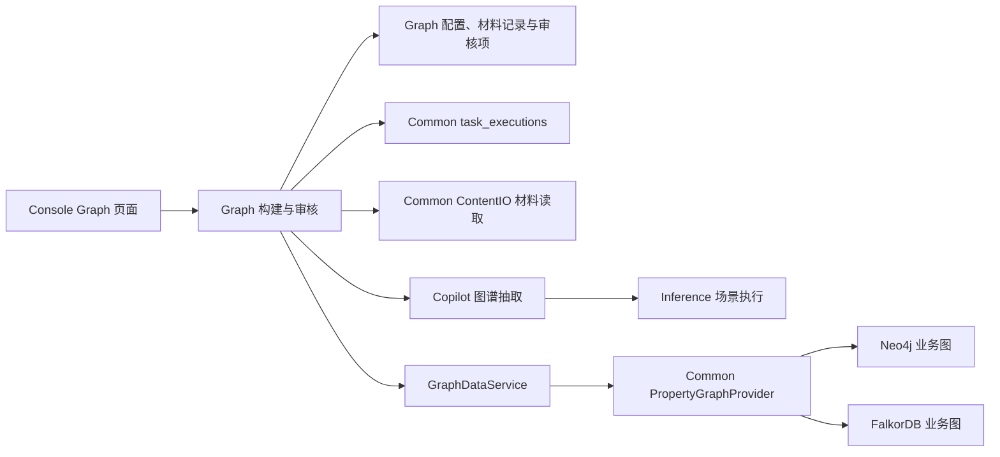

# Graph 图谱构建：实现契约与验收

本文描述 Graph 当前的材料处理、抽取、写图和审核流程。知识图谱可以绑定 Neo4j 或 FalkorDB，两类引擎共用同一领域流程。模块入口和权限事实见 [Graph 模块说明](../CLAUDE.md)，图引擎契约见 [引擎插件接口规范](../../docs/spec/addp引擎插件接口规范.md)。

## 一、职责和目标绑定



- Graph 管理本体、材料分块、置信度分流、审核和构建 execution；Copilot 处理单个分块的语义抽取，场景为 `knowledge_graph_extraction`。
- Graph 使用 `addp-graph` 的 Tenant Service Access Token 调用 Copilot，不直连厂商模型，不由请求 Header 自报 Tenant。
- 目标是知识图谱保存的 `engine_id + catalog_path`。Neo4j 为 `server/database/graph`，FalkorDB 为 `server/graph`，Redis 逻辑数据库属于连接身份。
- 构建和审核通过 `GraphDataService.MergeEntity/MergeRelation` 写入显式目标。原生 ID 表达式、索引和约束由 Common Provider 承担，Graph 不再持有引擎专属连接服务。
- 业务图与 Ontology 私有 Infra 分离。构建只作用于选定业务图，不隐式复制、双写或跨图搜索。
- Security 目标图保护继续生效；Graph 源数据授权仍按已确认范围暂缓，当前不提供图属性脱敏或原值豁免。

## 二、持久化事实

| 事实 | 所有者与位置 | 说明 |
| --- | --- | --- |
| 本体和图绑定 | Graph PostgreSQL | 图谱绑定本体、Engine、显式目录路径及索引管理方式 |
| 构建任务 | `BuildTask` | 配置、最近 execution、领域状态和统计 |
| 材料 | `BuildMaterial` | ContentIO 引用、文件摘要、分块进度、材料状态和错误 |
| 审核项 | `ReviewItem` | 原抽取内容、置信度、来源片段、审核状态和 `element_id` |
| 执行追踪 | `common.task_executions` | `module=graph`、`task_type=kg_build`，由 Monitor 统一查询 |
| 原生节点和关系 | 目标业务图 | PostgreSQL 不复制全部图数据 |

结构事实以 [build.go](../backend/internal/models/build.go) 为准，迁移使用 `MigrateGraphTables`。审核通过后保存统一字符串 `element_id`，不保留旧的引擎专属 ID 字段。构建材料经 ContentIO 读写，当前 MinIO 路径前缀为 `graph/build/`；抽取时读取材料内容，不把整份原文写入审核表。

## 三、执行生命周期

启动在任务行锁保护下检查活动 execution，原子创建 `pending` execution 并更新任务；`pending.started_at` 为空。Worker 接管时，任务和 execution 在同一事务进入 `running` 并记录真实开始时间。终态也通过同一仓储事务提交，不能只更新任务或只更新 execution。

材料按顺序处理，流程为：

1. 从本体取得实体、关系、继承标签和唯一键定义。
2. 读取材料，按任务的分块参数形成文本分块和文档头部上下文。
3. 通过正式 Copilot 抽取端点取得实体、关系、属性、临时引用和置信度。
4. 高置信度结果尝试写图；低置信度结果进入审核表。
5. 只有当前分块处理成功，才推进 `processed_chunks`；每份材料分别记录状态和错误。
6. 继续处理后续材料，最终汇总任务与 execution。

### 失败与部分写入

自动实体／关系写入、审核项入库和材料处理错误必须保留原因并向上传播。任一材料失败，任务与 execution 最终同为 `failed`；其余材料继续处理，已成功写入数据、待审项及成功统计保留。不新增部分成功状态，不因任务失败回滚业务图。

`processed` 表示本轮已处理过的材料数，可能包含失败材料；`auto_written`、`pending_review` 和 execution 的 `records_written` 保留实际成功操作的计数，包括失败材料中已经成功的操作。具体失败从逐份材料的错误和 execution 的 `error_details` 读取，不能用零计数或 `success` 隐藏失败。

### 取消与重跑

取消要求当前 Graph Backend 持有运行句柄；没有句柄返回冲突，不伪造取消终态。取消等待 Worker 停止并提交 `cancelled`，中断的材料恢复为可重跑的 `pending`，清除其分块进度。取消语义与材料失败汇总分开。

重跑仅允许终态任务。材料进度、待审核项、任务摘要重置和新 pending execution claim 在同一事务完成；已审核记录与业务图数据不作为临时材料删除。原生 MERGE 继续承担幂等写入。

## 四、分块、上下文和重复结果

| 参数 | 默认值 | 含义 |
| --- | --- | --- |
| `chunk_size` | 1000 | 分块字符预算 |
| `chunk_overlap` | 200 | 相邻分块重叠字符数 |
| `doc_context_size` | 200 | 文档头部上下文字符预算 |

字符预算按 Unicode 码点计算，不能按 UTF-8 字节切开汉字或 emoji。分块优先在段落、换行或标点附近切分，没有合适分隔符时仍须保留完整字符；每次必须向前推进，过大的 overlap 不能导致负索引或死循环。分块和头部上下文分别传给 Copilot；分块不保证跨段语义完整，也不意味着模型调用没有超时风险。

当前材料内去重键是实体类型与唯一键值。高置信度实体会继续执行 MERGE，以补充后续分块出现的非空属性；空值不清除已有属性。低置信度实体通过材料内集合避免重复入队。抽取结果先整体校验当前本体中的类型及实体标识，再进入写图或审核队列。每个实际出现的实体类型必须且只能确定一个显式 `Unique` 属性，值必须非空；未知实体／关系类型、无键、多键和空值使当前材料失败。数字零和布尔假是有效非空值。`name` 仅在本体显式声明其为唯一键时使用，不按字段顺序猜键，也不自动生成 UUID。此规则不构成跨材料实体消歧能力。

关系使用抽取结果中的临时实体引用定位两端；高置信度关系要求两端已写图。未知引用或尚未具备写入条件的关系按当前流程跳过，不声称已有跨分块待补关系队列。关系的材料内重复控制与原生 MERGE 分工，不新增另一套存储身份。

## 五、审核与权限

审核列表、批准、拒绝和修改分别使用 `graph.review.read/approve/reject/update`。任务读取、创建、执行、取消、删除及材料维护使用对应 `graph.build_task.*`，具体映射以 [router.go](../backend/internal/api/router.go) 和 [Permission Manifest](../authorization/permissions.yaml) 为准。

| 操作 | 正式路由 |
| --- | --- |
| 任务列表／创建 | `GET/POST /api/v1/graph/graphs/:id/build/tasks` |
| 任务详情／删除 | `GET/DELETE /api/v1/graph/graphs/:id/build/tasks/:tid` |
| 运行／取消／重跑 | `POST .../:tid/run`、`POST .../:tid/cancel`、`POST .../:tid/rerun` |
| 材料列表／上传 | `GET/POST .../:tid/materials` |
| 材料删除 | `DELETE .../:tid/materials/:mid` |
| 审核列表／待审数量 | `GET /api/v1/graph/graphs/:id/review`、`GET .../review/pending-count` |
| 单项批准／拒绝／修改 | `POST .../review/:iid/approve`、`POST .../review/:iid/reject`、`PUT .../review/:iid` |
| 批量批准／拒绝 | `POST .../review/batch/approve`、`POST .../review/batch/reject` |
| 执行详情 | `GET /api/v1/graph/executions/:execution_id` |

批准或修改后批准均复用 GraphDataService，原生写入成功后才保存审核状态和 `element_id`。构建与审核页通过共享 `MonitorExecutionsButton(module=graph, task_type=kg_build)` 查看执行历史，不自建另一套执行历史。

## 六、实现与验证入口

主要代码为：

- [BuildService](../backend/internal/service/build_service.go)：材料处理、Copilot 调用、写图和审核组合。
- [BuildRepository](../backend/internal/repository/build_repository.go)：活动 execution claim、启动和终态原子提交。
- [GraphDataService](../backend/internal/service/graph_data_service.go)：显式目标、保护门禁和原生图操作组合。
- [Copilot 抽取服务](../../copilot/backend/services/kg_extraction_service.py)：调用 `knowledge_graph_extraction` 场景。

最小标准验证命令：

```bash
make test-module MODULE=graph GO_ONLY=1
make test-common-falkordb
make test-common-neo4j
make test-common-postgres COMMON_POSTGRES_TEST_ARGS="--test graph"
```

Go T1 覆盖抽取／审核入库失败、后续材料继续、失败汇总、统计保留、取消和 Unicode 分块。两类原生图 T2 复用同一领域测试，验证原生实体与关系写入失败后的任务／execution 状态、已写数据及后续材料结果。PostgreSQL 分组覆盖目标约束、迁移、执行并发及事务；本地只使用 `addp_test`，连接参数按 Infra 实际映射显式注入。

`graph-protection` Hosted suite 的 v3 已覆盖普通 Graph 读取账号和独立 Develop 五权限账号的查询／保护链路。该结果不等同于材料上传、真实模型抽取、人工审核及 Monitor 全链路的普通账号浏览器验收；本轮原生构建故障测试控制 Copilot 响应，属于 T2。

## 七、剩余工作边界

- 材料上传 → 真实 Copilot/Inference → 自动写入／审核 → Monitor 的普通账号完整 Hosted T4 尚需单独准备身份、模型与合成材料。不得给现有只读验收账号追加构建权限后继续沿用原有最小权限结论。
- 按置信度保存历史值并解决属性冲突、跨分块待补关系、跨材料实体消歧仍需明确业务策略后实施，不能从 MERGE 或文档头部注入推断这些能力已经存在。
- 超大材料流式处理、生产恢复与 HA、图属性脱敏不在当前实现承诺中；Graph 源授权继续暂缓。
