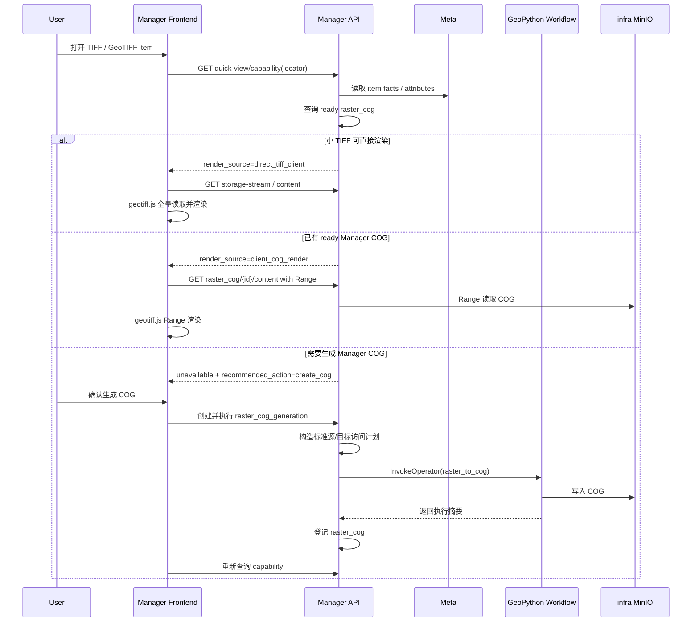

# TIFF 与 COG 快显

[返回快显实现规范](../快显实现规范.md)

本页定义 TIFF / GeoTIFF 基础预览、COG 快显、内容读取、来源驱动生成与执行生命周期。共用状态与 API 见[共用契约](共用契约.md)。

IMG 复用同一 COG 任务与地图显示链路：仅接受 Meta 已完整检查的自包含 HFA (`format_info.img.scan_complete=true`)；永不把 IMG 源发送给 geotiff.js。生成任务的 `config.raster.source_format` 必须保存 Meta 的 canonical 格式 (`tiff` 或 `img`)，执行器按此构造源计划，不再固定声明 TIFF。该字段缺失或未知的任务配置拒绝执行，旧任务须从源重新创建，不提供兼容默认。IMG 无定位事实时保持未知；Runtime 读取并确认定位后，COG 沿既有事实传递与校验处理。

地图全幅定位按 `quick_view.extent_srid` 的明确声明转换范围到 EPSG:3857，复用 OpenLayers 已有投影与转换（包括 UTM）；不再仅接受经纬度范围。缺失或未注册的范围坐标系不作经纬度推断，也不改写源文件及其 CRS。

阅读导航：[TIFF / COG 栅格快显](#tiff--cog-栅格快显)、[能力判断与响应](#能力判断与响应)、[渲染统计与范围](#渲染统计与范围)、[内容与任务接口](#内容与任务接口)、[来源驱动生成](#来源驱动生成)、[执行与租约](#执行与租约)、[端到端流程](#端到端流程)、[当前支持边界](#当前支持边界)、[产品入口与只读任务定义](#产品入口与只读任务定义)。

## TIFF / COG 栅格快显

### 能力判断与响应

TIFF / COG 的能力判断通过：

```http
GET /api/v1/manager/quick-view/capability?locator={resource_locator}
```

返回快显能力。TIFF / COG 判断事实来自 Meta attributes：`layout=multi` 的 GeoTIFF item 由 Meta 使用 primary `.tif/.tiff` 读取 `type_info.media`、`format_info.tiff` 和 `capabilities.spatial`，sidecar refs 只作为 `item.refs` 保留。Manager 不重新扫描 TIFF，也不直接读取 sidecar 反推空间事实。

小 TIFF 可直接由前端渲染时：

```json
{
  "can_use_quick_view": true,
  "status": "available",
  "render_source": "direct_tiff_client",
  "quick_view": {
    "render_source": "direct_tiff_client",
    "preview_url": "/api/v1/manager/storage-stream?locator=addp%3A%2F%2Fengine%2F26%2Fpath%2Frasters%2Fsmall.tif%3Ftype%3Dfile%26item_id%3D99&storage_ref=rasters%2Fsmall.tif",
    "extent": [110.0, 20.0, 120.0, 30.0],
    "extent_srid": 4326,
    "source_srid": 4326
  },
  "raster": {
    "format": "tiff",
    "profile": "geotiff",
    "width": 2048,
    "height": 2048,
    "size_bytes": 8388608,
    "nodata": -32768,
    "sample_min": -49,
    "sample_max": 406,
    "display_min": -49,
    "display_max": 406,
    "display_range_method": "metadata_statistics",
    "client_render_library": "geotiff.js",
    "client_read_mode": "full_file"
  }
}
```

大 TIFF 未生成 COG 时：

```json
{
  "can_use_quick_view": false,
  "status": "unavailable",
  "unavailable_reason": "requires_cog_generation",
  "raster": {
    "format": "tiff",
    "profile": "geotiff",
    "recommended_action": "create_cog"
  }
}
```

源 TIFF 已经是 COG 但尚未进入 Manager 受管 infra MinIO COG 结果时：

```json
{
  "can_use_quick_view": false,
  "status": "unavailable",
  "unavailable_reason": "requires_managed_cog",
  "raster": {
    "format": "tiff",
    "profile": "cog",
    "recommended_action": "create_managed_cog",
    "cog_check_level": "heuristic"
  }
}
```

ready raster COG 可直接由前端 Range 渲染时：

```json
{
  "can_use_quick_view": true,
  "status": "available",
  "render_source": "client_cog_render",
  "quick_view": {
    "render_source": "client_cog_render",
    "preview_url": "/api/v1/manager/raster_cog/12/content",
    "extent": [110.0, 20.0, 120.0, 30.0],
    "extent_srid": 4326,
    "source_srid": 4326
  },
  "raster": {
    "format": "tiff",
    "profile": "cog",
    "nodata": -32768,
    "display_min": -49,
    "display_max": 406,
    "display_range_method": "metadata_statistics",
    "client_render_library": "geotiff.js",
    "client_read_mode": "range"
  }
}
```

### 渲染统计与范围

`raster` 中的渲染统计字段含义：

| 字段 | 说明 |
| --- | --- |
| `nodata` | 栅格 NoData 值，来自 `format_info.tiff.nodata` 或 COG/TIFF 内部 GDAL metadata。 |
| `sample_min` / `sample_max` | 元数据中的样本统计范围，来自 GDAL statistics 或 TIFF sample value tags。 |
| `display_min` / `display_max` | 前端默认拉伸范围，优先来自 Meta scan。 |
| `display_range_method` | 范围来源，例如 `metadata_statistics`、`sample_value_tags` 或运行时兜底。 |

前端渲染范围取值顺序：

```text
Quick View capability raster.display_min/display_max
  -> geotiff.js 打开 TIFF/COG 后读取内部 GDAL metadata stats
  -> 对最低分辨率图像做受控采样
```

运行时兜底只影响本次预览，不反写源 item attributes。

### 内容与任务接口

raster COG 内容读取接口：

```http
GET /api/v1/manager/raster_cog/{id}/content
```

该接口只读取 `manager.raster_cog.status=ready` 的 Manager infra MinIO COG 生成结果，支持 HTTP Range。前端不得感知 NFS 路径、业务 MinIO bucket/object，也不得从 `storage_ref` 自行拼接 URL。

raster COG 任务与结果管理接口：

```http
GET    /api/v1/manager/tasks?task_type=raster_cog_generation
GET    /api/v1/manager/tasks/raster_cog_generation/{id}
DELETE /api/v1/manager/tasks/raster_cog_generation/{id}

GET  /api/v1/manager/raster_cog
GET  /api/v1/manager/raster_cog/{id}
DELETE /api/v1/manager/raster_cog/{id}
```

### 来源驱动生成

预览页触发 raster COG 生成时，只提交 Resource Locator 和 `quick-view/capability.available_actions` 返回的动作值：

```http
POST /api/v1/manager/quick-view/actions
```

请求体只包含：

```json
{
  "locator": "addp://engine/26/path/rasters/dem.tif?type=file&item_id=42",
  "action": "generate_raster_cog"
}
```

`manager.task_definitions.config.target`、`config.raster` 和 `config.cog` 必须由 Manager 后端根据 capability 和 Preview source 事实生成。前端不得自行拼接 raster COG 任务私有配置。统一“数据任务”页允许用户选择一个源 item 并调用同一个 `quick-view/actions` 领域动作，但不提供目标选择，也不提供直接提交或更新任务私有配置的入口。

失效任务的来源重绑遵循[共用重绑契约](共用契约.md#失效任务重绑)。

### 执行与租约

标准 TaskProvider 使用 `task_type=raster_cog_generation` 触发执行。执行器主路径为：Manager 解析 ResourceLocator、源 engine connection 和目标 `storage_ref`，构造标准 `addp.workflow.access-plan/v1` 源/目标访问计划，通过 `WorkflowRuntimeProvider.InvokeOperator("raster_to_cog")` direct 调用 GeoPython Workflow，在受控执行目录生成并通过 COG 结构校验后发布到 infra MinIO，最后登记 `manager.raster_cog`。如果 GeoPython Workflow 不可用、源 engine 不受支持、NFS 挂载不可达、对象存储源下载失败或 GDAL 写入失败，执行必须写入 failed execution 和 failed COG 结果，不能返回 ready。

`raster_cog_generation` execution 必须先在 Infra PostgreSQL 的任务定义行锁内原子创建为 `pending`，此时 `started_at` 为空；Manager 运行体接管时将 execution 和任务摘要同事务推进为 `running`。同一任务存在 `pending` / `running` execution 时，重复执行返回 `409 Conflict`。完成时使用 `manager.raster_cog.last_execution_id` fencing，并在 Infra PostgreSQL 同一事务提交 COG 结果状态、execution 终态和任务摘要。infra MinIO 对象写入无法与 Infra PostgreSQL 组成事务；对象已经写入但平台终态提交失败时不得分别补写 execution 或任务摘要来伪造终态，应保留 `running` / `building` 平台状态并通过同一任务重跑恢复。

### 端到端流程

TIFF / COG 栅格快显端到端流程：



### 当前支持边界

当前支持边界：

1. `direct_tiff_client` 只用于浏览器预算内的小 TIFF；前端优先采用 GeoTIFF metadata 生成的 source view 定位，`quick_view.extent` 仅作为 EPSG:4326 回退范围。
2. 大 TIFF 不降级为服务端 raster tile，也不生成 PNG/JPEG/WebP 瓦片缓存。
3. NFS 或业务 MinIO 上已经是 COG，只说明源布局可能已满足云优化；前端可消费前仍应通过 `raster_cog_generation` 生成 Manager 受管的 infra MinIO raster COG。当前执行器会通过 `raster_to_cog` 重写为规范 COG，不支持只登记外部路径。
4. `vector_tile_cache_generation` 和 `vector_materialized_view_generation` 不承载 TIFF / COG 快显。
5. 地图快显模式下隐藏 multi-layout related ref 切换入口；related ref 切换只属于基础预览。
6. 栅格地图底图优先使用平台配置中的天地图矢量 / 影像底图，高德只作为最后兜底。
7. COG 生成必须保留可被 GeoTIFF / OpenLayers 识别的 CRS GeoKey。Manager 应根据 Meta 源事实向 `raster_to_cog` 传入 `options.source_crs`：正数 SRID 统一使用对应 EPSG 定义，缺失时才使用可信 `source_crs`。运行时仅补充缺失 CRS；已有 CRS 按栅格 x/y 坐标语义验证等价后原样保留，冲突时拒绝执行。不得把 WKT 中单位、椭球或其他子节点 authority 误当作数据集 CRS。
8. COG 内容接口必须支持 HTTP Range，并只通过 Manager 受控 URL 暴露给前端。前端不得直接读取 NFS 路径、业务 MinIO 对象或 `storage_ref`。

### 产品入口与只读任务定义

Raster COG 任务在产品中是来源驱动的只读定义。用户可以从 Data Explorer 当前 TIFF / GeoTIFF item 的 Quick View action 发起，也可以在统一“数据任务”页选择一个源 item 后发起；两处统一提交 ResourceLocator 与后端 capability 声明的 action，Manager 根据 Meta 源事实和生成 profile 派生或复用任务定义。统一“数据任务”页不编辑来源驱动任务的私有配置。TaskProvider 的统一 CRUD 仍使用强类型配置校验，不得恢复类型私有路由。

Raster COG 管理页的 canonical URL 为：

```text
/manager/tasks/quick-view?task_type=raster_cog_generation&task_id={task_id}
```

该地址在统一任务工作区展示只读任务定义，也是 TaskProvider `edit_url`。TaskProvider `create_url` 指向 `/manager/tasks/quick-view?task_type=raster_cog_generation&create=1`，由统一页面选择源 item；该入口不是空白任务配置表单，不允许调用方提交目标位置或 Manager 私有生成参数。
