# Manager 模块数据库架构

## 一、模块概览

Manager 使用部署选定的 PostgreSQL `manager` schema 或 MySQL 8 `manager` 逻辑库，负责检索历史、数据剖析、向量化、空间快显和瓦片缓存相关状态。资源树、node 和 item 事实归 Meta 管理，Manager 通过 ResourceLocator 与 Meta facts 做只读探查和预览。

### 核心职责

- **搜索历史**：记录用户的数据检索历史（全文 + 向量），提供快速访问
- **数据剖析结果**：记录表格型 data item 当前成功的采样剖析摘要和字段指标；执行历史仍归 `common.task_executions`
- **向量化结果**：记录 data item 当前可检索向量状态和 pgvector 内容
- **向量化任务**：记录可执行、可调度、可编排的向量化任务定义
- **向量化平台配置**：记录 Manager owner 的平台普通运行配置及单调版本，不保存 API Key
- **快显服务**：记录 item 的预览模式偏好和轻量交互状态；快显能力由查询时动态合成
- **矢量物化视图结果**：记录 Manager 创建并拥有生命周期的 3857 矢量物化视图目标
- **矢量物化视图任务**：记录可执行、可编排的 3857 矢量物化视图目标构建或刷新配置
- **栅格快显 COG生成结果**：记录 Manager 创建并拥有生命周期的 infra MinIO COG 生成结果
- **栅格快显 COG生成任务**：记录可执行、可编排的 raster COG 生成配置
- **点云 COPC 快显结果**：记录 Manager 创建并拥有生命周期的 infra MinIO COPC artifact
- **点云 COPC 快显任务**：记录可执行、可编排的 LAS / LAZ / E57 / PCD / XYZ 转 COPC 快显配置
- **瓦片缓存结果**：记录瓦片缓存的存储引用、格式、范围、层级和状态
- **瓦片缓存任务**：记录可执行、可编排的瓦片缓存生成配置；当前不支持任务自身定时调度
- **导出会话**：记录用户发起的数据库 item 导出会话、Transfer sync execution 和 infra 暂存产物 manifest

---

## 二、数据库表清单

| 表名 | 用途 | 行数估算 |
|------|------|---------|
| `search_histories` | 个人搜索历史 | 每租户内每位 User 最多 50 条 |
| `content_index_outlets` | 全文索引持久出口隔离、端点身份及部署代次 | 每个 Manager 自有索引 1 条 |
| `content_index_deliveries` | 全文写入／删除投递、外部任务回执与终态证据；不存正文或凭据 | 随投递增长，未决记录不得按时间清除 |
| `export_sessions` | Manager 导出会话和 infra 暂存产物 manifest | 1000-10000 |
| `data_profiles` | 表格数据当前成功剖析结果和源依赖 | 1000-100000 |
| `data_profile_fields` | 当前剖析结果的字段指标、分布和观察 | 10000-1000000 |
| `embeddings` | 向量化结果状态和向量内容 | 10000-1000000 |
| `embedding_tasks` | 向量化任务定义 | 100-1000 |
| `embedding_configuration` | 平台向量化普通运行配置单例 | 1 |
| `preview_state` | 预览模式偏好和预览交互状态 | 100-1000 |
| `task_definitions` | 快显管理与空间任务的统一派生任务定义 | 100-10000 |
| `task_resource_bindings` | 派生任务对源/目标资源的规范化绑定 | 100-20000 |
| `vector_materialized_view` | 矢量物化视图结果状态 | 100-10000 |
| `raster_cog` | 栅格快显 COG生成结果 | 100-10000 |
| `model_3d_glb` | 三维模型 GLB 快显结果 | 100-10000 |
| `model3d_tiles` | 分块三维模型瓦片结果，包含 3D Tiles / S3M | 100-10000 |
| `gaussian_splat_ksplat` | 3DGS - KSplat 快显结果 | 100-10000 |
| `point_cloud_copc` | 点云 COPC 快显结果 | 100-10000 |
| `vector_tile_cache` | 瓦片缓存结果状态 | 100-10000 |

### Schema 收敛方式

`content_index_deliveries.document_ids` 是写入批次的排序成员指纹 JSON 数组；单指纹保护清理仍使用 `document_id`。一批最多 100 项，只登记一次投递并共享同一个外部任务；同租户未完成批次的成员重叠时拒绝新写入，清理继续等待所有写入终态。该列只保存身份，不保存快照载荷。

Manager 仓储维护索引出口、投递、删除屏障和专业清理记录。PG 使用现有迁移，MySQL 使用 InnoDB、原生 JSON 和区分大小写的索引身份。投递状态为 `queued → submitting → submitted → succeeded/failed/canceled`；提交响应丢失进入 `unknown`，不按超时推断无外部任务。`task_uid` 可空，`0` 是合法编号；端点身份、索引名和任务 UID 有联合唯一约束，阶段与回执组合由数据库 CHECK 约束。`task_correlation` 在新写入登记或清理领取时绑定投递 UUID，CHECK 只允许空值或本记录 ID；迁移旧记录默认空字符串，不回填。带标记的 `submitting/unknown` 可只读认回原任务，历史无标记且无 UID 的记录仍保持未决。外部任务入队时间以 UTC RFC3339Nano 文本保存，保留原始精度以核验任务身份，不能因 PostgreSQL 时间截断而误认重用 UID。保护投影安装只在同一事务登记清理和隔离出口，事务提交后才进行外部 I/O。失败或取消的删除创建新投递，保留原终态证据；已知任务由后台恢复循环继续核查，不重发原写入。

**部署确认与副本加入。** 部署入口根据与运行容器相同的环境确认 Manager 技术索引名和端点摘要。相同目标重复发布或普通进程重启沿用原代次、隔离状态和清理记录。普通副本只读加入已生效的代次，目标不符时本副本暂停搜索，其他业务继续。新库先由 `manager-backend prepare-database` 安装结构并登记单一逻辑索引；启动前未完成部署准备时按缺少必需结构处理。物理地址切换沿用已登记的索引名；逻辑索引改名涉及文档序号和删除屏障迁移，直接更名的发布会被拒绝。首次登记或变更目标时，在同一事务按已安装保护投影登记清理。相同目标重复发布不重复清理。停用搜索保留原物理端点和未决记录；重新启用原端点可以接续原回执。切换到不同物理端点时，部署事务核对原出口的维护占用和未完成外部投递，失败保留原目标及其全部证据。外部索引数据迁移和核验仍由站点恢复流程负责。独立进程部署时，用同一份部署环境运行准备命令与服务，只有准备命令接收部署凭据。首次升级先排空旧版本，避免仍执行旧启动协议的进程改写出口。两个副本同时首次启动时，按同一逻辑索引锁定出口行，再检查并准备 Meilisearch；后到的副本复核已有索引和设置。恢复循环执行同一流程，清理占用出口或代次已变更时停止准备。

混合搜索使用单独的 `manager-search-redis`。本机 `scripts/infra/up.sh` 为开发环境首次生成临时缓存的独立凭据，后续启动复用；生产环境由 `scripts/prod/setup-env.sh` 生成新站点凭据。已有生产环境升级时，先向项目密钥配置写入独立随机值 `MANAGER_SEARCH_REDIS_PASSWORD`，再按标准顺序启动 Infra 与平台。Manager 经 `MANAGER_SEARCH_REDIS_HOST`、`MANAGER_SEARCH_REDIS_PORT` 和用户 `manager_search` 连接；禁止复用 Infra Redis 凭据。固定期限、丢失、重放和授权语义见[检索续查契约](../../docs/spec/addp授权上下文规范.md)。首次切换清空旧进程内会话，已取得旧游标的客户端重新发起查询。

System 部署在 PG 和 MySQL 上准备检索授权世代及租户版本。Grant 签发、撤销及改变来源身份或生命周期的引擎变更，在原事务内推进相关租户版本。回滚保留原标记，已提交的版本变化使旧搜索游标失效。MySQL 沿用现有的部署触发器审阅与启动版本核验。运维通过既有入口更新事实，MySQL 手工 `TRUNCATE` 不属于检索授权维护操作。

**保护回执与在途读取。** Manager 在刷新保护投影前，将读取 UUID、租户、进程实例身份和 UTC 开始时间提交到平台库的 `manager.protection_reads`。登记持续到 HTTP 输出结束或有界执行完成结果持久化。任一副本在确认该租户的保护变更前检查共享登记；读库失败或登记仍存在时推迟回执。结束后删除失败由原进程重试。进程重启、租约过期或节点失联均不能解除遗留登记。同一租户在仍有持续读取时回执可能推迟。

首次升级须先排空并终止旧版 Manager Backend 和内嵌执行器，再走部署入口准备 Manager schema 并启动新版，防止旧进程绕过共享登记。故障处置时，部署人员先查询 `SELECT read_id, tenant_id, process_instance_id, started_at FROM manager.protection_reads ORDER BY started_at`，通过节点进程或容器运行时核实该启动实例已终止，记录现场证据。只有证据成立才按读取 UUID、租户和原进程身份三个条件删除对应的一条记录，核对影响行数；不按时间、Pod 名称或节点状态批量清理。登记不保存文件名、内容或访问凭据。

**全量维护约定。** 全量清空或同名重建由 Manager 的部署维护入口负责。平台库事务先隔离目标索引并使旧检索游标失效，保留文档序号、高水位、删除回执及清理记录。第二阶段只操作配置指向的 Manager 索引，核实外部任务终态、索引内容与序号后才开放查询。结果未知时保持隔离，凭原任务身份恢复。手工 `TRUNCATE` 不属于支持的维护流程。普通启动和部署升级不触发全量维护。Manager 初始化或恢复时核对技术内容索引的可搜索、可过滤和可排序字段。可搜索字段的顺序决定权重，另两组按集合比较。三组均一致时只读，存在差异时用一个外部任务只更新有差异的组，并等待任务成功。

在目标索引的独占维护窗口运行 `manager-backend maintain-search rebuild <操作 UUID>`。该命令用平台部署账号连接已选平台库，用 Manager 配置连接关键词索引。原索引中已有文档时，通过切换并恢复可搜索字段让 Meilisearch 重建全文索引，文档保留在原处。退出前按批核对文档身份、原序号与总数。恢复遗失的源文档需要由内容生产者按现有授权重新投递。只有明确需要清空所有租户在该索引的文档时才选 `clear`。程序支持用同一 UUID 查询或接续原操作，未知提交只有认回原任务才继续。维护期间暂停该索引生产者和其他索引管理命令。

Manager 仓储负责准备私有上传来源表 `manager.import_sources`。PostgreSQL 使用 UUID 和 JSONB，MySQL 8 使用受 UUID 约束的字符主键和原生 JSON。两者均按租户、上传者、Transfer 任务和完整对象引用核验来源，对象引用区分大小写及尾随空格。MySQL 表级实库门禁为 `make test-common-mysql-data-protection COMMON_MYSQL_TEST_ARGS='--local-disposable --test platform-manager-storage'`。

预览偏好按租户、数据项指纹和用户唯一。MySQL 新装使用原生 JSON 保存视角，并与 PG 一样在同一事务内校验清理代次、更新偏好。清理完成后，清理前取得的写入凭证失效。两种平台库均独立保存同一数据项下不同用户的偏好。

Manager 的部署与启动使用以下入口。

1. 根部署入口以部署身份执行 `manager-backend prepare-database`，Common 按选定的提供方连接 Manager。服务启动以平台运行身份核验 Common、Manager 版本并读回保护投影。
2. Manager 安装程序负责自己的表、索引和约束。PG 用原有模型与迁移整理旧对象，MySQL 使用原生 DDL。业务代码复用任务、清理及保护投影的事务。
3. PG 部署时显式执行 `048` 预览偏好迁移，以及个人搜索历史（`049`）和关键词材料（`050`）迁移。存在向量结果表的部署另行准备向量版本（`051`）。已应用的 `047` 继续核验原始摘要；新装直接按能力准备，不依赖向量表创建关键词索引。搜索迁移在同一事务写入 `manager.search_schema_migrations` 和校验和。归属和旧记录处理见[预览状态](tables/preview_state表.md#四索引声明与核验边界)与[搜索历史](tables/search_history表.md#表与迁移)。

`manager/backend/migrations` 中其余历史脚本留作部署审计与人工迁移参考，其中部分会删除并重建旧表。启动不遍历执行整个目录。

---

## 三、表关系图

### 3.1 ER图（Mermaid）

```mermaid
erDiagram
    SEARCH_HISTORIES }o..|| SYSTEM_USERS : "User 逻辑归属"
    SEARCH_HISTORIES }o..|| SYSTEM_TENANTS : "Tenant 逻辑归属"
    EXPORT_SESSIONS ||..|| TASK_EXECUTIONS : "关联 Transfer execution"
    DATA_PROFILES ||--o{ DATA_PROFILE_FIELDS : "包含字段结果"
    DATA_PROFILES ||..|| TASK_EXECUTIONS : "最近成功 execution"
    EMBEDDING_TASKS ||..o{ EMBEDDINGS : "执行后更新结果"
    EMBEDDING_CONFIGURATION ||..o{ EMBEDDING_TASKS : "创建或更新时快照"
    PREVIEW_STATE }o..o{ VECTOR_TILE_CACHE : "同一item指纹"
    PREVIEW_STATE }o..o{ VECTOR_MATERIALIZED_VIEW : "同一item指纹"
    PREVIEW_STATE }o..o{ RASTER_COG : "同一item指纹"
    PREVIEW_STATE }o..o{ MODEL_3D_GLB : "同一item指纹"
    PREVIEW_STATE }o..o{ MODEL3D_TILES : "同一item指纹"
    PREVIEW_STATE }o..o{ GAUSSIAN_SPLAT_KSPLAT : "同一item指纹"
    PREVIEW_STATE }o..o{ POINT_CLOUD_COPC : "同一item指纹"
    PREVIEW_STATE }o..o{ PPTX_PDF : "同一item指纹"
    TASK_DEFINITIONS ||--o{ TASK_RESOURCE_BINDINGS : "绑定源与目标"
    TASK_DEFINITIONS ||--o{ VECTOR_MATERIALIZED_VIEW : "创建或刷新"
    TASK_DEFINITIONS ||--o{ RASTER_COG : "生成"
    TASK_DEFINITIONS ||--o{ MODEL_3D_GLB : "生成"
    TASK_DEFINITIONS ||--o{ MODEL3D_TILES : "生成"
    TASK_DEFINITIONS ||--o{ GAUSSIAN_SPLAT_KSPLAT : "生成"
    TASK_DEFINITIONS ||--o{ POINT_CLOUD_COPC : "生成"
    TASK_DEFINITIONS ||--o{ PPTX_PDF : "生成"
    TASK_DEFINITIONS ||--o{ VECTOR_TILE_CACHE : "生成或刷新"

    SEARCH_HISTORIES {
        bigserial id PK
        bigint tenant_id "租户、User、关键词联合唯一"
        bigint user_id
        varchar query
        timestamptz created_at
        timestamptz updated_at
    }

    EXPORT_SESSIONS {
        serial id PK
        integer tenant_id
        integer user_id
        text source_item_locator
        varchar format
        varchar file_name
        text target_parent_locator
        text target_locator
        jsonb artifact_manifest
        varchar transfer_execution_id
        varchar status
        text error_message
        timestamp created_at
        timestamp updated_at
    }

    DATA_PROFILES {
        bigserial id PK
        bigint tenant_id UK1
        varchar item_fingerprint UK1
        bigint item_id
        bigint engine_id
        text locator
        varchar source_version
        jsonb dependency_snapshot
        varchar profile_mode UK1
        varchar profile_config_hash UK1
        jsonb data_scope
        varchar schema_version
        varchar sample_method
        bigint sample_size
        bigint rows_scanned
        bigint row_count
        boolean row_count_exact
        integer field_count
        boolean truncated
        boolean partial
        jsonb observations
        varchar last_execution_id
        timestamp profiled_at
    }

    DATA_PROFILE_FIELDS {
        bigserial id PK
        bigint profile_id FK
        integer position
        varchar name
        varchar type
        varchar status
        jsonb profile
    }

    EMBEDDINGS {
        serial id PK
        integer tenant_id
        varchar item_fingerprint UK
        integer item_id
        integer engine_id
        text locator
        varchar source_version
        vector embedding
        varchar model
        integer dimension
        varchar status
        varchar status_reason
        text error_message
        varchar last_execution_id
        timestamp vectorized_at
    }

    EMBEDDING_TASKS {
        serial id PK
        integer tenant_id
        varchar name
        text description
        boolean enabled
        varchar schedule
        timestamp next_run_at
        timestamp last_run_at
        varchar last_execution_id
        varchar last_execution_status
        jsonb config
        integer created_by
    }

    EMBEDDING_CONFIGURATION {
		integer id PK "固定为 1"
		bigint version "单调配置版本"
		text base_url
		varchar model
		integer timeout_seconds
		decimal max_distance
		integer max_file_size_mb
		integer batch_concurrency
		integer updated_by
		timestamp created_at
		timestamp updated_at
	}

    PREVIEW_STATE {
        serial id PK
        bigint tenant_id
        bigint user_id
        varchar item_fingerprint
        text locator
        varchar preferred_mode
        jsonb view_state
        timestamp created_at
        timestamp updated_at
    }

    VECTOR_MATERIALIZED_VIEW {
        serial id PK
        integer tenant_id
        varchar item_fingerprint
        integer item_id
        text locator
        integer task_id
        varchar last_execution_id
        integer source_engine_id
        varchar source_schema
        varchar source_table
        varchar source_geometry_column
        integer source_srid
        integer target_srid
        varchar target_kind
        varchar target_schema
        varchar target_table
        varchar target_geometry_column
        varchar status
        jsonb render_extent
        integer render_extent_srid
        bigint row_count_estimate
        jsonb source_fingerprint_snapshot
        jsonb metadata
        text error_message
    }

    TASK_DEFINITIONS {
        serial id PK
        integer tenant_id
        varchar task_type
        integer version
        varchar name
        text description
        boolean enabled
        varchar schedule
        timestamp next_run_at
        timestamp last_run_at
        varchar last_execution_id
        varchar last_execution_status
        varchar binding_status
        varchar binding_issue
        varchar semantic_key
        jsonb config
        integer created_by
    }

    TASK_RESOURCE_BINDINGS {
        bigserial id PK
        integer task_definition_id
        integer tenant_id
        varchar role
        integer engine_id
        text locator
        integer item_id
        varchar item_fingerprint
        integer ordinal
    }

    RASTER_COG {
        serial id PK
        integer tenant_id
        varchar item_fingerprint
        integer item_id
        text locator
        integer source_engine_id
        integer task_id
        varchar last_execution_id
        varchar source_profile
        varchar target_kind
        text storage_ref
        integer width
        integer height
        integer band_count
        integer source_srid
        text source_crs
        jsonb extent
        integer extent_srid
        varchar status
        jsonb metadata
        text error_message
    }

    MODEL_3D_GLB {
        serial id PK
        integer tenant_id
        varchar item_fingerprint
        integer item_id
        text locator
        integer task_id
        varchar last_execution_id
        integer source_engine_id
        varchar source_format
        bigint source_size_bytes
        text storage_ref
        varchar file_name
        bigint size_bytes
        text content_url
        varchar status
        jsonb metadata
        text error_message
    }

    MODEL3D_TILES {
        serial id PK
        integer tenant_id
        varchar item_fingerprint
        integer item_id
        text locator
        integer task_id
        varchar last_execution_id
        integer source_engine_id
        varchar source_format
        varchar target_format
        text storage_ref
        varchar status
        jsonb metadata
        text error_message
    }

    GAUSSIAN_SPLAT_KSPLAT {
        serial id PK
        integer tenant_id
        varchar item_fingerprint
        integer item_id
        text locator
        integer task_id
        varchar last_execution_id
        integer source_engine_id
        varchar source_format
        bigint source_size_bytes
        text storage_ref
        varchar file_name
        bigint size_bytes
        text content_url
        varchar status
        jsonb metadata
        text error_message
    }

    POINT_CLOUD_COPC {
        serial id PK
        integer tenant_id
        varchar item_fingerprint
        integer item_id
        text locator
        integer task_id
        varchar last_execution_id
        integer source_engine_id
        varchar source_format
        bigint source_size_bytes
        text storage_ref
        varchar file_name
        bigint size_bytes
        text content_url
        varchar status
        jsonb metadata
        text error_message
    }

    PPTX_PDF {
        serial id PK
        integer tenant_id
        varchar item_fingerprint
        integer item_id
        text locator
        integer task_id
        varchar last_execution_id
        integer source_engine_id
        text storage_ref
        varchar file_name
        integer page_count
        varchar status
        jsonb metadata
        text error_message
    }

    VECTOR_TILE_CACHE {
        serial id PK
        integer tenant_id
        varchar item_fingerprint
        integer item_id
        text locator
        integer task_id
        varchar tile_format
        varchar status
        text storage_ref
        jsonb extent
        integer extent_srid
        integer min_zoom
        integer max_zoom
        varchar last_execution_id
        text error_message
    }

```



### 3.2 关系说明

**核心关系**：

- `task_resource_bindings.task_definition_id` → `task_definitions.id`（应用维护的关系投影）
  - 索引不等于外键或级联；同事务维护、引用完整性与删除范围见[绑定表说明](tables/task_resource_bindings表.md#索引声明与引用完整性)。

- `search_histories.tenant_id` → `system.tenants.id`，`search_histories.user_id` → `system.users.id`（逻辑归属）。Manager 从当前 Tenant AuthContext 取得两个 ID，表上不声明跨 schema 外键。

- `embeddings.item_fingerprint` ↔ Meta item 指纹 (逻辑关联)
  - `manager.embeddings` 只表达 data item 当前向量化结果状态
  - `item_id` 是当前 Meta item 行引用，用于回查和资源树定位，不作为去重身份
  - `status=ready` 且 model / dimension 匹配时才可被混合检索消费

- `embedding_tasks` → `common.task_executions` (任务执行关系)
  - 持久化向量化任务定义进入 `manager.embedding_tasks`
  - 每次执行写入 `common.task_executions`
  - 资源树 item / node 一次性向量化只写 execution，不写任务定义

- `preview_state.item_fingerprint` ↔ `vector_tile_cache.item_fingerprint` (逻辑关联)
  - `preview_state` 只保存用户偏好和预览交互状态，不保存推荐结果；默认快显结果由状态查询时从 `vector_tile_cache` 动态选择

- `preview_state.item_fingerprint` ↔ `vector_materialized_view.item_fingerprint` (逻辑关联)
  - `vector_materialized_view` 只登记 Manager 创建并拥有生命周期的矢量物化视图目标
  - 自动识别的外部 3857 物化视图不写入该表，不出现在结果列表中，也不由 Manager cleanup 删除
  - 后续如支持人工登记外部 3857 目标，应使用独立 artifact state，不复用 `vector_materialized_view` 表

- `vector_materialized_view.task_id` → `task_definitions.id` (软引用，类型为 `vector_materialized_view_generation`)
  - 指向产生或最近刷新该矢量物化视图结果的任务

- `vector_tile_cache.task_id` → `task_definitions.id` (软引用，类型为 `vector_tile_cache_generation`)
  - 指向产生或最近刷新该产物的瓦片缓存任务

- `raster_cog.task_id` → `task_definitions.id`（应用引用，类型为 `raster_cog_generation`）
  - 可空任务引用与最近 execution 引用不声明外键或级联；结果唯一身份、任务删除后的引用保留及独立结果清理见[COG 表说明](tables/raster_cog表.md#任务与执行引用)。

- `model3d_tiles.task_id` → `task_definitions.id`（可空应用引用，类型为 `model3d_tiles_generation`）
  - 结果按源指纹与目标格式分开维护，不声明外键或级联；任务引用与独立目录清理见[Model3D Tiles 表说明](tables/model3d_tiles表.md#任务与执行引用)。

- `model_3d_glb.task_id` → `task_definitions.id`（可空应用引用，类型为 `model_3d_glb_generation`）
  - 不声明外键或级联；删除已完成任务后旧成果保留，重建任务成功发布后才切换引用，见[GLB 任务与执行引用](tables/model_3d_glb表.md#任务与执行引用)。

- `gaussian_splat_ksplat.task_id` → `task_definitions.id`（可空应用引用，类型为 `gaussian_splat_ksplat_generation`）
  - 准备生成时更新当前结果的任务及 execution 引用；不声明外键或级联，任务删除与结果清理分开，见[KSplat 任务与执行引用](tables/gaussian_splat_ksplat表.md#任务与执行引用)。

- `point_cloud_copc.task_id` → `task_definitions.id`（可空应用引用，类型为 `point_cloud_copc_generation`）
  - 准备生成时更新当前结果的任务及 execution 引用；不声明外键或级联，任务删除与结果清理分开，见[COPC 任务与执行引用](tables/point_cloud_copc表.md#任务与执行引用)。
  - 源 `format=copc` item 直接基础预览，不创建任务也不写入本表

**独立表**：
- `search_histories`、向量化结果和空间快显相关表之间没有直接关系

- `export_sessions` 是 Manager 用户导出会话表，不是 Manager 任务定义表：
  - source 是数据库 item 的 ResourceLocator。
  - target 是 `addp-infra://object/manager/...?type=object|prefix` 暂存对象或 prefix。
  - `transfer_execution_id` 只关联 Manager 调用 Transfer 创建的一次性 `sync` execution，不创建 Transfer 任务定义。
  - `artifact_manifest` 记录 Manager 下载时需要消费的导出产物 refs；Shapefile 等 multi refs 导出由 Transfer 产出相关对象，Manager 根据 manifest 打包 zip 返回给用户。
  - 导出产物位于 infra MinIO 的 `manager` bucket，不进入业务资源树，不写 Meta item，不触发 Meta scan。

**租户隔离**：
- 所有表都有 `tenant_id` 或通过关联表继承租户隔离

---

## 四、数据流向

### 4.1 资源树与预览事实消费流程

```
用户打开数据探查页面
  ↓
1. Manager 从 System 读取用户可访问引擎
   ↓
2. Manager 从 Meta 读取 node / item facts
   ├─ node / item 归 Meta 管理
   ├─ Manager 不创建 manager.directories
   └─ 前端使用 ResourceLocator 作为树节点和预览定位入口
   ↓
3. 用户选择数据项后调用 /api/v1/manager/preview
   ├─ PreviewResolver 按 locator 回查 Meta facts
   └─ PreviewProvider 生成前端预览材料
```

### 4.2 搜索历史记录流程

```
用户搜索
  ↓
1. 前端调用 /api/v1/manager/search，提交 q 和可选 page_size
   ↓
2. 后端执行混合检索（全文 + 向量）
   └─ 获得当前用户可见的结果
   ↓
3. 当前 User 的首次检索成功后记录关键词，零命中也记录
   ├─ 按 (tenant_id, user_id, query) 去重并更新时间
   └─ 当前租户和 User 最多保留最近 50 条
   ↓
4. 返回搜索结果给前端
```

### 4.3 向量化结果生成与检索流程

```text
用户触发资源树 item/node 向量化，或执行 embedding 任务
  ↓
1. 创建 common.task_executions
   ├─ ad-hoc execution 不写 source_task_id
   └─ 持久化任务 execution 写 source_task_id=manager.embedding_tasks.id
   ↓
2. 枚举 data item 并逐个判断
   ├─ ready 且 source_version/model/dimension 匹配：跳过
   ├─ unsupported / missing_source：写入对应 artifact state
   └─ 缺失、失败或过期：重新读取内容生成向量
   ↓
3. upsert manager.embeddings
   ├─ tenant_id + item_fingerprint 唯一
   ├─ 保存 pgvector、model、dimension、status
   └─ 记录 last_execution_id 和 vectorized_at
   ↓
4. 混合检索
   ├─ Meilisearch 提供全文/属性检索
   ├─ manager.embeddings 提供 ready 向量命中
   └─ 搜索结果带 locator 回到资源树或预览
```

### 4.4 快显与瓦片缓存生成流程

```
用户打开 spatial item
  ↓
1. Manager 判断快显能力
   ├─ 根据空间元数据、小数据量直出能力和 ready vector_tile_cache 动态合成 can_use_quick_view
   └─ 根据空间元数据、引擎能力和配置条件动态合成 can_generate_vector_tile_cache
   ↓
2. 若 can_use_quick_view=true
   └─ 预览页展示“切换快显”；render_source=realtime_tile 时可根据 performance_mode 和瓦片响应头展示“执行矢量物化视图”或“生成瓦片缓存”
   ↓
3. 若 can_use_quick_view=false 且 can_generate_vector_tile_cache=true
   └─ 预览页展示“生成瓦片缓存”；存在慢路径或超时建议时优先展示“执行矢量物化视图”
   ↓
4. 用户按引导创建 `manager.task_definitions` 中对应类型的任务
   └─ 矢量物化视图任务保存目标、几何和属性策略；瓦片缓存任务保存 target / tile / storage / options
   ↓
5. 执行 vector_materialized_view_generation 或 vector_tile_cache_generation
   ├─ 写入 common.task_executions
   ├─ vector_materialized_view_generation 创建或刷新 manager.vector_materialized_view 和 3857 矢量物化视图目标
   └─ vector_tile_cache_generation 按 tenant_id + item_fingerprint + profile_hash 创建或刷新 vector_tile_cache，并写入单个 PMTiles 对象
   ↓
6. 更新状态
   ├─ vector_materialized_view.status 或 vector_tile_cache.status=ready/failed/cancelled
   └─ `task_definitions.last_execution_id / last_execution_status`
```

### 4.5 数据库 item 导出流程

```text
用户在数据库 table item 上点击导出
  ↓
1. Manager 创建 export_sessions
   ├─ source_item_locator 指向数据库 table item
   ├─ target_parent_locator / target_locator 指向 infra MinIO manager bucket
   └─ status=pending
  ↓
2. Manager 通过 Transfer client 创建并触发 sync
   ├─ Transfer task_type 固定为 sync
   ├─ target policy 使用 overwrite
   └─ auto_scan_metadata=false
  ↓
3. Manager 轮询 Transfer execution
   ├─ running：更新 export_sessions.status
   ├─ success：读取导出对象或 manifest，写入 artifact_manifest，status=success
   └─ failed：写入 error_message，status=failed
  ↓
4. 前端调用 /api/v1/manager/exports/{id}/file
   ├─ single artifact：Manager 从 infra MinIO 流式返回文件
   └─ multi refs artifact：Manager 根据 artifact_manifest 流式打包 zip 返回
```

导出过程中的 infra 暂存上传 / 下载是 Manager 内部实现细节，用户只看到一次导出动作和最终文件下载。该链路不得复用存储型 item 的 `downloads/file`，也不得把导出暂存对象登记为业务库 item。

---

### 4.6 表格数据剖析流程

```text
用户打开“剖析”或提交结构化条件
  -> Manager 解析 ResourceLocator 和当前 child/ref 选择
  -> 校验并规范化 data_scope，计算 profile_config_hash
  -> 查询该数据范围的当前成功结果及同目标 active execution
  -> 无结果且无 active execution 时创建 data_profiling execution
  -> 条件范围由支持的 Provider 在源端参数化过滤，全范围按系统化页面读取
  -> bounded reservoir 收敛样本并计算 data.profile/v2 指标
  -> 事务替换 data_profiles + data_profile_fields
  -> common.task_executions 标记 success
```

刷新失败只更新 execution，不修改当前成功结果。源版本变化时结果标记 stale，不自动删除或重跑。全范围与各条件范围按 `profile_config_hash` 并存。

## 五、关键设计决策

### 5.1 搜索历史去重机制

同一个 User 在不同租户可分别保留同一个搜索词。去重、留存上限与迁移行为统一见[搜索历史表说明](tables/search_history表.md)。

### 5.2 瓦片缓存当前结果与存储引用

**设计选择**：当前同一 `item_fingerprint + profile_hash` 只保留一份当前瓦片缓存结果，瓦片缓存结果通过 `storage_ref` 定位单个 PMTiles 对象。

**用途**：
- `storage_ref` 指向当前瓦片缓存或 manifest，不要求上层硬编码 bucket、prefix 或对象路径；对象前缀按 `item_fingerprint` 组织
- 生成配置属于 `task_definitions.config` 和 execution `execution_config` / `metadata`，不作为瓦片缓存结果身份分叉

**好处**：
- 同一数据项不会产生多层 hash 目录和多份难以理解的缓存结果
- 结果页只表达当前可用结果，降低用户理解成本
- 降低 Manager 上层逻辑对对象存储路径规则的耦合

### 5.3 快显层级边界与保护

**设计选择**：用层级推荐、瓦片体积保护和动态 MVT 超时诊断共同决定用户引导，而不是把 `max_zoom` 理解为数据可查看的最高层级。

**职责边界**：
- 低层级和大范围浏览优先由瓦片缓存承担。
- 高层级局部浏览优先由动态 MVT 或后续按需回填承担。
- `min_zoom` 面向全幅显示，`max_zoom` 表达缓存与动态 MVT 的责任边界。
- 放大到动态 MVT 高层级通常是更精细的局部浏览，不应因为超过瓦片缓存层级而误提示“加载较慢”。

**运行时保护**：
- 动态 MVT 使用单瓦片响应时间预算、超时保护、体积保护和并发保护。
- 无可索引 3857 目标且动态 MVT 超时时，引导执行矢量物化视图。
- 有可索引 3857 目标但低层级重瓦片仍超时时，引导生成瓦片缓存。
- 已生成瓦片缓存的请求只有在 cached tile 超出缓存范围时才表达缓存范围提示。

**好处**：
- 避免把所有层级都预生成成缓存。
- 避免高层级动态浏览被错误提示为慢路径。
- 将性能准备、瓦片缓存和运行时降级放入同一条用户闭环。

---

## 六、性能优化

### 6.1 索引策略

**search_histories 表**：
- `idx_search_history_tenant_user_query`（`tenant_id, user_id, query`）是联合唯一索引。表级约束和迁移见[搜索历史索引](tables/search_history表.md#表与迁移)。

**embeddings 表**：
- `uk_embeddings_tenant_item_fingerprint`（tenant_id, item_fingerprint）- 当前向量化结果唯一身份
- `idx_embeddings_item_id`（item_id）- 按当前 Meta item 行引用回查
- `idx_embeddings_engine`（engine_id）- 按引擎过滤和清理
- `idx_embeddings_status`（status）- 结果状态过滤
- `idx_embeddings_ready_query`（tenant_id, status, model, dimension, engine_id）- 混合检索 ready 向量候选过滤

**embedding_tasks 表**：
- `idx_embedding_tasks_tenant_id`（tenant_id）- 租户任务查询
- `idx_embedding_tasks_next_run_at`（next_run_at）- 调度扫描
- `idx_embedding_tasks_deleted_at`（deleted_at）- 软删除过滤

**preview_state 表**：
- 联合唯一索引的模型声明、初始化来源与实际落库核验统一见[preview_state 索引声明与核验边界](tables/preview_state表.md#四索引声明与核验边界)。

**vector_materialized_view 表**：
- 模型查询索引、初始化 SQL 的部分唯一约束及与业务 PG 目标索引的区别统一见[vector_materialized_view 索引声明与核验边界](tables/vector_materialized_view表.md#四索引声明与核验边界)。

**task_definitions 表**：
- 模型查询索引、通用语义与类型专用表达式唯一约束，以及初始化和验收边界统一见[task_definitions 索引声明与唯一性边界](tables/task_definitions表.md#索引声明与唯一性边界)。

**task_resource_bindings 表**：
- 模型普通索引、初始化 SQL 唯一约束与引用完整性统一见[task_resource_bindings 索引声明与引用完整性](tables/task_resource_bindings表.md#索引声明与引用完整性)；事务替换、软／硬删除及实际验收范围见[投影替换与删除边界](tables/task_resource_bindings表.md#投影替换与删除边界)及[初始化与验收边界](tables/task_resource_bindings表.md#初始化与验收边界)。

**raster_cog 表**：
- 模型普通索引、初始化 SQL 部分唯一约束与实际落库核验统一见[raster_cog 索引声明与核验边界](tables/raster_cog表.md#索引声明与核验边界)；引用及删除职责见[任务与执行引用](tables/raster_cog表.md#任务与执行引用)，断言范围见[测试与实际数据库边界](tables/raster_cog表.md#测试与实际数据库边界)。

**model_3d_glb 表**：
- 模型普通索引、初始化 SQL 部分唯一约束、历史 SQL 与实际落库核验见[GLB 索引声明与核验边界](tables/model_3d_glb表.md#五索引声明与核验边界)；发布归属及用例覆盖分别见[任务与执行引用](tables/model_3d_glb表.md#任务与执行引用)、[测试与实际数据库边界](tables/model_3d_glb表.md#测试与实际数据库边界)。

**gaussian_splat_ksplat 表**：
- 模型普通索引、初始化 SQL 部分唯一约束与实际落库核验见[KSplat 索引声明与核验边界](tables/gaussian_splat_ksplat表.md#五索引声明与核验边界)；引用及用例范围分别见[任务与执行引用](tables/gaussian_splat_ksplat表.md#任务与执行引用)、[测试与实际数据库边界](tables/gaussian_splat_ksplat表.md#测试与实际数据库边界)。

**point_cloud_copc 表**：
- 模型普通索引、初始化 SQL 部分唯一约束与实际落库核验见[COPC 索引声明与核验边界](tables/point_cloud_copc表.md#五索引声明与核验边界)；引用及用例范围分别见[任务与执行引用](tables/point_cloud_copc表.md#任务与执行引用)、[测试与实际数据库边界](tables/point_cloud_copc表.md#测试与实际数据库边界)。

**model3d_tiles 表**：
- 模型普通索引、初始化 SQL 部分唯一约束及历史格式 CHECK 的声明差异见[Model3D Tiles 索引说明](tables/model3d_tiles表.md#索引声明与核验边界)；引用、目录清理及验证范围见[任务与执行引用](tables/model3d_tiles表.md#任务与执行引用)、[测试与实际数据库边界](tables/model3d_tiles表.md#测试与实际数据库边界)。

**vector_tile_cache 表**：
- 模型查询索引、初始化 SQL 的部分唯一约束及实际落库核验统一见[vector_tile_cache 索引声明与核验边界](tables/vector_tile_cache表.md#四索引声明与核验边界)。

**export_sessions 表**：
- `idx_export_sessions_scope_status_created`（tenant_id, user_id, status, created_at）- 按租户与发起用户隔离查询，并支持 cleanup。
- `transfer_execution_id` 建索引，用于 Transfer execution 回溯。

### 6.2 查询优化

**场景 1：查询搜索历史**（高频）
```sql
-- $1 为当前租户，$2 为当前 User，均来自已认证身份
SELECT id, query, created_at, updated_at FROM manager.search_histories
WHERE tenant_id = $1 AND user_id = $2
ORDER BY updated_at DESC NULLS LAST, id DESC
LIMIT 10;
```

**场景 2：混合检索向量候选过滤**
```sql
SELECT id, item_fingerprint, locator, embedding
FROM manager.embeddings
WHERE tenant_id = 1
  AND status = 'ready'
  AND model = 'qwen3-vl-embedding'
  AND dimension = 2560;
```

### 6.3 缓存策略

**资源树缓存**：
- 资源树事实来源为 Meta，不在 `manager` schema 维护目录树表。
- Manager 前端可以按 locator 做短期 UI 缓存；后端如需缓存，应以 Meta facts 和 ResourceLocator 为边界，不创建 `manager.directories`。

**快显与瓦片对象缓存**：
- 快显能力由 `/quick-view/capability?locator=...` 动态合成，不缓存公共接口结果。
- 瓦片缓存任务完成后写入 `manager.vector_tile_cache` 结果状态；统一 MVT 入口按 ready 结果的 `storage_ref` 读取瓦片对象。
- COG 生成任务完成后写入 `manager.raster_cog` 生成结果；栅格快显入口按 ready 结果的 content URL 读取 Manager 受控 COG 内容，前端不直接解析 `storage_ref`。

---

## 七、数据一致性保证

### 7.1 源事实与派生产物分离

Meta node / item、源文件和源表不是 Manager schema 的级联删除对象。Manager 只维护自身 artifact state 和任务定义。

Manager 删除自身结果时，只删除对应 owner 的派生产物：

1. 删除向量化结果只删除 `manager.embeddings` 中的结果和 pgvector 内容，不删除源 item。
2. 删除矢量物化视图结果只删除 Manager 创建并登记的 3857 目标，不删除源表或外部只读目标。
3. 删除瓦片缓存结果只删除 Manager 管理的瓦片对象和 `manager.vector_tile_cache` 结果，不删除矢量物化视图目标。
4. 删除栅格快显 COG 生成结果只删除 `storage_ref` 指向的 Manager infra MinIO COG 对象和 `manager.raster_cog` 结果，不删除源 TIFF/GeoTIFF item。
5. 清理过期导出会话只删除 `manager.export_sessions` 和 infra MinIO 中 Manager 拥有的暂存对象，不删除源数据库 item、Transfer execution 记录或 Meta item。

跨模块 cleanup 边界见 [ADDP Cleanup 体系规范](../../docs/spec/addp-cleanup体系规范.md)，cleanup 责任和迁移收口以该规范为准。

---

## 八、扩展性设计

### 8.1 多租户隔离

**策略**：
- 所有表都有 `tenant_id` 字段
- 查询时自动过滤租户

**实现要求**：
- 查询 Manager 自身表时必须带租户过滤。
- 从 Meta / System 读取源 facts 时必须复用对应模块的租户和权限校验。

### 8.2 数据引擎扩展依赖边界

Manager 不定义数据引擎类型，也不保存引擎连接配置。新增或调整数据引擎时，应先在 System、引擎插件接口和 Meta facts 中完成能力声明与事实采集，Manager 只消费这些事实来完成资源树探查、预览、快显和派生产物状态管理。

**实现要求**：
- 连接配置、认证和租户授权归 System 管理。
- node / item facts 归 Meta 管理。
- Manager provider 只接收 ResourceLocator 和已解析 facts，不新增 `manager` schema 表来镜像目录树或引擎配置。
- 新增可预览格式或空间快显能力时，应先更新 Manager 预览/快显规范，再实现 provider 能力。

### 8.3 执行血缘事实

Manager 血缘覆盖数据剖析、向量化、受管快显派生产物及业务派生结果，共同结构沿[统一执行事实](../../docs/spec/addp数据血缘能力规范.md#41-lineage_facts)。

Manager execution 的跨模块血缘事实统一写入 `common.task_executions.metadata.lineage_facts`，schema 固定为 `addp.lineage-facts/v1`。输入身份来自 execution 已冻结的 ResourceLocator、item ID 和 fingerprint；业务输出写目标 ResourceLocator，Manager 私有快显 artifact 写 `addp-infra://` Locator；后续 Meta scan execution ID 写入 `meta_scan_refs`。该事实不进入 Manager 私有结果表，也不由 Monitor 或 Meta 反查 Manager 配置补齐。清理 execution 不表达数据派生；通过 Transfer 执行的导入导出由 Transfer 作为唯一血缘 owner。

Manager 专业读取沿[Owner 读取契约](../../docs/spec/tasks/执行监控.md#manager-专业执行读取与响应)，Monitor 通用字段沿[安全投影契约](../../docs/spec/tasks/执行监控.md#执行详情与安全投影)；完整 Owner 事实与安全资源摘要分别验收，不能要求两份响应相同，也不能由摘要可见推定专业结果有权读取。

---

## 九、相关文档

- [search_histories 表](tables/search_history表.md) - 个人搜索历史与迁移
- [向量化概念说明](向量化概念说明.md) - 向量化价值、对象边界、任务边界和结果边界
- [向量化能力说明](向量化能力说明.md) - 向量化结果、任务、执行、检索和 UI 行为说明
- [embeddings表](tables/embeddings表.md) - 向量化结果状态和向量内容
- [embedding_tasks表](tables/embedding_tasks表.md) - 向量化任务定义表
- [data_profiles表](tables/data_profiles表.md) - 当前成功数据剖析结果表
- [data_profile_fields表](tables/data_profile_fields表.md) - 字段剖析指标和分布表
- [preview_state表](tables/preview_state表.md) - 预览状态表
- [task_definitions表](tables/task_definitions表.md) - Manager 统一派生任务定义表
- [task_resource_bindings表](tables/task_resource_bindings表.md) - 派生任务资源绑定表
- [vector_materialized_view表](tables/vector_materialized_view表.md) - 矢量物化视图结果状态表
- [model_3d_glb表](tables/model_3d_glb表.md) - 三维模型 GLB 快显结果表
- [model3d_tiles表](tables/model3d_tiles表.md) - 分块三维模型瓦片结果表
- [gaussian_splat_ksplat表](tables/gaussian_splat_ksplat表.md) - 3DGS - KSplat 快显结果表
- [快显概念说明](快显概念说明.md) - 快显、矢量物化视图和瓦片缓存概念边界
- [快显实现规范](快显实现规范.md) - 矢量物化视图任务、结果、外部 3857 目标、失效规则和验证记录
- [raster_cog表](tables/raster_cog表.md) - 栅格快显 COG 生成结果表
- [vector_tile_cache表](tables/vector_tile_cache表.md) - 瓦片缓存结果状态表
- [Manager 模块说明](../CLAUDE.md) - 模块整体架构
