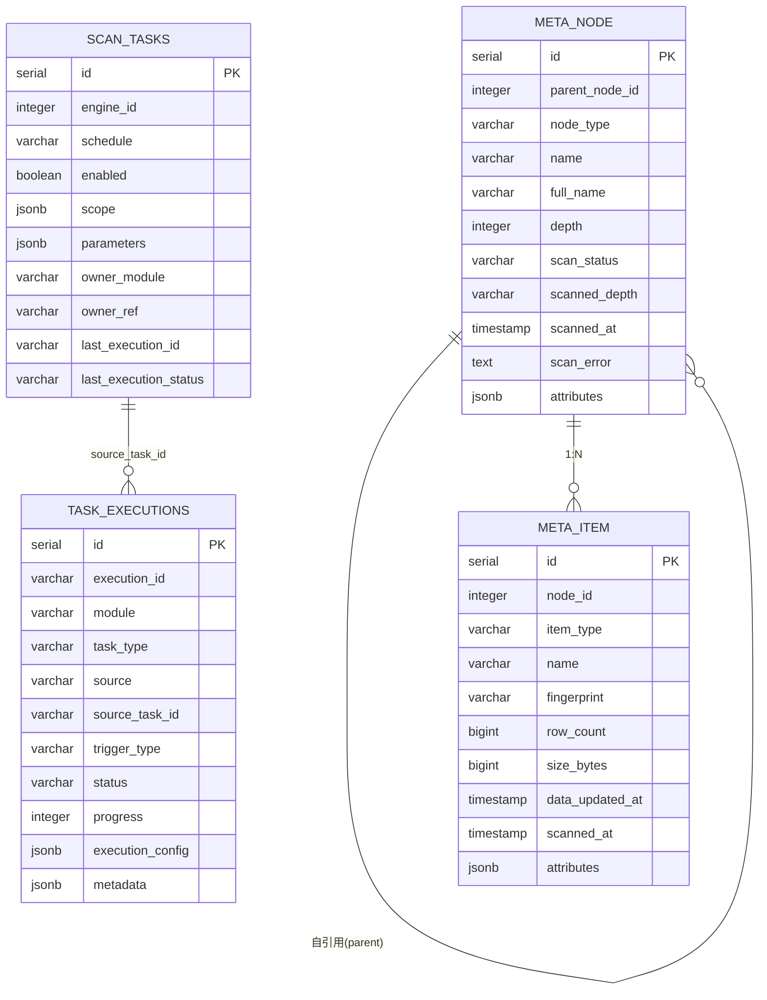
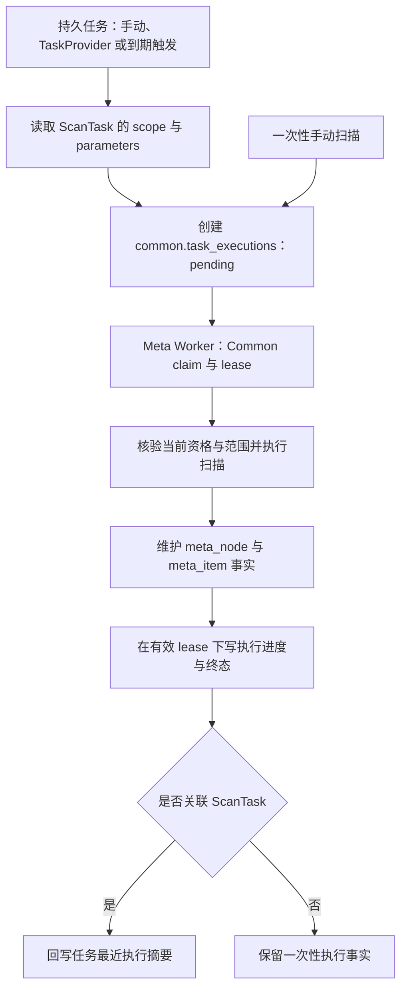

# Meta 模块数据库架构

本篇维护主表关系与扫描事实的持久化边界。字段分别见 [meta_node](tables/meta_node表.md)、[meta_item](tables/meta_item表.md)和 [scan_tasks](tables/scan_tasks表.md)；扫描、调度与资格沿[扫描机制规范](../../docs/spec/addp元数据扫描机制规范.md)，用户与机器读取沿[Meta 专业读取契约](../../docs/spec/tasks/执行监控.md#meta-专业执行读取与响应)。

## 一、模块概览

Meta 模块使用 PostgreSQL 的 `meta` schema，负责元数据的采集、存储、查询和变更追踪。

### 核心职责

- **元数据采集**：自动扫描数据源，提取表结构、文件属性等元数据
- **层级组织**：按数据源的实际层级组织节点与数据项，不固定为三层
- **定时调度**：保存扫描计划和最近摘要，每次扫描写入统一 execution
- **事实维护**：维护目录与数据项当前事实；变更记录、执行历史和操作审计各有归属

---

## 二、数据库表清单

以下列出本篇涉及的主表，不是完整 Schema 清单；字段与迁移以[模型](../backend/internal/models)及[现行 SQL 迁移](../backend/migrations)为准，行数与容量须由实际环境验证。

| 表名 | 用途 |
| --- | --- |
| `meta.meta_node` | 元数据层级节点 |
| `meta.meta_item` | 数据项及标准 attributes |
| `meta.scan_tasks` | 可复用扫描定义与最近执行摘要 |
| `common.task_executions` | Meta 的 `module=meta`、`task_type=scan` 执行事实，归 Common 存储 |

---

## 三、表关系图

### 3.1 ER图（Mermaid）

下图表达逻辑关系及代表性字段，不代替已落库的外键、唯一性或完整字段清单。

### 3.2 关系说明

**核心关系**：

- `meta_node.parent_node_id` → `meta_node.id` (自引用，树形结构)
- `meta_node.id` ← `meta_item.node_id` (1:N)
- `scan_tasks.id` ← `common.task_executions.source_task_id` (1:N，字符串软引用，仅任务定义触发时存在)
- 一次性手动扫描和 item refresh 可只写 `common.task_executions`，不要求存在 `scan_tasks` 定义。

定义与执行的租户、归属和历史读取不能仅凭这个软引用授予；实际权限与安全 DTO 沿上述专业读取契约。

---

### 3.3 租户与引擎约束

节点和数据项的 `(tenant_id, engine_id)` 引擎归属、索引与外键由[模型](../backend/internal/models)和 [009 号迁移](../backend/migrations/009_add_tenant_engine_fk.sql)声明。009 引用 `system.engines(tenant_id, id)` 并定义 `ON DELETE CASCADE`，仅描述被引用引擎行物理删除时的数据库行为，不能推导引擎软删除会自动级联，也不代替各 Owner 的清理与读取授权。

`parent_node_id` 与 `node_id` 的逻辑关系不等于已落库外键；009 没有为这两列建立父子外键，不能据此声明节点删除会自动级联到子节点或数据项。节点的部分唯一性和 item 的 fingerprint 声明分别由各表说明维护。

实际约束须核对目标数据库与已提交迁移记录。启动由 Backend 先执行模型迁移、再运行尚未登记的 SQL，详见[初始化入口](../backend/internal/repository/database.go)及[SQL Runner](../backend/internal/repository/migrations.go)；Worker 归属和标准验证沿[模块文档](../CLAUDE.md#数据库启动所有权)。009 包含不一致记录的物理清理，不能当作只读约束检查或直接重跑的修复命令；文档中的声明不证明任一目标数据库已经执行这些迁移。

---

## 四、数据流向

### 4.1 元数据扫描流程

任务定义触发与一次性扫描共享执行事实，不能将创建 `ScanTask` 作为所有扫描的前提：

扫描选择器、basic/deep、失败聚合与去重锁由[扫描机制规范](../../docs/spec/addp元数据扫描机制规范.md)维护；item 刷新使用其专属入口与已有 item 边界。`execution_config` 是执行私有配置，不作为专业响应或 Monitor 通用 DTO 返回；步骤图不表示跨表写入原子完成，也不表示任务摘要回写成功即可证明全部扫描成功。

节点范围的 `scan_status`、成功深度与成功时间分别按[节点表](tables/meta_node表.md#字段说明)解释，不能用某个 item 的刷新替代父范围扫描完成。执行终态与完成时间从 Common execution 读取，任务表只保留摘要。

---

## 五、关键设计决策

### 5.1 树形结构设计

节点通过 `parent_node_id` 表达层级，数据项通过 `node_id` 归属节点。schema、database、bucket、prefix 等实际层级由 Provider 与路径体系决定，不能将 table/file 固定为第三级，或将示意层级当作类型与深度上限；字段由上述节点表和数据项表维护。

### 5.2 软删除机制

节点和数据项使用 GORM `deleted_at` 标记软删除；重新入库匹配既有身份时，仓储实现可恢复对应记录。身份匹配与恢复分别见[节点仓储](../backend/internal/repository/scan_repository_node.go)和[数据项仓储](../backend/internal/repository/scan_repository_item.go)。

软删除不等于完整版本历史或通用误删恢复入口。重新扫描维护当前源事实，不能据此推导可还原过去内容；历史变更、执行记录与操作审计仍使用各自的存储和权限边界。

### 5.3 扫描任务调度

调度定义、范围与参数的存储语义见 [scan_tasks 表](tables/scan_tasks表.md)，Cron、层级关系及到期触发保证统一见[调度规范](../../docs/spec/addp元数据扫描机制规范.md#scantask-层级调度关系)。旧私有执行表由 [011 号迁移](../backend/migrations/011_drop_scan_task_runs.sql)移除；当前执行历史只写 Common。

### 5.4 字段优化历史

2026-01-02 的原字段优化说明已归入[历史字段优化记录](../../docs/spec/testing/evidence/资源读取与预览历史证据.md#meta-早期字段优化--历史说明未验收)。原文提到的 Migration 006 不在当前 SQL 文件清单中，未提供固定 SHA、现库报告或性能数据；该记录不用于认定当前字段数、迁移已执行或性能收益。

现行字段以各表说明和模型维护；Backend／Worker 的迁移归属、标准验证与历史证据见[模块文档](../CLAUDE.md#数据库启动所有权)和[开发与验证](../CLAUDE.md#开发与验证)。

---

## 六、相关文档

- [meta_node表](tables/meta_node表.md) - 元数据节点表
- [meta_item表](tables/meta_item表.md) - 数据项表
- [scan_tasks表](tables/scan_tasks表.md) - 扫描任务表
- [Meta 模块说明](../CLAUDE.md) - 模块整体架构
