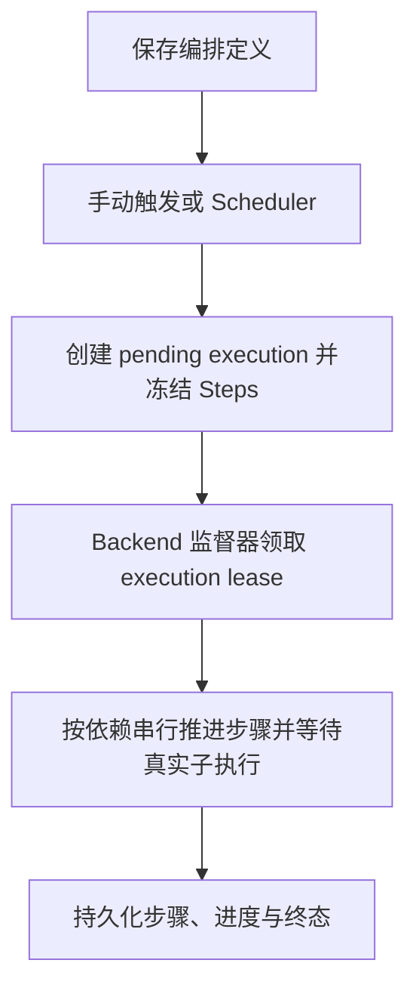

# Orchestrator 工作流编排模块

> 全域数据平台的工作流编排中枢，支持 DAG 编排、跨模块任务调用和定时调度

## 📖 文档说明

- **README.md** (本文件) - 快速入门和功能概览
- **[CLAUDE.md](./CLAUDE.md)** - 详细技术文档，包含架构设计、开发指南、常见场景和故障排查

## 🎯 核心功能

- **DAG 工作流编排**: 有向无环图任务编排，支持复杂的任务依赖关系
- **动态任务调用**: 从 System 模块动态加载 TaskProvider，无需硬编码模块 URL
- **执行参数来源**: 支持任务默认值、Step 固定值和从直接依赖步骤声明的稳定输出中选择
- **定时调度**: 基于 Cron 表达式的自动工作流触发
- **执行追踪**: 单编排页面展示步骤结果，跨编排执行统一进入 Monitor 查询

## 🚀 快速开始

### 方式 1: 开发模式（推荐）

```bash
# 启动基础设施
bash scripts/infra/up.sh

# 启动 Orchestrator 模块
bash scripts/dev/start.sh -orchestrator
```

开发首选端口统一见[端口规范](../docs/spec/addp端口分配.md)，实际地址以标准启动输出和 `.dev-state/ports.env` 为准；模块直连端口与 Console／公开访问入口分别核对。

### 方式 2: Docker 部署

产品容器部署沿[生产部署入口](../scripts/prod/README.md#startsh)，本机容器部署测试沿[Local 使用说明](../scripts/local/README.md)。镜像准备、容器状态与业务就绪按对应入口分别检查；开发修改继续使用上方原生启动脚本。

## 📡 主要 API 端点

公开管理与执行查询使用 `/api/v1/orchestrator` 前缀，定时调度配置随编排定义创建／更新保存。精确路径、方法、人用与 TaskProvider 机器入口及权限统一见[核心 API](./CLAUDE.md#核心-api)。

## 🏗️ 工作流编排流程



当前 v1 的串行执行、步骤等待、租约和不确定提交边界统一沿[执行可靠性契约](../docs/spec/tasks/编排与调度.md#orchestrator-执行可靠性)。画布操作与节点最后记录的展示见[编排编辑器交互](./CLAUDE.md#编排编辑器交互)，图示不代表并行、恢复重放或用户取消已获支持。

## 🔗 动态任务提供者支持

Orchestrator 通过 System 模块控制面中的 TaskProvider 声明和 Backend 租约实现：

- **无代码扩展**: 新增任务类型由 owner 模块随模块注册发布 TaskProvider capabilities，无需修改 Orchestrator
- **统一接口**: 所有任务提供者通过统一 TaskProvider endpoint 调用
- **清晰边界**: Orchestrator 引用任务定义，不拥有业务任务定义

## 🐛 常见问题

### 检测到循环依赖？

检查步骤的 `depends_on` 字段，确保不存在环形依赖。例如：

```json
❌ 错误: {"id": "A", "depends_on": ["B"]}, {"id": "B", "depends_on": ["A"]}
✅ 正确: {"id": "A", "depends_on": []}, {"id": "B", "depends_on": ["A"]}
```

### 任务提供者何时恢复？

Orchestrator 不缓存 TaskProvider 运行可用性，每次使用都从 System 重新解析当前有效 Backend 池，并在多个端点间稳定轮询。离线模块的声明仍会展示但不可选；对应 Backend 恢复并重新心跳后，刷新任务库即可使用，无需重启 Orchestrator。非幂等执行请求失败后不自动切换实例重放。

### 更多问题？

详见 [开发规则](./CLAUDE.md#开发规则)和[开发与验证](./CLAUDE.md#开发与验证)

## 📚 相关文档

- **[CLAUDE.md](./CLAUDE.md)** - 完整技术文档（架构、场景、故障排查）
- [编排编辑器交互](./CLAUDE.md#编排编辑器交互) - 保存、画布和本次执行状态
- [前端与编辑器验证](./CLAUDE.md#前端与编辑器验证) - 受控回归、像素组和实际验收边界
- [历史证据导航](./CLAUDE.md#历史证据导航) - 固定版本、取消与未覆盖范围
- **[数据库架构](./docs/数据库架构.md)** - 数据结构和 API 详解
- **[参数化模板说明](./docs/参数化模板说明.md)** - 参数模板化功能
- **[../system/CLAUDE.md](../system/CLAUDE.md)** - System 模块（引擎管理）
- **[../meta/CLAUDE.md](../meta/CLAUDE.md)** - Meta 模块（元数据扫描）
- **[../transfer/CLAUDE.md](../transfer/CLAUDE.md)** - Transfer 模块（数据传输）
- **[../manager/CLAUDE.md](../manager/CLAUDE.md)** - Manager 模块（数据管理）

---

Copyright © 2025 ADDP Team
