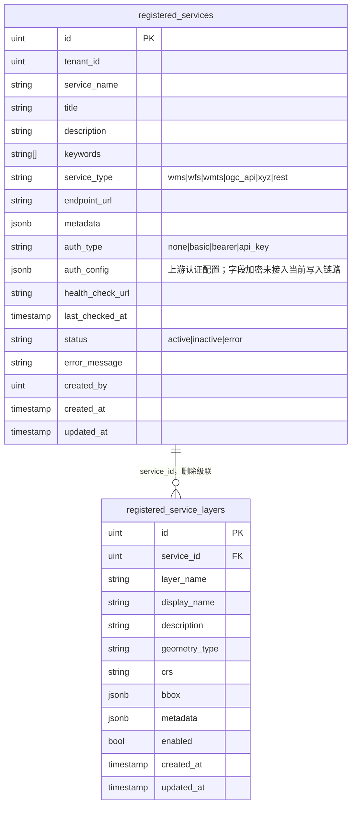

# Service 模块数据库架构

Service 使用 PostgreSQL 的 `service` schema，保存数据服务定义、外部服务注册信息及模块运行配置。本页说明当前表、对象关系和存储边界；完整字段以[模型目录](../backend/internal/models/)及[数据库初始化与迁移入口](../backend/internal/repository/database.go)为准。

阅读导航：[模块与表清单](#模块与表清单)、[注册服务关系图](#注册服务关系图)、[字段与约束](#字段与约束)、[写入与读取流程](#写入与读取流程)、[认证与访问边界](#认证与访问边界)、[待核对事项](#待核对事项)。

## 模块与表清单

服务发布覆盖查询、图查询和瓦片服务；注册服务保存第三方端点及其能力元数据。对象职责以 [Service 模块说明](../CLAUDE.md)为准。

| 表 | 对象与职责 |
| --- | --- |
| `service.query_services` | [表说明](tables/query_services表.md)。QueryService；保存 `table`、`sql` 或 `analytical` 来源、协议、消费契约和版本。发布快照由 `data_config` 保存；analytical 来源冻结 Model 指标实现修订及计划包。 |
| `service.graph_query_services` | GraphQueryService；保存图引擎、数据库、`shape` / `cypher` 来源及参数、输出配置。 |
| `service.tile_services` | [表说明](tables/tile_services表.md)。TileService；保存瓦片服务信息、范围、协议及访问设置。 |
| `service.tile_service_layers` | [表说明](tables/tile_service_layers表.md)。TileServiceLayer；以 `service_id` 归属瓦片服务，保存 `dynamic` / `static` 图层配置及显示顺序。 |
| `service.registered_services` | [表说明](tables/registered_services表.md)。RegisteredService；保存第三方服务端点、认证配置、能力元数据、健康检查状态和审计字段。 |
| `service.registered_service_layers` | [表说明](tables/registered_service_layers表.md)。RegisteredServiceLayer；以 `service_id` 归属注册服务，保存从上游能力解析的图层信息。 |
| `service.runtime_policy` | Service 自有的平台级运行配置；单行 `id=1`，保存健康检查与元数据刷新 Cron、版本和修改人。 |
| `service.catalog_resource_changes` | Service 本地的可重放变化流；当前仅发布 QueryService 的最小目录摘要，不保存企业目录身份或治理事实。 |
| `service.data_migrations` | PostgreSQL 数据迁移版本账本；由迁移入口创建，保存版本、名称和应用时间。 |

[AutoMigrate](../backend/internal/repository/database.go)登记上述八个模型，并调用 analytical 发布迁移与 Catalog 变化流迁移；`data_migrations` 是迁移账本。历史 SQL 文件不能替代当前启动迁移入口，也不能仅凭列注释确认运行能力已经实现。

Engine 连接配置归 System；企业 Catalog 身份和治理事实归 Catalog。Service 保存服务专业定义和必要的 owner 引用，不保存 `catalog_entry_id` 反向副本。APIConsumer 及其凭据归 System；它们与注册服务调用上游时使用的 `auth_config` 是不同事实。

## 注册服务关系图

下图列出当前注册服务模型字段；其他服务的业务关系见[平台 Service 元模型](../../docs/concepts/meta-model/Service.md)。图中的关联不替代具体数据库约束检查。

## 字段与约束

### 身份、租户与删除

- `service_name` 是程序标识，`title` 是显示标题，`endpoint_url` 是上游服务地址；注册服务图层使用 `layer_name` 和 `display_name`。不把显示名或 URL 当作服务 ID。
- 注册服务拥有 `tenant_id`；图层没有独立的 `tenant_id`，必须先校验所属服务的当前 Tenant，再读取或修改其图层。
- 管理详情与更新、删除使用 `id + tenant_id` 条件；名称查询与查重使用 `service_name + tenant_id`。租户来自当前 AuthContext，Platform Context 不能借普通 Repository 跨 Tenant 管理。
- 注册服务与图层的 GORM 模型没有 `DeletedAt`；当前 Repository 删除的是物理记录，没有软删除、回收或恢复流程。`inactive` 和图层 `enabled=false` 是状态标记，不提供删除或恢复语义。
- `RegisteredService.Layers` 声明 `service_id` 外键及 `OnDelete:CASCADE`，删除服务时级联删除所属图层。图层唯一键由 `service_id + layer_name` 组成；服务名的应用查重与数据库约束范围差异见[待核对事项](#待核对事项)。

### JSONB 的职责

| 字段 | 保存的事实与使用边界 |
| --- | --- |
| `registered_services.metadata` | 上游能力文档、解析出的服务信息及刷新时间；具体结构由 WMS、WFS、WMTS、OGC API 解析路径决定。REST / XYZ 不因注册就自动形成 GetCapabilities 图层。 |
| `registered_services.auth_config` | `auth_type` 对应的上游调用参数；当前 JSONB 编解码只是 JSON 序列化，不是字段加密。 |
| `registered_service_layers.bbox` | 协议解析的字符串坐标对象；形状、CRS 关联与未验证范围统一见[几何、范围与能力](tables/registered_service_layers表.md#几何范围与能力)，不当作统一四元素数值数组。 |
| `registered_service_layers.metadata` | 保存 WMS queryable/styles、WMTS tile_matrix_set 标识等解析值；不替代图层稳定身份或完整网格定义。 |

几何、CRS、BBox 与 TileMatrixSet 的各协议保存范围统一沿上述图层说明；原始能力文档、结构化解析值与实际地图验收分别核对，缺失值不补造，单个网格标识不能证明坐标系与瓦片定位已验证。

### 索引与读取

注册模型的索引名称及唯一约束分别由[注册服务表](tables/registered_services表.md#索引与约束)和[注册图层表](tables/registered_service_layers表.md#索引与约束)维护；具体创建结果由迁移验证。

Repository 按当前 Tenant 查询主表，并通过 `Preload("Layers")` 读取图层；详情先限定 `id + tenant_id`。列表按 `created_at DESC` 排列，名称/标题搜索使用 `ILIKE`，统计与分页仍由 Repository 执行。普通注册列表查询不承诺仅加载启用图层；限定 `enabled=true` 的读取使用对应图层查询方法。

这里保留查询行为和索引事实，具体 SQL/GORM 写法以[注册服务 Repository](../backend/internal/repository/registered_service_repository.go)为准，避免文档维护第二套查询实现。

## 写入与读取流程

### 注册与元数据刷新

创建先在当前 Tenant 查重，保存初始 `active` 的注册记录，再重新读取 DTO；创建成功不等于能力刷新完成。各入口的刷新与状态处理如下，具体用例见[元数据刷新核对](testing/注册服务与代理.md#元数据刷新核对)：

| 入口 | 实际调用与状态处理 | 返回结果的边界 |
| --- | --- | --- |
| 创建后自动刷新 | 仅在 OGC 类型且 `auto_refresh_metadata=true` 时异步调用 `refreshOGCMetadata`；失败只记日志，不经 `RefreshMetadata` 回写 error/active | 创建成功不等待图层完成，也不因异步失败回滚服务；初始 active 不能证明刷新成功 |
| 手动刷新 | 当前 Tenant 与 `service.external_registration.update` Permission 下，按 `id + tenant_id` 读取，不筛原状态；调用 `RefreshMetadata` | 不支持的 REST / XYZ 返回 400；OGC 刷新及状态回写的结果见下文 |
| 定时刷新 | 模块已注册时按 Tenant 串行处理 active 的 WMS / WFS / WMTS / OGC API，调用同一 `RefreshMetadata` | 调度成功计数依据方法返回值，不是成功写入图层数；error/inactive 不由该循环重试 |

当前 OGC 刷新使用已保存的上游认证，单次 HTTP 请求超时 30 秒，只接受上游 HTTP 200。WMS / WFS / WMTS 读取 GetCapabilities，OGC API 读取 `/collections`；解析与各类型图层写入方式唯一见[图层解析与刷新](tables/registered_service_layers表.md#解析与刷新)。`force` 当前未参与刷新分支，不能据请求字段推导已有强制重建或跳过缓存策略。

`RefreshMetadata` 分别处理刷新结果与服务状态回写：

- 刷新报错时，尝试写 `status=error` 和错误信息，忽略这次回写错误后返回原刷新错误；此前可能已保存部分数据，不能承诺仍为旧快照。
- 刷新返回 nil 时，再写 `status=active`，并返回这次写入错误。因此，部分图层错误未上抛时手动接口仍可能返回 HTTP 200；元数据已更新但最终状态写入失败时，可能返回 500（记录不存在时为 404）。
- 手动刷新 inactive 的 OGC 服务成功后也会尝试改为 active；旧 `error_message` 可能保留，原因见[健康检查与状态回写说明](#健康检查与定时刷新)。刷新不更新健康检查专用的 `last_checked_at`。

上游 HTTP、父服务 metadata、图层写入与最终状态更新没有共同事务、并发刷新锁或失败回滚。`metadata.refreshed_at` 在图层处理前生成，不能作为完成时间或持久化回执；读者可能看到新 metadata 配旧图层、空图层或部分新图层。实现依据为[注册服务 Service](../backend/internal/service/registered_service_service.go)和[Repository](../backend/internal/repository/registered_service_repository.go)。

### 健康检查与定时刷新

Service 启动时读取本模块 `runtime_policy`；未持久化配置时，健康检查默认 `0 * * * *`，元数据刷新默认 `0 2 * * *`。持久配置更新按重启生效，规则沿[平台配置规范](../../docs/spec/addp配置介绍.md)。定时入口仅在模块已注册时执行，按 Tenant 串行处理 `status=active` 的服务；写为 `error` 后不会由该循环继续探测，`inactive` 也不参与，不能据此承诺自动恢复或熔断。

手动健康接口使用当前 Tenant 与 `service.external_registration.read` Permission，按 `id + tenant_id` 读取，不筛原状态，再尝试回写检查时间和状态。探测优先使用 `health_check_url`；为空时 WMS / WFS / WMTS 构造 GetCapabilities，其他类型使用 `endpoint_url`。请求为 GET，按 `auth_type` 装配上游认证，超时 10 秒；结果仅按 HTTP 请求及状态判断，不解析能力正文。

| 上游探测条件 | `HealthCheckResult.status` | 尝试写入的服务持久状态 |
| --- | --- | --- |
| 取得 2xx 响应 | `healthy` | `active` |
| 非 2xx、请求失败或超时 | `unhealthy` | `error`，同时写入结果 `message` |
| HTTP 请求构造失败 | `error` | `error`，同时写入结果 `message` |

正常取得探测结果即返回 HTTP 200，包括 `unhealthy/error`，不表示上游健康或回写成功。`response_time` 计至上游响应返回，不读取完整响应体；`checked_at` 是结果初始化时的应用时间，`last_checked_at` 则在探测后用数据库 `NOW()` 单独更新，二者不是同一时刻。

当前按 `UpdateHealthCheck` → `UpdateStatus` 顺序独立写入，没有共同事务且两次错误均被忽略，可能仅一项成功。恢复 `active` 时传入空错误字符串，但 Repository 只在非空时更新 `error_message`，所以旧错误信息可能保留；原为 `inactive` 的服务手动检查成功也会尝试改为 `active`。

创建和元数据刷新也会写入 `active`，所以持久状态不是最近一次健康结果的专用快照；公开代理按 ID 读取、不筛 `status`，`active` 不授予消费权，`inactive/error` 也不保证阻断请求。授权缺口见[管理面与公开代理](#管理面与公开代理)。健康结果或刷新成功均不证明图层、数据或消费授权已通过，本节也不等同于 Service 进程的[存活与就绪端点](../../docs/spec/api/健康与平台控制面.md#进程存活与模块就绪端点)。

调度、探测与回写依据分别为[服务启动入口](../backend/cmd/server/main.go)、[注册服务 Service](../backend/internal/service/registered_service_service.go)和[Repository](../backend/internal/repository/registered_service_repository.go)。这里的固定模块维护调度不等于对外声明 TaskProvider 任务。

探测结果、检查时间与持久状态的回读及失败用例见[健康结果与状态回写核对](testing/注册服务与代理.md#健康结果与状态回写核对)；实际覆盖范围遵循[统一验收边界](API测试指南.md#能力与验收边界)。

### 代理读取

公开代理按注册服务 ID 读取上游端点与认证配置，再请求上游；请求缓冲、响应流式转发及超时的唯一说明见[代理请求链路](外部服务架构设计.md#当前入口与请求链路)。调用身份与消费授权见[管理面与公开代理](#管理面与公开代理)，凭据装配与保护见[上游认证配置](#上游认证配置)。

地址来源、Backend 直连与统一入口、错误按[代理读取与错误](testing/注册服务与代理.md#代理读取与错误)核对；请求体完整转发、客户端响应完整性及已发送响应后的中断失败按[请求与响应完整性核对](testing/注册服务与代理.md#请求与响应完整性核对)验收。日志事实及尚未接通的审计、调用统计见[代理日志边界](外部服务架构设计.md#代理日志边界)。

## 认证与访问边界

### 上游认证配置

上游凭据由注册配置的 `auth_type/auth_config` 提供，供健康检查、能力刷新及代理请求的 `addAuthToRequest` 使用；它与 ADDP User Token、Service Access Token、API Consumer Credential 分开，不授予调用者消费权限。各类型及三条调用路径的验证统一见[上游认证矩阵](testing/注册服务与代理.md#上游认证矩阵)。

| `auth_type` | 当前装配行为 | 独有约束 |
| --- | --- | --- |
| `none` | 不额外装配认证 | 不清除已经存储的 auth_config，也不是清理所有入站 Header/Query 的开关 |
| `basic` | username、password 均为字符串时，将 `username:password` 作 Base64 编码后写入 `Authorization: Basic ...` | Base64 不是加密；不校验非空、用户名中的分隔符或上游凭据有效性 |
| `bearer` | token 为字符串时写入 `Authorization: Bearer <token>` | 固定添加 Bearer 前缀，不解析 Token、验证有效期或自动获取/刷新 Token；不是平台用户认证 |
| `api_key` | key、name、location 均为字符串时，`location=header` 用 Header.Set(name,key)，`location=query` 用 Query.Add(name,key) | Header 覆盖同名值，Query 追加而非替换，可能保留客户端已有同名参数；location 只识别这两个值，不使用旧 api_key/header 参数别名 |

请求 DTO 只约束 auth_type 枚举，不按类型验证 auth_config 的必填字段、非空值或 Header/Query 名称。装配函数不返回认证配置错误；字段缺失、类型不符或 location 未命中时可能不装配凭据，而非在本地拒绝请求。配置保存或请求已发出均不证明上游认证成功。

创建时缺省类型为 none，配置直接保存。更新时 auth_config 缺省或 null 不修改原配置，提供对象则整体替换，不逐字段合并；只改 auth_type 为 none 不自动删除旧凭据。编辑页不回填凭据，不能将空输入当作已确认保留原值的契约。`has_auth_config` 仅由配置对象是否非空计算，不证明字段完整、当前类型匹配或凭据可用。

管理 DTO 的字段与端点投影沿[注册服务表说明](tables/registered_services表.md)维护；隐藏 `auth_config` 不表示 URL 或上游内容已脱敏。浏览器身份、CORS 与实际读取统一按[原始端点与浏览器直连核对](testing/注册服务与代理.md#原始端点与浏览器直连核对)验收，展示或服务端探测成功不代替浏览器直连证据。

当前 JSONB 编解码只有 JSON 序列化/反序列化，创建、更新和读取没有字段加解密步骤；不能据 ENCRYPTION_KEY 存在推导注册凭据已加密，密钥归属、加密与轮换仍须单独确认。

该调用链未强制 HTTPS，也未增加应用级重定向目标检查；统一入口 HTTPS 不证明 Service → 上游已使用 TLS。Query API Key 会进入实际上游 URL，地址、响应 Header/正文和日志的保护须分别核验，遵循[认证凭据日志边界](../../docs/spec/addp登录认证的统一要求.md#24-认证凭据日志边界)；日志用例见[代理日志核对](testing/注册服务与代理.md#代理日志核对)，实际消息与字段见[代理日志边界](外部服务架构设计.md#代理日志边界)。DTO 隐藏或部分 Header 过滤不替代完整保护验收。

### 管理面与公开代理

- 管理面执行 `service.external_registration.*` 的精确 Permission 与 Tenant 校验；这不等于注册服务的所有消费入口都具有相同校验。
- 公开代理的 ID 读取、Tenant/status 校验缺口及 SSRF、DNS、重定向边界统一见[外部服务访问边界](外部服务架构设计.md#认证租户与传输边界)；日志上下文不授予资源权限，注册记录也不构成网络安全白名单。

统一身份与凭据分类见[API 认证与授权规范](../../docs/spec/api/认证授权.md)。匿名、跨 Tenant、停用状态不能套用管理 API 的拒绝结论，凭据装配或管理回归也不证明消费授权；Backend/Gateway 入口、传输完整性与中断失败的测试导航统一见[代理读取](#代理读取)。

## 待核对事项

| 事项 | 现有依据与未确认范围 |
| --- | --- |
| 服务名唯一范围 | Repository 按 `tenant_id + service_name` 查重；历史建表 SQL 也声明这一复合唯一约束，但当前 GORM `unique_registered_service_name` 只标注在 `service_name`。需确认实际约束和跨 Tenant 同名策略，不能仅凭应用查重断言数据库保证租户内唯一。 |
| 刷新一致性与失败恢复 | 当前分步更新元数据和图层；原子替换、并发刷新及失败补偿尚需单独确认，不能使用示意事务代码充当实现证据。 |

注册凭据的写入、读取与保护现状见[上游认证配置](#上游认证配置)，不能从查询游标等其他加密用途推导注册凭据已加密。存储保护、密钥与轮换、代理调用主体/服务范围、上游目标/重定向和正式审计的待确认事项统一由[外部服务专题](外部服务架构设计.md#后续事项与确认边界)维护；跨服务类型的授权、配额/统计、监控与恢复见[能力清单](service后续能力清单.md#待确认范围)。

扩展服务类型或认证方式时，应同时核对请求校验、模型约束、能力解析、代理装配和管理 DTO；只增加枚举或未接线的示例函数不代表能力已经可用。当前服务类型不包含 GeoPackage，上游认证类型不包含 OAuth2。

## 相关文档

- [Service 模块说明](../CLAUDE.md)：当前模块职责、管理入口和验证方式。
- [平台 Service 元模型](../../docs/concepts/meta-model/Service.md)：服务与图层的业务对象关系。
- [注册服务模型](../backend/internal/models/registered_service.go)、[注册服务 Repository](../backend/internal/repository/registered_service_repository.go)、[注册服务 Service](../backend/internal/service/registered_service_service.go)：字段与实现事实。
- [运行配置模型](../backend/internal/models/runtime_policy.go)：平台级配置范围与版本。
- [数据库初始化与迁移入口](../backend/internal/repository/database.go)：当前表登记、数据迁移和目录变化捕获。
